# HKDSE 卷一 歷屆試題分類彙編（2012–2025）

> [!info] 說明
> 本檔案收錄 **2012–2025** 年香港中學文憑考試數學（必修部分）卷一全部 **267 道**試題，
> 按考點大類分類，每類下再按年份排列：
>
> | 類別 | 題數 | 說明 |
> |---|---|---|
> | **代數** | 134 | 方程、不等式、數列、多項式、變分、對數、百分法等 |
> | **幾何** | 75 | 三角形/圓的性質、坐標幾何、立體幾何、度量、三角學 |
> | **統計** | 47 | 集中趨勢、離散度、統計圖、**概率與排列組合** |
> | **組合（跨領域）** | 11 | 融合兩個或以上大類的綜合題 |
>
> 概率與排列組合歸入**統計**（HKDSE「數據與概率」範疇）。題目為原文繁體，
> 分題沿用 (a)、(b)、(i)、(ii) 標號。

> [!note] 快速導覽
> - [[#代數（134題）|代數]]
> - [[#幾何（75題）|幾何]]
> - [[#統計（47題）|統計]]
> - [[#組合（跨領域綜合）（11題）|組合（跨領域綜合）]]

---

## 代數（134題）

### 2012年（8題）

**1. 【2012 Q1】（3分）**　*指數運算、負指數轉換*

　化簡 $\frac{m^{-12}n^{8}}{n^{3}}$，並以正指數表示答案。

---

**2. 【2012 Q2】（3分）**　*主項變換、代數方程*

　令 $a$ 成為公式 $\frac{3a+b}{8}=b-1$ 的主項。

---

**3. 【2012 Q3】（3分）**　*因式分解、完全平方公式*

　因式分解

　(a) $x^{2}-6xy+9y^{2}$
　(b) $x^{2}-6xy+9y^{2}+7x-21y$

---

**4. 【2012 Q4】（4分）**　*百分數應用、比較大小*

　佩玲的日薪較志偉高 $20\%$，而志偉的日薪較潔儀低 $20\%$。已知志偉的日薪為 $480。

　(a) 求佩玲的日薪。
　(b) 誰的日薪最高？試解釋你的答案。

---

**5. 【2012 Q5】（4分）**　*一元一次方程、實際應用*

　在設有6個展區的展覽中心內有132名保安員。各個展區均有相同人數的保安員。在每個展區內，
　女保安員均較男保安員多4名。求在該展覽中心內男保安員的人數。

---

**6. 【2012 Q6】（4分）**　*不等式組、解的集合*

　(a) 求同時滿足 $\dfrac{4x+6}{7} > 2(x-3)$ 及 $2x-10 \leq 0$ 的 $x$ 值的範圍。
　(b) 有多少個正整數同時滿足(a)的不等式？

---

**7. 【2012 Q13】（7分）**　*因式定理、二次函數、長方形面積*

　(a) 求$k$的值使得$x-2$為$kx^3-21x^2+24x-4$的因式。　(2分)

　(b) 圖 4 顯示$y=15x^2-63x+72$的圖像。$Q$為第一象限內圖像上的可變點。$P$及$R$分別為由$Q$至$x$軸及$y$軸的垂足。

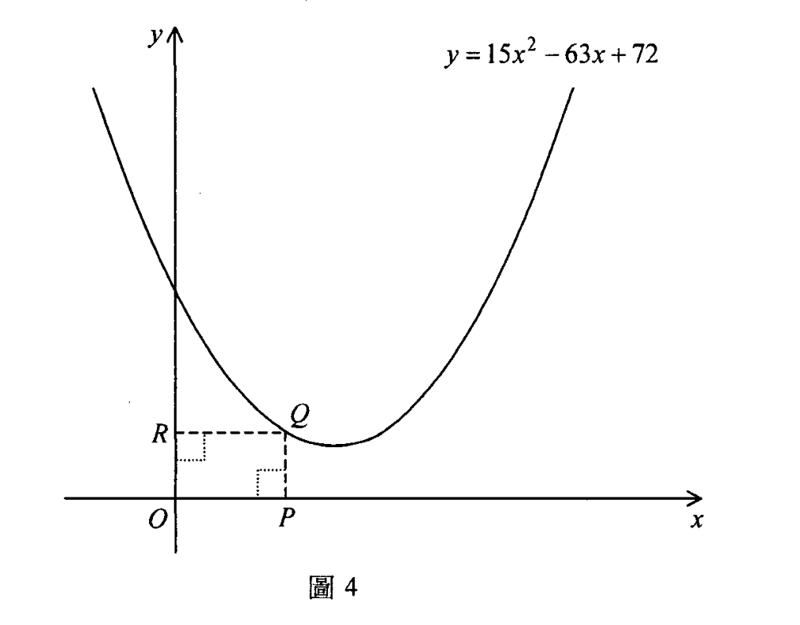

　　(i) 設$(m,0)$為$P$的坐標。以$m$表長方形$OPQR$的面積。
　　(ii) $Q$是否有三個不同的位置使得長方形$OPQR$的面積為12？試解釋你的答案。　(5分)

---

**8. 【2012 Q19】（13分）**　*指數函數應用、數列求和、實際問題*

　在某城市，一機場的空運貨站$X$自它開始運作起計的第$n$年所處理的貨物的重量為$A(n)$公噸，
　其中$n$為一正整數。已知$A(n) = ab^{2n}$，其中$a$及$b$均為正常數。
　現知$X$自它開始運作起計的第1年及第2年所處理的貨物的重量分別為254100公噸及307461公噸。

　(a)

　　(i) 求 $a$ 及 $b$。 由此求$X$自它開始運作起計的第4年所處理的貨物的重量。
　　(ii) 以$n$表$X$自它開始運作起計的首$n$年所處理的貨物的總重量。　(6分)

　(b) 自$X$運作了4年，空運貨站$Y$開始運作。設$B(m)$公噸為$Y$自它開始運作起計的第$m$年所處理的貨物的重量，其中$m$為一正整數。已知$B(m) = 2ab^{2m}$。

　　(i) 該機場的經理宣稱於$Y$運作後，每一年$Y$所處理的貨物的重量均較$X$所處理的少。你是否同意？試解釋你的答案。
　　(ii) 該機場的監督認為當$X$和$Y$所處理的貨物自$X$開始運作起計的總重量超出$20\,000\,000$公噸時，應安裝新設施以維持空運貨站的工作效能。根據該監督的想法，自$X$開始運作起計的哪一年應安裝新設施？　(7分)

---

### 2013年（10題）

**1. 【2013 Q1】（3分）**　*指數運算（負指數、分式化簡）*

　化簡 $\dfrac{x^{20}y^{13}}{(x^5y)^6}$，並以正指數表示答案。

---

**2. 【2013 Q2】（3分）**　*公式變換（主項）*

　令 $k$ 成為公式 $\dfrac{3}{h} - \dfrac{1}{k} = 2$ 的主項。

---

**3. 【2013 Q3】（3分）**　*因式分解（平方差、分組分解）*

　因式分解

　(a) $4m^2 - 25n^2$。　(1分)

　(b) $4m^2 - 25n^2 + 6m - 15n$。　(2分)

---

**4. 【2013 Q4】（4分）**　*聯立方程（應用題）*

　7 個梨和 3 個橙的價錢為 \$47，而 5 個梨和 6 個橙的價錢為 \$49。求一個梨的價錢。

---

**5. 【2013 Q5】（4分）**　*不等式（解不等式、整數解）*

　(a) 解不等式 $\dfrac{19 - 7x}{3} > 23 - 5x$。
　(b) 求所有能同時滿足不等式 $\dfrac{19 - 7x}{3} > 23 - 5x$ 及不等式 $18 - 2x \ge 0$ 的整數。

---

**6. 【2013 Q8】（5分）**　*絕對誤差（有效數字、總重量估算）*

　若一包海鹽的重量量得 $100\text{ g}$ 準確至最接近的 $\text{g}$，則稱它為普通裝。

　(a) 求一包普通裝海鹽的最小可取重量。
　(b) $32$ 包普通裝海鹽之總重量有沒有可能量得 $3.1\text{ kg}$ 準確至最接近的 $0.1\text{ kg}$？試解釋你的答案。

---

**7. 【2013 Q11】（6分）**　*變分法（正變/正平方變）*

　一周界為 $\ell$ 米的托盤的重量為 $W$ 克。已知 $W$ 為兩部分之和，一部分隨 $\ell$ 正變，另一部分隨 $\ell^2$ 正變。當 $\ell = 1$ 時，$W = 181$；且當 $\ell = 2$ 時，$W = 402$。

　(a) 求一周界為 $1.2$ 米的托盤的重量。　(4分)

　(b) 若一托盤的重量為 $594$ 克，求該托盤的周界。　(2分)

---

**8. 【2013 Q12】（7分）**　*多項式因式分解、質數根判斷*

　設 $f(x)=3x^{3}-7x^{2}+kx-8$，其中 $k$ 為一常數。已知 $f(x)=(x-2)(ax^{2}+bx+c)$，其中 $a$、$b$ 及 $c$ 均為常數。

　(a) 求 $a$、$b$ 及 $c$。　(4分)

　(b) 某人宣稱方程 $f(x)=0$ 所有的根均為質數。你是否同意？試解釋你的答案。　(3分)

---

**9. 【2013 Q17】（6分）**　*二次函數、配方法、面積最值*

　(a) 設 $f(x)=36x-x^2$。利用配方法，求 $y=f(x)$ 的圖像的頂點的坐標。　(2分)

　(b) 一條繩子的長度為 $108\,\text{m}$。某保安員將該繩子分割為兩條。一條用作圍成一面面積為 $A\,\text{m}^2$ 的長方形禁區；另一條長度為 $x\,\text{m}$，且用作將這禁區分成兩長方形區域，如圖 2 所示。

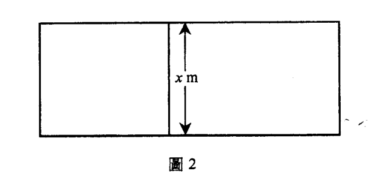

　　(i) 以 $x$ 表 $A$。
　　(ii) 該保安員宣稱這禁區的面積可大於 $500\,\text{m}^2$。你是否同意？試解釋你的答案。　(4分)

---

**10. 【2013 Q19】（13分）**　*數列（遞推、等比、求和）*

　現對某城市公共房屋的發展進行研究。已知第 $1$ 年年終時所有公屋單位的總樓面面積為 $9\times10^6\ \text{m}^2$，並且在隨後各年裏，每年所落成的公屋單位的總樓面面積均為前一年年終時全部公屋單位的總樓面面積之 $r\%$，其中 $r$ 為一常數，而每年所拆卸的公屋單位的總樓面面積均為 $3\times10^5\ \text{m}^2$。現知第 $3$ 年年終時所有公屋單位的總樓面面積為 $1.026\times10^7\ \text{m}^2$。

　(a)

　　(i) 以 $r$ 表第 $2$ 年年終時所有公屋單位的總樓面面積。
　　(ii) 求 $r$。　(4分)

　(b)

　　(i) 以 $n$ 表第 $n$ 年年終時所有公屋單位的總樓面面積。
　　(ii) 哪一年年終時所有公屋單位的總樓面面積會首次超過 $4\times10^7\ \text{m}^2$？　(5分)

　(c) 現假設第 $n$ 年年終時所需公屋單位的總樓面面積為 $(a(1.21)^n+b)\ \text{m}^2$，其中 $a$ 及 $b$ 均為常數。某些研究結果顯示下列資料：

| $n$ | 第 $n$ 年年終時所需公屋單位的總樓面面積 ($\text{m}^2$) |
|---|---|
| $1$ | $1\times10^7$ |
| $2$ | $1.063\times10^7$ |

　　一研究助理宣稱基於上述假設，某年年終時所有公屋單位的總樓面面積會大於所需公屋單位的總樓面面積。該宣稱是否正確？試解釋你的答案。　(4分)

---

### 2014年（10題）

**1. 【2014 Q1】（3分）**　*指數定律，化簡代數式*

　化簡 $\dfrac{(xy^{-2})^{3}}{y^{4}}$，並以正指數表示答案。

---

**2. 【2014 Q2】（3分）**　*因式分解（二次式及分組分解）*

　因式分解

　(a) $a^{2} - 2a - 3$。
　(b) $ab^{2} + b^{2} + a^{2} - 2a - 3$。

---

**3. 【2014 Q3】（3分）**　*近似與誤差（上捨入、四捨五入、下捨入）*

　(a) 將 $123.45$ 上捨入至一位有效數字。
　(b) 將 $123.45$ 捨入至最接近的整數。
　(c) 將 $123.45$ 下捨入至一位小數。

---

**4. 【2014 Q5】（4分）**　*主項變換*

　考慮公式 $2(3m + n) = m + 7$。

　(a) 令 $n$ 成為上述公式的主項。
　(b) 若 $m$ 的值增加 $2$，寫出 $n$ 的值的改變。

---

**5. 【2014 Q6】（4分）**　*百分法，盈利與虧蝕*

　某玩具的標價為 $\$255$。該玩具現以其標價六折售出。

　(a) 求該玩具的售價。
　(b) 若盈利百分率為 $2\%$，求該玩具的成本。

---

**6. 【2014 Q7】（5分）**　*多項式除法，因式定理，有理根判定*

　設 $f(x) = 4x^{3} - 5x^{2} - 18x + c$，其中 $c$ 為一常數。當 $f(x)$ 除以 $x - 2$ 時，餘數為 $-33$。

　(a) $x + 1$ 是否 $f(x)$ 的因式？試解釋你的答案。　(2分)

　(b) 某人宣稱方程 $f(x) = 0$ 所有的根均為有理數。你是否同意？試解釋你的答案。　(3分)

---

**7. 【2014 Q10】（6分）**　*速率，距離—時間圖像分析*

　$X$ 城與 $Y$ 城相距 $80\ \mathrm{km}$。圖 2 顯示在某上午 7:30 至 9:30 期間，在 $X$ 城與 $Y$ 城之間的同一直路上汽車 $A$ 及汽車 $B$ 行駛的圖像。汽車 $A$ 在該期間以恆速率行駛。汽車 $B$ 於該上午 8:15 停下。

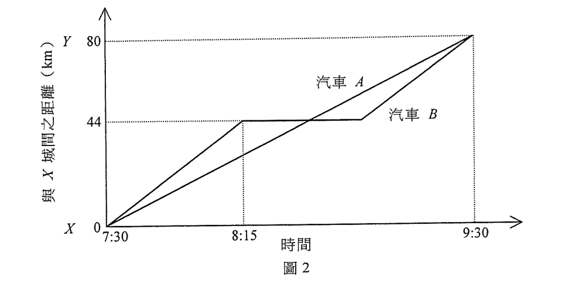

　(a) 求於該上午 8:15 汽車 $A$ 與 $X$ 城間之距離。　(2分)

　(b) 在該上午 7:30 之後，汽車 $A$ 與汽車 $B$ 於甚麼時間首次相遇？　(2分)

　(c) 汽車 $B$ 的司機宣稱在該上午 8:15 至 9:30 期間，汽車 $B$ 的平均速率較汽車 $A$ 高。你是否同意？試解釋你的答案。　(2分)

---

**8. 【2014 Q15】（3分）**　*對數，線性關係（log-log 圖像）*

　設 $x > 0$ 及 $y > 0$。已知當 $\log_4 x$ 對 $\log_8 y$ 的圖像是一條直線。該直線的斜率為 $-\dfrac{1}{3}$，且橫截距為 $3$。若 $y = Ax^k$，其中 $A$ 及 $k$ 為常數，求 $A$ 及 $k$。

---

**9. 【2014 Q16】（4分）**　*數列（等差數列），求和*

　某圖案用點組成。圖 5(a) 顯示了首 3 個圖案。已知第 1 個圖案有 3 個點，隨後每個圖案的點數均較前一圖案多 $2$ 個。

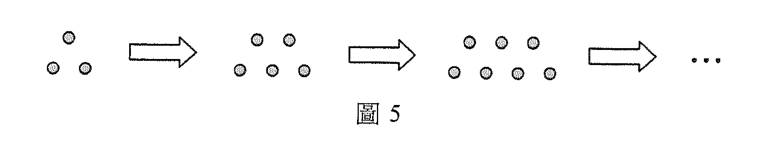

　(a) 求第 6 個圖案的點數。　(1分)

　(b) 求使首 $m$ 個圖案的總點數超過 $6888$ 的最小的 $m$ 值。　(3分)

---

**10. 【2014 Q18】（8分）**　*線性規劃*

　圖 7 中，直線 $L_1: 6x + 7y = 900$ 與直線 $L_2$ 的交點為 $(45, 90)$。$L_2$ 的 $x$ 截距為 $180$。陰影區域（包括邊界在內）為一些不等式的解。

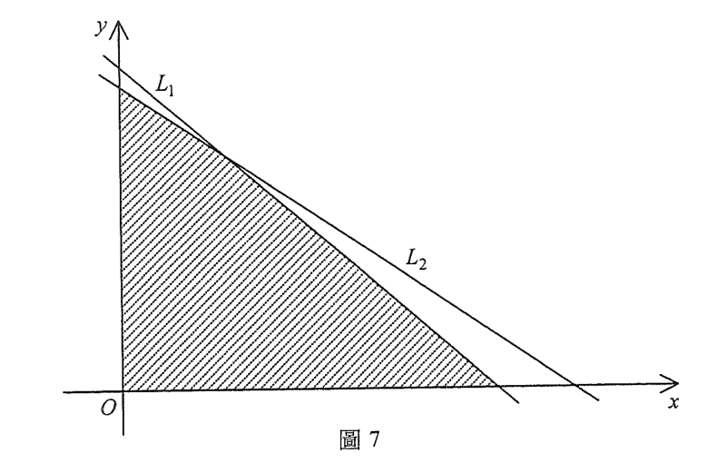

　(a) 寫出該些不等式。　(4分)

　(b) 某工廠每月製造 $x$ 件產品 $X$ 及 $y$ 件產品 $Y$。在製造過程中，每件 $X$ 所需機器工時及所需人手工時分別為 $2$ 小時及 $3$ 小時，而每件 $Y$ 所需機器工時及所需人手工時分別為 $3$ 小時及 $2$ 小時。已知每月的機器總工時及工人總工時的上限分別為 $900$ 小時及 $900$ 小時。每件 $X$ 的利潤為 $\$800$，而每件 $Y$ 的利潤為 $\$1000$。

　　某人宣稱該工廠的月總利潤可超過 $\$80 000$。你是否同意？試解釋你的答案。　(4分)

---

### 2015年（10題）

**1. 【2015 Q1】（3分）**　*指數運算*

　化簡 $\dfrac{m^9}{(m^3 n^{-7})^5}$，並以正指數表示答案。

---

**2. 【2015 Q2】（3分）**　*公式變換*

　令 $b$ 成為公式 $\dfrac{4a+5b-7}{b}=8$ 的主項。

---

**3. 【2015 Q4】（4分）**　*因式分解*

　因式分解

　(a) $x^3+x^2y-7x^2$，
　(b) $x^3+x^2y-7x^2-x-y+7$。

---

**4. 【2015 Q5】（4分）**　*一元一次不等式*

　(a) 求同時滿足 $\dfrac{7-3x}{5}\leq 2(x+2)$ 及 $4x-13>0$ 的 $x$ 值的範圍。
　(b) 寫出同時滿足 (a) 的不等式的最小整數。

---

**5. 【2015 Q6】（4分）**　*成本、盈利與折扣*

　某書的成本為 \$250。現售出該書且盈利百分率為 $20%$。

　(a) 求該書的售價。
　(b) 若該書以其標價七五折售出，求該書的標價。

---

**6. 【2015 Q7】（4分）**　*代數文字題*

　佩玲擁有蘋果的數目為志偉擁有的 $4$ 倍。若佩玲將她其中的 $12$ 個蘋果送給志偉，他們將擁有相同數目的蘋果。求佩玲和志偉擁有蘋果的總數。

---

**7. 【2015 Q10】（6分）**　*正變與常數*

　當嘉娜在某月售出 $n$ 個手袋時，她該月的收入是 $\$S$。已知 $S$ 為兩部分之和，一部分為常數，而另一部分隨 $n$ 正變。當 $n=10$ 時，$S=10 600$；當 $n=6$ 時，$S=9 000$。

　(a) 當嘉娜在某月售出 20 個手袋時，求她該月的收入。　(4分)

　(b) 當嘉娜在某月售出若干個手袋時，她該月的收入有沒有可能是 $\$18 000$？試解釋你的答案。　(2分)

---

**8. 【2015 Q11】（6分）**　*多項式餘式定理*

　設 $f(x)=(x-2)^2(x+h)+k$，其中 $h$ 及 $k$ 均為常數。當 $f(x)$ 除以 $x-2$ 時，餘數為 $-5$。已知 $f(x)$ 可被 $x-3$ 整除。

　(a) 求 $h$ 及 $k$。　(3分)

　(b) 某人宣稱方程 $f(x)=0$ 所有的根均為整數。你是否同意？試解釋你的答案。　(3分)

---

**9. 【2015 Q17】（5分）**　*等差數列求和、對數*

　對任意正整數 $n$，設 $A(n) = 4n - 5$ 及 $B(n) = 10^{4n-5}$。

　(a) 以 $n$ 表 $A(1) + A(2) + A(3) + \cdots + A(n)$。　(2分)

　(b) 求 $n$ 的最大值使得 $\log(B(1)B(2)B(3)\cdots B(n)) \leq 8000$。　(3分)

---

**10. 【2015 Q18】（9分）**　*二次函數、配方法、圖像幾何*

　設 $f(x) = 2x^2 - 4kx + 3k^2 + 5$，其中 $k$ 為一實常數。

　(a) $y = f(x)$ 的圖像是否與 $x$ 軸相交？試解釋你的答案。　(2分)

　(b) 利用配方法，以 $k$ 表 $y = f(x)$ 的圖像的頂點的坐標。　(3分)

　(c) 在同一直角坐標系中，設 $S$ 及 $T$ 分別為 $y = f(x)$ 的圖像及 $y = 2 - f(x)$ 的圖像上的動點。將原點記為 $O$。某人宣稱當 $S$ 與 $T$ 最接近時，$\triangle OST$ 的外心在 $x$ 軸上。該宣稱是否正確？試解釋你的答案。　(4分)

---

### 2016年（10題）

**1. 【2016 Q1】（3分）**　*指數律（以正指數表示答案）*

　化簡 $\dfrac{(x^{8}y^{7})^{2}}{x^{5}y^{-6}}$，並以正指數表示答案。

---

**2. 【2016 Q2】（3分）**　*公式變形（主項）*

　令 $x$ 成為公式 $Ax=(4x+B)C$ 的主項。

---

**3. 【2016 Q3】（3分）**　*分式化簡*

　化簡 $\dfrac{2}{4x-5}+\dfrac{3}{1-6x}$。

---

**4. 【2016 Q4】（4分）**　*因式分解（提取公因式、二次、分組分解）*

　因式分解

　(a) $5m-10n$，
　(b) $m^{2}+mn-6n^{2}$，
　(c) $m^{2}+mn-6n^{2}-5m+10n$。

---

**5. 【2016 Q5】（4分）**　*百分法（男女人數之差）*

　某遊樂會有 180 名會員且男會員人數較女會員人數多 $40\%$。求男會員人數與女會員人數之差。

---

**6. 【2016 Q6】（4分）**　*複合不等式*

　考慮複合不等式
　\begin{equation*}
　x+6<6(x+11)\ \text{或}\ x \leq -5 \tag{*}
　\end{equation*}

　(a) 解 (*)。
　(b) 寫出滿足 (*) 的最大負整數。

---

**7. 【2016 Q8】（5分）**　*聯合變分*

　已知 $f(x)$ 為兩部分之和，一部分隨 $x$ 正變，而另一部分隨 $x^{2}$ 正變。假定 $f(3)=48$ 及 $f(9)=198$。

　(a) 求 $f(x)$。
　(b) 解方程 $f(x)=90$。

---

**8. 【2016 Q14】（10分）**　*餘式定理、多項式恆等式、因式分解、實根*

　設 $p(x)=6x^{4}+7x^{3}+ax^{2}+bx+c$，其中 $a$、$b$ 及 $c$ 均為常數。當 $p(x)$ 除以 $x+2$ 時及當 $p(x)$ 除以 $x-2$ 時，所得的兩餘數相等。已知 $p(x)\equiv (lx^{2}+5x+8)(2x^{2}+mx+n)$，其中 $l$、$m$ 及 $n$ 均為常數。

　(a) 求 $l$、$m$ 及 $n$。　(5分)

　(b) 方程 $p(x)=0$ 有多少個實根？試解釋你的答案。　(5分)

---

**9. 【2016 Q17】（5分）**　*等差數列（公差、最大項數）*

　某等差數列的第 1 項及第 38 項分別為 666 及 555。求

　(a) 該數列的公差，　(2分)

　(b) $n$ 的最大值使得該數列的首 $n$ 項之和為正值。　(3分)

---

**10. 【2016 Q18】（6分）**　*二次函數（配方法、圖像平移、反射）*

　設 $f(x)=\dfrac{-1}{3}x^{2}+12x-121$。

　(a) 利用配方法，求 $y=f(x)$ 的圖像的頂點的坐標。　(2分)

　(b) 藉將 $y=f(x)$ 的圖像垂直平移得出 $y=g(x)$ 的圖像。若 $y=g(x)$ 的圖像與 $x$ 軸相切，求 $g(x)$。　(2分)

　(c) 在一變換下，$f(x)$ 變為 $\dfrac{-1}{3}x^{2}-12x-121$。描述該變換的幾何意義。　(2分)

---

### 2017年（10題）

**1. 【2017 Q1】（3分）**　*公式變換（主項變換）*

　令 $y$ 成為公式 $k=\dfrac{3x-y}{y}$ 的主項。

---

**2. 【2017 Q2】（3分）**　*指數定律*

　化簡 $\dfrac{(m^{4}n^{-1})^{3}}{(m^{-2})^{5}}$，並以正指數表示答案。

---

**3. 【2017 Q3】（3分）**　*因式分解*

　因式分解

　(a) $x^{2}-4xy+3y^{2}$
　(b) $x^{2}-4xy+3y^{2}+11x-33y$

---

**4. 【2017 Q4】（4分）**　*一元一次方程（應用題）*

　某劇院只有兩類門票：正價票及特惠票。正價票及特惠票的票價分別為 \$126 及 \$78。在某日，售出正價票的數目為售出特惠票的數目之 5 倍，且售出門票所得的總金額為 $50976。求在該日售出門票的總數。

---

**5. 【2017 Q5】（4分）**　*複合一元一次不等式*

　(a) 求同時滿足 $7(x-2) \leq \dfrac{11x+8}{3}$ 及 $6-x < 5$ 的 $x$ 值的範圍。
　(b) 有多少個整數同時滿足 (a) 的不等式？

---

**6. 【2017 Q8】（4分）**　*變分（反變分）*

　已知 $y$ 隨 $\sqrt{x}$ 反變。當 $x=144$ 時，$y=81$。

　(a) 以 $x$ 表 $y$。
　(b) 若 $x$ 的值由 144 增加至 324，求 $y$ 的值的改變。

---

**7. 【2017 Q9】（5分）**　*誤差與近似*

　若一個瓶子的容量量得 $200\ \mathrm{mL}$ 準確至最接近的 $10\ \mathrm{mL}$，則稱它為標準。

　(a) 求一個標準瓶子的最小可取容量。
　(b) 某人宣稱120個標準瓶子的總容量可量得 $23.3\ \mathrm{L}$ 準確至最接近的 $0.1\ \mathrm{L}$。你是否同意？試解釋你的答案。

---

**8. 【2017 Q14】（8分）**　*多項式除法、餘式定理*

　設 $\mathrm{f}(x)=6x^3-13x^2-46x+34$。當 $\mathrm{f}(x)$ 除以 $2x^2+ax+4$ 時，商式及餘式分別為 $3x+7$ 及 $bx+c$，其中 $a$、$b$ 及 $c$ 均為常數。

　(a) 求 $a$。　(3分)

　(b) 設 $\mathrm{g}(x)$ 為二次多項式使得當 $\mathrm{g}(x)$ 除以 $2x^2+ax+4$ 時，餘式為 $bx+c$。

　　(i) 證明 $\mathrm{f}(x)-\mathrm{g}(x)$ 可被 $2x^2+ax+4$ 整除。
　　(ii) 某人宣稱方程 $\mathrm{f}(x)-\mathrm{g}(x)=0$ 所有的根均為整數。你是否同意？試解釋你的答案。

---

**9. 【2017 Q15】（4分）**　*對數函數、換底公式*

　設 $a$ 及 $b$ 均為常數。將 $y=a+\log_b x$ 的圖像記為 $G$。$G$ 的 $x$ 截距為 9 且 $G$ 通過點 $(243,3)$。以 $y$ 表 $x$。

---

**10. 【2017 Q16】（4分）**　*等比數列、無窮級數之和*

　某城市採納從另一城市輸入食水的計劃。已知自該計劃開始起計的第1年所輸入的食水量為 $1.5 \times 10^7\ \mathrm{m}^3$，並且在隨後各年裏，每年所輸入的食水量均較前一年所輸入的食水量少 $10\%$。

　(a) 求自該計劃開始起計的首20年所輸入的總食水量。　(2分)

　(b) 某人宣稱自該計劃開始起計所輸入的總食水量不會超過 $1.6 \times 10^8\ \mathrm{m}^3$。你是否同意？試解釋你的答案。　(2分)

---

### 2018年（9題）

**1. 【2018 Q1】（3分）**　*公式變形（主項）*

　令 $b$ 成為公式 $\dfrac{a+4}{3}=\dfrac{b+1}{2}$ 的主項。

---

**2. 【2018 Q2】（3分）**　*指數律（以正指數表示答案）*

　化簡 $\dfrac{xy^{7}}{(x^{-2}y^{3})^{4}}$，並以正指數表示答案。

---

**3. 【2018 Q3】（3分）**　*捨入（上捨入、下捨入、有效數字）*

　(a) 將 $265.473$ 上捨入至最接近的整數。
　(b) 將 $265.473$ 下捨入至一位小數。
　(c) 將 $265.473$ 捨入至二位有效數字。

---

**4. 【2018 Q5】（4分）**　*因式分解（提取公因式、分組分解）*

　因式分解

　(a) $9r^{3}-18r^{2}s$,
　(b) $9r^{3}-18r^{2}s-rs^{2}+2s^{3}$。

---

**5. 【2018 Q6】（4分）**　*複合不等式*

　(a) 求同時滿足 $\dfrac{3-x}{2}>2x+7$ 及 $x+8\geq 0$ 的 $x$ 值的範圍。
　(b) 寫出同時滿足 (a) 的不等式的最大整數。

---

**6. 【2018 Q7】（5分）**　*百分法（成本、標價、折扣、虧蝕）*

　某花瓶的標價較其成本高 $30\%$。該花瓶以其標價六折售出並虧蝕 $\$88$。求該花瓶的標價。

---

**7. 【2018 Q9】（5分）**　*速率（時間 = 距離 / 速率）*

　某汽車以平均速率 $72\ \mathrm{km/h}$ 由 $P$ 城駛至 $Q$ 城，該汽車然後以平均速率 $90\ \mathrm{km/h}$ 由 $Q$ 城駛至 $R$ 城。已知該汽車在整段行程中以 $1\dfrac{6}{11}$ 分鐘行駛 $210\ \mathrm{km}$。該汽車由 $P$ 城駛至 $Q$ 城需時多久？

---

**8. 【2018 Q12】（7分）**　*餘式定理、多項式恆等式、無理根*

　設 $f(x)=4x(x+1)^{2}+ax+b$，其中 $a$ 及 $b$ 均為常數。已知 $x-3$ 為 $f(x)$ 的因式。當 $f(x)$ 除以 $x+2$ 時，餘數為 $2b+165$。

　(a) 求 $a$ 及 $b$。　(3分)

　(b) 某人宣稱方程 $f(x)=0$ 有至少一個無理根。你是否同意？試解釋你的答案。　(4分)

---

**9. 【2018 Q16】（5分）**　*等比數列*

　某等比數列的第 $3$ 項及第 $4$ 項分別為 $720$ 及 $864$。

　(a) 求該數列的第 $1$ 項。　(2分)

　(b) 求 $n$ 的最大值使得第 $(n+1)$ 項與第 $(2n+1)$ 項之和小於 $5\times 10^{14}$。　(3分)

---

### 2019年（10題）

**1. 【2019 Q1】（3分）**　*公式變換（主項）*

　令 $h$ 成為公式 $9(h+6k)=7h+8$ 的主項。

---

**2. 【2019 Q2】（3分）**　*分式化簡*

　化簡 $\dfrac{3}{7x-6} - \dfrac{2}{5x-4}$ 。

---

**3. 【2019 Q3】（3分）**　*畢氏定理、一元二次方程*

　一長方形的長及闊分別為 $24\,\mathrm{cm}$ 及 $(13+r)\,\mathrm{cm}$。若該長方形的對角線的長度為 $(17-3r)\,\mathrm{cm}$，求 $r$。

---

**4. 【2019 Q4】（4分）**　*因式分解（平方差、分組分解）*

　因式分解

　(a) $4m^2-9$ ，
　(b) $2m^2n+7mn-15n$ ，
　(c) $4m^2-9-2m^2n-7mn+15n$ 。

---

**5. 【2019 Q5】（4分）**　*百分法、盈利百分率*

　某錢包以其標價七五折售出。該錢包的售價為 $690 。

　(a) 求該錢包的標價。
　(b) 售出該錢包後，盈利百分率為 $15\%$。求該錢包的成本。

---

**6. 【2019 Q6】（4分）**　*複合不等式、整數解*

　(a) 解不等式 $\dfrac{7x+26}{4} \leq 2(3x-1)$ 。
　(b) 求同時滿足不等式 $\dfrac{7x+26}{4} \leq 2(3x-1)$ 及不等式 $45-5x \geq 0$ 的整數的數目。

---

**7. 【2019 Q7】（4分）**　*比例、一元一次方程*

　在某遊樂場，成人人數與小童人數之比為 $13:6$。若 $9$ 名成人和 $24$ 名小童進入該遊樂場，則成人人數與小童人數之比為 $8:7$。求在該遊樂場原本的成人人數。

---

**8. 【2019 Q10】（5分）**　*變分（正變）、二次方程*

　已知 $h(x)$ 的一部分為常數，另一部分則隨 $x$ 正變。假定 $h(-2)=-96$ 及 $h(5)=72$ 。

　(a) 求 $h(x)$ 。　(3分)

　(b) 解方程 $h(x)=3x^2$ 。　(2分)

---

**9. 【2019 Q11】（6分）**　*多項式、餘式定理、有理根*

　設 $p(x)$ 為三次多項式。當 $p(x)$ 除以 $x-1$ 時，餘數為 $50$。當 $p(x)$ 除以 $x+2$ 時，餘數為 $-52$。已知 $p(x)$ 可被 $2x^2+9x+14$ 整除。

　(a) 求當 $p(x)$ 除以 $2x^2+9x+14$ 時的商式。　(3分)

　(b) 方程 $p(x)=0$ 有多少個有理根？試解釋你的答案。　(3分)

---

**10. 【2019 Q16】（6分）**　*等差數列、對數、求和*

　設 $\alpha$ 及 $\beta$ 均為實數使得

$$
\beta &= 5\alpha - 18 \\
\beta &= \alpha^2 - 13\alpha + 63
$$

　(a) 求 $\alpha$ 及 $\beta$ 。　(2分)

　(b) 某等差數列的第 $1$ 項及第 $2$ 項分別為 $\log\alpha$ 及 $\log\beta$。求 $n$ 的最小值使得該數列的首 $n$ 項之和大於 $888$ 。　(4分)

---

### 2020年（10題）

**1. 【2020 Q1】（3分）**　*指數運算*

　化簡 $\dfrac{(mn^{-2})^5}{m^{-4}}$，並以正指數表示答案。

---

**2. 【2020 Q2】（3分）**　*因式分解*

　因式分解

　(a) $a^2+a-6$ ，
　(b) $a^4+a^3-6a^2$ 。

---

**3. 【2020 Q3】（3分）**　*誤差與近似（上捨入、下捨入、有效數字）*

　(a) 將 $534.7698$ 上捨入至最接近的百位。
　(b) 將 $534.7698$ 下捨入至二位小數。
　(c) 將 $534.7698$ 捨入至二位有效數字。

---

**4. 【2020 Q4】（3分）**　*比、分式運算*

　設 $a$、$b$ 及 $c$ 均為非零的數使得 $\dfrac{a}{b}=\dfrac{6}{7}$ 及 $3a=4c$。求 $\dfrac{b+2c}{a+2b}$。

---

**5. 【2020 Q5】（4分）**　*百分法（人數差）*

　在某招聘活動中，男申請者的人數較女申請者的人數多 $28\%$。男申請者的人數與女申請者的人數之差為 $91$。求在該招聘活動中男申請者的人數。

---

**6. 【2020 Q6】（4分）**　*複合不等式（或）*

　考慮複合不等式

$$3-x>\frac{7-x}{2}\quad\text{或}\quad5+x>4\qquad\dots\dots\dots\dots(*)\text{。}$$

　(a) 解 $(*)$。
　(b) 寫出滿足 $(*)$ 的最大負整數。

---

**7. 【2020 Q7】（5分）**　*二次方程、判別式、等根、x截距*

　設 $p(x)=4x^2+12x+c$，其中 $c$ 為一常數。方程 $p(x)=0$ 有等根。求

　(a) $c$ ，
　(b) $y=p(x)-169$ 的圖像的 $x$ 截距。

---

**8. 【2020 Q10】（6分）**　*變分（正變、隨h³正變）*

　一個高度為 $h$ cm 的 $X$ 牌紀念品的價錢為 $\$P$。$P$ 的一部分為常數，而另一部分隨 $h^3$ 正變。當 $h=3$ 時，$P=59$；且當 $h=7$ 時，$P=691$。

　(a) 求一個高度為 $4$ cm 的 $X$ 牌紀念品的價錢。　(4分)

　(b) 某人宣稱一個高度為 $5$ cm 的 $X$ 牌紀念品的價錢高於兩個高度均為 $4$ cm 的 $X$ 牌紀念品的總價錢。該宣稱是否正確？試解釋你的答案。　(2分)

---

**9. 【2020 Q13】（8分）**　*多項式、餘式定理、因式、有理根*

　三次多項式 $f(x)$ 可被 $x-1$ 整除。當 $f(x)$ 除以 $x^2-1$ 時，餘式為 $kx+8$，其中 $k$ 為一常數。

　(a) 求 $k$。　(3分)

　(b) 已知 $x+3$ 為 $f(x)$ 的因式。當 $f(x)$ 除以 $x$ 時，餘數為 $24$。某人宣稱方程 $f(x)=0$ 所有的根均為整數。該宣稱是否正確？試解釋你的答案。　(5分)

---

**10. 【2020 Q16】（5分）**　*等比數列、求和*

　某等比數列的第 $3$ 項及第 $6$ 項分別為 $144$ 及 $486$。

　(a) 求該數列的第 $1$ 項。　(2分)

　(b) 求 $n$ 的最小值使得該數列的首 $n$ 項之和大於 $8\times10^{18}$。　(3分)

---

### 2021年（10題）

**1. 【2021 Q1】（3分）**　*指數運算*

　化簡 $(\alpha\beta^3)(\alpha^{-2}\beta^4)^5$，並以正指數表示答案。

---

**2. 【2021 Q2】（3分）**　*主項變換*

　令 $a$ 成為公式 $\dfrac{4-3a}{b}=5$ 的主項。

---

**3. 【2021 Q3】（3分）**　*因式分解*

　因式分解

　(a) $6x^2+xy-2y^2$， 　(2分)
　(b) $8x-4y-6x^2-xy+2y^2$。 　(1分)

---

**4. 【2021 Q4】（4分）**　*不等式*

　(a) 求同時滿足 $\dfrac{7(x-2)}{5}+11>3(x-1)$ 及 $x+4\geq0$ 的 $x$ 值的範圍。 　(2分)
　(b) 有多少個正整數同時滿足 (a) 的不等式？ 　(2分)

---

**5. 【2021 Q5】（4分）**　*百分法/線性方程*

　某男生擁有貼紙的數目為某女生擁有的3倍。若該男生將他其中的20張貼紙送給該女生，則該女生擁有貼紙的數目為該男生擁有的2倍。求該男生和該女生擁有貼紙的總數。

---

**6. 【2021 Q6】（4分）**　*盈利與折扣*

　某襯衣的標價較其成本高$80。該襯衣以其標價九折售出。售出該襯衣後，盈利百分率為30%。求該襯衣的成本。

---

**7. 【2021 Q10】（6分）**　*變分（二次函數）*

　已知 $f(x)$ 的一部分為常數，另一部分則隨 $(x+4)^2$ 正變。假定 $f(-3)=0$ 及 $f(2)=105$。

　(a) 求 $f(0)$。 　(3分)
　(b) 將 $y = f(x) + 3$ 的圖像記為 $G$。

　　(i) 寫出 $G$ 的 $y$ 截距。 　(1分)
　　(ii) 求 $G$ 的 $x$ 截距。 　(2分)

---

**8. 【2021 Q12】（7分）**　*多項式（因式/方程根）*

　多項式 $p(x)$ 可被 $x-5$ 整除。當 $p(x)$ 除以 $x^2+x+1$ 時，商式及餘式分別為 $2x^2-37$ 及 $cx+c-1$，其中 $c$ 為一常數。

　(a) 求 $c$。 　(3分)
　(b) 證明 $x+3$ 為 $p(x)$ 的因式。 　(1分)
　(c) 某人宣稱方程 $p(x)=0$ 所有的根均為實數。該宣稱是否正確？試解釋你的答案。 　(3分)

---

**9. 【2021 Q16】（5分）**　*線性規劃/不等式*

　直線 $L_1$ 與直線 $L_2$ 互相垂直。$L_1$ 的 $y$ 截距為 3。已知 $L_1$ 與 $L_2$ 相交於點 $(2,6)$。設 $R$ 為 $L_1$、$L_2$ 與 $x$ 軸圍成的區域（包括邊界在內）。

　(a) 已知 $R$ 表示某不等式組的解。求該不等式組。 　(3分)
　(b) 求 $8x-5y$ 的最小值，其中 $(x,y)$ 為 $R$ 中的一點。 　(2分)

---

**10. 【2021 Q17】（7分）**　*等差數列/對數*

　設 $A(n)$ 為一等差數列的第 $n$ 項。已知 $A(5)=26$ 及 $A(12)=61$。

　(a) 求 $A(1)$。 　(2分)
　(b) 假定對任意正整數 $n$，$\log_2 G(n) = A(n)$。求 $k$ 的最大值使得 $\log_8 (G(1) G(2) G(3) \cdots G(k)) < 999$。 　(5分)

---

### 2022年（9題）

**1. 【2022 Q1】（3分）**　*指數運算*

　化簡 $\dfrac{(a^{3}b^{-2})^{4}}{a^{-5}b^{6}}$，並以正指數表示答案。

---

**2. 【2022 Q2】（3分）**　*聯立方程（文字題）*

　設 $x$ 及 $y$ 為兩數。$x$ 與 $y$ 之和為 $456$ 而 $7$ 與 $x$ 之積為 $y$。求 $x$。

---

**3. 【2022 Q3】（3分）**　*分式化簡*

　化簡 $\dfrac{3}{k-9} + \dfrac{2}{5k+6}$。

---

**4. 【2022 Q4】（4分）**　*因式分解*

　因式分解

　(a) $9c^{2} - 6c + 1$。
　(b) $(4c+d)^{2} - 9c^{2} + 6c - 1$。

---

**5. 【2022 Q5】（4分）**　*百分法（盈虧）*

　某風扇以其標價七折售出。售出該風扇後，盈利為 $\$78$ 且盈利百分率為 $26%$。求該風扇的標價。

---

**6. 【2022 Q6】（4分）**　*複合不等式*

　考慮複合不等式

$$-2(3x+2) > x + 10 \quad \text{或} \quad 2x \leq -8 \tag{*}$$

　(a) 解 $(*)$。
　(b) 寫出滿足 $(*)$ 的最大整數。

---

**7. 【2022 Q10】（6分）**　*變分、二次函數、根的判別式*

　已知 $f(x)$ 的一部分隨 $x^{2}$ 正變，而另一部分則隨 $x$ 正變。假定 $f(4) = 96$ 及 $f(-5) = 15$。

　(a) 求 $f(x)$。　(3分)

　(b) 寫出 $y = 8f(x)$ 的圖像的 $x$ 截距。　(1分)

　(c) 設 $k$ 為一實常數。求 $k$ 值的範圍使得方程 $f(x) = k$ 有兩個相異的實根。　(2分)

---

**8. 【2022 Q14】（8分）**　*多項式除法、因式定理、無理根*

　設 $p(x) = 2x^{3} + ax^{2} + bx - 20$，其中 $a$ 及 $b$ 均為常數。當 $p(x)$ 除以 $x^{2} - 2x + 3$ 時，餘式為 $x + 13$。

　(a) 求 $a$ 及 $b$。　(3分)

　(b) $x - 5$ 是否 $p(x)$ 的因式？試解釋你的答案。　(2分)

　(c) 某人宣稱方程 $p(x) = 0$ 有兩個無理根。你是否同意？試解釋你的答案。　(3分)

---

**9. 【2022 Q17】（7分）**　*根與系數、等差數列*

　設 $c$ 為一實常數。方程 $x^{2} + cx - 9 = 0$ 的根為 $\alpha$ 及 $\beta$。

　(a) 以 $c$ 表 $\alpha^{2} + \beta^{2}$。　(3分)

　(b) 某等差數列的第 $1$ 項、第 $2$ 項及第 $3$ 項分別為 $c^{2}$、$\alpha^{2} + \beta^{2}$ 及 $85$。求 $n$ 的最小值使得該數列的首 $n$ 項之和大於 $2 \times 10^{6}$。　(4分)

---

### 2023年（9題）

**1. 【2023 Q1】（3分）**　*主項變換（公式）*

　令 $h$ 成為公式 $\dfrac{5}{h+k} = \dfrac{k}{h-3}$ 的主項。

---

**2. 【2023 Q2】（3分）**　*指數運算*

　化簡 $\dfrac{x^{-8}y}{(x^{2}y^{3})^{-6}}$，並以正指數表示答案。

---

**3. 【2023 Q3】（3分）**　*誤差（上限與下限）*

　若一包芝士的重量量得 $220\,\mathrm{g}$ 準確至最接近的 $10\,\mathrm{g}$，則稱它為*普通裝*。某人宣稱 $250$ 包普通裝芝士的總重量可量得 $53.6\,\mathrm{kg}$ 準確至最接近的 $0.1\,\mathrm{kg}$。該宣稱是否正確？試解釋你的答案。

---

**4. 【2023 Q4】（4分）**　*複合不等式*

　考慮複合不等式

$$3x + 2 > \frac{4x-5}{2} \quad \text{及} \quad 3x - 2 < 7 \tag{*}$$

　(a) 解 $(*)$。
　(b) 有多少個負整數滿足 $(*)$?

---

**5. 【2023 Q5】（4分）**　*百分法（文字題）*

　在某渡輪上，女乘客人數較男乘客人數多 $40\%$。若 $24$ 名女乘客離開該渡輪，則男乘客人數較女乘客人數多 $40\%$。求在該渡輪上男乘客人數。

---

**6. 【2023 Q6】（4分）**　*聯比*

　設 $a$、$b$ 及 $c$ 均為非零的數使得 $7a = 6b$ 及 $\dfrac{4a-3c}{2b-c} = 9$。求

　(a) $a : b : c$；
　(b) $\dfrac{5a+8b}{7b+3c}$。

---

**7. 【2023 Q12】（7分）**　*變分、圓周*

　已知 $f(x)$ 的一部分為常數，而另一部分則隨 $x^{2}$ 正變。假定 $f(10) = 62$ 及 $f(15) = 122$。

　(a) 求 $f(5)$。　(3分)

　(b) 假定 $U(0,u)$ 及 $V(5,v)$ 均為 $y = f(x)$ 的圖像上的點。通過 $V$ 的水平線與 $y$ 軸相交於點 $W$。將通過 $U$、$V$ 及 $W$ 的圓記為 $C$。以 $\pi$ 表 $C$ 的圓周。　(4分)

---

**8. 【2023 Q13】（7分）**　*多項式除法、有理根*

　定義 $g(x) = x^{3} + 5x^{2} - 12x - 1$。設 $h(x) = 3x^{4} + ax^{3} - 16x^{2} + bx + c$，其中 $a$、$b$ 及 $c$ 均為常數。當 $h(x)$ 除以 $g(x)$ 時，商式與餘式相等。

　(a) 求當 $h(x)$ 除以 $g(x)$ 時的商式。　(3分)

　(b) 方程 $h(x) = 0$ 有多少個有理根？試解釋你的答案。　(4分)

---

**9. 【2023 Q18】（8分）**　*等比數列、對數、等差數列*

　假定 $\alpha$、$7$、$\beta$ 為一等比數列，其中 $1 < \alpha < \beta$。

　(a) 以 $\log_{7}\beta$ 表 $\log_{7}\alpha$。　(3分)

　(b) 若 $\log_{\beta}\alpha$、$\log_{7}\beta$、$\log_{\alpha}\beta$ 為一等差數列，求該等差數列的公差。　(5分)

---

### 2024年（9題）

**1. 【2024 Q1】（3分）**　*分式化簡*

　化簡 $\dfrac{2}{4h-7} - \dfrac{3}{6h-5}$。

---

**2. 【2024 Q2】（3分）**　*公式主項變換*

　令 $x$ 成為公式 $\dfrac{Ax+C}{B} = 3x$ 的主項。

---

**3. 【2024 Q3】（3分）**　*因式分解*

　因式分解

　(a) $6r^2 - 13rs - 28s^2$。
　(b) $4r - 14s + 6r^2 - 13rs - 28s^2$。

---

**4. 【2024 Q4】（4分）**　*不等式*

　(a) 求同時滿足 $\dfrac{5x+7}{4} - 1 < 2x$ 及 $3x+9 \geq 0$ 的 $x$ 值的範圍。
　(b) 寫出同時滿足 (a) 的不等式的最小整數。

---

**5. 【2024 Q5】（4分）**　*代數運算*

　設 $a$、$b$ 及 $c$ 均為非零的數使得 $5a=6c$ 及 $\dfrac{2b+7c}{b+c} = 4$。求 $\dfrac{5a+8b}{2b+3c}$。

---

**6. 【2024 Q6】（4分）**　*百分數、盈虧*

　某計算機的標價較其成本高 $40\%$。該計算機以其標價七五折售出並獲利 $\$13$。求該計算機的標價。

---

**7. 【2024 Q10】（6分）**　*變分、二次方程*

　已知 $g(x)$ 的一部分為常數，而另一部分則隨 $x$ 正變。假定 $g(-3) = -21$ 及 $g(7) = 9$。

　(a) 求 $g(x)$。　(3分)

　(b) 設 $h(x) = xg(x) + k$，其中 $k$ 為一實常數。若方程 $h(x) = 0$ 所有的根均為實數，求 $k$ 值的範圍。　(3分)

---

**8. 【2024 Q14】（8分）**　*多項式、因式定理、無理根*

　設 $F(x) = (6x^2 + x + p)(qx^2 + rx - 10)$，其中 $p$、$q$ 及 $r$ 均為常數。$F(x)$ 的常數項為 40。

　(a) 寫出 $p$ 的值。　(1分)

　(b) 當 $F(x)$ 除以 $x+1$ 時，餘數為 $-12$。已知 $x-2$ 為 $F(x)$ 的因式。

　　(i) 求 $q$ 及 $r$。
　　(ii) 方程 $F(x) = 0$ 有多少個無理根？試解釋你的答案。　(7分)

---

**9. 【2024 Q15】（3分）**　*對數函數、線性函數*

　已知 $\log_3 y$ 為 $\log_5 x$ 的線性函數。將該線性函數的圖像記為 $L$。$L$ 的斜率為 4 及 $L$ 通過點 $(5, 22)$。以 $x$ 表 $y$。

---

### 2025年（10題）

**1. 【2025 Q1】（3分）**　*指數運算*

　化簡 $\dfrac{(x^{4}y^{-5})^{3}}{xy^{2}}$，並以正指數表示答案。

---

**2. 【2025 Q2】（3分）**　*分式化簡*

　化簡 $\dfrac{1}{3d-4} - \dfrac{2}{6d+5}$。

---

**3. 【2025 Q3】（3分）**　*聯立方程、比例*

　設 $m$ 及 $n$ 為兩數。$2m$ 與 $3n$ 之和為 $999$ 而 $m$ 與 $n$ 之比為 $8:7$。求 $n$。

---

**4. 【2025 Q5】（4分）**　*因式分解*

　因式分解

　(a) $10pr - 6qr$。
　(b) $25p^{2} - 9q^{2}$。
　(c) $25p^{2} - 9q^{2} - 10pr + 6qr$。

---

**5. 【2025 Q6】（4分）**　*複合不等式*

　考慮複合不等式

$$\dfrac{6x+1}{2} < x-8 \quad \text{或} \quad 3x \leq -21 \tag{*}$$

　(a) 解 $(*)$。
　(b) 寫出滿足 $(*)$ 的最大整數。

---

**6. 【2025 Q7】（5分）**　*百分數、折扣、成本*

　某紀念品的售價為 $\$378$。該紀念品以其標價四折售出。該紀念品的標價較其成本高 $75%$。

　(a) 求該紀念品的標價。
　(b) 求該紀念品的成本。
　(c) 判別售出該紀念品後是獲利還是虧蝕。試解釋你的答案。

---

**7. 【2025 Q10】（6分）**　*多項式、因式定理、有理根*

　設 $f(x) = 2x^{3} + hx^{2} + kx + 15$，其中 $h$ 及 $k$ 均為常數。當 $f(x)$ 除以 $x+2$ 時，餘數為 $-45$。已知 $f(x)$ 可被 $2x-5$ 整除。

　(a) 求 $h$ 及 $k$。　(3分)

　(b) 某人宣稱方程 $f(x)=0$ 所有的根均為有理數。你是否同意？試解釋你的答案。　(3分)

---

**8. 【2025 Q11】（6分）**　*變分、二次方程*

　已知 $\mathrm{p}(x)$ 的一部分隨 $x$ 正變，而另一部分則隨 $x^{2}$ 正變。假定 $\mathrm{p}(7)=56$ 及 $\mathrm{p}(9)=216$。

　(a) 求 $\mathrm{p}(x)$。　(3分)

　(b) 設 $c$ 為一實常數。求 $c$ 值的範圍使得方程 $\mathrm{p}(x)=c$ 有兩個相異的實根。　(3分)

---

**9. 【2025 Q16】（4分）**　*對數方程*

　已知

$$\begin{cases} \log_{3}x + \log_{3}y = 9 \\ \log_{x}81 - \log_{y}9 = 1 \end{cases}$$

　其中 $0 < x < y$。

　(a) 設 $u = \log_{3}y$。證明 $u^{2} - 3u - 18 = 0$。　(2分)

　(b) 求 $x$。　(2分)

---

**10. 【2025 Q17】（6分）**　*等差數列、等比數列*

　設 $\mathrm{T}(n)$ 為一等差數列的第 $n$ 項使得 $\mathrm{T}(1) \neq \mathrm{T}(2)$ 及 $\mathrm{T}(47)=456$。已知 $\mathrm{T}(9)$、$\mathrm{T}(47)$、$\mathrm{T}(199)$ 為一等比數列。

　(a) 求 $\mathrm{T}(1)$。　(3分)

　(b) 求 $n$ 的最小值使得該等差數列的首 $n$ 項之和大於 $10^{6}$。　(3分)

---

## 幾何（75題）

### 2012年（6題）

**1. 【2012 Q8】（5分）**　*圓的弦、相似三角形、垂直判斷*

　下圖中，$AB$、$BC$、$CD$ 及 $DA$ 均為圓的弦。$AC$ 與 $BD$ 相交於 $E$，
　且 $BE=8\text{ cm}$，$CE=20\text{ cm}$，$DE=15\text{ cm}$。

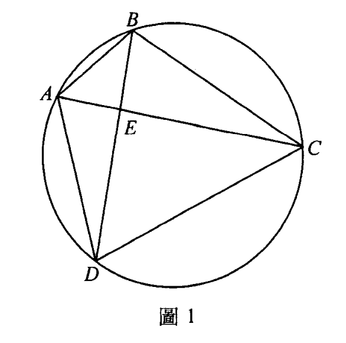

　(a) 寫出兩對相似三角形，並求 $AE$。
　(b) 若 $AB=10\text{ cm}$，$AC$ 是否垂直於 $BD$？試解釋你的答案。

---

**2. 【2012 Q9】（5分）**　*角柱體體積、表面面積、梯形*

　下圖所示為一直立角柱體 $ABCDEFGH$，
　其體積為 $1020\text{ cm}^3$。底 $ABCD$ 為梯形，
　其中 $AD \parallel BC$ 及 $\angle BAD = 90^\circ$。已知 $AB = 12\text{ cm}$，$BC = 6\text{ cm}$
　及 $DE = 10\text{ cm}$。

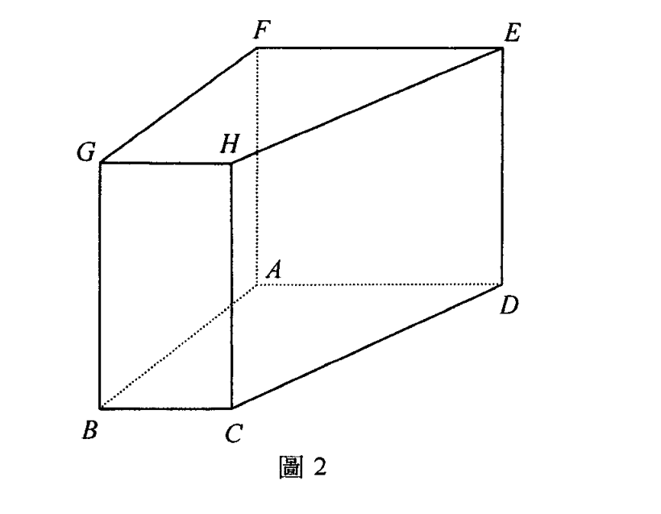

　(a) 求 $AD$ 的長度。
　(b) 求該角柱體的總表面面積。

---

**3. 【2012 Q12】（7分）**　*圓錐體體積、半球體積、體積比較*

　圖3(a)顯示底半徑為$48\,\text{cm}$及高為$96\,\text{cm}$的實心金屬直立圓錐體。

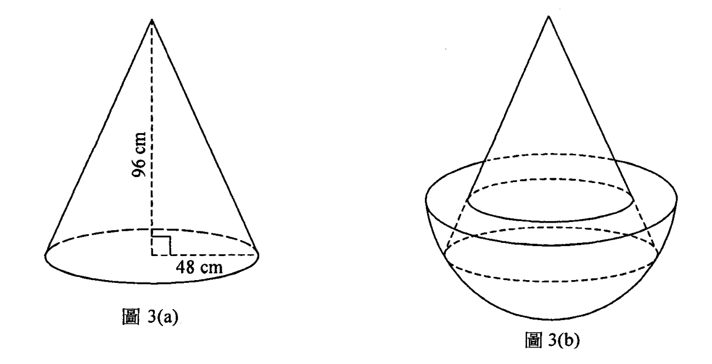

　(a) 求該圓錐體的體積，答案以$\pi$表示。　(2分)

　(b) 把半徑為$60\,\text{cm}$的半球形容器鉛垂置於一水平面上。該容器載滿牛奶。

　　(i) 求該容器內牛奶的體積，答案以$\pi$表示。
　　(ii) 現把該圓錐體鉛垂置於該容器內，如圖3(b)所示。
　　　某工匠宣稱剩下在該容器內的牛奶的體積大於$0.3\,\text{m}^3$。你是否同意？試解釋你的答案。　(5分)

---

**4. 【2012 Q14】（9分）**　*直線方程、軌跡、圓的方程*

　兩平行線$L$及$\ell$的$y$截距分別為$-1$及$-3$，且$L$的$x$截距為$3$。
　$P$為直角坐標平面上的一動點使得由$P$至$L$的垂直距離等於由$P$至$\ell$的垂直距離。
　將$P$的軌跡記為$\Gamma$。

　(a)

　　(i) 描述$\Gamma$與$L$之間的幾何關係。
　　(ii) 求$\Gamma$的方程。　(5分)

　(b) 圓$C$的方程為$(x-6)^2+y^2=4$。將$C$的圓心記為$Q$。

　　(i) $\Gamma$是否通過$Q$？試解釋你的答案。
　　(ii) 若$L$與$C$相交於$A$及$B$而$\Gamma$與$C$相交於$H$及$K$，求$\triangle AQH$的面積與$\triangle BQK$的面積之比。　(4分)

---

**5. 【2012 Q17】（7分）**　*圓的方程、直線與圓相交*

　圓$C$的圓心的坐標為$(6,10)$。已知$x$軸為$C$的切線。

　(a) 求$C$的方程。　(2分)

　(b) 直線$L$的斜率及$y$截距分別為$-1$及$k$。若$L$與$C$相交於$A$及$B$，以$k$表$AB$的中點的坐標。　(5分)

---

**6. 【2012 Q18】（8分）**　*角錐體、空間幾何、角度計算*

　圖5(a)顯示以正方形為底的直立角錐體 $VABCD$，其中 $\angle VAB = 72^{\circ}$。
　該底的邊長為$20\,\text{cm}$。設 $P$ 及 $Q$ 分別為 $VA$ 及 $VD$ 上的點使得 $PQ$ 平行於 $BC$
　且 $\angle PBA = 60^{\circ}$。從 $VABCD$ 切去角錐體 $VPBCQ$ 造成一幾何模型，如圖5(b)所示。

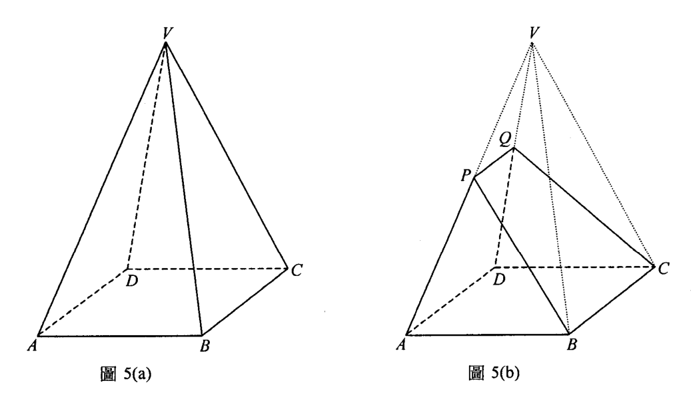

　(a) 求 $AP$ 的長度。　(2分)

　(b) 設 $\alpha$ 為平面 $PBCQ$ 與底 $ABCD$ 間之交角。

　　(i) 求 $\alpha$。
　　(ii) 設 $\beta$ 為 $PB$ 與底 $ABCD$ 間之交角。$\alpha$ 與 $\beta$ 哪一個較大？試解釋你的答案。　(6分)

---

### 2013年（5題）

**1. 【2013 Q6】（4分）**　*極坐標（對稱軸、極坐標求點）*

　在某極坐標系中，$O$ 為原點。點 $A$ 及點 $B$ 的極坐標分別為 $(26, 10^{\circ})$ 及 $(26, 130^{\circ})$。設 $L$ 為 $\triangle OAB$ 的反射對稱軸。

　(a) 描述 $L$ 與 $\angle AOB$ 之間的幾何關係。
　(b) 求 $L$ 與 $AB$ 的交點的極坐標。

---

**2. 【2013 Q7】（4分）**　*全等與相似三角形（四邊形）*

　圖 1 中，$ABCD$ 為四邊形。對角線 $AC$ 與對角線 $BD$ 相交於 $E$。已知 $BE = CE$ 及 $\angle BAC = \angle BDC$。

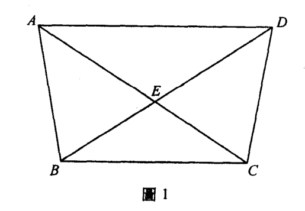

　(a) 證明 $\triangle ABC \cong \triangle DCB$。
　(b) 考慮在圖 1 中的三角形。

　　(i) 有多少對全等三角形？
　　(ii) 有多少對相似三角形？

---

**3. 【2013 Q13】（7分）**　*圓柱體體積守恒、相似形判斷*

　在某工場內，把 $2$ 個底半徑均為 $R \mathrm{cm}^{}$ 的完全相同的實心金屬直立圓柱體熔化，並重鑄成 $27$ 個底半徑均為 $r \mathrm{cm}^{}$ 及高均為 $10 \mathrm{cm}^{}$ 的完全相同的較小的實心直立圓柱體。已知較大的圓柱體的底面積為較小的 $9$ 倍。

　(a)

　　(i) 求 $r:R$。
　　(ii) 求較大的圓柱體的高。　(5分)

　(b) 某工匠宣稱較小的圓柱體與較大的圓柱體相似。你是否同意？試解釋你的答案。　(2分)

---

**4. 【2013 Q14】（9分）**　*圓的方程、坐標幾何（距離、面積比）*

　圓 $C$ 的方程為 $x^{2}+y^{2}-12x-34y+225=0$。將 $C$ 的圓心記為 $R$。

　(a) 寫出 $R$ 的坐標。　(1分)

　(b) 直線 $L$ 的方程為 $4x+3y+50=0$。現知 $C$ 與 $L$ 沒有相交。設 $P$ 為 $L$ 上的一點使得 $P$ 最接近 $R$。

　　(i) 求 $P$ 與 $R$ 間的距離。
　　(ii) 設 $Q$ 為 $C$ 上的一動點。當 $Q$ 最接近 $P$ 時，

　　　1. 描述 $P$、$Q$ 與 $R$ 之間的幾何關係；
　　　2. 求 $\triangle OPQ$ 的面積與 $\triangle OQR$ 的面積之比，其中 $O$ 為原點。　(8分)

---

**5. 【2013 Q18】（8分）**　*三角學（餘弦定理）、立體幾何、摺疊*

　(a) 圖 3(a) 顯示一張三角形紙卡 $ABC$，其中 $AB=28\,\text{cm}$、$BC=21\,\text{cm}$ 及 $AC=35\,\text{cm}$。設 $M$ 為 $AC$ 上的一點使得 $\angle BMC = 75^{\circ}$。

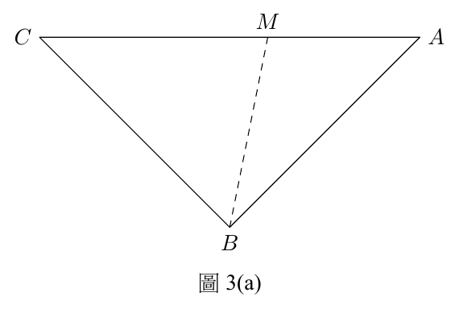

　　求

　　(i) $\angle BCM$；
　　(ii) $CM$。　(3分)

　(b) 文俊將 (a) 所描述的三角形紙卡沿 $BM$ 摺起，使得 $AB$ 及 $BC$ 均位於水平地面上，如圖 3(b) 所示。已知 $\angle AMC = 107^{\circ}$。

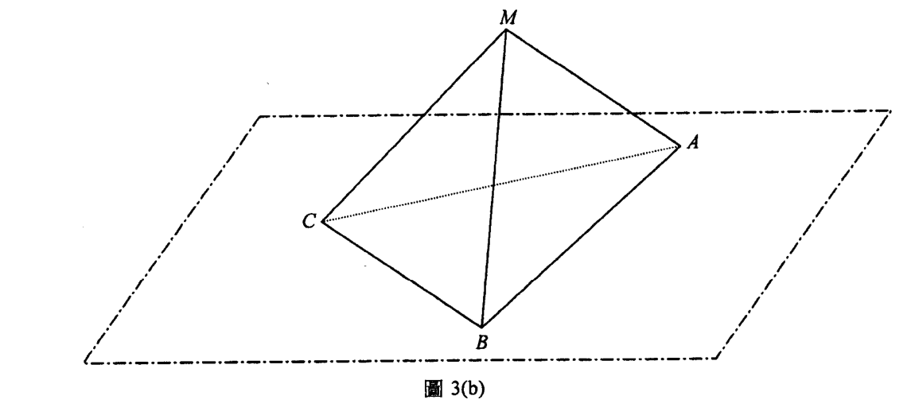

　　(i) 求在水平地面上 $A$ 與 $C$ 間的距離。
　　(ii) 設 $N$ 為 $BC$ 上的一點使得 $MN$ 垂直於 $BC$。文俊宣稱面 $BCM$ 與水平地面間的交角為 $\angle ANM$。你是否同意？試解釋你的答案。　(5分)

---

### 2014年（5題）

**1. 【2014 Q8】（5分）**　*坐標幾何：旋轉、平移，垂直判定*

　點 $P$ 及點 $Q$ 的坐標分別為 $(-3, 5)$ 及 $(2, -7)$。$P$ 繞原點 $O$ 逆時針方向旋轉 $270^{\circ}$ 至 $P'$。$Q$ 向左平移 $21$ 單位至 $Q'$。

　(a) 寫出 $P'$ 及 $Q'$ 的坐標。　(2分)

　(b) 證明 $PQ$ 垂直於 $P'Q'$。　(3分)

---

**2. 【2014 Q9】（5分）**　*相似三角形，畢氏定理*

　圖 1 中，$D$ 為 $AC$ 上的一點使得 $\angle BAC = \angle CBD$。

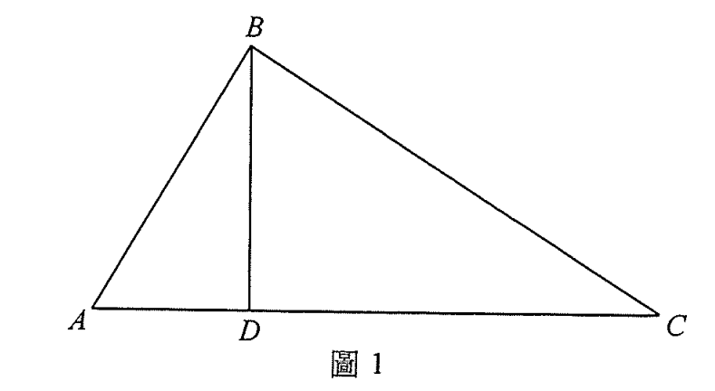

　(a) 證明 $\triangle ABC \sim \triangle BDC$。　(2分)

　(b) 假定 $AC = 25\ \mathrm{cm}$、$BC = 20\ \mathrm{cm}$ 及 $BD = 12\ \mathrm{cm}$。$\triangle BCD$ 是否一直角三角形？試解釋你的答案。　(3分)

---

**3. 【2014 Q12】（7分）**　*圓方程，軌跡，坐標幾何*

　圓 $C$ 通過點 $A(6,11)$ 且 $C$ 的圓心為點 $G(0,3)$。

　(a) 求 $C$ 的方程。　(2分)

　(b) $P$ 為直角坐標平面上的一動點使得 $AP = GP$。將 $P$ 的軌跡記為 $\Gamma$。

　　(i) 求 $\Gamma$ 的方程。
　　(ii) 描述 $\Gamma$ 與線段 $AG$ 之間的幾何關係。
　　(iii) 若 $\Gamma$ 與 $C$ 相交於 $Q$ 及 $R$，求四邊形 $AQGR$ 的周界。　(5分)

---

**4. 【2014 Q14】（8分）**　*平截頭體（圓錐），曲面面積及體積*

　圖 3 顯示一容器，其形狀為一平截頭體。該平截頭體是從一底半徑為 $72\ \mathrm{cm}$ 及高為 $96\ \mathrm{cm}$ 的倒置直立圓錐切去其下部分造成。該容器的高度為 $60\ \mathrm{cm}$。將該容器放在一水平桌上。現將一些水注入該容器內。偉明得知該容器內的水深為 $28\ \mathrm{cm}$。

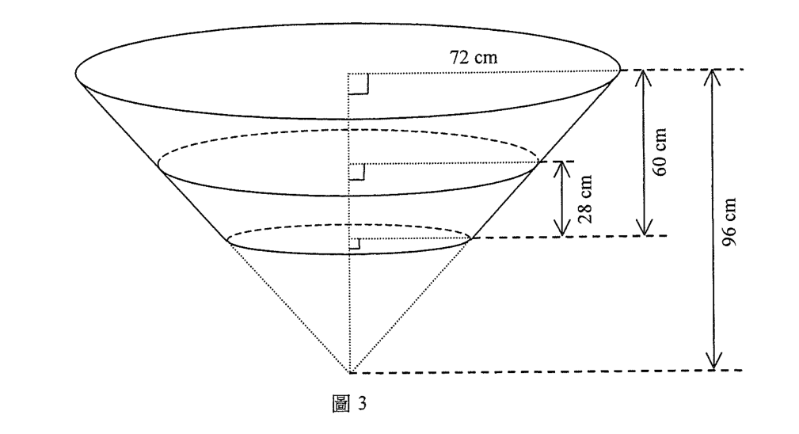

　(a) 求該容器被浸濕的曲面面積，答案以 $\pi$ 表示。　(4分)

　(b) 偉明宣稱該容器內的水的體積大於 $0.1\ \mathrm{m}^3$。你是否同意？試解釋你的答案。　(4分)

---

**5. 【2014 Q17】（7分）**　*立體幾何（角錐體），三角學，面積*

　圖 6(a) 顯示一角錐體 $VABCD$，其底 $ABCD$ 為一長方形，其中 $AB = 18 \mathrm{cm}^{}$、$BC = 10 \mathrm{cm}^{}$。$VB = VC = 30 \mathrm{cm}^{}$，$\angle VAB = 110^{\circ}$ 及 $\angle VDC = 110^{\circ}$。

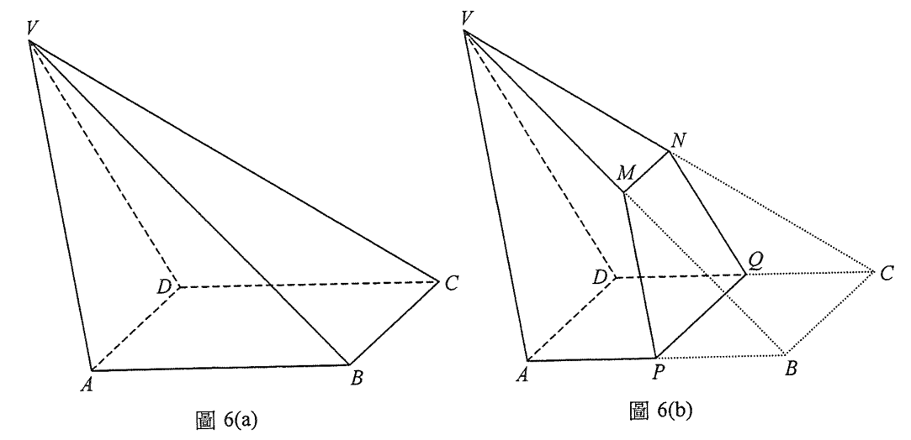

　(a)

　　(i) 求 $\angle VBA$。
　　(ii) 求 $VA$ 的長度。　(2分)

　(b) 設 $P$、$Q$ 分別為 $VB$ 及 $VC$ 的中點。設 $M$ 及 $N$ 分別為 $BC$ 及 $AD$ 上的點使得 $PM$ 及 $QN$ 均垂直於 $BC$。$P$、$Q$、$M$、$N$ 在同一平面上。將 $V$ 沿平面 $PQNM$ 切去，餘下的幾何模型如圖 6(b) 所示。

　　某人宣稱在該幾何模型中，梯形 $PQNM$ 的面積少於 $70\ \mathrm{cm}^2$。你是否同意？試解釋你的答案。　(5分)

---

### 2015年（5題）

**1. 【2015 Q8】（5分）**　*圓的幾何*

　圖1中，$ABCD$ 為一圓。$E$ 為 $AC$ 上的一點使得 $BC=CE$。已知 $AB=AD$、$\angle ADB=58^{\circ}$ 及 $\angle CBD=25^{\circ}$。

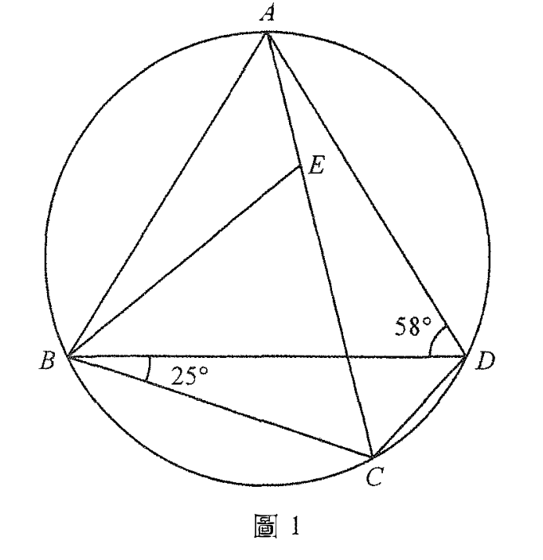

　求 $\angle BDC$ 及 $\angle ABE$。

---

**2. 【2015 Q9】（5分）**　*扇形*

　某扇形的半徑及面積分別為 $12\,\mathrm{cm}$ 及 $30\pi\,\mathrm{cm}^2$。

　(a) 求該扇形的角。
　(b) 以 $\pi$ 表該扇形的周界。

---

**3. 【2015 Q13】（7分）**　*正方形、全等三角形、幾何證明*

　圖 2 中，$ABCD$ 為一正方形。$E$ 及 $F$ 分別為 $BC$ 及 $CD$ 上的點使得 $AE = BF$。$AE$ 與 $BF$ 相交於 $G$。

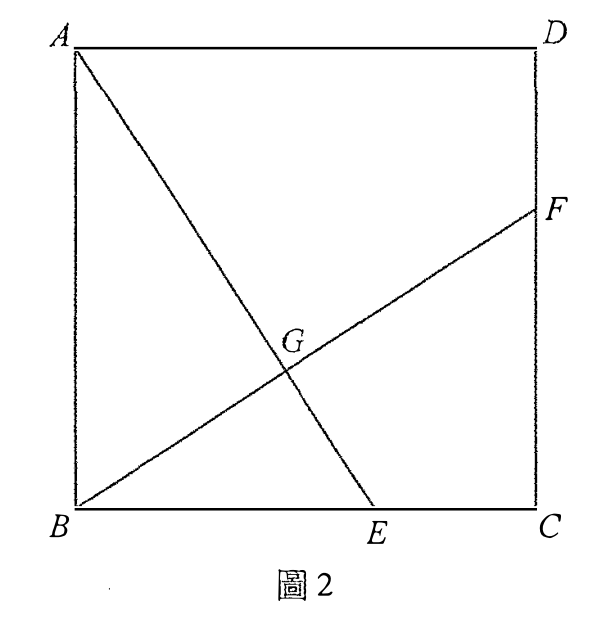

　(a) 證明 $\triangle ABE \cong \triangle BCF$。　(2分)

　(b) $\triangle BGE$ 是否一直角三角形？試解釋你的答案。　(3分)

　(c) 若 $CF = 15\,\mathrm{cm}$ 及 $EG = 9\,\mathrm{cm}$，求 $BG$。　(2分)

---

**4. 【2015 Q14】（9分）**　*垂直平分線、圓方程、坐標幾何*

　點 $P$ 及點 $Q$ 的坐標分別為 $(4,-1)$ 及 $(-14,23)$。

　(a) 設 $L$ 為 $PQ$ 的垂直平分線。

　　(i) 求 $L$ 的方程。
　　(ii) 假定 $G$ 為 $L$ 上的一點。將 $G$ 的 $x$ 坐標記為 $h$。設 $C$ 為一圓，其圓心為 $G$ 且通過 $P$ 及 $Q$。證明 $C$ 的方程為 $2x^2 + 2y^2 - 4hx - (3h+59)y + 13h - 93 = 0$。　(6分)

　(b) 點 $R$ 的坐標為 $(26,43)$。利用 (a)(ii)，或其他方法，求通過 $P$、$Q$ 及 $R$ 的圓的直徑。　(3分)

---

**5. 【2015 Q19】（13分）**　*三角學（立體幾何、角錐體體積）*

　圖 3(a) 中，$ABCD$ 為五邊形紙卡。已知 $AB = AB' = 40\,\mathrm{cm}$、$BC = B'D = 24\,\mathrm{cm}$ 及 $\angle ABC = \angle AB'D = 80^{\circ}$。

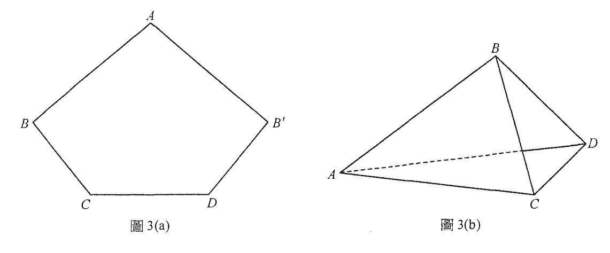

　(a) 假定 $105^{\circ} \leq \angle BCD \leq 145^{\circ}$。

　　(i) 求 $A$ 與 $C$ 間的距離。
　　(ii) 求 $\angle ACB$。
　　(iii) 描述當 $\angle BCD$ 由 $105^{\circ}$ 增加至 $145^{\circ}$ 期間該紙卡的面積如何變化。試解釋你的答案。　(7分)

　(b) 假定 $\angle BCD = 132^{\circ}$。將圖 3(a) 中的紙卡沿 $AC$ 及 $AD$ 摺起，使得 $AB$ 與 $AB'$ 連接成角錐體 $ABCD$，如圖 3(b) 所示。求角錐體 $ABCD$ 的體積。　(6分)

---

### 2016年（6題）

**1. 【2016 Q7】（4分）**　*極坐標、等腰三角形、旋轉對稱*

　在某極坐標系中，$O$ 為極點。點 $A$ 及點 $B$ 的極坐標分別為 $(12, 75^{\circ})$ 及 $(12, 135^{\circ})$。

　(a) 求 $\angle AOB$。
　(b) 求 $\triangle AOB$ 的周界。
　(c) 寫出 $\triangle AOB$ 的旋轉對稱的折式數目。

---

**2. 【2016 Q10】（5分）**　*軌跡（垂直平分線）、圓的幾何*

　點 $A$ 及點 $B$ 的坐標分別為 $(5,7)$ 及 $(13,1)$。設 $P$ 為直角坐標平面上的一動點使得 $P$ 與 $A$ 及 $B$ 等距。將 $P$ 的軌跡記為 $\Gamma$。

　(a) 求 $\Gamma$ 的方程。　(2分)

　(b) $\Gamma$ 與 $x$ 軸及 $y$ 軸分別相交於 $H$ 及 $K$。將原點記為 $O$。設 $C$ 為通過 $O$、$H$ 及 $K$ 的圓。某人宣稱 $C$ 的圓周超過 30。該宣稱是否正確？試解釋你的答案。　(3分)

---

**3. 【2016 Q11】（6分）**　*圓錐體積、相似、曲面面積*

　某倒置直立圓錐形的容器載有一些牛奶。將該容器鉛垂放置。該容器內牛奶的深度為 $12\,\mathrm{cm}$。文俊隨後將 $444\pi\,\mathrm{cm}^{3}$ 的牛奶倒入該容器內，而牛奶沒有溢出。他現知該容器內牛奶的深度為 $16\,\mathrm{cm}$。

　(a) 以 $\pi$ 表該容器內牛奶的最終體積。　(3分)

　(b) 文俊宣稱該容器被浸濕的曲面的最終面積至少為 $800\,\mathrm{cm}^{2}$。你是否同意？試解釋你的答案。　(3分)

---

**4. 【2016 Q13】（7分）**　*全等三角形、等腰三角形、畢氏定理*

　圖 1 中，$ABC$ 為三角形。$D$、$E$ 及 $M$ 均為 $BC$ 上的點使得 $BD=CE$、$\angle ADC=\angle AEB$ 及 $DM=EM$。

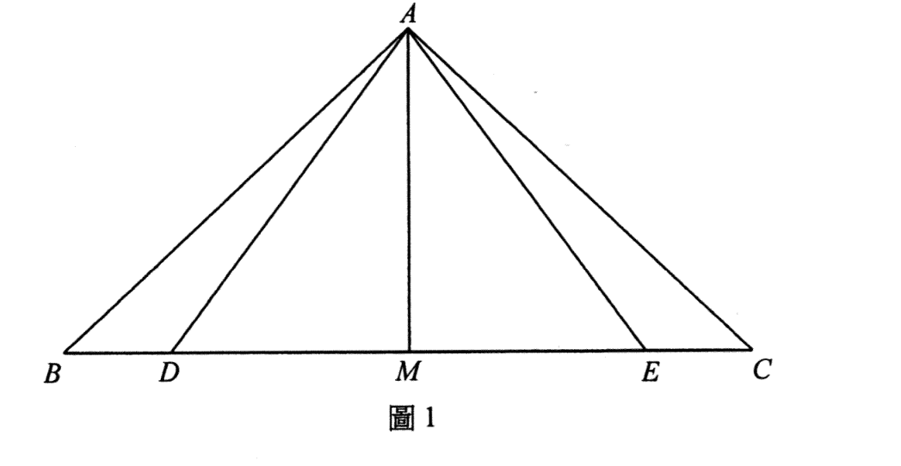

　(a) 證明 $\triangle ACD \cong \triangle ABE$。　(2分)

　(b) 假定 $AD=15\,\mathrm{cm}$、$BD=7\,\mathrm{cm}$ 及 $DE=18\,\mathrm{cm}$。

　　(i) 求 $AM$。
　　(ii) $\triangle ABE$ 是否一直角三角形？試解釋你的答案。　(5分)

---

**5. 【2016 Q19】（6分）**　*三角學（正弦/餘弦定理）、立體幾何（線面角）*

　圖 2 顯示一幾何模型 $ABCD$，其形狀為四面體。已知 $\angle BAD = 86^{\circ}$、$\angle CBD = 43^{\circ}$、$AB = 10\,\mathrm{cm}$、$AC = 6\,\mathrm{cm}$、$BC = 8\,\mathrm{cm}$ 及 $BD = 15\,\mathrm{cm}$。

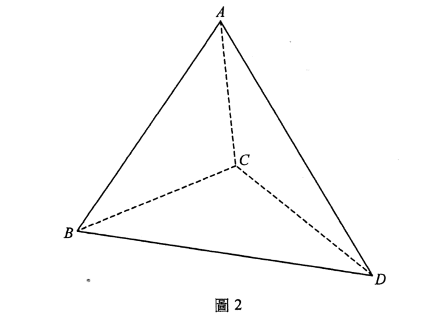

　(a) 求 $\angle ABD$ 及 $CD$。　(4分)

　(b) 某工匠宣稱 $AB$ 與面 $BCD$ 間的交角為 $\angle ABC$。你是否同意？試解釋你的答案。　(2分)

---

**6. 【2016 Q20】（12分）**　*圓的性質、內心與外心、坐標幾何、圓方程、切線、梯形面積*

　$\triangle OPQ$ 為一鈍角三角形。將 $\triangle OPQ$ 的內心及外心分別記為 $I$ 及 $J$。已知 $P$、$I$ 與 $J$ 共線。

　(a) 證明 $OP=PQ$。　(3分)

　(b) 引入一直角坐標系使得 $O$ 及 $Q$ 的坐標分別為 $(0,0)$ 及 $(40,30)$，而 $P$ 的 $y$ 坐標為 $19$。設 $C$ 為通過 $O$、$P$ 及 $Q$ 的圓。

　　(i) 求 $C$ 的方程。
　　(ii) 設 $L_{1}$ 及 $L_{2}$ 為 $C$ 的兩切線使得每一切線的斜率均為 $\dfrac{3}{4}$ 且 $L_{1}$ 的 $y$ 截距較 $L_{2}$ 大。$L_{1}$ 分別與 $x$ 軸及 $y$ 軸相交於 $S$ 及 $T$，而 $L_{2}$ 分別與 $x$ 軸及 $y$ 軸相交於 $U$ 及 $V$。某人宣稱梯形 $STUV$ 的面積超過 $17000$。該宣稱是否正確？試解釋你的答案。　(9分)

---

### 2017年（5題）

**1. 【2017 Q6】（4分）**　*變換（旋轉、反射）與坐標幾何*

　點 $A$ 及點 $B$ 的坐標分別為 $(-3,4)$ 及 $(9,-9)$。$A$ 繞原點逆時針方向旋轉 $90^{\circ}$ 至 $A'$。$B'$ 為 $B$ 對 $x$ 軸的反射影像。

　(a) 寫出 $A'$ 及 $B'$ 的坐標。
　(b) 證明 $AB$ 垂直於 $A'B'$。

---

**2. 【2017 Q10】（6分）**　*全等三角形、圓的性質、扇形面積*

　圖1中，$OPQR$ 為四邊形使得 $OP=OQ=OR$。$OQ$ 與 $PR$ 相交於點 $S$。$S$ 為 $PR$ 的中點。

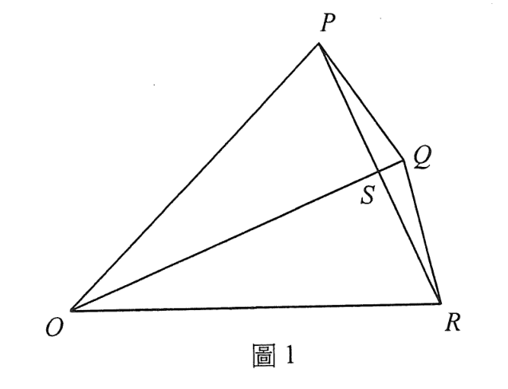

　(a) 證明 $\triangle OPS \cong \triangle ORS$。　(2分)

　(b) 已知 $O$ 為通過 $P$、$Q$ 及 $R$ 的圓的圓心。若 $OQ=6\ \mathrm{cm}$ 及 $\angle PRQ=10^{\circ}$，求扇形 $OPQR$ 的面積，答案以 $\pi$ 表示。　(4分)

---

**3. 【2017 Q12】（7分）**　*相似立體、體積與表面面積*

　把一底面積為 $84\ \mathrm{cm}^2$ 及高為 $20\ \mathrm{cm}$ 的實心金屬直立角柱體熔化並重鑄成兩個相似的實心直立角錐體。該兩個角錐體的底均為正方形。較小的角錐體的底面積與較大的角錐體的底面積之比為 $4:9$。

　(a) 求較大的角錐體的體積。　(3分)

　(b) 若較大的角錐體的高為 $12\ \mathrm{cm}$，求較小的角錐體的總表面面積。　(4分)

---

**4. 【2017 Q13】（7分）**　*圓的方程、距離公式*

　點 $E$、點 $F$ 及點 $G$ 的坐標分別為 $(-6,5)$、$(-3,11)$ 及 $(2,-1)$。圓 $C$ 通過 $E$ 且 $C$ 的圓心為 $G$。

　(a) 求 $C$ 的方程。　(2分)

　(b) 證明 $F$ 在 $C$ 以外。　(2分)

　(c) 設 $H$ 為 $C$ 上的一動點。當 $H$ 最遠離 $F$ 時，

　　(i) 描述 $F$、$G$ 與 $H$ 之間的幾何關係；
　　(ii) 求通過 $F$ 及 $H$ 的直線的方程。　(3分)

---

**5. 【2017 Q19】（13分）**　*三角學（正弦/餘弦定理）、立體幾何*

　$ABC$ 為三角形金屬薄片，其中 $BC=24\ \mathrm{cm}$、$\angle BAC=30^{\circ}$ 及 $\angle ACB=42^{\circ}$。

　(a) 求 $AC$ 的長度。　(2分)

　(b) 圖2中，把金屬薄片 $ABC$ 懸掛使得只有頂點 $B$ 位於水平地面上。$D$ 及 $E$ 均為水平地面上的點，且分別鉛垂於頂點 $A$ 及頂點 $C$ 之下。$AC$ 的延線與水平地面相交於點 $F$。某工匠得知 $AD=10\ \mathrm{cm}$ 及 $CE=2\ \mathrm{cm}$。

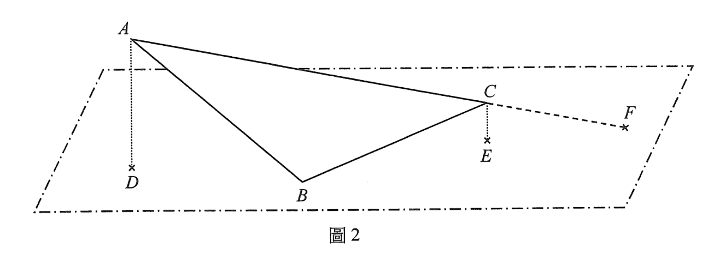

　　(i) 求 $C$ 與 $F$ 間的距離。
　　(ii) 求 $\triangle ABF$ 的面積。
　　(iii) 求金屬薄片 $ABC$ 與水平地面間的傾角。
　　(iv) 該工匠宣稱 $\triangle BDF$ 的面積大於 $460\ \mathrm{cm}^2$。你是否同意？試解釋你的答案。

---

### 2018年（5題）

**1. 【2018 Q8】（5分）**　*圓的幾何（圓內接四邊形、平行線）*

　圖 1 中，$ABCDE$ 為一圓。已知 $AB \parallel ED$，$AD$ 與 $BE$ 相交於點 $F$。

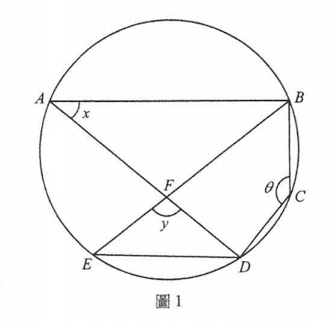

　以 $\theta$ 表 $x$ 及 $y$。

---

**2. 【2018 Q13】（8分）**　*相似三角形、畢氏定理、面積*

　圖 2 中，$ABCD$ 為一梯形，且 $\angle ABC=90^{\circ}$ 及 $AB \parallel DC$。$E$ 為 $BC$ 上的一點使得 $\angle AED=90^{\circ}$。

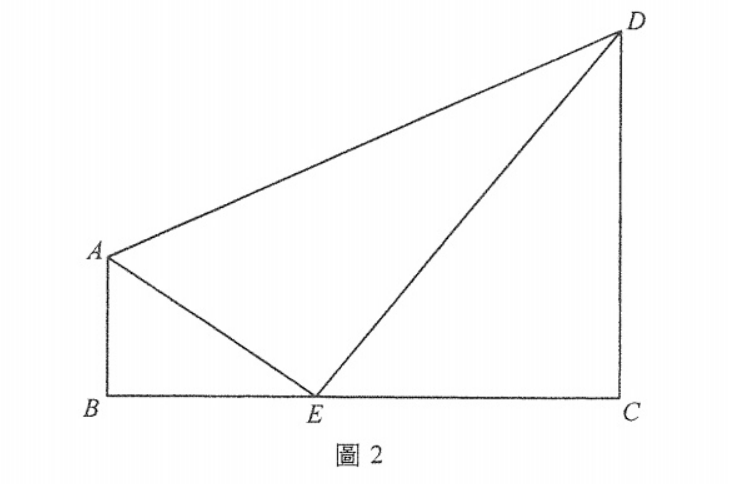

　(a) 證明 $\triangle ABE \sim \triangle ECD$。　(2分)

　(b) 已知 $AB=15\ \mathrm{cm}$、$AE=25\ \mathrm{cm}$ 及 $CE=36\ \mathrm{cm}$。

　　(i) 求 $CD$ 的長度。
　　(ii) 求 $\triangle ADE$ 的面積。
　　(iii) $AD$ 上是否有一點 $F$ 使得 $E$ 與 $F$ 間的距離少於 $23\ \mathrm{cm}$？試解釋你的答案。　(6分)

---

**3. 【2018 Q14】（9分）**　*圓柱與圓錐體積、球體體積*

　一底半徑為 $8\ \mathrm{cm}$ 及高為 $64\ \mathrm{cm}$ 的直立圓柱形的容器與一底半徑為 $20\ \mathrm{cm}$ 及高為 $60\ \mathrm{cm}$ 的倒置直立圓錐形的器皿均鉛垂放置。該容器載滿了水。現將該容器內的水倒入該器皿內。

　(a) 求該器皿內水的體積，答案以 $\pi$ 表示。　(2分)

　(b) 求該器皿內水的深度。　(4分)

　(c) 若將一半徑為 $14\ \mathrm{cm}$ 的實心金屬球體隨後放進該器皿內，且該球體完全浸入水中，水會否溢出？試解釋你的答案。　(3分)

---

**4. 【2018 Q17】（7分）**　*三角學（正弦/餘弦定理）、立體幾何（交角）*

　(a) 圖 3(a) 中，$ABCD$ 為一紙卡，其形狀為平行四邊形。已知 $AB=60\ \mathrm{cm}$、$\angle ABD=20^{\circ}$ 及 $\angle BAD=120^{\circ}$。

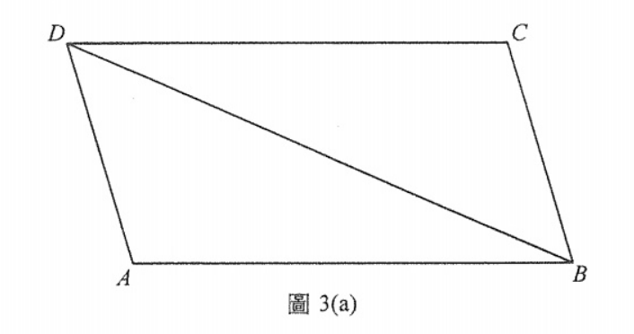

　　求 $AD$ 的長度。　(2分)

　(b) 將圖 3(a) 中的紙卡沿 $BD$ 摺起，使得 $A$ 與 $C$ 間的距離為 $40\ \mathrm{cm}$（見圖 3(b)）。

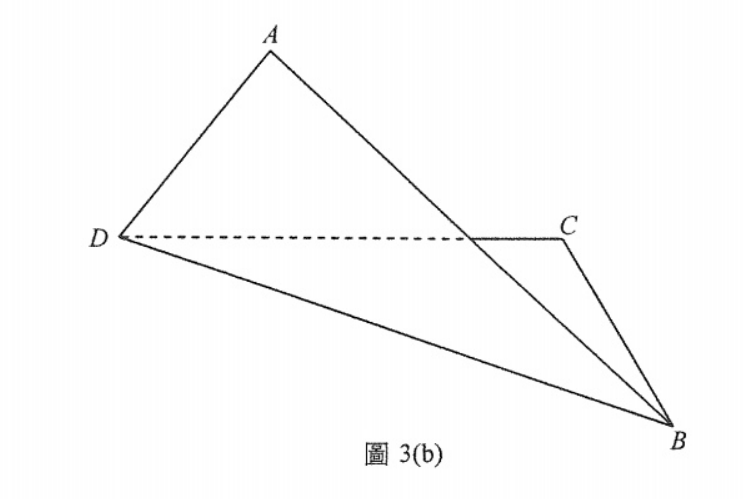

　　(i) 求 $\angle ABC$。
　　(ii) 求平面 $ABD$ 與平面 $BCD$ 間的交角。　(5分)

---

**5. 【2018 Q19】（12分）**　*圓方程、切線、內切圓、鈍角三角形*

　圓 $C$ 的圓心的坐標為 $(8,2)$。將 $C$ 的半徑記為 $r$。設 $L$ 為直線 $kx-5y-21=0$，其中 $k$ 為一常數。已知 $L$ 為 $C$ 的切線。

　(a) 求 $C$ 的方程，答案以 $r$ 表示。由此，以 $k$ 表 $r^{2}$。　(4分)

　(b) $L$ 通過點 $D(18,39)$。

　　(i) 求 $r$。
　　(ii) 已知 $L$ 與 $y$ 軸相交於點 $E$。設 $F$ 為一點使得 $C$ 為 $\triangle DEF$ 的內切圓。$\triangle DEF$ 是否一鈍角三角形？試解釋你的答案。　(8分)

---

### 2019年（5題）

**1. 【2019 Q9】（5分）**　*球體體積、表面面積、相似*

　某兩球體的體積之和為 $324\pi\,\mathrm{cm}^3$。較大的球體的半徑等於較小的球體的直徑。以 $\pi$ 表示

　(a) 較大的球體的體積，
　(b) 該兩球體的表面面積之和。

---

**2. 【2019 Q13】（8分）**　*圓的性質、直徑、扇形周界*

　圖1中，$O$ 為圓 $ABCDE$ 的圓心。$AC$ 為該圓的一直徑。$BD$ 與 $OC$ 相交於點 $F$。已知 $\angle AED=115^{\circ}$。

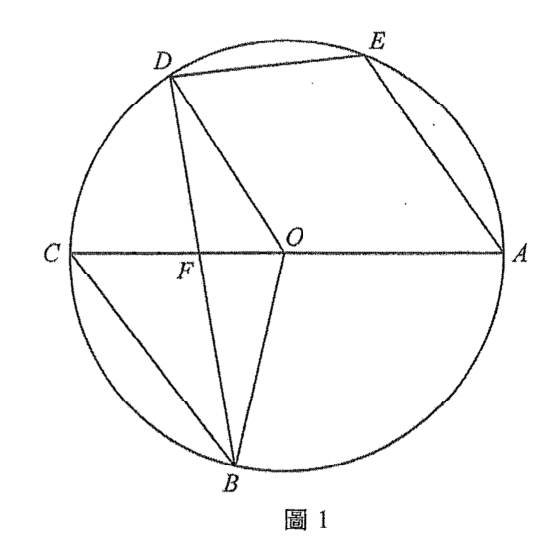

　(a) 求 $\angle CBF$ 。　(3分)

　(b) 假定 $BC \parallel OD$ 及 $OB=18\,\mathrm{cm}$，扇形 $OBC$ 的周界是否少於 $60\,\mathrm{cm}$？試解釋你的答案。　(5分)

---

**3. 【2019 Q14】（8分）**　*正方形、全等三角形、相似三角形*

　圖2中，$ABCD$ 為一正方形。已知 $E$ 為 $AD$ 上的一點。$BD$ 與 $CE$ 相交於點 $F$。設 $G$ 為一點使得 $BG \parallel EC$ 及 $CG \parallel DB$。

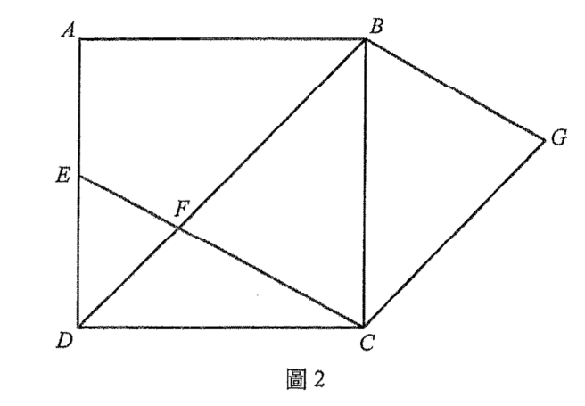

　(a) 證明

　　(i) $\triangle BCG \cong \triangle CDF$ ，
　　(ii) $\triangle BCF \sim \triangle DEF$ 。　(4分)

　(b) 假定 $\angle BCF = \angle BGC$ 。

　　(i) 設 $BC=\ell$，以 $\ell$ 表 $DF$ 。
　　(ii) 某人宣稱 $AE > DF$。你是否同意？試解釋你的答案。　(4分)

---

**4. 【2019 Q17】（7分）**　*內切圓、軌跡、坐標幾何*

　(a) 設 $a$ 及 $p$ 分別為 $\triangle CDE$ 的面積及周界。將 $\triangle CDE$ 的內切圓的半徑記為 $r$。證明 $pr=2a$ 。　(2分)

　(b) 點 $H$ 及點 $K$ 的坐標分別為 $(9,12)$ 及 $(14,0)$。設 $P$ 為直角坐標平面上的一動點使得由 $P$ 至 $OH$ 的垂直距離等於由 $P$ 至 $HK$ 的垂直距離，其中 $O$ 為原點。將 $P$ 的軌跡記為 $\Gamma$ 。

　　(i) 描述 $\Gamma$ 與 $\angle OHK$ 之間的幾何關係。
　　(ii) 利用(a)，求 $\Gamma$ 的方程。　(5分)

---

**5. 【2019 Q18】（7分）**　*立體幾何、三角學、面交角*

　圖3顯示四面體 $ABCD$。設 $P$ 為 $AD$ 上的一點使得 $BP$ 垂直於 $AD$。某工匠得知 $AC=AD=CD=13\,\mathrm{cm}$ 、 $BC=8\,\mathrm{cm}$ 、 $BD=12\,\mathrm{cm}$ 及 $\angle ABD=72^{\circ}$ 。

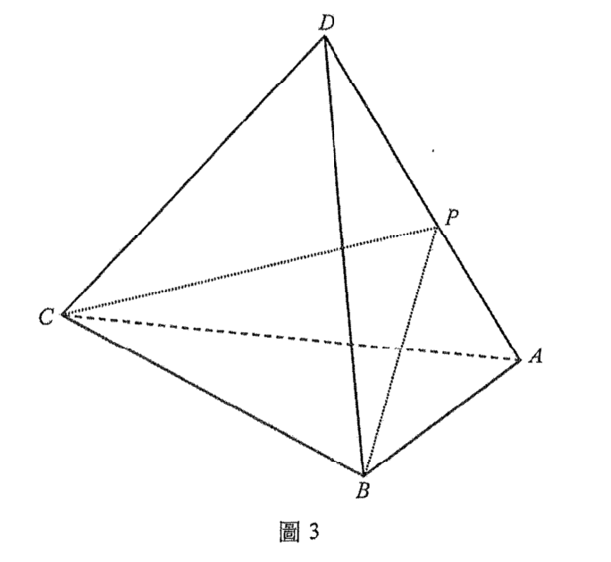

　(a) 求

　　(i) $\angle BAD$ ，
　　(ii) $CP$ 。　(5分)

　(b) 該工匠宣稱 $\angle BPC$ 為面 $ABD$ 與面 $ACD$ 間的交角。該宣稱是否正確？試解釋你的答案。　(2分)

---

### 2020年（5題）

**1. 【2020 Q8】（5分）**　*幾何角度、平行線、等腰三角形*

　圖1中，$B$ 及 $D$ 分別為 $AC$ 及 $AE$ 上的點。$BE$ 與 $CD$ 相交於點 $F$。已知 $AB=BE$、$BD\parallel CE$、$\angle CAE=30^{\circ}$ 及 $\angle ADB=42^{\circ}$。

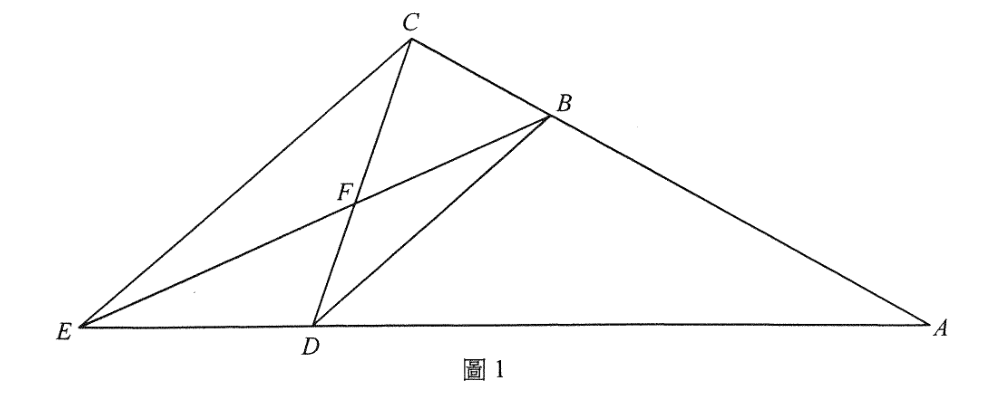

　(a) 求 $\angle BEC$。
　(b) 設 $\angle BDC=\theta$。以 $\theta$ 表 $\angle CFE$。

---

**2. 【2020 Q12】（6分）**　*圓錐體、平截頭體、體積、曲面面積、相似*

　一實心直立圓錐體的高及底半徑分別為 $36$ cm 及 $15$ cm。將該圓錐體以兩平行於其底的平面分成三部分。該三部分的高相等。以 $\pi$ 表

　(a) 該圓錐體的中間部分的體積，
　(b) 該圓錐體的中間部分的曲面面積。

---

**3. 【2020 Q14】（9分）**　*圓方程、軌跡、坐標幾何、角度*

　點 $A$ 及點 $B$ 的坐標分別為 $(-10,0)$ 及 $(30,0)$。圓 $C$ 通過 $A$ 及 $B$。將 $C$ 的圓心記為 $G$。已知 $G$ 的 $y$ 坐標為 $-15$。

　(a) 求 $C$ 的方程。　(3分)

　(b) 直線 $L$ 通過 $B$ 及 $G$。另一直線 $\ell$ 平行於 $L$。設 $P$ 為直角坐標平面上的一動點使得由 $P$ 至 $L$ 的垂直距離等於由 $P$ 至 $\ell$ 的垂直距離。將 $P$ 的軌跡記為 $\Gamma$。已知 $\Gamma$ 通過 $A$。

　　(i) 描述 $\Gamma$ 與 $L$ 之間的幾何關係。
　　(ii) 求 $\Gamma$ 的方程。
　　(iii) 假定 $\Gamma$ 與 $C$ 相交於另一點 $H$。某人宣稱 $\angle GAH<70^{\circ}$。你是否同意？試解釋你的答案。　(6分)

---

**4. 【2020 Q18】（7分）**　*圓的性質、切線、相似三角形、直徑、圓周*

　圖2中，$U$、$V$ 及 $W$ 均為某圓上的點。將該圓記為 $C$。$TU$ 為 $C$ 在 $U$ 的切線使得 $TVW$ 為一直線。

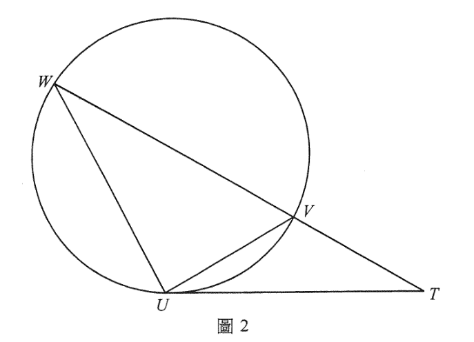

　(a) 證明 $\triangle UTV\sim\triangle WTU$。　(2分)

　(b) 已知 $VW$ 為 $C$ 的一直徑。假定 $TU=780$ cm 及 $TV=325$ cm。

　　(i) 以 $\pi$ 表 $C$ 的圓周。
　　(ii) 某人宣稱 $\triangle UVW$ 的周界超過 $35$ m。你是否同意？試解釋你的答案。　(5分)

---

**5. 【2020 Q19】（12分）**　*三角學（正弦餘弦定理）、立體幾何、面交角*

　$PQRS$ 為四邊形紙卡，其中 $PQ=60$ cm、$PS=40$ cm、$\angle PQR=30^{\circ}$、$\angle PRQ=55^{\circ}$ 及 $\angle QPS=120^{\circ}$。把該紙卡懸掛且 $QR$ 位於水平地面上，如圖3所示。

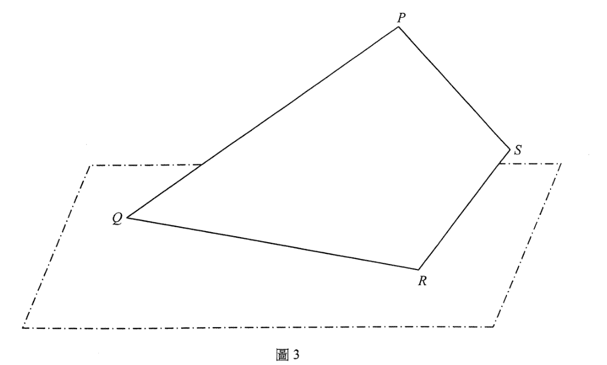

　(a) 求 $RS$ 的長度。　(3分)

　(b) 求該紙卡的面積。　(2分)

　(c) 已知該紙卡與水平地面間的交角為 $32^{\circ}$。

　　(i) 求由 $P$ 至水平地面的最短距離。
　　(ii) 某學生宣稱 $RS$ 與水平地面間的交角至多為 $20^{\circ}$。該宣稱是否正確？試解釋你的答案。　(7分)

---

### 2021年（5題）

**1. 【2021 Q7】（4分）**　*極坐標/三角學*

　在某極坐標系中，$O$ 為極點。點 $P$ 及點 $Q$ 的極坐標分別為 $(r,80^{\circ})$ 及 $(r,140^{\circ})$，其中 $r$ 為一正常數。已知 $P$ 與 $Q$ 間的距離為 21。求

　(a) $\angle POQ$， 　(1分)
　(b) $r$， 　(2分)
　(c) $\triangle OPQ$ 的周界。 　(1分)

---

**2. 【2021 Q8】（5分）**　*幾何（相似三角形）*

　圖1中，$AB$ 的延線與 $CD$ 的延線相交於點 $E$。已知 $\angle CAE = \angle BDE$。

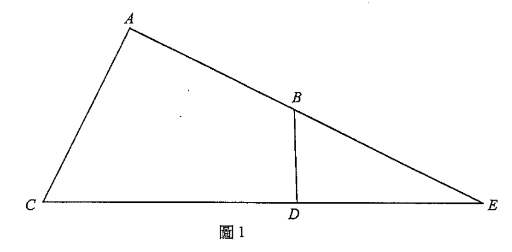

　(a) 證明 $\triangle ACE \sim \triangle DBE$。 　(2分)
　(b) 已知 $AC = 25\,\text{cm}$、$AE = 60\,\text{cm}$、$CE = 65\,\text{cm}$ 及 $BD = 15\,\text{cm}$。

　　(i) $\triangle ACE$ 是否一直角三角形？試解釋你的答案。 　(2分)
　　(ii) 求 $\triangle BDE$ 的面積。 　(1分)

---

**3. 【2021 Q13】（7分）**　*圓方程/軌跡*

　圓 $C$ 的方程為 $x^2+y^2-12x-16y-69=0$。設 $G$ 為 $C$ 的圓心。將原點記為 $O$。

　(a) 求 $OG$。 　(2分)
　(b) $O$ 是否位於 $C$ 以內？試解釋你的答案。 　(1分)
　(c) 設 $P$ 為直角坐標平面上的一動點使得 $OP = GP$。將 $P$ 的軌跡記為 $\Gamma$。假定 $\Gamma$ 與 $C$ 相交於點 $M$ 及點 $N$。求四邊形 $OMGN$ 的面積。 　(4分)

---

**4. 【2021 Q14】（8分）**　*立體幾何（圓柱/圓錐）*

　實心直立圓柱體 $X$ 的底半徑與實心直立圓錐體 $Y$ 的底半徑相等。$X$ 及 $Y$ 的高分別為 $20\,\text{cm}$ 及 $24\,\text{cm}$。實心直立圓錐體 $Z$ 的體積等於 $X$ 的體積與 $Y$ 的體積之和。$Z$ 的底半徑等於 $X$ 的底直徑。某工匠得知 $Y$ 的體積為 $800\pi\,\text{cm}^3$。

　(a) 求 $Y$ 的底半徑。 　(2分)
　(b) $Y$ 與 $Z$ 是否相似？試解釋你的答案。 　(3分)
　(c) 該工匠宣稱 $X$ 的曲面面積與 $Y$ 的曲面面積之和大於 $Z$ 的曲面面積。你是否同意？試解釋你的答案。 　(3分)

---

**5. 【2021 Q18】（7分）**　*立體幾何（角錐/平面交角）*

　(a) 金屬薄片 $ABCD$ 的形狀為一梯形，其中 $AD \parallel BC$。已知 $AB = 45\,\text{cm}$、$\angle ADC = 70^{\circ}$ 及 $\angle BAD = 50^{\circ}$。求 $CD$。 　(2分)
　(b) 現給定 (a) 中所描述的金屬片 $ABCD$。設 $E$ 為 $AD$ 上的一點使得 $BE$ 垂直於 $AD$。將該金屬片沿 $BE$ 折起使得 $AE$ 垂直於平面 $BCDE$。將三棱形金屬薄片放置於該已折起的金屬片成一角錐體（見圖2）。已知 $BC = 40\,\text{cm}$。

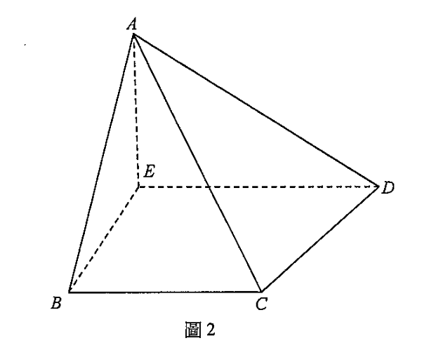

　　(i) 求 $\angle CAD$。 　(2分)
　　(ii) 平面 $ACD$ 與平面 $BCDE$ 間的交角是否超過 $30^{\circ}$？試解釋你的答案。 　(3分)

---

### 2022年（6題）

**1. 【2022 Q7】（4分）**　*變換（旋轉、反射）及斜率*

　點 $S$ 及點 $T$ 的坐標分別為 $(12,-5)$ 及 $(-3,-7)$。$S$ 繞 $O$ 逆時針方向旋轉 $90^{\circ}$ 至 $S'$，其中 $O$ 為原點。$T'$ 為 $T$ 對 $x$ 軸的反射影像。

　(a) 寫出 $S'$ 及 $T'$ 的坐標。
　(b) 求 $S'T'$ 的斜率。

---

**2. 【2022 Q8】（5分）**　*全等三角形、平行線*

　圖1中，$A$ 是位於四邊形 $BCDE$ 以內的一點使得 $AC \parallel ED$ 及 $AD \parallel BC$。已知 $\angle ABC = \angle AED$ 及 $AB = AE$。

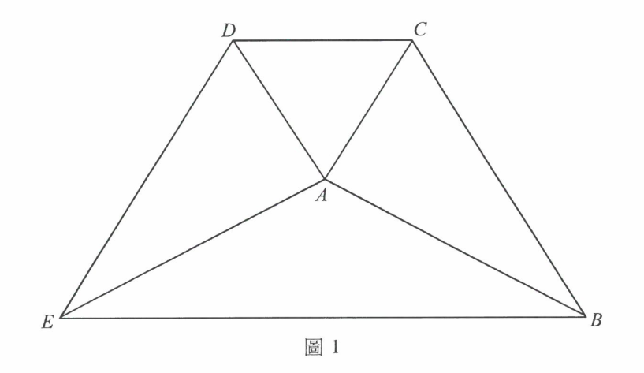

　(a) 證明 $\triangle ABC \cong \triangle AED$。
　(b) 若 $\angle ABC = 39^{\circ}$ 及 $\angle DAE = 87^{\circ}$，求 $\angle ACD$。

---

**3. 【2022 Q12】（7分）**　*圓的方程、幾何關係*

　圓 $C$ 的方程為 $x^{2} + y^{2} - 154x - 128y + 224 = 0$。將 $C$ 的圓心記為 $G$。點 $H$ 的坐標為 $(65, 48)$。

　(a) 求 $G$ 與 $H$ 間的距離。　(3分)

　(b) 設 $P$ 為 $C$ 上的一動點。當 $\triangle GHP$ 的面積最大時，

　　(i) 描述 $GH$ 與 $GP$ 之間的幾何關係；
　　(ii) 求 $\triangle GHP$ 的周界。　(4分)

---

**4. 【2022 Q13】（7分）**　*相似立體、體積*

　現有兩實心金屬球體。較小的球體的表面面積與較大的球體的表面面積之比為 $4:9$。較大的球體的半徑為 $9\,\mathrm{cm}$。

　(a) 以 $\pi$ 表較小的球體的體積。　(3分)

　(b) 把該兩球體熔化，並重鑄成兩實心直立圓錐體。將該兩圓錐體記為 $A$ 及 $B$。已知 $A$ 的高及底半徑分別為 $10\,\mathrm{cm}$ 及 $6\,\mathrm{cm}$。某學生得知 $B$ 的底半徑為 $12\,\mathrm{cm}$。該學生宣稱 $A$ 與 $B$ 相似。該宣稱是否正確？試解釋你的答案。　(4分)

---

**5. 【2022 Q18】（7分）**　*三角學（正弦、餘弦定理）、立體幾何*

　圖2中，把三角形紙卡 $PQR$ 懸掛使得 $PQ$ 位於水平地面上。已知 $PQ = 30\,\mathrm{cm}$、$PR = 25\,\mathrm{cm}$ 及 $\angle QPR = 95^{\circ}$。

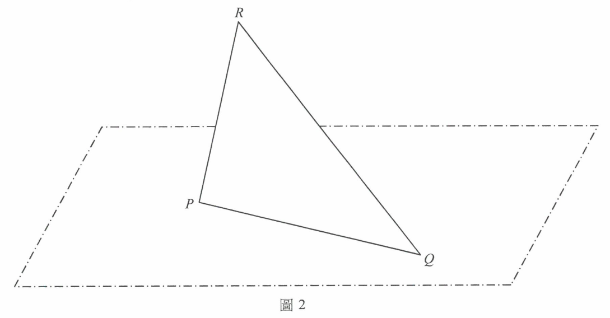

　(a) 求

　　(i) $QR$ 的長度，
　　(ii) $\angle PQR$。　(4分)

　(b) 設 $M$ 為 $QR$ 的中點。某工匠得知 $PR$ 與水平地面間的交角為 $70^{\circ}$。該工匠宣稱 $PM$ 與水平地面間的交角超過 $40^{\circ}$。該宣稱是否正確？試解釋你的答案。　(3分)

---

**6. 【2022 Q19】（12分）**　*圓的切線、直線方程、內切圓與外接圓*

　圓 $C$ 的圓心為點 $G(83, 112)$。得知點 $A(158, 12)$ 位於 $C$ 以外。$AP$ 及 $AQ$ 分別為 $C$ 在點 $P$ 及點 $Q$ 的切線。已知 $C$ 通過點 $(23, 67)$。

　(a) 求通過 $A$ 及 $G$ 的直線的方程。　(2分)

　(b) 求 $AG$ 與 $PQ$ 的交點的坐標。　(3分)

　(c) 求 $\triangle APQ$ 的內切圓的方程。　(4分)

　(d) 某人宣稱 $\triangle APQ$ 的內切圓的面積與外接圓的面積之比為 $1:4$。你是否同意？試解釋你的答案。　(3分)

---

### 2023年（6題）

**1. 【2023 Q7】（4分）**　*圓的性質（圓周角、直徑）*

　圖1中，$PR$ 為圓 $PQRS$ 的一直徑。將 $PR$ 與 $QS$ 的交點記為 $T$。

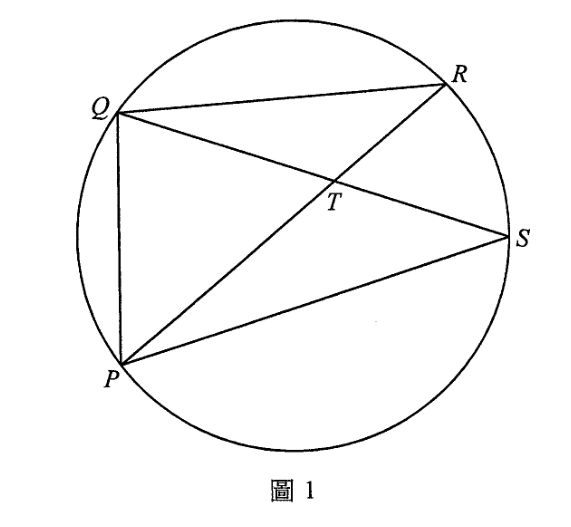

　若 $\angle PSQ = 41^{\circ}$ 及 $\angle PTQ = 68^{\circ}$，求 $\angle RQS$ 及 $\angle PQS$。

---

**2. 【2023 Q8】（5分）**　*相似三角形*

　圖2中，$AB$ 與 $CD$ 相交於點 $E$。已知 $AC \parallel DB$。

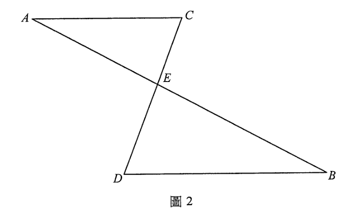

　(a) 證明 $\triangle ACE \sim \triangle BDE$。
　(b) 假定 $AB = 20\,\mathrm{cm}$、$AC = 10\,\mathrm{cm}$、$BD = 15\,\mathrm{cm}$ 及 $CE = 7\,\mathrm{cm}$。$\triangle BDE$ 是否一直角三角形？試解釋你的答案。

---

**3. 【2023 Q10】（6分）**　*軌跡、直線方程、圓的方程*

　已知 $A$ 及 $B$ 為直角坐標平面上的兩相異點。設 $P$ 為該直角坐標平面上的一動點使得 $P$ 與 $A$ 及 $B$ 等距。將 $P$ 的軌跡記為 $\Gamma$。

　(a) 描述 $\Gamma$ 與 $AB$ 之間的幾何關係。　(1分)

　(b) 假定 $A$ 的坐標為 $(2,-4)$ 及 $\Gamma$ 的方程為 $3x + y - 12 = 0$。求

　　(i) 通過 $A$ 及 $B$ 的直線的方程；
　　(ii) 以 $AB$ 為一直徑的圓的方程。　(5分)

---

**4. 【2023 Q14】（8分）**　*圓錐體（曲面面積、體積、相似）*

　某實心金屬直立圓錐體的底半徑及曲面面積分別為 $14\,\mathrm{cm}$ 及 $700\pi\,\mathrm{cm}^{2}$。

　(a) 求該圓錐體的高。　(3分)

　(b) 將該圓錐體以一平行於其底的平面分成一直立圓錐體 $X$ 及一平截頭體 $Y$。$Y$ 的曲面面積為 $X$ 的曲面面積之 $15$ 倍。

　　(i) 以 $\pi$ 表 $Y$ 的體積。
　　(ii) 若把 $Y$ 熔化，並重鑄成 $2$ 個完全相同的實心球體，求每個球體的直徑。　(5分)

---

**5. 【2023 Q17】（6分）**　*三角學（正弦、餘弦定理）、立體幾何*

　(a) 已知 $WXY$ 為三角形，其中 $WX = 6\,\mathrm{cm}$、$XY = 5\,\mathrm{cm}$ 及 $\angle WYX = 70^{\circ}$。求 $\angle XWY$。　(2分)

　(b) 圖3顯示角錐體 $WXYZ$，其中 $WZ = XZ = YZ$。這角錐體的底為 (a) 所描述的三角形 $WXY$。

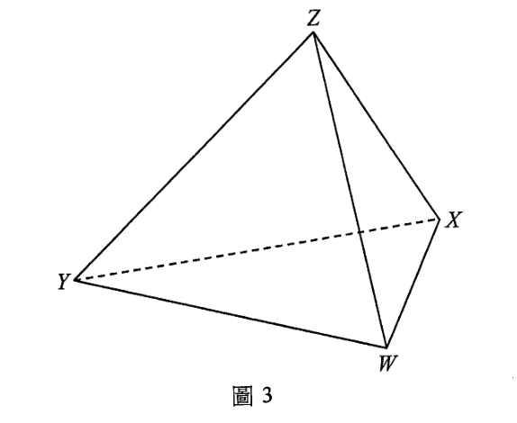

　　已知 $WZ$ 與三角形 $WXY$ 間的交角為 $30^{\circ}$。三角形 $WXY$ 與三角形 $XYZ$ 間的交角是否超過 $45^{\circ}$？試解釋你的答案。　(4分)

---

**6. 【2023 Q19】（12分）**　*外心、垂心、內心、坐標幾何*

　點 $P$ 及點 $Q$ 的坐標分別為 $(50,0)$ 及 $(32,t)$，其中 $t > 0$。將原點記為 $O$。設 $R$ 為一點使得 $OQ$ 為 $\triangle OPR$ 的中線。假定 $G$ 及 $H$ 分別為 $\triangle OPR$ 的外心及垂心。

　(a) 以 $t$ 表 $G$ 及 $H$ 的坐標。　(5分)

　(b) 設 $S$ 為 $OP$ 上的一點使得 $QS$ 垂直於 $OP$。已知 $\angle PQS = \angle POQ$。

　　(i) 藉考慮 $\tan\angle PQS$，證明 $t = 24$。
　　(ii) $O$、$G$ 與 $Q$ 是否共線？試解釋你的答案。
　　(iii) 將 $\triangle OPR$ 的內心記為 $I$。求 $\triangle GHR$ 的面積與 $\triangle IPQ$ 的面積之比。　(7分)

---

### 2024年（6題）

**1. 【2024 Q7】（4分）**　*極坐標*

　在某極坐標系中，$O$ 為極點。點 $P$、點 $Q$ 及點 $R$ 的極坐標分別為 $(11, 59^{\circ})$、$(60, 149^{\circ})$ 及 $(144, 239^{\circ})$。

　(a) 求 $\angle POQ$。
　(b) $P$、$O$ 與 $R$ 是否共線？試解釋你的答案。
　(c) 求 $\triangle PQR$ 的面積。

---

**2. 【2024 Q8】（5分）**　*全等三角形、面積*

　圖1中，$E$ 為 $AC$ 與 $BD$ 的交點。已知 $\angle ACB = \angle ADB = 90^{\circ}$ 及 $AD = BC$。

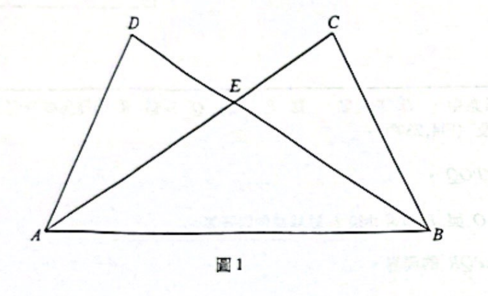

　(a) 證明 $\triangle ABC \cong \triangle BAD$。
　(b) 若 $AD = 12\ \mathrm{cm}$ 及 $DE = 9\ \mathrm{cm}$，求五邊形 $ABCED$ 的面積。

---

**3. 【2024 Q12】（7分）**　*坐標幾何、正方形*

　將原點記為 $O$。

　(a) $A$ 及 $B$ 均為正 $x$ 軸上的點使得 $A$ 的 $x$ 坐標大於 $B$ 的 $x$ 坐標。通過 $B$ 的垂直線與直線 $y = mx$ 相交於點 $C$ 使得 $AB = BC$。其中 $m$ 為一正常數。設 $D$ 為一點使得 $ABCD$ 為一正方形。以 $m$ 表 $OD$ 的斜率。　(3分)

　(b) 點 $M$ 及 $N$ 的坐標分別為 $(6, 5)$ 及 $(10, 0)$。設 $P$ 及 $Q$ 分別為 $OM$ 及 $MN$ 上的點，而 $R$ 及 $S$ 均為 $x$ 軸上的點。若四邊形 $PQRS$ 為一正方形，求 $P$ 的 $x$ 坐標。　(4分)

---

**4. 【2024 Q13】（7分）**　*立體幾何、體積、相似*

　某實心直立角錐體的底為一正方形，其邊長為 $64\ \mathrm{cm}$。該角錐體的高為 $24\ \mathrm{cm}$。將該角錐體以一平行於其底的平面分成一平截頭體 $X$ 及一角錐體 $Y$。已知 $Y$ 的高為 $18\ \mathrm{cm}$。

　(a) 求 $X$ 的體積。　(3分)

　(b) 另一實心直立角錐體的底為一正方形。將該角錐體以一平行於其底的平面分成一平截頭體 $Z$ 及一角錐體。$Z$ 的高及總表面面積分別為 $3\ \mathrm{cm}$ 及 $960\ \mathrm{cm}^2$。$X$ 與 $Z$ 是否相似？試解釋你的答案。　(4分)

---

**5. 【2024 Q17】（8分）**　*軌跡、圓的方程、切線*

　點 $Q$ 及點 $R$ 的坐標分別為 $(10, -4)$ 及 $(-4, -9)$。

　(a) 設 $P$ 為直角坐標平面上的一動點使得 $PQ = PR$。將 $P$ 的軌跡記為 $\Gamma$。

　　(i) 描述 $\Gamma$ 與 $QR$ 之間的幾何關係。
　　(ii) 求 $\Gamma$ 的方程。　(3分)

　(b) 設 $C$ 為通過 $Q$、$R$ 及點 $(4, 3)$ 的圓。

　　(i) 求 $C$ 的方程。
　　(ii) 點 $U$ 的坐標為 $(10, 4)$。現知 $U$ 位於 $C$ 以外。$UV$ 及 $UW$ 分別為 $C$ 在點 $V$ 及點 $W$ 的切線。$\triangle UVW$ 的外接圓的面積是否大於 100？試解釋你的答案。　(5分)

---

**6. 【2024 Q18】（8分）**　*三維三角學*

　(a) $PQRS$ 為一四邊形金屬片，其中 $PQ = 12\ \mathrm{cm}$、$PS = 10\ \mathrm{cm}$、$QR = 13\ \mathrm{cm}$、$\angle QPS = 82^{\circ}$ 及 $\angle QRS = 65^{\circ}$。求

　　(i) $QS$ 的長度。
　　(ii) $\angle RQS$。　(4分)

　(b) 現將 (a) 中所描述的金屬片 $PQRS$ 沿 $QS$ 摺起（見圖 2）。已知平面 $PQS$ 與平面 $QRS$ 間的交角為 $80^{\circ}$。

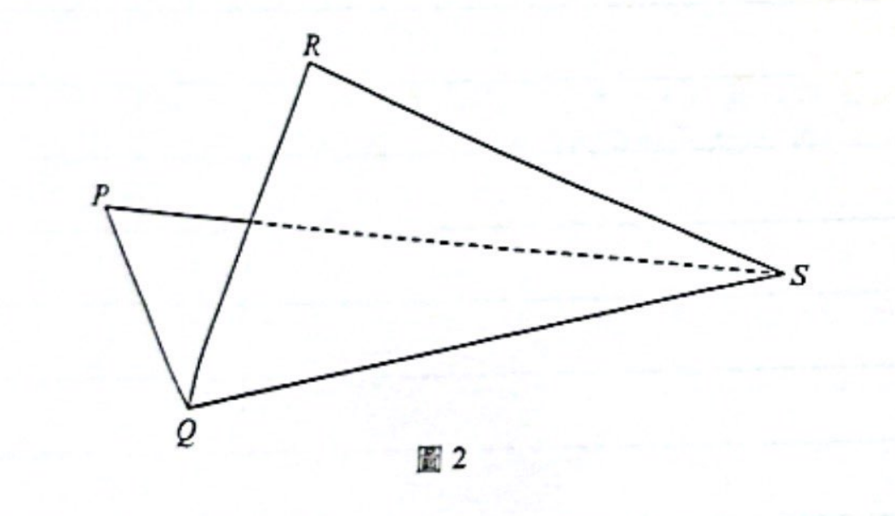

　　(i) 求由 $R$ 至平面 $PQS$ 的最短距離。
　　(ii) 設 $X$ 為平面 $QRS$ 上的任意點。某人宣稱 $P$ 與 $X$ 間的距離超過 $8\ \mathrm{cm}$。該宣稱是否正確？試解釋你的答案。　(4分)

---

### 2025年（5題）

**1. 【2025 Q4】（3分）**　*旋轉變換、平移、共線*

　點 $A$ 的坐標為 $(4,-2)$。$A$ 繞原點 $O$ 順時針方向旋轉 $90^{\circ}$ 至 $B$。

　(a) 寫出 $B$ 的坐標。
　(b) 假定 $B$ 向上平移 $t$ 單位至點 $C$。若 $A$、$O$ 與 $C$ 共線，求 $t$。

---

**2. 【2025 Q8】（5分）**　*全等三角形、相似三角形*

　圖中，$ST$ 與 $UV$ 相交於點 $W$。已知 $SU \parallel VT$ 及 $W$ 為 $ST$ 的中點。

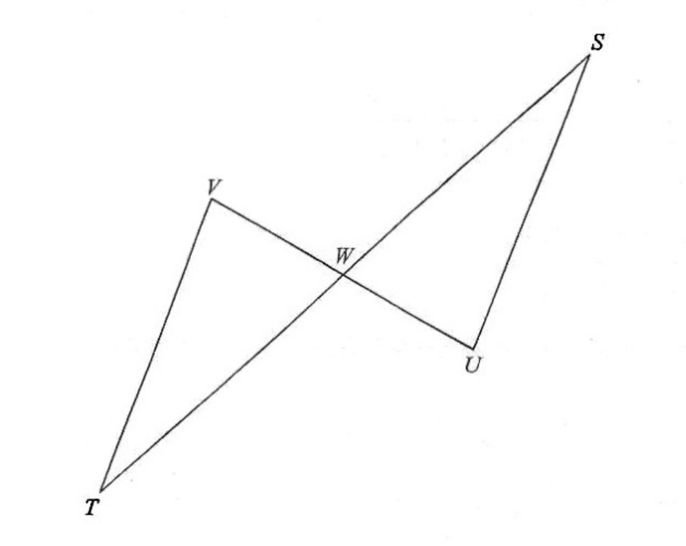

　(a) 證明 $\triangle SUW \cong \triangle TVW$。
　(b) 設 $X$ 為 $TW$ 上的一點使得 $\triangle SUW \sim \triangle VXW$。若 $SU = 57\ \mathrm{cm}$、$SW = 63\ \mathrm{cm}$ 及 $WX = 7\ \mathrm{cm}$，求 $\triangle TVX$ 的周界。

---

**3. 【2025 Q13】（7分）**　*軌跡、直線方程、面積*

　直線 $L$ 分別與正 $x$ 軸及正 $y$ 軸相交於點 $M$ 及點 $N$。設 $P$ 為直角坐標平面上的一動點使得 $MP = NP$。將 $P$ 的軌跡記為 $\Gamma$。已知 $\Gamma$ 的方程為 $3x-2y-30=0$。

　(a) 描述 $\Gamma$ 與 $MN$ 之間的幾何關係。　(1分)

　(b) 求 $L$ 的方程。　(3分)

　(c) 假定 $\Gamma$ 分別與 $L$ 及 $x$ 軸相交於點 $Q$ 及點 $R$。求四邊形 $ONQR$ 的面積，其中 $O$ 為原點。　(3分)

---

**4. 【2025 Q14】（9分）**　*圓錐體、平截頭體、體積、表面面積*

　一實心金屬直立圓錐體的高及底半徑分別為 $45\ \mathrm{cm}$ 及 $24\ \mathrm{cm}$。將該圓錐體以一平行於其底的平面分成一圓錐體及一平截頭體 $X$。已知 $X$ 的高為 $30\ \mathrm{cm}$。

　(a) 以 $\pi$ 表 $X$ 的體積。　(3分)

　(b) 以 $\pi$ 表 $X$ 的總表面面積。　(3分)

　(c) 把 $X$ 熔化，並重鑄成一實心正方體。該正方體的總表面面積是否超過 $X$ 的總表面面積？試解釋你的答案。　(3分)

---

**5. 【2025 Q19】（12分）**　*圓的方程、切線、內切圓、外接圓*

　直線 $L$ 的方程為 $4x-3y+83=0$。圓 $C$ 的方程為 $x^{2}+y^{2}+ax-2y+b=0$，其中 $a$ 及 $b$ 均為正常數。已知 $C$ 通過點 $(-10,9)$ 且 $L$ 為 $C$ 的切線。

　(a) 證明方程 $25x^{2}+(9a+640)x+(90a+4924)=0$ 有等根。由此，求 $a$ 及 $b$。　(4分)

　(b) 點 $P$ 的坐標為 $(-20,1)$。設 $Q$ 為在 $L$ 之下的一點使得 $PQ$ 與 $C$ 相切且 $PQ=25$。將 $C$ 的圓心記為 $I$。

　　(i) 求 $\cos \angle IPQ$。
　　(ii) 求 $I$ 與 $Q$ 間的距離，答案以根式表示。
　　(iii) 設 $R$ 為 $L$ 上的一點使得 $C$ 為 $\triangle PQR$ 的內切圓。將 $\triangle PQR$ 的外接圓的半徑記為 $r$。某人宣稱 $r > PQ$。該宣稱是否正確？試解釋你的答案。　(8分)

---

## 統計（47題）

### 2012年（4題）

**1. 【2012 Q7】（4分）**　*箱線圖、統計量（四分位數、中位數）*

　以下框線圖顯示100米賽跑的時間（秒）。

　（此處有圖：框線圖，最小值 $11.3$、下四分位數 $12.1$、中位數 $13.2$、上四分位數 $15.3$、最大值 $18.1$）

　已知最小值是 $a=11.3$，下四分位數是 $12.1$，中位數是 $13.2$，上四分位數是 $b=15.3$，最大值是 $18.1$。四分位數間距是 $3.2$ 秒，分佈域是 $6.8$ 秒。

　(a) 求 $a$ 及 $b$。
　(b) 訓練後，該組學生所需的最長時間減少 $2.9$ 秒。教練聲稱該組學生中至少 $25\%$ 的賽跑時間有改善。你是否同意？試解釋你的答案。

---

**2. 【2012 Q10】（6分）**　*莖葉圖、平均值、中位數*

　志誠進行一項中學生在某星期內用於做家課的時數的調查。在發出的問卷中，有二十份回覆。
　下面的幹葉圖顯示該二十份問卷記錄得的時數：

| 幹（十位） | 葉（個位） |
|---|---|
| 1 | 0  0  1  1  2  3  4  5  5  6  6  7  7 |
| 2 | 0  0  0  5  8 |
| 3 | 4  6 |

　(a) 求該二十份問卷記錄得的時數的平均值及中位數。　(2分)

　(b) 志誠再收到四份問卷。他得知這四份問卷記錄得的時數的平均值為18。現知這四份問卷其中兩份記錄得的時數為19及20。

　　(i) 寫出該二十四份問卷記錄得的時數的平均值。
　　(ii) 該二十四份問卷記錄得的時數的中位數與(a)所求得的中位數有沒有可能相同？試解釋你的答案。　(4分)

---

**3. 【2012 Q15】（3分）**　*標準差性質、標準分*

　一班學生在某數學測驗得分的標準差為10分。全部學生在該測驗均不及格，故此將每名學生的測驗得分調整，
　使每個得分均增加20%然後額外加5分。

　(a) 求得分調整後，測驗得分的標準差。　(1分)

　(b) 每名學生的標準分有否因得分調整而改變？試解釋你的答案。　(2分)

---

**4. 【2012 Q16】（4分）**　*組合概率、抽樣問題*

　某公司有8個部門。每個部門各提名2位代表以成立一個有16位成員的工作小組。從該工作小組中隨機選出4位成員。

　(a) 求所選出的4位成員由4個不同部門提名的概率。　(2分)

　(b) 求所選出的4位成員至多由3個不同部門提名的概率。　(2分)

---

### 2013年（4題）

**1. 【2013 Q9】（5分）**　*統計（棒形圖、平均值/四分位距/標準差）*

　下面的棒形圖顯示 $D$ 公司僱員的家庭成員人數的分佈。

　（此處有圖：棒形圖顯示家庭成員人數分佈）

　(a) 求上述分佈的平均值、四分位數間距及標準差。
　(b) $D$ 公司某僱員離職。這僱員的家庭成員人數為 $7$。求這僱員離職而引致 $D$ 公司僱員的家庭成員人數的標準差的改變。

---

**2. 【2013 Q10】（6分）**　*統計（中位數/眾數/幹葉圖/概率）*

　$A$ 委員會的委員年齡如下：

$$
\begin{array}{cccccccccc}
17 & 18 & 21 & 21 & 22 & 22 & 23 & 23 & 23 & 31 \\
31 & 34 & 35 & 36 & 47 & 47 & 58 & 68 & 69 & 69
\end{array}
$$

　(a) 寫出 $A$ 委員會的委員年齡的中位數及眾數。　(2分)

　(b) 下面的幹葉圖顯示 $B$ 委員會的委員年齡的分佈。已知這分佈的分佈域為 $47$。

| 幹（十位） | 葉（個位） |
|---|---|
| 2 | $a$  5  6  7 |
| 3 | 3  5  8 |
| 4 | 3 |
| 5 | 1  2  9 |
| 6 | 7  $b$ |

　　(i) 求 $a$ 及 $b$。
　　(ii) 現從每個委員會中，各隨機選出一名委員作該委員會的代表。當該兩名代表的年齡之差超過 $40$ 時，他們便可參加某比賽。求這兩名代表可參加該比賽的概率。　(4分)

---

**3. 【2013 Q15】（5分）**　*框線圖、標準分、平均值*

　下面的框線圖顯示某班學生在一測驗中得分（以分為單位）的分佈。在該測驗中，嘉明獲最高得分，而志誠獲得 $65$ 分。嘉明及志誠在該測驗中的標準分分別為 $3$ 及 $0.5$。

　（此處有圖：框線圖顯示測驗得分分佈）

　(a) 求該分佈的平均值。　(2分)

　(b) 嘉明宣稱在該測驗中至少一半學生的標準分均為負值。你是否同意？試解釋你的答案。　(2分)

---

**4. 【2013 Q16】（4分）**　*概率（組合、同時抽出）*

　某盒子內有 $5$ 個白色杯及 $11$ 個藍色杯。若從該盒子中隨機同時抽出 $6$ 個杯，

　(a) 求抽出至少 $4$ 個白色杯的概率；　(2分)

　(b) 求抽出至少 $3$ 個藍色杯的概率。　(2分)

---

### 2014年（3題）

**1. 【2014 Q4】（3分）**　*統計：集中趨勢及離散量度（中位數、眾數、標準差）*

　下表顯示一些學生擁有計算機的數目的分佈。

　\newcolumntype{C}[1]{>{\centering\arraybackslash}p{#1}}

| 計算機的數目 | 0 | 1 | 2 | 3 |
|---|---|---|---|---|
| 學生人數 | 7 | 14 | 15 | 4 |

　求上述分佈的中位數、眾數及標準差。

---

**2. 【2014 Q11】（6分）**　*統計：框線圖，分佈域，四分位數間距，平均值及中位數*

　某畫廊有 33 幅油畫。下面的框線圖顯示該畫廊的油畫的價格分佈。已知此分佈的平均值為 53 千元。

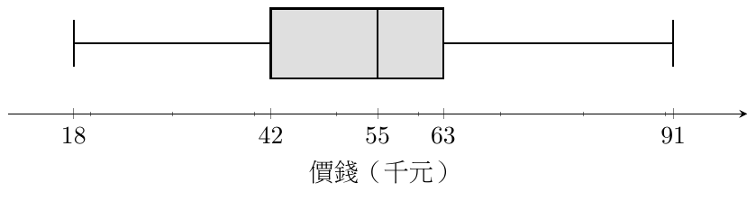

　(a) 求上述分佈的分佈域及四分位數間距。　(3分)

　(b) 現將價格（以千元為單位）分別為 32、34、58 及 59 的四幅油畫捐贈給一博物館。求該畫廊內餘下的油畫的價格的平均值及中位數。　(3分)

---

**3. 【2014 Q19】（13分）**　*概率（幾何分佈），期望值*

　佩玲及志偉參與一含兩回合的遊戲。在第一回合，佩玲及志偉輪流投擲一枚勻稱骰子。首位擲得點數「$3$」的參與者勝出第一回合。佩玲及志偉參與第一回合，直至其中一人勝出為止。佩玲先投擲骰子。

　(a) 求佩玲勝出該遊戲第一回合的概率。　(3分)

　(b) 在該遊戲的第二回合，球被逐一投入某部由八個管子並列所組成的裝置內（見圖8）。當球被投入該裝置時，它會隨機跌進其中一管子內。每個管子最多可容納三個球。

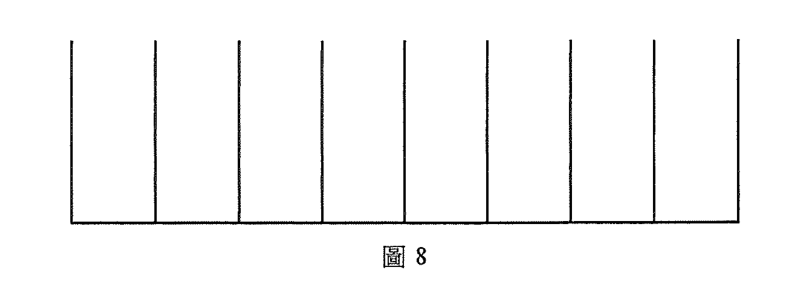

　　這回合的參與者採納下列兩個選項中的一個。

　　**選項1：**將兩個球逐一投入該裝置內。若該兩個球跌進同一管子內，則該參與者獲 $10$ 個代幣；若該兩個球跌進兩個相鄰的管子內，則該參與者獲 $5$ 個代幣；否則，該參與者不獲代幣。

　　**選項2：**將三個球逐一投入該裝置內。若該三個球跌進同一管子內，則該參與者獲 $50$ 個代幣；若該三個球跌進三個相鄰的管子內，
　　則該參與者獲 $10$ 個代幣；若該三個球跌進兩個相鄰的管子內，則該參與者獲 $5$ 個代幣；否則，該參與者不獲代幣。

　　(i) 若第二回合的參與者採納選項1，求所獲代幣的數目的期望值。
　　(ii) 第二回合的參與者應採納哪一選項才使所獲代幣的數目的期望值達至最大？試解釋你的答案。
　　(iii) 只有第一回合的勝方參與第二回合。已知第二回合的參與者採納能使所獲代幣的數目的期望值達至最大的選項。志偉宣稱佩玲在該遊戲中不獲代幣的概率超過 $0.9$。該宣稱是否正確？試解釋你的答案。　(10分)

---

### 2015年（4題）

**1. 【2015 Q3】（3分）**　*概率*

　$A$ 袋內有四張卡，該四張卡分別記有數字 $1$、$3$、$5$ 及 $7$；而 $B$ 袋內有五張卡，該五張卡分別記有數字 $2$、$4$、$6$、$8$ 及 $10$。若從每袋中各隨機抽出一張卡，求所抽出的兩數字之和小於 $9$ 的概率。

---

**2. 【2015 Q12】（7分）**　*統計（莖葉圖、平均值、中位數、分佈域）*

　下面的幹葉圖顯示足球學會的學生的體重（以 $\mathrm{kg}$ 為單位）的分佈。

| 4 | 0  2  3  3  3  9 |
|---|---|
| 5 | 1  1  2  2  3  7  9 |
| 6 | 3  5  8  9 |
| 7 | 8  9 |

　(a) 求上述分佈的平均值、中位數及分佈域。　(3分)

　(b) 現再有兩名學生加入該學會。得知體重的分佈的平均值及分佈域均增加 $1\,\mathrm{kg}$。求這兩名學生各人的體重。　(4分)

---

**3. 【2015 Q15】（4分）**　*標準分、正態分佈*

　下表顯示一大群學生在數學考試及科學考試的得分的平均值及標準差：

| **考試** | **平均值** | **標準差** |
|---|---|---|
| 數學 | 66 分 | 12 分 |
| 科學 | 52 分 | 10 分 |

　家華在數學考試的標準分為 $-0.5$。

　(a) 求家華在數學考試的得分。　(2分)

　(b) 假設上述每一考試的得分均為正態分佈。家華在科學考試得 49 分。他宣稱相對於其他學生，他在科學考試的表現較數學考試為佳。該宣稱是否正確？試解釋你的答案。　(2分)

---

**4. 【2015 Q16】（4分）**　*概率（組合、同時抽出）*

　某盒子內有 5 個紅色碗、6 個黃色碗及 3 個白色碗。若從該盒子中隨機同時抽出 4 個碗，

　(a) 求抽出恰好 2 個紅色碗的概率；　(2分)

　(b) 求抽出至少 2 個紅色碗的概率。　(2分)

---

### 2016年（4題）

**1. 【2016 Q9】（5分）**　*頻數分佈表、累積頻數、概率*

　下面的頻數分佈表及累積頻數分佈表均顯示某花園內植物的高度的分佈。

| **高度 (m)** | **頻數** |
|---|---|
| $0.1-0.3$ | $a$ |
| $0.4-0.6$ | $4$ |
| $0.7-0.9$ | $b$ |
| $1.0-1.2$ | $c$ |
| $1.3-1.5$ | $15$ |
| $1.6-1.8$ | $3$ |

| **高度少於 (m)** | **累積頻數** |
|---|---|
| $0.35$ | $2$ |
| $0.65$ | $x$ |
| $0.95$ | $13$ |
| $1.25$ | $y$ |
| $1.55$ | $37$ |
| $1.85$ | $z$ |

　(a) 求 $x$、$y$ 及 $z$。
　(b) 若從該花園中隨機選取一植物，求所選取的植物的高度少於 $1.25\,\mathrm{m}$ 但不少於 $0.65\,\mathrm{m}$ 的概率。

---

**2. 【2016 Q12】（7分）**　*棒形圖、中位數、平均值、分佈域*

　下面的棒形圖顯示一群小童的年歲的分佈，其中 $a>11$ 及 $4<b<10$。該群小童的年歲的中位數為 $7.5$。

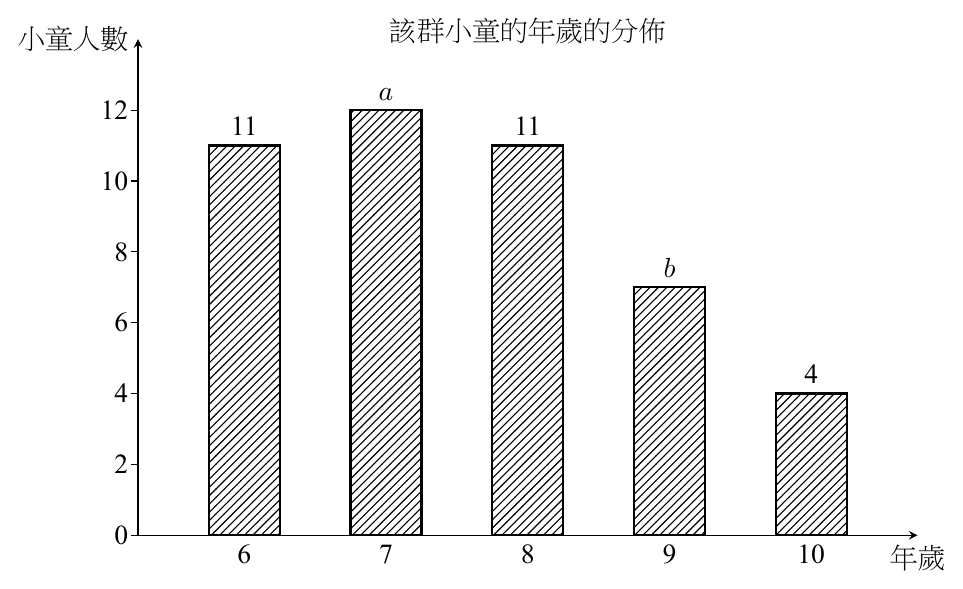

　(a) 求 $a$ 及 $b$。　(3分)

　(b) 現再有四名小童加入該群。得知該四名小童的年歲全不相同且該群小童的年歲的分佈域維持不變。求

　　(i) 該群小童的年歲的最大可取中位數，
　　(ii) 該群小童的年歲的最小可取平均值。　(4分)

---

**3. 【2016 Q15】（3分）**　*排列組合（不相鄰排列）*

　若 4 名男生與 5 名女生隨機排成一隊，求沒有男生在該隊中相鄰而排的概率。

---

**4. 【2016 Q16】（3分）**　*標準分、分佈域*

　某測驗中，一班學生得分的分佈的平均值為 61 分。家健及小麗的標準分分別為 $-2.6$ 及 $1.4$。家健得 22 分。某學生宣稱該分佈的分佈域至多為 59 分。該宣稱是否正確？試解釋你的答案。

---

### 2017年（3題）

**1. 【2017 Q7】（4分）**　*圓形圖與概率*

　下面的圓形圖顯示某校學生出生季節的分佈。

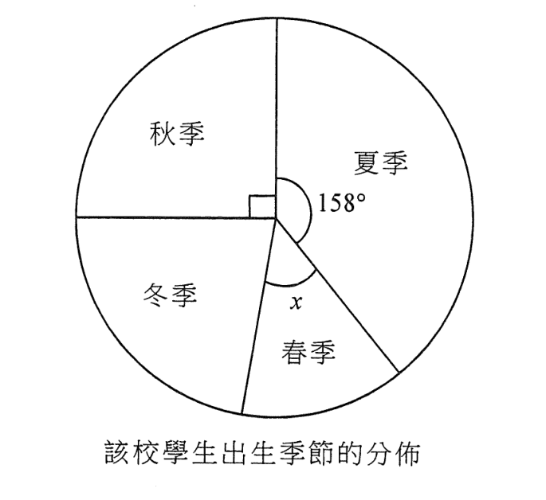

　若從該校中隨機選出一名學生，則所選出的學生在春季出生的概率為 $\dfrac{1}{9}$。

　(a) 求 $x$。
　(b) 該校有180名學生在冬季出生。求該校學生的人數。

---

**2. 【2017 Q11】（7分）**　*幹葉圖、集中趨勢與離差度量*

　下面的幹葉圖顯示一群工人的時薪（以元為單位）的分佈。

| 幹（十位） | 葉（個位） |
|---|---|
| 6 | 1  1  1  3  4  6  8  9  9 |
| 7 | $a$  7  7  8 |
| 8 | 1  $b$ |

　已知上述分佈的平均值及分佈域分別為 \$70 及 \$22。

　(a) 求上述分佈的中位數及標準差。　(5分)

　(b) 若從該群中隨機選出一名工人，求所選出的工人的時薪超過 $70 的概率。　(2分)

---

**3. 【2017 Q17】（6分）**　*排列與組合*

　某袋子內有4枝綠筆、7枝藍筆及8枝黑筆。若從該袋子中隨機同時抽出5枝筆，

　(a) 求抽出恰好4枝綠筆的概率。　(2分)

　(b) 求抽出恰好3枝綠筆的概率。　(2分)

　(c) 求抽出不多於2枝綠筆的概率。　(2分)

---

### 2018年（4題）

**1. 【2018 Q4】（3分）**　*概率*

　某盒子中有 $n$ 個白球、$5$ 個黑球及 $8$ 個紅球。若從該盒子中隨機抽出一個球，則抽出紅球的概率為 $\dfrac{2}{5}$。求 $n$ 的值。

---

**2. 【2018 Q10】（5分）**　*框線圖（分佈域、四分位數間距）*

　下面的框線圖顯示某公司 $X$ 組文員的年歲的分佈。已知這分佈的分佈域及四分位數間距分別為 $43$ 及 $21$。

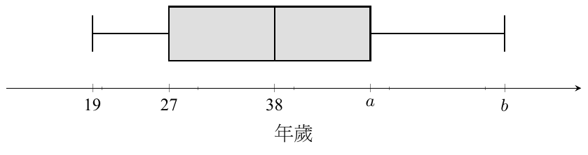

　(a) 求 $a$ 及 $b$。　(3分)

　(b) 該公司 $Y$ 組有五名文員且其中三名的年歲均為 $38$。已知 $Y$ 組文員的年歲的分佈域為 $20$。$X$ 組與 $Y$ 組現合併為一部門。公司經理宣稱該部門文員的年歲的分佈域與 $X$ 組文員的年歲的分佈域必為相同。你是否同意？試解釋你的答案。　(2分)

---

**3. 【2018 Q11】（6分）**　*統計分佈（眾數、中位數、平均值）*

　下表顯示一些家庭的子女人數的分佈：

| 子女人數 | $0$ | $1$ | $2$ | $3$ | $4$ |
|---|---|---|---|---|---|
| 家庭數目 | $k$ | $2$ | $9$ | $6$ | $7$ |

　已知 $k$ 為一正整數。

　(a) 若該分佈的眾數為 $2$，寫出

　　(i) $k$ 的最小可取值；
　　(ii) $k$ 的最大可取值。　(2分)

　(b) 若該分佈的中位數為 $2$，寫出

　　(i) $k$ 的最小可取值；
　　(ii) $k$ 的最大可取值。　(2分)

　(c) 若該分佈的平均值為 $2$，求 $k$ 的值。　(2分)

---

**4. 【2018 Q15】（3分）**　*排列組合*

　一個八位電話號碼由 $2$、$3$、$4$、$5$、$6$、$7$、$8$ 及 $9$ 的排列所組成。

　(a) 可組成多少個不同的八位電話號碼？　(1分)

　(b) 若八位電話號碼的第一個位及最後一個位均為奇數，則可組成多少個不同的八位電話號碼？　(2分)

---

### 2019年（3題）

**1. 【2019 Q8】（5分）**　*圓形圖、眾數、平均值、概率*

　下面的圓形圖顯示一群女生擁有指環的數目的分佈。

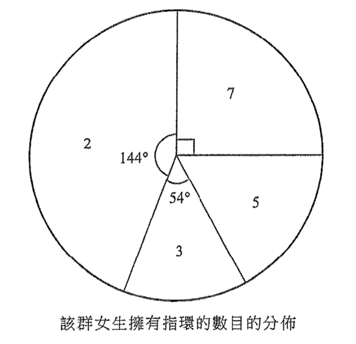

　(a) 寫出該分佈的眾數。
　(b) 求該分佈的平均值。
　(c) 若從該群中隨機選出一名女生，求所選出的女生擁有多於 $3$ 枚指環的概率。

---

**2. 【2019 Q12】（8分）**　*幹葉圖、四分位數間距、標準差、分佈域*

　下面的幹葉圖顯示一些男生在 $400\,\mathrm{m}$ 賽跑的成績（以秒為單位）的分佈。

| 幹（十位） | 葉（個位） |
|---|---|
| $5$ | $a$ |
| $6$ | $0\quad 0\quad 3\quad c\quad c\quad 8\quad 9\quad 9\quad 9$ |
| $7$ | $0\quad 1\quad 1\quad 1\quad 2\quad 2\quad 3\quad 6\quad 9$ |
| $8$ | $b$ |

　已知該分佈的四分位數間距為 $8$ 秒。

　(a) 求 $c$ 。　(2分)

　(b) 已知該分佈的分佈域超過 $34$ 秒且該分佈的平均值為 $69$ 秒。求

　　(i) $a$ 及 $b$ ，
　　(ii) 該分佈的最小可取標準差。　(6分)

---

**3. 【2019 Q15】（3分）**　*排列組合（至少1名男生）*

　某班有 $21$ 名男生及 $11$ 名女生。若從該班中選出 $5$ 名學生組成一個有至少 $1$ 名男生的委員會，則可組成多少個不同的委員會？

---

### 2020年（3題）

**1. 【2020 Q9】（5分）**　*統計：平均值、中位數、標準差*

　下表顯示某班學生所修科目的數目的分佈。

| 所修科目的數目 | 4 | 5 | 6 | 7 |
|---|---|---|---|---|
| 學生人數 | 8 | 12 | 16 | 4 |

　(a) 寫出上述分佈的平均值、中位數及標準差。
　(b) 現有一新生加入該班。該新生所修科目的數目為 $5$。求加入這學生而引致該分佈的中位數的改變。

---

**2. 【2020 Q11】（6分）**　*幹葉圖、分佈域、四分位數間距、概率*

　下面的幹葉圖顯示某袋子內的信件的重量（以克為單位）的分佈。

| 幹（十位） | 葉（個位） |
|---|---|
| 1 | 1  2  3  3 |
| 2 | 3  3  4  5  6  9  9 |
| 3 | 1  6  7  8  8  8 |
| 4 | 2 |
| 5 | 0  $w$ |

　已知上述分佈的分佈域為其四分位數間距的三倍。

　(a) 求 $w$。　(4分)

　(b) 若從該袋子中隨機抽取一信件，求所抽取的信件的重量不少於該分佈的眾數的概率。　(2分)

---

**3. 【2020 Q15】（5分）**　*概率（同時抽出）*

　某箱子內有 $3$ 隻藍色碟、$7$ 隻綠色碟及 $9$ 隻紫色碟。若從該箱子中隨機同時抽出 $4$ 隻碟，求

　(a) 抽出 $4$ 隻相同顏色的碟的概率；
　(b) 抽出至少 $2$ 隻不同顏色的碟的概率。

---

### 2021年（3題）

**1. 【2021 Q9】（5分）**　*統計（條形圖/概率）*

　下面的棒形圖顯示一群學生在某年內的閱讀數目的分佈。

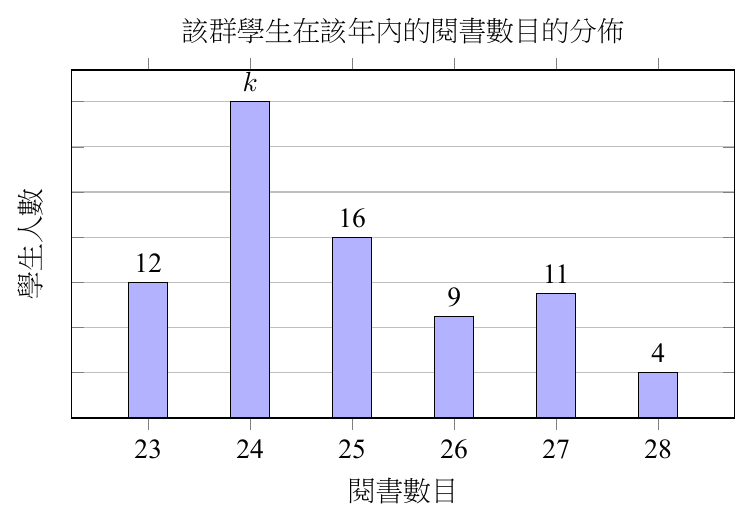

　若從該群中隨機選出一名學生，則所選出的學生在該年內閱讀少於26本的機率為 $\dfrac{7}{10}$。

　(a) 求 $k$。 　(2分)
　(b) 寫出該分佈的分佈域、四分位數間距及標準差。 　(3分)

---

**2. 【2021 Q11】（7分）**　*統計（平均值/中位數/眾數）*

　下表顯示在一遊戲中某群小童所獲代幣的數目的分佈。

| 所獲代幣的數目 | 1 | 2 | 3 | 4 | 5 | 6 | 7 |
|---|---|---|---|---|---|---|---|
| 小童人數 | 15 | 9 | 2 | 5 | 4 | 2 | 5 |

　(a) 求該分佈的平均值。 　(2分)
　(b) 該分佈的中位數與眾數是否相等？試解釋你的答案。 　(2分)
　(c) 若再多 $n$ 名小童參與該遊戲且其中每人均獲 5 個代幣，寫出：

　　(i) $n$ 的值使得該分佈的平均值增加 1； 　(1分)
　　(ii) $n$ 的最小值使得該分佈的中位數增加 2； 　(1分)
　　(iii) $n$ 的最大值使得該分佈的眾數維持不變。 　(1分)

---

**3. 【2021 Q15】（4分）**　*排列組合/概率*

　7名教師與3名學生隨機排成一隊。

　(a) 可排成多少不同的隊？ 　(1分)
　(b) 求沒有學生在該隊中相鄰而排的概率。 　(3分)

---

### 2022年（3題）

**1. 【2022 Q9】（5分）**　*統計（頻數分佈表、平均值、概率）*

　下面的頻數分佈表及累積頻數分佈表均顯示某群學生完成某 $3\,\mathrm{km}$ 賽跑所需時間的分佈。

| 所需時間（分鐘） | 頻數 |
|---|---|
| $10$ -- $14$ | $a$ |
| $15$ -- $19$ | $9$ |
| $20$ -- $24$ | $b$ |
| $25$ -- $29$ | $3$ |

| 所需時間少於（分鐘） | 累積頻數 |
|---|---|
| $14.5$ | $3$ |
| $19.5$ | $x$ |
| $24.5$ | $y$ |
| $29.5$ | $20$ |

　(a) 寫出 $x$ 的值。
　(b) 求該分佈的平均值。
　(c) 求從該群中隨機選出的一名學生完成該 $3\,\mathrm{km}$ 賽跑所需時間少於 $19.5$ 分鐘的概率。

---

**2. 【2022 Q11】（7分）**　*幹葉圖、四分位數間距、標準差*

　下面的幹葉圖顯示某足球隊球員的年齡的分佈。

| 幹（十位） | 葉（個位） |
|---|---|
| 1 | 7  8  9 |
| 2 | 0  $a$  $a$  8  8  9 |
| 3 | $b$  $b$  5  5  6  6  6  6  7  8 |
| 4 | 3 |

　該分佈的四分位數間距及中位數分別為 $14$ 及 $31$。

　(a) 求 $a$ 及 $b$。　(3分)

　(b) 某球員現退出該足球隊。

　　(i) 該分佈的眾數有否因該球員退出而改變？試解釋你的答案。
　　(ii) 若該分佈的分佈域減小，求該分佈的最大可取標準差。　(4分)

---

**3. 【2022 Q15】（4分）**　*排列組合、概率*

　某班有 $10$ 名男生及 $12$ 名女生。若從該班中隨機選出 $4$ 名學生組成一個委員會，

　(a) 求該委員會有 $2$ 名男生及 $2$ 名女生的概率；　(2分)

　(b) 求該委員會男生人數與女生人數不同的概率。　(2分)

---

### 2023年（3題）

**1. 【2023 Q9】（5分）**　*幹葉圖（平均值、眾數、概率）*

　下面的幹葉圖顯示一群工人在某星期的工作時數的分佈。

| 幹（十位） | 葉（個位） |
|---|---|
| 2 | $a$  5  5  6  6  8  8 |
| 3 | 3  3  3  4  5  5  9  9 |
| 4 | 0  1  4  4  5  6  7  7  9 |

　該分佈的分佈域為 $27$。

　(a) 求該分佈的平均值及眾數。
　(b) 若從該群中隨機選出一名工人，求所選出的工人在該星期的工作時數超過該分佈的眾數的概率。

---

**2. 【2023 Q11】（7分）**　*離散數據（中位數、四分位數間距、方差）*

　下表顯示某班學生擁有計算機的數目的分佈。

| 擁有計算機的數目 | 1 | 2 | 3 | 4 |
|---|---|---|---|---|
| 學生人數 | 8 | 5 | $n$ | 1 |

　該分佈的平均值為 $2$。

　(a) 求該分佈的中位數、四分位數間距及方差。　(5分)

　(b) 該班現有兩名學生退學。得知該分佈的平均值維持不變。該分佈的分佈域有否因該兩名學生退學而改變？試解釋你的答案。　(2分)

---

**3. 【2023 Q15】（4分）**　*概率（排列組合）*

　某盒子內有 $5$ 個紅球及 $4$ 個黑球。從該盒子中隨機同時抽出 $2$ 個球。

　(a) 求所抽出的 $2$ 個球均為紅色的概率。　(2分)

　(b) 某袋子內有 $8$ 個紅球。把從該盒子中所抽出的 $2$ 個球放入該袋子內，然後從該袋子中隨機同時抽出 $3$ 個球。求所抽出的 $3$ 個球為相同顏色的概率。　(2分)

---

### 2024年（3題）

**1. 【2024 Q9】（5分）**　*統計：平均值、眾數、中位數*

　下表顯示某組主持擁有鑰匙的數目的分佈。

　\newcolumntype{C}[1]{>{\centering\arraybackslash}p{#1}}

| 鑰匙的數目 | 3 | 4 | 5 | 6 | 7 | 8 |
|---|---|---|---|---|---|---|
| 主持人數 | 10 | 9 | 4 | 3 | 4 | $k$ |

　若從該群中隨機選出一名主持，則她擁有多於 6 條鑰匙的概率為 $\dfrac{5}{18}$。

　(a) 求 $k$。
　(b) 寫出該分佈的平均值、眾數及中位數。

---

**2. 【2024 Q11】（9分）**　*幹葉圖、四分位數間距*

　下面的幹葉圖顯示一群研究員在某月內用於閱讀期刊的時數的分佈。

| 幹（十位） | 葉（個位） |
|---|---|
| 2 | 0  0  1  $a$  $a$  $a$  8  8  9  9 |
| 3 | 0  0  2  3  4  4  7  9 |
| 4 | 0  $b$ |

　該分佈的平均值為 30。

　(a) 求 $a$ 及 $b$。　(5分)

　(b) 寫出該分佈的最小可取分佈域。　(1分)

　(c) 求該分佈的最大可取四分位數間距。　(3分)

---

**3. 【2024 Q16】（4分）**　*概率*

　某袋子內有 16 個紅色杯及 4 個白色杯。若從該袋子中隨機同時抽出 5 個杯，求

　(a) 抽出恰好 1 個白色杯的概率；
　(b) 抽出至多 3 個紅色杯的概率。

---

### 2025年（3題）

**1. 【2025 Q9】（5分）**　*統計：中位數、標準差*

　下表顯示一些學生擁有原子筆的數目的分佈。

　\newcolumntype{C}[1]{>{\centering\arraybackslash}p{#1}}

| 原子筆的數目 | 5 | 6 | 7 | 8 | 9 |
|---|---|---|---|---|---|
| 學生人數 | 9 | 13 | 2 | $s$ | 11 |

　該分佈的中位數為 $7$。

　(a) 求 $s$ 的最小可取值。
　(b) 寫出 $s$ 的最大可取值。
　(c) 求該分佈的最大可取標準差。

---

**2. 【2025 Q12】（7分）**　*幹葉圖、框線圖、四分位數*

　下面的幹葉圖顯示一些運動員在訓練前的體重（以 $\mathrm{kg}$ 為單位）的分佈。

| 幹（十位） | 葉（個位） |
|---|---|
| 4 | 5  6  8 |
| 5 | $w$  $w$  6  7 |
| 6 | 3  4  5  6  9  9 |
| 7 | 0  2 |
| 8 | 7 |

　上述分佈的分佈域與四分位數間距之差為 $25\ \mathrm{kg}$。

　(a) 寫出上述分佈的分佈域。由此，求 $w$。　(3分)

　(b) 下面的框線圖顯示該些運動員在訓練後的體重（以 $\mathrm{kg}$ 為單位）的分佈。

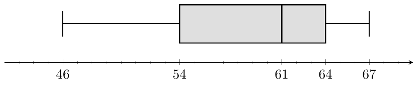

　　(i) 求因訓練而致該分佈的上四分位數的改變。
　　
　　(ii) 該些運動員在訓練後的體重的分佈的離差是否較訓練前的小？試解釋你的答案。　(4分)

---

**3. 【2025 Q15】（4分）**　*概率*

　某盒子內有 $8$ 隻白色碟、$4$ 隻紅色碟及 $1$ 隻黑色碟。若從該盒子中隨機同時抽出 $3$ 隻碟，求

　(a) 所抽出 $3$ 隻碟的顏色是相同的概率；　(2分)

　(b) 所抽出 $3$ 隻碟的顏色是全不相同的概率。　(2分)

---

## 組合（跨領域綜合）（11題）

### 2012年（1題）

**1. 【2012 Q11】（6分）**　*正變、成本計算、相似形*

　設$\$C$為一表面面積是$A \text{m}^2$的罐的髹漆成本。已知$C$為兩部分之和，一部分為常數，
　而另一部分隨$A$正變。當$A=2$時，$C=62$；當$A=6$時，$C=74$。

　(a) 求一表面面積是$13\,\text{m}^2$的罐的髹漆成本。　(4分)

　(b) 有一較大的罐與(a)所描述的罐相似。若該較大的罐的體積為(a)所描述的罐的8倍，求該較大的罐的髹漆成本。　(2分)

---

### 2014年（1題）

**1. 【2014 Q13】（8分）**　*正變，函數求值，三角形面積（坐標）*

　已知 $f(x)$ 為兩部分之和，一部分隨 $x^2$ 正變，而另一部分為常數。假定 $f(2)=59$ 及 $f(7)=-121$。

　(a) 求 $f(6)$。　(4分)

　(b) $A(6,a)$ 及 $B(-6,b)$ 均為 $y = f(x)$ 的圖像上的點。求 $\triangle ABC$ 的面積，其中 $C$ 為 $x$ 軸上的一點。　(4分)

---

### 2017年（1題）

**1. 【2017 Q18】（8分）**　*二次函數、判別式、距離公式*

　拋物線 $\varGamma$ 的方程為 $y=2x^2-2kx+2x-3k+8$，其中 $k$ 為一實常數。將直線 $y=19$ 記為 $L$。

　(a) 證明 $L$ 與 $\varGamma$ 相交於兩相異點。　(3分)

　(b) $L$ 與 $\varGamma$ 的交點為 $A$ 及 $B$。

　　(i) 設 $a$ 及 $b$ 分別為 $A$ 及 $B$ 的 $x$ 坐標。證明 $(a-b)^2=k^2+4k+23$。
　　
　　(ii) $A$ 與 $B$ 間的距離有沒有可能少於 4？試解釋你的答案。　(5分)

---

### 2018年（1題）

**1. 【2018 Q18】（8分）**　*聯合變分、配方法、頂點、外心*

　已知 $f(x)$ 的一部分隨 $x^{2}$ 正變，而另一部分則隨 $x$ 正變。假定 $f(2)=60$ 及 $f(3)=99$。

　(a) 求 $f(x)$。　(3分)

　(b) 設 $Q$ 為 $y=f(x)$ 的圖像的頂點及 $R$ 為 $y=27-f(x)$ 的圖像的頂點。

　　(i) 利用配方法，求 $Q$ 的坐標。
　　
　　(ii) 寫出 $R$ 的坐標。
　　
　　(iii) 點 $S$ 的坐標為 $(56,0)$。設 $P$ 為 $\triangle QRS$ 的外心。描述 $P$、$Q$ 與 $R$ 之間的幾何關係。試解釋你的答案。　(5分)

---

### 2019年（1題）

**1. 【2019 Q19】（12分）**　*二次函數、配方法、圖像變換、共圓、圓面積*

　設 $f(x) = \dfrac{1}{1+k}\left[x^2 + (6k-2)x + (9k+25)\right]$，其中 $k$ 為一正常數。將點 $(4,23)$ 記為 $F$ 。

　(a) 證明 $y=f(x)$ 的圖像通過 $F$ 。　(1分)

　(b) 將 $y=f(x)$ 的圖像對 $y$ 軸反射，然後將所得的圖像向上平移 $4$ 單位得出 $y=g(x)$ 的圖像。設 $U$ 為 $y=g(x)$ 的圖像的頂點。將原點記為 $O$ 。

　　(i) 利用配方法，以 $k$ 表 $U$ 的坐標。
　　
　　(ii) 求 $k$ 使得通過 $F$ 、 $O$ 及 $U$ 的圓的面積最小。
　　
　　(iii) 對任意正常數 $k$ ， $y=g(x)$ 的圖像均通過同一點 $G$ 。設 $V$ 為 $y=g(x)$ 的圖像的頂點使得通過 $F$ 、 $O$ 及 $V$ 的圓的面積最小。 $F$ 、 $G$ 、 $O$ 與 $V$ 是否共圓？試解釋你的答案。　(11分)

---

### 2020年（1題）

**1. 【2020 Q17】（6分）**　*二次函數、配方法、頂點、外心*

　設 $g(x)=x^2-2kx+2k^2+4$，其中 $k$ 為一實常數。

　(a) 利用配方法，以 $k$ 表 $y=g(x)$ 的圖像的頂點的坐標。　(2分)

　(b) 在同一直角坐標系中，設 $D$ 及 $E$ 分別為 $y=g(x+2)$ 的圖像的頂點及 $y=-g(x-2)$ 的圖像的頂點。這直角坐標系中是否有一點 $F$ 使得 $\triangle DEF$ 的外心的坐標為 $(0,3)$？試解釋你的答案。　(4分)

---

### 2021年（1題）

**1. 【2021 Q19】（12分）**　*二次函數/圓/內切圓*

　設 $f(x) = x^2 - 12kx - 14x + 36k^2 + 89k + 53$，其中 $k$ 為一正常數。在同一直角坐標系中，將 $y = f(x)$ 的圖像的頂點及 $y = f(14-x)$ 的圖像的頂點分別記為 $Q$ 及 $R$。

　(a) 利用配方法，以 $k$ 表 $Q$ 的坐標。 　(2分)
　
　(b) 寫出 $R$ 的坐標，答案以 $k$ 表示。 　(1分)
　
　(c) 點 $S$ 的坐標為 $(7, 4-3k)$。將 $\triangle QRS$ 的內切圓記為 $C$。

　　(i) 以 $k$ 表通過 $Q$ 及 $S$ 的直線的方程。
　　
　　(ii) 以 $k$ 表 $C$ 的方程。
　　
　　(iii) 假定 $QS$ 為 $C$ 在點 $T$ 的切線。設 $U$ 為 $C$ 的圓心。已知點 $V$ 的坐標為 $(-29, -14)$。$STUV$ 有沒有可能為一長方形？試解釋你的答案。　(9分)

---

### 2022年（1題）

**1. 【2022 Q16】（5分）**　*配方法、坐標幾何*

　設 $g(x) = 3x^{2} + 12kx + 16k^{2} + 8$，其中 $k$ 為一非零的實常數。

　(a) 利用配方法，以 $k$ 表 $y = g(x)$ 的圖像的頂點的坐標。　(2分)

　(b) 在同一直角坐標系中，將 $y = g(x)$ 的圖像的頂點及 $y = 2g(-x)$ 的圖像的頂點分別記為 $A$ 及 $B$。設 $M$ 為 $AB$ 上的一點使得 $\triangle OBM$ 的面積為 $\triangle OAM$ 的面積之三倍，其中 $O$ 為原點。以 $k$ 表 $M$ 的坐標。　(3分)

---

### 2023年（1題）

**1. 【2023 Q16】（5分）**　*根與系數、圓與直線*

　(a) 設 $a$ 及 $b$ 均為實常數。若方程 $x^{2} + ax + b = 0$ 的根為 $p$ 及 $5p$，證明 $5a^{2} = 36b$。　(2分)

　(b) 將圓 $x^{2} + y^{2} - 6x - 12y + 20 = 0$ 記為 $C$。求常數 $m$ 使得直線 $y = mx$ 與 $C$ 相交於點 $Q$ 及點 $R$ 且 $OQ : QR = 1 : 4$，其中 $O$ 為原點。　(3分)

---

### 2024年（1題）

**1. 【2024 Q19】（12分）**　*二次函數、配方法、等差等比數列、菱形*

　設 $f(x) = 2x^2 + 4mx + 8x + 2m^2 + 8m + n$，其中 $m$ 及 $n$ 均為實常數使得 $mn < 0$。將 $y = f(x)$ 的圖像的頂點記為 $P$。

　(a) 利用配方法，以 $m$ 及 $n$ 表 $P$ 的坐標。　(2分)

　(b) 描述 $f(x)$ 變換為 $f\left(\dfrac{x}{5}\right) + 7$ 所表示的幾何意義。　(2分)

　(c) 將 $y = f\left(\dfrac{x}{5}\right) + 7$ 的圖像的頂點記為 $Q$。設 $(a_1, b_1)$ 及 $(a_2, b_2)$ 分別為 $P$ 及 $Q$ 的坐標。已知 $a_1$、$1+n$、$a_2$ 為一等差數列及 $b_1$、$4-m$、$b_2$ 為一等比數列。

　　(i) 求 $P$ 及 $Q$ 的坐標。
　　
　　(ii) 點 $R$ 及點 $S$ 的坐標分別為 $(3t+27, t)$ 及 $(3t+3, 2t-3)$。其中 $t$ 為一實數。$PQRS$ 有沒有可能為一菱形？試解釋你的答案。　(8分)

---

### 2025年（1題）

**1. 【2025 Q18】（9分）**　*二次函數、配方法、圖像變換、重心、共圓*

　設 $g(x) = 3x^{2} - 6kx + 24x + 3k^{2} - 24k + 55$，其中 $k$ 為一正常數。將 $y=g(x)$ 的圖像的頂點記為 $R$。

　(a) 利用配方法，以 $k$ 表 $R$ 的坐標。　(2分)

　(b) 藉將 $y=g(x)$ 的圖像向右平移 $6$ 單位，然後向下平移 $10$ 單位得出 $y=h(x)$ 的圖像。將 $y=h(x)$ 的圖像的頂點記為 $S$。設 $T$ 為一點使得 $\triangle RST$ 的重心為原點。
　
　(i) 以 $k$ 表 $T$ 的坐標。
　　
　(ii) 點 $U$ 的坐標為 $(-5,5)$。設 $V$ 為 $RS$ 上的一點使得 $TV$ 垂直於 $RS$。已知 $S$、$T$、$U$ 與 $V$ 共圓。求 $k$。　(7分)

---

