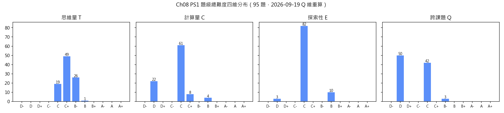
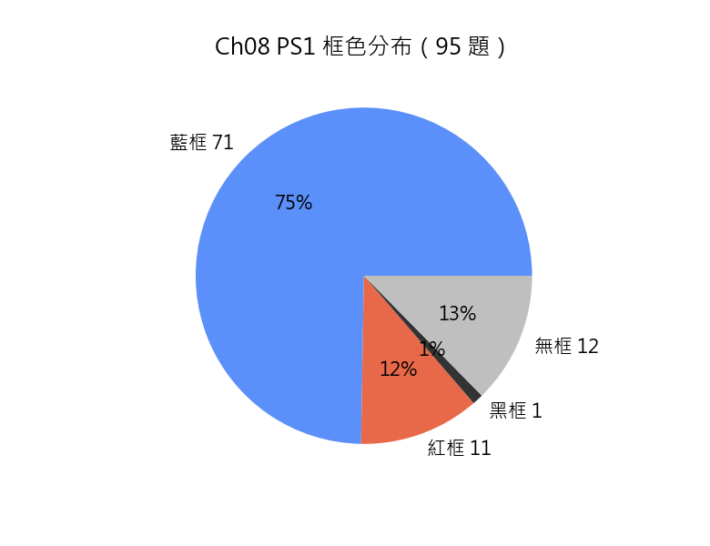

# Chapter 8「平面幾何（I）（Plane Geometry (I)）」習題冊規劃方案（結構整改 2026-09-13：116→95 題，對齊現行《習題冊規劃說明方案.md》）

> 本規劃文件按用戶裁定以正文 `Ch08_PS1.tex` 題目數據為準：116 題全要素（題干／分題／考核目標／詳細解答／四維難度標記＋逐維判定理由／配圖判定／題目修改欄），與正文、答案 .tex 三處同步。結構分類與正文實際結構一致（task 12／簡單 45／複雜 17／無結構 42），所有含分題的題均分題獨立打標。2026-08-24 按《習題冊規劃說明方案.md》「自然融合」定稿口徑再規範化：新增「〇」規範章節、全部 116 題詳細答案升級為詳細解答（融合寫法＋易錯點注意）、補全節標題（§8.1–§8.11 對應正文 11 節）、清理舊格式殘留（詳見「修訂記錄」末條）。

> 結構分類與正文實際結構一致：`task` 類 12／簡單結構 45／複雜結構 17／無結構 42；所有含分題的題（62 題）均分題獨立打標，大題難度取各分題最大值。

## 〇、詳細解答規範與難度評分依據（2026-08-24，依《習題冊規劃說明方案.md》3.2／第六章定稿口徑）

**詳細解答**（取代原「詳細答案」，每題必備）須為完整、健全的解答，包含兩部分：

1. **解答主體**：思路與分步推導**自然融合**——不單列思路板塊，也不生硬分出開篇策略段；策略與切入點（為何選用此工具／方法、關鍵觀察、解題切入點）**自然地織入每一步推導中**，隨推導過程逐步交代，使解答整體成為一段詳細、教導式的講解；每一步註明依據與中間結果、完整推理鏈，禁止只寫結論（一步式簡略作答）；
2. **易錯點注意**：常見錯誤與避免方法——概念混淆、運算疏漏、邏輯陷阱、符號誤用等。

> 依《習題冊規劃說明方案.md》3.2／第六章定稿口徑：兩部分板塊標題的字樣**不應出現在答案正文上**（.md 與 .tex 均同）；**不設獨立開篇策略段**，策略自然織入推導各步；證明結束後不加任何記號；恆等號（≡/=）區分依 3.3——恆等變形用 `≡`，代入數值／解方程用 `=`。

**難度評分**基於上述詳細解答逐維分析：

- 每個分題的四維標記（T／C／Q／E）之判定理由，須**引用詳細解答中的具體環節**（如推理鏈步數與各步內容、運算類型與步數、構造反例／矛盾源的步驟、動用的跨課題工具），而非籠統表述；
- 分題判定理由不得合併為一條籠統理由，每個維度各一條；
- 整題總標記只需註明「取各分題最大值」，不附逐維判定理由（2026-08-23 定稿口徑）；`task`／無結構類按附錄 A.1／A.2 模板保留四行理由。
- **單步直接套定義 → T D**（不因項數重複抬檔；須 2–3 步或涉及 2+ 知識點才升 C）。

**超綱方法自檢**：依《習題冊規劃說明方案.md》第八章執行——以 `DSE 課題講義/Chapter 8 平面几何 (I).md` 及前置章節講義（Ch00–Ch07）為工具清單，逐題核對方法來源；結果見「修訂記錄」末條。

## 一、命題範圍與設計原則

- **唯一內容來源**：`DSE 課題講義/Chapter 8 平面几何 (I).md`（§8.1–§8.10）。
- 本習題冊涵蓋：
  - §8.1 幾何公理與基礎：基本元素（點／直線／射線／線段）、角與度量、歐氏幾何公理、平行線與截線（同位角／內錯角／同旁內角、平行判定與性質）、線段記法與長度、中點與內分點；
  - §8.2 三角形的角：內角、內角和定理、外角定理；
  - §8.3 多邊形：多邊形定義、內角和公式、外角和公式；
  - §8.4 全等與相似：全等三角形（SSS／SAS／ASA 判定）、相似三角形（AA 判定）、相似比（邊長比／周長比／面積比）；
  - §8.5 畢氏定理：畢氏定理、畢氏逆定理及應用（含斜邊上的高、分類討論）；
  - §8.6 平行線的進一步性質：距離概念、截線定理、中點定理；
  - §8.7 三角形：三角形分類、等腰三角形性質（底角相等、三線合一）、三角形不等式；
  - §8.8 特殊四邊形：平行四邊形（性質與判定）、矩形／菱形／正方形、梯形（含等腰梯形）；
  - §8.9 圓形及扇形：圓的基本概念、弧長、扇形面積、弓形；
  - §8.10 圖形的對稱性：軸對稱、旋轉對稱、中心對稱；
  - 綜合問題：跨節綜合（§8.11 對應正文「平面幾何綜合問題」）。
- **範圍邊界**：全等判定依講義 8.4 全五條件（SSS／SAS／ASA／AAS／RHS）；相似判定依講義 8.4 全三條件（AA／三邊成比例／兩邊成比例且夾角相等）；圓的性質（圓心角／圓周角）屬後續章節不引入；三角形四心移至 Ch29 不考（中線／高線／垂直平分線／角平分線作基礎元素仍可用）；比例定理用比例記號 $a:b=c:d$；角度記號一律寫完整三字母（`\angle BAC`，頂點居中），理由附後如 `(同位角，AB∥DE)`。
- **跨章聯動**：聯動 Ch00 基礎概念（等式性質、基本運算）、Ch01 數系(I)（無理數、平方根）、Ch05 解方程(I)（一元一次方程——設未知數列方程求角）、Ch07 率、比及百分法（比例——內分點、相似比、面積比）、Ch11 不等式(I)（三角不等式的整數解）、Ch15 解析幾何(I)（坐標應用）。
- **Q 維口徑（2026-09-19 用戶裁定）**：本章 Q 維只計「跨章節工具」——解答須實際調用其他章節課題（Ch02 估算、Ch05 方程、Ch07 比例、Ch11 不等式等）方記 C 及以上；本章 §8.x 之間互用（如 §8.10 軸對稱 × §8.5 畢氏、§8.8 菱形 × §8.5 畢氏）記 D，理由須寫明「皆本章課題，未涉其他章節工具」，不得以「跨課題」字樣虛報。《習題難度標記方案-規劃.md》「同板塊跨課題→C」的字面口徑與本章現行計法不同，本章依本裁定執行（其他章是否跟隨另行裁定）。
- 題目只列中文題面，**不標分數**；英文對譯留待正式 LaTeX 階段按題補譯（正文 .tex 已有 `entranslation`）。
- 難度由角關係、全等相似、畢氏定理逐步提升至綜合應用與理論證明。

## 二、框色邊界（2026-09-13 依 5.1 三步總則逐題復核；2026-09-19 按用戶裁定的梯形類改判修訂）

- **藍框（71 題）**：內容在 DSE 官方考綱內，且題級總難度至少一維介於 C+~B+（含）、無 A-/A/A+ 維（藍框量化判據逐題復核；原舊式「（藍框）」句尾標注中全維不足 C+ 者已改判無框或併入 task）。2026-09-19 梯形類改判考綱內後新入：26、30、36、51、55、81、85、87（原紅框②撤除，檔位均含 C+~B- 維而無 A 檔）。
- **紅框（11 題）**：考綱外且講義覆蓋，逐題引用《官方考綱與課題講義關聯分析.md》Ch8 條目——
  - ①「§8.10 圖形的對稱性｜【完全超綱】」：題 67、68、69、70、71、76、77、78（後三題為綜合練習中對稱核心考點題型）；
  - ②「§8.7 三角形不等式定理化｜【深度超出】」：題 41、44；
  - ③「§8.4 相似性質證明｜【深度超出】（官方 22.2 不須證明）」：題 92。
  - （原②「§8.8 梯形與等腰梯形性質｜【完全超綱】＋§8.6 中位線涉梯形」經 2026-09-19 用戶裁定整條撤除：梯形周界與面積公式屬小學先備，本冊梯形相關結論（底角相等、對角線相等、梯形中位線）均可由本冊考綱內工具（全等、畢氏、中點定理）現場推導，題 81 更要求自行證出中位線定理；經查原引用「§8.6 中位線涉梯形【完全超綱】」在關聯分析 Ch8 表無對應條目、題 48 平行四邊形判定本就對應初中 23.3，係誤掛。題 78 之紅框不撤——其依據為①軸對稱超綱，與梯形無關。關聯分析 Ch8 §8.8 行已補本裁定註。）
- **黑框（1 題）**：題 95（中點四邊形）——題面給出新概念定義並在其下探索證明（2026-09-03 口徑；(c) 之梯形僅為設置，不受改判影響）。
- **無框（12 題）**：無任一維達 C+ 的基礎批量操練——題 1、2、3、8、11、12、16、23、39、47、50（無框第一類）；2026-09-19 新入 48（T C｜C D｜E C｜Q D，全維不足 C+，同 47／50 口徑）。
- 各題「**標記框**」checkbox 為正文 `recquestion/ofsquestion/exquestion` 落框唯一依據；連續同色並框、不跨 `\section`。

---
## 三、題型結構規劃（95 題）
### 各節題目分配

| 板塊 | 題號 | 題數 | 結構分布 | 命題用途 |
| --- | --- | ---: | --- | --- |
| §8.1 幾何公理與基礎 | 1–7 | 7 | task 3／無結構 2／簡單結構 2 | 本節常規操練（受 7.7 上限） |
| §8.2 三角形的角 | 8–10 | 3 | task 1／無結構 2 | 本節常規操練（受 7.7 上限） |
| §8.3 多邊形 | 11–13 | 3 | task 2／無結構 1 | 本節常規操練（受 7.7 上限） |
| §8.4 全等與相似 | 14–22 | 9 | task 2／無結構 1／簡單結構 6 | 本節常規操練（受 7.7 上限） |
| §8.5 畢氏定理 | 23–30 | 8 | task 2／無結構 1／簡單結構 5 | 本節常規操練（受 7.7 上限） |
| §8.6 平行線的進一步性質 | 31–38 | 8 | task 1／簡單結構 6／無結構 1 | 本節常規操練（受 7.7 上限） |
| §8.7 三角形——等腰與三角不等式 | 39–46 | 8 | task 2／無結構 1／簡單結構 5 | 本節常規操練（受 7.7 上限） |
| §8.8 特殊四邊形 | 47–57 | 11 | task 3／無結構 2／簡單結構 6 | 本節常規操練（受 7.7 上限） |
| §8.9 圓形及扇形 | 58–66 | 9 | task 1／無結構 2／簡單結構 6 | 本節常規操練（受 7.7 上限） |
| §8.10 圖形的對稱性 | 67–71 | 5 | task 3／簡單結構 1／無結構 1 | 本節常規操練（受 7.7 上限） |
| 綜合練習 | 72–90 | 19 | 簡單結構 11／無結構 1／複雜結構 7 | 跨節綜合／新結論探索（不受 7.7） |
| 理論習題 | 91–95 | 5 | 無結構 3／複雜結構 2 | 跨節綜合／新結論探索（不受 7.7） |

結構比例（非 `task` 共 75 題）：無結構 18（24%）｜簡單 48（64%）｜複雜 9（12%），目標 2:7:1（整改前 40:43:16；複雜 17 題→9 題）。

---
## 四、難度與框色統計表（7.6，2026-09-13 重算；2026-09-19 Q 維依用戶裁定重算，95 題題級總難度）

| 維度 | 各檔計數 |
| --- | --- |
| T | C×19｜C+×49｜B-×26｜B×1 |
| C | D×22｜C×61｜C+×8｜B×4 |
| E | D×3｜C×82｜B×10 |
| Q | D×50｜C×42｜B-×3 |

- 任一維達 B 檔及以上：27 題（28.4%）≥30% ✓；任一維達 C 檔區間：90 題（94.7%）≥30% ✓。
- 框色：藍 71／紅 11／黑 1／無 12，與「二、框色邊界」一致 ✓（2026-09-19 梯形類改判：26、30、36、51、55、81、85、87 紅→藍，48 紅→無框；四維檔位未變，本表各維計數不動）。
- 宏觀遞增：各節內新序 D→C→B、綜合與理論承 B-/B 峰值 ✓；無 A 檔（本講義內容上限所限屬合理，見五）。
- 跨章聯動（Q≥C）：45 題（47.4%）≥30% ✓（2026-09-19 用戶裁定：題 3、4、22(b)、28(b)、29(b)、34、38、73(b) 確用 Ch02／Ch05／Ch07 工具，Q 由 D 上調 C；原 37 題 38.9%）。
- 統計圖表：腳本 `.workbuddy/scripts/ch08_diff_stat.py`（Ch21 先例復用）。
**統計圖表**（2026-09-13 生成，2026-09-19 框色分布重跑更新）：






---
## 五、講義節難度上限對照（7.7，2026-09-13：講義上限已按用戶裁決重打標）

| 講義節 | 節上限（重打標後） | 觸頂題（新號） | 越限題 |
| --- | --- | --- | --- |
| §8.1 | B-｜C｜C｜C | 6 | 無 |
| §8.2 | B-｜C｜C｜C | 10 | 無 |
| §8.3 | C+｜C｜C｜C | 13 | 無 |
| §8.4 | B-｜C｜C｜C | 17 | 無 |
| §8.5 | B-｜C+｜C｜B- | 27 | 無 |
| §8.6 | B-｜C｜C｜B- | 36 | 無 |
| §8.7 | B-｜C｜C｜B- | 44 | 無 |
| §8.8 | B-｜C｜C｜C | 57 | 無 |
| §8.9 | C+｜C+｜C｜C | 65 | 無 |
| §8.10 | C｜D｜C｜C | 70、71 | 無 |

- 結論：「各章小節」部分 71 題越限 0 題、10/10 節觸頂（綜合練習與理論習題不適用）。
- 講義側變動：10 節上限逐維重評（原 C／E／Q 多維 D 屬誤標；§8.3 T 下修 C+、§8.6 T 依「講義覆述鏈不入節內題」定 B-），備份 `Chapter 8 平面几何 (I).md.bak_ceil0913`；逐節依據見「十」章執行摘要與修訂記錄。

---
## 六、題目方案（95 題；每題要素齊備：題干／分題（結構化題）／考核目標／詳細解答＋易錯點注意／難度（末級逐維＋大題總標）／配圖／題目修改欄／標記框）

### §8.1 幾何公理與基礎

#### 題 1（`task` 類）——對頂角與鄰補角


**題干**

如圖，兩條直線 $AB$ 與 $CD$ 交於 $O$，射線 $OE$ 位於 $\angle AOC$ 內。已知 $\angle AOE=35\degree$ 及 $\angle EOC=55\degree$。求下列各角的和。

- $\angle AOC+\angle BOD$；

- $\angle AOD+\angle BOC$；

- $\angle AOE+\angle EOC+\angle BOD$；

- $\angle AOE+\angle EOD$。

**考核目標**

運用對頂角相等及鄰補角和為 $180\degree$，求多個相關角的和；不涉及角分或度分換算。

**詳細解答**

由對頂角相等（$\angle AOC=\angle BOD$）及鄰補角（$\angle AOC+\angle BOC=180\degree$）逐項求和。

$\angle AOC=\angle BOD=90\degree$，故和為 $180\degree$。

$\angle AOD=\angle BOC=90\degree$，故和為 $180\degree$。

$35\degree+55\degree+90\degree=180\degree$。

$\angle EOD=180\degree-\angle EOC=125\degree$，故和為 $35\degree+125\degree=160\degree$。

**易錯點注意**

- 易錯：(d) 求 $\angle EOD$ 用 $\angle EOD=180\degree-\angle EOC$（鄰補角），勿誤用對頂角。

**難度**

> 題 1｜難度：**T C｜C D｜E C｜Q D**
> 判定理由（T）：四項均先由對頂角或鄰補角定出一個未知角，再與已知角相加求和，每項 2 步，同一組角關係重複套用、不抬檔。
> 判定理由（C）：無計算／直接判斷。
> 判定理由（E）：須自行組織解題路徑，方法選擇層。
> 判定理由（Q）：僅涉 §8.1 對頂角與鄰補角一課題，無跨章節工具。

**配圖**：有（TikZ，Obsidian + TikZJax 渲染）

```tikz
\begin{document}
\begin{tikzpicture}[scale=0.9]
\coordinate (A) at (-2.5,0);
\coordinate (B) at (2.5,0);
\coordinate (C) at (0,2);
\coordinate (D) at (0,-2);
\coordinate (O) at (0,0);
\coordinate (E) at (-1.23,0.86);
\draw (A) -- (B);
\draw (C) -- (D);
\draw (O) -- (E);
\node[below left] at (A) {$A$};
\node[below right] at (B) {$B$};
\node[above right] at (C) {$C$};
\node[below right] at (D) {$D$};
\node[below left] at (O) {$O$};
\node[above left] at (E) {$E$};
\end{tikzpicture}
\end{document}
```

**題目修改欄**

- [ ] 加強計算量
- [ ] 加強思維量
- [ ] 分題分得過細
- [ ] 重寫
- [ ] 數值醜陋

**標記框**

- [x] 無標記框
- [ ] 紅框
- [ ] 藍框
- [ ] 黑框

---

#### 題 2（`task` 類）——平行線的角計算與平行判定

**題干**

下列各題涉及平行線與截線，求各角的度數或判定直線是否平行，並述明理由。

- 直線 $AB \parallel CD$，截線 $EF$ 分別交 $AB$ 於 $G$、交 $CD$ 於 $H$。已知 $\angle AGE = 65\degree$，求 $\angle BGH$、$\angle DHG$ 及 $\angle AGH$；
- 直線 $l_1$、$l_2$ 被截線 $t$ 所截，其一對同旁內角分別為 $58\degree$ 及 $122\degree$，判斷 $l_1$ 與 $l_2$ 是否平行；
- 直線 $l_1$、$l_2$ 被截線 $t$ 所截，其一對同位角分別為 $47\degree$ 及 $47\degree$，判斷 $l_1$ 與 $l_2$ 是否平行；
- 直線 $l_1 \parallel l_2$ 被截線 $t$ 所截，其一對同旁內角分別為 $3x$ 及 $2x+30$（單位：$\degree$），求 $x$。

**考核目標**

批量應用平行線的性質定理與判定定理（正用、逆用及設未知數列方程；聯動 Ch05）。

**詳細解答**

同位角相等、內錯角相等、同旁內角互補三組關係及其逆命題為本組各項的共同依據。

(a) $\angle BGH = \angle AGE = 65\degree$（對頂角）。

$\angle DHG = \angle AGE = 65\degree$（同位角，$AB \parallel CD$）。

$\angle AGH = 180\degree - \angle AGE = 115\degree$（鄰補角）。

(b) $58\degree + 122\degree = 180\degree$，同旁內角互補，故 $l_1 \parallel l_2$。

(c) 同位角相等，故 $l_1 \parallel l_2$。

(d) 同旁內角互補：$3x + (2x + 30) = 180$。

$5x = 150$，$x = 30$。

**易錯點注意**

- 易錯：判定期望寫「同位角相等，故平行」的完整因果；勿把性質與判定方向弄反。
- 易錯：(d) 列方程時勿把 $2x+30$ 誤寫為 $2(x+30)$。

**難度**

> 題 2｜難度：**T C｜C D｜E C｜Q C**
> 判定理由（T）：各項均為對頂角／鄰補／平行角關係的 2–3 步直接轉換，重複不抬檔。
> 判定理由（C）：整數角度加減與一步一次方程，負擔輕。
> 判定理由（E）：判定與性質雙向選路，屬方法選擇層。
> 判定理由（Q）：(d) 設未知數列一次方程，幾何 × 方程，同板塊跨課題。

**配圖**：有（每 task 一幅小圖，正文以 `center` 環境單獨置於對應分題之後，命令逐行、scale=1、不併排；僅呈位置關係，不標數值、不泄露所求、不按比例）

分題 (a) 附圖：

```tikz
\begin{document}
\begin{tikzpicture}[scale=1]
\coordinate (Gx) at (0.65,1.2);
\coordinate (Hy) at (-0.05,-0.2);
\draw (-1.3,1.2) -- (1.5,1.2);
\draw (-1.3,-0.2) -- (1.5,-0.2);
\draw (1.15,2.05) -- (-0.55,-1.05);
\node[left] at (-1.2,1.2) {$A$};
\node[above] at (1.4,1.2) {$B$};
\node[left] at (-1.2,-0.2) {$C$};
\node[above] at (1.4,-0.2) {$D$};
\node[above] at (1.05,1.85) {$E$};
\node[below] at (-0.4,-0.85) {$F$};
\node[above right] at (Gx) {$G$};
\node[above left] at (Hy) {$H$};
\draw (Gx) ++(63:0.35) arc (63:180:0.35);
\end{tikzpicture}
\end{document}
```

分題 (b) 附圖：

```tikz
\begin{document}
\begin{tikzpicture}[scale=1]
\coordinate (P1) at (0.53,1.1);
\coordinate (Q1) at (-0.23,-0.3);
\draw (-1.4,1.1) -- (1.2,1.1);
\draw (-1.4,-0.3) -- (1.2,-0.3);
\draw (0.95,1.8) -- (-0.65,-1.0);
\node[right] at (1.25,1.1) {$l_1$};
\node[right] at (1.25,-0.3) {$l_2$};
\node[right] at (1.0,1.7) {$t$};
\draw (P1) ++(180:0.32) arc (180:242:0.32);
\draw (Q1) ++(62:0.32) arc (62:180:0.32);
\end{tikzpicture}
\end{document}
```

分題 (c) 附圖：

```tikz
\begin{document}
\begin{tikzpicture}[scale=1]
\coordinate (P2) at (0.53,1.1);
\coordinate (Q2) at (-0.23,-0.3);
\draw (-1.4,1.1) -- (1.2,1.1);
\draw (-1.4,-0.3) -- (1.2,-0.3);
\draw (0.95,1.8) -- (-0.65,-1.0);
\node[right] at (1.25,1.1) {$l_1$};
\node[right] at (1.25,-0.3) {$l_2$};
\node[right] at (1.0,1.7) {$t$};
\draw (P2) ++(0:0.32) arc (0:62:0.32);
\draw (Q2) ++(0:0.32) arc (0:62:0.32);
\end{tikzpicture}
\end{document}
```

分題 (d) 附圖：

```tikz
\begin{document}
\begin{tikzpicture}[scale=1]
\coordinate (P3) at (0.53,1.1);
\coordinate (Q3) at (-0.23,-0.3);
\draw (-1.4,1.1) -- (1.2,1.1);
\draw (-1.4,-0.3) -- (1.2,-0.3);
\draw (0.95,1.8) -- (-0.65,-1.0);
\draw (1.0,1.1) ++(-0.06,-0.06) -- ++(0.12,0.12) -- ++(-0.12,0.06);
\draw (1.0,-0.3) ++(-0.06,-0.06) -- ++(0.12,0.12) -- ++(-0.12,0.06);
\node[right] at (1.25,1.1) {$l_1$};
\node[right] at (1.25,-0.3) {$l_2$};
\node[right] at (1.0,1.7) {$t$};
\draw (P3) ++(180:0.32) arc (180:242:0.32);
\draw (Q3) ++(62:0.32) arc (62:180:0.32);
\end{tikzpicture}
\end{document}
```

**題目修改欄**

- [ ] 加強計算量
- [ ] 加強思維量
- [ ] 分題分得過細
- [ ] 重寫
- [ ] 數值醜陋

**標記框**

- [x] 無標記框
- [ ] 紅框
- [ ] 藍框
- [ ] 黑框

---

#### 題 3（`task` 類）——線段內分點


**題干**

線段 $AB$ 上有一內分點 $P$，使得 $AP : PB = 3 : 5$。

- 已知 $AB = 24\text{ cm}$，求 $AP$ 及 $PB$。

- 已知 $AP = 9\text{ cm}$，求 $AB$ 及 $PB$。

**考核目標**

以份數法（比例常數法）處理內分點比例，正向與逆向兩方向（聯動 Ch7 比例）。

**詳細解答**

內分點 $AP:PB=3:5$ 設 $AP=3k$、$PB=5k$，由 $AB=8k$ 求值。

共 $8$ 份：$AP = 24 \times \dfrac{3}{8} = 9\text{ cm}$、$PB = 24 \times \dfrac{5}{8} = 15\text{ cm}$。

每份 $= \dfrac{9}{3} = 3$：$AB = 3 \times 8 = 24\text{ cm}$、$PB = 3 \times 5 = 15\text{ cm}$。

**易錯點注意**

- 易錯：比例 $3:5$ 的總份數是 $3+5=8$，故 $AB=8k$；勿把 $PB$ 的 $5k$ 當成 $AB$，亦勿以 $5$ 份作全長。

**難度**

> 題 3｜難度：**T C｜C C｜E C｜Q C**
> 判定理由（T）：兩項均先把 $3:5$ 化成總份數 $8$：(a) 取全長的 $\dfrac38$、$\dfrac58$ 分段，(b) 由 $AP$ 反求每份再乘總份數，各 2–3 步，正逆兩向同一規矩、重複不抬檔。
> 判定理由（C）：常規數值或代數運算。
> 判定理由（E）：須自行組織解題路徑，方法選擇層。
> 判定理由（Q）：份數法與按比例分配屬 Ch07 率、比及百分法課題，與本章 §8.1 線段計算並用，同板塊跨課題取 C。

**配圖**：無（題干文字已自足，不需配圖）

**題目修改欄**

- [ ] 加強計算量
- [ ] 加強思維量
- [ ] 分題分得過細
- [ ] 重寫
- [ ] 數值醜陋

**標記框**

- [x] 無標記框
- [ ] 紅框
- [ ] 藍框
- [ ] 黑框

---

#### 題 4（無結構類）——平行線設未知數列方程


**題干**

直線 $AB \parallel CD$，$BE$ 為截線交 $CD$ 於 $E$。已知 $\angle ABE = 3x + 10\degree$ 及 $\angle CEB = 2x + 20\degree$，求 $x$ 的值。

**考核目標**

以平行線角關係（同旁內角互補）建立含未知角的方程求解（聯動 Ch5 解方程）。

**詳細解答**

設未知角列方程（平行線角關係），解方程求角。

$\angle ABE$ 與 $\angle CEB$ 為同旁內角：$3x + 10 + 2x + 20 = 180$，故 $5x = 150$，$x = 30$。

**易錯點注意**

- 易錯：列方程前先確認角關係（同位/內錯/同旁內）正確。

**難度**

> 題 4｜難度：**T C+｜C C｜E C｜Q C**
> 判定理由（T）：先由 $AB\parallel CD$ 認出 $\angle ABE$ 與 $\angle CEB$ 為同旁內角（此為關鍵選路），列 $3x+10+2x+20=180$，合併同類項後解一次方程求 $x$，鏈 3–4 步。
> 判定理由（C）：常規數值或代數運算。
> 判定理由（E）：須自行組織解題路徑，方法選擇層。
> 判定理由（Q）：平行線角關係（§8.1）與一元一次方程（Ch05）並用，同板塊跨課題取 C。

**配圖**：有（TikZ，Obsidian + TikZJax 渲染）

```tikz
\begin{document}
\begin{tikzpicture}[scale=0.9]
\coordinate (A) at (-3,1.5);
\coordinate (B) at (1.5,1.5);
\coordinate (C) at (-2.4,-1);
\coordinate (D) at (3,-1);
\coordinate (E) at (1.94,-1);
\draw (-3.4,1.5) -- (2.4,1.5);
\draw (-2.8,-1) -- (3.4,-1);
\draw (1.58,1.94) -- (2.02,-1.44);
\draw (B) ++(180:0.45) arc (180:280:0.45);
\draw (E) ++(100:0.45) arc (100:180:0.45);
\draw (-0.6,1.5) ++(-0.1,-0.09) -- ++(0.1,0.09) -- ++(-0.1,0.09);
\draw (-0.6,-1) ++(-0.1,-0.09) -- ++(0.1,0.09) -- ++(-0.1,0.09);
\node[above] at (A) {$A$};
\node[above left] at (B) {$B$};
\node[below] at (C) {$C$};
\node[below] at (D) {$D$};
\node[below left] at (E) {$E$};
\end{tikzpicture}
\end{document}
```

**題目修改欄**

- [ ] 加強計算量
- [ ] 加強思維量
- [ ] 分題分得過細
- [ ] 重寫
- [ ] 數值醜陋

**標記框**

- [ ] 無標記框
- [ ] 紅框
- [x] 藍框
- [ ] 黑框

---

#### 題 5（無結構類）——平行線間的折線倒角


**題干**

如圖，$AB\parallel CD$。$E$ 在 $AB$ 上，$G$ 在 $CD$ 上，折線 $EFG$ 的頂點 $F$ 位於兩平行線之間。已知 $\angle AEF=40\degree$ 及 $\angle FGC=75\degree$，求 $\angle EFG$。

**考核目標**

需要自行過 $F$ 作平行輔助線，綜合內錯角與角的加法，屬多步倒角。

**詳細解答**

過折點作平行輔助線，將折角拆為兩組平行線角。

過 $F$ 作 $FH\parallel AB$ 交 $CD$ 於 $H$。$\angle EFH=\angle AEF=40\degree$（內錯角）；$\angle HFG=\angle FGC=75\degree$（內錯角）；故 $\angle EFG=40\degree+75\degree=115\degree$。

**易錯點注意**

- 易錯：輔助線方向須正確；拆角時勿重複或遺漏。

**難度**

> 題 5｜難度：**T C+｜C C｜E C｜Q D**
> 判定理由（T）：須自構過 $F$ 且平行於 $AB$（從亦平行於 $CD$）的輔助線 $FH$，再以兩組內錯角分別得 $40\degree$、$75\degree$，末以角的加法合成 $115\degree$，鏈 3 步而輔助線非題給，故取 C+。
> 判定理由（C）：常規數值或代數運算。
> 判定理由（E）：須自行組織解題路徑，方法選擇層。
> 判定理由（Q）：平行線內錯角與角的加法，屬本章 §8.1 課題內，無跨章節成分。

**配圖**：有（TikZ，Obsidian + TikZJax 渲染）

```tikz
\begin{document}
\begin{tikzpicture}[scale=0.9]
\coordinate (A) at (-2.8,1.6);
\coordinate (B) at (2.8,1.6);
\coordinate (E) at (1.66,1.6);
\coordinate (C) at (-2.8,-1.2);
\coordinate (D) at (2.8,-1.2);
\coordinate (G) at (0.82,-1.2);
\coordinate (F) at (0.36,0.51);
\draw (A) -- (B);
\draw (C) -- (D);
\draw (E) -- (F) -- (G);
\draw (E) ++(180:0.45) arc (180:220:0.45);
\draw (G) ++(105:0.45) arc (105:180:0.45);
\draw (-0.6,1.6) ++(-0.1,-0.09) -- ++(0.1,0.09) -- ++(-0.1,0.09);
\draw (1.9,-1.2) ++(-0.1,-0.09) -- ++(0.1,0.09) -- ++(-0.1,0.09);
\node[above left] at (A) {$A$};
\node[above right] at (B) {$B$};
\node[above] at (E) {$E$};
\node[below left] at (C) {$C$};
\node[below right] at (D) {$D$};
\node[below] at (G) {$G$};
\node[left] at (F) {$F$};
\end{tikzpicture}
\end{document}
```

**題目修改欄**

- [ ] 加強計算量
- [ ] 加強思維量
- [ ] 分題分得過細
- [ ] 重寫
- [ ] 數值醜陋

**標記框**

- [ ] 無標記框
- [ ] 紅框
- [x] 藍框
- [ ] 黑框

---

#### 題 6（簡單結構類）——內分點的比例方程

**題干**

線段 $AB$ 長 $30\text{ cm}$，其上兩點 $P$、$Q$ 分別滿足 $AP : PB = 1 : 4$ 及 $AQ : QB = 2 : 3$。

(a) 求 $AP$ 及 $AQ$。

(b) 求 $PQ$，並判斷 $P$、$Q$ 兩點哪一點離 $B$ 較近。

**考核目標**

以份數法分別處理兩組內分點比例，再作線段差與位置比較（聯動 Ch07 比例；本節觸頂題）。

**詳細解答**

每組比例獨立設份數：$AP:PB=1:4$ 得 $AP=\dfrac{1}{5}AB$；$AQ:QB=2:3$ 得 $AQ=\dfrac{2}{5}AB$。

(a) $AP = \dfrac{1}{1+4} \times 30 = 6\text{ cm}$；$AQ = \dfrac{2}{2+3} \times 30 = 12\text{ cm}$。

(b) $P$、$Q$ 同自 $A$ 起量，故 $PQ = AQ - AP = 12 - 6 = 6\text{ cm}$。

又 $PB = 30 - 6 = 24\text{ cm}$、$QB = 30 - 12 = 18\text{ cm}$，$QB < PB$，故 $Q$ 離 $B$ 較近。

**易錯點注意**

- 易錯：兩組比例的分屬不同劃分（$1:4$ 分五份、$2:3$ 分五份），「共 5 份」各自成組，勿混用。
- 易錯：$PQ$ 是 $AQ - AP$，勿誤加兩段。

**難度**

> 分題 (a)｜難度：**T B-｜C C｜E C｜Q C**
> 判定理由（T）：兩組比例各經「定總份數→取份→求值」再並列輸出，鏈 4 步達 B- 下限。
> 判定理由（C）：分數乘法。
> 判定理由（E）：兩組比例需分別建模，屬方法選擇層。
> 判定理由（Q）：內分點 × 比例分配（Ch07），同板塊跨課題。

> 分題 (b)｜難度：**T C+｜C C｜E C｜Q C**
> 判定理由（T）：依 (a) 作線段差並比較距端點距離，鏈 3 步。
> 判定理由（C）：整數減法。
> 判定理由（E）：依賴 (a)，不上浮。
> 判定理由（Q）：比例 × 線段運算，同板塊跨課題。

> 題 6｜難度：**T B-｜C C｜E C｜Q C**（取各分題最大值；§8.1 觸頂題）

**配圖**：有（線段 $AB$ 上 $P$、$Q$ 的先後位置以圖展示；圖僅標點線與頂點字母、不標數值，題干已足以唯一還原該圖）

```tikz
\begin{document}
\begin{tikzpicture}[scale=1]
\coordinate (A) at (0,0);
\coordinate (B) at (6,0);
\coordinate (P) at (1.2,0);
\coordinate (Q) at (2.4,0);
\draw (A) -- (B);
\node[below] at (A) {$A$};
\node[below] at (B) {$B$};
\node[below] at (P) {$P$};
\node[below] at (Q) {$Q$};
\end{tikzpicture}
\end{document}
```

**題目修改欄**

- [ ] 加強計算量
- [ ] 加強思維量
- [ ] 分題分得過細
- [ ] 重寫
- [ ] 數值醜陋

**標記框**

- [ ] 無標記框
- [ ] 紅框
- [x] 藍框
- [ ] 黑框

---

#### 題 7（簡單結構類）——平行判定的逆向應用

**題干**

如圖，直線 $l_1$、$l_2$ 被截線 $t_1$ 所截，得同旁內角 $\angle 1 = 62\degree$、$\angle 2 = 118\degree$；又被截線 $t_2$ 所截，得 $\angle 3 = 55\degree$。

(a) 判斷 $l_1$ 與 $l_2$ 是否平行，並述明理由。

(b) 設 $\angle 5$ 為 $\angle 3$ 的同旁內角、$\angle 6$ 為 $\angle 5$ 的鄰補角，求 $\angle 5$ 及 $\angle 6$。

**考核目標**

先由同旁內角互補判定平行，再用平行線性質作兩級角轉換求相鄰角；判定與應用兩個方向。

**詳細解答**

由 $t_1$ 的同旁內角關係判定平行；平行後於 $t_2$ 上依「同旁內角互補、鄰補角互補」逐級轉換。

(a) $\angle 1 + \angle 2 = 62\degree + 118\degree = 180\degree$，同旁內角互補，故 $l_1 \parallel l_2$。

(b) 由 (a) 知 $\angle 5 = 180\degree - \angle 3 = 125\degree$（同旁內角互補）。

$\angle 6 = 180\degree - \angle 5 = 55\degree$（鄰補角）。

**易錯點注意**

- 易錯：同旁內角互補才平行，相等不成立。
- 易錯：(b) 須經 $\angle 5$ 轉折再求 $\angle 6$，勿直接當同位角抄 $55\degree$ 而不寫理據。

**難度**

> 分題 (a)｜難度：**T C｜C D｜E C｜Q D**
> 判定理由（T）：判同旁內角互補推平行，鏈 2 步。
> 判定理由（C）：一步角度加法。
> 判定理由（E）：判定定理直接套用。
> 判定理由（Q）：平行線單課題。

> 分題 (b)｜難度：**T C+｜C D｜E C｜Q D**
> 判定理由（T）：依 (a) 平行結論連續兩次角關係轉換（互補→鄰補），鏈 3 步。
> 判定理由（C）：兩步減法。
> 判定理由（E）：轉換次序需自行選定，屬方法選擇層。
> 判定理由（Q）：平行線單課題。

> 題 7｜難度：**T C+｜C D｜E C｜Q D**（取各分題最大值）

**配圖**：有（TikZ 見下）

```tikz
\begin{document}
\begin{tikzpicture}[scale=0.85]
\coordinate (X) at (-0.2,1.5);
\coordinate (Y) at (-1.53,-1);
\coordinate (U) at (0.6,1.5);
\coordinate (V) at (2.35,-1);
\draw (-3,1.5) -- (3,1.5);
\draw (-3,-1) -- (3,-1);
\draw (0.25,2.34) -- (-1.97,-1.84);
\draw (0.08,2.24) -- (2.87,-1.74);
\draw (X) ++(180:0.4) arc (180:242:0.4);
\draw (Y) ++(62:0.4) arc (62:180:0.4);
\draw (U) ++(305:0.4) arc (305:360:0.4);
\draw (V) ++(0:0.4) arc (0:125:0.4);
\draw (V) ++(125:0.4) arc (125:180:0.4);
\node at (-0.73,1.14) {$1$};
\node at (-1.88,-0.47) {$2$};
\node at (1.18,1.18) {$3$};
\node at (2.66,-0.42) {$5$};
\node at (1.78,-0.72) {$6$};
\node[above left] at (-3,1.5) {$l_1$};
\node[below left] at (-3,-1) {$l_2$};
\node[below left] at (-1.97,-1.84) {$t_1$};
\node[below right] at (2.87,-1.74) {$t_2$};
\end{tikzpicture}
\end{document}
```

**題目修改欄**

- [ ] 加強計算量
- [ ] 加強思維量
- [ ] 分題分得過細
- [ ] 重寫
- [ ] 數值醜陋

**標記框**

- [ ] 無標記框
- [ ] 紅框
- [x] 藍框
- [ ] 黑框

---

### §8.2 三角形的角

#### 題 8（`task` 類）——三角形的內角與外角

**題干**

求下列各題中指定的角。

- 在 $\triangle ABC$ 中，已知 $\angle BAC = 50\degree$ 及 $\angle ABC = 70\degree$，求 $\angle ACB$；
- 在 $\triangle PQR$ 中，延長 $QR$ 至 $S$。已知 $\angle QPR = 35\degree$ 及 $\angle PQR = 72\degree$，求外角 $\angle PRS$；
- 某三角形的一個外角為 $105\degree$，與它不相鄰的一個內角為 $60\degree$，求另一個不相鄰的內角；
- 在 $\triangle ABC$ 中，已知 $\angle BAC = 40\degree$ 及 $\angle ABC = 70\degree$，求點 $C$ 處的外角。

**考核目標**

批量應用三角形內角和定理與外角定理（正用外角、逆用求內角）。

**詳細解答**

內角和 $180\degree$ 與外角＝不相鄰兩內角之和為各項共同依據。

(a) $\angle ACB = 180\degree - 50\degree - 70\degree = 60\degree$。

(b) $\angle PRS = \angle QPR + \angle PQR = 35\degree + 72\degree = 107\degree$（外角定理）。

(c) 所求內角 $= 105\degree - 60\degree = 45\degree$（外角定理逆用）。

(d) 先求 $\angle ACB = 180\degree - 40\degree - 70\degree = 70\degree$；點 $C$ 處外角 $= 180\degree - 70\degree = 110\degree$，或由外角定理 $= 40\degree + 70\degree = 110\degree$。

**易錯點注意**

- 易錯：外角須選「與已知內角不相鄰」的兩角相加；每個頂點處有兩個相等的外角。
- 易錯：(d) 中內角與外角互補，勿把 $70\degree$ 直接抄作答案。

**難度**

> 題 8｜難度：**T C｜C C｜E C｜Q D**
> 判定理由（T）：各項為內角和／外角定理的 2–3 步直接套用，重複不抬檔。
> 判定理由（C）：整數角度加減。
> 判定理由（E）：內用外用需選路，屬方法選擇層。
> 判定理由（Q）：三角形的角單課題。

**配圖**：無（`task` 類批量小题，條件已文字化）

**題目修改欄**

- [ ] 加強計算量
- [ ] 加強思維量
- [ ] 分題分得過細
- [ ] 重寫
- [ ] 數值醜陋

**標記框**

- [x] 無標記框
- [ ] 紅框
- [ ] 藍框
- [ ] 黑框

---

#### 題 9（無結構類）——組合圖形倒角


**題干**

如圖，$BD$ 是 $\triangle ABC$ 中的線段，$D$ 在 $AC$ 上。已知 $\angle ABD = 30\degree$、$\angle DBC = 25\degree$ 及 $\angle BDC = 110\degree$，求 $\angle BAC$ 及 $\angle ACB$。

**考核目標**

在多個三角形之間反覆運用內角和與鄰補角，屬綜合倒角。

**詳細解答**

組合圖形倒角：逐步用內角和/外角定理，必要時作輔助線。

$\angle ACB = 180\degree - 25\degree - 110\degree = 45\degree$，$\angle ADB = 180\degree - 110\degree = 70\degree$，$\angle BAC = 180\degree - 30\degree - 70\degree = 80\degree$。

**易錯點注意**

- 易錯：倒角順序要清晰，勿跳步導致角度錯位。

**難度**

> 題 9｜難度：**T C+｜C C｜E C｜Q D**
> 判定理由（T）：三級倒角且後步以前步結果為條件：先在含 $25\degree$、$110\degree$ 的三角形用內角和求 $\angle ACB=45\degree$，次由鄰補角得 $\angle ADB=70\degree$，末在 $\triangle ABD$ 用內角和求 $\angle BAC=80\degree$。
> 判定理由（C）：常規數值或代數運算。
> 判定理由（E）：須自行組織解題路徑，方法選擇層。
> 判定理由（Q）：三角形內角和與鄰補角串用，屬本章 §8.2 課題內，無跨章節成分。

**配圖**：有（TikZ，Obsidian + TikZJax 渲染）

```tikz
\begin{document}
\begin{tikzpicture}[scale=0.8]
\coordinate (A) at (-2.5,-1);
\coordinate (B) at (0,2);
\coordinate (C) at (2.5,-1);
\coordinate (D) at (0.5,-1);
\draw (A) -- (B) -- (C) -- cycle;
\draw (B) -- (D);
\node[below left] at (A) {$A$};
\node[above] at (B) {$B$};
\node[below right] at (C) {$C$};
\node[below] at (D) {$D$};
\end{tikzpicture}
\end{document}
```

**題目修改欄**

- [ ] 加強計算量
- [ ] 加強思維量
- [ ] 分題分得過細
- [ ] 重寫
- [ ] 數值醜陋

**標記框**

- [ ] 無標記框
- [ ] 紅框
- [x] 藍框
- [ ] 黑框

---

#### 題 10（無結構類）——比例求角


**題干**

在 $\triangle ABC$ 中，$\angle BAC : \angle ABC : \angle ACB = 1 : 2 : 3$。求 $\angle BAC$、$\angle ABC$ 及 $\angle ACB$。

**考核目標**

以份數法（比例常數法）結合內角和求各角（聯動 Ch7 比例）。

**詳細解答**

比例設角 $\angle BAC=k$、$\angle ABC=2k$、$\angle ACB=3k$，由內角和 $6k=180\degree$ 列方程。

共 $6$ 份：$\angle BAC = 180\degree \times \dfrac{1}{6} = 30\degree$、$\angle ABC = 60\degree$、$\angle ACB = 90\degree$。

**易錯點注意**

- 易錯：三份角之比 $1:2:3$ 共 $6$ 份，故 $6k=180\degree$、$k=30\degree$；勿把比例份數當成實際角度。

**難度**

> 題 10｜難度：**T B-｜C C｜E C｜Q C**
> 判定理由（T）：設三份角依次為 $k$、$2k$、$3k$，由內角和 $6k=180\degree$ 解 $k=30\degree$，再回代三式逐一求角，鏈 4 步（設份、列方程、解方程、回代），故取 B-。
> 判定理由（C）：常規數值或代數運算。
> 判定理由（E）：須自行組織解題路徑，方法選擇層。
> 判定理由（Q）：幾何 × 其他課題（跨課題）。

**配圖**：有（TikZ，Obsidian + TikZJax 渲染）

```tikz
\begin{document}
\begin{tikzpicture}[scale=0.8]
\coordinate (A) at (-1.8,1.2);
\coordinate (B) at (1.2,2);
\coordinate (C) at (2,-1);
\draw (A) -- (B) -- (C) -- cycle;
\node[above left] at (A) {$A$};
\node[above] at (B) {$B$};
\node[below] at (C) {$C$};
\end{tikzpicture}
\end{document}
```

**題目修改欄**

- [ ] 加強計算量
- [ ] 加強思維量
- [ ] 分題分得過細
- [ ] 重寫
- [ ] 數值醜陋

**標記框**

- [ ] 無標記框
- [ ] 紅框
- [x] 藍框
- [ ] 黑框

---

### §8.3 多邊形

#### 題 11（`task` 類）——多邊形內角和


**題干**

求下列各多邊形的內角和。

- 五邊形；

- 九邊形；

- 十二邊形；

- 十五邊形。

**考核目標**

批量應用內角和公式 $(n-2) \times 180\degree$。

**詳細解答**

套內角和公式 $(n-2)\times180\degree$。

$540\degree$。

$1260\degree$。

$1800\degree$。

$2340\degree$。

**易錯點注意**

- 易錯：$n$ 為邊數；三角形 $n=3$，得 $180\degree$，勿加錯。

**難度**

> 題 11｜難度：**T C｜C C｜E D｜Q D**
> 判定理由（T）：四項一律先由題述定邊數 $n$，再代 $(n-2)\times180\degree$ 作一次乘法，每項 2 步，同一公式重複套用不抬檔。
> 判定理由（C）：常規數值或代數運算。
> 判定理由（E）：直接套用已知定理，無探究。
> 判定理由（Q）：多邊形內角和公式直算，屬本章 §8.3 課題內，無跨章節成分。

**配圖**：無（題干文字已自足，不需配圖）

**題目修改欄**

- [ ] 加強計算量
- [ ] 加強思維量
- [ ] 分題分得過細
- [ ] 重寫
- [ ] 數值醜陋

**標記框**

- [x] 無標記框
- [ ] 紅框
- [ ] 藍框
- [ ] 黑框

---

#### 題 12（`task` 類）——多邊形的角與邊數

**題干**

求下列各題中多邊形的邊數。

- 已知一個正多邊形的每個內角為 $150\degree$；
- 已知一個正多邊形的每個外角為 $24\degree$；
- 一個凸多邊形的內角和為 $1620\degree$；
- 一個凸多邊形的內角和為其外角和的 $3$ 倍。

**考核目標**

批量應用正多邊形內角、外角與內角和公式反解邊數（聯動 Ch05 列方程）。

**詳細解答**

正 $n$ 邊形每內角 $\dfrac{(n-2)\times180\degree}{n}$、每外角 $\dfrac{360\degree}{n}$、內角和 $(n-2)\times180\degree$、外角和恆為 $360\degree$。

(a) $\dfrac{(n-2)\times180}{n} = 150$，得 $30n = 360$，$n = 12$。

(b) $n = \dfrac{360}{24} = 15$。

(c) $(n-2)\times180 = 1620$，$n-2 = 9$，$n = 11$。

(d) $(n-2)\times180 = 3\times360 = 1080$，$n - 2 = 6$，$n = 8$。

**易錯點注意**

- 易錯：外角和恆為 $360\degree$ 與邊數無關；(d) 勿忘右邊是 $3\times360$ 而非 $3n$。
- 易錯：每內角 $150\degree$ 對應每外角 $30\degree$，用 $360\div30$ 更快，可作驗算。

**難度**

> 題 12｜難度：**T C｜C C｜E C｜Q C**
> 判定理由（T）：各項為公式反解邊數的 2–3 步鏈，重複不抬檔。
> 判定理由（C）：一次方程與整數除法。
> 判定理由（E）：內角／外角／內角和三條公式需先選路，屬方法選擇層。
> 判定理由（Q）：多邊形角 × 一元一次方程（Ch05），同板塊跨課題。

**配圖**：無（`task` 類批量小题，公式反解不依賴圖形）

**題目修改欄**

- [ ] 加強計算量
- [ ] 加強思維量
- [ ] 分題分得過細
- [ ] 重寫
- [ ] 數值醜陋

**標記框**

- [x] 無標記框
- [ ] 紅框
- [ ] 藍框
- [ ] 黑框

---

#### 題 13（無結構類）——內角和與外角和的關係

**題干**

一個正多邊形的內角和是其外角和的 $3$ 倍。求此正多邊形的邊數及每個內角。

**考核目標**

由外角和恆為 $360\degree$ 及內角和公式列方程反解邊數，再求每內角（聯動 Ch05；本節觸頂題）。

**詳細解答**

內角和 $=$ 外角和 $\times 3$，即 $(n-2)\times180\degree = 3\times360\degree$。

$(n-2)\times180 = 1080$，$n - 2 = 6$，$n = 8$。

每個內角 $= \dfrac{6 \times 180\degree}{8} = 135\degree$。

**易錯點注意**

- 易錯：外角和恆為 $360\degree$ 與邊數無關，右邊是 $3\times360$ 而非 $3n$。
- 易錯：求出 $n$ 後須回代每內角公式，勿以內角和作答。

**難度**

> 題 13｜難度：**T C+｜C C｜E C｜Q C**（§8.3 觸頂題）
> 判定理由（T）：「外角和常數→列方程→反解 n→回代每內角」鏈 3–4 步。
> 判定理由（C）：一次方程與分數運算。
> 判定理由（E）：須自行選定經外角和列式的途徑，方法選擇層。
> 判定理由（Q）：多邊形角 × 一元一次方程（Ch05），同板塊跨課題。

**配圖**：無（題干文字已自足）

**題目修改欄**

- [ ] 加強計算量
- [ ] 加強思維量
- [ ] 分題分得過細
- [ ] 重寫
- [ ] 數值醜陋

**標記框**

- [ ] 無標記框
- [ ] 紅框
- [x] 藍框
- [ ] 黑框

---

### §8.4 全等與相似

#### 題 14（`task` 類）——全等判定的書寫

**題干**

下列各題中的兩個三角形均已全等。指出每題所用的全等判定，並述明理由。

- 在 $\triangle ABC$ 中，$D$、$E$ 為邊 $BC$ 上的兩點，$AB = AC$，$AD = AE$，$\angle BAC = \angle DAE$。$\triangle ABD \cong \triangle ACE$ 依據哪一判定？述明理由；
- 在 $\triangle ABC$ 與 $\triangle DEF$ 中，$\angle BAC = \angle EDF$，$AB = DE$，$\angle ABC = \angle DEF$。$\triangle ABC \cong \triangle DEF$ 依據哪一判定？述明理由；
- 在 $\triangle ABC$ 與 $\triangle ADC$ 中，點 $B$、$D$ 位於 $AC$ 的兩側，$AB = AD$，$BC = DC$。$\triangle ABC \cong \triangle ADC$ 依據哪一判定？述明理由。

**考核目標**

批量辨識 SAS、ASA、SSS 全等判定：在題設條件下指出判定並述明理由，含角的加減預處理與公共邊識別。

**詳細解答**

三項均先把已知對齊到「兩邊一夾角」「兩角一夾邊」「三邊」格式，再指出判定並述明理由。

(a) $\angle BAC = \angle DAE$，兩邊同減 $\angle DAC$：$\angle BAD = \angle CAE$。

又 $AB = AC$、$AD = AE$，夾角與兩邊對應相等，故依據 SAS。

(b) $\angle BAC = \angle EDF$、$AB = DE$、$\angle ABC = \angle DEF$，兩角及其夾邊對應相等，故依據 ASA。

(c) $AB = AD$、$BC = DC$、$AC = CA$（公共邊），三邊對應相等，故依據 SSS。

**易錯點注意**

- 易錯：(a) 須先作 $\angle BAD = \angle CAE$ 的減角預處理，直接寫「$\angle BAC=\angle DAE$ 夾角」會錯用邊角位置。
- 易錯：全等記號的頂點次序必須對應；SAS 的角必須是兩邊的夾角。

**難度**

> 題 14｜難度：**T C+｜C D｜E C｜Q D**
> 判定理由（T）：每項 2 步論證（對齊條件→指出判定並述理由），(a) 含減角預處理上修至 C+。
> 判定理由（C）：無計算。
> 判定理由（E）：須在五個判定中選路，屬方法選擇層。
> 判定理由（Q）：全等判定單課題。

**配圖**：有（每 task 一幅小圖，正文 `center` 置於對應分題之後，命令逐行、scale=1、不併排；僅標點線與頂點字母，不加刻號、不標數值）

分題 (a) 附圖：

```tikz
\begin{document}
\begin{tikzpicture}[scale=1]
\coordinate (A1) at (0.6,1.6);
\coordinate (B1) at (-0.5,0);
\coordinate (C1) at (1.7,0);
\coordinate (D1) at (0.15,0);
\coordinate (E1) at (1.05,0);
\draw (A1) -- (B1) -- (C1) -- cycle;
\draw (A1) -- (D1);
\draw (A1) -- (E1);
\node[above] at (A1) {$A$};
\node[below left] at (B1) {$B$};
\node[below right] at (C1) {$C$};
\node[below] at (D1) {$D$};
\node[below] at (E1) {$E$};
\end{tikzpicture}
\end{document}
```

分題 (b) 附圖：

```tikz
\begin{document}
\begin{tikzpicture}[scale=1]
\coordinate (A2) at (0,1.3);
\coordinate (B2) at (-0.5,0);
\coordinate (C2) at (1.2,0);
\coordinate (D2) at (2.0,1.45);
\coordinate (E2) at (1.5,0.1);
\coordinate (F2) at (2.9,0.1);
\draw (A2) -- (B2) -- (C2) -- cycle;
\draw (D2) -- (E2) -- (F2) -- cycle;
\node[above] at (A2) {$A$};
\node[below left] at (B2) {$B$};
\node[below right] at (C2) {$C$};
\node[above] at (D2) {$D$};
\node[below left] at (E2) {$E$};
\node[below right] at (F2) {$F$};
\end{tikzpicture}
\end{document}
```

分題 (c) 附圖：

```tikz
\begin{document}
\begin{tikzpicture}[scale=1]
\coordinate (A3) at (0.9,1.5);
\coordinate (B3) at (-0.5,0.3);
\coordinate (C3) at (0.9,-0.9);
\coordinate (D3) at (2.3,0.3);
\draw (A3) -- (B3) -- (C3) -- cycle;
\draw (A3) -- (D3) -- (C3);
\node[above] at (A3) {$A$};
\node[left] at (B3) {$B$};
\node[below] at (C3) {$C$};
\node[right] at (D3) {$D$};
\end{tikzpicture}
\end{document}
```

**題目修改欄**

- [ ] 加強計算量
- [ ] 加強思維量
- [ ] 分題分得過細
- [ ] 重寫
- [ ] 數值醜陋

**標記框**

- [ ] 無標記框
- [ ] 紅框
- [x] 藍框
- [ ] 黑框

---

#### 題 15（無結構類）——AA 相似判定


**題干**

如圖，$\angle BAC = \angle EDF$，$\angle ABC = \angle DEF$。證明 $\triangle ABC \sim \triangle DEF$。

**考核目標**

以 AA 判定書寫相似證明，注意對應頂點的書寫順序。

**詳細解答**

由兩角對應相等用 AA 證相似。

$\angle BAC = \angle EDF$、$\angle ABC = \angle DEF$，故 $\triangle ABC \sim \triangle DEF$（AA）。

**易錯點注意**

- 易錯：AA 只需兩角；勿多寫條件。

**難度**

> 題 15｜難度：**T C+｜C D｜E C｜Q D**
> 判定理由（T）：先由圖形位置辨出兩組對應角 $\angle BAC=\angle EDF$、$\angle ABC=\angle DEF$，再按對應頂點次序寫出 $\triangle ABC\sim\triangle DEF$ 並註 AA，含記號對應判斷，鏈 3 步。
> 判定理由（C）：無計算／直接判斷。
> 判定理由（E）：須自行組織解題路徑，方法選擇層。
> 判定理由（Q）：AA 相似判定書寫，屬本章 §8.4 課題內，無跨章節成分。

**配圖**：有（TikZ，Obsidian + TikZJax 渲染）

```tikz
\begin{document}
\begin{tikzpicture}[scale = 1]
\coordinate (A) at (-2.5,1.8);
\coordinate (B) at (-1.5,0);
\coordinate (C) at (-3,0);
\draw (A) -- (B) -- (C) -- cycle;
\coordinate (D) at (2.8,2.2);
\coordinate (E) at (1.2,0);
\coordinate (F) at (3.5,0);
\draw (D) -- (E) -- (F) -- cycle;
\node[above] at (A) {$A$};
\node[below] at (B) {$B$};
\node[below] at (C) {$C$};
\node[above] at (D) {$D$};
\node[below] at (E) {$E$};
\node[below] at (F) {$F$};
\end{tikzpicture}
\end{document}
```

**題目修改欄**

- [ ] 加強計算量
- [ ] 加強思維量
- [ ] 分題分得過細
- [ ] 重寫
- [ ] 數值醜陋

**標記框**

- [ ] 無標記框
- [ ] 紅框
- [x] 藍框
- [ ] 黑框

---

#### 題 16（`task` 類）——相似比求邊長與周長


**題干**

$\triangle ABC \sim \triangle DEF$，相似比 $k = 3$。

- 若 $AB = 6\text{ cm}$，求 $DE$。

- 若 $\triangle DEF$ 的周長為 $15\text{ cm}$，求 $\triangle ABC$ 的周長。

**考核目標**

應用相似比求對應邊與周長比，注意「相似比 $k$」的大小對應（相似比與周長比皆屬本章 §8.4 課題）。

**詳細解答**

相似比 $k$ 統一：對應邊成比例，求未知邊與周長。

$DE = \dfrac{AB}{k} = \dfrac{6}{3} = 2\text{ cm}$。

周長比 $= k = 3$：$\triangle ABC$ 的周長 $= 15 \times 3 = 45\text{ cm}$。

**易錯點注意**

- 易錯：相似比對應關係勿顛倒（$\triangle ABC\sim\triangle DEF$ 中 $AB$ 對 $DE$）。

**難度**

> 題 16｜難度：**T C｜C C｜E C｜Q D**
> 判定理由（T）：各項皆由相似比 $k$ 列一個比例式反解未知量（周長項須先認「周長比 $=k$」），每項 2–3 步，同一比式重複不抬檔。
> 判定理由（C）：常規數值或代數運算。
> 判定理由（E）：須自行組織解題路徑，方法選擇層。
> 判定理由（Q）：相似比與周長比屬本章 §8.4 課題內，比例僅為既有運算技能，不計跨章節聯動。

**配圖**：無（題干文字已自足，不需配圖）

**題目修改欄**

- [ ] 加強計算量
- [ ] 加強思維量
- [ ] 分題分得過細
- [ ] 重寫
- [ ] 數值醜陋

**標記框**

- [x] 無標記框
- [ ] 紅框
- [ ] 藍框
- [ ] 黑框

---

#### 題 17（簡單結構類）——相似比與周長

**題干**

$\triangle ABC \sim \triangle DEF$，對應邊為 $AB$ 與 $DE$，兩三角形的面積比為 $49 : 25$。

(a) 求 $AB : DE$。

(b) 若 $DE = 10\text{ cm}$，求 $AB$；又若兩三角形的周長差為 $12\text{ cm}$，求兩三角形各自的周長。

**考核目標**

由面積比反求相似比，再依次求邊長與周長（聯動 Ch07 比例；本節觸頂題）。

**詳細解答**

(a) 面積比為相似比的平方，故 $AB : DE = \sqrt{49 : 25} = 7 : 5$。

(b) 由 (a) 得 $\dfrac{AB}{DE} = \dfrac{7}{5}$：$AB = 10 \times \dfrac{7}{5} = 14\text{ cm}$。

周長比同樣為 $7 : 5$，設周長為 $7k$ 與 $5k$：$7k - 5k = 12$，$k = 6$。

兩三角形的周長分別為 $42\text{ cm}$ 及 $30\text{ cm}$。

**易錯點注意**

- 易錯：面積比 $k^2$ 反求 $k$ 須開方；周長比直接用 $k$ 不再平方。
- 易錯：對應邊次序 $AB:DE = 7:5$ 勿寫反。

**難度**

> 分題 (a)｜難度：**T C+｜C C｜E C｜Q D**
> 判定理由（T）：由 $k^2 = \dfrac{49}{25}$ 反求 $k$，鏈 2–3 步。
> 判定理由（C）：開方與比例化簡。
> 判定理由（E）：直接套面積比定理，無探究。
> 判定理由（Q）：相似比單課題。

> 分題 (b)｜難度：**T B-｜C C｜E C｜Q C**
> 判定理由（T）：先依 (a) 求邊，再設份數列周長差方程，4 步鏈達 B- 下限。
> 判定理由（C）：分數乘法與一步一次方程。
> 判定理由（E）：依賴 (a) 結論，不上浮。
> 判定理由（Q）：相似三角形 × 比例設元（Ch07），同板塊跨課題。

> 題 17｜難度：**T B-｜C C｜E C｜Q C**（取各分題最大值；§8.4 觸頂題）

**配圖**：無（兩三角形以字母條件陳述，無計算性圖形需求）

**題目修改欄**

- [ ] 加強計算量
- [ ] 加強思維量
- [ ] 分題分得過細
- [ ] 重寫
- [ ] 數值醜陋

**標記框**

- [ ] 無標記框
- [ ] 紅框
- [x] 藍框
- [ ] 黑框

---

#### 題 18（簡單結構類）——延長線構造的全等與平行

**題干**

如圖，在 $\triangle ABC$ 中，延長 $AC$ 至 $D$，使 $CD = CA$；延長 $BC$ 至 $E$，使 $CE = CB$，連接 $DE$。

(a) 證明 $\triangle ABC \cong \triangle DEC$。

(b) 由此證明 $AB \parallel DE$。

**考核目標**

以 SAS 全等證明兩三角形全等；再由對應角配合共線條件取內錯角，判定兩直線平行。

**詳細解答**

對頂角配兩組等邊構成 SAS；第二問把 (a) 的對應角與共線條件接上，取內錯角判定平行。

(a) $CA = CD$、$CB = CE$，且 $\angle ACB = \angle DCE$（對頂角），故 $\triangle ABC \cong \triangle DEC$（SAS）。

(b) 由 (a) 得 $\angle ABC = \angle DEC$。

因 $B$、$C$、$E$ 共線，$\angle ABC = \angle ABE$、$\angle DEC = \angle DEB$，兩角是直線 $BE$ 截 $AB$、$DE$ 所得的內錯角。

故 $AB \parallel DE$（內錯角相等，兩直線平行）。

**易錯點注意**

- 易錯：對頂角相等是 (a) 的關鍵條件，勿漏寫。
- 易錯：(b) 須先由全等取出對應角 $\angle ABC=\angle DEC$，並說明 $B$、$C$、$E$ 共線，才可當作內錯角使用。

**難度**

> 分題 (a)｜難度：**T C｜C D｜E C｜Q D**
> 判定理由（T）：整理三條件用 SAS，鏈 2–3 步。
> 判定理由（C）：無計算。
> 判定理由（E）：直接套全等判定。
> 判定理由（Q）：全等單課題。

> 分題 (b)｜難度：**T C+｜C D｜E C｜Q D**
> 判定理由（T）：由全等取對應角，再配合共線條件轉為內錯角判定平行，鏈 3 步。
> 判定理由（C）：無計算。
> 判定理由（E）：須自行把共線條件接成內錯角關係，方法選擇層。
> 判定理由（Q）：全等（§8.4）與平行線判定（§8.1）皆在本章課題內，未涉其他章節工具。

> 題 18｜難度：**T C+｜C D｜E C｜Q D**（取各分題最大值）

**配圖**：有（TikZ 見下）

```tikz
\begin{document}
\begin{tikzpicture}[scale=0.8]
\coordinate (A) at (-2.2,1.8);
\coordinate (B) at (2.6,1.2);
\coordinate (C) at (0.4,0.2);
\coordinate (D) at (3,-1.4);
\coordinate (E) at (-1.8,-0.8);
\draw (A) -- (B) -- (E) -- (A);
\draw (D) -- (E);
\draw (A) -- (D);
\node[above] at (A) {$A$};
\node[above] at (B) {$B$};
\node[right] at (C) {$C$};
\node[below right] at (D) {$D$};
\node[below left] at (E) {$E$};
\end{tikzpicture}
\end{document}
```

**題目修改欄**

- [ ] 加強計算量
- [ ] 加強思維量
- [ ] 分題分得過細
- [ ] 重寫
- [ ] 數值醜陋

**標記框**

- [ ] 無標記框
- [ ] 紅框
- [x] 藍框
- [ ] 黑框

---

#### 題 19（簡單結構類）——等腰直角三角板掉凳間


**題干**

如圖，$AD\perp DE$、$BE\perp DE$，點 $C$ 在 $DE$ 上，且 $AC=BC$、$\angle ACB=90\degree$。已知 $CD=55\text{ cm}$、$CE=75\text{ cm}$。

(a) 證明 $\triangle ACD\cong\triangle CBE$。

(b) 求 $AD+BE$。

**考核目標**

以 AAS 全等建立兩組垂線段與水平距離的對應，再用和差求兩垂線段之和；全等判定與應用的綜合。

**詳細解答**

(a)

$\angle ADC=\angle CEB=90\degree$，$\angle ACD+\angle BCE=90\degree=\angle CAD+\angle ACD$，故 $\angle CAD=\angle BCE$，又 $AC=CB$，故 $\triangle ACD\cong\triangle CBE$（AAS），得 $AD=CE$、$BE=CD$。

(b)

$AD+BE=CE+CD=75+55=130\text{ cm}$。

**易錯點注意**

- 易錯：垂直與共線條件提供直角與角關係，逐一寫明。

**難度**

> 分題 (a)｜難度：**T C+｜C D｜E C｜Q D**
> 判定理由（T）：證 $\triangle ACD\cong\triangle CBE$（兩角+邊），鏈 3 步。
> 判定理由（C）：無計算。
> 判定理由（E）：須自行識別對應關係，方法選擇層。
> 判定理由（Q）：全等單課題。

> 分題 (b)｜難度：**T C+｜C C｜E C｜Q D**
> 判定理由（T）：由全等對應邊求 $AD+BE$，鏈 3 步。
> 判定理由（C）：數值運算。
> 判定理由（E）：依賴 (a) 結論。
> 判定理由（Q）：全等單課題。

> 題 19｜難度：**T C+｜C C｜E C｜Q D**（取各分題最大值）
**配圖**：有（TikZ，Obsidian + TikZJax 渲染）

```tikz
\begin{document}
\begin{tikzpicture}[scale=0.8]
\coordinate (D) at (-2.75,0);
\coordinate (E) at (3.75,0);
\coordinate (A) at (-2.75,3.75);
\coordinate (B) at (3.75,2.75);
\coordinate (C) at (0,0);
\draw (D) -- (E);
\draw (D) -- (A);
\draw (E) -- (B);
\draw (A) -- (C) -- (B);
\node[below] at (D) {$D$};
\node[below] at (E) {$E$};
\node[above] at (A) {$A$};
\node[above] at (B) {$B$};
\node[below] at (C) {$C$};
\end{tikzpicture}
\end{document}
```

**題目修改欄**

- [ ] 加強計算量
- [ ] 加強思維量
- [ ] 分題分得過細
- [ ] 重寫
- [ ] 數值醜陋

**標記框**

- [ ] 無標記框
- [ ] 紅框
- [x] 藍框
- [ ] 黑框

---

#### 題 20（簡單結構類）——摺疊三角形求周長


**題干**

三角形紙片 $ABC$ 的邊長為 $AB=10\text{ cm}$、$BC=7\text{ cm}$、$AC=6\text{ cm}$。沿過點 $B$ 的直線摺疊紙片，使頂點 $C$ 落在 $AB$ 上的點 $E$，摺痕為 $BD$。

(a) 證明 $\triangle BCD\cong\triangle BED$，並求 $AE$。

(b) 求 $\triangle AED$ 的周長。

**考核目標**

以摺疊對稱建立全等與等長關係，再利用等量代換求三角形周長。

**詳細解答**

摺疊使 $\triangle BCD$ 與 $\triangle BED$ 全等，$BE=BC=7$，$AE=AB-BE$。

(a)

摺疊使 $C$、$E$ 重合：$BC=BE$、$CD=DE$、$BD$ 公共，故 $\triangle BCD\cong\triangle BED$（SSS），$AE=AB-BE=10-7=3\text{ cm}$。

(b)

$\triangle AED$ 周長 $=AE+ED+DA=AE+CD+DA=AE+AC=3+6=9\text{ cm}$。

**易錯點注意**

- 易錯：摺疊對應邊：$BE=BC$（非 $AB$），$AE=10-7=3$。

**難度**

> 分題 (a)｜難度：**T C+｜C C｜E C｜Q D**
> 判定理由（T）：摺疊全等 $\triangle BCD\cong\triangle BED$ 求 $AE$，鏈 3–4 步。
> 判定理由（C）：數值運算。
> 判定理由（E）：須自行識別摺疊對應，方法選擇層。
> 判定理由（Q）：全等單課題。

> 分題 (b)｜難度：**T C+｜C C｜E C｜Q D**
> 判定理由（T）：由 (a) 求 $\triangle AED$ 周長，鏈 3 步。
> 判定理由（C）：數值運算。
> 判定理由（E）：依賴 (a)。
> 判定理由（Q）：全等單課題。

> 題 20｜難度：**T C+｜C C｜E C｜Q D**（取各分題最大值）
**配圖**：有（TikZ，Obsidian + TikZJax 渲染）

```tikz
\begin{document}
\begin{tikzpicture}[scale=0.9]
\coordinate (A) at (0,0);
\coordinate (B) at (5,0);
\coordinate (C) at (2.175,2.066);
\coordinate (D) at (1.28,1.215);
\coordinate (E) at (1.5,0);
\draw (A) -- (B) -- (C) -- cycle;
\draw (B) -- (D);
\draw[dashed] (D) -- (E);
\node[below left] at (A) {$A$};
\node[below right] at (B) {$B$};
\node[above] at (C) {$C$};
\node[left] at (D) {$D$};
\node[below] at (E) {$E$};
\end{tikzpicture}
\end{document}
```

**題目修改欄**

- [ ] 加強計算量
- [ ] 加強思維量
- [ ] 分題分得過細
- [ ] 重寫
- [ ] 數值醜陋

**標記框**

- [ ] 無標記框
- [ ] 紅框
- [x] 藍框
- [ ] 黑框

---

#### 題 21（簡單結構類）——全等判定與角度計算


**題干**

在 $\triangle ABC$ 中，$AB=AC$。$D$ 在 $BC$ 上。從 $D$ 作 $AB$ 的垂線，垂足為 $E$；從 $D$ 作 $AC$ 的垂線，垂足為 $F$。已知 $BE=CF$。

(a) 證明 $\triangle BDE\cong\triangle CDF$。

(b) 若 $\angle BAC=80\degree$，求 $\angle BDE$。

**考核目標**

以 ASA 證明兩個直角三角形全等，再綜合等腰底角與直角三角形角關係求角；證明與計算兩個方向。

**詳細解答**

(a)

$\angle ABC=\angle ACB$（等腰底角）、$BE=CF$、$\angle BED=\angle CFD=90\degree$，故 $\triangle BDE\cong\triangle CDF$（ASA）。

(b)

$\angle ABC=\dfrac{180\degree-80\degree}{2}=50\degree$，$\angle BDE=90\degree-50\degree=40\degree$。

**易錯點注意**

- 易錯：RHS 須直角+斜邊+一條直角邊；本題用角邊角亦可。

**難度**

> 分題 (a)｜難度：**T C+｜C D｜E C｜Q D**
> 判定理由（T）：證 $\triangle BDE\cong\triangle CDF$（等腰+垂直），鏈 3–4 步。
> 判定理由（C）：無計算。
> 判定理由（E）：須自行組織全等判定，方法選擇層。
> 判定理由（Q）：等腰三角形單課題。

> 分題 (b)｜難度：**T C+｜C C｜E C｜Q D**
> 判定理由（T）：由全等及已知角求 $\angle BDE$，鏈 3 步。
> 判定理由（C）：角度運算。
> 判定理由（E）：依賴 (a)。
> 判定理由（Q）：等腰三角形單課題。

> 題 21｜難度：**T C+｜C C｜E C｜Q D**（取各分題最大值）
**配圖**：有（TikZ，Obsidian + TikZJax 渲染）

```tikz
\begin{document}
\begin{tikzpicture}[scale=0.9]
\coordinate (A) at (0,3);
\coordinate (B) at (-2.5,0);
\coordinate (C) at (2.5,0);
\coordinate (D) at (0,0);
\coordinate (E) at (-1.47541,1.22951);
\coordinate (F) at (1.47541,1.22951);
\draw (A) -- (B) -- (C) -- cycle;
\draw (D) -- (E);
\draw (D) -- (F);
\node[above] at (A) {$A$};
\node[below left] at (B) {$B$};
\node[below right] at (C) {$C$};
\node[below] at (D) {$D$};
\node[above left] at (E) {$E$};
\node[above right] at (F) {$F$};
\end{tikzpicture}
\end{document}
```

**題目修改欄**

- [ ] 加強計算量
- [ ] 加強思維量
- [ ] 分題分得過細
- [ ] 重寫
- [ ] 數值醜陋

**標記框**

- [ ] 無標記框
- [ ] 紅框
- [x] 藍框
- [ ] 黑框

---

#### 題 22（簡單結構類）——相似三角形測樹高


**題干**

如圖，$AB\perp AE$、$CD\perp AE$，且 $B$、$D$、$E$ 共線。已知 $AC=8\text{ m}$、$CE=2\text{ m}$、$CD=1.6\text{ m}$。

(a) 說明 $\triangle ECD\sim\triangle EAB$ 的理由。

(b) 求 $AB$。

**考核目標**

以 AA 相似建立垂直線段與斜線的比例關係，綜合公共角與直角條件（聯動 Ch7 比例）。

**詳細解答**

(a)

$\angle CED$ 公共、$\angle ECD=\angle EAB=90\degree$，故 $\triangle ECD\sim\triangle EAB$（AA）。

(b)

$EA=AC+CE=10\text{ m}$，$\dfrac{AB}{CD}=\dfrac{EA}{EC}=\dfrac{10}{2}=5$，故 $AB=1.6\times5=8\text{ m}$。

**易錯點注意**

- 易錯：相似對應邊勿顛倒：$EC/EA=CD/AB$。

**難度**

> 分題 (a)｜難度：**T C+｜C D｜E C｜Q D**
> 判定理由（T）：說明 $\triangle ECD\sim\triangle EAB$ 理由，鏈 3 步。
> 判定理由（C）：無計算。
> 判定理由（E）：須自行識別相似判定，方法選擇層。
> 判定理由（Q）：AA 相似判定屬本章 §8.4 課題內，未涉其他章節工具。

> 分題 (b)｜難度：**T C+｜C C｜E C｜Q C**
> 判定理由（T）：由相似比求 $AB$，鏈 3 步。
> 判定理由（C）：數值運算。
> 判定理由（E）：依賴 (a)。
> 判定理由（Q）：以相似比列 $\dfrac{AB}{CD}=\dfrac{EA}{EC}$ 解比例（Ch07）求邊，與 §8.4 相似並用，跨課題取 C。

> 題 22｜難度：**T C+｜C C｜E C｜Q C**（取各分題最大值）
**配圖**：有（TikZ，Obsidian + TikZJax 渲染）

```tikz
\begin{document}
\begin{tikzpicture}[scale=0.8]
\coordinate (A) at (0,0);
\coordinate (C) at (4,0);
\coordinate (E) at (5,0);
\coordinate (B) at (0,4);
\coordinate (D) at (4,0.8);
\draw (A) -- (E);
\draw (A) -- (B);
\draw (C) -- (D);
\draw (E) -- (D) -- (B);
\node[below left] at (A) {$A$};
\node[below] at (C) {$C$};
\node[below] at (E) {$E$};
\node[above] at (B) {$B$};
\node[above] at (D) {$D$};
\end{tikzpicture}
\end{document}
```

**題目修改欄**

- [ ] 加強計算量
- [ ] 加強思維量
- [ ] 分題分得過細
- [ ] 重寫
- [ ] 數值醜陋

**標記框**

- [ ] 無標記框
- [ ] 紅框
- [x] 藍框
- [ ] 黑框

---

### §8.5 畢氏定理

#### 題 23（`task` 類）——畢氏定理求邊

**題干**

在直角 $\triangle ABC$ 中，$\angle ACB = 90\degree$。已知下列兩邊，求第三邊。

- $AC = 6$，$BC = 8$，求 $AB$；
- $AC = 5$，$BC = 12$，求 $AB$；
- $AB = 13$，$AC = 5$，求 $BC$；
- $AB = 10$，$BC = 6$，求 $AC$；
- $AC = BC + 3$ 及 $AB = 15$，求 $AC$ 及 $BC$。

**考核目標**

批量應用畢氏定理求斜邊或直角邊；末項設未知數列方程（聯動 Ch05）。

**詳細解答**

畢氏定理 $AC^2 + BC^2 = AB^2$（$AB$ 為斜邊）。

(a) $AB = \sqrt{6^2 + 8^2} = 10$。

(b) $AB = \sqrt{5^2 + 12^2} = 13$。

(c) $BC = \sqrt{13^2 - 5^2} = 12$。

(d) $AC = \sqrt{10^2 - 6^2} = 8$。

(e) 設 $BC = x$，則 $AC = x+3$：$x^2 + (x+3)^2 = 15^2$。

$x^2 + 3x - 108 = 0$，$(x+12)(x-9) = 0$，$x = 9$（$x = -12$ 不合，捨去）。

故 $BC = 9$、$AC = 12$。

**易錯點注意**

- 易錯：斜邊是直角所對的一邊；求直角邊用 $\sqrt{c^2-a^2}$。
- 易錯：(e) 因式分解後負根依「長度為正」捨去，須寫捨去理由。

**難度**

> 題 23｜難度：**T C｜C C｜E C｜Q C**
> 判定理由（T）：前四項兩步套公式；(e) 設元、展開、分解、取捨約 4 步，整體不足抬檔。
> 判定理由（C）：平方、開方與二次方程因式分解。
> 判定理由（E）：(e) 需自行設元選路，屬方法選擇層。
> 判定理由（Q）：畢氏定理 × 一元二次方程（Ch05），同板塊跨課題。

**配圖**：無（`task` 類批量小题，直角三角形條件已文字化）

**題目修改欄**

- [ ] 加強計算量
- [ ] 加強思維量
- [ ] 分題分得過細
- [ ] 重寫
- [ ] 數值醜陋

**標記框**

- [x] 無標記框
- [ ] 紅框
- [ ] 藍框
- [ ] 黑框

---

#### 題 24（`task` 類）——畢氏逆定理判斷

**題干**

判斷下列各組邊長能否構成直角三角形。

- $5, 12, 13$；
- $7, 8, 11$；
- $8, 15, 17$；
- $10, 12, 15$；
- 某三角形三邊與 $3, 4, 5$ 成比例，且最短邊為 $9$。

**考核目標**

批量以畢氏逆定理（最長邊平方與其餘兩邊平方和比較）判斷直角三角形；末項先求比例三邊再判斷。

**詳細解答**

最大邊平方 $=$ 另兩邊平方和則為直角三角形。

(a) $5^2 + 12^2 = 169 = 13^2$，是。

(b) $7^2 + 8^2 = 113 \ne 121$，否。

(c) $8^2 + 15^2 = 289 = 17^2$，是。

(d) $10^2 + 12^2 = 244 \ne 225$，否。

(e) 三邊為 $9, 12, 15$（比例因子 $3$）；$9^2 + 12^2 = 225 = 15^2$，是。

**易錯點注意**

- 易錯：比較時以最大邊作斜邊候選，勿亂配對。
- 易錯：(e) 先按 $3:4:5$ 求出三邊實際長度再驗證。

**難度**

> 題 24｜難度：**T B-｜C C｜E C｜Q D**
> 判定理由（T）：前四項兩步驗證；(e) 比例求邊再加判斷共 3–4 步，整體上修至 B- 下限。
> 判定理由（C）：平方與加法。
> 判定理由（E）：直接套逆定理模板，無探究。
> 判定理由（Q）：畢氏逆定理單課題。

**配圖**：無（`task` 類批量小题）

**題目修改欄**

- [ ] 加強計算量
- [ ] 加強思維量
- [ ] 分題分得過細
- [ ] 重寫
- [ ] 數值醜陋

**標記框**

- [ ] 無標記框
- [ ] 紅框
- [x] 藍框
- [ ] 黑框

---

#### 題 25（無結構類）——梯子靠牆應用


**題干**

一把長 $10\text{ m}$ 的梯子斜靠在一面直立的牆上，梯子底部離牆 $6\text{ m}$。其後把梯子底部移至離牆 $8\text{ m}$ 處（梯子仍緊貼牆面）。求兩次擺放中梯子頂端的高度，並求頂端下降了幾多米。

**考核目標**

把兩個實際情境分別建模為直角三角形，運用畢氏定理求兩個高度並比較差值；訓練同一模型在不同數據下的逆向思考（兩情境同屬本章 §8.5，開平方為既有運算）。

**詳細解答**

梯子、牆、地構成直角三角形，畢氏定理求牆高。

第一次高度 $=\sqrt{10^2-6^2}=8\text{ m}$。

第二次高度 $=\sqrt{10^2-8^2}=6\text{ m}$。

頂端下降 $=8-6=2\text{ m}$。

**易錯點注意**

- 易錯：梯子長 $10\text{ m}$ 恆為斜邊，牆高才是直角邊；兩情境各自用畢氏定理，勿把其中一次的牆高重用到另一次。

**難度**

> 題 25｜難度：**T C｜C C｜E C｜Q D**
> 判定理由（T）：兩情境各以畢氏定理求牆高，再作差求下降量，鏈 3 步。
> 判定理由（C）：常規數值或代數運算。
> 判定理由（E）：須自行組織解題路徑，方法選擇層。
> 判定理由（Q）：兩情境同為 §8.5 畢氏定理的逆向運用，未涉其他章節課題。

**配圖**：無（題干文字已自足，不需配圖）

**題目修改欄**

- [ ] 加強計算量
- [ ] 加強思維量
- [ ] 分題分得過細
- [ ] 重寫
- [ ] 數值醜陋

**標記框**

- [ ] 無標記框
- [ ] 紅框
- [x] 藍框
- [ ] 黑框

---

#### 題 26（簡單結構類）——直角梯形求腰

**題干**

直角梯形 $ABCD$ 中，$AD \parallel BC$、$AB \perp BC$。已知 $AB = 12\text{ cm}$、$AD = 15\text{ cm}$、$BC = 20\text{ cm}$。

(a) 求 $CD$。

(b) 求梯形的面積及周界。

**考核目標**

作高把直角梯形分解為矩形與直角三角形，運用畢氏定理求腰，再組合面積與周界計算（原一步「加和求周界」擴為面積與周界雙問）。

**詳細解答**

作高構造矩形加直角三角形；面積與周界皆由已求邊長直接組合。

(a) 作 $DE \perp BC$ 於 $E$：$DE = AB = 12\text{ cm}$、$EC = BC - AD = 20 - 15 = 5\text{ cm}$。

$CD = \sqrt{12^2 + 5^2} = 13\text{ cm}$。

(b) 面積 $= \dfrac{AD + BC}{2} \times AB = \dfrac{15 + 20}{2} \times 12 = 210\text{ cm}^2$。

周界 $= AB + BC + CD + DA = 12 + 20 + 13 + 15 = 60\text{ cm}$。

**易錯點注意**

- 易錯：作高後梯形分為矩形與直角三角形，高 $= AB$。
- 易錯：(b) 梯形面積用「兩底和的一半乘高」，底是 $AD$、$BC$，勿誤用 $CD$。

**難度**

> 分題 (a)｜難度：**T C+｜C C｜E C｜Q D**
> 判定理由（T）：作高、算水平差、畢氏求斜邊，鏈 3–4 步。
> 判定理由（C）：數值開方（$5,12,13$）。
> 判定理由（E）：須自行作輔助線，方法選擇層。
> 判定理由（Q）：畢氏定理單課題。

> 分題 (b)｜難度：**T C+｜C C｜E C｜Q D**
> 判定理由（T）：面積公式與周界各自代入前問數據，鏈 3 步（兩量並列）。
> 判定理由（C）：分數乘法與連加。
> 判定理由（E）：依賴 (a) 並自選公式，方法選擇層。
> 判定理由（Q）：畢氏定理 × 面積計算，同板塊跨課題。

> 題 26｜難度：**T C+｜C C｜E C｜Q D**（取各分題最大值）

**配圖**：有（TikZ，Obsidian + TikZJax 渲染；續用舊題 39 圖形）

```tikz
\begin{document}
\begin{tikzpicture}[scale=0.8]
\coordinate (A) at (0,2.4);
\coordinate (B) at (0,0);
\coordinate (C) at (6,0);
\coordinate (D) at (3,2.4);
\coordinate (E) at (3,0);
\draw (A) -- (B) -- (C) -- (D) -- cycle;
\draw[dashed] (D) -- (E);
\draw (A) -- (D);
\node[above] at (A) {$A$};
\node[below] at (B) {$B$};
\node[below] at (C) {$C$};
\node[above] at (D) {$D$};
\node[below] at (E) {$E$};
\end{tikzpicture}
\end{document}
```

**題目修改欄**

- [ ] 加強計算量
- [ ] 加強思維量
- [ ] 分題分得過細
- [ ] 重寫
- [ ] 數值醜陋

**標記框**

- [ ] 無標記框
- [ ] 紅框
- [x] 藍框
- [ ] 黑框

---

#### 題 27（簡單結構類）——收購站位置

**題干**

兩村 $A$、$B$ 在一條筆直公路的同側，$A$ 村到公路的垂距為 $15\text{ km}$、$B$ 村為 $10\text{ km}$，兩垂足 $C$、$D$ 相距 $25\text{ km}$。在 $C$、$D$ 之間選一點 $E$ 建收購站，使 $AE = BE$。

(a) 設 $CE = x\text{ km}$，分別以 $x$ 表示 $AE^2$ 及 $BE^2$。

(b) 求 $CE$。

**考核目標**

把實際距離問題化為兩個直角三角形的畢氏關係，列方程求解（聯動 Ch01 根式、Ch05 方程；本節觸頂題）。

**詳細解答**

公路與兩垂距構成直角三角形，$AE$、$BE$ 為斜邊。

(a) $AE^2 = 15^2 + x^2 = 225 + x^2$；$BE^2 = 10^2 + (25 - x)^2$。

(b) 由 $AE = BE$ 得 $AE^2 = BE^2$：

$225 + x^2 = 100 + (25 - x)^2$，

$225 + x^2 = 100 + 625 - 50x + x^2$（展開），

$50x = 500$，$x = 10$，故 $CE = 10\text{ km}$。

**易錯點注意**

- 易錯：$(25-x)^2$ 展開勿漏中間項 $-50x$。
- 易錯：$AE = BE$ 轉為平方相等時勿引入增根，最後檢查 $0 \le x \le 25$。

**難度**

> 分題 (a)｜難度：**T C+｜C C｜E C｜Q C**
> 判定理由（T）：以 $x$ 表示兩個斜邊平方（畢氏定理），鏈 3 步。
> 判定理由（C）：代數式展開。
> 判定理由（E）：須自行符號化建模，方法選擇層。
> 判定理由（Q）：畢氏定理 × 代數式，同板塊跨課題。

> 分題 (b)｜難度：**T B-｜C C+｜E C｜Q B-**
> 判定理由（T）：由 $AE^2 = BE^2$ 列方程、展開、消項求解，鏈 4–5 步達 B-。
> 判定理由（C）：完全平方展開與多步移項（判據普通多步運算 C+ 封頂）。
> 判定理由（E）：依賴 (a) 的表達式，不上浮。
> 判定理由（Q）：幾何建模 × 一元一次方程（Ch05），跨板塊常見搭配升 B-。

> 題 27｜難度：**T B-｜C C+｜E C｜Q B-**（取各分題最大值；§8.5 觸頂題）

**配圖**：有（TikZ 見下）

```tikz
\begin{document}
\begin{tikzpicture}[scale=0.7]
\coordinate (C) at (0,0);
\coordinate (D) at (6,0);
\coordinate (A) at (0,2.6);
\coordinate (B) at (6,1.7);
\coordinate (E) at (2.4,0);
\draw (C) -- (D);
\draw (A) -- (C);
\draw (B) -- (D);
\draw (A) -- (E) -- (B);
\node[above] at (A) {$A$};
\node[above] at (B) {$B$};
\node[below left] at (C) {$C$};
\node[right] at (E) {$E$};
\node[below right] at (D) {$D$};
\end{tikzpicture}
\end{document}
```

**題目修改欄**

- [ ] 加強計算量
- [ ] 加強思維量
- [ ] 分題分得過細
- [ ] 重寫
- [ ] 數值醜陋

**標記框**

- [ ] 無標記框
- [ ] 紅框
- [x] 藍框
- [ ] 黑框

---

#### 題 28（簡單結構類）——天線杆的鋼索


**題干**

天線杆 $AB$ 豎直立於地面 $BCD$ 上。兩條鋼索 $AC$、$AD$ 的一端共同固定於杆上離地 $50\text{ cm}$ 的點 $A$，另一端分別固定於杆底 $B$ 兩側地面、距杆底 $25\text{ cm}$ 的 $C$、$D$ 兩點，且 $B$、$C$、$D$ 共線。

(a) 求一條鋼索的長度。

(b) 求兩條鋼索的總長度，並判斷總長是否超過 $1.2\text{ m}$。

**考核目標**

把鋼索、杆高與地面距離組成的直角三角形套用畢氏定理，再以估算作判斷（聯動 Ch2 估算）。

**詳細解答**

天線杆與地面垂直構成直角三角形，畢氏定理求鋼索長。

(a)

$AC=\sqrt{50^2+25^2}=\sqrt{3125}=25\sqrt5\text{ cm}$。

(b)

總長 $=50\sqrt5\text{ cm}\approx111.8\text{ cm}<120\text{ cm}=1.2\text{ m}$，未超過。

**易錯點注意**

- 易錯：鋼索為斜邊；兩條鋼索分別在不同直角三角形中。

**難度**

> 分題 (a)｜難度：**T C+｜C C｜E C｜Q D**
> 判定理由（T）：畢氏定理求鋼索長，鏈 3 步。
> 判定理由（C）：數值開方。
> 判定理由（E）：直接套公式。
> 判定理由（Q）：畢氏定理求斜邊屬本章 §8.5 課題內，未涉其他章節工具。

> 分題 (b)｜難度：**T C+｜C C｜E C｜Q C**
> 判定理由（T）：求總長並與 1.2 m 比較，鏈 3 步。
> 判定理由（C）：數值運算。
> 判定理由（E）：直接計算比較。
> 判定理由（Q）：以 $50\sqrt5\approx111.8\text{ cm}$ 與 $1.2\text{ m}$ 比較，須用 Ch02 估算與單位換算，跨課題取 C。

> 題 28｜難度：**T C+｜C C｜E C｜Q C**（取各分題最大值）
**配圖**：有（TikZ，Obsidian + TikZJax 渲染）

```tikz
\begin{document}
\begin{tikzpicture}[scale=0.8]
\coordinate (B) at (0,0);
\coordinate (A) at (0,4);
\coordinate (C) at (-2,0);
\coordinate (D) at (2,0);
\draw (B) -- (A);
\draw (C) -- (B) -- (D);
\draw (A) -- (C);
\draw (A) -- (D);
\node[above] at (A) {$A$};
\node[below] at (B) {$B$};
\node[below] at (C) {$C$};
\node[below] at (D) {$D$};
\end{tikzpicture}
\end{document}
```

**題目修改欄**

- [ ] 加強計算量
- [ ] 加強思維量
- [ ] 分題分得過細
- [ ] 重寫
- [ ] 數值醜陋

**標記框**

- [ ] 無標記框
- [ ] 紅框
- [x] 藍框
- [ ] 黑框

---

#### 題 29（簡單結構類）——畢氏逆定理與斜邊上的高


**題干**

三角形的三邊長分別為 $7\text{ cm}$、$24\text{ cm}$、$25\text{ cm}$。

(a) 判斷該三角形是否為直角三角形。

(b) 求其面積及斜邊上的高。

**考核目標**

運用畢氏逆定理判定直角，再用等面積法列方程求斜邊上的高（聯動 Ch5 解方程）。

**詳細解答**

(a)

$7^2+24^2=49+576=625=25^2$，故為直角三角形。

(b)

面積 $=\dfrac12\times7\times24=84\text{ cm}^2$；設斜邊上的高為 $h$，則 $\dfrac12\times25\times h=84$，$h=\dfrac{168}{25}=6.72\text{ cm}$。

**易錯點注意**

- 易錯：斜邊高的計算：$h=\frac{7\times24}{25}=6.72$。

**難度**

> 分題 (a)｜難度：**T C｜C C｜E C｜Q D**
> 判定理由（T）：畢氏定理逆定理判斷，鏈 2–3 步。
> 判定理由（C）：數值平方。
> 判定理由（E）：直接套逆定理。
> 判定理由（Q）：畢氏逆定理判定直角屬本章 §8.5 課題內，未涉其他章節工具。

> 分題 (b)｜難度：**T C+｜C C｜E C｜Q C**
> 判定理由（T）：面積及斜邊高 $h=ab/c$，鏈 3 步。
> 判定理由（C）：數值運算。
> 判定理由（E）：直接套公式。
> 判定理由（Q）：等面積法列 $\dfrac12\times25\times h=84$ 解一次方程（Ch05），與 §8.5 畢氏定理並用，跨課題取 C。

> 題 29｜難度：**T C+｜C C｜E C｜Q C**（取各分題最大值）
**配圖**：有（TikZ，Obsidian + TikZJax 渲染）

```tikz
\begin{document}
\begin{tikzpicture}[scale=0.9]
\coordinate (A) at (0,0);
\coordinate (B) at (5,0);
\coordinate (C) at (1.8,2.4);
\draw (A) -- (B) -- (C) -- cycle;
\draw[dashed] (C) -- (1.8,0);
\node[below left] at (A) {$A$};
\node[below right] at (B) {$B$};
\node[above] at (C) {$C$};
\end{tikzpicture}
\end{document}
```

**題目修改欄**

- [ ] 加強計算量
- [ ] 加強思維量
- [ ] 分題分得過細
- [ ] 重寫
- [ ] 數值醜陋

**標記框**

- [ ] 無標記框
- [ ] 紅框
- [x] 藍框
- [ ] 黑框

---

#### 題 30（簡單結構類）——等腰梯形作高求腰


**題干**

等腰梯形 $ABCD$（$AB\parallel CD$、$AB>CD$）的兩底長分別為 $20\text{ cm}$、$8\text{ cm}$，面積為 $112\text{ cm}^2$。

(a) 求梯形的高。

(b) 求兩腰的長度。

**考核目標**

由面積反求高，再由等腰梯形的對稱性拆出全等直角三角形求腰；逆向設計。

**詳細解答**

等腰梯形作高，腰與高、底邊差一半構成直角三角形。

(a)

$\dfrac{20+8}{2}\times h=112$，$h=8\text{ cm}$。

(b)

每側水平差 $=\dfrac{20-8}{2}=6$，腰 $=\sqrt{8^2+6^2}=10\text{ cm}$。

**易錯點注意**

- 易錯：底邊差的一半 $=\dfrac{AB-CD}{2}$（$AB>CD$），勿用全差。

**難度**

> 分題 (a)｜難度：**T C+｜C C｜E C｜Q D**
> 判定理由（T）：等腰梯形作高用畢氏定理，鏈 3–4 步。
> 判定理由（C）：數值開方。
> 判定理由（E）：須自行作輔助線，方法選擇層。
> 判定理由（Q）：畢氏定理單課題。

> 分題 (b)｜難度：**T C+｜C C｜E C｜Q D**
> 判定理由（T）：由高求兩腰長，鏈 3 步。
> 判定理由（C）：數值開方。
> 判定理由（E）：依賴 (a)。
> 判定理由（Q）：畢氏定理單課題。

> 題 30｜難度：**T C+｜C C｜E C｜Q D**（取各分題最大值）
**配圖**：有（TikZ，Obsidian + TikZJax 渲染）

```tikz
\begin{document}
\begin{tikzpicture}[scale=0.8]
\coordinate (A) at (0,2.4);
\coordinate (B) at (6,2.4);
\coordinate (C) at (5,0);
\coordinate (D) at (1,0);
\draw (A) -- (B) -- (C) -- (D) -- cycle;
\draw[dashed] (D) -- (0.8,2.4);
\draw[dashed] (C) -- (5.2,2.4);
\draw (A) -- (B);
\draw (A) -- (D);
\draw (B) -- (C);
\node[above] at (A) {$A$};
\node[above] at (B) {$B$};
\node[below] at (C) {$C$};
\node[below] at (D) {$D$};
\end{tikzpicture}
\end{document}
```

**題目修改欄**

- [ ] 加強計算量
- [ ] 加強思維量
- [ ] 分題分得過細
- [ ] 重寫
- [ ] 數值醜陋

**標記框**

- [ ] 無標記框
- [ ] 紅框
- [x] 藍框
- [ ] 黑框

---

### §8.6 平行線的進一步性質

#### 題 31（`task` 類）——截線定理直算

**題干**

下列各題中，平行線組被兩截線所截，求指定線段（單位均為 $\text{cm}$）。

- 三條平行線 $l_1 \parallel l_2 \parallel l_3$ 截兩截線，第一截線上 $AB : BC = 2 : 3$，第二截線上 $DE = 4$，求 $EF$（$D$、$E$、$F$ 依對應順序）；
- 四條平行線截兩截線，第一截線相鄰線段比 $AB : BC : CD = 3 : 4 : 5$，第二截線上 $EF = 6$，求 $FG$ 及 $GH$；
- 三條平行線截兩截線，第一截線上 $AB = 3$、$BC = x$，第二截線上 $DE = 2$、$EF = 4$，求 $x$；
- 三條平行線截兩截線，第一截線上 $AB : BC = 5 : 7$，第二截線上 $DF = 24$，求 $DE$ 及 $EF$。

**考核目標**

批量應用截線定理列比例求線段（含設份數與解比例）。

**詳細解答**

截線定理：平行線組在兩截線上截出對應線段成比例。

(a) $\dfrac{AB}{BC} = \dfrac{DE}{EF}$：$\dfrac{2}{3} = \dfrac{4}{EF}$，$EF = 6$。

(b) $EF : FG : GH = 3 : 4 : 5$，設每份 $k$：$3k = 6$，$k = 2$，$FG = 8$、$GH = 10$。

(c) $\dfrac{3}{x} = \dfrac{2}{4}$，$x = 6$。

(d) $\dfrac{DE}{EF} = \dfrac{5}{7}$ 且 $DE + EF = 24$：$DE = 24 \times \dfrac{5}{12} = 10$、$EF = 14$。

**易錯點注意**

- 易錯：對應順序要對齊（$A \leftrightarrow D$ 等），勿把 $DF$ 全長當成分段。
- 易錯：(d) 比例分配用總份數 $12$。

**難度**

> 題 31｜難度：**T C+｜C C｜E C｜Q C**
> 判定理由（T）：各項為「判比例式→代入→求解」2–3 步，(b)(d) 設份數上修 C+。
> 判定理由（C）：解比例與分數乘法。
> 判定理由（E）：直接套截線定理，無探究。
> 判定理由（Q）：截線定理 × 比例（Ch07），同板塊跨課題。

**配圖**：有（每 task 一幅小圖，正文 `center` 置於對應分題之後，命令逐行、scale=1、不併排；僅標交點字母，不標長度數值）

分題 (a) 附圖：

```tikz
\begin{document}
\begin{tikzpicture}[scale=1]
\draw (-1.3,1.2) -- (1.6,1.2);
\draw (-1.3,0.2) -- (1.6,0.2);
\draw (-1.3,-0.8) -- (1.6,-0.8);
\draw (-0.75,1.9) -- (0.1,-1.5);
\draw (1.35,1.9) -- (0.6,-1.5);
\node[left] at (-0.575,1.2) {$A$};
\node[left] at (-0.325,0.2) {$B$};
\node[left] at (-0.075,-0.8) {$C$};
\node[right] at (1.2,1.2) {$D$};
\node[right] at (0.975,0.2) {$E$};
\node[right] at (0.75,-0.8) {$F$};
\end{tikzpicture}
\end{document}
```

分題 (b) 附圖：

```tikz
\begin{document}
\begin{tikzpicture}[scale=1]
\draw (-1.3,1.5) -- (1.6,1.5);
\draw (-1.3,0.5) -- (1.6,0.5);
\draw (-1.3,-0.5) -- (1.6,-0.5);
\draw (-1.3,-1.5) -- (1.6,-1.5);
\draw (-0.7,2.2) -- (0.2,-1.8);
\draw (1.4,2.2) -- (0.7,-1.8);
\node[left] at (-0.54,1.5) {$A$};
\node[left] at (-0.32,0.5) {$B$};
\node[left] at (-0.09,-0.5) {$C$};
\node[left] at (0.13,-1.5) {$D$};
\node[right] at (1.28,1.5) {$E$};
\node[right] at (1.1,0.5) {$F$};
\node[right] at (0.92,-0.5) {$G$};
\node[right] at (0.75,-1.5) {$H$};
\end{tikzpicture}
\end{document}
```

分題 (c) 附圖：

```tikz
\begin{document}
\begin{tikzpicture}[scale=1]
\draw (-1.3,1.2) -- (1.6,1.2);
\draw (-1.3,0.2) -- (1.6,0.2);
\draw (-1.3,-0.8) -- (1.6,-0.8);
\draw (-0.75,1.9) -- (0.1,-1.5);
\draw (1.35,1.9) -- (0.6,-1.5);
\node[left] at (-0.575,1.2) {$A$};
\node[left] at (-0.325,0.2) {$B$};
\node[left] at (-0.075,-0.8) {$C$};
\node[right] at (1.2,1.2) {$D$};
\node[right] at (0.975,0.2) {$E$};
\node[right] at (0.75,-0.8) {$F$};
\end{tikzpicture}
\end{document}
```

分題 (d) 附圖：

```tikz
\begin{document}
\begin{tikzpicture}[scale=1]
\draw (-1.3,1.2) -- (1.6,1.2);
\draw (-1.3,0.2) -- (1.6,0.2);
\draw (-1.3,-0.8) -- (1.6,-0.8);
\draw (-0.75,1.9) -- (0.1,-1.5);
\draw (1.35,1.9) -- (0.6,-1.5);
\node[left] at (-0.575,1.2) {$A$};
\node[left] at (-0.325,0.2) {$B$};
\node[left] at (-0.075,-0.8) {$C$};
\node[right] at (1.2,1.2) {$D$};
\node[right] at (0.975,0.2) {$E$};
\node[right] at (0.75,-0.8) {$F$};
\end{tikzpicture}
\end{document}
```

**題目修改欄**

- [ ] 加強計算量
- [ ] 加強思維量
- [ ] 分題分得過細
- [ ] 重寫
- [ ] 數值醜陋

**標記框**

- [ ] 無標記框
- [ ] 紅框
- [x] 藍框
- [ ] 黑框

---

#### 題 32（簡單結構類）——中點定理的逆向與綜合應用


**題干**

在 $\triangle ABC$ 中，$D$、$E$ 分別位於 $AB$、$AC$ 上，且 $AD:DB=2:1$、$AE:EC=2:1$。已知 $BC=15\text{ cm}$ 及 $AB=12\text{ cm}$。

(a) 證明 $DE\parallel BC$，並求 $DE$。

(b) 過 $D$ 作 $DF\perp AB$ 交 $BC$ 於 $F$。若 $\triangle DBF$ 的面積為 $16\text{ cm}^2$，求 $DF$。

**考核目標**

先由兩邊上的相同比例判定 $DE\parallel BC$，再以相似三角形求 $DE$；最後由直角邊 $DB$ 與面積逆向求高 $DF$，正向與逆向各測一方向（聯動 Ch7 比例）。

**詳細解答**

(a)

$AD/AB=AE/AC=2/3$，由截線定理逆命題 $DE\parallel BC$、$\triangle ADE\sim\triangle ABC$，相似比 $2:3$，故 $DE=15\times\dfrac{2}{3}=10\text{ cm}$。

(b)

$DB=\dfrac13 AB=4\text{ cm}$。

由 $DF\perp AB$ 得 $\angle BDF=90\degree$，$DB$、$DF$ 是 $\triangle DBF$ 的兩直角邊。

由 $\dfrac12\times4\times DF=16$，故 $DF=8\text{ cm}$。

**易錯點注意**

- 易錯：中點定理條件是「兩中點」；面積比與高的關係勿混。
- 易錯：$DF\perp AB$ 使直角在 $D$，面積式取兩直角邊 $DB$、$DF$，勿把 $DB$ 當作 $BC$ 上的底。

**難度**

> 分題 (a)｜難度：**T C+｜C D｜E C｜Q D**
> 判定理由（T）：中點定理證 $DE\parallel BC$ 並求長，鏈 3 步。
> 判定理由（C）：無計算。
> 判定理由（E）：直接套中點定理。
> 判定理由（Q）：平行線單課題。

> 分題 (b)｜難度：**T B-｜C C｜E C｜Q C**
> 判定理由（T）：由比例分配求 $DB$，再以直角邊與面積反求高，鏈 4 步，B- 下限。
> 判定理由（C）：數值運算。
> 判定理由（E）：須自行把 $DF\perp AB$ 轉為直角與兩直角邊的關係，方法選擇層。
> 判定理由（Q）：以比例分配求 $DB$（Ch07 比例）並配合面積反求高，跨章節取 C。

> 題 32｜難度：**T B-｜C C｜E C｜Q C**（取各分題最大值）
**配圖**：有（TikZ，Obsidian + TikZJax 渲染）

```tikz
\begin{document}
\begin{tikzpicture}[scale=0.9]
\coordinate (A) at (0,2.6);
\coordinate (B) at (-2.2,0);
\coordinate (C) at (2.6,0);
\coordinate (D) at (-1.4667,0.8666);
\coordinate (E) at (1.7334,0.8666);
\coordinate (F) at (-0.4426,0);
\draw (A) -- (B) -- (C) -- cycle;
\draw (D) -- (E);
\draw[dashed] (D) -- (F);
\draw (-1.5959,0.7139) -- (-1.4432,0.5847) -- (-1.3141,0.7374);
\node[above] at (A) {$A$};
\node[below left] at (B) {$B$};
\node[below right] at (C) {$C$};
\node[left] at (D) {$D$};
\node[above right] at (E) {$E$};
\node[below] at (F) {$F$};
\end{tikzpicture}
\end{document}
```

**題目修改欄**

- [ ] 加強計算量
- [ ] 加強思維量
- [ ] 分題分得過細
- [ ] 重寫
- [ ] 數值醜陋

**標記框**

- [ ] 無標記框
- [ ] 紅框
- [x] 藍框
- [ ] 黑框

---

#### 題 33（無結構類）——兩平行線間距離處處相等


**題干**

如圖，$l_1$ 與 $l_2$ 是兩條平行線，$A$、$B$ 為 $l_1$ 上的兩點，$AC \perp l_2$ 於 $C$，$BD \perp l_2$ 於 $D$。證明 $AC = BD$。

**考核目標**

連 $AB$ 構造兩個直角三角形，以 AAS 全等證明兩平行線間垂線段相等，屬新結論證明（藍框，不重複講義）。

**詳細解答**

平行線間距離相等，構造矩形/直角三角形求距離。

連 $AB$。$AC \parallel BD$（同垂直於 $l_2$），故 $\angle CAB = \angle ABD$（內錯角）。

又 $\angle ACB = \angle BDA = 90\degree$、$AB$ 公共，故 $\triangle ABC \cong \triangle BAD$（AAS），$AC = BD$。

**易錯點注意**

- 易錯：平行線距離是垂直距離，勿用斜距離。

**難度**

> 題 33｜難度：**T C+｜C D｜E C｜Q D**
> 判定理由（T）：先連 $AB$ 構造兩個直角三角形，由 $AC\parallel BD$（同垂直於 $l_2$）取內錯角 $\angle CAB=\angle ABD$，配兩直角與公共邊 $AB$ 以 AAS 證全等，末得 $AC=BD$，鏈 4 步且輔助線需自構。
> 判定理由（C）：無計算／直接判斷。
> 判定理由（E）：須自行組織解題路徑，方法選擇層。
> 判定理由（Q）：平行線性質與 AAS 全等皆在本章 §8.1、§8.4 之間，未涉其他章節工具。

**配圖**：有（TikZ，Obsidian + TikZJax 渲染）

```tikz
\begin{document}
\begin{tikzpicture}[scale=0.9]
\coordinate (A) at (-1.8,1.4);
\coordinate (B) at (1.2,1.4);
\coordinate (C) at (-1.8,-1.4);
\coordinate (D) at (1.2,-1.4);
\draw (-3,1.4) -- (3,1.4);
\draw (-3,-1.4) -- (3,-1.4);
\draw (A) -- (C);
\draw (B) -- (D);
\draw (-1.58,-1.4) -- ++(0,0.22) -- ++(-0.22,0);
\draw (1.42,-1.4) -- ++(0,0.22) -- ++(-0.22,0);
\draw (-2.5,1.4) ++(-0.1,-0.09) -- ++(0.1,0.09) -- ++(-0.1,0.09);
\draw (-2.5,-1.4) ++(-0.1,-0.09) -- ++(0.1,0.09) -- ++(-0.1,0.09);
\node[above] at (A) {$A$};
\node[above] at (B) {$B$};
\node[below] at (C) {$C$};
\node[below] at (D) {$D$};
\node[right] at (3,1.4) {$l_1$};
\node[right] at (3,-1.4) {$l_2$};
\end{tikzpicture}
\end{document}
```

**題目修改欄**

- [ ] 加強計算量
- [ ] 加強思維量
- [ ] 分題分得過細
- [ ] 重寫
- [ ] 數值醜陋

**標記框**

- [ ] 無標記框
- [ ] 紅框
- [x] 藍框
- [ ] 黑框

---

#### 題 34（簡單結構類）——截線定理與比例


**題干**

如圖，三條平行線 $l_1 \parallel l_2 \parallel l_3$ 被兩條截線所截，第一條截線依次交 $l_1,l_2,l_3$ 於 $A,B,C$，第二條截線依次交 $l_1,l_2,l_3$ 於 $D,E,F$。已知 $AB=4\text{ cm}$、$BC=6\text{ cm}$、$DE=10\text{ cm}$。

(a) 求 $EF$。

(b) 設第三條截線與 $l_1$、$l_2$、$l_3$ 依次交於 $P$、$Q$、$R$。若 $PR=30\text{ cm}$，求 $PQ$ 與 $QR$。

**考核目標**

直接運用截線定理建立對應比例，再逆向按比例分配把整段 $PR$ 分成兩段（聯動 Ch7 比例）。

**詳細解答**

(a)

$\dfrac{AB}{BC}=\dfrac{DE}{EF}$，故 $\dfrac{4}{6}=\dfrac{10}{EF}$，$EF=15\text{ cm}$。

(b)

由截線定理，$PQ:QR=AB:BC=4:6=2:3$。

$PQ+QR=PR=30\text{ cm}$，故 $PQ=30\times\dfrac{2}{5}=12\text{ cm}$，$QR=30-12=18\text{ cm}$。

**易錯點注意**

- 易錯：截線定理給的是同一條截線上各段之比，勿把兩條截線上的線段混為一組。
- 易錯：$PR$ 是第三條截線上由 $l_1$ 到 $l_3$ 的整段，$PR=PQ+QR$。

**難度**

> 分題 (a)｜難度：**T C+｜C C｜E C｜Q C**
> 判定理由（T）：截線定理比例求 $EF$，鏈 3 步。
> 判定理由（C）：數值比例。
> 判定理由（E）：直接套截線定理。
> 判定理由（Q）：截線定理（§8.6）與解比例 $4:6=10:EF$（Ch07）並用，跨課題取 C。

> 分題 (b)｜難度：**T C+｜C C｜E C｜Q C**
> 判定理由（T）：先取比例 $2:3$，再以比例分配把整段 $PR=30$ 分成兩段，鏈 3 步。
> 判定理由（C）：數值比例。
> 判定理由（E）：須自行認出 $PR$ 為整段並按比例分配，方法選擇層。
> 判定理由（Q）：截線定理（§8.6）與比例分配（Ch07）並用，跨課題取 C。

> 題 34｜難度：**T C+｜C C｜E C｜Q C**（取各分題最大值）
**配圖**：有（TikZ，Obsidian + TikZJax 渲染）

```tikz
\begin{document}
\begin{tikzpicture}[scale=0.85]
\coordinate (A) at (-1.8,2.6);
\coordinate (C) at (-0.3,0);
\coordinate (D) at (1.2,2.6);
\coordinate (F) at (2.7,0);
\coordinate (B) at (-1.1655,1.5);
\coordinate (E) at (1.8345,1.5);
\draw (-2.8,2.6) -- (3.7,2.6);
\draw (-2.8,1.5) -- (3.7,1.5);
\draw (-2.8,0) -- (3.7,0);
\draw (-2.04,3.016) -- (-0.06,-0.416);
\draw (0.96,3.016) -- (2.94,-0.416);
\draw (-2.5,2.6) ++(-0.1,-0.09) -- ++(0.1,0.09) -- ++(-0.1,0.09);
\draw (-2.5,1.5) ++(-0.1,-0.09) -- ++(0.1,0.09) -- ++(-0.1,0.09);
\draw (-2.5,0) ++(-0.1,-0.09) -- ++(0.1,0.09) -- ++(-0.1,0.09);
\node[above left] at (A) {$A$};
\node[left] at (B) {$B$};
\node[below left] at (C) {$C$};
\node[above right] at (D) {$D$};
\node[right] at (E) {$E$};
\node[below right] at (F) {$F$};
\node[right] at (3.7,2.6) {$l_1$};
\node[right] at (3.7,1.5) {$l_2$};
\node[right] at (3.7,0) {$l_3$};
\end{tikzpicture}
\end{document}
```

**題目修改欄**

- [ ] 加強計算量
- [ ] 加強思維量
- [ ] 分題分得過細
- [ ] 重寫
- [ ] 數值醜陋

**標記框**

- [ ] 無標記框
- [ ] 紅框
- [x] 藍框
- [ ] 黑框

---

#### 題 35（簡單結構類）——截線定理求未知數

**題干**

如圖，四條平行線 $l_1 \parallel l_2 \parallel l_3 \parallel l_4$ 被兩條截線所截，第一條截線依次交四線於 $A$、$B$、$C$、$D$，且 $AB = x$、$BC = x + 2$、$CD = 2x$；第二條截線依次交四線於 $E$、$F$、$G$、$H$，且 $EF = 6$、$FG = 8$。

(a) 求 $x$。

(b) 求 $GH$ 及第二條截線上 $EH$ 的全長。

**考核目標**

由截線定理的比例常數解未知數，再以同一常數順推其餘線段（聯動 Ch05；取代原「檢查比例一致」的驗證式問法）。

**詳細解答**

截線定理保證兩截線上對應線段成同一比例。

(a) 由 $\dfrac{AB}{BC} = \dfrac{EF}{FG}$：$\dfrac{x}{x+2} = \dfrac{6}{8}$，$8x = 6x + 12$，$x = 6$。

(b) 比例常數 $\dfrac{EF}{AB} = \dfrac{6}{6} = 1$，故 $GH = CD = 2x = 12\text{ cm}$。

$EH = EF + FG + GH = 6 + 8 + 12 = 26\text{ cm}$。

**易錯點注意**

- 易錯：交叉相乘後 $8x = 6(x+2)$ 勿漏括號。
- 易錯：(b) 全長為三段相加，勿把 $GH$ 誤當 $EH$。

**難度**

> 分題 (a)｜難度：**T C+｜C C｜E C｜Q C**
> 判定理由（T）：判比例式、交叉相乘求解，鏈 3 步。
> 判定理由（C）：一元一次方程。
> 判定理由（E）：須自行取對應比列式，方法選擇層。
> 判定理由（Q）：截線定理 × 方程（Ch05），同板塊跨課題。

> 分題 (b)｜難度：**T C+｜C C｜E C｜Q C**
> 判定理由（T）：先定比例常數，再求 $CD$、相加全長，鏈 3 步。
> 判定理由（C）：代入與連加。
> 判定理由（E）：依賴 (a) 的 $x$，不上浮。
> 判定理由（Q）：截線定理 × 線段和，同板塊跨課題。

> 題 35｜難度：**T C+｜C C｜E C｜Q C**（取各分題最大值）

**配圖**：有（TikZ，Obsidian + TikZJax 渲染；續用舊題 51 圖形）

```tikz
\begin{document}
\begin{tikzpicture}[scale=0.8]
\draw (-2.9,2.4) -- (3.5,2.4);
\draw (-2.9,0.8) -- (3.5,0.8);
\draw (-2.9,-0.8) -- (3.5,-0.8);
\draw (-2.9,-2.4) -- (3.5,-2.4);
\coordinate (A) at (-2.2,2.4);
\coordinate (B) at (-1.5,0.8);
\coordinate (C) at (-0.8,-0.8);
\coordinate (D) at (-0.1,-2.4);
\coordinate (E) at (0.6,2.4);
\coordinate (F) at (1.3,0.8);
\coordinate (G) at (2.0,-0.8);
\coordinate (H) at (2.7,-2.4);
\draw (-2.42,2.9) -- (0.12,-2.9);
\draw (0.38,2.9) -- (2.92,-2.9);
\draw (-2.6,2.4) ++(-0.1,-0.09) -- ++(0.1,0.09) -- ++(-0.1,0.09);
\draw (-2.6,0.8) ++(-0.1,-0.09) -- ++(0.1,0.09) -- ++(-0.1,0.09);
\draw (-2.6,-0.8) ++(-0.1,-0.09) -- ++(0.1,0.09) -- ++(-0.1,0.09);
\draw (-2.6,-2.4) ++(-0.1,-0.09) -- ++(0.1,0.09) -- ++(-0.1,0.09);
\node[above left] at (A) {$A$};
\node[left] at (B) {$B$};
\node[left] at (C) {$C$};
\node[below left] at (D) {$D$};
\node[above right] at (E) {$E$};
\node[right] at (F) {$F$};
\node[right] at (G) {$G$};
\node[below right] at (H) {$H$};
\node[right] at (3.5,2.4) {$l_1$};
\node[right] at (3.5,0.8) {$l_2$};
\node[right] at (3.5,-0.8) {$l_3$};
\node[right] at (3.5,-2.4) {$l_4$};
\end{tikzpicture}
\end{document}
```

**題目修改欄**

- [ ] 加強計算量
- [ ] 加強思維量
- [ ] 分題分得過細
- [ ] 重寫
- [ ] 數值醜陋

**標記框**

- [ ] 無標記框
- [ ] 紅框
- [x] 藍框
- [ ] 黑框

---

#### 題 36（簡單結構類）——梯形中位線反求底

**題干**

梯形 $ABCD$ 中，$AB \parallel CD$，$AD$、$BC$ 的中點分別為 $M$、$N$。

(a) 若 $MN = 13\text{ cm}$、$AB = 17\text{ cm}$，求 $CD$。

(b) 若兩底之差為 $8\text{ cm}$，求 $AB$ 及 $CD$。

**考核目標**

由梯形中位線性質（中點定理推論）正用求底、再聯立和差反求兩底（聯動 Ch05 聯立方程；本節觸頂題）。

**詳細解答**

中位線 $MN = \dfrac{AB + CD}{2}$（可由連結對角線、兩次中點定理推出）。

(a) $CD = 2MN - AB = 2 \times 13 - 17 = 9\text{ cm}$。

(b) 由 (a) 的公式，$AB + CD = 26$。

聯立 $AB - CD = 8$：兩式相加得 $2AB = 34$，$AB = 17\text{ cm}$；代回得 $CD = 9\text{ cm}$。

**易錯點注意**

- 易錯：中位線是兩底「和」的一半，勿誤為「差」的一半。
- 易錯：(b) 聯立時注意 $AB > CD$ 的方向，和差方程勿設反。

**難度**

> 分題 (a)｜難度：**T C+｜C C｜E C｜Q C**
> 判定理由（T）：由中位線公式反解一向，鏈 2–3 步。
> 判定理由（C）：整數四則。
> 判定理由（E）：直接套公式，無探究。
> 判定理由（Q）：梯形中位線 × 線段運算，同板塊跨課題。

> 分題 (b)｜難度：**T B-｜C C｜E C｜Q B-**
> 判定理由（T）：把幾何條件譯為和差聯立方程、相加消元、回代校驗，鏈 4–5 步達 B-。
> 判定理由（C）：二元一次聯立。
> 判定理由（E）：依賴 (a) 公式但需自行建模和差關係，方法選擇層。
> 判定理由（Q）：幾何中位線 × 聯立方程（Ch05），跨板塊常見搭配 B-。

> 題 36｜難度：**T B-｜C C｜E C｜Q B-**（取各分題最大值；§8.6 觸頂題）

**配圖**：有（TikZ，Obsidian + TikZJax 渲染；續用舊題 52 圖形）

```tikz
\begin{document}
\begin{tikzpicture}[scale=0.8]
\coordinate (A) at (0,2.4);
\coordinate (B) at (5.2,2.4);
\coordinate (C) at (4.2,0);
\coordinate (D) at (1,0);
\coordinate (M) at (0.5,1.2);
\coordinate (N) at (4.7,1.2);
\draw (A) -- (B) -- (C) -- (D) -- cycle;
\draw (M) -- (N);
\draw (2.6,2.4) ++(-0.1,-0.09) -- ++(0.1,0.09) -- ++(-0.1,0.09);
\draw (2.6,0) ++(-0.1,-0.09) -- ++(0.1,0.09) -- ++(-0.1,0.09);
\node[above left] at (A) {$A$};
\node[above right] at (B) {$B$};
\node[below right] at (C) {$C$};
\node[below left] at (D) {$D$};
\node[left] at (M) {$M$};
\node[right] at (N) {$N$};
\end{tikzpicture}
\end{document}
```

**題目修改欄**

- [ ] 加強計算量
- [ ] 加強思維量
- [ ] 分題分得過細
- [ ] 重寫
- [ ] 數值醜陋

**標記框**

- [ ] 無標記框
- [ ] 紅框
- [x] 藍框
- [ ] 黑框

---

#### 題 37（簡單結構類）——三角形中位線的周長比與面積比


**題干**

在 $\triangle ABC$ 中，$D$、$E$、$F$ 分別為 $AB$、$AC$、$BC$ 的中點。連接 $DE$、$EF$、$FD$。

(a) 求 $\triangle DEF$ 與 $\triangle ABC$ 的周長比。

(b) 求 $\triangle DEF$ 與 $\triangle ABC$ 的面積比，並述明理由。

**考核目標**

由三條中位線建立 $\triangle DEF\sim\triangle ABC$，綜合周長比與面積比（面積比 $=k^2$ 屬本章 §8.4 相似性質）。

**詳細解答**

中點三角形周長比 $1:2$、面積比 $1:4$（相似比平方）。

(a)

中位線定理：$DE=\dfrac12BC$、$EF=\dfrac12AB$、$FD=\dfrac12AC$，周長比 $=1:2$。

(b)

三邊分別平行 $\triangle DEF\sim\triangle ABC$ 且相似比 $1:2$，面積比 $=1^2:2^2=1:4$。

**易錯點注意**

- 易錯：面積比是相似比平方，勿直接 $1:2$。

**難度**

> 分題 (a)｜難度：**T C｜C D｜E C｜Q D**
> 判定理由（T）：中點三角形周長比 $=1:2$，鏈 2–3 步。
> 判定理由（C）：無計算。
> 判定理由（E）：直接套中點定理。
> 判定理由（Q）：中位線（§8.6）與相似面積比（§8.4）皆本章課題，未涉其他章節工具。

> 分題 (b)｜難度：**T C+｜C D｜E C｜Q D**
> 判定理由（T）：面積比 $=1:4$ 並述理由，鏈 3 步。
> 判定理由（C）：無計算。
> 判定理由（E）：須自行組織理由，方法選擇層。
> 判定理由（Q）：中位線（§8.6）與相似面積比（§8.4）皆本章課題，未涉其他章節工具。

> 題 37｜難度：**T C+｜C D｜E C｜Q D**（取各分題最大值）
**配圖**：有（TikZ，Obsidian + TikZJax 渲染）

```tikz
\begin{document}
\begin{tikzpicture}[scale=0.9]
\coordinate (A) at (0,3);
\coordinate (B) at (-2.5,0);
\coordinate (C) at (3,0);
\coordinate (D) at (-1.25,1.5);
\coordinate (E) at (1.5,1.5);
\coordinate (F) at (0.25,0);
\draw (A) -- (B) -- (C) -- cycle;
\draw (D) -- (E) -- (F) -- cycle;
\node[above] at (A) {$A$};
\node[below left] at (B) {$B$};
\node[below right] at (C) {$C$};
\node[left] at (D) {$D$};
\node[right] at (E) {$E$};
\node[below] at (F) {$F$};
\end{tikzpicture}
\end{document}
```

**題目修改欄**

- [ ] 加強計算量
- [ ] 加強思維量
- [ ] 分題分得過細
- [ ] 重寫
- [ ] 數值醜陋

**標記框**

- [ ] 無標記框
- [ ] 紅框
- [x] 藍框
- [ ] 黑框

---

#### 題 38（簡單結構類）——截線定理應用（支架）


**題干**

如圖，三條平行線 $l_1 \parallel l_2 \parallel l_3$ 被兩條截線所截，第一條截線依次交 $l_1,l_2,l_3$ 於 $A,C,E$，第二條截線依次交 $l_1,l_2,l_3$ 於 $B,D,F$。已知 $AC:CE=3:2$ 及 $BD=9\text{ cm}$。

(a) 求 $DF$。

(b) 若 $AE=20\text{ cm}$，求 $AC$。

**考核目標**

把截線定理應用到三平行線兩截線的對應線段比例，正向與逆向各一問（聯動 Ch7 比例）。

**詳細解答**

截線定理比例求 $DF$、$AC$。

(a)

$AC:CE=BD:DF$，$3:2=9:DF$，$DF=6\text{ cm}$。

(b)

$AC:AE=3:5$，$AC=20\times\dfrac35=12\text{ cm}$。

**易錯點注意**

- 易錯：對應線段（$AE:EC$ 與 $DF:FC$）配對勿錯。

**難度**

> 分題 (a)｜難度：**T C+｜C C｜E C｜Q C**
> 判定理由（T）：截線定理比例求 $DF$，鏈 3 步。
> 判定理由（C）：數值比例。
> 判定理由（E）：直接套截線定理。
> 判定理由（Q）：截線定理列 $3:2=9:DF$ 解比例（Ch07），跨課題取 C。

> 分題 (b)｜難度：**T C+｜C C｜E C｜Q C**
> 判定理由（T）：由 $AE$ 反推 $AC$，鏈 3 步。
> 判定理由（C）：數值比例。
> 判定理由（E）：直接套比例。
> 判定理由（Q）：按 $AC:AE=3:5$ 作比例分配求段（Ch07），與截線定理並用，跨課題取 C。

> 題 38｜難度：**T C+｜C C｜E C｜Q C**（取各分題最大值）
**配圖**：有（TikZ，Obsidian + TikZJax 渲染）

```tikz
\begin{document}
\begin{tikzpicture}[scale=0.85]
\draw (-2.9,2.4) -- (2.9,2.4);
\draw (-2.9,0.48) -- (2.9,0.48);
\draw (-2.9,-0.8) -- (2.9,-0.8);
\coordinate (A) at (-2.2,2.4);
\coordinate (C) at (-0.76,0.48);
\coordinate (E) at (0.2,-0.8);
\coordinate (B) at (-0.6,2.4);
\coordinate (D) at (0.84,0.48);
\coordinate (F) at (1.8,-0.8);
\draw (-2.41,2.68) -- (0.41,-1.08);
\draw (-0.81,2.68) -- (2.01,-1.08);
\draw (-2.6,2.4) ++(-0.1,-0.09) -- ++(0.1,0.09) -- ++(-0.1,0.09);
\draw (-2.6,0.48) ++(-0.1,-0.09) -- ++(0.1,0.09) -- ++(-0.1,0.09);
\draw (-2.6,-0.8) ++(-0.1,-0.09) -- ++(0.1,0.09) -- ++(-0.1,0.09);
\node[above left] at (A) {$A$};
\node[left] at (C) {$C$};
\node[below left] at (E) {$E$};
\node[above right] at (B) {$B$};
\node[right] at (D) {$D$};
\node[below right] at (F) {$F$};
\node[right] at (2.9,2.4) {$l_1$};
\node[right] at (2.9,0.48) {$l_2$};
\node[right] at (2.9,-0.8) {$l_3$};
\end{tikzpicture}
\end{document}
```

**題目修改欄**

- [ ] 加強計算量
- [ ] 加強思維量
- [ ] 分題分得過細
- [ ] 重寫
- [ ] 數值醜陋

**標記框**

- [ ] 無標記框
- [ ] 紅框
- [x] 藍框
- [ ] 黑框

---

### §8.7 三角形——等腰與三角不等式

#### 題 39（`task` 類）——等腰三角形的角計算與類型判斷

**題干**

求下列各題中指定的角或判斷三角形的類型。

- 在等腰 $\triangle ABC$ 中，$AB = AC$，$\angle BAC = 80\degree$，求 $\angle ABC$ 及 $\angle ACB$；
- 在 $\triangle PQR$ 中，$\angle QPR = \angle RQP$。判斷 $\triangle PQR$ 的類型，並在 $\angle PRQ = 40\degree$ 時求 $\angle QPR$；
- 在等腰 $\triangle DEF$ 中，$DE = DF$，$\angle DEF = 70\degree$，求頂角 $\angle EDF$；
- 在 $\triangle GHK$ 中，$\angle HGK = \angle HKG = 45\degree$。判斷其類型並求第三角。

**考核目標**

批量應用等腰三角形底角相等、等角對等邊與內角和定理（正向與逆向雙向）。

**詳細解答**

底角相等（等邊對等角）與內角和 $180\degree$ 為各項共同依據。

(a) $\angle ABC = \angle ACB = \dfrac{180\degree - 80\degree}{2} = 50\degree$。

(b) 兩角相等故 $RP = RQ$，為等腰三角形；$\angle QPR = \dfrac{180\degree - 40\degree}{2} = 70\degree$。

(c) $\angle DFE = \angle DEF = 70\degree$，頂角 $\angle EDF = 180\degree - 140\degree = 40\degree$。

(d) 兩底角相等，故 $HG = HK$（等角對等邊），為等腰三角形；第三角 $\angle GHK = 180\degree - 45\degree - 45\degree = 90\degree$，故為等腰直角三角形。

**易錯點注意**

- 易錯：先分清「腰對的角」與「底角」：$AB = AC$ 所對的是 $\angle ACB$ 與 $\angle ABC$。
- 易錯：(d) 判斷類型時「等腰直角三角形」宜寫全。

**難度**

> 題 39｜難度：**T C｜C C｜E C｜Q D**
> 判定理由（T）：各項為底角性質與內角和的 2 步套用，重複不抬檔。
> 判定理由（C）：角度算術。
> 判定理由（E）：判型與求角雙向需選路，屬方法選擇層。
> 判定理由（Q）：等腰三角形單課題。

**配圖**：有（每 task 一幅小圖，正文 `center` 置於對應分題之後，命令逐行、scale=1、不併排；僅標頂點與題述兩角位置弧，不標數值，不按比例）

分題 (a) 附圖：

```tikz
\begin{document}
\begin{tikzpicture}[scale=1]
\coordinate (A1) at (0.6,1.5);
\coordinate (B1) at (-0.5,0);
\coordinate (C1) at (1.7,0);
\draw (A1) -- (B1) -- (C1) -- cycle;
\node[above] at (A1) {$A$};
\node[below left] at (B1) {$B$};
\node[below right] at (C1) {$C$};
\end{tikzpicture}
\end{document}
```

分題 (b) 附圖：

```tikz
\begin{document}
\begin{tikzpicture}[scale=1]
\coordinate (P1) at (0,1.4);
\coordinate (Q1) at (-0.55,0);
\coordinate (R1) at (1.35,0.15);
\draw (P1) -- (Q1) -- (R1) -- cycle;
\node[above] at (P1) {$P$};
\node[below left] at (Q1) {$Q$};
\node[below right] at (R1) {$R$};
\draw (P1) ++(249:0.3) arc (249:317:0.3);
\draw (Q1) ++(5:0.3) arc (5:69:0.3);
\end{tikzpicture}
\end{document}
```

分題 (c) 附圖：

```tikz
\begin{document}
\begin{tikzpicture}[scale=1]
\coordinate (D1) at (0.6,1.6);
\coordinate (E1) at (-0.5,0);
\coordinate (F1) at (1.7,0);
\draw (D1) -- (E1) -- (F1) -- cycle;
\node[above] at (D1) {$D$};
\node[below left] at (E1) {$E$};
\node[below right] at (F1) {$F$};
\end{tikzpicture}
\end{document}
```

分題 (d) 附圖：

```tikz
\begin{document}
\begin{tikzpicture}[scale=1]
\coordinate (G1) at (-0.55,0);
\coordinate (H1) at (0.05,1.5);
\coordinate (K1) at (1.4,0);
\draw (G1) -- (H1) -- (K1) -- cycle;
\node[below left] at (G1) {$G$};
\node[above] at (H1) {$H$};
\node[below right] at (K1) {$K$};
\draw (G1) ++(0:0.3) arc (0:68:0.3);
\draw (K1) ++(132:0.3) arc (132:180:0.3);
\end{tikzpicture}
\end{document}
```

**題目修改欄**

- [ ] 加強計算量
- [ ] 加強思維量
- [ ] 分題分得過細
- [ ] 重寫
- [ ] 數值醜陋

**標記框**

- [x] 無標記框
- [ ] 紅框
- [ ] 藍框
- [ ] 黑框

---

#### 題 40（無結構類）——三線合一


**題干**

在等腰 $\triangle ABC$ 中，$AB = AC$。$AD$ 平分 $\angle BAC$，即 $\angle BAD=\angle DAC$，$AD$ 交 $BC$ 於 $D$。已知 $\angle BAC = 50\degree$ 及 $BC = 6\text{ cm}$，求 $\angle BAD$、$\angle ADB$ 及 $BD$。

**考核目標**

綜合運用等腰三角形三線合一性質求角與邊。

**詳細解答**

等腰三角形性質（三線合一）求角或邊。

$AD$ 平分 $\angle BAC$：$\angle BAD = 25\degree$；$AD$ 垂直平分 $BC$：$\angle ADB = 90\degree$、$BD = \dfrac{1}{2} BC = 3\text{ cm}$（三線合一）。

**易錯點注意**

- 易錯：三線合一僅適用等腰（底邊上的中線/高/角平分線）。

**難度**

> 題 40｜難度：**T C+｜C C｜E C｜Q D**
> 判定理由（T）：由三線合一把「$AD$ 平分 $\angle BAC$」一條件同時轉為 $\angle BAD=25\degree$、$AD\perp BC$ 與 $BD=\dfrac12 BC=3\text{ cm}$ 三個結論，須先選定所用結論，鏈 3 步。
> 判定理由（C）：常規數值或代數運算。
> 判定理由（E）：須自行組織解題路徑，方法選擇層。
> 判定理由（Q）：等腰三角形三線合一，屬本章 §8.7 課題內，無跨章節成分。

**配圖**：有（TikZ，Obsidian + TikZJax 渲染）

```tikz
\begin{document}
\begin{tikzpicture}[scale=0.8]
\coordinate (A) at (0,2.5);
\coordinate (B) at (-1.8,-1);
\coordinate (C) at (1.8,-1);
\coordinate (D) at (0,-1);
\draw (A) -- (B);
\draw (A) -- (C);
\draw (A) -- (D);
\draw (B) -- (C);
\draw (B) -- (D);
\draw (D) -- (C);
\node[above] at (A) {$A$};
\node[below left] at (B) {$B$};
\node[below right] at (C) {$C$};
\node[below] at (D) {$D$};
\end{tikzpicture}
\end{document}
```

**題目修改欄**

- [ ] 加強計算量
- [ ] 加強思維量
- [ ] 分題分得過細
- [ ] 重寫
- [ ] 數值醜陋

**標記框**

- [ ] 無標記框
- [ ] 紅框
- [x] 藍框
- [ ] 黑框

---

#### 題 41（`task` 類）——三角不等式判斷


**題干**

判斷下列各組線段能否構成三角形。

- $3, 4, 5$；

- $2, 7, 10$；

- $5, 5, 9$；

- $4, 4, 8$。

**考核目標**

批量應用三角形不等式（任兩邊之和大於第三邊）判斷。

**詳細解答**

三角不等式：任意兩邊和大於第三邊。

能：$3 + 4 > 5$。

不能：$2 + 7 < 10$。

能：$5 + 5 > 9$。

不能：$4 + 4 = 8$（兩邊之和須嚴格大於第三邊）。

**易錯點注意**

- 易錯：須三組都成立；$4,4,8$ 中 $4+4=8$ 不構成三角形。

**難度**

> 題 41｜難度：**T C｜C D｜E C｜Q D**
> 判定理由（T）：各項取兩邊之和與第三邊比較即得判斷（含 $4+4=8$ 的等號反例），每項 1–2 步，判準相同、重複不抬檔。
> 判定理由（C）：無計算／直接判斷。
> 判定理由（E）：須自行組織解題路徑，方法選擇層。
> 判定理由（Q）：三角形不等式判斷，屬本章 §8.7 課題內，無跨章節成分。

**配圖**：無（題干文字已自足，不需配圖）

**題目修改欄**

- [ ] 加強計算量
- [ ] 加強思維量
- [ ] 分題分得過細
- [ ] 重寫
- [ ] 數值醜陋

**標記框**

- [ ] 無標記框
- [x] 紅框
- [ ] 藍框
- [ ] 黑框

---

#### 題 42（簡單結構類）——等腰三角形周長與面積

**題干**

等腰三角形的周長為 $32\text{ cm}$，底邊與腰長之比為 $6 : 5$。

(a) 求腰長及底邊長。

(b) 求此三角形的面積。

**考核目標**

以周長與比例建立方程求邊，再由三線合一作高、畢氏定理求面積（聯動 Ch05、Ch07；取代原「驗證三角不等式」的一步問法）。

**詳細解答**

設份數表示各邊，作底邊上的高後用畢氏定理。

(a) 設腰長 $5k$、底邊長 $6k$：$5k + 5k + 6k = 32$，$16k = 32$，$k = 2$。

故腰長 $10\text{ cm}$、底邊 $12\text{ cm}$。

(b) 設 $AB = AC = 10\text{ cm}$、$BC = 12\text{ cm}$，作底邊上的高 $AD$：三線合一得 $BD = DC = 6\text{ cm}$。

$AD = \sqrt{10^2 - 6^2} = \sqrt{64} = 8\text{ cm}$。

面積 $= \dfrac{1}{2} \times 12 \times 8 = 48\text{ cm}^2$。

**易錯點注意**

- 易錯：周長含兩腰一底，$6k$ 只出現一次。
- 易錯：(b) 的高必須是「底邊上的高」（頂點向底邊），否則畢氏式不對。

**難度**

> 分題 (a)｜難度：**T C+｜C C｜E C｜Q C**
> 判定理由（T）：比例設元、列周長方程、求解，鏈 3 步。
> 判定理由（C）：一元一次方程。
> 判定理由（E）：需自行選份數建模，方法選擇層。
> 判定理由（Q）：等腰三角形 × 比例方程（Ch07/Ch05），同板塊跨課題。

> 分題 (b)｜難度：**T C+｜C C｜E C｜Q C**
> 判定理由（T）：三線合一取半底、畢氏求高、代面積式，鏈 3–4 步。
> 判定理由（C）：平方、開方（$6,8,10$ 整數結果）。
> 判定理由（E）：依賴 (a) 並自行作高，方法選擇層。
> 判定理由（Q）：等腰性質 × 畢氏定理，同板塊跨課題。

> 題 42｜難度：**T C+｜C C｜E C｜Q C**（取各分題最大值）

**配圖**：有（TikZ，Obsidian + TikZJax 渲染；續用舊題 60 圖形）

```tikz
\begin{document}
\begin{tikzpicture}[scale=0.9]
\coordinate (A) at (0,2.6);
\coordinate (B) at (-2,0);
\coordinate (C) at (2,0);
\draw (A) -- (B) -- (C) -- cycle;
\draw (A) -- (B);
\draw (A) -- (C);
\node[above] at (A) {$A$};
\node[below left] at (B) {$B$};
\node[below right] at (C) {$C$};
\end{tikzpicture}
\end{document}
```

**題目修改欄**

- [ ] 加強計算量
- [ ] 加強思維量
- [ ] 分題分得過細
- [ ] 重寫
- [ ] 數值醜陋

**標記框**

- [ ] 無標記框
- [ ] 紅框
- [x] 藍框
- [ ] 黑框

---

#### 題 43（簡單結構類）——三線合一與等面積法


**題干**

等腰三角形的兩腰長 $13\text{ cm}$、底邊長 $10\text{ cm}$。

(a) 求底邊上的高。

(b) 求該三角形的面積，並求一腰上的高。

**考核目標**

用三線合一與畢氏定理求高，再以等面積法求腰上的高；兩方向交替。

**詳細解答**

(a)

底邊上的高 $=\sqrt{13^2-5^2}=12\text{ cm}$。

(b)

面積 $=\dfrac12\times10\times12=60\text{ cm}^2$；設腰上的高為 $h$，則 $\dfrac12\times13\times h=60$，$h=\dfrac{120}{13}\text{ cm}$。

**易錯點注意**

- 易錯：高平分底邊得 $6$：$h=\sqrt{13^2-6^2}$。

**難度**

> 分題 (a)｜難度：**T C+｜C C｜E C｜Q D**
> 判定理由（T）：等腰底邊高用畢氏定理，鏈 3 步。
> 判定理由（C）：數值開方。
> 判定理由（E）：直接套公式。
> 判定理由（Q）：等腰三角形 × 畢氏定理，跨課題。

> 分題 (b)｜難度：**T C+｜C C｜E C｜Q D**
> 判定理由（T）：面積及腰上高，鏈 3 步。
> 判定理由（C）：數值運算。
> 判定理由（E）：直接套面積公式。
> 判定理由（Q）：等腰三角形 × 畢氏定理，跨課題。

> 題 43｜難度：**T C+｜C C｜E C｜Q D**（取各分題最大值）
**配圖**：有（TikZ，Obsidian + TikZJax 渲染）

```tikz
\begin{document}
\begin{tikzpicture}[scale=0.9]
\coordinate (A) at (0,2.6);
\coordinate (B) at (-2,0);
\coordinate (C) at (2,0);
\coordinate (D) at (0,0);
\draw (A) -- (B) -- (C) -- cycle;
\draw (A) -- (D);
\draw (A) -- (B);
\draw (A) -- (C);
\node[above] at (A) {$A$};
\node[below left] at (B) {$B$};
\node[below right] at (C) {$C$};
\node[below] at (D) {$D$};
\end{tikzpicture}
\end{document}
```

**題目修改欄**

- [ ] 加強計算量
- [ ] 加強思維量
- [ ] 分題分得過細
- [ ] 重寫
- [ ] 數值醜陋

**標記框**

- [ ] 無標記框
- [ ] 紅框
- [x] 藍框
- [ ] 黑框

---

#### 題 44（簡單結構類）——三角不等式的整數解

**題干**

三角形的兩邊長分別為 $10\text{ cm}$ 及 $12\text{ cm}$，第三邊長為 $x\text{ cm}$，其中 $x$ 為正整數。

(a) 寫出 $x$ 的取值範圍。

(b) 若此三角形的周長為偶數，求 $x$ 所有可能值的個數，並求周長的最大值及最小值。

**考核目標**

以三角不等式建立複合不等式組求範圍，再按奇偶條件篩選整數並求極值（聯動 Ch11 不等式；本節觸頂題）。

**詳細解答**

三角不等式等價於「最大邊小於另兩邊和」，配合整數與奇偶篩選。

(a) $12 - 10 < x < 12 + 10$，故 $2 < x < 22$。

(b) 周長 $P = x + 22$ 為偶數，故 $x$ 為偶數。

$2 < x < 22$ 中的偶數為 $4, 6, 8, \ldots, 20$，共 $9$ 個。

周長最小值 $= 4 + 22 = 26\text{ cm}$、最大值 $= 20 + 22 = 42\text{ cm}$。

**易錯點注意**

- 易錯：範圍是嚴格不等（$x = 2$ 或 $22$ 時三點共線，不能構成三角形）。
- 易錯：(b) 偶數由「$x + 22$ 為偶」推出 $x$ 為偶，勿誤篩成奇數。

**難度**

> 分題 (a)｜難度：**T C｜C D｜E C｜Q B-**
> 判定理由（T）：一組雙邊不等式直接寫出，鏈 2 步。
> 判定理由（C）：整數加減。
> 判定理由（E）：直接套三角不等式。
> 判定理由（Q）：三角形不等式 × 不等式組（Ch11），跨板塊常見搭配 B-。

> 分題 (b)｜難度：**T B-｜C C｜E C｜Q B-**
> 判定理由（T）：範圍交集、奇偶轉化（$x+22$ 偶 $\Rightarrow x$ 偶）、枚舉計數與極值，鏈 4–5 步達 B-。
> 判定理由（C）：等差枚舉與加法。
> 判定理由（E）：須自行把周長條件譯為整數篩選，方法選擇層。
> 判定理由（Q）：不等式組 × 整數討論（Ch11），跨板塊常見搭配 B-。

> 題 44｜難度：**T B-｜C C｜E C｜Q B-**（取各分題最大值；§8.7 觸頂題）

**配圖**：無（邊長範圍問題不依賴具體圖形）

**題目修改欄**

- [ ] 加強計算量
- [ ] 加強思維量
- [ ] 分題分得過細
- [ ] 重寫
- [ ] 數值醜陋

**標記框**

- [ ] 無標記框
- [x] 紅框
- [ ] 藍框
- [ ] 黑框

---

#### 題 45（簡單結構類）——等腰三角形外角與類型


**題干**

等腰三角形的頂角外角為 $140\degree$。

(a) 求頂角及兩個底角。

(b) 判斷該三角形是否為銳角三角形，並述明理由。

**考核目標**

用外角與內角的補角關係及等腰底角相等求角，再依角度分類。

**詳細解答**

(a)

頂角 $=180\degree-140\degree=40\degree$ 底角 $=\dfrac{180\degree-40\degree}{2}=70\degree$，兩個底角均為 $70\degree$。

(b)

三個內角為 $40\degree$、$70\degree$、$70\degree$，均小於 $90\degree$，故為銳角三角形。

**易錯點注意**

- 易錯：外角 $=$ 兩不相鄰內角和；頂角 $=180-140$。

**難度**

> 分題 (a)｜難度：**T C+｜C C｜E C｜Q D**
> 判定理由（T）：外角求頂角與底角，鏈 3 步。
> 判定理由（C）：角度運算。
> 判定理由（E）：直接套外角關係。
> 判定理由（Q）：等腰三角形單課題。

> 分題 (b)｜難度：**T C｜C D｜E C｜Q D**
> 判定理由（T）：判斷銳角三角形並述理由，鏈 2 步。
> 判定理由（C）：無計算。
> 判定理由（E）：直接辨析。
> 判定理由（Q）：三角形單課題。

> 題 45｜難度：**T C+｜C C｜E C｜Q D**（取各分題最大值）
**配圖**：有（TikZ，Obsidian + TikZJax 渲染）

```tikz
\begin{document}
\begin{tikzpicture}[scale=0.9]
\coordinate (A) at (0,2.6);
\coordinate (B) at (-2,0);
\coordinate (C) at (2,0);
\coordinate (D) at (2.9,0);
\draw (A) -- (B) -- (C) -- cycle;
\draw (C) -- (D);
\draw (A) -- (B);
\draw (A) -- (C);
\node[above] at (A) {$A$};
\node[below left] at (B) {$B$};
\node[below] at (C) {$C$};
\node[below] at (D) {$D$};
\end{tikzpicture}
\end{document}
```

**題目修改欄**

- [ ] 加強計算量
- [ ] 加強思維量
- [ ] 分題分得過細
- [ ] 重寫
- [ ] 數值醜陋

**標記框**

- [ ] 無標記框
- [ ] 紅框
- [x] 藍框
- [ ] 黑框

---

#### 題 46（簡單結構類）——等邊三角形中的全等與角度


**題干**

在等邊 $\triangle ABC$ 中，$D$ 在 $BC$ 上、$E$ 在 $AC$ 上，且 $BD=CE$。連接 $AD$、$BE$，交於 $P$。

(a) 證明 $\triangle ABD\cong\triangle BCE$。

(b) 求 $\angle APB$。

**考核目標**

以 SAS 證明旋轉式全等，再由全等對應角代換求交角；證明與倒角綜合。

**詳細解答**

(a)

$AB=BC$、$\angle ABD=\angle BCE=60\degree$、$BD=CE$，故 $\triangle ABD\cong\triangle BCE$（SAS）。

$\angle BAD=\angle CBE$。

(b)

由 (a)，得$\angle BAD=\angle CBE$。在 $\triangle ABP$ 中，$\angle PAB=\angle BAD$、$\angle ABP=\angle ABC-\angle CBE=60\degree-\angle CBE$，故 $\angle APB=180\degree-\angle PAB-\angle ABP=180\degree-\angle BAD-(60\degree-\angle CBE)=120\degree$。

**易錯點注意**

- 易錯：$\angle APB$ 用三角形內角和或外角求，勿直接假設。

**難度**

> 分題 (a)｜難度：**T C+｜C D｜E C｜Q D**
> 判定理由（T）：等邊三角形全等證明，鏈 3 步。
> 判定理由（C）：無計算。
> 判定理由（E）：直接套全等判定。
> 判定理由（Q）：等邊三角形單課題。

> 分題 (b)｜難度：**T C+｜C C｜E C｜Q D**
> 判定理由（T）：由全等求 $\angle APB$，鏈 3–4 步。
> 判定理由（C）：角度運算。
> 判定理由（E）：依賴 (a)。
> 判定理由（Q）：等邊三角形單課題。

> 題 46｜難度：**T C+｜C C｜E C｜Q D**（取各分題最大值）
**配圖**：有（TikZ，Obsidian + TikZJax 渲染）

```tikz
\begin{document}
\begin{tikzpicture}[scale=0.9]
\coordinate (A) at (0,4.16);
\coordinate (B) at (-2.4,0);
\coordinate (C) at (2.4,0);
\coordinate (D) at (-0.9,0);
\coordinate (E) at (1.65,1.3);
\coordinate (P) at (-0.79,0.52);
\draw (A) -- (B) -- (C) -- cycle;
\draw (A) -- (D);
\draw (B) -- (E);
\draw (A) -- (B);
\draw (B) -- (C);
\draw (C) -- (A);
\draw (B) -- (D);
\draw (C) -- (E);
\node[above] at (A) {$A$};
\node[below left] at (B) {$B$};
\node[below right] at (C) {$C$};
\node[below] at (D) {$D$};
\node[right] at (E) {$E$};
\node[above left] at (P) {$P$};
\end{tikzpicture}
\end{document}
```

**題目修改欄**

- [ ] 加強計算量
- [ ] 加強思維量
- [ ] 分題分得過細
- [ ] 重寫
- [ ] 數值醜陋

**標記框**

- [ ] 無標記框
- [ ] 紅框
- [x] 藍框
- [ ] 黑框

---

### §8.8 特殊四邊形

#### 題 47（`task` 類）——特殊四邊形的邊角直算

**題干**

求下列各題中指定的量（長度單位 $\text{cm}$、面積單位 $\text{cm}^2$）。

- 在平行四邊形 $ABCD$ 中，$\angle DAB = 70\degree$，求 $\angle ABC$、$\angle BCD$ 及 $\angle CDA$；
- 矩形 $ABCD$ 中，$AB = 6$、$BC = 8$，求對角線 $AC$；
- 正方形 $ABCD$ 的邊長為 $5$，求對角線 $AC$ 及面積；
- 平行四邊形的周界為 $34$，其中一邊長為 $7$，求其餘各邊。

**考核目標**

批量應用平行四邊形、矩形、正方形的邊角性質與畢氏定理直算。

**詳細解答**

對角相等、鄰角互補、四角直角、對角線與邊構成直角三角形為各項依據。

(a) $\angle BCD = \angle DAB = 70\degree$（對角相等）；$\angle ABC = \angle CDA = 180\degree - 70\degree = 110\degree$（同旁內角互補）。

(b) $AC = \sqrt{6^2 + 8^2} = 10$。

(c) $AC = \sqrt{5^2 + 5^2} = 5\sqrt{2}$；面積 $= 25$。

(d) 對邊相等：其餘三邊為 $7$、$17$、$17$。

**易錯點注意**

- 易錯：正方形對角線 $= \sqrt{2}$ 倍邊長，勿寫成 $2$ 倍。
- 易錯：(d) 周界包含兩組對邊，勿把 $34-7$ 當另一半。

**難度**

> 題 47｜難度：**T C｜C C｜E C｜Q D**
> 判定理由（T）：各項為性質直用的 2 步套用，重複不抬檔。
> 判定理由（C）：一步畢氏開方與整數運算。
> 判定理由（E）：直接套性質，無探究。
> 判定理由（Q）：特殊四邊形單課題（含畢氏工具同板塊）。

**配圖**：無（`task` 類批量小题）

**題目修改欄**

- [ ] 加強計算量
- [ ] 加強思維量
- [ ] 分題分得過細
- [ ] 重寫
- [ ] 數值醜陋

**標記框**

- [x] 無標記框
- [ ] 紅框
- [ ] 藍框
- [ ] 黑框

---

#### 題 48（`task` 類）——平行四邊形判定


**題干**

判斷下列各四邊形是否為平行四邊形，並述明理由。

- 兩組對邊分別平行的四邊形；

- 兩組對邊分別相等的四邊形；

- 一組對邊平行且相等的四邊形；

- 兩條對角線相等的四邊形。

**考核目標**

批量辨識平行四邊形的判定條件，並能指出反例。

**詳細解答**

用平行四邊形判定條件逐項判斷。

是（定義）。

是（判定定理）。

是（判定定理）。

否：對角線相等不保證平行四邊形，如等腰梯形。

**易錯點注意**

- 易錯：「對角線相等」不是平行四邊形判定條件（矩形才是）。

**難度**

> 題 48｜難度：**T C｜C D｜E C｜Q D**
> 判定理由（T）：各項把所給條件對到定義或某一判定定理上作判斷，(d) 另需以等腰梯形為反例，每項 1–2 步，同一辨認動作不抬檔。
> 判定理由（C）：無計算／直接判斷。
> 判定理由（E）：須自行組織解題路徑，方法選擇層。
> 判定理由（Q）：平行四邊形判定與反例皆在本章 §8.8 課題內。

**配圖**：無（題干文字已自足，不需配圖）

**題目修改欄**

- [ ] 加強計算量
- [ ] 加強思維量
- [ ] 分題分得過細
- [ ] 重寫
- [ ] 數值醜陋

**標記框**

- [x] 無標記框
- [ ] 紅框
- [ ] 藍框
- [ ] 黑框

---

#### 題 49（無結構類）——菱形對角線求邊長


**題干**

菱形 $ABCD$ 的兩條對角線 $AC = 6\text{ cm}$，$BD = 8\text{ cm}$。求菱形的邊長。

**考核目標**

應用菱形對角線互相垂直平分的性質，以畢氏定理求邊長（菱形性質 §8.8 與畢氏定理 §8.5 串用，開平方為既有運算）。

**詳細解答**

菱形對角線互相垂直平分，畢氏定理求邊長。

對角線互相垂直平分：半對角線為 $3\text{ cm}$、$4\text{ cm}$，邊長 $= \sqrt{3^2 + 4^2} = 5\text{ cm}$。

**易錯點注意**

- 易錯：對角線半長用畢氏定理：邊 $=\sqrt{(d_1/2)^2+(d_2/2)^2}$。

**難度**

> 題 49｜難度：**T C+｜C C｜E C｜Q D**
> 判定理由（T）：先由菱形對角線互相垂直平分取半對角線 $3\text{ cm}$、$4\text{ cm}$ 作兩直角邊，再以畢氏定理求斜邊即邊長，鏈 3 步（性質轉化＋開方）。
> 判定理由（C）：常規數值或代數運算。
> 判定理由（E）：須自行組織解題路徑，方法選擇層。
> 判定理由（Q）：菱形對角線性質（§8.8）與畢氏定理（§8.5）皆本章課題，未涉其他章節工具。

**配圖**：無（題干文字已自足，不需配圖）

**題目修改欄**

- [ ] 加強計算量
- [ ] 加強思維量
- [ ] 分題分得過細
- [ ] 重寫
- [ ] 數值醜陋

**標記框**

- [ ] 無標記框
- [ ] 紅框
- [x] 藍框
- [ ] 黑框

---

#### 題 50（`task` 類）——四邊形命題判斷


**題干**

判斷下列各命題是否正確。

- 正方形是矩形。

- 菱形是正方形。

- 矩形的對角線互相平分。

- 正方形的對角線互相垂直。

**考核目標**

批量辨析特殊四邊形之間的包含關係與對角線性質。

**詳細解答**

用特殊四邊形包含關係逐項判斷命題。

正確。

錯誤：菱形的角未必是直角。

正確。

正確。

**易錯點注意**

- 易錯：「菱形是正方形」假（菱形不必有直角）；「正方形是矩形」真。

**難度**

> 題 50｜難度：**T C｜C D｜E C｜Q D**
> 判定理由（T）：各項在特殊四邊形的包含關係與對角線性質之間作一次比對，(b) 須想見非直角的菱形作反例，每項 1–2 步，不抬檔。
> 判定理由（C）：無計算／直接判斷。
> 判定理由（E）：須自行組織解題路徑，方法選擇層。
> 判定理由（Q）：特殊四邊形包含關係與對角線性質辨析，屬本章 §8.8 課題內。

**配圖**：無（題干文字已自足，不需配圖）

**題目修改欄**

- [ ] 加強計算量
- [ ] 加強思維量
- [ ] 分題分得過細
- [ ] 重寫
- [ ] 數值醜陋

**標記框**

- [x] 無標記框
- [ ] 紅框
- [ ] 藍框
- [ ] 黑框

---

#### 題 51（無結構類）——等腰梯形求角


**題干**

在等腰梯形 $ABCD$ 中，$AB \parallel DC$，$AD = BC$。已知 $\angle DAB = 70\degree$，求 $\angle ABC$、$\angle BCD$ 及 $\angle CDA$。

**考核目標**

運用等腰梯形底角相等與同旁內角互補求其餘三角。

**詳細解答**

等腰梯形性質（兩腰相等、底角相等、對角線相等）。

$\angle ABC=\angle DAB=70\degree$（等腰梯形底角），$\angle BCD=\angle CDA=180\degree-70\degree=110\degree$。

**易錯點注意**

- 易錯：等腰梯形對角線相等，勿誤用於一般梯形。

**難度**

> 題 51｜難度：**T C+｜C C｜E C｜Q D**
> 判定理由（T）：先由等腰梯形同底兩底角相等得 $\angle ABC=\angle DAB=70\degree$，再以 $AB\parallel DC$ 的同旁內角互補求 $\angle BCD=\angle CDA=110\degree$，鏈 3 步並需選對平行邊。
> 判定理由（C）：常規數值或代數運算。
> 判定理由（E）：須自行組織解題路徑，方法選擇層。
> 判定理由（Q）：等腰梯形底角與平行線同旁內角同屬本章 §8.8、§8.1 課題內。

**配圖**：無（題干文字已自足，不需配圖）

**題目修改欄**

- [ ] 加強計算量
- [ ] 加強思維量
- [ ] 分題分得過細
- [ ] 重寫
- [ ] 數值醜陋

**標記框**

- [ ] 無標記框
- [ ] 紅框
- [x] 藍框
- [ ] 黑框

---

#### 題 52（簡單結構類）——平行四邊形對角線與面積比


**題干**

平行四邊形 $ABCD$ 的周長為 $40\text{ cm}$，對角線 $AC$、$BD$ 交於 $O$，且 $\triangle AOB$ 與 $\triangle BOC$ 的周長相差 $4\text{ cm}$。

(a) 求 $AB$ 及 $BC$。

(b) 求 $\triangle AOB$ 與 $\triangle BOC$ 的面積比。

**考核目標**

由周長差列方程求相鄰兩邊，再用對角線互相平分及同高關係求面積比。

**詳細解答**

(a)

設 $AB=x$、$BC=y$：$x+y=20$；又 $AO=CO$、$BO$ 公共，周長差 $=|x-y|=4$，解得 $AB=12\text{ cm}$、$BC=8\text{ cm}$（或對調）。

(b)

$AO=CO$ 且兩三角形同以 $B$ 為頂點，同高，面積比 $=AO:CO=1:1$。

**易錯點注意**

- 易錯：平行四邊形對邊相等；對角線平分面積。

**難度**

> 分題 (a)｜難度：**T C+｜C C｜E C｜Q C**
> 判定理由（T）：周長與邊比列方程求邊，鏈 3–4 步。
> 判定理由（C）：代數方程。
> 判定理由（E）：須自行建模。
> 判定理由（Q）：平行四邊形 × 方程，跨課題。

> 分題 (b)｜難度：**T C+｜C D｜E C｜Q D**
> 判定理由（T）：對角線分面積比，鏈 2–3 步。
> 判定理由（C）：無計算。
> 判定理由（E）：直接套性質。
> 判定理由（Q）：平行四邊形單課題。

> 題 52｜難度：**T C+｜C C｜E C｜Q C**（取各分題最大值）
**配圖**：有（TikZ，Obsidian + TikZJax 渲染）

```tikz
\begin{document}
\begin{tikzpicture}[scale=0.9]
\coordinate (A) at (0,0);
\coordinate (B) at (4.5,0);
\coordinate (C) at (5.5,2);
\coordinate (D) at (1,2);
\coordinate (O) at (2.75,1);
\draw (A) -- (B) -- (C) -- (D) -- cycle;
\draw (A) -- (C);
\draw (B) -- (D);
\draw (A) -- (B);
\draw (A) -- (D);
\node[below left] at (A) {$A$};
\node[below right] at (B) {$B$};
\node[above right] at (C) {$C$};
\node[above left] at (D) {$D$};
\node[below] at (O) {$O$};
\end{tikzpicture}
\end{document}
```

**題目修改欄**

- [ ] 加強計算量
- [ ] 加強思維量
- [ ] 分題分得過細
- [ ] 重寫
- [ ] 數值醜陋

**標記框**

- [ ] 無標記框
- [ ] 紅框
- [x] 藍框
- [ ] 黑框

---

#### 題 53（簡單結構類）——矩形對角線與面積

**題干**

矩形 $ABCD$ 的對角線 $AC = 13\text{ cm}$，面積為 $60\text{ cm}^2$。

(a) 求 $AB$ 及 $BC$ 的長，並求矩形的周長。

(b) 求點 $B$ 到對角線 $AC$ 的距離。

**考核目標**

由對角線與面積建立兩式，用完全平方公式求長闊之和；再以等面積法反求點到對角線的距離（聯動 Ch06 恆等式；取代原一步「周長」問法）。

**詳細解答**

設 $AB = x$、$BC = y$，利用 $x^2 + y^2 = AC^2$ 與 $xy = 60$，經 $(x+y)^2 = x^2 + 2xy + y^2$ 求出 $x + y$。

(a) $x^2 + y^2 = 13^2 = 169$、$xy = 60$：$(x+y)^2 = 169 + 120 = 289$，$x + y = 17$。

由 $x + y = 17$、$xy = 60$ 得 $x$、$y$ 為 $12\text{ cm}$、$5\text{ cm}$，周長 $= 2 \times 17 = 34\text{ cm}$。

(b) $\triangle ABC$ 的面積為矩形的一半：$\dfrac{1}{2} \times 60 = 30\text{ cm}^2$。

以 $AC$ 為底、所求距離 $d$ 為高：$\dfrac{1}{2} \times 13 \times d = 30$，$d = \dfrac{60}{13}\text{ cm}$。

**易錯點注意**

- 易錯：$(x+y)^2$ 需補 $2xy = 120$，勿直接開方 $x^2 + y^2$。
- 易錯：(b) 用等面積法時底換成 $AC$，高才是點 $B$ 到 $AC$ 的距離，勿與邊長混淆。

**難度**

> 分題 (a)｜難度：**T C+｜C C｜E C｜Q C**
> 判定理由（T）：聯立構造、完全平方、解和積，鏈 4 步。
> 判定理由（C）：代數方程與因式分解。
> 判定理由（E）：須自選恆等變形途徑，方法選擇層。
> 判定理由（Q）：矩形 × 恆等式/方程（Ch06/Ch05），同板塊跨課題。

> 分題 (b)｜難度：**T C+｜C C｜E C｜Q C**
> 判定理由（T）：面積一半過渡、等面積法反求高，鏈 3 步。
> 判定理由（C）：分數方程。
> 判定理由（E）：需自選「以哪邊為底」，方法選擇層。
> 判定理由（Q）：矩形 × 面積法，同板塊跨課題。

> 題 53｜難度：**T C+｜C C｜E C｜Q C**（取各分題最大值）

**配圖**：有（TikZ，Obsidian + TikZJax 渲染；續用舊題 74 圖形）

```tikz
\begin{document}
\begin{tikzpicture}[scale=0.9]
\coordinate (A) at (0,0);
\coordinate (B) at (4.5,0);
\coordinate (C) at (4.5,2.4);
\coordinate (D) at (0,2.4);
\draw (A) -- (B) -- (C) -- (D) -- cycle;
\draw (A) -- (C);
\node[below left] at (A) {$A$};
\node[below right] at (B) {$B$};
\node[above right] at (C) {$C$};
\node[above left] at (D) {$D$};
\end{tikzpicture}
\end{document}
```

**題目修改欄**

- [ ] 加強計算量
- [ ] 加強思維量
- [ ] 分題分得過細
- [ ] 重寫
- [ ] 數值醜陋

**標記框**

- [ ] 無標記框
- [ ] 紅框
- [x] 藍框
- [ ] 黑框

---

#### 題 54（簡單結構類）——菱形對角線、面積與高


**題干**

菱形的兩條對角線長分別為 $10\text{ cm}$、$24\text{ cm}$。

(a) 求菱形的邊長及周長。

(b) 求菱形的面積，並求邊上的高。

**考核目標**

由對角線互相垂直平分與畢氏定理求邊長，再用面積相等求邊上的高。

**詳細解答**

(a)

邊長 $=\sqrt{5^2+12^2}=13\text{ cm}$，周長 $=52\text{ cm}$。

(b)

面積 $=\dfrac12\times10\times24=120\text{ cm}^2$，邊上的高 $h$：$13h=120$，$h=\dfrac{120}{13}\text{ cm}$。

**易錯點注意**

- 易錯：面積公式用對角線乘積一半，勿用邊乘高（除非已知高）。

**難度**

> 分題 (a)｜難度：**T C+｜C C｜E C｜Q D**
> 判定理由（T）：菱形對角線半長用畢氏定理求邊，鏈 3 步。
> 判定理由（C）：數值開方。
> 判定理由（E）：直接套公式。
> 判定理由（Q）：菱形 × 畢氏定理，跨課題。

> 分題 (b)｜難度：**T C+｜C C｜E C｜Q D**
> 判定理由（T）：菱形面積 $=d_1d_2/2$ 及邊上高，鏈 3 步。
> 判定理由（C）：數值運算。
> 判定理由（E）：直接套面積公式。
> 判定理由（Q）：菱形單課題。

> 題 54｜難度：**T C+｜C C｜E C｜Q D**（取各分題最大值）
**配圖**：有（TikZ，Obsidian + TikZJax 渲染）

```tikz
\begin{document}
\begin{tikzpicture}[scale=0.9]
\coordinate (A) at (0,1.6);
\coordinate (B) at (-1.8,0);
\coordinate (C) at (0,-1.6);
\coordinate (D) at (1.8,0);
\draw (A) -- (B) -- (C) -- (D) -- cycle;
\draw (A) -- (C);
\draw (B) -- (D);
\draw (A) -- (B);
\draw (B) -- (C);
\draw (C) -- (D);
\draw (D) -- (A);
\node[above] at (A) {$A$};
\node[left] at (B) {$B$};
\node[below] at (C) {$C$};
\node[right] at (D) {$D$};
\end{tikzpicture}
\end{document}
```

**題目修改欄**

- [ ] 加強計算量
- [ ] 加強思維量
- [ ] 分題分得過細
- [ ] 重寫
- [ ] 數值醜陋

**標記框**

- [ ] 無標記框
- [ ] 紅框
- [x] 藍框
- [ ] 黑框

---

#### 題 55（簡單結構類）——等腰梯形作高求腰與對角線


**題干**

等腰梯形 $ABCD$（$AB\parallel CD$、$AB>CD$）的兩底長分別為 $18\text{ cm}$、$8\text{ cm}$，高為 $12\text{ cm}$。

(a) 求兩腰的長度。

(b) 求梯形的面積及對角線 $AC$ 的長度。

**考核目標**

由等腰梯形對稱性拆出全等直角三角形求腰，再於坐標式構圖中求對角線。

**詳細解答**

(a)

每側水平差 $=\dfrac{18-8}{2}=5$，腰 $=\sqrt{12^2+5^2}=13\text{ cm}$。

(b)

面積 $=\dfrac{18+8}{2}\times12=156\text{ cm}^2$，$AC=\sqrt{(5+8)^2+12^2}=\sqrt{169+144}=\sqrt{313}\text{ cm}$。

**易錯點注意**

- 易錯：對角線用畢氏定理（高與底邊差一半、全底構成）。

**難度**

> 分題 (a)｜難度：**T C+｜C C｜E C｜Q D**
> 判定理由（T）：等腰梯形作高求腰長，鏈 3–4 步。
> 判定理由（C）：數值開方。
> 判定理由（E）：須自行作輔助線。
> 判定理由（Q）：等腰梯形 × 畢氏定理，跨課題。

> 分題 (b)｜難度：**T C+｜C C｜E C｜Q C**
> 判定理由（T）：梯形面積及對角線長，鏈 4 步。
> 判定理由（C）：數值開方。
> 判定理由（E）：依賴 (a)，方法選擇層。
> 判定理由（Q）：等腰梯形 × 畢氏定理，跨課題。

> 題 55｜難度：**T C+｜C C｜E C｜Q C**（取各分題最大值）
**配圖**：有（TikZ，Obsidian + TikZJax 渲染）

```tikz
\begin{document}
\begin{tikzpicture}[scale=0.8]
\coordinate (A) at (0,2.4);
\coordinate (B) at (5.5,2.4);
\coordinate (C) at (4.7,0);
\coordinate (D) at (0.8,0);
\draw (A) -- (B) -- (C) -- (D) -- cycle;
\draw[dashed] (A) -- (C);
\draw[dashed] (D) -- (0.8,2.4);
\draw (A) -- (B);
\draw (A) -- (D);
\draw (B) -- (C);
\node[above] at (A) {$A$};
\node[above] at (B) {$B$};
\node[below] at (C) {$C$};
\node[below] at (D) {$D$};
\end{tikzpicture}
\end{document}
```

**題目修改欄**

- [ ] 加強計算量
- [ ] 加強思維量
- [ ] 分題分得過細
- [ ] 重寫
- [ ] 數值醜陋

**標記框**

- [ ] 無標記框
- [ ] 紅框
- [x] 藍框
- [ ] 黑框

---

#### 題 56（簡單結構類）——正方形與等邊三角形組合


**題干**

在正方形 $ABCD$ 內部作等邊 $\triangle ABE$。

(a) 求 $\angle DAE$。

(b) 證明 $\triangle ADE$ 是等腰三角形，並求 $\angle ADE$。

**考核目標**

綜合正方形與等邊三角形的角度，再用等腰性質求角；組合圖形倒角。

**詳細解答**

(a)

$\angle DAE=90\degree-60\degree=30\degree$。

(b)

$AD=AE$（均等於邊長），故 $\triangle ADE$ 為等腰三角形，$\angle ADE=\dfrac{180\degree-30\degree}{2}=75\degree$。

**易錯點注意**

- 易錯：$\angle DAE=90-60=30\degree$；$\triangle ADE$ 等腰底角 $(180-30)/2$。

**難度**

> 分題 (a)｜難度：**T C+｜C C｜E C｜Q D**
> 判定理由（T）：正方形與等邊三角形角度，鏈 3 步。
> 判定理由（C）：角度運算。
> 判定理由（E）：直接套角度和。
> 判定理由（Q）：四邊形單課題。

> 分題 (b)｜難度：**T C+｜C C｜E C｜Q D**
> 判定理由（T）：證等腰並求底角，鏈 3–4 步。
> 判定理由（C）：角度運算。
> 判定理由（E）：須自行組織證明，方法選擇層。
> 判定理由（Q）：四邊形單課題。

> 題 56｜難度：**T C+｜C C｜E C｜Q D**（取各分題最大值）
**配圖**：有（TikZ，Obsidian + TikZJax 渲染）

```tikz
\begin{document}
\begin{tikzpicture}[scale=0.9]
\coordinate (A) at (0,0);
\coordinate (B) at (4,0);
\coordinate (C) at (4,4);
\coordinate (D) at (0,4);
\coordinate (E) at (2,3.464);
\draw (A) -- (B) -- (C) -- (D) -- cycle;
\draw (A) -- (E) -- (B);
\draw (D) -- (E);
\draw (C) -- (E);
\node[below left] at (A) {$A$};
\node[below right] at (B) {$B$};
\node[above right] at (C) {$C$};
\node[above left] at (D) {$D$};
\node[below] at (E) {$E$};
\end{tikzpicture}
\end{document}
```

**題目修改欄**

- [ ] 加強計算量
- [ ] 加強思維量
- [ ] 分題分得過細
- [ ] 重寫
- [ ] 數值醜陋

**標記框**

- [ ] 無標記框
- [ ] 紅框
- [x] 藍框
- [ ] 黑框

---

#### 題 57（簡單結構類）——平行四邊形面積與對角線


**題干**

平行四邊形 $ABCD$ 的底邊 $AB=15\text{ cm}$，腰 $AD=13\text{ cm}$。從 $D$ 向 $AB$ 作垂線，垂足 $E$ 把 $AB$ 分成 $5\text{ cm}$ 與 $10\text{ cm}$ 兩段。

(a) 求平行四邊形的高。

(b) 求面積及對角線 $AC$、$BD$ 的長度。

**考核目標**

由直角三角形與畢氏定理求高，再在構圖中求兩條對角線；面積與對角線綜合。

**詳細解答**

(a)

$DE=\sqrt{13^2-5^2}=12\text{ cm}$。

(b)

面積 $=15\times12=180\text{ cm}^2$，$AC=\sqrt{(15+5)^2+12^2}=\sqrt{544}=4\sqrt{34}\text{ cm}$、$BD=\sqrt{(15-5)^2+12^2}=\sqrt{244}=2\sqrt{61}\text{ cm}$。

**易錯點注意**

- 易錯：對角線用平行四邊形定理或分割直角三角形求。

**難度**

> 分題 (a)｜難度：**T C+｜C C｜E C｜Q D**
> 判定理由（T）：平行四邊形面積求高，鏈 3 步。
> 判定理由（C）：數值運算。
> 判定理由（E）：直接套面積公式。
> 判定理由（Q）：平行四邊形單課題。

> 分題 (b)｜難度：**T B-｜C C｜E C｜Q C**
> 判定理由（T）：面積及對角線長（畢氏/平行四邊形定理），鏈 4 步，B- 下限。
> 判定理由（C）：數值開方。
> 判定理由（E）：須自行組織多步，方法選擇層。
> 判定理由（Q）：平行四邊形 × 畢氏定理，跨課題。

> 題 57｜難度：**T B-｜C C｜E C｜Q C**（取各分題最大值）
**配圖**：有（TikZ，Obsidian + TikZJax 渲染）

```tikz
\begin{document}
\begin{tikzpicture}[scale=0.8]
\coordinate (A) at (0,0);
\coordinate (B) at (5,0);
\coordinate (C) at (6.7,2.4);
\coordinate (D) at (1.7,2.4);
\coordinate (E) at (1.7,0);
\draw (A) -- (B) -- (C) -- (D) -- cycle;
\draw (D) -- (E);
\draw[dashed] (A) -- (C);
\draw[dashed] (B) -- (D);
\draw (A) -- (B);
\draw (A) -- (D);
\node[below left] at (A) {$A$};
\node[below right] at (B) {$B$};
\node[above right] at (C) {$C$};
\node[above left] at (D) {$D$};
\node[below] at (E) {$E$};
\end{tikzpicture}
\end{document}
```

**題目修改欄**

- [ ] 加強計算量
- [ ] 加強思維量
- [ ] 分題分得過細
- [ ] 重寫
- [ ] 數值醜陋

**標記框**

- [ ] 無標記框
- [ ] 紅框
- [x] 藍框
- [ ] 黑框

---

### §8.9 圓形及扇形

#### 題 58（`task` 類）——弧長與扇形面積直算

**題干**

求下列各題中指定的量（長度單位 $\text{cm}$、面積單位 $\text{cm}^2$，答案以真確值表示）。

- 半徑 $7$ 的圓中，圓心角 $60\degree$ 所對的弧長；
- 半徑 $6$、圓心角 $90\degree$ 的扇形面積，及該扇形弦 $AB$ 與弧 $AB$ 所圍弓形（扇形減三角形）的面積；
- 半徑 $14$、圓心角 $45\degree$ 的扇形的弧長及面積；
- 半徑 $10$ 的圓中，長 $5\pi$ 的弧所對的圓心角。

**考核目標**

批量應用弧長、扇形面積公式正逆用及弓形＝扇形減三角形。

**詳細解答**

弧長 $L = 2\pi r \times \dfrac{\theta}{360}$、扇形面積 $A = \pi r^2 \times \dfrac{\theta}{360}$。

(a) $L = 2\pi \times 7 \times \dfrac{60}{360} = \dfrac{7\pi}{3}$。

(b) 扇形面積 $= \pi \times 36 \times \dfrac{90}{360} = 9\pi$；三角形面積 $= \dfrac12 \times 6 \times 6 = 18$；弓形 $= 9\pi - 18$。

(c) $L = 2\pi \times 14 \times \dfrac{45}{360} = \dfrac{7\pi}{2}$；$A = \pi \times 196 \times \dfrac{45}{360} = \dfrac{49\pi}{2}$。

(d) $\theta = \dfrac{5\pi}{2\pi \times 10} \times 360 = 90\degree$。

**易錯點注意**

- 易錯：弓形面積＝扇形減三角形，勿減錯底高。
- 易錯：(d) 反解圓心角用弧長佔周界的比例，勿與面積混淆。

**難度**

> 題 58｜難度：**T C+｜C C｜E C｜Q D**
> 判定理由（T）：各項 2–3 步公式正逆用，(b) 兩量相連上修 C+。
> 判定理由（C）：含 $\pi$ 的分數乘除與約簡，屬普通多步運算。
> 判定理由（E）：直接套公式，無探究。
> 判定理由（Q）：圓形及扇形單課題。

**配圖**：無（`task` 類批量小题，弓形配置已文字化）

**題目修改欄**

- [ ] 加強計算量
- [ ] 加強思維量
- [ ] 分題分得過細
- [ ] 重寫
- [ ] 數值醜陋

**標記框**

- [ ] 無標記框
- [ ] 紅框
- [x] 藍框
- [ ] 黑框

---

#### 題 59（無結構類）——扇形周長


**題干**

一個扇形的半徑為 $5\text{ cm}$，圓心角為 $72\degree$。求此扇形的周長。

**考核目標**

扇形周長 $=$ 弧長 $+$ 兩半徑，注意勿漏兩半徑（藍框，易錯點）。

**詳細解答**

扇形弧長 $\ell=\frac{\theta}{360}\cdot2\pi r$ 代入。

弧長 $= \dfrac{72}{360} \times 2\pi \times 5 = 2\pi\text{ cm}$ 周長 $= 2\pi + 10\text{ cm}$。

**易錯點注意**

- 易錯：圓心角單位為度，比例勿顛倒。

**難度**

> 題 59｜難度：**T C+｜C C｜E C｜Q D**
> 判定理由（T）：先以 $\ell=\dfrac{72}{360}\times2\pi\times5$ 求弧長 $2\pi$，再認明周界須含兩條半徑而合成 $2\pi+10$，鏈 3 步（公式＋周界構成判斷）。
> 判定理由（C）：常規數值或代數運算。
> 判定理由（E）：須自行組織解題路徑，方法選擇層。
> 判定理由（Q）：弧長公式與扇形周界構成，屬本章 §8.9 課題內，無跨章節成分。

**配圖**：有（TikZ，Obsidian + TikZJax 渲染）

```tikz
\begin{document}
\begin{tikzpicture}[scale=0.6]
\coordinate (O) at (0,0);
\coordinate (A) at (72:2);
\coordinate (B) at (0:2);
\draw (O) circle (2);
\draw (O) -- (A);
\draw (O) -- (B);
\draw (A) arc (72:0:2);
\node[below left] at (O) {$O$};
\node[above right] at (A) {$A$};
\node[right] at (B) {$B$};
\end{tikzpicture}
\end{document}
```

**題目修改欄**

- [ ] 加強計算量
- [ ] 加強思維量
- [ ] 分題分得過細
- [ ] 重寫
- [ ] 數值醜陋

**標記框**

- [ ] 無標記框
- [ ] 紅框
- [x] 藍框
- [ ] 黑框

---

#### 題 60（無結構類）——同心扇形陰影面積


**題干**

如圖，兩個同心扇形的半徑分別為 $R$ 及 $r$（$R > r$），圓心角均為 $\theta$。已知 $R = 8\text{ cm}$，$r = 5\text{ cm}$，$\theta = 60\degree$，求陰影部分的面積。

**考核目標**

大扇形面積減小扇形面積求環形扇形（陰影）面積。

**詳細解答**

環形扇形面積 $=\frac{\theta}{360}\pi(R^2-r^2)$。

陰影面積 $= \dfrac{60}{360} \times \pi \times (8^2 - 5^2) = \dfrac{\pi(64 - 25)}{6} = \dfrac{13\pi}{2}\text{ cm}^2$。

**易錯點注意**

- 易錯：面積差勿寫成 $(R-r)^2$。

**難度**

> 題 60｜難度：**T C+｜C C+｜E C｜Q D**（復核：面積差與同因式兩步，未達多概念協同；根式與 $\pi$ 分數運算屬普通多步 C+ 封頂）
> 判定理由（T）：以 $\dfrac{60}{360}\pi(R^2-r^2)$ 作兩扇形面積差，先算 $8^2-5^2=39$ 再約分成 $\dfrac{13\pi}{2}$，鏈 3 步（提同因式與分數化簡）。
> 判定理由（C）：多步代數或根式運算。
> 判定理由（E）：須自行組織解題路徑，方法選擇層。
> 判定理由（Q）：扇形面積差與分數化簡，屬本章 §8.9 課題內，無跨章節成分。

**配圖**：有（TikZ，Obsidian + TikZJax 渲染）

```tikz
\begin{document}
\begin{tikzpicture}[scale=0.8]
\coordinate (O) at (0,0);
\coordinate (A) at (0,4);
\coordinate (B) at (3.464101615,2);
\coordinate (a) at (0,2.5);
\coordinate (b) at (2.165063509,1.25);
\fill[pattern=north east lines] (a) arc (90:30:2.5) -- (b) -- (B) arc (30:90:4) -- (A) -- cycle;
\draw (O) -- (A);
\draw (O) -- (B);
\draw (A) arc (90:30:4);
\draw (a) arc (90:30:2.5);
\draw (a) -- (A);
\draw (b) -- (B);
\node[below left] at (O) {$O$};
\node[above] at (A) {$A$};
\node[right] at (B) {$B$};
\end{tikzpicture}
\end{document}
```

**題目修改欄**

- [ ] 加強計算量
- [ ] 加強思維量
- [ ] 分題分得過細
- [ ] 重寫
- [ ] 數值醜陋

**標記框**

- [ ] 無標記框
- [ ] 紅框
- [x] 藍框
- [ ] 黑框

---

#### 題 61（簡單結構類）——扇形環的面積（擺盤）


**題干**

如圖，扇形 $OAB$ 與扇形 $OCD$ 同圓心，圓心角均為 $60\degree$，$OC<OA$，$C$ 在 $OA$ 上、$D$ 在 $OB$ 上。已知 $AC=BD=12\text{ cm}$、$CD=4\text{ cm}$。

(a) 求 $OA$。

(b) 求兩扇形之間陰影部分的面積，答案以 $\pi$ 表示。

**考核目標**

利用 $60\degree$ 角使 $\triangle OCD$ 為等邊三角形求內半徑，再作大扇形減小扇形；應用題。

**詳細解答**

(a)

$\triangle OCD$ 中 $OC=OD$ 且 $\angle COD=60\degree$，故為等邊三角形，$OC=CD=4\text{ cm}$，$OA=OC+AC=16\text{ cm}$。

(b)

陰影面積 $=\dfrac{60}{360}\pi(16^2-4^2)=\dfrac16\pi\times240=40\pi\text{ cm}^2$。

**易錯點注意**

- 易錯：陰影為兩扇形之差，勿相加。

**難度**

> 分題 (a)｜難度：**T C+｜C C｜E C｜Q D**
> 判定理由（T）：扇形弧長/面積反求 $OA$，鏈 3 步。
> 判定理由（C）：代數方程。
> 判定理由（E）：直接套扇形公式。
> 判定理由（Q）：扇形單課題。

> 分題 (b)｜難度：**T C+｜C C+｜E C｜Q D**
> 判定理由（T）：兩扇形面積差（以 $\pi$ 表示），鏈 4 步。
> 判定理由（C）：含 $\pi$ 的平方差與分數乘法，普通多步運算 C+ 封頂。
> 判定理由（E）：須自行組織面積差，方法選擇層。
> 判定理由（Q）：扇形單課題。

> 題 61｜難度：**T C+｜C C+｜E C｜Q D**（取各分題最大值）
**配圖**：有（TikZ，Obsidian + TikZJax 渲染）

```tikz
\begin{document}
\begin{tikzpicture}[scale=0.9]
\coordinate (O) at (0,0);
\coordinate (A) at (60:4);
\coordinate (B) at (0:4);
\coordinate (C) at (60:1.6);
\coordinate (D) at (0:1.6);
\draw (O) -- (A);
\draw (O) -- (B);
\draw (A) arc (60:0:4);
\draw (C) arc (60:0:1.6);
\fill[pattern=north east lines] (C) arc (60:0:1.6) -- (B) arc (0:60:4) -- cycle;
\node[below left] at (O) {$O$};
\node[above] at (A) {$A$};
\node[right] at (B) {$B$};
\node[above] at (C) {$C$};
\node[right] at (D) {$D$};
\end{tikzpicture}
\end{document}
```

**題目修改欄**

- [ ] 加強計算量
- [ ] 加強思維量
- [ ] 分題分得過細
- [ ] 重寫
- [ ] 數值醜陋

**標記框**

- [ ] 無標記框
- [ ] 紅框
- [x] 藍框
- [ ] 黑框

---

#### 題 62（簡單結構類）——扇形內的正方形


**題干**

圓心角為 $90\degree$ 的扇形 $OAB$ 內有一正方形 $OCDE$，其中 $O$ 為扇形圓心，$C$ 在 $OA$ 上、$E$ 在 $OB$ 上、$D$ 在弧 $AB$ 上，正方形邊長為 $1\text{ cm}$。

(a) 求扇形的半徑。

(b) 求陰影部分（扇形與正方形之間）的面積，答案以 $\pi$ 表示。

**考核目標**

由正方形對角線與半徑的關係求半徑，再用扇形面積減正方形面積；組合圖形。

**詳細解答**

(a)

$OD^2=OC^2+CD^2=1^2+1^2$，故半徑 $OD=\sqrt2\text{ cm}$。

(b)

陰影面積 $=\dfrac{90}{360}\pi(\sqrt2)^2-1=\dfrac{\pi}{2}-1\text{ cm}^2$。

**易錯點注意**

- 易錯：邊長 $=R/\sqrt2$，勿用 $R/2$。

**難度**

> 分題 (a)｜難度：**T C+｜C C｜E C｜Q D**
> 判定理由（T）：扇形內正方形求半徑（畢氏/對角線），鏈 3–4 步。
> 判定理由（C）：數值開方。
> 判定理由（E）：須自行識別對角線關係，方法選擇層。
> 判定理由（Q）：扇形 × 畢氏定理，跨課題。

> 分題 (b)｜難度：**T C+｜C C+｜E C｜Q D**
> 判定理由（T）：扇形減正方形陰影面積，鏈 4 步。
> 判定理由（C）：$\pi r^2$ 代換與減法，普通多步 C+ 封頂。
> 判定理由（E）：依賴 (a)。
> 判定理由（Q）：扇形單課題。

> 題 62｜難度：**T C+｜C C+｜E C｜Q D**（取各分題最大值）
**配圖**：有（TikZ，Obsidian + TikZJax 渲染）

```tikz
\begin{document}
\begin{tikzpicture}[scale=1.1]
\coordinate (O) at (0,0);
\coordinate (A) at (1.414,0);
\coordinate (B) at (0,1.414);
\coordinate (C) at (1,0);
\coordinate (D) at (1,1);
\coordinate (E) at (0,1);
\draw (O) -- (A);
\draw (O) -- (B);
\draw (A) arc (0:90:1.414);
\draw (O) -- (C) -- (D) -- (E) -- cycle;
\fill[pattern=north east lines] (1,1) -- (1.414,1.414) -- (0,0) -- cycle;
\node[below left] at (O) {$O$};
\node[right] at (A) {$A$};
\node[above] at (B) {$B$};
\node[below] at (C) {$C$};
\node[left] at (E) {$E$};
\node[above right] at (D) {$D$};
\end{tikzpicture}
\end{document}
```

**題目修改欄**

- [ ] 加強計算量
- [ ] 加強思維量
- [ ] 分題分得過細
- [ ] 重寫
- [ ] 數值醜陋

**標記框**

- [ ] 無標記框
- [ ] 紅框
- [x] 藍框
- [ ] 黑框

---

#### 題 63（簡單結構類）——弧長與面積聯立


**題干**

一個扇形的弧長為 $6\pi\text{ cm}$，面積為 $27\pi\text{ cm}^2$。

(a) 求半徑。

(b) 求圓心角。

**考核目標**

由弧長與面積公式的比值關係求半徑（$r=2S/l$），再反求圓心角；兩公式聯用。

**詳細解答**

(a)

由 $S=\dfrac12rl$，$r=\dfrac{2S}{l}=\dfrac{2\times27\pi}{6\pi}=9\text{ cm}$。

(b)

$6\pi=\dfrac{n}{180}\pi\times9$，$n=120\degree$。

**易錯點注意**

- 易錯：聯立時注意 $\pi r^2$ 與 $\pi r$ 的關係。

**難度**

> 分題 (a)｜難度：**T C+｜C C｜E C｜Q D**
> 判定理由（T）：由弧長/面積公式聯立求半徑，鏈 4 步。
> 判定理由（C）：代數方程。
> 判定理由（E）：須自行聯立公式，方法選擇層。
> 判定理由（Q）：扇形單課題。

> 分題 (b)｜難度：**T C+｜C C｜E C｜Q D**
> 判定理由（T）：由半徑反求圓心角，鏈 3 步。
> 判定理由（C）：代數方程。
> 判定理由（E）：依賴 (a)。
> 判定理由（Q）：扇形單課題。

> 題 63｜難度：**T C+｜C C｜E C｜Q D**（取各分題最大值）
**配圖**：有（TikZ，Obsidian + TikZJax 渲染）

```tikz
\begin{document}
\begin{tikzpicture}[scale=1]
\coordinate (O) at (0,0);
\coordinate (A) at (50:2.6);
\coordinate (B) at (0:2.6);
\draw (O) -- (A);
\draw (O) -- (B);
\draw (A) arc (50:0:2.6);
\node[below left] at (O) {$O$};
\node[above] at (A) {$A$};
\node[right] at (B) {$B$};
\end{tikzpicture}
\end{document}
```

**題目修改欄**

- [ ] 加強計算量
- [ ] 加強思維量
- [ ] 分題分得過細
- [ ] 重寫
- [ ] 數值醜陋

**標記框**

- [ ] 無標記框
- [ ] 紅框
- [x] 藍框
- [ ] 黑框

---

#### 題 64（簡單結構類）——同心扇形環的周界


**題干**

如圖，兩個同圓心、圓心角均為 $60\degree$ 的扇形，半徑分別為 $12\text{ cm}$、$7\text{ cm}$，小扇形的兩條半徑分別落在兩條大半徑上。

(a) 求兩弧的長度之和。

(b) 求兩弧與徑向邊界圍成的環形扇形的周界長。

**考核目標**

分別計算兩弧長，再與徑向線段相加求環形周界；弧長與周界綜合。

**詳細解答**

(a)

弧長之和 $=\dfrac{60}{360}\times2\pi(12+7)=\dfrac{19\pi}{3}\text{ cm}$。

(b)

周界 $=\dfrac{19\pi}{3}+2(12-7)=\dfrac{19\pi}{3}+10\text{ cm}$。

**易錯點注意**

- 易錯：周界勿漏徑向邊界。

**難度**

> 分題 (a)｜難度：**T C+｜C C｜E C｜Q D**
> 判定理由（T）：兩弧長求和（$\theta r$），鏈 3 步。
> 判定理由（C）：數值運算。
> 判定理由（E）：直接套弧長公式。
> 判定理由（Q）：扇形單課題。

> 分題 (b)｜難度：**T C+｜C C+｜E C｜Q D**
> 判定理由（T）：環形扇形周界（兩弧+兩徑向），鏈 4 步。
> 判定理由（C）：兩弧一徑相加，普通多步 C+ 封頂。
> 判定理由（E）：須自行組織周界，方法選擇層。
> 判定理由（Q）：扇形單課題。

> 題 64｜難度：**T C+｜C C+｜E C｜Q D**（取各分題最大值）
**配圖**：有（TikZ，Obsidian + TikZJax 渲染）

```tikz
\begin{document}
\begin{tikzpicture}[scale=0.9]
\coordinate (O) at (0,0);
\coordinate (A) at (60:4);
\coordinate (B) at (0:4);
\coordinate (C) at (60:2.2);
\coordinate (D) at (0:2.2);
\draw (O) -- (A);
\draw (O) -- (B);
\draw (A) arc (60:0:4);
\draw (C) arc (60:0:2.2);
\fill[pattern=north east lines] (C) arc (60:0:2.2) -- (B) arc (0:60:4) -- cycle;
\node[below left] at (O) {$O$};
\node[above] at (A) {$A$};
\node[right] at (B) {$B$};
\node[above] at (C) {$C$};
\node[right] at (D) {$D$};
\end{tikzpicture}
\end{document}
```

**題目修改欄**

- [ ] 加強計算量
- [ ] 加強思維量
- [ ] 分題分得過細
- [ ] 重寫
- [ ] 數值醜陋

**標記框**

- [ ] 無標記框
- [ ] 紅框
- [x] 藍框
- [ ] 黑框

---

#### 題 65（簡單結構類）——旋轉掃過的面積


**題干**

矩形 $OABC$ 中 $OA=6\text{ cm}$、$OC=8\text{ cm}$。把矩形繞頂點 $O$ 順時針旋轉 $90\degree$，頂點 $B$ 移到 $B'$。

(a) 求 $OB$，並求 $B$ 掃過的面積，答案以 $\pi$ 表示。

(b) 求邊 $OA$ 掃過的面積。

**考核目標**

由畢氏定理求旋轉半徑，再以扇形面積求掃過面積；聯動 §8.10 旋轉。

**詳細解答**

(a)

$OB=\sqrt{6^2+8^2}=10\text{ cm}$，$B$ 掃過面積 $=\dfrac{90}{360}\pi\times10^2=25\pi\text{ cm}^2$。

(b)

$OA$ 掃過面積 $=\dfrac14\pi\times6^2=9\pi\text{ cm}^2$。

**易錯點注意**

- 易錯：掃過半徑：$B$ 用 $OB$、$OA$ 用 $OA$。

**難度**

> 分題 (a)｜難度：**T C+｜C C+｜E C｜Q C**
> 判定理由（T）：矩形繞頂點旋轉求 $OB$ 及掃過面積，鏈 4 步。
> 判定理由（C）：畢氏開方加 $\pi$ 扇形面積，普通多步 C+ 封頂。
> 判定理由（E）：須自行理解掃過區域，概念遷移層。
> 判定理由（Q）：扇形 × 旋轉，跨課題。

> 分題 (b)｜難度：**T C+｜C C+｜E C｜Q C**
> 判定理由（T）：邊 $OA$ 掃過面積，鏈 3–4 步。
> 判定理由（C）：平方乘 $\pi$ 與減法，C+ 封頂。
> 判定理由（E）：依賴 (a) 概念。
> 判定理由（Q）：扇形 × 旋轉，跨課題。

> 題 65｜難度：**T C+｜C C+｜E C｜Q C**（取各分題最大值）
**配圖**：有（TikZ，Obsidian + TikZJax 渲染）

```tikz
\begin{document}
\begin{tikzpicture}[scale=0.8]
\coordinate (O) at (0,0);
\coordinate (A) at (3,0);
\coordinate (C) at (0,4);
\coordinate (B) at (3,4);
\coordinate (Bp) at (4,-3);
\draw (O) -- (A) -- (B) -- (C) -- cycle;
\draw[dashed] (O) -- (Bp);
\draw (B) arc (53.13:-36.87:5);
\node[below left] at (O) {$O$};
\node[below right] at (A) {$A$};
\node[above left] at (C) {$C$};
\node[right] at (B) {$B$};
\node[above] at (Bp) {$B'$};
\end{tikzpicture}
\end{document}
```

**題目修改欄**

- [ ] 加強計算量
- [ ] 加強思維量
- [ ] 分題分得過細
- [ ] 重寫
- [ ] 數值醜陋

**標記框**

- [ ] 無標記框
- [ ] 紅框
- [x] 藍框
- [ ] 黑框

---

#### 題 66（簡單結構類）——圓內接正方形與弓形


**題干**

如圖，圓 $O$ 的半徑為 $4\text{ cm}$，正方形 $ABCD$ 內接於圓 $O$（即 $A$、$B$、$C$、$D$ 均在圓 $O$ 上）。

(a) 求正方形 $ABCD$ 的邊長及面積。

(b) 求圖中陰影區域（圓與正方形之間的四個弓形）的總面積，答案以 $\pi$ 表示。

**考核目標**

由直徑與對角線的關係求正方形邊長，再作圓面積減正方形面積；組合圖形。

**詳細解答**

(a)

正方形對角線 $=$ 直徑 $=8\text{ cm}$，邊長 $=\sqrt{\dfrac{8^2}{2}}=4\sqrt2\text{ cm}$，面積 $=32\text{ cm}^2$。

(b)

陰影區域總面積 $=\pi\times4^2-32=16\pi-32\text{ cm}^2$。

**易錯點注意**

- 易錯：正方形邊長 $=\sqrt2 r$。

**難度**

> 分題 (a)｜難度：**T C+｜C C｜E C｜Q D**
> 判定理由（T）：圓內正方形對角線求邊長，鏈 3 步。
> 判定理由（C）：數值開方。
> 判定理由（E）：直接套對角線關係。
> 判定理由（Q）：圓 × 正方形，跨課題。

> 分題 (b)｜難度：**T C+｜C C+｜E C｜Q D**
> 判定理由（T）：圓減正方形陰影面積，鏈 4 步。
> 判定理由（C）：圓減正方形，含 $\pi$ 與根式的普通多步 C+ 封頂。
> 判定理由（E）：依賴 (a)。
> 判定理由（Q）：圓 × 正方形，跨課題。

> 題 66｜難度：**T C+｜C C+｜E C｜Q D**（取各分題最大值）
**配圖**：有（TikZ，Obsidian + TikZJax 渲染）

```tikz
\begin{document}
\begin{tikzpicture}[scale=0.9]
\draw (0,0) circle (2.6);
\coordinate (A) at (-1.84,1.84);
\coordinate (B) at (1.84,1.84);
\coordinate (C) at (1.84,-1.84);
\coordinate (D) at (-1.84,-1.84);
\draw (A) -- (B) -- (C) -- (D) -- cycle;
\fill[pattern=north east lines] (0,0) -- (A) arc (135:45:2.6);
\fill[pattern=north east lines] (0,0) -- (B) arc (45:-45:2.6);
\fill[pattern=north east lines] (0,0) -- (C) arc (-45:-135:2.6);
\fill[pattern=north east lines] (0,0) -- (D) arc (-135:135:2.6);
\node[above] at (A) {$A$};
\node[above] at (B) {$B$};
\node[below] at (C) {$C$};
\node[below] at (D) {$D$};
\end{tikzpicture}
\end{document}
```

**題目修改欄**

- [ ] 加強計算量
- [ ] 加強思維量
- [ ] 分題分得過細
- [ ] 重寫
- [ ] 數值醜陋

**標記框**

- [ ] 無標記框
- [ ] 紅框
- [x] 藍框
- [ ] 黑框

---

### §8.10 圖形的對稱性

#### 題 67（`task` 類）——對稱軸數量


**題干**

求下列各正多邊形的對稱軸數量。

- 正三角形；

- 正方形；

- 正五邊形；

- 正六邊形。

**考核目標**

批量辨識正多邊形的對稱軸數量。

**詳細解答**

正 $n$ 邊形對稱軸 $n$ 條。

$3$。

$4$。

$5$。

$6$。

**易錯點注意**

- 易錯：勿漏正多邊形的對稱軸數等於邊數。

**難度**

> 題 67｜難度：**T C｜C D｜E D｜Q D**
> 判定理由（T）：各項先認正多邊形的邊數 $n$，再按「對稱軸 $=n$ 條」直接讀數，每項 2 步，同一規則重複不抬檔。
> 判定理由（C）：無計算／直接判斷。
> 判定理由（E）：直接套用已知定理，無探究。
> 判定理由（Q）：正多邊形對稱軸計數，屬本章 §8.10 課題內，無跨章節成分。

**配圖**：無（2026-09-19 用戶裁定：批量辨識題文字自足，撤圖；紅框依①對稱性不變）

**題目修改欄**

- [ ] 加強計算量
- [ ] 加強思維量
- [ ] 分題分得過細
- [ ] 重寫
- [ ] 數值醜陋

**標記框**

- [ ] 無標記框
- [x] 紅框
- [ ] 藍框
- [ ] 黑框

---

#### 題 68（`task` 類）——旋轉對稱重數


**題干**

求下列各圖形的旋轉對稱重數。

- 正三角形；

- 正方形；

- 正六邊形；

- 圓形。

**考核目標**

批量辨識旋轉對稱重數，特別注意圓形的旋轉對稱重數為無限多。

**詳細解答**

旋轉對稱重數 $=$ 邊數（正多邊形）。

$3$。

$4$。

$6$。

無限多。

**易錯點注意**

- 易錯：旋轉重數與邊數一致。

**難度**

> 題 68｜難度：**T C｜C D｜E D｜Q D**
> 判定理由（T）：各項按「正 $n$ 邊形重數 $=n$」讀數，圓一項須改判無限多，每項 1–2 步，屬同一對照規則的重複。
> 判定理由（C）：無計算／直接判斷。
> 判定理由（E）：直接套用已知定理，無探究。
> 判定理由（Q）：旋轉對稱重數（含圓之特例），屬本章 §8.10 課題內。

**配圖**：無（2026-09-19 用戶裁定：批量辨識題文字自足，撤圖；紅框依①對稱性不變）

**題目修改欄**

- [ ] 加強計算量
- [ ] 加強思維量
- [ ] 分題分得過細
- [ ] 重寫
- [ ] 數值醜陋

**標記框**

- [ ] 無標記框
- [x] 紅框
- [ ] 藍框
- [ ] 黑框

---

#### 題 69（`task` 類）——中心對稱判斷


**題干**

判斷下列各圖形是否為中心對稱圖形。

- 平行四邊形；

- 正三角形；

- 正方形；

- 等腰梯形。

**考核目標**

批量辨識中心對稱圖形（旋轉對稱重數為 $2$ 的圖形）。

**詳細解答**

中心對稱：$180\degree$ 旋轉重合。

是。

否。

是。

否。

**易錯點注意**

- 易錯：正三角形、正五邊形等奇數邊形非中心對稱。

**難度**

> 題 69｜難度：**T C｜C D｜E C｜Q D**
> 判定理由（T）：各項只查能否繞一點旋轉 $180\degree$ 與自身重合，一步判準配一句理由，重複套用不抬檔。
> 判定理由（C）：無計算／直接判斷。
> 判定理由（E）：須自行組織解題路徑，方法選擇層。
> 判定理由（Q）：中心對稱辨認，屬本章 §8.10 課題內，無跨章節成分。

**配圖**：無（2026-09-19 用戶裁定：批量辨識題文字自足，撤圖；紅框依①對稱性不變）

**題目修改欄**

- [ ] 加強計算量
- [ ] 加強思維量
- [ ] 分題分得過細
- [ ] 重寫
- [ ] 數值醜陋

**標記框**

- [ ] 無標記框
- [x] 紅框
- [ ] 藍框
- [ ] 黑框

---

#### 題 70（簡單結構類）——正九邊形的對稱量

**題干**

某正多邊形具有 $9$ 重旋轉對稱。

(a) 求該正多邊形的最小旋轉角及對稱軸數目。

(b) 求該正多邊形的每個外角及每個內角。

**考核目標**

由旋轉對稱重數反推最小旋轉角、對稱軸數，並經外角與內角關係完成角度計算（合併原 95、97 兩題重復考點）。

**詳細解答**

正 $n$ 邊形有 $n$ 重旋轉對稱與 $n$ 條對稱軸；最小旋轉角 $= \dfrac{360\degree}{n}$、每外角 $= \dfrac{360\degree}{n}$。

(a) 最小旋轉角 $= \dfrac{360\degree}{9} = 40\degree$；對稱軸 $9$ 條。

(b) 由 $9$ 重對稱知 $n = 9$：每個外角 $= \dfrac{360\degree}{9} = 40\degree$。

每個內角 $= 180\degree - 40\degree = 140\degree$。

**易錯點注意**

- 易錯：「重數 $=$ 邊數 $=$ 對稱軸數」，勿把對稱軸數誤為 $18$。
- 易錯：每外角與最小旋轉角同為 $\dfrac{360\degree}{n}$，勿用內角代入。

**難度**

> 分題 (a)｜難度：**T C｜C D｜E C｜Q C**
> 判定理由（T）：重數到角度與軸數的兩步轉換。
> 判定理由（C）：$360 \div 9$ 一步除法。
> 判定理由（E）：對稱概念與多邊形參數互譯，屬方法選擇層。
> 判定理由（Q）：對稱性 × 正多邊形（§8.3 回顧），同板塊跨課題。

> 分題 (b)｜難度：**T C｜C D｜E C｜Q C**
> 判定理由（T）：外角公式接內角互補，鏈 2 步。
> 判定理由（C）：一步減法。
> 判定理由（E）：依賴 (a) 的 $n$，不上浮。
> 判定理由（Q）：對稱性 × 多邊形角，同板塊跨課題。

> 題 70｜難度：**T C｜C D｜E C｜Q C**（取各分題最大值；§8.10 觸頂題）

**配圖**：無（正多邊形辨識與計數問題，圖形不承載額外條件）

**題目修改欄**

- [ ] 加強計算量
- [ ] 加強思維量
- [ ] 分題分得過細
- [ ] 重寫
- [ ] 數值醜陋

**標記框**

- [ ] 無標記框
- [x] 紅框
- [ ] 藍框
- [ ] 黑框

---

#### 題 71（無結構類）——中心對稱與平行四邊形

**題干**

如圖，平行四邊形 $ABCD$ 關於對角線交點 $O$ 成中心對稱。寫出 $B$、$D$ 兩點關於中心 $O$ 的對稱點，求 $OA : OC$，並說明 $\triangle AOB \cong \triangle COD$。

**考核目標**

運用中心對稱的對應關係得出對角線互平分，再以 SAS 完成全等論證（原 (a)(b) 兩步概念查問合併為一題；本節觸頂題）。

**詳細解答**

中心對稱即繞 $O$ 旋轉 $180\degree$ 重合，對應點與全等結論一併推出。

$B$ 的對稱點為 $D$、$D$ 的對稱點為 $B$，故 $OB = OD$；同理 $A$、$C$ 互為對稱點，$OA = OC$，$OA : OC = 1 : 1$。

在 $\triangle AOB$ 與 $\triangle COD$ 中：$OA = OC$、$OB = OD$、$\angle AOB = \angle COD$（對頂角），由 SAS 得 $\triangle AOB \cong \triangle COD$。

**易錯點注意**

- 易錯：全等論證必須補「對頂角相等」一條，僅有兩組邊不成 SAS。
- 易錯：對稱點成對書寫（$A \leftrightarrow C$、$B \leftrightarrow D$），勿漏反向。

**難度**

> 題 71｜難度：**T C｜C D｜E C｜Q C**（§8.10 觸頂題）
> 判定理由（T）：對稱關係轉邊等、配對頂角用 SAS，鏈 3 步。
> 判定理由（C）：無計算。
> 判定理由（E）：需自選全等判定路徑，屬方法選擇層。
> 判定理由（Q）：對稱性 × 全等三角形，同板塊跨課題。

**配圖**：有（TikZ，Obsidian + TikZJax 渲染；續用舊題 99 圖形）

```tikz
\begin{document}
\begin{tikzpicture}[scale=0.9]
\coordinate (A) at (0,0);
\coordinate (B) at (4.5,0);
\coordinate (C) at (5.5,2);
\coordinate (D) at (1,2);
\coordinate (O) at (2.75,1);
\draw (A) -- (B) -- (C) -- (D) -- cycle;
\draw (A) -- (C);
\draw (B) -- (D);
\draw (A) -- (B);
\draw (A) -- (D);
\node[below left] at (A) {$A$};
\node[below right] at (B) {$B$};
\node[above right] at (C) {$C$};
\node[above left] at (D) {$D$};
\node[below] at (O) {$O$};
\end{tikzpicture}
\end{document}
```

**題目修改欄**

- [ ] 加強計算量
- [ ] 加強思維量
- [ ] 分題分得過細
- [ ] 重寫
- [ ] 數值醜陋

**標記框**

- [ ] 無標記框
- [x] 紅框
- [ ] 藍框
- [ ] 黑框

---

### 綜合練習

#### 題 72（簡單結構類）——三角形高在內外的分類討論


**題干**

在 $\triangle ABC$ 中，$AB=15\text{ cm}$、$AC=20\text{ cm}$，$BC$ 邊上的高 $AD=12\text{ cm}$。

(a) 若 $D$ 在 $BC$ 上，求 $BD$、$CD$ 及 $BC$。

(b) 判斷 $D$ 可否落在 $BC$ 的延長線上；若可，求此時的 $BC$，若不可，述明理由。

**考核目標**

在同一組數據下分類討論高的位置，比較兩種情形下的結果；聯動 Ch1 畢氏數 $9$、$12$、$15$ 與 $12$、$16$、$20$。

**詳細解答**

(a)

$BD=\sqrt{15^2-12^2}=9\text{ cm}$、$CD=\sqrt{20^2-12^2}=16\text{ cm}$、$BC=25\text{ cm}$。

(b)

可（取 $\angle ABC$ 為鈍角，$A$ 到 $BC$ 的垂足落在 $B$ 的另一側）。

此時 $BC=|CD-BD|=|16-9|=7\text{ cm}$。

驗算 $AB=15$、$BC=7$、$AC=20$ 滿足 $15^2+7^2<20^2$，$\angle ABC$ 為鈍角，與 $D$ 落在延長線上相符。

**易錯點注意**

- 易錯：高在內時 $BC=BD+CD$，高在外時 $BC=|CD-BD|$——勿一律相加；作圖前先判斷 $D$ 的位置。

**難度**

> 分題 (a)｜難度：**T B-｜C C｜E C｜Q C**
> 判定理由（T）：高線將 $BC$ 分兩段，各用畢氏定理求 $BD$、$CD$ 再相加，鏈 3–4 步。
> 判定理由（C）：畢氏平方與開方運算。
> 判定理由（E）：須自行選用畢氏定理分解，方法選擇層。
> 判定理由（Q）：三角形 × 畢氏定理，跨課題。

> 分題 (b)｜難度：**T B-｜C C｜E B｜Q C**
> 判定理由（T）：討論 $D$ 在延長線情形，$BC$ 為兩段之差 $|CD-BD|$，鏈 3 步。
> 判定理由（C）：數值運算。
> 判定理由（E）：須自行分類討論，概念遷移層。
> 判定理由（Q）：三角形 × 畢氏定理，跨課題。

> 題 72｜難度：**T B-｜C C｜E B｜Q C**（取各分題最大值）
**配圖**：有（TikZ，Obsidian + TikZJax 渲染）

```tikz
\begin{document}
\begin{tikzpicture}[scale=0.8]
\coordinate (B) at (0,0);
\coordinate (C) at (5,0);
\coordinate (A) at (1.8,2.4);
\coordinate (D) at (1.8,0);
\draw (B) -- (C) -- (A) -- cycle;
\draw (A) -- (D);
\node[above] at (A) {$A$};
\node[below] at (B) {$B$};
\node[below] at (C) {$C$};
\node[below] at (D) {$D$};
\end{tikzpicture}
\end{document}
```

**題目修改欄**

- [ ] 加強計算量
- [ ] 加強思維量
- [ ] 分題分得過細
- [ ] 重寫
- [ ] 數值醜陋

**標記框**

- [ ] 無標記框
- [ ] 紅框
- [x] 藍框
- [ ] 黑框

---

#### 題 73（簡單結構類）——中點定理與截線定理綜合


**題干**

在 $\triangle ABC$ 中，$D$、$E$ 分別為 $AB$、$AC$ 的中點。$F$ 在 $BC$ 上，且 $BF:FC=1:2$。連接 $DF$，與 $BE$ 交於 $G$。

(a) 證明 $DE\parallel BC$，並求 $DE:BC$。

(b) 求 $DG:GF$。

**考核目標**

先用中點定理得平行與半長關係，再用相似三角形求兩線段比，屬多步綜合（聯動 Ch7 比例）。

**詳細解答**

(a)

中點定理：$DE\parallel BC$ 且 $DE=\dfrac12BC$，故 $DE:BC=1:2$。

(b)

$\triangle DEG\sim\triangle FBG$（$DE\parallel BC$，內錯角相等），$DG:GF=DE:BF$；由題設 $BF:FC=1:2$，得 $BF=\dfrac13BC$，故 $DG:GF=\dfrac12BC:\dfrac13BC=3:2$。

**易錯點注意**

- 易錯：$G$ 非重心（$DF$ 非中線），勿套重心 $2:1$ 性質——須由 $\triangle DEG\sim\triangle FBG$ 的相似比 $DE:BF=3:2$ 推 $DG:GF$。

**難度**

> 分題 (a)｜難度：**T C+｜C D｜E C｜Q D**
> 判定理由（T）：中點定理證平行並求 $DE:BC$，鏈 3 步。
> 判定理由（C）：無計算。
> 判定理由（E）：直接套中點定理。
> 判定理由（Q）：中點定理證平行與半長屬本章 §8.6 課題內，未涉其他章節工具。

> 分題 (b)｜難度：**T B-｜C D｜E B｜Q C**
> 判定理由（T）：由 $DE\parallel BC$ 建 $\triangle DEG\sim\triangle FBG$，用相似比 $DE:BF=3:2$ 求 $DG:GF$，鏈 4 步。
> 判定理由（C）：無計算。
> 判定理由（E）：須自行建立相似三角形與比例，概念遷移層。
> 判定理由（Q）：相似比 $DE:BF$ 化比值 $\dfrac12BC:\dfrac13BC=3:2$（Ch07 比例），與 §8.6 中點定理、§8.4 相似並用，跨課題取 C。

> 題 73｜難度：**T B-｜C D｜E B｜Q C**（取各分題最大值）
**配圖**：有（TikZ，Obsidian + TikZJax 渲染）

```tikz
\begin{document}
\begin{tikzpicture}[scale=0.9]
\coordinate (A) at (0,3);
\coordinate (B) at (-2.5,0);
\coordinate (C) at (3,0);
\coordinate (D) at (-1.25,1.5);
\coordinate (E) at (1.5,1.5);
\coordinate (F) at (-0.67,0);
\coordinate (G) at (-0.9,0.6);
\draw (A) -- (B) -- (C) -- cycle;
\draw (D) -- (E);
\draw (D) -- (F);
\draw (B) -- (E);
\draw (D) -- (E);
\node[above] at (A) {$A$};
\node[below left] at (B) {$B$};
\node[below right] at (C) {$C$};
\node[left] at (D) {$D$};
\node[right] at (E) {$E$};
\node[below] at (F) {$F$};
\node[above left] at (G) {$G$};
\end{tikzpicture}
\end{document}
```

**題目修改欄**

- [ ] 加強計算量
- [ ] 加強思維量
- [ ] 分題分得過細
- [ ] 重寫
- [ ] 數值醜陋

**標記框**

- [ ] 無標記框
- [ ] 紅框
- [x] 藍框
- [ ] 黑框

---

#### 題 74（無結構類）——等腰底邊中點到兩腰距離相等


**題干**

證明等腰三角形底邊中點到兩腰的距離相等。

**考核目標**

以全等判定證明距離相等，綜合等腰底角與直角三角形條件。

**詳細解答**

證等腰三角形底邊中點到兩腰距離相等（全等或面積法）。

設 $M$ 為底 $BC$ 的中點，$ME\perp AB$ 於 $E$、$MF\perp AC$ 於 $F$。$\angle MBE=\angle MCF$（等腰底角）、$\angle BEM=\angle CFM=90\degree$、$BM=CM$，故 $\triangle BME\cong\triangle CMF$（AAS），$ME=MF$。

**易錯點注意**

- 易錯：證明時用「底角相等+中點+垂直」證全等，勿跳步。

**難度**

> 題 74｜難度：**T B-｜C D｜E B｜Q D**
> 判定理由（T）：設 $ME\perp AB$、$MF\perp AC$ 後，須湊齊 $\angle MBE=\angle MCF$（等腰底角）、$\angle BEM=\angle CFM=90\degree$ 與 $BM=CM$ 三條件，以 AAS 證 $\triangle BME\cong\triangle CMF$ 再取 $ME=MF$，鏈 4 步。
> 判定理由（C）：無計算／直接判斷。
> 判定理由（E）：須自行探究或證明，概念遷移層。
> 判定理由（Q）：等腰底角與 AAS 全等在本章 §8.7、§8.4 之間，未涉其他章節工具。

**配圖**：無（題干文字已自足，不需配圖）

**題目修改欄**

- [ ] 加強計算量
- [ ] 加強思維量
- [ ] 分題分得過細
- [ ] 重寫
- [ ] 數值醜陋

**標記框**

- [ ] 無標記框
- [ ] 紅框
- [x] 藍框
- [ ] 黑框

---

#### 題 75（簡單結構類）——等腰三角形與聯立方程


**題干**

等腰三角形的腰長為 $a$、底邊長為 $b$，其中 $a$、$b$ 均為正整數，且 $a+b=20$、周長為 $32$。

(a) 求 $a$ 及 $b$。

(b) 求底邊上的高（答案以根式表示）。

**考核目標**

以周長與和差關係列方程組求腰與底，再用三線合一與畢氏定理求高（聯動 Ch5 解方程）。

**詳細解答**

(a)

$\begin{cases}2a+b=32\\a+b=20\end{cases}$ 解得 $a=12$、$b=8$。

(b)

底邊上的高 $=\sqrt{12^2-4^2}=\sqrt{128}=8\sqrt2\text{ cm}$。

**易錯點注意**

- 易錯：方程組求解時注意比例常數設定一致。

**難度**

> 分題 (a)｜難度：**T B-｜C C｜E C｜Q C**
> 判定理由（T）：兩比例列方程求 $a$、$b$，鏈 4 步，B- 下限。
> 判定理由（C）：代數方程。
> 判定理由（E）：須自行建模，方法選擇層。
> 判定理由（Q）：等腰三角形 × 方程，跨課題。

> 分題 (b)｜難度：**T B-｜C B｜E C｜Q D**
> 判定理由（T）：底邊高以根式表示，鏈 4 步。
> 判定理由（C）：根式運算。
> 判定理由（E）：直接套畢氏定理。
> 判定理由（Q）：等腰三角形 × 根式，跨課題。

> 題 75｜難度：**T B-｜C B｜E C｜Q C**（取各分題最大值）
**配圖**：有（TikZ，Obsidian + TikZJax 渲染）

```tikz
\begin{document}
\begin{tikzpicture}[scale=0.9]
\coordinate (A) at (0,2.6);
\coordinate (B) at (-1.7,0);
\coordinate (C) at (1.7,0);
\coordinate (D) at (0,0);
\draw (A) -- (B) -- (C) -- cycle;
\draw (A) -- (D);
\draw (A) -- (B);
\draw (A) -- (C);
\node[above] at (A) {$A$};
\node[below left] at (B) {$B$};
\node[below right] at (C) {$C$};
\node[below] at (D) {$D$};
\end{tikzpicture}
\end{document}
```

**題目修改欄**

- [ ] 加強計算量
- [ ] 加強思維量
- [ ] 分題分得過細
- [ ] 重寫
- [ ] 數值醜陋

**標記框**

- [ ] 無標記框
- [ ] 紅框
- [x] 藍框
- [ ] 黑框

---

#### 題 76（簡單結構類）——軸對稱與最短距離


**題干**

直線 $l$ 的同側有 $A$、$B$ 兩點，$A$、$B$ 到 $l$ 的距離分別為 $3\text{ cm}$、$5\text{ cm}$，兩垂足 $C$、$D$ 相距 $12\text{ cm}$。在 $l$ 上取一點 $P$，使 $PA+PB$ 最小。

(a) 說明如何確定 $P$ 的位置。

(b) 求最小距離 $PA+PB$。

**考核目標**

以軸對稱把折線距離轉化為兩點間直線距離，再用畢氏定理求長；對稱與最短距離綜合（軸對稱 §8.10 與畢氏定理 §8.5 串用）。

**詳細解答**

(a)

作 $B$ 關於 $l$ 的對稱點 $B'$，連接 $AB'$，交 $l$ 於 $P$，則 $PA+PB=PA+PB'=AB'$ 最小。

(b)

$AB'=\sqrt{12^2+(3+5)^2}=\sqrt{208}=4\sqrt{13}\text{ cm}$。

**易錯點注意**

- 易錯：對稱點連線與 $l$ 的交點即最短路徑點。

**難度**

> 分題 (a)｜難度：**T B-｜C D｜E B｜Q D**
> 判定理由（T）：鏡像法說明 $P$ 位置，鏈 3–4 步，B- 下限。
> 判定理由（C）：無計算。
> 判定理由（E）：須自行構造鏡像點，概念遷移層。
> 判定理由（Q）：軸對稱求最短距離屬本章 §8.10 課題內，未涉其他章節工具。

> 分題 (b)｜難度：**T B-｜C C｜E B｜Q D**
> 判定理由（T）：由 (a) 求最小距離 $PA+PB$（畢氏），鏈 4 步。
> 判定理由（C）：數值開方。
> 判定理由（E）：依賴 (a)。
> 判定理由（Q）：軸對稱（§8.10）與畢氏定理（§8.5）皆本章課題，未涉其他章節工具。

> 題 76｜難度：**T B-｜C C｜E B｜Q D**（取各分題最大值）
**配圖**：有（TikZ，Obsidian + TikZJax 渲染）

```tikz
\begin{document}
\begin{tikzpicture}[scale=0.9]
\coordinate (C) at (0,0);
\coordinate (D) at (6,0);
\coordinate (A) at (0,1.5);
\coordinate (B) at (6,2.5);
\coordinate (Bp) at (6,-2.5);
\coordinate (P) at (2.25,0);
\draw (C) -- (D);
\draw (C) -- (A);
\draw (D) -- (B);
\draw[dashed] (D) -- (Bp);
\draw[dashed] (A) -- (Bp);
\draw (A) -- (P);
\draw (B) -- (P);
\node[below] at (C) {$C$};
\node[below] at (D) {$D$};
\node[above] at (A) {$A$};
\node[above] at (B) {$B$};
\node[below] at (Bp) {$B'$};
\node[below] at (P) {$P$};
\node[right] at (4.2,0.6) {$l$};
\end{tikzpicture}
\end{document}
```

**題目修改欄**

- [ ] 加強計算量
- [ ] 加強思維量
- [ ] 分題分得過細
- [ ] 重寫
- [ ] 數值醜陋

**標記框**

- [ ] 無標記框
- [x] 紅框
- [ ] 藍框
- [ ] 黑框

---

#### 題 77（簡單結構類）——軸對稱圖形中的畢氏與面積


**題干**

如圖，四邊形 $ABCD$ 關於直線 $l$ 成軸對稱，$l$ 過 $A$、$C$，$B$、$D$ 為對稱點，$BD$ 交 $l$ 於 $E$。已知 $AB=13\text{ cm}$、$BE=5\text{ cm}$。

(a) 求 $AE$ 及 $AD$。

(b) 求四邊形 $ABCD$ 的面積。

**考核目標**

由軸對稱的垂直平分性質與畢氏定理求線段，再作三角形面積求和；對稱與畢氏綜合。

**詳細解答**

(a)

軸對稱：$l$ 垂直平分 $BD$，故 $BE=ED=5\text{ cm}$、$AD=AB=13\text{ cm}$，$AE=\sqrt{13^2-5^2}=12\text{ cm}$。

(b)

面積 $=2\times\dfrac12\times BD\times AE=2\times\dfrac12\times10\times12=120\text{ cm}^2$。

**易錯點注意**

- 易錯：對稱軸垂直平分對應點連線。

**難度**

> 分題 (a)｜難度：**T C+｜C C｜E C｜Q D**
> 判定理由（T）：軸對稱對應邊求 $AE$、$AD$，鏈 3 步。
> 判定理由（C）：數值運算。
> 判定理由（E）：直接套對稱性質。
> 判定理由（Q）：軸對稱單課題。

> 分題 (b)｜難度：**T C+｜C C｜E C｜Q D**
> 判定理由（T）：對稱四邊形面積，鏈 3 步。
> 判定理由（C）：面積運算。
> 判定理由（E）：依賴 (a)。
> 判定理由（Q）：軸對稱單課題。

> 題 77｜難度：**T C+｜C C｜E C｜Q D**（取各分題最大值）
**配圖**：有（TikZ，Obsidian + TikZJax 渲染）

```tikz
\begin{document}
\begin{tikzpicture}[scale=0.9]
\coordinate (A) at (0,2.6);
\coordinate (C) at (0,-1.6);
\coordinate (E) at (0,0.5);
\coordinate (B) at (-1.8,0.5);
\coordinate (D) at (1.8,0.5);
\draw[dashed] (A) -- (C);
\draw (A) -- (B) -- (C) -- (D) -- cycle;
\draw (B) -- (D);
\node[above] at (A) {$A$};
\node[below] at (C) {$C$};
\node[below left] at (B) {$B$};
\node[below right] at (D) {$D$};
\node[below right] at (E) {$E$};
\node[right] at (0.5,-1.9) {$l$};
\end{tikzpicture}
\end{document}
```

**題目修改欄**

- [ ] 加強計算量
- [ ] 加強思維量
- [ ] 分題分得過細
- [ ] 重寫
- [ ] 數值醜陋

**標記框**

- [ ] 無標記框
- [x] 紅框
- [ ] 藍框
- [ ] 黑框

---

#### 題 78（簡單結構類）——軸對稱與等腰梯形


**題干**

等腰梯形 $ABCD$（$AB\parallel CD$、$AB>CD$，$AD=BC$）。

(a) 證明 $AC=BD$。

(b) 若 $AD=BC=13\text{ cm}$、$CD=10\text{ cm}$、$AB=24\text{ cm}$，求梯形的高及面積。

**考核目標**

由等腰梯形底角相等配合全等證明對角線相等，再作高求面積；證明與計算兩個方向。

**詳細解答**

(a)

$\angle DAB=\angle CBA$（等腰梯形底角）、$AD=BC$、$AB$ 公共，故 $\triangle DAB\cong\triangle CBA$（SAS），對應邊 $AC=BD$。

(b)

每側水平差 $=\dfrac{24-10}{2}=7$，高 $=\sqrt{13^2-7^2}=\sqrt{120}=2\sqrt{30}\text{ cm}$ 面積 $=\dfrac{24+10}{2}\times2\sqrt{30}=34\sqrt{30}\text{ cm}^2$。

**易錯點注意**

- 易錯：等腰梯形高 $=\sqrt{13^2-7^2}$（底差一半 $7$）。

**難度**

> 分題 (a)｜難度：**T C+｜C D｜E C｜Q D**
> 判定理由（T）：等腰梯形對角線相等證明，鏈 3–4 步。
> 判定理由（C）：無計算。
> 判定理由（E）：直接套全等。
> 判定理由（Q）：等腰梯形單課題。

> 分題 (b)｜難度：**T B-｜C C｜E C｜Q C**
> 判定理由（T）：梯形作高求面積及對角線，鏈 4 步，B- 下限。
> 判定理由（C）：數值開方。
> 判定理由（E）：須自行作輔助線，方法選擇層。
> 判定理由（Q）：等腰梯形 × 畢氏定理，跨課題。

> 題 78｜難度：**T B-｜C C｜E C｜Q C**（取各分題最大值）
**配圖**：有（TikZ，Obsidian + TikZJax 渲染）

```tikz
\begin{document}
\begin{tikzpicture}[scale=0.8]
\coordinate (A) at (0,2.4);
\coordinate (B) at (6,2.4);
\coordinate (C) at (5.2,0);
\coordinate (D) at (0.8,0);
\draw (A) -- (B) -- (C) -- (D) -- cycle;
\draw[dashed] (3,2.4) -- (3,0);
\draw[dashed] (A) -- (C);
\draw (A) -- (D);
\draw (B) -- (C);
\node[above] at (A) {$A$};
\node[above] at (B) {$B$};
\node[below] at (C) {$C$};
\node[below] at (D) {$D$};
\end{tikzpicture}
\end{document}
```

**題目修改欄**

- [ ] 加強計算量
- [ ] 加強思維量
- [ ] 分題分得過細
- [ ] 重寫
- [ ] 數值醜陋

**標記框**

- [ ] 無標記框
- [x] 紅框
- [ ] 藍框
- [ ] 黑框

---

#### 題 79（簡單結構類）——平行四邊形中的全等與相似

**題干**

如圖，在平行四邊形 $ABCD$ 中，對角線 $AC$ 與 $BD$ 交於 $O$。過 $O$ 作直線分別交 $AB$ 於 $E$、交 $CD$ 於 $F$。

(a) 證明 $\triangle AOE \cong \triangle COF$。

(b) 若 $AB = 10\text{ cm}$ 及 $AE = 3\text{ cm}$，利用 (a) 的結果求 $CF$ 及 $BE$，並寫出 $\triangle AOD$ 與 $\triangle COB$ 的相似比。

**考核目標**

平行四邊形對角線性質與全等判定的綜合運用，末問順帶辨析「相似比 $1:1$ 即全等」（原 (b)(c) 合併，壓平為恰兩分題）。

**詳細解答**

對角線互平分與內錯角提供全等條件；線段差與全等對應邊求 $CF$、$BE$。

(a) $OA = OC$（對角線互平分）、$\angle AOE = \angle COF$（對頂角）、$\angle EAO = \angle FCO$（內錯角，$AB \parallel CD$），由 ASA 得 $\triangle AOE \cong \triangle COF$。

(b) 由 (a) 全等得 $CF = AE = 3\text{ cm}$；$BE = AB - AE = 10 - 3 = 7\text{ cm}$。

又 $OA = OC$、$OD = OB$、$\angle AOD = \angle COB$（對頂角），$\triangle AOD \cong \triangle COB$（SAS），全等即相似比 $1 : 1$，故相似比為 $1 : 1$。

**易錯點注意**

- 易錯：平行四邊形「對角線互平分」是 (a) 的關鍵已知，勿憑圖直說「看起來相等」。
- 易錯：末問相似比須由全等推出 $1:1$ 並交代依據，勿只給數字。

**難度**

> 分題 (a)｜難度：**T C+｜C D｜E C｜Q D**
> 判定理由（T）：ASA 全等證明（平分+對頂+內錯），鏈 3–4 步。
> 判定理由（C）：無計算。
> 判定理由（E）：直接套全等判定。
> 判定理由（Q）：平行四邊形單課題。

> 分題 (b)｜難度：**T C+｜C D｜E C｜Q D**
> 判定理由（T）：取 (a) 結論作線段差，再以 SAS 定全等得出相似比，鏈 3 步。
> 判定理由（C）：整數減法。
> 判定理由（E）：依賴 (a)，不上浮。
> 判定理由（Q）：平行四邊形單課題。

> 題 79｜難度：**T C+｜C D｜E C｜Q D**（取各分題最大值）

**配圖**：有（TikZ，Obsidian + TikZJax 渲染；續用舊題 100 圖形）

```tikz
\begin{document}
\begin{tikzpicture}[scale=1.2]
\coordinate (A) at (0,0);
\coordinate (B) at (4,0);
\coordinate (C) at (5,2);
\coordinate (D) at (1,2);
\coordinate (O) at (2.5,1);
\coordinate (E) at (2.4,0);
\coordinate (F) at (2.6,2);
\draw (A) -- (B);
\draw (D) -- (C);
\draw (A) -- (D);
\draw (B) -- (C);
\draw (A) -- (C);
\draw (B) -- (D);
\draw (E) -- (F);
\node[below left] at (A) {$A$};
\node[below right] at (B) {$B$};
\node[above right] at (C) {$C$};
\node[above left] at (D) {$D$};
\node[right] at (O) {$O$};
\node[below] at (E) {$E$};
\node[above] at (F) {$F$};
\end{tikzpicture}
\end{document}
```

**題目修改欄**

- [ ] 加強計算量
- [ ] 加強思維量
- [ ] 分題分得過細
- [ ] 重寫
- [ ] 數值醜陋

**標記框**

- [ ] 無標記框
- [ ] 紅框
- [x] 藍框
- [ ] 黑框

---

#### 題 80（簡單結構類）——等腰三角形、外角與畢氏定理

**題干**

如圖，在等腰 $\triangle ABC$ 中，$AB = AC$，延長 $BC$ 至 $D$。過 $A$ 作 $AE \perp BC$ 於 $E$。已知 $\angle ACD = 115\degree$ 及 $BC = 8\text{ cm}$。

(a) 求 $\angle BAC$。

(b) 若 $AB = 5\text{ cm}$，利用三線合一求 $BE$ 及 $AE$ 的長度。

**考核目標**

外角定理、等腰三角形三線合一與畢氏定理的綜合運用（原 (b)(c) 合併，壓平為恰兩分題）。

**詳細解答**

先經外角回到內角，再用等腰底角相等求頂角；第二問以三線合一取半底、畢氏求高。

(a) $\angle ACB = 180\degree - 115\degree = 65\degree$（鄰補角）。

$\angle ABC = \angle ACB = 65\degree$（等腰底角），$\angle BAC = 180\degree - 2 \times 65\degree = 50\degree$。

(b) 三線合一：$BE = \dfrac{1}{2} BC = 4\text{ cm}$。

$AE = \sqrt{AB^2 - BE^2} = \sqrt{5^2 - 4^2} = 3\text{ cm}$。

**易錯點注意**

- 易錯：$115\degree$ 是外角 $\angle ACD$，先轉回內角再用底角相等。
- 易錯：三線合一只對「底邊上的高」成立：$BE = CE = \dfrac{1}{2}BC$。

**難度**

> 分題 (a)｜難度：**T C+｜C C｜E C｜Q D**
> 判定理由（T）：鄰補→底角→頂角三步鏈。
> 判定理由（C）：角度加減。
> 判定理由（E）：直接套外角與等腰性質。
> 判定理由（Q）：三角形的角單課題。

> 分題 (b)｜難度：**T C+｜C C｜E C｜Q C**
> 判定理由（T）：三線合一取半底再畢氏求高，鏈 3 步。
> 判定理由（C）：平方開方（$3,4,5$）。
> 判定理由（E）：需自選「高在哪個直角三角形」，方法選擇層。
> 判定理由（Q）：等腰性質 × 畢氏定理，同板塊跨課題。

> 題 80｜難度：**T C+｜C C｜E C｜Q C**（取各分題最大值）

**配圖**：有（TikZ，Obsidian + TikZJax 渲染；續用舊題 101 圖形）

```tikz
\begin{document}
\begin{tikzpicture}[scale=0.8]
\coordinate (A) at (0,2.5);
\coordinate (B) at (-2,-1);
\coordinate (C) at (2,-1);
\coordinate (D) at (4,-1);
\coordinate (E) at (0,-1);
\draw (A) -- (B);
\draw (A) -- (C);
\draw (A) -- (E);
\draw (B) -- (D);
\node[above] at (A) {$A$};
\node[below] at (B) {$B$};
\node[below] at (C) {$C$};
\node[below] at (D) {$D$};
\node[below] at (E) {$E$};
\end{tikzpicture}
\end{document}
```

**題目修改欄**

- [ ] 加強計算量
- [ ] 加強思維量
- [ ] 分題分得過細
- [ ] 重寫
- [ ] 數值醜陋

**標記框**

- [ ] 無標記框
- [ ] 紅框
- [x] 藍框
- [ ] 黑框

---

#### 題 81（複雜結構類）——梯形中位線與面積比

**題干**

如圖，在梯形 $ABCD$ 中，$AB \parallel DC$，$M$、$N$ 分別為兩腰 $AD$、$BC$ 的中點，對角線 $AC$ 交 $MN$ 於 $P$。已知 $AB = 10\text{ cm}$、$DC = 6\text{ cm}$。

(a) 證明 $MN \parallel AB \parallel DC$。

(b) 求 $MN$ 及 $MP$ 的長度，並求 $AP : PC$。

(c) 求 $\triangle AMP$ 與 $\triangle ACD$ 的面積比。

**考核目標**

以「倍長構造全等」證明梯形中位線定理（新結論推導），再逐級求段長、比例與面積比（合併原 102、114 兩道同模題）。

**詳細解答**

常規證法是延長 $AN$ 構造全等三角形，把兩底集中到一直角線上，再用三角形中位線定理。

(a) 延長 $AN$ 交 $DC$ 的延長線於 $G$。在 $\triangle ABN$ 與 $\triangle GCN$ 中：$BN = CN$、$\angle ABN = \angle GCN$（內錯角，$AB \parallel DC$）、$\angle ANB = \angle GNC$（對頂角），由 ASA 得 $\triangle ABN \cong \triangle GCN$，故 $AN = NG$ 且 $CG = AB$。

在 $\triangle ADG$ 中，$M$、$N$ 分別為 $AD$、$AG$ 的中點，由中點定理 $MN \parallel DG$，即 $MN \parallel AB \parallel DC$，且 $MN = \dfrac{DG}{2} = \dfrac{DC + CG}{2}$。

(b) 由 (a)：$MN = \dfrac{6 + 10}{2} = 8\text{ cm}$。

在 $\triangle ADC$ 中，$M$ 為 $AD$ 中點且 $MP \parallel DC$，故 $P$ 為 $AC$ 中點（中點定理逆命題／截線定理），$AP : PC = 1 : 1$，且 $MP = \dfrac{1}{2} DC = 3\text{ cm}$。

(c) 由 (b)：$MP$ 為 $\triangle ADC$ 的中位線，$\triangle AMP \sim \triangle ADC$（兩邊成比例且夾角 $A$ 公共），相似比 $1 : 2$，面積比 $= 1 : 4$。

**易錯點注意**

- 易錯：(a) 須自行引入輔助線（延長中點連線倍長），勿默認「梯形中位線 $=\frac{1}{2}(AB+CD)$」為已知定理直接引用。
- 易錯：(c) 相似對象選 $\triangle AMP$ 與 $\triangle ADC$，比例以 $AD$ 方向取 $1:2$，面積比平方為 $1:4$。

**難度**

> 分題 (a)｜難度：**T B-｜C D｜E B｜Q D**
> 判定理由（T）：倍長構造、ASA、中點定理兩級鏈，約 5–6 步。
> 判定理由（C）：無計算。
> 判定理由（E）：輔助線與構造方向須自行設計，概念遷移層。
> 判定理由（Q）：梯形 × 中點定理，同板塊。

> 分題 (b)｜難度：**T C+｜C C｜E C｜Q D**
> 判定理由（T）：套用 (a) 結論求 $MN$，再以逆命題定 $P$、算 $MP$，鏈 3–4 步。
> 判定理由（C）：算術與比例。
> 判定理由（E）：依賴 (a)，不上浮。
> 判定理由（Q）：梯形單課題。

> 分題 (c)｜難度：**T C+｜C C｜E C｜Q C**
> 判定理由（T）：辨認中位線相似圖形、平方取面積比，鏈 3 步。
> 判定理由（C）：整數平方。
> 判定理由（E）：相似對象需自行選定，方法選擇層。
> 判定理由（Q）：梯形 × 相似面積比（§8.4），同板塊跨課題。

> 題 81｜難度：**T B-｜C C｜E B｜Q C**（取各分題最大值）

**配圖**：有（TikZ，Obsidian + TikZJax 渲染；續用舊題 102 圖形）

```tikz
\begin{document}
\begin{tikzpicture}[scale=1]
\coordinate (A) at (0,2);
\coordinate (B) at (5,2);
\coordinate (C) at (3,0);
\coordinate (D) at (1,0);
\coordinate (M) at (0.5,1);
\coordinate (N) at (4,1);
\coordinate (P) at (intersection of M--N and A--C);
\draw (A) -- (B);
\draw (D) -- (C);
\draw (A) -- (D);
\draw (B) -- (C);
\draw (A) -- (C);
\draw (M) -- (N);
\node[above left] at (A) {$A$};
\node[above right] at (B) {$B$};
\node[below right] at (C) {$C$};
\node[below left] at (D) {$D$};
\node[left] at (M) {$M$};
\node[right] at (N) {$N$};
\node[above] at (P) {$P$};
\end{tikzpicture}
\end{document}
```

**題目修改欄**

- [ ] 加強計算量
- [ ] 加強思維量
- [ ] 分題分得過細
- [ ] 重寫
- [ ] 數值醜陋

**標記框**

- [ ] 無標記框
- [ ] 紅框
- [x] 藍框
- [ ] 黑框

---

#### 題 82（簡單結構類）——扇形內接相似三角形

**題干**

扇形 $OAB$（$O$ 為圓心）的圓心角為 $90\degree$，半徑為 $6\text{ cm}$。$P$ 為 $OA$ 上一點，$Q$ 為 $OB$ 上一點，且 $OP = OQ = 3\text{ cm}$，連接 $PQ$。

(a) 證明 $\triangle OPQ \sim \triangle OAB$，並求相似比。

(b) 求弦 $PQ$、弦 $AB$ 與線段 $AP$、$QB$ 所圍區域的面積。

**考核目標**

SAS 相似判定與「面積差」思想的綜合運用（原 (b)(c) 合併；(c) 落點由「四邊形 $APQB$」明確為弦圍區域，修正解答錯位）。

**詳細解答**

公共角配兩夾邊成比例；目標區域由兩個直角三角形面積相減。

(a) $\angle POQ = \angle AOB$（公共角），$\dfrac{OP}{OA} = \dfrac{OQ}{OB} = \dfrac{1}{2}$，由 SAS 相似判定得 $\triangle OPQ \sim \triangle OAB$，相似比 $k = \dfrac{1}{2}$。

(b) 所圍區域即 $\triangle OAB$ 減去 $\triangle OPQ$：

$S_{\triangle OAB} = \dfrac{1}{2} \times 6 \times 6 = 18\text{ cm}^2$，$S_{\triangle OPQ} = \dfrac{1}{2} \times 3 \times 3 = 4.5\text{ cm}^2$。

所求面積 $= 18 - 4.5 = 13.5\text{ cm}^2$。

**易錯點注意**

- 易錯：圍成區域以「弦」為界（$13.5$），若改以弧為界則為 $\dfrac{27\pi}{4} - 13.5$——審題先定邊界。
- 易錯：SAS 相似判定要求夾角位於兩組對應邊之間，此處正是公共角 $\angle POQ$（即 $\angle AOB$）。

**難度**

> 分題 (a)｜難度：**T C+｜C D｜E C｜Q D**
> 判定理由（T）：整理公共角與比例、下判定，鏈 3 步。
> 判定理由（C）：無計算。
> 判定理由（E）：判定選擇屬方法選擇層。
> 判定理由（Q）：扇形 × 相似，同板塊。

> 分題 (b)｜難度：**T C+｜C C｜E C｜Q C**
> 判定理由（T）：邊界辨析後作兩直角三角形面積差，鏈 3 步。
> 判定理由（C）：乘法與小數減法。
> 判定理由（E）：需自行把區域分解為已知圖形，方法選擇層。
> 判定理由（Q）：相似 × 面積計算，同板塊跨課題。

> 題 82｜難度：**T C+｜C C｜E C｜Q C**（取各分題最大值）

**配圖**：有（TikZ，Obsidian + TikZJax 渲染；續用舊題 103 圖形）

```tikz
\begin{document}
\begin{tikzpicture}[scale=0.5]
\coordinate (O) at (0,0);
\coordinate (A) at (0,6);
\coordinate (B) at (6,0);
\coordinate (P) at (0,3);
\coordinate (Q) at (3,0);
\fill[pattern=north east lines] (A) -- (O) -- (B) -- (Q) -- (P) -- cycle;
\draw (A) -- (O);
\draw (O) -- (B);
\draw (A) arc (90:0:6);
\draw (A) -- (B);
\draw (P) -- (Q);
\draw (O) -- (A);
\node[above] at (A) {$A$};
\node[right] at (B) {$B$};
\node[below left] at (O) {$O$};
\node[left] at (P) {$P$};
\node[below] at (Q) {$Q$};
\end{tikzpicture}
\end{document}
```

**題目修改欄**

- [ ] 加強計算量
- [ ] 加強思維量
- [ ] 分題分得過細
- [ ] 重寫
- [ ] 數值醜陋

**標記框**

- [ ] 無標記框
- [ ] 紅框
- [x] 藍框
- [ ] 黑框

---

#### 題 83（複雜結構類）——矩形摺疊


**題干**

如圖，矩形 $ABCD$ 中，$AB = 8\text{ cm}$，$BC = 6\text{ cm}$。將矩形沿 $EF$ 摺疊，使頂點 $C$ 恰好落在頂點 $A$ 上。

(a) 證明 $\triangle CEF \cong \triangle AEF$。

(b) 設 $CF = x\text{ cm}$，列方程求 $x$。

(c) 求摺痕 $EF$ 的長度。

**考核目標**

摺疊對稱的等量關係、設未知列方程與畢氏定理的綜合（聯動 Ch1、Ch5）。

**詳細解答**

(a)

摺疊對稱：$CE = AE$、$CF = AF$、$EF$ 公共，故$\triangle CEF \cong \triangle AEF$（SSS）。

(b)

$AF = CF = x$，$BF = 8 - x$。在 $\triangle BCF$ 中：$x^2 = 6^2 + (8-x)^2$，故 $x = \dfrac{25}{4}\text{ cm}$。

(c)

$E$ 在 $DC$ 上且 $CE = AE$：設 $DE = t$，則 $AE^2 = 6^2 + t^2 = (6-t)^2$，得 $t = \dfrac{7}{4}$。$EF = \sqrt{(6)^2 + \left(\dfrac{25}{4} - \dfrac{7}{4}\right)^2} = \sqrt{36 + \dfrac{81}{4}} = \dfrac{15}{2}\text{ cm}$。

**易錯點注意**

- 易錯：摺疊對應邊：$CE=AE$ 等；方程由畢氏列。

**難度**

> 分題 (a)｜難度：**T C+｜C D｜E C｜Q D**
> 判定理由（T）：摺疊全等證明，鏈 3 步。
> 判定理由（C）：無計算。
> 判定理由（E）：直接套全等判定。
> 判定理由（Q）：全等單課題。

> 分題 (b)｜難度：**T B-｜C C｜E C｜Q C**
> 判定理由（T）：設 $CF=x$ 列方程求值，鏈 4 步，B- 下限。
> 判定理由（C）：代數方程。
> 判定理由（E）：須自行設元建模，方法選擇層。
> 判定理由（Q）：全等 × 方程，跨課題。

> 分題 (c)｜難度：**T B-｜C B｜E C｜Q C**
> 判定理由（T）：摺痕 $EF$ 長度（畢氏），鏈 4–5 步。
> 判定理由（C）：多步開方。
> 判定理由（E）：依賴 (b)。
> 判定理由（Q）：全等 × 畢氏定理，跨課題。

> 題 83｜難度：**T B-｜C B｜E C｜Q C**（取各分題最大值）
**配圖**：有（TikZ，Obsidian + TikZJax 渲染）

```tikz
\begin{document}
\begin{tikzpicture}[scale=0.6]
\coordinate (A) at (0,0);
\coordinate (B) at (8,0);
\coordinate (C) at (8,6);
\coordinate (D) at (0,6);
\coordinate (E) at (1.75,6);
\coordinate (F) at (6.25,0);
\coordinate (Cfold) at (4,3);
\draw (A) -- (B) -- (C) -- (D) -- cycle;
\draw (E) -- (F);
\draw[dashed] (C) -- (Cfold) -- (A);
\draw[dashed] (E) -- (Cfold);
\draw[dashed] (F) -- (A);
\node[below left] at (A) {$A$};
\node[below right] at (B) {$B$};
\node[above right] at (C) {$C$};
\node[above left] at (D) {$D$};
\node[above] at (E) {$E$};
\node[below] at (F) {$F$};
\end{tikzpicture}
\end{document}
```

**題目修改欄**

- [ ] 加強計算量
- [ ] 加強思維量
- [ ] 分題分得過細
- [ ] 重寫
- [ ] 數值醜陋

**標記框**

- [ ] 無標記框
- [ ] 紅框
- [x] 藍框
- [ ] 黑框

---

#### 題 84（簡單結構類）——正六邊形的中心三角形

**題干**

正六邊形 $ABCDEF$ 中，連接對角線 $AD$、$BE$、$CF$，它們交於中心 $O$。

(a) 求 $\angle AOB$、$\angle ABO$ 及 $\angle OAB$。

(b) 證明 $\triangle AOB \cong \triangle DOE$，並求正六邊形 $ABCDEF$ 與 $\triangle AOB$ 的面積比。

**考核目標**

正多邊形中心角、等腰（等邊）三角形性質與全等的綜合，面積比經六等分構造得出（原 (b)(c) 合併，(c) 落點改為六邊形與中心三角形之比）。

**詳細解答**

三條長對角線把正六邊形分成六個全等等邊三角形。

(a) 中心角 $\angle AOB = \dfrac{360\degree}{6} = 60\degree$；$OA = OB$，故 $\angle ABO = \angle OAB = \dfrac{180\degree - 60\degree}{2} = 60\degree$。

(b) $OA = OD$、$OB = OE$（均為中心到頂點距離）、$\angle AOB = \angle DOE = 60\degree$（對頂角），由 SAS 得 $\triangle AOB \cong \triangle DOE$。

由 (a) 三內角均 $60\degree$，六個中心三角形 $\triangle AOB$、$\triangle BOC$、$\ldots$、$\triangle FOA$ 皆為同邊長等邊三角形而全等，故正六邊形面積 $= 6 \times S_{\triangle AOB}$，面積比 $= 6 : 1$。

**易錯點注意**

- 易錯：中心角分母是邊數 $6$，勿用內角和公式。
- 易錯：六等分需說明「皆全等」才得 $6:1$，勿憑對稱口號帶過。

**難度**

> 分題 (a)｜難度：**T C+｜C C｜E C｜Q D**
> 判定理由（T）：中心角、等腰底角兩級計算，鏈 3 步。
> 判定理由（C）：角度算術。
> 判定理由（E）：直接套正多邊形性質。
> 判定理由（Q）：正多邊形單課題。

> 分題 (b)｜難度：**T C+｜C C｜E C｜Q C**
> 判定理由（T）：SAS 全等後再以六個全等三角形拼面積比，鏈 3–4 步。
> 判定理由（C）：倍數關係 $6:1$ 的整數運算。
> 判定理由（E）：面積比需自行構造分割，方法選擇層。
> 判定理由（Q）：正多邊形 × 全等與面積，同板塊跨課題。

> 題 84｜難度：**T C+｜C C｜E C｜Q C**（取各分題最大值）

**配圖**：有（TikZ，Obsidian + TikZJax 渲染；續用舊題 105 圖形）

```tikz
\begin{document}
\begin{tikzpicture}[scale=1.2]
\coordinate (A) at (60:1.2);
\coordinate (B) at (0:1.2);
\coordinate (C) at (-60:1.2);
\coordinate (D) at (-120:1.2);
\coordinate (E) at (180:1.2);
\coordinate (F) at (120:1.2);
\coordinate (O) at (0,0);
\draw (A) -- (B) -- (C) -- (D) -- (E) -- (F) -- cycle;
\draw (A) -- (D);
\draw (B) -- (E);
\draw (C) -- (F);
\node[above] at (A) {$A$};
\node[right] at (B) {$B$};
\node[below right] at (C) {$C$};
\node[below left] at (D) {$D$};
\node[left] at (E) {$E$};
\node[above left] at (F) {$F$};
\node[below] at (O) {$O$};
\end{tikzpicture}
\end{document}
```

**題目修改欄**

- [ ] 加強計算量
- [ ] 加強思維量
- [ ] 分題分得過細
- [ ] 重寫
- [ ] 數值醜陋

**標記框**

- [ ] 無標記框
- [ ] 紅框
- [x] 藍框
- [ ] 黑框

---

#### 題 85（複雜結構類）——等腰梯形對角線綜合

**題干**

如圖，在等腰梯形 $ABCD$ 中，$AB \parallel DC$、$AB > DC$、$AD = BC$，對角線 $AC$ 與 $BD$ 交於 $O$。已知 $\angle DAB = 60\degree$、$AB = 12\text{ cm}$、$DC = 6\text{ cm}$、$AD = BC = 6\text{ cm}$。

(a) 證明 $\triangle ADC \cong \triangle BCD$，並推出 $AC = BD$。

(b) 過 $D$ 作 $DH \perp AB$ 於 $H$。求 $AH$、$DH$ 及對角線 $BD$ 的長度。

(c) 求 $\angle ADB$、梯形 $ABCD$ 的面積及對角線 $AC$ 的長度。

**考核目標**

等腰梯形全等、三 $30\degree$ 定理與畢氏定理（含逆定理）的多級綜合（合併原 108、116 兩道同型題）。

**詳細解答**

先證對角線相等；再經作高把 $60\degree$ 底角化為 $30\degree$ 直角三角形逐步求長。

(a) $DC$ 公共、$AD = BC$、$\angle ADC = \angle BCD$（等腰梯形同一底上兩角相等），由 SAS 得 $\triangle ADC \cong \triangle BCD$，故 $AC = BD$。

(b) 在直角 $\triangle ADH$ 中，$\angle DAH = 60\degree$，故 $\angle ADH = 180\degree - 90\degree - 60\degree = 30\degree$。

由 $30\degree$ 定理（第 93 題）：$AH = \dfrac{1}{2} AD = 3\text{ cm}$。

$DH = \sqrt{AD^2 - AH^2} = \sqrt{36 - 9} = \sqrt{27} = 3\sqrt{3}\text{ cm}$。

$HB = AB - AH = 12 - 3 = 9\text{ cm}$，$BD = \sqrt{DH^2 + HB^2} = \sqrt{27 + 81} = \sqrt{108} = 6\sqrt{3}\text{ cm}$。

(c) 檢查 $\triangle ADB$：$AD^2 + DB^2 = 36 + 108 = 144 = AB^2$，由畢氏逆定理 $\angle ADB = 90\degree$。

面積 $= \dfrac{AB + DC}{2} \times DH = \dfrac{12 + 6}{2} \times 3\sqrt{3} = 27\sqrt{3}\text{ cm}^2$。

由 (a)：$AC = BD = 6\sqrt{3}\text{ cm}$。

**易錯點注意**

- 易錯：(b) 使用 $30\degree$ 定理前須先經內角和得出 $\angle ADH = 30\degree$，勿直接對 $60\degree$ 角用「一半」關係。
- 易錯：$\sqrt{27}$、$\sqrt{108}$ 要先化簡再相加減；(c) 判斷直角用「平方和等於第三邊平方」的形式寫完整。

**難度**

> 分題 (a)｜難度：**T C+｜C D｜E C｜Q D**
> 判定理由（T）：整理等腰梯形底角條件再 SAS，鏈 3 步。
> 判定理由（C）：無計算。
> 判定理由（E）：直接套全等判定。
> 判定理由（Q）：等腰梯形單課題。

> 分題 (b)｜難度：**T B-｜C C+｜E C｜Q C**
> 判定理由（T）：內角和→三 $30\degree$ 定理→畢氏→再畢氏，鏈 4–5 步。
> 判定理由（C）：兩次根式化簡（$\sqrt{27}\to3\sqrt3$、$\sqrt{108}\to6\sqrt3$）屬多步普通運算 C+。
> 判定理由（E）：作高方向與用哪條定理需自行組織，方法選擇層。
> 判定理由（Q）：梯形 × 畢氏 × 根式，同板塊跨課題。

> 分題 (c)｜難度：**T B-｜C C｜E C｜Q C**
> 判定理由（T）：逆定理驗證、面積公式回代、(a) 結論轉 $AC$，鏈 4 步。
> 判定理由（C）：平方和驗算與分數乘法。
> 判定理由（E）：依賴 (b) 全組數據，不上浮。
> 判定理由（Q）：畢氏逆定理 × 面積，同板塊跨課題。

> 題 85｜難度：**T B-｜C C+｜E C｜Q C**（取各分題最大值）

**配圖**：有（TikZ，Obsidian + TikZJax 渲染；續用舊題 108 圖形）

```tikz
\begin{document}
\begin{tikzpicture}[scale=1.2]
\coordinate (A) at (0,1.5);
\coordinate (B) at (6,1.5);
\coordinate (C) at (4.5,0);
\coordinate (D) at (1.5,0);
\coordinate (O) at (intersection of A--C and B--D);
\draw (A) -- (B);
\draw (D) -- (C);
\draw (A) -- (D);
\draw (B) -- (C);
\draw (A) -- (C);
\draw (B) -- (D);
\node[above left] at (A) {$A$};
\node[above right] at (B) {$B$};
\node[below right] at (C) {$C$};
\node[below left] at (D) {$D$};
\node[above] at (O) {$O$};
\end{tikzpicture}
\end{document}
```

**題目修改欄**

- [ ] 加強計算量
- [ ] 加強思維量
- [ ] 分題分得過細
- [ ] 重寫
- [ ] 數值醜陋

**標記框**

- [ ] 無標記框
- [ ] 紅框
- [x] 藍框
- [ ] 黑框

---

#### 題 86（複雜結構類）——共頂點相似與畢氏定理


**題干**

如圖，$\triangle ABC$ 與 $\triangle ADE$ 共頂點 $A$，$D$ 在 $AB$ 上，$E$ 在 $AC$ 的延長線上，且 $\angle ADE = \angle ABC$。

(a) 證明 $\triangle ADE \sim \triangle ABC$。

(b) 若 $AD = 3\text{ cm}$，$AB = 6\text{ cm}$，$BC = 8\text{ cm}$，求 $DE$。

(c) 若 $\angle ADE = 90\degree$，$AD = 3\text{ cm}$，$AB = 6\text{ cm}$，利用畢氏定理求 $AE$。

**考核目標**

AA 相似判定、相似比與畢氏定理的綜合（聯動 Ch1、Ch7）。

**詳細解答**

(a)

$\angle DAE = \angle BAC$（公共角）、$\angle ADE = \angle ABC$（已知），故 $\triangle ADE \sim \triangle ABC$（AA）。

(b)

相似比 $= \dfrac{AD}{AB} = \dfrac{3}{6} = \dfrac{1}{2}$：$DE = \dfrac{1}{2} BC = \dfrac{1}{2} \times 8 = 4\text{ cm}$。

(c)

由 (b)，得$DE = 4\text{ cm}$。當 $\angle ADE = 90\degree$ 時，$\triangle ADE$ 為直角三角形，由畢氏定理：

$AE = \sqrt{AD^2 + DE^2} = \sqrt{3^2 + 4^2} = 5\text{ cm}$。

**易錯點注意**

- 易錯：對應邊配對正確，相似比勿顛倒。

**難度**

> 分題 (a)｜難度：**T C+｜C D｜E C｜Q D**
> 判定理由（T）：三角形相似證明，鏈 3–4 步。
> 判定理由（C）：無計算。
> 判定理由（E）：直接套相似判定。
> 判定理由（Q）：相似單課題。

> 分題 (b)｜難度：**T C+｜C C｜E C｜Q D**
> 判定理由（T）：由相似比求邊，鏈 3 步。
> 判定理由（C）：數值比例。
> 判定理由（E）：依賴 (a)。
> 判定理由（Q）：相似單課題。

> 分題 (c)｜難度：**T C+｜C C｜E C｜Q C**
> 判定理由（T）：取 (b) 之 $DE$，代入畢氏定理求 $AE$，鏈 3 步。
> 判定理由（C）：$3,4,5$ 畢氏數平方與開方。
> 判定理由（E）：依賴 (b)，方法選擇層。
> 判定理由（Q）：相似 × 畢氏定理，同板塊跨課題。

> 題 86｜難度：**T C+｜C C｜E C｜Q C**（取各分題最大值）
**配圖**：有（TikZ，Obsidian + TikZJax 渲染）

```tikz
\begin{document}
\begin{tikzpicture}[scale=1.2]
\coordinate (A) at (0,0);
\coordinate (B) at (4,2);
\coordinate (C) at (3,-1);
\coordinate (D) at (2,1);
\coordinate (E) at (4.5,-1.5);
\draw (A) -- (B) -- (C) -- cycle;
\draw (A) -- (E);
\draw (D) -- (E);
\node[below left] at (A) {$A$};
\node[above right] at (B) {$B$};
\node[below] at (C) {$C$};
\node[above] at (D) {$D$};
\node[below] at (E) {$E$};
\end{tikzpicture}
\end{document}
```

**題目修改欄**

- [ ] 加強計算量
- [ ] 加強思維量
- [ ] 分題分得過細
- [ ] 重寫
- [ ] 數值醜陋

**標記框**

- [ ] 無標記框
- [ ] 紅框
- [x] 藍框
- [ ] 黑框

---

#### 題 87（複雜結構類）——直角梯形與等邊三角形


**題干**

如圖，直角梯形 $ABED$ 中 $\angle EDA=\angle BED=90\degree$，$\triangle ABC$ 為等邊三角形，$C$ 在 $DE$ 上。已知 $AD=6\text{ cm}$、$BE=9\text{ cm}$。

(a) 設 $DC=x$、$CE=y$，以 $x$、$y$ 表示 $AC^2$、$BC^2$，並由 $AC=BC$ 證明 $x^2-y^2=45$。

(b) 過 $A$ 作 $AF\perp BE$ 於 $F$，以 $x$、$y$ 表示 $AB^2$；由 $AB=AC$ 得另一關係式，聯立求 $x$、$y$ 的比值。

(c) 求 $\triangle ABC$ 的面積。

**考核目標**

把等邊條件轉化為兩組畢氏關係，聯立方程求比值再求面積；綜合畢氏、聯立與等邊性質（聯動 Ch5 解方程）（藍框，難度高）。

**詳細解答**

(a)

$AC^2=36+x^2$、$BC^2=81+y^2$，由 $AC=BC$ 得 $36+x^2=81+y^2$，$x^2-y^2=45$。

(b)

$AF=DE=x+y$、$BF=3$，$AB^2=(x+y)^2+9$；由 $AB=AC$：$36+x^2=(x+y)^2+9$，化簡 $2xy+y^2=27$。聯立解得 $x:y=4:1$，故可設 $x=4t$、$y=t$：$16t^2-t^2=45$，$t^2=3$，$AC^2=36+16t^2=36+48=84$。

(c)

$S_{\triangle ABC}=\dfrac{\sqrt3}{4}\times AC^2=\dfrac{\sqrt3}{4}\times84=21\sqrt3\text{ cm}^2$。

**易錯點注意**

- 易錯：直角梯形作高後分割為矩形+直角三角形。

**難度**

> 分題 (a)｜難度：**T B-｜C C｜E C｜Q C**
> 判定理由（T）：設 $DC=x$、$CE=y$ 列方程，鏈 4 步，B- 下限。
> 判定理由（C）：代數方程。
> 判定理由（E）：須自行設元建模。
> 判定理由（Q）：直角梯形 × 方程，跨課題。

> 分題 (b)｜難度：**T B-｜C C｜E B｜Q C**
> 判定理由（T）：作垂線用畢氏求相關量，鏈 4 步。
> 判定理由（C）：數值開方。
> 判定理由（E）：須自行作輔助線，概念遷移層。
> 判定理由（Q）：直角梯形 × 畢氏定理，跨課題。

> 分題 (c)｜難度：**T B-｜C C｜E C｜Q C**
> 判定理由（T）：面積計算，鏈 4 步。
> 判定理由（C）：數值運算。
> 判定理由（E）：依賴 (a)(b)。
> 判定理由（Q）：直角梯形 × 面積，跨課題。

> 題 87｜難度：**T B-｜C C｜E B｜Q C**（取各分題最大值）
**配圖**：有（TikZ，Obsidian + TikZJax 渲染）

```tikz
\begin{document}
\begin{tikzpicture}[scale=0.8]
\coordinate (D) at (0,0);
\coordinate (E) at (5.2,0);
\coordinate (A) at (0,3.6);
\coordinate (B) at (5.2,5.4);
\coordinate (C) at (4.16,0);
\coordinate (F) at (5.2,3.6);
\draw (D) -- (E);
\draw (D) -- (A);
\draw (E) -- (B);
\draw (A) -- (B);
\draw (A) -- (C) -- (B);
\draw[dashed] (A) -- (F);
\node[below left] at (D) {$D$};
\node[below right] at (E) {$E$};
\node[above left] at (A) {$A$};
\node[above right] at (B) {$B$};
\node[below] at (C) {$C$};
\node[right] at (F) {$F$};
\end{tikzpicture}
\end{document}
```

**題目修改欄**

- [ ] 加強計算量
- [ ] 加強思維量
- [ ] 分題分得過細
- [ ] 重寫
- [ ] 數值醜陋

**標記框**

- [ ] 無標記框
- [ ] 紅框
- [x] 藍框
- [ ] 黑框

---

#### 題 88（簡單結構類）——平行四邊形與面積

**題干**

平行四邊形 $ABCD$ 中，$E$ 在 $AD$ 上、$F$ 在 $BC$ 上，且 $AE : ED = 2 : 1$、$BF : FC = 1 : 2$。連接 $BD$、$EF$，兩線交於 $G$。

(a) 證明四邊形 $BEDF$ 是平行四邊形，並求 $BG : GD$。

(b) 若平行四邊形 $ABCD$ 的面積為 $36\text{ cm}^2$，求 $\triangle BEG$ 的面積。

**考核目標**

由「一組對邊平行且相等」判定平行四邊形並取對角線互平分結論，再以面積比逐級求值（原 (a)(b) 合併）。

**詳細解答**

比例先把 $ED$、$BF$ 化為同一份，判得 $BEDF$ 後用其對角線性質。

(a) $ED = \dfrac{1}{3} AD$、$BF = \dfrac{1}{3} BC$，而 $AD = BC$ 且 $AD \parallel BC$，故 $ED \parallel BF$ 且 $ED = BF$，四邊形 $BEDF$ 為平行四邊形。

其對角線 $BD$、$EF$ 互平分於 $G$，故 $BG : GD = 1 : 1$。

(b) $BEDF$ 與 $ABCD$ 同高（對 $AD$、$BC$ 方向），底 $BF = \dfrac{1}{3} BC$，故 $S_{BEDF} = \dfrac{1}{3} \times 36 = 12\text{ cm}^2$。

$G$ 為兩對角線交點，對角線把平行四邊形分成四個等積三角形：$S_{\triangle BEG} = \dfrac{1}{4} \times 12 = 3\text{ cm}^2$。

**易錯點注意**

- 易錯：$AE:ED=2:1$ 表示 $ED$ 佔 $\frac13$，$BF:FC=1:2$ 表示 $BF$ 佔 $\frac13$——兩條比例方向不同，先各自換算再對照。
- 易錯：四等分面積的依據是「對角線互平分」，寫計算前先說明。

**難度**

> 分題 (a)｜難度：**T B-｜C D｜E C｜Q D**
> 判定理由（T）：比例換算、判定、再取對角線性質，鏈 4 步達 B-。
> 判定理由（C）：分數。
> 判定理由（E）：判定條件需自行選定，方法選擇層。
> 判定理由（Q）：平行四邊形單課題。

> 分題 (b)｜難度：**T B-｜C C｜E C｜Q C**
> 判定理由（T）：同高比底、四等分兩級面積推理，鏈 4 步。
> 判定理由（C）：分數乘法。
> 判定理由（E）：依賴 (a) 構造的圖形，方法選擇層。
> 判定理由（Q）：平行四邊形 × 面積比，同板塊跨課題。

> 題 88｜難度：**T B-｜C C｜E C｜Q C**（取各分題最大值）

**配圖**：有（TikZ，Obsidian + TikZJax 渲染；續用舊題 112 圖形）

```tikz
\begin{document}
\begin{tikzpicture}[scale=0.9]
\coordinate (A) at (0,0);
\coordinate (B) at (4.5,0);
\coordinate (C) at (5.5,2);
\coordinate (D) at (1,2);
\coordinate (E) at (0.667,1.333);
\coordinate (F) at (4.833,0.667);
\coordinate (G) at (2.75,1);
\draw (A) -- (B) -- (C) -- (D) -- cycle;
\draw (B) -- (D);
\draw (E) -- (F);
\node[below left] at (A) {$A$};
\node[below right] at (B) {$B$};
\node[above right] at (C) {$C$};
\node[above left] at (D) {$D$};
\node[left] at (E) {$E$};
\node[right] at (F) {$F$};
\node[below] at (G) {$G$};
\end{tikzpicture}
\end{document}
```

**題目修改欄**

- [ ] 加強計算量
- [ ] 加強思維量
- [ ] 分題分得過細
- [ ] 重寫
- [ ] 數值醜陋

**標記框**

- [ ] 無標記框
- [ ] 紅框
- [x] 藍框
- [ ] 黑框

---

#### 題 89（複雜結構類）——扇形與三角形的陰影面積


**題干**

扇形 $OAB$ 的圓心角為 $90\degree$、半徑為 $8\text{ cm}$，$C$ 是弧 $AB$ 的中點。連接 $AC$、$BC$。

(a) 證明 $\triangle OAC\cong\triangle OBC$，並求 $\angle AOC$。

(b) 求 $\triangle ABC$ 的面積。

(c) 求扇形與 $\triangle ABC$ 之間的陰影面積，答案以 $\pi$ 表示。

**考核目標**

由等弧得等弦證明全等，用等腰直角三角形的性質求面積，再作扇形減三角形；全等與扇形面積綜合。

**詳細解答**

(a)

$OA=OB$、$OC$ 公共，且 $C$ 為弧 $AB$ 中點得 $AC=BC$，故 $\triangle OAC\cong\triangle OBC$（SSS），$\angle AOC=\angle BOC=\dfrac{90\degree}{2}=45\degree$。

(b)

$AB=\sqrt{8^2+8^2}=8\sqrt2\text{ cm}$；$OC$ 垂直平分 $AB$，交 $AB$ 於 $M$，$OM=\dfrac12AB=4\sqrt2\text{ cm}$，$CM=OC-OM=8-4\sqrt2$，$S_{\triangle ABC}=\dfrac12\times8\sqrt2\times(8-4\sqrt2)=32(\sqrt2-1)\text{ cm}^2$。

(c)

陰影面積 $=\dfrac14\pi\times8^2-32(\sqrt2-1)=16\pi-32\sqrt2+32\text{ cm}^2$。

**易錯點注意**

- 易錯：$OA=OB$（半徑）、$\angle$ 公共是關鍵。

**難度**

> 分題 (a)｜難度：**T C+｜C D｜E C｜Q D**
> 判定理由（T）：扇形內三角形全等證明，鏈 3–4 步。
> 判定理由（C）：無計算。
> 判定理由（E）：直接套全等判定。
> 判定理由（Q）：扇形 × 全等，跨課題。

> 分題 (b)｜難度：**T C+｜C C｜E C｜Q D**
> 判定理由（T）：三角形面積，鏈 3 步。
> 判定理由（C）：數值運算。
> 判定理由（E）：依賴 (a)。
> 判定理由（Q）：扇形 × 面積，跨課題。

> 分題 (c)｜難度：**T B-｜C B｜E C｜Q C**
> 判定理由（T）：扇形減三角形陰影面積，鏈 4–5 步，B- 下限。
> 判定理由（C）：多步面積含 $\pi$。
> 判定理由（E）：依賴 (b)。
> 判定理由（Q）：扇形 × 全等 × 面積，跨課題。

> 題 89｜難度：**T B-｜C B｜E C｜Q C**（取各分題最大值）
**配圖**：有（TikZ，Obsidian + TikZJax 渲染）

```tikz
\begin{document}
\begin{tikzpicture}[scale=0.9]
\coordinate (O) at (0,0);
\coordinate (A) at (3.4,0);
\coordinate (B) at (0,3.4);
\coordinate (C) at (2.4,2.4);
\draw (O) -- (A);
\draw (O) -- (B);
\draw (A) arc (0:90:3.4);
\draw (A) -- (C) -- (B);
\draw[dashed] (O) -- (C);
\fill[pattern=north east lines] (A) -- (C) -- (B) -- (A);
\node[below left] at (O) {$O$};
\node[right] at (A) {$A$};
\node[above] at (B) {$B$};
\node[above right] at (C) {$C$};
\end{tikzpicture}
\end{document}
```

**題目修改欄**

- [ ] 加強計算量
- [ ] 加強思維量
- [ ] 分題分得過細
- [ ] 重寫
- [ ] 數值醜陋

**標記框**

- [ ] 無標記框
- [ ] 紅框
- [x] 藍框
- [ ] 黑框

---

#### 題 90（複雜結構類）——等腰三角形與等面積法


**題干**

等腰 $\triangle ABC$ 中 $AB=AC$，$D$ 是 $BC$ 的中點。$DE\perp AB$ 於 $E$。已知 $AD=12\text{ cm}$、$BC=10\text{ cm}$。

(a) 求 $AB$。

(b) 求 $DE$。

(c) 求 $BE$ 及 $\triangle BDE$ 的面積。

**考核目標**

用三線合一與畢氏定理求腰，再以等面積法求高，最後用畢氏定理與面積公式求餘量；多步綜合。

**詳細解答**

(a)

$BD=5\text{ cm}$，$AB=\sqrt{12^2+5^2}=13\text{ cm}$。

(b)

$S_{\triangle ABD}=\dfrac12\times BD\times AD=30\text{ cm}^2$，又 $S_{\triangle ABD}=\dfrac12\times AB\times DE$，故 $DE=\dfrac{2\times30}{13}=\dfrac{60}{13}\text{ cm}$。

(c)

$BE=\sqrt{5^2-\left(\dfrac{60}{13}\right)^2}=\sqrt{\dfrac{625}{169}}=\dfrac{25}{13}\text{ cm}$，$S_{\triangle BDE}=\dfrac12\times BE\times DE=\dfrac12\times\dfrac{25}{13}\times\dfrac{60}{13}=\dfrac{750}{169}\text{ cm}^2$。

**易錯點注意**

- 易錯：外角 $=$ 兩底角和；中點定理求 $DE$。

**難度**

> 分題 (a)｜難度：**T C+｜C C｜E C｜Q D**
> 判定理由（T）：等腰+外角求 $AB$，鏈 3 步。
> 判定理由（C）：代數方程。
> 判定理由（E）：直接套等腰性質。
> 判定理由（Q）：等腰三角形單課題。

> 分題 (b)｜難度：**T C+｜C C｜E C｜Q D**
> 判定理由（T）：求 $DE$（中點/相似），鏈 3 步。
> 判定理由（C）：數值運算。
> 判定理由（E）：直接套中點定理。
> 判定理由（Q）：等腰三角形單課題。

> 分題 (c)｜難度：**T B-｜C B｜E C｜Q C**
> 判定理由（T）：求 $BE$ 及面積，鏈 4–5 步，B- 下限。
> 判定理由（C）：多步根式。
> 判定理由（E）：依賴 (a)(b)。
> 判定理由（Q）：等腰三角形 × 面積，跨課題。

> 題 90｜難度：**T B-｜C B｜E C｜Q C**（取各分題最大值）
**配圖**：有（TikZ，Obsidian + TikZJax 渲染）

```tikz
\begin{document}
\begin{tikzpicture}[scale=0.9]
\coordinate (A) at (0,3);
\coordinate (B) at (-2.4,0);
\coordinate (C) at (2.4,0);
\coordinate (D) at (0,0);
\coordinate (E) at (-1.463,1.171);
\draw (A) -- (B) -- (C) -- cycle;
\draw (A) -- (D);
\draw (D) -- (E);
\draw (A) -- (B);
\draw (A) -- (C);
\node[above] at (A) {$A$};
\node[below left] at (B) {$B$};
\node[below right] at (C) {$C$};
\node[below] at (D) {$D$};
\node[left] at (E) {$E$};
\end{tikzpicture}
\end{document}
```

**題目修改欄**

- [ ] 加強計算量
- [ ] 加強思維量
- [ ] 分題分得過細
- [ ] 重寫
- [ ] 數值醜陋

**標記框**

- [ ] 無標記框
- [ ] 紅框
- [x] 藍框
- [ ] 黑框

---

### 理論習題

#### 題 91（無結構類）——兩角兩邊分別平行


**題干**

證明若兩角的兩邊分別平行，則此兩角相等或互補。

**考核目標**

運用平行線同位角/內錯角/同旁內角性質推導新結論；分同向、反向兩情況討論，屬新結論證明（不重複講義）。

**詳細解答**

設兩角為 $\alpha$、$\beta$，其兩邊分別平行。若兩邊方向均相同，則 $\alpha = \beta$（同位角或內錯角相等）；若一對邊方向相反，則 $\alpha + \beta = 180\degree$（同旁內角互補）。故兩角相等或互補。

**易錯點注意**

- 易錯：「相等或互補」兩種情形都要論證，勿只證一種。

**難度**

> 題 91｜難度：**T B-｜C D｜E B｜Q D**
> 判定理由（T）：須分「兩邊同向」與「一對邊反向」兩情況，各以同位角／內錯角或同旁內角互補推得 $\alpha=\beta$ 或 $\alpha+\beta=180\degree$，末合併結論，鏈 4 步並含分類討論。
> 判定理由（C）：無計算／直接判斷。
> 判定理由（E）：須自行探究或證明，概念遷移層。
> 判定理由（Q）：平行線角關係之上位結論證明，屬本章 §8.1 課題內。

**配圖**：無（題干文字已自足，不需配圖）

**題目修改欄**

- [ ] 加強計算量
- [ ] 加強思維量
- [ ] 分題分得過細
- [ ] 重寫
- [ ] 數值醜陋

**標記框**

- [ ] 無標記框
- [ ] 紅框
- [x] 藍框
- [ ] 黑框

---

#### 題 92（無結構類）——相似三角形對應高比


**題干**

證明相似三角形的對應高之比等於相似比。

**考核目標**

運用相似三角形的對應角相等與判定定理推導對應高比，屬新結論證明。

**詳細解答**

記兩對應高為 $AM$、$DN$，用相似三角形的對應角相等湊 AA，再取對應邊比得 $AM/DN=k$。

設 $\triangle ABC\sim\triangle DEF$，對應高 $AM\perp BC$ 於 $M$、$DN\perp EF$ 於 $N$。

$\angle ABM=\angle DEN$（對應角相等）、$\angle AMB=\angle DNE=90\degree$，故 $\triangle ABM\sim\triangle DEN$（AA）。

$\dfrac{AM}{DN}=\dfrac{AB}{DE}=k$，即對應高之比等於相似比。

**易錯點注意**

- 易錯：證對應高比時須先確認兩高對應的角相等。

**難度**

> 題 92｜難度：**T B-｜C D｜E B｜Q D**
> 判定理由（T）：記兩對應高 $AM$、$DN$ 後，由 $\angle ABM=\angle DEN$（對應角相等）與 $\angle AMB=\angle DNE=90\degree$ 湊 AA 證 $\triangle ABM\sim\triangle DEN$，再取對應邊比 $AM:DN=AB:DE=k$ 收結，鏈 4 步。
> 判定理由（C）：無計算／直接判斷。
> 判定理由（E）：須自行探究或證明，概念遷移層。
> 判定理由（Q）：相似三角形性質之上位結論證明，屬本章 §8.4 課題內。

**配圖**：無（題干文字已自足，不需配圖）

**題目修改欄**

- [ ] 加強計算量
- [ ] 加強思維量
- [ ] 分題分得過細
- [ ] 重寫
- [ ] 數值醜陋

**標記框**

- [ ] 無標記框
- [x] 紅框
- [ ] 藍框
- [ ] 黑框

---

#### 題 93（無結構類）——$30\degree$ 定理證明


**題干**

證明在直角三角形中，若一銳角為 $30\degree$，則其所對的直角邊等於斜邊的一半。

**考核目標**

以延長短直角邊構造等邊三角形，結合等腰性質與全等推導 $30\degree$ 定理，屬新結論證明（不重複講義）。

**詳細解答**

構造等邊三角形或全等，證明 $30\degree$ 對邊 $=$ 斜邊一半。

設 $\triangle ABC$ 中 $\angle ACB = 90\degree$、$\angle BAC = 30\degree$。延長 $BC$ 至 $D$ 使 $CD = BC$，連 $AD$。$\triangle ACD \cong \triangle ACB$（SAS），故 $AD = AB$ 且 $\angle ADC = \angle ABC = 60\degree$。$\triangle ABD$ 中 $\angle ABC = \angle ADC = 60\degree$，故為等邊三角形，$AB = BD = 2BC$，即 $BC = \dfrac{1}{2}AB$。

**易錯點注意**

- 易錯：證明需完整（作輔助線或倍長斜邊），勿直接當已知。

**難度**

> 題 93｜難度：**T B-｜C D｜E B｜Q D**
> 判定理由（T）：先延長 $BC$ 至 $D$ 使 $CD=BC$，以 SAS 證 $\triangle ACD\cong\triangle ACB$，得 $AD=AB$ 與 $\angle ADC=\angle ABC=60\degree$，斷 $\triangle ABD$ 為等邊三角形後取 $BC=\dfrac12 AB$，構造＋全等＋等邊三轉化，鏈 4 步。
> 判定理由（C）：無計算／直接判斷。
> 判定理由（E）：須自行探究或證明，概念遷移層。
> 判定理由（Q）：全等與等邊構造之上位結論證明，屬本章 §8.4 課題內。

**配圖**：無（題干文字已自足，不需配圖）

**題目修改欄**

- [ ] 加強計算量
- [ ] 加強思維量
- [ ] 分題分得過細
- [ ] 重寫
- [ ] 數值醜陋

**標記框**

- [ ] 無標記框
- [ ] 紅框
- [x] 藍框
- [ ] 黑框

---

#### 題 94（複雜結構類）——$30\degree$ 定理與等邊構造


**題干**

在直角 $\triangle ABC$ 中，$\angle ACB = 90\degree$，$\angle BAC = 30\degree$。延長 $BC$ 至 $D$，使 $CD=CB$，連接 $AD$。已知 $AB=8\text{ cm}$。

(a) 利用第 93 題的結果求 $BC$。

(b) 證明 $\triangle ABD$ 為等邊三角形。

(c) 求 $\triangle ABD$ 的面積。

**考核目標**

跨題引用（第 93 題之 $30\degree$ 定理）、等腰性質與面積公式的綜合（聯動 Ch1、Ch7）。

**詳細解答**

(a)

由 $30\degree$ 定理 $BC = \dfrac{1}{2} AB = 4\text{ cm}$。

(b)

由第 93 題 $BC=4\text{ cm}$，構造給出 $CD=4\text{ cm}$。又 $AC=\sqrt{8^2-4^2}=4\sqrt3$，故 $AD=\sqrt{(4\sqrt3)^2+4^2}=8\text{ cm}$。於是 $AB=BD=DA=8\text{ cm}$，$\triangle ABD$ 為等邊三角形。

(c)

$S_{\triangle ABD}=\dfrac{\sqrt3}{4}\times 8^2=16\sqrt3\text{ cm}^2$。

**易錯點注意**

- 易錯：跨題引用須寫明「由第 93 題的結果」。

**難度**

> 分題 (a)｜難度：**T C+｜C C｜E C｜Q C**
> 判定理由（T）：利用題 36 結果求 $BC$，鏈 3 步。
> 判定理由（C）：數值運算。
> 判定理由（E）：依賴題 36，方法選擇層。
> 判定理由（Q）：畢氏定理 × 跨題引用，跨課題。

> 分題 (b)｜難度：**T C+｜C D｜E C｜Q D**
> 判定理由（T）：證 $\triangle ABD$ 為特殊三角形，鏈 3 步。
> 判定理由（C）：無計算。
> 判定理由（E）：直接套性質。
> 判定理由（Q）：三角形單課題。

> 分題 (c)｜難度：**T B-｜C C｜E C｜Q C**
> 判定理由（T）：面積計算，鏈 4 步，B- 下限。
> 判定理由（C）：數值運算。
> 判定理由（E）：依賴 (b)。
> 判定理由（Q）：三角形 × 面積，跨課題。

> 題 94｜難度：**T B-｜C C｜E C｜Q C**（取各分題最大值）
**配圖**：有（TikZ，Obsidian + TikZJax 渲染）

```tikz
\begin{document}
\begin{tikzpicture}[scale=0.7]
\coordinate (A) at (6.93,0);
\coordinate (B) at (0,4);
\coordinate (C) at (0,0);
\coordinate (D) at (0,-4);
\draw (A) -- (B);
\draw (A) -- (D);
\draw (B) -- (C);
\draw (B) -- (D);
\node[right] at (A) {$A$};
\node[above] at (B) {$B$};
\node[below left] at (C) {$C$};
\node[below right] at (D) {$D$};
\end{tikzpicture}
\end{document}
```

**題目修改欄**

- [ ] 加強計算量
- [ ] 加強思維量
- [ ] 分題分得過細
- [ ] 重寫
- [ ] 數值醜陋

**標記框**

- [ ] 無標記框
- [ ] 紅框
- [x] 藍框
- [ ] 黑框

---

#### 題 95（複雜結構類）——中點四邊形

**題干**

任意四邊形 $ABCD$ 中，$E$、$F$、$G$、$H$ 分別為邊 $AB$、$BC$、$CD$、$DA$ 的中點，順次連接所得的四邊形 $EFGH$ 稱為該四邊形的「中點四邊形」。

(a) 證明四邊形 $EFGH$ 是平行四邊形。（提示：連接對角線）

(b) 試探究：當原四邊形的對角線滿足什麼條件時，其中點四邊形分別為菱形、為矩形？試解釋你的答案。

(c) 若 $ABCD$ 為梯形，$AD \parallel BC$，$AD = 6\text{ cm}$、$BC = 10\text{ cm}$，$P$、$Q$ 分別為對角線 $AC$、$BD$ 的中點，求 $PQ$。

**考核目標**

在題面給出的新概念「中點四邊形」下，用中點定理探索其一般性質並分類對角線條件；末項回落原梯形對角線中點模型作求值。

**詳細解答**

每條中點連線都是某三角形的中位線，靠對角線搭橋。

(a) 在 $\triangle ABC$ 中 $EF$ 為中位線：$EF \parallel AC$ 且 $EF = \dfrac{1}{2} AC$。

在 $\triangle ADC$ 中 $HG$ 為中位線：$HG \parallel AC$ 且 $HG = \dfrac{1}{2} AC$。

故 $EF \parallel HG$ 且 $EF = HG$，四邊形 $EFGH$ 為平行四邊形。

(b) 同理由 $\triangle ABD$、$\triangle CBD$ 得 $EH \parallel BD$、$EH = \dfrac{1}{2} BD$。

若 $AC = BD$：$EF = EH = FG = GH$，中點四邊形四邊相等，為菱形；反之菱形亦有 $AC = BD$。

若 $AC \perp BD$：$EF \parallel AC \perp BD \parallel EH$，$\angle FEH = 90\degree$，為矩形；反之矩形亦有 $AC \perp BD$。

(c) 取 $AB$ 的中點 $M$，連接 $MP$、$MQ$。在 $\triangle ABC$ 中 $MP$ 為中位線：$MP \parallel CB$、$MP = \dfrac{1}{2} CB = 5\text{ cm}$；在 $\triangle ABD$ 中 $MQ$ 為中位線：$MQ \parallel AD$、$MQ = \dfrac{1}{2} AD = 3\text{ cm}$。

由 $AD \parallel BC$，過 $M$ 與 $CB$ 平行的直線唯一，$P$、$Q$ 同在此線上（$M$、$P$、$Q$ 共線且 $PQ \parallel AD \parallel BC$），故 $PQ = MP - MQ = 5 - 3 = 2\text{ cm}$。

**易錯點注意**

- 易錯：(a) 一組對邊「平行且相等」才下平行四邊形結論，勿證兩組。
- 易錯：(b) 條件與結論雙向都要交代，菱形對應「對角線相等」、矩形對應「對角線垂直」，兩組勿互換。
- 易錯：(c) 共線性須經「過 $M$ 平行 $CB$ 的直線唯一」論證，勿憑圖直說。

**難度**

> 分題 (a)｜難度：**T B-｜C D｜E B｜Q D**
> 判定理由（T）：兩個中位線拼一組對邊，鏈 4 步。
> 判定理由（C）：無計算。
> 判定理由（E）：在新概念下自選對角線作橋，概念遷移層。
> 判定理由（Q）：中點定理單課題。

> 分題 (b)｜難度：**T B｜C D｜E B｜Q C**
> 判定理由（T）：雙向探究菱形、矩形兩條分類鏈，約 6 步，達 B。
> 判定理由（C）：無計算。
> 判定理由（E）：開放探究「滿足什麼條件」需自行猜想再論證，屬最高探究成分。
> 判定理由（Q）：中點四邊形 × 特殊四邊形判定（§8.8），同板塊跨課題。

> 分題 (c)｜難度：**T C+｜C C｜E C｜Q C**
> 判定理由（T）：輔助中點構造、兩中位線、共線論證與相減，鏈 3–4 步。
> 判定理由（C）：半數與減法。
> 判定理由（E）：構造點 $M$ 需自行想出，方法選擇層。
> 判定理由（Q）：中點定理 × 梯形，同板塊跨課題。

> 題 95｜難度：**T B｜C C｜E B｜Q C**（取各分題最大值）

**配圖**：需配圖（四邊形中點四邊形示意；2026-09-19 用戶裁定提示語去點名 $AC$ 後，圖中虛線對角線一併撤除，構造留給提示本身；(c) 沿用舊題 107 梯形對角線圖）

```tikz
\begin{document}
\begin{tikzpicture}[scale=0.8]
\coordinate (A) at (0,0);
\coordinate (B) at (5,0.6);
\coordinate (C) at (4.2,3.6);
\coordinate (D) at (1.2,2.8);
\coordinate (E) at (2.5,0.3);
\coordinate (F) at (4.6,2.1);
\coordinate (G) at (2.7,3.2);
\coordinate (H) at (0.6,1.4);
\draw (A) -- (B) -- (C) -- (D) -- cycle;
\draw[thick] (E) -- (F) -- (G) -- (H) -- cycle;
\node[below left] at (A) {$A$};
\node[below right] at (B) {$B$};
\node[above right] at (C) {$C$};
\node[above left] at (D) {$D$};
\node[below] at (E) {$E$};
\node[right] at (F) {$F$};
\node[above] at (G) {$G$};
\node[left] at (H) {$H$};
\end{tikzpicture}
\end{document}
```

**題目修改欄**

- [ ] 加強計算量
- [ ] 加強思維量
- [ ] 分題分得過細
- [ ] 重寫
- [ ] 數值醜陋

**標記框**

- [ ] 無標記框
- [ ] 紅框
- [ ] 藍框
- [x] 黑框

---

---
## 七、題庫與命題資料參考

1. 歷屆真題庫 `Combined_P1.tex`（2012–2025 卷一 267 題）：扇形弧長/面積、全等相似證明、畢氏應用等考點與本册 §8.4–§8.6、§8.9 同型，作藍框「可對標真題」佐證；
2. 經典結論引入：中點四邊形（Varignon 定理）——黑框新 95 於題面自定義後探索；$30degree$ 直角邊定理——新 93 證明、新 94 構造鏈、新 85 綜合調用；
3. 生活情境命題：測樹高（新 22）、收購站選址（新 27）、天線杆鋼索（新 28）、擺盤扇形環（新 61）、支架（新 66）——情境包裝按 DSE 慣例；原「測池塘寬」新 18 已按 2026-10-03 用戶註釋重出為純幾何題（延長線構造的全等與平行），不再帶應用情境；
4. 超綱方法自檢（規範第八章）：全部解答僅用講義已建工具（見「一」紀要條）。

---
## 八、正式 LaTeX 階段的執行備忘

- 題號新 1–95 連續；`series=mainlist`+`resume*=mainlist`；分題一律 `enumerate`（label=(\alph*)），禁 `\task` 於分題；`task` 題用 onecolunm/twocolunm/fourcolunm；
- 落框按「標記框」checkbox：藍 `recquestion`、紅 `ofsquestion`、黑 `exquestion`、無框裸 \item；連續同色並框，嚴禁跨 `\section`（正文 12 節：10 小節＋綜合練習＋理論習題）；
- 本册不標分數（用戶既定）；英文對譯逐題 `entranslation`，改動題重譯；配圖 `task` 題（題 2、14、31、39）之英文框逐分題拆分（2026-10-03，依規範 5.2／v3.4）：題干英文框緊接題干，其後每一分題採「中文項 `onecolunm`（第二項起 `[start=n]`）→ 該項 `center` 圖 → 該項 `entranslation` 框（框內嵌 `onecolunm`，第二項起同樣標 `[start=n]` 以與中文項同號，不配圖）」循環（全章 `[start=n]` 共 22 處＝中文 11＋英譯 11，改後 PDF 逐項核對中英標號一致）；
- 配圖以本檔 ```tikz 塊為準：標頂點字母、不標數值、不泄露所求；
- 答案檔：`Answer/Ch08_PS1_Answer.tex`——task 項用 `onecolunm`、多步鏈 `aligned[t]`、推理 \implies（禁 therefore/because）、`difficulty` 環境末級打標＋大題總標（逐維理由）、證明末尾不記 QED；
- 答案檔結構與正文同（10 小節＋綜合練習＋理論習題共 12 個 `section`，`series=mainlist`／`resume*=mainlist` 續號）；結構類分題用 `enumerate`（小分題嵌套 `[label=(\roman*)]`），該分題解答結束後**即時**標 `difficulty`，大題總標置於全題解答與主圖之後；task 與無結構題只標整題一標；行內多步等號鏈一律展開為每步一行（相鄰純算式段以「，」並列者併入同塊、以「、；」分隔者各自成塊；主語在算式前者保持行內，以免懸空等號）；逐小題附圖依本節上文只入正文，答案檔僅列主圖；**答案檔一律由本檔經管線生成，禁在單側手改解答文字或增删難度標記**（2026-09-19 晚因手改致分題粘連與標記漂移，詳見十一節首條）。

---
## 十、注釋修改方案規劃

✅ 已執行（2026-09-13）：按本章方案完成 116→95 結構整改、講義上限重打標、7.7 觸頂補位、全冊角度三字母化與解答逐行化、標記框 95/95 落位、自洽修復（舊 34/43/103/106/110）、板塊重排；正文（41 頁）與答案（56 頁）.tex 三處同步完成，xelatex 兩遍編譯 0 錯誤。方案全文與逐條依據見當日修訂記錄及 `Ch08_平面幾何I_PS1_規劃.md.bak_prescheme0913`（116 題原貌）、`.bak_presync0913`（整改前文檔）。

✅ 已執行（2026-09-19，第二輪，用戶正文 .tex 14 處 %% 註釋，方案 A–F 全數批准；同日按用戶補充指示與題 2 範式，補圖改為每分題後以 `center` 環境單獨包裹一幅小圖、命令逐行、scale=1、不併排）：梯形類 9 題撤紅框（26、30、36、51、55、81、85、87 紅→藍，48 紅→無框；框色現藍 71／紅 11／黑 1／無 12；查實原紅框②兩處引用不實並整條撤除；關聯分析 Ch8 §8.8 補裁定註；「二」①行舊號殘留順帶修正）；題 2、14、31、39 逐小題補 15 幅小圖，67、68、69 撤 3 幅圖組（總表現需配圖 68／不配圖 27）；題 14 改「指出判定並述理由」句式（中英與解答同步）；95(a) 提示改括號式「（提示：連接對角線）」並撤題圖虛線 $AC$，(c) 分幅舊誤圖重繪；三處同步完成，正文 45 頁、答案 55 頁，xelatex 兩遍 0 錯誤，check_norm_md（95 題）0 錯 0 警、check_answer_tex 殘留全零。另用戶新增題 29(b)「若是…」條件句誤題註釋一條，已於 2026-10-03 第三輪落實（見下條）。逐條細節見「十一、修訂記錄」2026-09-19 條；含註釋原貌備份 *.bak_annot0919。

✅ 已執行（2026-10-03，第三輪，用戶規劃檔 4 處 %% 註釋＋正文 .tex 兩處遺留註釋，逕行落實；可修改欄勾選 5 項）：①題 18 重出——用戶原話「重出这一题，不要问这种用语不严谨的题，什么叫点 C 的位置改为靠近 A B 一侧？而且为什么突然转为应用？」，撤「測池塘寬」情境與該模糊問法，改為純幾何題「延長線構造的全等與平行」，(b) 改「由此證明 $AB \parallel DE$」（由 (a) 得對應角 $\angle ABC=\angle DEC$，配合 $B$、$C$、$E$ 共線取內錯角）；四維檔位不變（題級 T C+｜C D｜E C｜Q D），(b) 的 Q 理由改寫為「全等（§8.4）與平行線判定（§8.1）皆在本章課題內」。②題 32(b) 重寫修正——原「$DF\perp BC$」下以 $\frac12\cdot DB\cdot DF=16$ 列式屬錯（$DF$ 垂直 $BC$、$\angle BDF$ 非直角），改「過 $D$ 作 $DF\perp AB$ 交 $BC$ 於 $F$」，$DB$、$DF$ 為兩直角邊；解答、易錯點、判定理由同步；檔位 T B-｜C C｜E C｜Q C 不變，Q 理由改點名 Ch07 比例分配。③題 34 重寫＋數值重配——用戶原話「什么叫截线的全长？用语不严密且逻辑漏洞严重，重写」，(a) $BC$ 由 7 改 6（$EF$ 由 17.5 改 15），(b) 撤「第二條截線全長 55」改為第三條截線 $P$、$Q$、$R$ 與整段 $PR=30\text{ cm}$ 反求 $PQ$、$QR$（12／18），同時消除「全長」歧義與原 (b) 與題干數據互斥之漏洞；檔位與框色不變。④題 29(b) 去條件句——接 2026-09-19 正文註釋「这种题没有意义，你有没有说『若不是，则…』这不明明摆着它就是直角三角形吗？」，改「求其面積及斜邊上的高」，題面與英文對譯同步，解答與檔位不動。⑤`calc` 同型普查——用戶註釋「配图无法渲染」根因＝```tikz 塊使用 `calc` 庫語法（`($(A)!0.5!(B)$)`、`($(C)+(0.2,0)$)`），Obsidian＋TikZJax 不載入 `calc`，故整塊不渲染；全章 7 題（32、33、34、36、79、81、95）19 行（正文含題 95 (c) 分幅共 21 行、答案 19 行）改為顯式座標，幾何與比例不變，「十二」判定標準補此條。⑥配圖 `task` 英文框逐分題拆分——用戶 2026-09-19 註釋「这个英文翻译板块要拆成四部分，分别嵌入每一 task 题」，題 2、14、31、39 四題依規範 v3.4 改「題干英文框＋逐分題（中文項→該項圖→該項英文框）」；正文 `entranslation` 95→110、`onecolunm` 30→52、`[start=n]` 續號 11→22（中文 11＋英譯 11，英譯標號與中文項同號）。三處同步完成：正文 46 頁、答案 57 頁，xelatex 兩遍 0 錯誤 0 缺字 0 Overfull；備份規劃／正文／答案各 `*.bak_annot1003`。

✅ 追加（2026-10-03，用戶指示「只报不改的部分全部一并修改」，落實上一輪只報不改的兩項）：①題 72(b) 條件句補全兩分支——原「$D$ 是否可能落在 $BC$ 的延長線上？若是，求此時的 $BC$」與題 29(b) 同型（只寫「若是」、未寫「若不是」），改「判斷 $D$ 可否落在 $BC$ 的延長線上；若可，求此時的 $BC$，若不可，述明理由」，中英同步；解答首句改「可（取 $\angle ABC$ 為鈍角，$A$ 到 $BC$ 的垂足落在 $B$ 的另一側）」，並刪去原「或 $\angle ACB$ 為鈍角時」之誤述（$BD=9$、$CD=16$ 下 $D$ 不可能落在 $C$ 側，該情形 $BC$ 為負），補 $15^2+7^2<20^2$ 之驗算；檔位 T B-｜C C｜E B｜Q C 與框色不動。②題 29 換三元組——9／12／15（＝3×(3,4,5)）顯見度過高，改 7／24／25：判定式 $7^2+24^2=625=25^2$、面積 54→84、斜邊高 7.2→6.72，易錯點與 (b) 的 Q 理由同步；檔位 T C+｜C C｜E C｜Q C 與框色不動。驗收：正文 46 頁、答案 57 頁，xelatex 兩遍 0 錯誤 0 缺字 0 Overfull；規劃↔答案判定理由 644 行仍逐行一致。

---
## 十一、修訂記錄

✅ 追加修改（2026-10-03，用戶「只报不改的部分全部一并修改」）：①題 72(b) 同型條件句補全兩分支（中英題面＋解答＋$15^2+7^2<20^2$ 驗算），並更正原解答「或 $\angle ACB$ 為鈍角」之數據誤述；②題 29 三元組由 9／12／15 改 7／24／25（面積 84、斜邊高 6.72），降低一眼看破的顯見度。兩項之檔位、框色、統計表皆不動；正文 46 頁／答案 57 頁重編 0 錯誤 0 缺字 0 Overfull，`check_norm_md` 0 錯 0 警，規劃↔答案判定理由 644 行全等。備份仍為 `*.bak_annot1003`。

✅ 第三輪註釋修改（2026-10-03，用戶規劃檔 4 處 %% 註釋＋正文 .tex 兩處遺留註釋，規劃／正文／答案三處同步）：①題 18 重出（原「測池塘寬」）——標題、題干、考核目標、解答引語、(b) 解答、易錯點、(b) 判定理由七處改寫；新 (b)「由此證明 $AB \parallel DE$」鏈 3 步：全等取對應角 → $B$、$C$、$E$ 共線 → 內錯角相等；英文對譯改「Hence prove that $AB \parallel DE$.」；檔位不動。②題 32(b) 重寫——$\perp BC$ 改 $\perp AB$ 使面積式合法，$DB=\dfrac13 AB=4$、$\dfrac12\times4\times DF=16$、$DF=8\text{ cm}$ 結論不變；易錯點增「直角在 $D$」一條；判定理由（T／E／Q）逐條改寫（Q 點名 Ch07 比例分配）；圖形隨之重繪（$F$ 為 $D$ 到 $AB$ 的垂足，直角記號移至 $D$）。③題 34 重寫——$BC=6$（原 7），(a) $EF=15$（原 17.5）；(b) 改「設第三條截線與 $l_1$、$l_2$、$l_3$ 依次交於 $P$、$Q$、$R$。若 $PR=30\text{ cm}$，求 $PQ$ 與 $QR$」→ 12／18；考核目標、解答、易錯點、兩分題判定理由與修改欄勾選同步。④題 29(b) 去「若是」，正文中文與英文同步；⑤圖形 `calc` 語法清除（題 32、33、34、36、79、81、95；正文另含題 95 (c) 分幅），改顯式座標，幾何不變；⑥題 2、14、31、39 英文框逐分題拆分（v3.4 版面）：題干英文框＋逐分題「中文項 onecolunm → 該項 center 圖 → 該項 entranslation 框」，中英兩側 `[start=n]` 同步（11→22）以免英譯項全數回到 (a)。驗收：正文 46 頁、答案 57 頁 xelatex 兩遍 0 錯誤、0 Missing character、0 Overfull；規劃／正文／答案 `%%` 用戶註釋殘留 0、`calc` 殘留 0（preamble 邊框除外）。備份：規劃／正文／答案各 `*.bak_annot1003`（含註釋原貌）。

✅ Q 維口徑裁定與重算（2026-09-19 深夜，用戶選「逐題裁定：8 題上調 C、5 題改文字」）：①**口徑明訂**——「一」節新增「Q 維口徑」條：本章 Q 只計**跨章節工具**（解答須實際調用 Ch02 估算／Ch05 方程／Ch07 比例／Ch11 不等式等他章課題方記 C 及以上）；本章 §8.x 之間互用（如 §8.10 軸對稱 × §8.5 畢氏、§8.8 菱形 × §8.5 畢氏）記 D，理由須寫明「皆本章課題，未涉其他章節工具」，不得以「跨課題」字樣虛報；並註明《習題難度標記方案-規劃.md》「同板塊跨課題→C」的字面口徑與本章計法不同，其他章是否跟隨另行裁定。②**上調 8 題**——題 3（份數法 Ch07）、題 4（一次方程 Ch05）整題 Q D→C；題 22(b)（相似比解比例 Ch07）、28(b)（Ch02 估算與單位換算）、29(b)（等面積法列方程 Ch05）、73(b)（相似比化比值 Ch07）末級 Q D→C 並同步大題總標；題 34(a)(b)、38(a)(b)（截線定理 × 解比例／比例分配 Ch07）兩分題與大題 Q D→C；各題 Q 判定理由改寫為點名所用他章工具與本章課題。③**改文字 5 題**——題 16（相似比與周長比皆屬 §8.4）、題 25（兩情境同屬 §8.5，開平方為既有運算）、題 37（面積比 $=k^2$ 屬 §8.4 相似性質，非 Ch03）、題 49（§8.8 × §8.5 串用，非 Ch01）、題 76（§8.10 × §8.5 串用）：考核目標的不實章節引用一律改為本章節次，Q 維維持 D；題 29 考核目標「聯動 Ch1 畢氏數」改為「聯動 Ch5 解方程」（實際所用）。④**統計與圖表重算**——「四」表 Q 維 D×58｜C×34｜B-×3 → **D×50｜C×42｜B-×3**；跨章聯動 37 題 38.9% → **45 題 47.4%**（仍 ≥30%）；T／C／E 三維分布與框色（藍 71／紅 11／黑 1／無 12）不變；7.7 各節上限越限 **0**（§8.1–§8.4、§8.8–§8.10 上限 Q C，§8.5–§8.7 上限 Q B-，C 均不逾限）；大題總標＝末級最大值機器校驗 **0 不符**；節內字典序局部逆序 24→27 對（規範 7.5 容許宏觀遞增下的局部回退，不重排題號）；兩張統計圖以 `.workbuddy/tmp/ch08_charts_0919.py` 重畫（沿用原檔名，標題改註「2026-09-19 Q 維重算」）。⑤**答案同步與驗收**——重生成 `Answer/Ch08_PS1_Answer.tex`（5795 行／57 頁），逐題校驗 0 差異；xelatex 兩遍 0 錯誤、0 Missing character、0 Overfull；`check_norm_md.py`（95）0 錯 0 警（7633 行）；答案中「解題核心為」與「幾何單課題」殘留均為 **0**。⑥**順帶修正**——題 22(b) 新增理由行因腳本跳脫錯誤曾寫成 `$dfrac…$`（缺反斜線）、題 60 既有 `$pi$` 筆誤，兩者改為 `$\dfrac…$`／`$\pi$`，全檔重掃 LaTeX 損壞 **0** 處。⑦**跨章修復**——用戶裁定「全部先不動，只留審計報告」，報告存 `.workbuddy/tmp/chXX_answer_audit_0919.md`；備份規劃與答案各 `.bak_qfix0919`。

✅ 規劃層四類問題清理＋答案同步（2026-09-19 深夜，用戶「处理所有的问题」）：①**判定理由模板句清除**——25 處「解題核心為「〈題干機械摘取〉」，鏈 N 步」全數改寫為引用該題解答實際環節的鏈述（題 1、3、4、5、9、10、11、15、16、33、40、41、48、49、50、51、59、60、67、68、69、74、91、92、93，檔位一律不動）；20 處「判定理由（Q）：幾何單課題。」泛稱具體化為「〈課題名〉，屬本章 §8.x 課題內，無跨章節成分」；題 3、4、16、25、49 五題因考核目標另有「聯動 ChX」宣稱與 Q=D 相衝，**保留原樣待裁定**（見⑥）。②**解答段標點補全**——48 處「算式與算式僅以空格相連」「（依據）後接新句」的缺標點位置補入「，」「、」「；」「：」（涉題 3、4、5、9、10、19、20、21、22、29、30、32、33、34、38、40、43、51、52、54、55、56、57、61、63、65、73、74、77、83、87、89、90、92、94），改後重掃殘留 0 處；「故$\triangle\ldots$」等缺空格處一併補正。③**內容筆誤（數據類自行修正）**——題 3 易錯點「$AB=5k$ 勿誤寫為 $2k$」與題干 $AP:PB=3:5$（$AB=8k$）矛盾，改為「總份數 $3+5=8$，故 $AB=8k$；勿把 $PB$ 的 $5k$ 當成 $AB$」；題 10 解答「比例設角 $2k$、$3k$、$4k$」與題干 $1:2:3$ 及「共 $6$ 份」矛盾，改為 $k$、$2k$、$3k$ 並補 $6k=180\degree$，易錯點「$9k$，$k=20\degree$」同步改「$6k=180\degree$、$k=30\degree$」；題 25 易錯點「單位 cm/m 統一」與題干全為 m 不符，改為斜邊與直角邊之辨及兩情境勿混用；題 92 解答頂點記號自相矛盾（$\triangle ABC\sim\triangle DEF$ 卻用 $AD\perp BC$、$EH\perp FG$，且 $EF$ 非對應邊），改為 $AM\perp BC$、$DN\perp EF$、$\triangle ABM\sim\triangle DEN$、$AM:DN=AB:DE=k$，並拆為三段以消 Overfull，其 T 判定理由同步改寫。④**題 6 配圖判定對齊現況**——正文一直附 $AB$ 線段圖而本檔「配圖」判「無」，改為「有」並回填正文所用 tikz 代碼（scale=1，僅標點線與頂點字母、不標數值）；「十二」總表 6 由不配圖移入需配圖（需配圖 68→69、不配圖 27→26）；答案檔隨之增該圖（主圖 64→65 幅）。⑤**答案同步與驗收**——以 `.workbuddy/tmp/ch08_ansgen_v2.js` 重生成 `Answer/Ch08_PS1_Answer.tex`（5795 行／57 頁），逐題校驗 `.workbuddy/tmp/ch08_anscheck_0919.js` 0 差異；xelatex 兩遍 0 錯誤、無 Missing character、無 Overfull box；`check_norm_md.py`（95）0 錯 0 警；`check_answer_tex.py` 殘留全零；備份規劃 `.bak_issues0919`、答案 `.bak_planfix0919`。⑥**待裁定（本輪未動）**——13 題（3、4、16、22、25、28、29、34、37、38、49、73、76）的考核目標宣稱「聯動 ChX」或分題 Q 理由寫「跨課題」，而該末級 Q 維實為 D；若上調 Q→C，Q 分布由 D×58／C×34 變 D×45／C×47、跨章聯動由 37 題 38.9% 升至 50 題 52.6%，各節 Q 上限（C 或 B-）均不逾限、框色不受影響（C 未達 C+），但會在 §8.1、§8.4、§8.5、§8.6、§8.7、§8.8、§8.9 與綜合練習各節新增字典序局部回退（規範 7.5 容許宏觀遞增下的局部回退）；其中題 25、29、37、49、76 的章節引用本身不實（「Ch1 畢氏數」「Ch3 面積比 $=k^2$」「聯動 §8.5」屬本章 §8.4／§8.5 工具），宜改文字而非上調。⑦**跨章審計（同輪）**——以全域計數法普查 27 章答案檔，查出 Ch05（difficulty 100 vs 規劃 115，缺 15 標記與 44 行逐維理由，缺失位置已逐條定位）、Ch24（答案僅 1 個 section，正文 4 個）、Ch11（答案 11 幅圖在規劃無 tikz 來源、正文僅 2 幅）、Ch27／Ch23（括號注數輕度不符）、Ch02／Ch03（早期樣式未寫括號注）、Ch09／Ch12／Ch04／Ch16／Ch17／Ch19／Ch22（正文有圖而答案 0 圖，與 Ch08 現行口徑不一致）；報告存 `.workbuddy/tmp/chXX_answer_audit_0919.md`，修復須用戶批准。


✅ 答案 .tex 整份重排版（2026-09-19 晚，接第二輪註釋修改之後；用戶指示「`Ch08_PS1_Answer.tex:822-849` 分題去哪里了？重新參照習題冊規劃文件，排版該章節的整份答案」）：①**病因**——用戶所指 822-849 行屬題 14 解答塊，(b)(c) 兩項的條目標記在第二輪手改時遺失，三項文字粘連於 (a) 條內，故 PDF 僅剩一個標號；以新校驗腳本逐題比對規劃與正文，測得舊檔 141 處偏差，同型粘連共 20 題（6、14、19、21、22、28、29、32、56、57、62、65、72、75、76、83、87、89、90、94 之分題條目數少於規劃與正文）、難度標記環境數不符 20 題（題 86 四標全缺）、大題與分題檔位停滯於 2026-09-13 重打標前舊值 17 處（如題 13 跨課題仍 D 並註「幾何單課題」，規劃現行為 C 且註 Ch05 聯動）、逐維理由行數不符 20 處、解答文字與規劃不一致 24 段（題 6 多出規劃沒有的段落並多插一幅圖、題 13 等處解答被改寫）、題 32 等結構類把三枚標記堆在題末而非逐分題即時標；且全檔僅餘首節大標題（12 節結構與續號遺失，答案與正文節數不一致）。②**處置**——依「規劃為題目全文與打標的唯一來源、.tex 僅是其排版產物」，以新管線 `.workbuddy/tmp/ch08_ansgen_v2.js` 由本檔「六、題目方案」重生成 `Answer/Ch08_PS1_Answer.tex`：12 節大標題全數還原（不寫節號，與正文同步）；結構類分題改用編號列（小分題預留羅馬數字嵌套），每分題解答結束後即時標該分題之四維標記與逐維判定理由，大題末總標只寫檔位與取最大值括號注；`task` 類項統一 `onecolunm` 且只標整題一標（不逐項標）；行內多步等號鏈一律展開為每步一行的對齊塊（127 → 175 處；相鄰純算式段以「，」並列者併入同塊，以「、」「；」分隔者各自成塊；主語在算式之前者保持行內以免出現懸空等號）；逐小題附圖依「八」備忘「置於正文」之口徑不入答案檔（題 2、14、31、39 答案仍只列各項解答），答案檔配圖 64 幅與規劃主圖逐題對齊；解答、易錯點與判定理由一律逐字照抄本檔。③**校驗**——`.workbuddy/tmp/ch08_anscheck_0919.js` 逐題核九項（分題條目數與正文比、標記環境數、四維檔位、逐維理由行數、易錯點條數、配圖數、解答全文保真、總標注釋、結構類型與規劃一致），重生成檔 95 題全項 0 差異（同一腳本測舊檔為 141 項）。④**順帶修正（正字）**——本檔 6 行簡體殘留逕轉繁體而不改詞語：題 7 (b)「邻補角」→「鄰」、題 23「舍去／取舍」→「捨」（三處）、題 32「連结对角線」→「連結對角線」、題 44「误筛」→「誤篩」、題 64「弧長占周界」→「佔」；正文題 7 (b) 同步；「才是」「只對」屬正字不動（s2t 對這兩字的「纔／隻」建議不採納）。⑤**編譯與驗收**——答案 xelatex 兩遍 56 頁 0 錯誤、無 Missing character、無 Overfull box（舊檔有 1 處懸空對齊塊致溢出，重生成後消除）；正文同步重編 45 頁 0 錯誤；`check_answer_tex.py` 違禁殘留全零（僅宏定義與註釋行字面命中）；check_norm_md.py（95 題）0 錯 0 警（7611 行／123 分題難度塊／644 理由行）；舊檔備份 `Answer/Ch08_PS1_Answer.tex.bak_retex0919`。


✅ 第二輪註釋修改（2026-09-19，用戶正文 .tex 批註 14 處 %% 註釋，方案 A–F 經批准全數執行，規劃／正文／答案三處同步）：①框色改判——梯形類按用戶裁定屬考綱內（周界與面積公式屬小學先備；底角相等、對角線相等、梯形中位線等結論本冊均可由全等、畢氏、中點定理現場推導，題 81 更要求自行證出中位線定理），題 26、30、51、55、81、85、87、36 紅→藍，題 48 紅→無框（全維不足 C+，同 47／50 口徑）；查實原紅框②兩處引用不實：「§8.6 中位線涉梯形【完全超綱】」於關聯分析 Ch8 表無對應條目（該行判【對應】初中 23.5），題 48 平行四邊形判定本就對應初中 23.3，紅框誤掛；②整條撤除，78 紅框依①軸對稱保留、95 黑框保留（(c) 之梯形僅為設置）；框色藍 63／紅 20／黑 1／無 11 → 藍 71／紅 11／黑 1／無 12，四維檔位未動；「二」①行「70, 70」重複與「94、96、98」舊號殘留修正；關聯分析 Ch8 §8.8 行補用戶裁定註；框色分布圖表重跑。②配圖——題 2、14、31、39（註釋「每一个分题都需要配图」「欠缺配图」「权限配图」按「均需配圖」裁定）逐小題補 15 幅小圖；同日按用戶補充指示「配圖要在每個分題後分別給出，不要擠在一起」並依用戶對題 2 的親改範式，每圖以 `center` 環境單獨緊跟在對應 task 分題之後、代碼命令逐行、scale=1、取消並排圖組，圖面僅標點線、頂點與題述角位弧，不標數值、不按比例、不泄露所求；題 67、68、69（「这一部分无需配图」）正文與答案撤 3 幅圖組；「十二」總表需配圖 67→68、不配圖 28→27，判定標準補 task 批量配圖裁定行。③題 14 改寫——主句「證明……全等，並指出所用的判定」→「均已全等。指出每題所用的全等判定，並述明理由」，三項末句同步改「依據哪一判定？述明理由」，英文對譯改「Which congruence test justifies …? Explain.」；解答壓為「判定＋理由」句式（(a) 保留減角一步）；考核目標與 T 判定理由（3 步→2 步）同步。④題 95——(a)「連接對角線 $AC$，證明……」→「證明四邊形 $EFGH$ 是平行四邊形。（提示：連接對角線）」，英文 (Hint: draw the diagonals.)，主圖虛線 $AC$ 撤除（圖面不再單方面暗示單一对角線）；(c) 分幅核實為舊 107 誤圖（點在對角線 $0.4$ 處非中點、標記 $E$／$F$ 與題干 $P$／$Q$ 不符、兩底不平行），按題干重繪（數據類自行修正）。⑤收尾——本輪 14 處 %% 註釋刪除（用戶新增之題 29(b) 誤題註釋一條留待下一輪方案）；逐分題附圖重排後正文 45 頁、答案 55 頁 xelatex 兩遍 0 錯誤、無 Missing character；check_norm_md（期望 95）0 錯 0 警，一併清結本檔「未跑驗收」遺留：新增「各節題目分配」三級板塊標題、〇節板塊字樣改「解答主體／思路」表述、八備忘 task 宏加反引號、兩條 08 月記錄舊板塊字樣去除；check_answer_tex 殘留全零（宏定義行與註釋行的字面命中除外）。另修既有筆誤：題 82「SAS∼」（U+223C 致 Missing character）→「SAS 相似判定」，規劃與答案各兩處。備份：規劃／正文／答案各 *.bak_annot0919（正文備份保留註釋原貌）。

✅ 平行線課題配圖重繪（2026-09-14，用戶指示「改進有關平行線的那兩個課題中的配圖，建議重繪一次」）：§8.1（新 4／5／7）與 §8.6（新 32／33／34／35／36／38）共 9 圖全部重繪——補角弧標記（新 7 補 $\angle 1/2/3/5/6$ 編號，與題干對應）、平行線刻號、垂足直角標記；新 32 之 $F$ 由誤畫「$BC$ 中點」更正為 $D$ 至 $BC$ 的垂足（$DF$ 虛線）；新 33 兩線改等長對稱；新 34 三平行線統一線長、截線延出線外；新 35／38 截線延長、補平行刻號；新 36 去重複 draw 線、中位線端點改 calc 精確定義；新 4 去除雙重畫線。另修復數據筆誤：新 4 題干「$\angle CED$」（$C$、$E$、$D$ 共線，該角恆為 $180\degree$，不成立）為舊 6 遺留筆誤，按同旁內角本意改「$\angle CEB$」（數據類自行修正，正文／答案／英文對譯三處同步）；新 37 圖核查正確未動。规划 ```tikz 塊與正文、答案 .tex 經管線重生成，正文 42 頁、答案 55 頁重編 0 錯誤。

✅ 排版復查修復（2026-09-14，用戶指出「第二題排版」問題後全面排查）：①正文 10 道新建 task 題的中文條目曾因規劃「題干」內 "- " 項為連續行、生成器按空行切段而全部粘連進首項——生成器改逐行解析後重生成，現每項獨立 `\task`；②複用答案 3 題（新 9/10/72）因答案文本無三角形名致三字母化漏網，6 組精確替換補齊（∠C→∠ACB 等）；③新 25 解答三句拆為獨立行、判定理由（T）由模板引句刷新為實際解法鏈；④task 答案項內多句由空格拼接改為獨立段落（合 6.2 每句獨佔一行）。正文重編 42 頁、答案重編 56 頁，xelatex 兩遍 0 錯誤；聯合審計（stray "- "／markdown 粗體／圍欄／單字母角／U+FFFD／如圖無圖）雙文件全零。

✅ 全冊結構整改＋現行規範同步（2026-09-13，用戶批准「十」章方案）：①講義 10 節上限按判據逐維重評落盤（備份 .bak_ceil0913）；②本規劃 116→95 題重編號並板塊重排（〇／一／二框色邊界／三結構／四7.6／五7.7／六題目方案／七題庫參考／八備忘／十方案歸檔／十一記錄／十二配圖；九待確認無省略）；③機械修正：角度三字母化 102 處（含 $ABED$ 型圖名角）、解答每獨立句子獨佔一行、配圖代碼入「**配圖**」要素並改 ```tikz 柵欄、舊「（藍框）」後綴清除、標記框 checkbox 全量落位（藍 63／紅 20／黑 1／無 11）；④自洽修復：舊 34 題干補全、舊 43 易錯點、舊 103(c) 解答錯位、舊 106 跨題引用、舊 105 解答誤用 $sin$（改六等分論證）、舊 112 解答錯位。新舊題號映射：1→1；2+3→2；4→91；5→3；6→4；7→5；8→6；9→7；10+11→8；12→9；13→10；14→11；15+16+17→12；18→13；19+20+21→14；22→15；23→16；24+29→17；25→92；26→18；27→19；28→20；30→21；31→22；32+35→23；33+37→24；34→25；36→93；38→72；39→26；40→27；41→28；42→29；43→30；44+45+48→31；46→32；47→33；49→34；50→73；51→35；52→36；53→37；54→38；55+56→39；57→40；58→41；59→74；60→42；61→43；62→44；63→45；64→46；65→75；66+68+70→47；67→48；69→49；71→50；72→51；73→52；74→53；75→54；76→55；77→56；78→57；79+80+82+84→58；81→59；83→60；85→61；86→62；87→63；88→64；89→65；90→66；91→67；92→68；93→69；94→76；95+97→70；96→77；98→78；99→71；100→79；101→80；102+114→81；103→82；104→83；105→84；106→94；107→95；108+116→85；109→86；110→87；112→88；113→89；115→90。

✅ 規範升級（2026-08-22）：116 題全要素升級——補「詳細答案」三部分（策略段＋解答段＋易錯點）、四維難度打標（分題級＋大題級＋逐維判定理由）、配圖判定、新式題目修改欄；修正 22 題分類（21 題簡單結構＋題 107 複雜結構）；標題層級統一（題塊 `#### 題`、章節 `### §`）。

✅ 自然融合定稿再規範化（2026-08-24）：依《習題冊規劃說明方案.md》「自然融合」定稿口徑——新增「〇、詳細解答規範與難度評分依據」＋「一、命題範圍與設計原則」＋「二、題型結構規劃」＋「三、各節題目分配」頭部章節；補全節標題（§8.1–§8.11 對應正文 11 節，原僅 §8.1）；全部 116 題「詳細答案」升級為「詳細解答」（融合寫法：刪策略段與解答段兩個獨立板塊標題，策略與切入點織入解答首段與推導各步）＋「易錯點」升級為「易錯點注意」（列表化）；結構類大題總標記刪除四行理由、只留「（取各分題最大值）」單行；清理連續空行；修訂記錄補條目。

✅ 超綱方法自檢（2026-08-24）：依規範第八章，以 `DSE 課題講義/Chapter 8 平面几何 (I).md` 及前置章節（Ch00–Ch07）為工具清單逐題核對——全部解答方法均有講義出處（全等五條件 SSS/SAS/ASA/AAS/RHS、相似三條件 AA/三邊成比例/兩邊夾角、畢氏定理與逆定理、截線定理與逆命題、中點定理與逆命題、等腰性質與三線合一、三角形不等式、四邊形性質、弧長與扇形面積、面積法、軸對稱與旋轉對稱）；講義未明講但題目自足或為新結論證明者註明：題 36/106 的 30° 定理為「用已建定理推新結論」、題 80 弓形題干已解釋、題 42 斜邊上高用面積相等推導、題 94 鏡像法可由軸對稱推出。同時修正 6 處「策略段/易錯點與實際解答不符」：題 21（SSS/HL→SSS）、題 35（誤提 30° 角→畢氏列方程）、題 37（誤提 $(x^2-y^2,2xy,x^2+y^2)$ 形式→比例＋畢氏驗證，解答補驗證步）、題 38（誤寫角平分線定理→畢氏定理分解）、題 46（誤寫中點定理→截線定理逆命題）、題 50（誤寫重心性質→相似三角形 $DG:GF$），三處文件同步。

✅ 題 5/8 內分點比例引用修正（2026-08-24，用戶指出「題 8 算錯」）：數值答案本身正確（題 5：$AP:PB=3:5$ 得 $AP=9$、$PB=15$；題 8：$AP:PB=1:4$、$AQ:QB=2:3$ 得 $AP=6$、$AQ=12$、$PQ=6$、$Q$ 離 $B$ 較近），但兩題**策略段誤引比例**（題 5 誤寫 $2:3$、題 8 誤寫 $AP:PB=2:3$，均與題干不符），已改為與題干一致並補清「共 5 份」分屬兩組比例的表述；題 8 難度理由 (a) 同步修正；規劃 .md 與答案 .tex 兩處同步。

✅ 合規核查修復（2026-08-25，用戶指示「重點核查第六、七、八章」）：逐題排查發現 4 處「(a) 解答與 (b)/(c) 錯位＋後續分題解答缺失」的結構性殘缺，已三處同步修復——①題 100：(a) 只留全等證明，(c) 補「由 (a) 全等得 $CF=AE=3$、$BE=10-3=7$」；正文 (c) 題干「利用 (a)」的引用錯亂（誤成 `\item`）修復；難度 (c) 由「相似比求邊 B-」改「套 (a) 結論 2 步 C」，大題總標記 T B-→C+、Q C→D；②題 107：(a) 補中位線 $ME\parallel CB$、$ME=CB/2$ 證明（原誤標 (ii) 缺失），(b) 補 $MF$ 與共線推導，(c) 保留 $EF=2$；正文/英文 (c)「利用 (a)」改「利用 (a)、(b)」；③題 64：拆開 (a) 全等證明與 (b) $\angle APB=120\degree$ 推導（原合併在 (a)、(b) 為空「由」）；④題 116：(a) 只留全等證明，(b) 補「由 (a) 全等得 $AC=BD$」（原 (b) 為空「由」）；Ch08 答案 .tex 同源修復。另 Ch06 答案 1 處缺字 ⟺（U+27FA）→ $\iff$。
✅ 書寫規範修復（2026-08-25，用戶指出 Ch07 答案違反書寫規範後全冊排查）：Ch08 答案 .tex 45+8 處行內多步 = 鏈（角度計算/畢氏求邊/弧長面積/比例/全等相似條件等）改為 aligned[t] 每步一行，多個獨立計算並列一行者拆分（每句/每鏈各自成段）；編譯 68 頁 0 錯誤。

---

## 十二、配圖判定總表（2026-09-13，95 題；2026-09-19 按用戶註釋修訂）

### 判定標準
- 需配圖：①题干描述具體幾何圖形（具頂點字母）；②可建模為直角三角形的現實情境；其餘（純代數、公式直算、`task` 批量、自主構造型）不配圖（9.2）。
- 2026-09-19 用戶裁定補充：位置關係承載型的 `task` 批量題（題 2、14、31、39）逐小題配示意圖，每圖以 `center` 環境單獨緊跟在對應分題之後、命令逐行、scale=1（不併排成組），圖面僅標點線、頂點與題述角位弧，不標數值、不泄露所求、不按比例；純文字自足的辨識型 `task`（題 67、68、69）不配圖。
- 2026-10-03 補（用戶註釋「配图无法渲染」）：本檔 ```tikz 塊以 Obsidian＋TikZJax 預覽為準，**禁用 `calc` 庫語法**（如 `($(A)!0.5!(B)$)`、`($(C)+(0.22,0)$)`、`($(A)!-0.16!(C)$)`），中點、分點、垂足與直角記號一律寫顯式座標；全章 7 題（32、33、34、36、79、81、95）19 行已依此改寫，正文與答案 .tex 同步。

### 逐題判定
- **需配圖（69 題）**：1、2、4、5、6、7、9、10、14、15、18、19、20、21、22、26、27、28、29、30、31、32、33、34、35、36、37、38、39、40、42、43、45、46、52、53、54、55、56、57、59、60、61、62、63、64、65、66、71、72、73、75、76、77、78、79、80、81、82、83、84、85、86、87、88、89、90、94、95
- **不配圖（26 題）**：3、8、11、12、13、16、17、23、24、25、41、44、47、48、49、50、51、58、67、68、69、70、74、91、92、93

