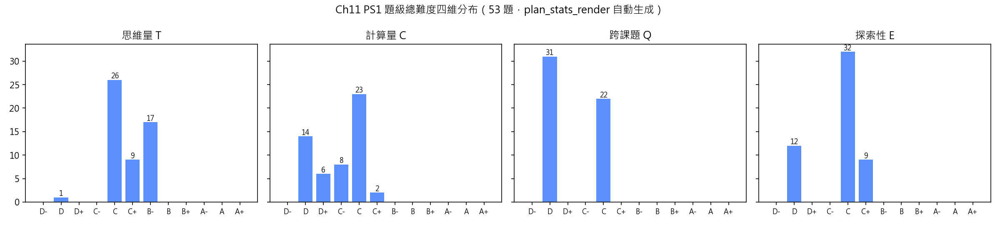
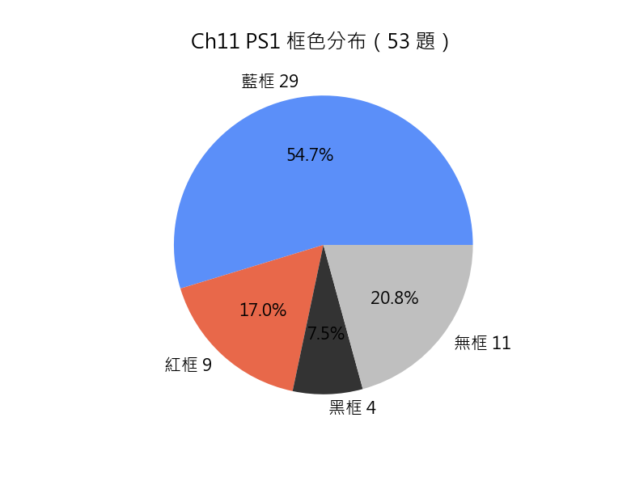

# Chapter 11「不等式（I）」習題冊規劃方案（2026-10-13 合規普查、二次擴充與 7.7 重打標輪）

> 本規劃文件為 Ch11 題集 PS1 的**唯一權威來源**：53 題全要素（題干／分題／考核目標／詳細解答／四維難度標記＋逐維判定理由／配圖判定／標記框／題目修改欄），正文 `Ch11_PS1.tex` 與 `Answer\Ch11_PS1_Answer.tex` 依本規劃由管線重生成（2026-10-13 階段三已重生成並部署：正文 18 頁、答案 38 頁，各兩遍 0 錯誤 0 缺字 0 Overfull；舊成品備份 `.bak_tex1013`）。結構分類：`task` 類 5／無結構 17／簡單結構 7／複雜結構 24；所有含分題的題（31 題）均分題獨立打標，大題總標記取各分題最大值。

> 章節歸組對齊講義節：§11.1（題 1–3）／§11.2.1（題 4–14）／§11.2.2（題 15–19）／§11.3（題 20–28）／綜合練習（題 29–42，四維字典序排列）／理論習題（題 43–53，四維字典序排列）。

## 〇、詳細解答規範與難度評分依據

- **詳細解答**：每題必備，策略與切入點自然織入每步推導（不設開篇策略段），每步註明依據與中間結果；末附**易錯點注意**（`- 易錯：` 起首列點）。解答正文不寫講義章節引用，依據只寫方法／定理名稱（判定理由與易錯點保留引用者寫 `Ch NN [內容]`）。
- **難度評分**：四維（T 思維量／C 計算量／E 探索性／Q 跨課題）逐分題、小分題獨立打標，各維附引用解答具體環節的判定理由，不得合併籠統；大題總標記＝各末級逐維最大值，只附取最大值括號注；`task`／無結構類整題一標（附四行理由）。單步直接套定義→T D；須 2–3 步或涉 2 個以上知識點才升 C；T 維計步只計異質概念環節（同質重複不抬檔）；紅線手法給足引導後正常使用，亦不得據以抬 T／E 檔。
- **符號**：恆等變形用 `≡`，代入數值／解方程／求解鏈用 `=`；證明結束不加收尾記號；多步變形鏈用 `aligned` 環境每步一行附依據，行內不排多步 `>`／`\implies` 鏈。
- **超綱方法自檢**：依《習題冊規劃說明方案》第八章，以本章講義＋前置章節講義（Ch00–Ch10）為工具清單逐題核對方法出處，結果記入「十一、修訂記錄」。

## 一、命題範圍與設計原則

- **唯一內容來源**：`DSE 课题讲义/Chapter 11 不等式 (I).md`（§11.1–§11.3）。
- 內容涵蓋：§11.1 序公理與序運算性質（作差法、乘除保序、變號法則）；§11.2.1 一元一次不等式的定義、標準形式、解的公式與五步求解法；§11.2.2 數軸圖示（空心圓／實心點／方向／複合範圍）；§11.3 平方的非負性、基本不等式、放縮法、同向不等式加法；綜合練習（計分反推、複合範圍整數計數與交集為空、溫標換算建模、促銷方案比較、溫度／秤量／收費情境、盈利百分率、方程聯動、含參分類、宣稱判斷）；理論習題（以已建工具推新結論：均值不等式鏈、交叉差論證、倒數界與商式放縮、積和比較、相鄰根式差單調性、黃金比例探索）。
- **範圍邊界**：只解一元一次不等式；二次不等式（題 42(b) 的 $k^2<20$ 與題 42(c) 的 $(x-1)(x-5)\le 0$）講義未明講，以序公理乘法性質的因子正負討論處理，標黑框；均值不等式 $\dfrac{x+y}{2}\ge\sqrt{xy}$ 為題 43 由基本不等式換元推導的新結論（紅框，超 DSE 但講義可推）；「恰有三個整數值」（題 37）與「公共範圍不存在」（題 49）僅以複合範圍語言表達，不引入區間記號 $(a,b)$、$[a,b]$ 與集合術語；同底數冪比較需一般冪的單調性（講義 §11.3.4 明文「乘法情形留待後續章節討論」），本卷不出。
- **跨章聯動**：Ch01（序公理、平方根、整數與符號法則）、Ch04（多項式展開、因式分解）、Ch05（一元一次方程）、Ch06（代數式化簡、代數分式）、Ch07（盈利百分率、折扣）。
- 題目只列中文題面，不標分數；英文對譯由正文 `entranslation` 提供；解答正文不寫講義節號，依據只寫方法／定理名稱。

## 二、框色邊界（頭部匯總聲明）

- **藍框 `recquestion`（29 題）**：題 1、2、3、7、9、10、12、13、14、16、18、19、22、24、28、29、30、31、33、34、35、36、37、38、39、41、48、49、53——課題在 DSE 官方考綱（初中單位 14 一元一次不等式及其概念、性質、數線表示與應用題）內；其中題 1、3、7、10、13、14、16、18、19、22、24、28、29、30、31 的量化判據複核見「九」第 5 條。
- **紅框 `ofsquestion`（9 題）**：題 21、27、43、44、45、46、47、50、51——引用《官方考纲与课题讲义关联分析.md》Ch11 節「§11.3 不等式技巧｜【完全超纲】」條目（平方非負性、$a^2+b^2\ge2ab$、放縮法、同向加法——官方初中 14 無證明技巧；M2 單位 2 明確「證明不等式命題不屬課程所需」）；逐題：21 基本不等式證明、27 三元推廣、43 均值推導、44 均值應用、45 四種平均鏈、46 交叉差論證（同向加法與變號法則之一般化）、47 倒數界與商式放縮、50 積和下界（配方法放縮）、51 相鄰根式差單調性；另引用該文件本輪新增「§11.1／§11.3 理論延伸」條目。
- **黑框 `exquestion`（4 題）**：題 32、40、42、52——題 52 題面自給「黃金比例 $\varphi$」新概念並在其下探索（成立）；題 32、40、42 為探索性判斷題，⚠ 題面未自給新概念，5.1.3 成立性見「九」第 5 條待裁。
- **無框（11 題）**：題 4、5、6、8、11、15、17、20、23、25、26——太基礎批量操練或無任何維達 C+（5.1 無框第一類）。
- 各題勾選見「六、題目方案」各題「標記框」；正文 .tex 落框以勾選為準。

## 三、題型結構規劃

| 類型 | 題號 | 數量 | 命題用途 |
| --- | --- | --: | --- |
| `task` 類 | 2、4、5、6、8 | 5 | 批量操練：序運算性質判斷、一元一次不等式辨識、文字轉不等式、解不等式 |
| 無結構類 | 1、7、9、10、11、13、15、16、17、20、21、22、23、24、25、26、40 | 17 | 單一概念的完整運用：作差法、五步法、解的公式、數軸圖示、不等式技巧證明、含參分類討論 |
| 簡單結構類 | 14、18、19、28、33、36、46 | 7 | 恰 (a)(b) 兩大分題，前分鋪墊、後分依賴 |
| 複雜結構類 | 3、12、27、29、30、31、32、34、35、37、38、39、41、42、43、44、45、47、48、49、50、51、52、53 | 24 | 三分題或以上，層層遞進（逆向求參、端點反推、推廣、情境建模、新結論推導） |

> 結構類型以題面實際分題數為準（`\task` 多欄 → task 類；大分題 ≥3 → 複雜、恰 2 → 簡單、無分題 → 無結構）。非 task 題 48 題中「無結構 : 簡單 : 複雜」＝ 17 : 7 : 24（與 4.1 的 2:7:1 參考比例之差距見「九」第 3 條）。

### 各節題目分配

| 講義部分 | 題目 | 主要內容 | 跨章聯動 |
| --- | --- | --- | --- |
| §11.1 序性質回顧 | 1–3 | 作差法比較、序運算性質判斷、多項式作差比較 | Ch01、Ch04 |
| §11.2.1 定義與求解 | 4–14 | 一元一次不等式辨識、文字轉換、五步法、解的公式、方程對比、逆向求參、變號判斷 | Ch05、Ch06 |
| §11.2.2 幾何表示（數軸） | 15–19 | 數軸圖示、同一數軸交集、讀數軸寫不等式、範圍交集、正整數解判斷 | Ch01 |
| §11.3 不等式技巧 | 20–28 | 平方非負性、基本不等式、配方、放縮法、同向加法、三元推廣、情境建模 | Ch04、Ch06 |
| 綜合練習 | 29–42 | 溫度情境、盈利百分率、方程聯動、乘法性質探究、水族箱、秤量誤差、的士收費、計分反推、交集整數計數、溫標換算、促銷比較、含參分類、二次多項式、範圍包含 | Ch01、Ch04、Ch05、Ch06、Ch07 |
| 理論習題 | 43–53 | 均值不等式推導與應用、四種平均不等式鏈、交叉差論證、分數範圍界定、立方保序與平方反例、公共範圍為空、積和比較、相鄰根式差、黃金比例、糖水不等式 | Ch01、Ch04、Ch06 |

## 四、難度與框色統計表（依規範 7.6，由題目定級自動重算）

> **本節為自動產物，勿手改**：由 `.workbuddy/scripts/plan_stats_render.py` 取「七、題目方案」的**末級定級行**重算題級四維（逐維取各末級最大值）、框色勾選與所屬大節，整節覆蓋（片段層覆寫後須重跑本章組裝器）。檔位、框色或題目增刪後**重跑本腳本即可**（連同兩個 PNG），不必逐處對照；欲保留人工解釋文字，寫成以 `> 備註：` 起始的引用塊即自動保留。
> 統計口徑：只計**題級總難度**（不統計分題與小分題，2026-09-01 用戶裁定）；「B 檔及以上」＝**任一維達 B- 或以上**；「C 檔及以上」＝任一維達 C- 或以上；「跨章聯動」按題計、以題級 Q 維達 C 或以上為準（規範 7.6）。

### 四維分布表（題級總難度，53 題）

| 維度 | D- | D | D+ | C- | C | C+ | B- | B | B+ | A- | A | A+ | B 檔及以上合計 |
| --- | --: | --: | --: | --: | --: | --: | --: | --: | --: | --: | --: | --: | --: | ---: |
| 思維量（T） | 0 | 1 | 0 | 0 | 26 | 9 | 17 | 0 | 0 | 0 | 0 | 0 | 17 |
| 計算量（C） | 0 | 14 | 6 | 8 | 23 | 2 | 0 | 0 | 0 | 0 | 0 | 0 | 0 |
| 跨課題（Q） | 0 | 31 | 0 | 0 | 22 | 0 | 0 | 0 | 0 | 0 | 0 | 0 | 0 |
| 探索性（E） | 0 | 12 | 0 | 0 | 32 | 9 | 0 | 0 | 0 | 0 | 0 | 0 | 0 |

（思維量最高 B-（題 9、27、36、37、38、39、40、41、42、46、47、48、49、50、51、52、53）；計算量最高 C+（題 45、53）；跨課題最高 C（題 3、10、11、12、16、26、27、28、30、31、35、38、39、42、43、44、45、47、50、51、52、53）；探索性最高 C+（題 34、37、39、41、47、48、49、51、53）。全章無 A 檔維。按上述口徑：**B 檔及以上 17 題（32.1%）**、C 檔及以上 52 題（98.1%）、題級 Q 維達 C 或以上（跨章聯動）22 題（41.5%）。B 檔及以上題號：9、27、36、37、38、39、40、41、42、46、47、48、49、50、51、52、53。）

**統計圖表**（同上腳本自動生成，重跑即覆寫同名 PNG）：





### 按題號難度一覽（B 檔及以上，17 題，佔 32.1%）

| 題號 | 總難度 | 框色 | 要點 |
| --- | --- | --- | --- |
| 9 | T B-｜C D｜E D｜Q D | 藍 | 解的公式（含參） |
| 27 | **T B-｜C C｜E C｜Q C** | 紅 | 基本不等式推廣 |
| 36 | T B-｜C C-｜E C｜Q D | 藍 | 知識競賽計分 |
| 37 | T B-｜C C-｜E C+｜Q D | 藍 | 公共範圍恰有三個整數 |
| 38 | T B-｜C C-｜E C｜Q C | 藍 | 華氏與攝氏 |
| 39 | T B-｜C C-｜E C+｜Q C | 藍 | 促銷方案比較 |
| 40 | T B-｜C C｜E C｜Q D | 黑 | 含參分類討論 |
| 41 | T B-｜C C｜E C+｜Q D | 藍 | 範圍包含與參數 |
| 42 | T B-｜C C｜E C｜Q C | 黑 | 二次多項式與不等式 |
| 46 | T B-｜C D+｜E C｜Q D | 紅 | 差的比較方向 |
| 47 | T B-｜C D+｜E C+｜Q C | 紅 | 分數範圍的界定 |
| 48 | T B-｜C C-｜E C+｜Q D | 藍 | 立方保序與平方反例 |
| 49 | T B-｜C C-｜E C+｜Q D | 藍 | 公共範圍為空 |
| 50 | T B-｜C C-｜E C｜Q C | 紅 | 積與和的比較 |
| 51 | T B-｜C C-｜E C+｜Q C | 紅 | 相鄰平方根差 |
| 52 | T B-｜C C｜E C｜Q C | 黑 | 黃金比例 |
| 53 | T B-｜C C+｜E C+｜Q C | 藍 | 糖水不等式 |

### 框色分布表

| 部分 | 藍框 | 紅框 | 黑框 | 無框 | 小計 |
| --- | --: | --: | --: | --: | --: |
| §11.1（題 1–3） | 3 | 0 | 0 | 0 | 3 |
| §11.2（題 4–19） | 9 | 0 | 0 | 7 | 16 |
| §11.3（題 20–28） | 3 | 2 | 0 | 4 | 9 |
| 綜合練習（題 29–42） | 11 | 0 | 3 | 0 | 14 |
| 理論習題（題 43–53） | 3 | 7 | 1 | 0 | 11 |
| **合計** | **29** | **9** | **4** | **11** | **53** |

- 紅框 9 題（17.0%）：題 21、27、43、44、45、46、47、50、51。
- 黑框 4 題（7.5%）：題 32、40、42、52。
- 無框 11 題（20.8%）：題 4、5、6、8、11、15、17、20、23、25、26。

### 分布檢查結論

- ①**宏觀遞增與次序**：同小節內相鄰兩題按四維字典序 T→C→Q→E 升序排列；實算**小節內回退 8 對**（§11.1 2→3；§11.2.1 4→5；§11.2.1 9→10；§11.2.1 12→13；§11.2.2 16→17；§11.3 22→23；§11.3 24→25；§11.3 27→28）；另有**小節交界回退 1 對**（14→15）——依規範 7.5「小節歸組優先於逐對排序」，交界回退屬正常形態，如實報數、不重排。
- ②**全章檔位**：B 檔及以上 17 題（32.1%）、C 檔及以上 52 題（98.1%）；全章最高檔 T B-／C C+／E C+／Q C；**全章無** A 檔維。
- ③**講義節上限對照（7.7，逐維）**：§11.1 上限 T C+｜C C｜E C｜Q C｜越限 無｜四維全同觸頂 ⚠ 無；§11.2 上限 T B-｜C C｜E C｜Q C｜越限 無｜四維全同觸頂 ⚠ 無；§11.3 上限 T B-｜C C｜E C｜Q C｜越限 無｜四維全同觸頂 27；綜合練習 不適用（7.7）；理論習題 不適用（7.7）。
- ④**框色結構**：藍框 29 題（54.7%）為操練主體；紅框 9 題（17.0%）；黑框 4 題（7.5%）為題面自給新概念的探索題；無框 11 題（20.8%）。紅／黑框成立與否只取決於內容範圍與題面是否自給新概念（規範 5.1，A 維限制只約束藍框），逐題引用見「二、框色邊界」。
- ⑤**跨章聯動**：題級 Q 維達 C 或以上 22 題（41.5%）（按題計；規範 7.6 已取消「全章 ≥30%」與「每節至少一題」配額，只留標準）。
## 五、講義節難度上限對照（7.7）

| 講義節 | 本節上限（T｜C｜E｜Q） | 對應題目 | 越限（逐維） | 觸頂（四維全同） |
| --- | --- | --- | --- | --- |
| §11.1 | T C+｜C C｜E C｜Q C | 1–3 | 無 | ⚠ 無四維全同題 |
| §11.2 | T B-｜C C｜E C｜Q C | 4–19 | 無 | ⚠ 無四維全同題 |
| §11.3 | T B-｜C C｜E C｜Q C | 20–28 | 無 | ✅ 題 27 |
| 綜合練習、理論習題 | 不適用（7.7） | 29–53 | — | — |

- 對照依據＝`DSE 课题讲义/Chapter 11 不等式 (I).md` 各 `##` 節標題下的「本節難度上限」行；`###` 小節不作對照粒度。
- 三行上限於 2026-10-13 依《習題難度標記方案-規劃.md》速查表逐維重評（甲案，用戶裁定）：原 §11.1 行按必修例題口徑寫死為 T C｜C D｜E D｜Q D、§11.2／§11.3 低估含參全符號化論證可支撐深度；重評後越限 6 題 → 0 題。§11.1／§11.2 尚無四維全同觸頂題，處置見「九」第 2 條。


## 六、題目方案

### §11.1 序性質與不等式概念


#### 題 1（無結構類）——作差法比較分數

**題干**

以作差法比較 $\dfrac{3}{4}$ 與 $\dfrac{5}{7}$ 的大小。

**考核目標**

運用作差法（講義 11.1 定理 1）與分數通分（Ch01），比較兩分數大小並以數軸位置說明。

**詳細解答**

依作差法，比較 $\dfrac{3}{4}$ 與 $\dfrac{5}{7}$ 轉化為判斷 $\dfrac{3}{4}-\dfrac{5}{7}$ 的正負：

$\begin{aligned}[t] \frac{3}{4}-\frac{5}{7} &= \frac{21}{28}-\frac{20}{28} \\ &= \frac{1}{28} \end{aligned}$

通分時取公分母 $28$（$4$ 與 $7$ 的最小公倍數）。

因 $\dfrac{1}{28}>0$，$\implies \dfrac{3}{4}>\dfrac{5}{7}$。

數軸上較大的數在較右方，故 $\dfrac{3}{4}$ 在 $\dfrac{5}{7}$ 的右方。

**易錯點注意**

- 易錯：通分時分子須同步放大（$\dfrac{3}{4}=\dfrac{21}{28}$），勿只改分母。
- 易錯：作差結果為正 $\implies$ 被減數較大（$\dfrac{3}{4}>\dfrac{5}{7}$），勿寫反。

**難度**

> 題 1｜難度：**T C｜C C｜E D｜Q D**
> 判定理由（T）：作差→通分→比正負→定位數軸，鏈 3 步。
> 判定理由（C）：分數通分（$\dfrac{21}{28}-\dfrac{20}{28}$）與減法。
> 判定理由（E）：題干指定作差法，直接套用，無探究。
> 判定理由（Q）：序性質單課題。

**配圖**：無（純數值比較，數軸位置以文字說明即可，不需配圖。）

**標記框**
- [x] 藍框

**題目修改欄**

- [ ] 加強計算量
- [ ] 加強思維量
- [ ] 分題分得過細
- [ ] 重寫
- [ ] 數值醜陋


---

#### 題 2（`task` 類）——判斷推論

**題干**

判斷下列各推論是否正確，並說明理由。

- $-x>5 \implies x>-5$
- $a>b \implies ac>bc$
- $a>b \implies a+c>b+c$
- $a>b>0 \implies a^2>b^2$。

**考核目標**

運用序運算性質（講義 11.1 定理 2–4）與序公理（加法性質、傳遞性）判斷含參推論的正誤。

**詳細解答**

依序運算性質逐項判斷：

- 不正確。$-x>5$ 兩邊同乘 $-1$（變號法則）得 $x<-5$，而非 $x>-5$。

- 不正確。當 $c<0$ 時兩邊同乘負數 $c$ 方向反轉，得 $ac<bc$；僅當 $c>0$ 時該推論才成立。

- 正確。由序公理加法性質，兩邊同加 $c$ 方向不變。

- 正確。$a>b>0$，兩邊同乘 $a>0$（乘正保序）得 $a^2>ab$；又 $a>b>0$，兩邊同乘 $b>0$ 得 $ab>b^2$。由傳遞性，$a^2>b^2$。

**易錯點注意**

- 易錯：第 1 項乘負數須變號，$x<-5$ 勿寫 $x>-5$。
- 易錯：第 2 項須分 $c>0$、$c<0$ 討論，勿默認 $c>0$。
- 易錯：第 4 項兩次同乘正數後用傳遞性，勿一步到位不寫理由。

**難度**

> 題 2｜難度：**T C+｜C D｜E C｜Q D**
> 判定理由（T）：4 項判斷中第 2、4 項各需 2–3 步（含參數正負討論、兩步乘法＋傳遞性），鏈 2–3 步。
> 判定理由（C）：無實質運算。
> 判定理由（E）：判斷含參推論須自行考慮 $c$ 的正負等隱藏條件，方法選擇層。
> 判定理由（Q）：序性質單課題。

**配圖**：無（純代數推論判斷，不涉及數軸。）

**標記框**
- [x] 藍框

**題目修改欄**

- [ ] 加強計算量
- [ ] 加強思維量
- [ ] 分題分得過細
- [ ] 重寫
- [ ] 數值醜陋


---

#### 題 3（複雜結構類）——多項式作差比較

**題干**

設 $P_1=3x^2-5x+2$ 及 $P_2=2x^2-x-1$。

**分題**

(a) 證明 $P_1-P_2=x^2-4x+3$。

(b) 當 $x=0$、$x=2$ 及 $x=4$ 時，分別判斷 $P_1$ 與 $P_2$ 的大小關係。

(c) 以作差法判斷當 $x>3$ 時 $P_1$ 與 $P_2$ 的大小關係。

**考核目標**

綜合運用多項式減法與因式分解（Ch04）、作差法（講義 11.1）與序公理乘法性質判斷大小關係。

**詳細解答**


(a)

依作差法，先算 $P_1-P_2$：

$\begin{aligned}[t] P_1-P_2 &= (3x^2-5x+2)-(2x^2-x-1) \\ &\equiv 3x^2-5x+2-2x^2+x+1 \\ &\equiv x^2-4x+3 \end{aligned}$

（去括號時第二括號前是減號，每項變號；再合併同類項。）

再因式分解：$x^2-4x+3\equiv(x-1)(x-3)$（十字相乘）。


(b)

由 (a) 的因式分解結果代入各 $x$ 值判斷正負：

- $x=0$：$P_1-P_2=(0-1)(0-3)=3>0$，$\implies P_1>P_2$。

- $x=2$：$P_1-P_2=(2-1)(2-3)=-1<0$，$\implies P_1<P_2$。

- $x=4$：$P_1-P_2=(4-1)(4-3)=3>0$，$\implies P_1>P_2$。


(c)

當 $x>3$ 時，$x-1>2>0$ 且 $x-3>0$，兩因子均正（序公理乘法性質），故 $(x-1)(x-3)>0$，即 $P_1-P_2>0$。

$\implies P_1>P_2$。

**易錯點注意**

- 易錯：(a) 去括號時 $-(2x^2-x-1)$ 每項變號，勿漏 $-2x^2$ 的負號。
- 易錯：(b) 代入的是因式分解結果 $(x-1)(x-3)$，勿把 $P_1$、$P_2$ 各自代入再相減（易算錯）。
- 易錯：(c) $x>3$ 時 $x-1$ 與 $x-3$ 均正，勿漏判其中一個。

**難度**

> 分題 (a)｜難度：**T C｜C C｜E D｜Q C**
> 判定理由（T）：去括號→合併同類項→因式分解，鏈 3 步。
> 判定理由（C）：多項式加減與因式分解（≥4 步）。
> 判定理由（E）：直接計算，無探究。
> 判定理由（Q）：多項式單課題（Ch04 聯動）。
> 分題 (b)｜難度：**T C｜C D+｜E D｜Q C**
> 判定理由（T）：代入 (a) 的因式分解結果並判斷正負，3 次同類代入、每步 1–2 步；依 (a) 結論直接代入，不上浮。
> 判定理由（C）：3 次簡單代入求值，數量疊加上修半級（D→D+）。
> 判定理由（E）：直接代入，無探究。
> 判定理由（Q）：多項式單課題（Ch04 聯動）。
> 分題 (c)｜難度：**T C｜C D｜E C｜Q C**
> 判定理由（T）：由 $x>3$ 判斷兩因子均正→積正→$P_1>P_2$，鏈 3 步。
> 判定理由（C）：無實質運算。
> 判定理由（E）：自行結合因式分解與序性質推理，方法選擇層。
> 判定理由（Q）：多項式＋不等式同板塊跨課題（C）。
> 題 3｜難度：**T C｜C C｜E C｜Q C**（取各分題最大值）

**配圖**：無（純代數比較，不涉及數軸。）

**標記框**
- [x] 藍框

**題目修改欄**

- [ ] 加強計算量
- [ ] 加強思維量
- [ ] 分題分得過細
- [ ] 重寫
- [ ] 數值醜陋


---

### §11.2.1 一元一次不等式的定義與求解


#### 題 4（`task` 類）——判斷一元一次不等式

**題干**

判斷下列哪些是一元一次不等式，並說明理由。

- $4x-7>0$
- $2x^2+x\le 3$
- $5x-2y>7$
- $2(x-3)\le 5x+1$。

**考核目標**

依一元一次不等式的定義（講義 11.2.1），將各不等式化為 $P_1-P_2$ 的最簡多項式後判斷次數與元數。

**詳細解答**

依定義，逐項計算 $P_1-P_2$ 的最簡表示並判斷是否為一元一次多項式：

- $4x-7>0$：$P_1-P_2=4x-7-0=4x-7$，為一元一次多項式。$\implies$ **是**。

- $2x^2+x\le 3$：$P_1-P_2=2x^2+x-3$，為一元二次多項式。$\implies$ **否**。

- $5x-2y>7$：$P_1-P_2=5x-2y-7$，為二元一次多項式。$\implies$ **否**。

- $2(x-3)\le 5x+1$：$P_1-P_2=2(x-3)-(5x+1)=2x-6-5x-1=-3x-7$，為一元一次多項式。$\implies$ **是**。

**易錯點注意**

- 易錯：判斷時須把不等式移項化為 $P_1-P_2$ 的最簡多項式再判次數與元數，勿只看表面形式（如 $2(x-3)\le 5x+1$ 表面含括號，展開合併後仍是一次）。
- 易錯：$5x-2y$ 是二元一次多項式，勿誤判為一元。

**難度**

> 題 4｜難度：**T C｜C D+｜E D｜Q D**
> 判定理由（T）：逐項計算 $P_1-P_2$ 化簡後判斷次數與元數，每項 2 步、鏈 2 步（4 項同類重複不抬檔）。
> 判定理由（C）：展開合併等簡單代數運算，4 項同類計算重複，數量疊加上修半級（D→D+）。
> 判定理由（E）：直接套一元一次不等式的定義，無探究。
> 判定理由（Q）：不等式單課題。

**配圖**：無（純代數辨識，不涉及數軸。）

**標記框**
- [x] 無標記框

**題目修改欄**

- [ ] 加強計算量
- [ ] 加強思維量
- [ ] 分題分得過細
- [ ] 重寫
- [ ] 數值醜陋


---

#### 題 5（`task` 類）——文字寫不等式

**題干**

將下列文字描述寫成不等式。

- $x$ 不小於 $3$
- $y$ 是非負數
- $t$ 最多為 $10$
- $z$ 是正數。

**考核目標**

將中文量詞（不小於／非負／最多／正）準確轉換為不等號（講義 11.2.1 不等式的概念）。

**詳細解答**

依不等式符號的含義逐項轉換：

- $x$ 不小於 $3$：$x\ge 3$（不小於即大於或等於）。

- $y$ 是非負數：$y\ge 0$（非負數即大於或等於零）。

- $t$ 最多為 $10$：$t\le 10$（最多為即不大於）。

- $z$ 是正數：$z>0$（正數即大於零）。

**易錯點注意**

- 易錯：「不小於」是 $\ge$ 而非 $>$；「最多為」是 $\le$。
- 易錯：「非負數」含 $0$，勿寫成 $y>0$。

**難度**

> 題 5｜難度：**T D｜C D｜E D｜Q D**
> 判定理由（T）：直接翻譯文字為不等號，單步套定義。
> 判定理由（C）：無運算。
> 判定理由（E）：直接套規則，無探究。
> 判定理由（Q）：不等式單課題。

**配圖**：無（純文字轉換，不涉及數軸。）

**標記框**
- [x] 無標記框

**題目修改欄**

- [ ] 加強計算量
- [ ] 加強思維量
- [ ] 分題分得過細
- [ ] 重寫
- [ ] 數值醜陋


---

#### 題 6（`task` 類）——解不等式（正負係數）

**題干**

解下列各不等式。

- $4x-3>13$
- $-3x+8\le 2$
- $4(x+2)>3x+5$。

**考核目標**

按五步法（講義 11.2.1）解一元一次不等式，重點在係數化為 1 時判斷係數正負決定是否變號。

**詳細解答**

依五步法逐項求解，最後一步看係數正負：

- $4x-3>13$：移項 $4x>16$，係數 $4>0$，除以正數方向不變，$\implies x>4$。

- $-3x+8\le 2$：移項 $-3x\le -6$，係數 $-3<0$ 方向反轉，$\implies x\ge 2$。

- $4(x+2)>3x+5$：去括號 $4x+8>3x+5$，移項 $x>-3$。

**易錯點注意**

- 易錯：第 2 項係數 $-3$ 為負須反轉方向（$x\ge 2$ 勿寫 $x\le 2$）。
- 易錯：移項要變號（$4x>13+3$ 勿寫 $4x>13-3$）。

**難度**

> 題 6｜難度：**T C｜C D+｜E D｜Q D**
> 判定理由（T）：每項移項＋係數化為 1 共 2–3 步，3 項同類重複不抬檔。
> 判定理由（C）：簡單數值運算，3 項同類計算重複，數量疊加上修半級（D→D+）。
> 判定理由（E）：直接套五步法，無探究。
> 判定理由（Q）：不等式單課題。

**配圖**：無（只要求解集，不要求數軸表示。）

**標記框**
- [x] 無標記框

**題目修改欄**

- [ ] 加強計算量
- [ ] 加強思維量
- [ ] 分題分得過細
- [ ] 重寫
- [ ] 數值醜陋


---

#### 題 7（無結構類）——去分母解不等式

**題干**

解不等式 $\dfrac{3x-2}{4}-\dfrac{x-1}{2}\le 1$。

**考核目標**

完整執行五步法（講義 11.2.1），重點在去分母（同乘 LCM）與係數化為 1。

**詳細解答**

依五步法先去分母：兩邊同乘 $4$、$2$ 的最小公倍數 $4$（乘正數方向不變）：

$\begin{aligned}[t] \frac{3x-2}{4}-\frac{x-1}{2} &\le 1 \\ (3x-2)-2(x-1) &\le 4 \\ 3x-2-2x+2 &\le 4 \\ x &\le 4 \end{aligned}$

合併同類項後係數為 $1>0$，方向不變，解為 $x\le 4$。

**易錯點注意**

- 易錯：去分母時每一項都要乘 $4$（含右邊常數 $1$），勿只乘分數項。
- 易錯：$-2(x-1)$ 去括號時 $-2$ 要乘 $x$ 與 $-1$ 兩項，得 $-2x+2$，勿漏變號。

**難度**

> 題 7｜難度：**T C｜C C｜E D｜Q D**
> 判定理由（T）：去分母→去括號→移項→合併→係數化為 1，五步法 5 步。
> 判定理由（C）：去分母與代數運算（≥4 步，低次代數式）。
> 判定理由（E）：直接套五步法，無探究。
> 判定理由（Q）：不等式單課題。

**配圖**：無（只要求解集，不要求數軸表示。）

**標記框**
- [x] 藍框

**題目修改欄**

- [ ] 加強計算量
- [ ] 加強思維量
- [ ] 分題分得過細
- [ ] 重寫
- [ ] 數值醜陋


---

#### 題 8（`task` 類）——解不等式綜合操練

**題干**

解下列各不等式。

- $5x-3<2x+9$
- $-3(x-2)\ge x+4$
- $\dfrac{x+1}{2}<\dfrac{2x-1}{3}$
- $4-2x\le 3x+14$。

**考核目標**

綜合操練五步法（講義 11.2.1），涵蓋去括號、去分母、正負係數變號。

**詳細解答**

依五步法逐項求解：

- $5x-3<2x+9$：移項 $3x<12$，$\implies x<4$。

- $-3(x-2)\ge x+4$：去括號 $-3x+6\ge x+4$，移項 $-4x\ge -2$，係數 $-4<0$ 變號，$\implies x\le \dfrac{1}{2}$。

- $\dfrac{x+1}{2}<\dfrac{2x-1}{3}$：同乘 $6$，$3(x+1)<2(2x-1)$，去括號 $3x+3<4x-2$，移項 $x>5$。

- $4-2x\le 3x+14$：移項 $-5x\le 10$，係數 $-5<0$ 變號，$\implies x\ge -2$。

**易錯點注意**

- 易錯：第 2、4 項係數為負須變號。
- 易錯：第 3 項去分母同乘 $6$ 時兩邊分母約去後勿漏分子括號。
- 易錯：結果化至最簡（$x\le \dfrac{1}{2}$ 勿寫 $x\le \dfrac{2}{4}$）。

**難度**

> 題 8｜難度：**T C｜C C｜E D｜Q D**
> 判定理由（T）：每項去括號／去分母→移項→係數化為 1 共 3–4 步，4 項同類重複不抬檔；含正負係數變號判斷。
> 判定理由（C）：去括號、去分母、移項等低次代數運算，4 項疊加。
> 判定理由（E）：直接套五步法，無探究。
> 判定理由（Q）：不等式單課題。

**配圖**：無（只要求解集，不要求數軸表示。）

**標記框**
- [x] 無標記框

**題目修改欄**

- [ ] 加強計算量
- [ ] 加強思維量
- [ ] 分題分得過細
- [ ] 重寫
- [ ] 數值醜陋


---

#### 題 9（無結構類）——解的公式（含參）

**題干**

已知不等式 $ax+b>0$（$a\neq 0$），分別就 $a>0$ 及 $a<0$ 兩種情形寫出其解。

**考核目標**

直接運用解的公式（講義 11.2.1 定理），區分 $a>0$、$a<0$ 兩情形（含參符號化）。

**詳細解答**

依解的公式：由 $ax+b>0$ 移項（加法性質）得 $ax>-b$。

若 $a>0$，兩邊同除 $a$（正數）方向不變：$x>-\dfrac{b}{a}$。

若 $a<0$，兩邊同除 $a$（負數）方向反轉：$x<-\dfrac{b}{a}$。

**易錯點注意**

- 易錯：$a<0$ 時方向反轉，勿漏。
- 易錯：結果以 $-\dfrac{b}{a}$ 表示，正負號勿寫錯。

**難度**

> 題 9｜難度：**T B-｜C D｜E D｜Q D**
> 判定理由（T）：由 $ax+b>0$ 移項再分 $a>0$、$a<0$ 兩情形套解的公式，鏈 2 步；全符號化（$a$、$b$ 為參數、無具體數值），依判據「無圖＋全符號化」C 上修至 B-。
> 判定理由（C）：無實質運算。
> 判定理由（E）：直接套解的公式，無探究。
> 判定理由（Q）：不等式單課題。

**配圖**：無（只要求寫出解集，不要求數軸表示。）

**標記框**
- [x] 藍框

**題目修改欄**

- [ ] 加強計算量
- [ ] 加強思維量
- [ ] 分題分得過細
- [ ] 重寫
- [ ] 數值醜陋


---

#### 題 10（無結構類）——方程與不等式對比

**題干**

解方程 $3x-5=7$ 與不等式 $3x-5>7$，比較兩者解的異同。

**考核目標**

對比一元一次方程（Ch05）與一元一次不等式的解法異同——前兩步相同，最後一步方程得點、不等式得範圍。

**詳細解答**

先解方程 $3x-5=7$：$3x=12$，$\implies x=4$，方程有唯一解。

再解不等式 $3x-5>7$：$3x>12$，係數 $3>0$ 方向不變，$\implies x>4$，不等式有無限多解。

比較：兩者「移項、合併」兩步完全相同，唯一分別在最後一步——方程得唯一值 $x=4$（一個點），不等式得開範圍 $x>4$（不含 $4$ 本身，對應數軸上 $x=4$ 右方除端點外的所有點）。

**易錯點注意**

- 易錯：不等式的解 $x>4$ 不含 $4$（嚴格不等號），勿與方程解 $x=4$ 混淆。
- 易錯：「無限多解」對應數軸上的連續範圍，勿理解為間斷的點集。

**難度**

> 題 10｜難度：**T C｜C D｜E C｜Q C**
> 判定理由（T）：解方程與解不等式各 2–3 步並比較異同，鏈 3 步。
> 判定理由（C）：簡單數值運算。
> 判定理由（E）：自行比較兩者解集的異同（理解層）。
> 判定理由（Q）：方程＋不等式同板塊跨課題（Ch05 聯動，C）。

**配圖**：無（比較以文字說明，不需數軸配圖。）

**標記框**
- [x] 藍框

**題目修改欄**

- [ ] 加強計算量
- [ ] 加強思維量
- [ ] 分題分得過細
- [ ] 重寫
- [ ] 數值醜陋


---

#### 題 11（無結構類）——先化簡再解不等式

**題干**

先化簡 $2(x-3)-3(x-1)$，再解不等式 $2(x-3)-3(x-1)<0$。

**考核目標**

先作代數式化簡（Ch06），再解一元一次不等式（講義 11.2.1）。

**詳細解答**

先化簡：

$\begin{aligned}[t] 2(x-3)-3(x-1) &\equiv 2x-6-3x+3 \\ &\equiv -x-3 \end{aligned}$

再解不等式 $-x-3<0$：

$\begin{aligned}[t] -x-3 &< 0 \\ -x &< 3 \\ x &> -3 \end{aligned}$

（最後一步兩邊同乘 $-1$，方向反轉（變號法則）。）

**易錯點注意**

- 易錯：化簡時 $-3(x-1)=-3x+3$（乘負數展開，符號勿錯）。
- 易錯：$-x<3$ 兩邊同乘 $-1$ 得 $x>-3$，勿漏變號。

**難度**

> 題 11｜難度：**T C｜C C｜E D｜Q C**
> 判定理由（T）：化簡→移項→變號，鏈 3 步。
> 判定理由（C）：多項式展開合併（≥4 步）。
> 判定理由（E）：直接計算，無探究。
> 判定理由（Q）：代數式＋不等式同板塊跨課題（Ch06 聯動，C）。

**配圖**：無（純代數運算，不涉及數軸。）

**標記框**
- [x] 無標記框

**題目修改欄**

- [ ] 加強計算量
- [ ] 加強思維量
- [ ] 分題分得過細
- [ ] 重寫
- [ ] 數值醜陋


---

#### 題 12（複雜結構類）——逆向求參數

**題干**

已知關於 $x$ 的不等式 $kx+5>2$ 的解為 $x<3$。

**分題**

(a) 判斷 $k$ 的正負。

(b) 求 $k$ 的值。

(c) 解不等式 $(k-1)x+3\le 0$。

**考核目標**

逆向運用解的公式（講義 11.2.1）由解集形態反推係數正負，再代回解不等式。

**詳細解答**


(a)

由 $kx+5>2$ 移項得 $kx>-3$。

若 $k>0$，由解的公式得 $x>-\dfrac{3}{k}$，方向向右，與解 $x<3$（方向向左）不符。

$\implies k<0$（兩邊同除負數方向反轉才得 $x<$ 形態）。


(b)

由 (a) $k<0$，$kx>-3$ 兩邊同除 $k$（負數）方向反轉，得 $x<-\dfrac{3}{k}$。

對照解 $x<3$：$-\dfrac{3}{k}=3$，$\implies k=-1$。


(c)

代 $k=-1$：$(-1-1)x+3\le 0\implies -2x+3\le 0\implies -2x\le -3$，係數 $-2<0$ 變號，$\implies x\ge \dfrac{3}{2}$。

**易錯點注意**

- 易錯：(a) 勿先假定 $k>0$——解為 $x<3$ 已暗示 $k<0$（除以負數才變號）。
- 易錯：(b) 由 $kx>-3$ 同除 $k$ 方向反轉，$-\dfrac{3}{k}=3$ 勿寫成 $\dfrac{3}{k}=3$。
- 易錯：(c) 代 $k=-1$ 後係數是 $-2$，除負數變號得 $x\ge \dfrac{3}{2}$。

**難度**

> 分題 (a)｜難度：**T C+｜C D｜E C｜Q D**
> 判定理由（T）：由解集的形態（$x<3$ 向左）反推係數 $k<0$，逆向運用解的公式，含易漏判斷（漏 $k<0$ 即出錯），思維陷阱上修半級（C→C+）。
> 判定理由（C）：無實質運算。
> 判定理由（E）：自行建立「解集方向$\iff$係數正負」的逆向推理，方法選擇層。
> 判定理由（Q）：不等式單課題。
> 分題 (b)｜難度：**T C｜C D｜E D｜Q D**
> 判定理由（T）：由 $-\dfrac{3}{k}=3$ 解 $k=-1$，1–2 步；依 (a) 結論（$k<0$）驗證，不上浮。
> 判定理由（C）：簡單分數運算。
> 判定理由（E）：直接計算，無探究。
> 判定理由（Q）：不等式單課題。
> 分題 (c)｜難度：**T C｜C C｜E D｜Q C**
> 判定理由（T）：代 $k=-1$ 解一元一次不等式，鏈 3 步；依 (b) 結論代入，不上浮。
> 判定理由（C）：代數式運算。
> 判定理由（E）：直接計算，無探究。
> 判定理由（Q）：不等式單課題。
> 題 12｜難度：**T C+｜C C｜E C｜Q C**（取各分題最大值）

**配圖**：無（只要求解集，不要求數軸表示。）

**標記框**
- [x] 藍框

**題目修改欄**

- [ ] 加強計算量
- [ ] 加強思維量
- [ ] 分題分得過細
- [ ] 重寫
- [ ] 數值醜陋


---

#### 題 13（無結構類）——變號陷阱判斷題

**題干**

某人宣稱「不等式 $-3x+6>0$ 的解為 $x>2$」。該宣稱是否正確？試解釋你的答案。

**考核目標**

自行解不等式（講義 11.2.1 五步法）驗證宣稱，考查除以負數變號的常見錯誤。

**詳細解答**

不正確。先自行解 $-3x+6>0$：

$\begin{aligned}[t] -3x+6 &> 0 \\ -3x &> -6 \\ x &< 2 \end{aligned}$

最後一步兩邊同除 $-3$（負數），方向反轉（變號法則）。

正確解為 $x<2$，而非宣稱的 $x>2$。

**易錯點注意**

- 易錯：除以負數 $-3$ 必須變號——正確解是 $x<2$，宣稱 $x>2$ 恰好漏了變號。
- 易錯：判斷前先自己解一遍再對比宣稱，勿直接相信宣稱。

**難度**

> 題 13｜難度：**T C｜C D｜E C｜Q D**
> 判定理由（T）：解不等式 3 步並判斷宣稱正誤，鏈 3 步。
> 判定理由（C）：簡單數值運算。
> 判定理由（E）：判斷題須自行完成推算再對比宣稱，方法選擇層。
> 判定理由（Q）：不等式單課題。

**配圖**：無（判斷以文字說明，不需數軸配圖。）

**標記框**
- [x] 藍框

**題目修改欄**

- [ ] 加強計算量
- [ ] 加強思維量
- [ ] 分題分得過細
- [ ] 重寫
- [ ] 數值醜陋


---

#### 題 14（簡單結構類）——解、數軸與最小值判斷

**題干**

解不等式 $\dfrac{5x-2}{3}\le 2x-1$。

**分題**

(a) 將解以數軸表示。

(b) 某人宣稱「對該不等式的任何一個解 $x$，$2x-1$ 的值均不小於 $1$」。該宣稱是否正確？試解釋你的答案。

**考核目標**

解不等式（講義 11.2.1）、數軸圖示（11.2.2），並由解集推出 $2x-1$ 的下界完成判斷。

**詳細解答**

(a)

先去分母（同乘 $3>0$，方向不變）：

$\begin{aligned}[t] \frac{5x-2}{3} &\le 2x-1 \\ 5x-2 &\le 6x-3 \\ -x &\le -1 \\ x &\ge 1 \end{aligned}$

（最後一步兩邊同乘 $-1$，方向反轉。）

數軸上 $x=1$ 處以實心點（$\ge$ 包含端點）向右畫箭頭（數軸圖示規則）。

(b)

由 (a) 解為 $x\ge 1$。當 $x\ge 1$ 時，$2x-1\ge 2(1)-1=1$（$2x-1$ 隨 $x$ 增大而增大，在 $x=1$ 處取得最小值 $1$）。

$\implies$ 正確。該不等式的任何一個解均滿足 $x\ge 1$，故 $2x-1$ 的值均不小於 $1$。

**易錯點注意**

- 易錯：(a) 去分母時右邊 $2x-1$ 也要乘 $3$（$6x-3$），勿只乘左邊。
- 易錯：(a) $-x\le -1$ 兩邊同乘 $-1$ 變號得 $x\ge 1$，方向勿忘反轉。
- 易錯：(b) 論證「$2x-1$ 不小於 $1$」須用 $x\ge 1$ 代入最小值，勿只舉一個例子。

**難度**

> 分題 (a)｜難度：**T C｜C C｜E D｜Q D**
> 判定理由（T）：去分母→移項→變號→數軸轉換，鏈 4 步。
> 判定理由（C）：去分母與代數運算（≥4 步）。
> 判定理由（E）：直接套五步法與圖示規則，無探究。
> 判定理由（Q）：不等式單課題。
> 分題 (b)｜難度：**T C｜C D｜E C｜Q D**
> 判定理由（T）：由 (a) 的 $x\ge 1$ 推出 $2x-1\ge 1$，鏈 2 步；依 (a) 結論，不上浮。
> 判定理由（C）：簡單代入。
> 判定理由（E）：判斷題須自行完成最小值推理，方法選擇層。
> 判定理由（Q）：不等式單課題。
> 題 14｜難度：**T C｜C C｜E C｜Q D**（取各分題最大值）

**配圖**：有（作答型數軸參考圖，逐塊標「分題（x）附圖」存於本欄——管線僅輸出未標記主圖，故不落正文與答案文字，防預示答案；Obsidian 可渲染。）

分題 (a) 附圖：

```tikz
\begin{document}
\begin{tikzpicture}[scale=0.9]
    \draw[->] (-4,0) -- (4.5,0);
    \draw[very thick, blue] (1,0) -- (3.8,0);
    \filldraw[blue] (1,0) circle (3pt);
    \draw[->, very thick, blue] (3.7,0) -- (4.2,0);
    \node[below] at (1,0) {$1$};
\end{tikzpicture}
\end{document}
```


**標記框**
- [x] 藍框

**題目修改欄**

- [ ] 加強計算量
- [ ] 加強思維量
- [ ] 分題分得過細
- [ ] 重寫
- [ ] 數值醜陋

---

### §11.2.2 幾何表示（數軸）

#### 題 15（無結構類）——數軸表示（單端點）

**題干**

將不等式 $x>-3$ 及 $x\le 2$ 的解分別以數軸表示。

**考核目標**

運用數軸圖示規則（講義 11.2.2）：嚴格用空心圓、非嚴格用實心點，方向看不等號開口。

**詳細解答**

依數軸圖示規則：$>$／$\ge$ 向右、$<$／$\le$ 向左；嚴格不等式用空心圓、非嚴格用實心點。

$x>-3$：$x=-3$ 處空心圓（不包含端點），向右畫箭頭。

$x\le 2$：$x=2$ 處實心點（包含端點），向左畫箭頭。

**易錯點注意**

- 易錯：$>$ 用空心圓、$\ge$ 用實心點，勿混淆。
- 易錯：方向看不等號開口：$x>-3$ 向右、$x\le 2$ 向左。

**難度**

> 題 15｜難度：**T C｜C D｜E D｜Q D**
> 判定理由（T）：兩圖各含「端點類型＋方向」兩個判斷，鏈 2 步（2 圖重複不額外抬檔）。
> 判定理由（C）：無運算。
> 判定理由（E）：直接套圖示規則，無探究。
> 判定理由（Q）：不等式單課題。

**配圖**：有（作答型數軸參考圖，逐塊標「分題（x）附圖」存於本欄——管線僅輸出未標記主圖，故不落正文與答案文字，防預示答案；Obsidian 可渲染。）

分題 (a) 附圖：

```tikz
\begin{document}
\begin{tikzpicture}[scale=0.9]
    \draw[->] (-4,0) -- (4.5,0);
    \draw[very thick, blue] (-3,0) -- (3.8,0);
    \draw[fill=white, very thick, blue] (-3,0) circle (3pt);
    \draw[->, very thick, blue] (3.7,0) -- (4.2,0);
    \node[below] at (-3,0) {$-3$};
\end{tikzpicture}
\end{document}
```

分題 (a) 附圖：

```tikz
\begin{document}
\begin{tikzpicture}[scale=0.9]
    \draw[->] (-4,0) -- (4.5,0);
    \draw[very thick, blue] (2,0) -- (-1,0);
    \filldraw[blue] (2,0) circle (3pt);
    \draw[->, very thick, blue] (-1.1,0) -- (-1.6,0);
    \node[below] at (2,0) {$2$};
\end{tikzpicture}
\end{document}
```


**標記框**
- [x] 無標記框

**題目修改欄**

- [ ] 加強計算量
- [ ] 加強思維量
- [ ] 分題分得過細
- [ ] 重寫
- [ ] 數值醜陋

---

#### 題 16（無結構類）——同一數軸與交集

**題干**

在同一數軸上表示不等式 $x\ge -4$ 與 $x<1$ 的解，並寫出所有同時滿足兩者的整數。

**考核目標**

在同一數軸上作兩條射線（講義 11.2.2），取重疊範圍並列舉其中的整數（Ch01 整數）。

**詳細解答**

在同一數軸上：$x\ge -4$ 在 $x=-4$ 處實心點向右畫箭頭；$x<1$ 在 $x=1$ 處空心圓向左畫箭頭（數軸圖示規則）。

同時滿足兩者的範圍為兩圖的重疊部分 $-4\le x<1$（左端實心、右端空心）。

該範圍內的整數為 $-4,-3,-2,-1,0$。

**易錯點注意**

- 易錯：交集左端含 $-4$（實心）、右端不含 $1$（空心），整數列舉到 $0$ 為止，勿把 $1$ 算進去。

**難度**

> 題 16｜難度：**T C｜C D｜E C｜Q C**
> 判定理由（T）：兩條射線→取交集→列舉整數，鏈 3–4 步。
> 判定理由（C）：無運算。
> 判定理由（E）：自行確定重疊範圍並列舉整數，方法選擇層。
> 判定理由（Q）：不等式＋數系（整數）同板塊跨課題（C）。

**配圖**：有（作答型數軸參考圖，逐塊標「分題（x）附圖」存於本欄——管線僅輸出未標記主圖，故不落正文與答案文字，防預示答案；Obsidian 可渲染。）

分題 (a) 附圖：

```tikz
\begin{document}
\begin{tikzpicture}[scale=0.9]
    \draw[->] (-5.5,0) -- (3.5,0);
    \draw[very thick, blue] (-4,0) -- (1,0);
    \filldraw[blue] (-4,0) circle (3pt);
    \draw[->, very thick, blue] (0.9,0) -- (1.3,0);
    \draw[very thick, orange] (-4,0.45) -- (1,0.45);
    \draw[fill=white, very thick, orange] (1,0.45) circle (3pt);
    \node[below] at (-4,0) {$-4$};
    \node[below] at (1,0) {$1$};
\end{tikzpicture}
\end{document}
```


**標記框**
- [x] 藍框

**題目修改欄**

- [ ] 加強計算量
- [ ] 加強思維量
- [ ] 分題分得過細
- [ ] 重寫
- [ ] 數值醜陋

---

#### 題 17（無結構類）——讀數軸寫不等式

**題干**

圖中數軸表示某不等式的解，寫出對應的不等式。

**考核目標**

逆向運用數軸圖示規則（講義 11.2.2）：由空心／實心與方向讀出不等式。

**詳細解答**

圖中數軸在 $x=3$ 處為空心圓（不包含端點），藍色粗線向右延伸並帶向右箭頭（數軸圖示規則）。

空心圓對應嚴格不等號，向右對應「大於」。

$\implies$ 對應的不等式為 $x>3$。

**易錯點注意**

- 易錯：空心圓對應嚴格不等式（$x>3$）；若畫成實心點則為 $x\ge 3$——先看端點類型再寫不等號。

**難度**

> 題 17｜難度：**T C｜C D｜E D｜Q D**
> 判定理由（T）：讀圖：判端點類型（空心→嚴格）與方向（右→大於），鏈 2 步。
> 判定理由（C）：無運算。
> 判定理由（E）：直接套圖示規則（逆向），無探究。
> 判定理由（Q）：不等式單課題。

**配圖**：有（數軸圖為本題條件，讀圖作答所需，不屬預示答案之圖。）

```tikz
\begin{document}
\begin{tikzpicture}[scale=0.8]
    \draw[->] (-2.5,0) -- (6.5,0);
    \foreach \x in {-2,-1,0,1,2,3,4,5,6} \draw (\x,0.1) -- (\x,-0.1) node[below] {\footnotesize $\x$};
    \draw[very thick, blue] (3,0) -- (6,0);
    \draw[fill=white, very thick, blue] (3,0) circle (3pt);
    \draw[->, very thick, blue] (5.8,0) -- (6.4,0);
\end{tikzpicture}
\end{document}
```

**標記框**
- [x] 無標記框

**題目修改欄**

- [ ] 加強計算量
- [ ] 加強思維量
- [ ] 分題分得過細
- [ ] 重寫
- [ ] 數值醜陋


---

#### 題 18（簡單結構類）——範圍交集

**題干**

設 $A$ 為所有滿足 $-2<x\le 5$ 的實數 $x$ 所成的範圍，$B$ 為所有滿足 $1\le x<8$ 的實數 $x$ 所成的範圍。

**分題**

(a) 將 $A$ 與 $B$ 分別以數軸表示。

(b) 寫出同時屬於 $A$ 與 $B$ 的 $x$ 的範圍，並以數軸表示。

**考核目標**

作雙端點範圍的數軸圖示（講義 11.2.2），取交集（下界取大、上界取小）並確認端點開閉。

**詳細解答**

(a)

$A$：$-2<x\le 5$，$x=-2$ 處空心圓、$x=5$ 處實心點，兩點之間以粗線段連接（數軸圖示規則）。

$B$：$1\le x<8$，$x=1$ 處實心點、$x=8$ 處空心圓，粗線段連接。

(b)

同時屬於 $A$、$B$ 即兩範圍重疊：下界取兩者較大者 $\max(-2,1)=1$（實心，$B$ 含 $1$），上界取較小者 $\min(5,8)=5$（實心，$A$ 含 $5$）。

$\implies 1\le x\le 5$。數軸上 $x=1$、$x=5$ 均實心點，粗線段連接。

**易錯點注意**

- 易錯：(b) 交集下界 $1$ 實心（$B$ 含 $1$）、上界 $5$ 實心（$A$ 含 $5$），勿把 $5$ 寫成空心。
- 易錯：(b) 重疊範圍各取較大的下界與較小的上界，勿相加或相減。

**難度**

> 分題 (a)｜難度：**T C｜C D｜E D｜Q D**
> 判定理由（T）：兩範圍各按端點類型與連線繪圖，鏈 2 步。
> 判定理由（C）：無運算。
> 判定理由（E）：直接套圖示規則，無探究。
> 判定理由（Q）：不等式單課題。
> 分題 (b)｜難度：**T C｜C D｜E C｜Q D**
> 判定理由（T）：取交集（下界取大、上界取小）並確認端點開閉，鏈 3 步；依 (a) 結論，不上浮。
> 判定理由（C）：無運算。
> 判定理由（E）：自行確定重疊範圍與端點開閉，方法選擇層。
> 判定理由（Q）：不等式單課題。
> 題 18｜難度：**T C｜C D｜E C｜Q D**（取各分題最大值）

**配圖**：有（作答型數軸參考圖，逐塊標「分題（x）附圖」存於本欄——管線僅輸出未標記主圖，故不落正文與答案文字，防預示答案；Obsidian 可渲染。）

分題 (a) 附圖：

```tikz
\begin{document}
\begin{tikzpicture}[scale=0.8]
    \draw[->] (-4,0) -- (4,0);
    \draw[very thick, blue] (-2,0) -- (1.5,0);
    \draw[fill=white, very thick, blue] (-2,0) circle (3pt);
    \filldraw[blue] (1.5,0) circle (3pt);
    \node[below] at (-2,0) {$-2$};
    \node[below] at (1.5,0) {$5$};
\end{tikzpicture}
\end{document}
```

分題 (a) 附圖：

```tikz
\begin{document}
\begin{tikzpicture}[scale=0.8]
    \draw[->] (-4,0) -- (4,0);
    \draw[very thick, blue] (-1.5,0) -- (3,0);
    \filldraw[blue] (-1.5,0) circle (3pt);
    \draw[fill=white, very thick, blue] (3,0) circle (3pt);
    \node[below] at (-1.5,0) {$1$};
    \node[below] at (3,0) {$8$};
\end{tikzpicture}
\end{document}
```

分題 (b) 附圖：

```tikz
\begin{document}
\begin{tikzpicture}[scale=0.8]
    \draw[->] (-4,0) -- (4,0);
    \draw[very thick, blue] (-1.5,0) -- (1.5,0);
    \filldraw[blue] (-1.5,0) circle (3pt);
    \filldraw[blue] (1.5,0) circle (3pt);
    \node[below] at (-1.5,0) {$1$};
    \node[below] at (1.5,0) {$5$};
\end{tikzpicture}
\end{document}
```


**標記框**
- [x] 藍框

**題目修改欄**

- [ ] 加強計算量
- [ ] 加強思維量
- [ ] 分題分得過細
- [ ] 重寫
- [ ] 數值醜陋

---

#### 題 19（簡單結構類）——解、數軸與正整數判斷

**題干**

解不等式 $2(3-x)>x-9$。

**分題**

(a) 將解以數軸表示。

(b) 某人宣稱「在該不等式的正整數解中，最大的一個為 $5$」。該宣稱是否正確？試解釋你的答案。

**考核目標**

解不等式（講義 11.2.1）、數軸圖示（11.2.2），並列舉正整數解驗證宣稱（Ch01 整數）。

**詳細解答**

(a)

$\begin{aligned}[t] 2(3-x) &> x-9 \\ 6-2x &> x-9 \\ -3x &> -15 \\ x &< 5 \end{aligned}$

（最後一步同除 $-3$，方向反轉。）

數軸上 $x=5$ 處空心圓（$<$ 不包含）向左畫箭頭（數軸圖示規則）。

(b)

由 (a) 解為 $x<5$，正整數解為 $1,2,3,4$（$5$ 本身不是解，因 $x<5$ 為嚴格不等式）。

$\implies$ 不正確。最大正整數解應為 $4$。

**易錯點注意**

- 易錯：(b) 最大正整數解是 $4$ 而非 $5$——$x<5$ 不含 $5$。
- 易錯：(b) 列舉正整數解時由 $1$ 開始，勿把 $0$ 或負數算進去。

**難度**

> 分題 (a)｜難度：**T C｜C C｜E D｜Q D**
> 判定理由（T）：去括號→移項→變號→數軸轉換，鏈 4 步。
> 判定理由（C）：代數運算（≥4 步）。
> 判定理由（E）：直接套五步法，無探究。
> 判定理由（Q）：不等式單課題。
> 分題 (b)｜難度：**T C｜C D｜E C｜Q D**
> 判定理由（T）：列舉正整數解並找最大，1–2 步；依 (a) 結論，不上浮。
> 判定理由（C）：無實質運算。
> 判定理由（E）：判斷題須自行列舉並檢驗端點，方法選擇層。
> 判定理由（Q）：不等式單課題。
> 題 19｜難度：**T C｜C C｜E C｜Q D**（取各分題最大值）

**配圖**：有（作答型數軸參考圖，逐塊標「分題（x）附圖」存於本欄——管線僅輸出未標記主圖，故不落正文與答案文字，防預示答案；Obsidian 可渲染。）

分題 (a) 附圖：

```tikz
\begin{document}
\begin{tikzpicture}[scale=0.9]
    \draw[->] (-4,0) -- (4.5,0);
    \draw[very thick, blue] (5,0) -- (3.9,0);
    \draw[fill=white, very thick, blue] (5,0) circle (3pt);
    \draw[->, very thick, blue] (4,0) -- (3.6,0);
    \node[below] at (5,0) {$5$};
\end{tikzpicture}
\end{document}
```


**標記框**
- [x] 藍框

**題目修改欄**

- [ ] 加強計算量
- [ ] 加強思維量
- [ ] 分題分得過細
- [ ] 重寫
- [ ] 數值醜陋

---

### §11.3 不等式技巧

#### 題 20（無結構類）——平方非負性

**題干**

證明 $x^2+7\ge 7$ 對所有實數 $x$ 成立。

**考核目標**

直接運用平方的非負性（講義 11.3.1 定理）與序公理加法性質。

**詳細解答**

依平方的非負性，對任意實數 $x$，$x^2\ge 0$。

兩邊同加 $7$（序公理加法性質）：$x^2+7\ge 7$。

故 $x^2+7\ge 7$ 對所有實數 $x$ 成立。

**易錯點注意**

- 易錯：平方的非負性對所有實數成立，勿加「$x\ne 0$」之類多餘條件。
- 易錯：證明過程用 $\implies$ 串接並註明依據，勿一步到結論。

**難度**

> 題 20｜難度：**T C｜C D｜E D｜Q D**
> 判定理由（T）：平方非負性＋兩邊同加 7，鏈 2 步。
> 判定理由（C）：無運算。
> 判定理由（E）：直接套定理，無探究。
> 判定理由（Q）：不等式單課題。

**配圖**：無（純代數證明，不涉及數軸。）

**標記框**
- [x] 無標記框

**題目修改欄**

- [ ] 加強計算量
- [ ] 加強思維量
- [ ] 分題分得過細
- [ ] 重寫
- [ ] 數值醜陋


---

#### 題 21（無結構類）——基本不等式

**題干**

證明對任意實數 $a$、$b$，$a^2+b^2\ge 2ab$，並寫出等號成立的條件。

**考核目標**

以作差法＋完全平方＋平方非負性證明基本不等式（講義 11.3.2 定理的操練）。

**詳細解答**

作差：$a^2+b^2-2ab\equiv(a-b)^2$（完全平方）。

由平方的非負性，$(a-b)^2\ge 0$。

$\implies a^2+b^2-2ab\ge 0$，兩邊同加 $2ab$（加法性質）：$a^2+b^2\ge 2ab$。

等號成立當且僅當 $(a-b)^2=0$，即 $a=b$。

**易錯點注意**

- 易錯：展開 $(a-b)^2=a^2-2ab+b^2$，中間項係數 $-2ab$ 勿漏。
- 易錯：等號條件是 $a=b$ 而非 $a=-b$。

**難度**

> 題 21｜難度：**T C｜C C｜E C｜Q D**
> 判定理由（T）：作差→配方→平方非負→移項，鏈 3–4 步。
> 判定理由（C）：多項式展開合併（≥4 步）。
> 判定理由（E）：自行選擇作差＋配方路徑，方法選擇層。
> 判定理由（Q）：不等式單課題。

**配圖**：無（純代數證明，不涉及數軸。）

**標記框**
- [x] 紅框

**題目修改欄**

- [ ] 加強計算量
- [ ] 加強思維量
- [ ] 分題分得過細
- [ ] 重寫
- [ ] 數值醜陋


---

#### 題 22（無結構類）——配方證不等式

**題干**

證明 $x^2+9\ge 6x$ 對所有實數 $x$ 成立。

**考核目標**

識別完全平方 $x^2-6x+9=(x-3)^2$（Ch04）並用平方非負性（講義 11.3.1）。

**詳細解答**

移項觀察：$x^2+9-6x\equiv x^2-6x+9\equiv(x-3)^2$（完全平方）。

由平方的非負性，$(x-3)^2\ge 0$，即 $x^2+9-6x\ge 0$。

$\implies x^2+9\ge 6x$ 對所有實數 $x$ 成立。

**易錯點注意**

- 易錯：$x^2-6x+9=(x-3)^2$，一次項係數 $-6$ 對應 $2\times 3$，勿誤配成 $(x-6)^2$。
- 易錯：證明目標是 $x^2+9\ge 6x$，移項後符號勿錯。

**難度**

> 題 22｜難度：**T C｜C C｜E C｜Q D**
> 判定理由（T）：識別完全平方→配方→平方非負性，鏈 3 步。
> 判定理由（C）：配方與展開（≥4 步）。
> 判定理由（E）：自行識別 $x^2-6x+9$ 為完全平方，方法選擇層。
> 判定理由（Q）：不等式單課題。

**配圖**：無（純代數證明，不涉及數軸。）

**標記框**
- [x] 藍框

**題目修改欄**

- [ ] 加強計算量
- [ ] 加強思維量
- [ ] 分題分得過細
- [ ] 重寫
- [ ] 數值醜陋


---

#### 題 23（無結構類）——放縮法

**題干**

證明 $x^2+3>1$ 對所有實數 $x$ 成立。

**考核目標**

運用放縮法（講義 11.3.3）：以 $x^2\ge 0$ 將平方項放縮為 $0$ 獲得下界。

**詳細解答**

依放縮法：由平方的非負性 $x^2\ge 0$，將 $x^2$ 放縮為 $0$ 以獲得下界：

$x^2+3\ge 0+3=3$。

又 $3>1$，由傳遞性：$x^2+3\ge 3>1$。

$\implies x^2+3>1$ 對所有實數 $x$ 成立。

**易錯點注意**

- 易錯：放縮方向勿反——$x^2\ge 0$ 給出的是下界（$x^2+3\ge 3$），勿寫成 $\le$。
- 易錯：「$\ge 3>1$」的傳遞鏈要寫完整。

**難度**

> 題 23｜難度：**T C｜C D｜E C｜Q D**
> 判定理由（T）：放縮→下界→傳遞比較，鏈 3 步。
> 判定理由（C）：無實質運算。
> 判定理由（E）：運用放縮法（自行將 $x^2$ 替換為下界 $0$），方法選擇層。
> 判定理由（Q）：不等式單課題。

**配圖**：無（純代數證明，不涉及數軸。）

**標記框**
- [x] 無標記框

**題目修改欄**

- [ ] 加強計算量
- [ ] 加強思維量
- [ ] 分題分得過細
- [ ] 重寫
- [ ] 數值醜陋


---

#### 題 24（無結構類）——配方＋放縮

**題干**

證明 $x^2+6x+12>0$ 對所有實數 $x$ 成立。

**考核目標**

先配方再放縮（講義 11.3.3 示例方法）：$x^2+6x+12=(x+3)^2+3\ge 3>0$。

**詳細解答**

先配方：$x^2+6x+12\equiv x^2+6x+9+3\equiv(x+3)^2+3$（拆 $12$ 湊完全平方）。

由平方的非負性，$(x+3)^2\ge 0$，將 $(x+3)^2$ 放縮為 $0$：$(x+3)^2+3\ge 0+3=3>0$。

$\implies x^2+6x+12>0$ 對所有實數 $x$ 成立。

**易錯點注意**

- 易錯：配方時 $x^2+6x+12=(x+3)^2+3$（拆 $12$ 為 $9+3$），勿寫成 $(x+3)^2+12$。
- 易錯：放縮後「$\ge 3>0$」的傳遞關係勿漏。

**難度**

> 題 24｜難度：**T C｜C C｜E C｜Q D**
> 判定理由（T）：配方→放縮→傳遞，鏈 3 步。
> 判定理由（C）：配方（≥4 步）。
> 判定理由（E）：自行配方後放縮，方法選擇層。
> 判定理由（Q）：不等式單課題。

**配圖**：無（純代數證明，不涉及數軸。）

**標記框**
- [x] 藍框

**題目修改欄**

- [ ] 加強計算量
- [ ] 加強思維量
- [ ] 分題分得過細
- [ ] 重寫
- [ ] 數值醜陋


---

#### 題 25（無結構類）——同向不等式加法

**題干**

已知 $x>-3$ 且 $y>7$，求 $x+y$ 的範圍。

**考核目標**

直接運用同向不等式的加法（講義 11.3.4 定理）。

**詳細解答**

依同向不等式的加法：若 $a>b$ 且 $c>d$，則 $a+c>b+d$。

已知 $x>-3$ 且 $y>7$，兩式相加：$x+y>-3+7=4$。

$\implies x+y>4$。

**易錯點注意**

- 易錯：同向不等式只能相加不能相乘——此題只求 $x+y$，勿把兩式相乘得 $xy>-21$（乘法須正數才保序）。
- 易錯：結果是嚴格大於 $x+y>4$，勿寫 $\ge$。

**難度**

> 題 25｜難度：**T C｜C D｜E D｜Q D**
> 判定理由（T）：套同向加法定理並相加，鏈 2 步。
> 判定理由（C）：簡單數值運算。
> 判定理由（E）：直接套定理，無探究。
> 判定理由（Q）：不等式單課題。

**配圖**：無（純代數推理，不涉及數軸。）

**標記框**
- [x] 無標記框

**題目修改欄**

- [ ] 加強計算量
- [ ] 加強思維量
- [ ] 分題分得過細
- [ ] 重寫
- [ ] 數值醜陋


---

#### 題 26（無結構類）——作差法證不等式

**題干**

證明 $(a+b)^2\ge 4ab$ 對所有實數 $a$、$b$ 成立。

**考核目標**

作差法（講義 11.1）＋多項式展開（Ch04）＋配方＋平方非負性（講義 11.3.1）。

**詳細解答**

依作差法，算 $(a+b)^2-4ab$：

$\begin{aligned}[t] (a+b)^2-4ab &\equiv a^2+2ab+b^2-4ab \\ &\equiv a^2-2ab+b^2 \\ &\equiv (a-b)^2 \end{aligned}$

（展開與合併同類項。）

由平方的非負性，$(a-b)^2\ge 0$。

$\implies (a+b)^2\ge 4ab$ 對所有實數 $a$、$b$ 成立。

**易錯點注意**

- 易錯：展開 $(a+b)^2=a^2+2ab+b^2$，中間項 $+2ab$ 勿漏。
- 易錯：$+2ab$ 與 $-4ab$ 合併得 $-2ab$，勿漏項或算錯符號。

**難度**

> 題 26｜難度：**T C｜C C｜E C｜Q C**
> 判定理由（T）：作差→展開合併→配方→平方非負性，鏈 4 步。
> 判定理由（C）：多項式展開合併（≥4 步）。
> 判定理由（E）：自行選擇作差法路徑，方法選擇層。
> 判定理由（Q）：多項式＋不等式同板塊跨課題（Ch04 聯動，C）。

**配圖**：無（純代數證明，不涉及數軸。）

**標記框**
- [x] 無標記框

**題目修改欄**

- [ ] 加強計算量
- [ ] 加強思維量
- [ ] 分題分得過細
- [ ] 重寫
- [ ] 數值醜陋


---

#### 題 27（複雜結構類）——基本不等式推廣

**題干**

設 $a$、$b$、$c$ 為實數。

**分題**

(a) 證明 $a^2+b^2\ge 2ab$，$b^2+c^2\ge 2bc$，$c^2+a^2\ge 2ca$。

(b) 由 (a) 證明 $a^2+b^2+c^2\ge ab+bc+ca$ 對所有實數 $a$、$b$、$c$ 成立。

(c) 利用 (b) 的結果，證明當 $a+b+c=6$ 時，$a^2+b^2+c^2\ge 12$。

**考核目標**

基本不等式（講義 11.3.2）三式相加（11.3.4 同向加法），再展開 $(a+b+c)^2$（Ch04）完成放縮證明。

**詳細解答**


(a)

依基本不等式：對任意 $u,v$ 有 $u^2+v^2\ge 2uv$（由 $(u-v)^2\ge 0$ 推出）。

分別令 $(u,v)=(a,b)$、$(b,c)$、$(c,a)$，得 $a^2+b^2\ge 2ab$、$b^2+c^2\ge 2bc$、$c^2+a^2\ge 2ca$。


(b)

將 (a) 的三個不等式相加（同向不等式的加法）：

$(a^2+b^2)+(b^2+c^2)+(c^2+a^2)\ge 2ab+2bc+2ca$。

左邊合併同類項：$2(a^2+b^2+c^2)\ge 2(ab+bc+ca)$。

兩邊同除 $2>0$（方向不變）：$a^2+b^2+c^2\ge ab+bc+ca$。


(c)

已知 $a+b+c=6$，展開 $(a+b+c)^2$：$(a+b+c)^2\equiv a^2+b^2+c^2+2(ab+bc+ca)$；代入 $a+b+c=6$ 得 $a^2+b^2+c^2+2(ab+bc+ca)=36$。

由 (b)，$ab+bc+ca\le a^2+b^2+c^2$，代入：$36\le a^2+b^2+c^2+2(a^2+b^2+c^2)=3(a^2+b^2+c^2)$。

兩邊同除 $3>0$：$a^2+b^2+c^2\ge 12$。

**易錯點注意**

- 易錯：(b) 三式相加時左邊每項出現兩次（$2(a^2+b^2+c^2)$），勿漏係數 $2$。
- 易錯：(c) 代入 (b) 時是 $ab+bc+ca\le a^2+b^2+c^2$，不等號方向勿寫反；由 $36\le 3(a^2+b^2+c^2)$ 同除 $3$ 方向不變。

**難度**

> 分題 (a)｜難度：**T C｜C C｜E D｜Q D**
> 判定理由（T）：套基本不等式三次（各 2–3 步），重複不抬檔。
> 判定理由（C）：無實質運算（三式直接寫出）。
> 判定理由（E）：直接套基本不等式，無探究。
> 判定理由（Q）：不等式單課題。
> 分題 (b)｜難度：**T C｜C C｜E C｜Q D**
> 判定理由（T）：三式相加→合併→同除 2，鏈 3 步；依 (a) 結論，不上浮。
> 判定理由（C）：多項式相加合併（≥4 步）。
> 判定理由（E）：自行組織三式相加，方法選擇層。
> 判定理由（Q）：不等式單課題。
> 分題 (c)｜難度：**T B-｜C C｜E C｜Q C**
> 判定理由（T）：展開 $(a+b+c)^2$→代入 (b) 的 $ab+bc+ca\le a^2+b^2+c^2$→得 $36\le 3(a^2+b^2+c^2)$→同除 3，推理鏈 4 步；依 (b) 結論上浮。
> 判定理由（C）：展開與代入（≥4 步）。
> 判定理由（E）：自行設計「先展開平方再用 (b) 放縮」的整體路徑，方法選擇層。
> 判定理由（Q）：多項式展開＋不等式同板塊跨課題（Ch04 聯動，C）。
> 題 27｜難度：**T B-｜C C｜E C｜Q C**（取各分題最大值）

**配圖**：無（純代數證明，不涉及數軸。）

**標記框**
- [x] 紅框

**題目修改欄**

- [ ] 加強計算量
- [ ] 加強思維量
- [ ] 分題分得過細
- [ ] 重寫
- [ ] 數值醜陋


---

#### 題 28（簡單結構類）——瓶裝水總費用

**題干**

某商店有兩款瓶裝水。A 款每瓶售價為 \$(x+5)，B 款每瓶售價為 \$(2x+1)，其中 $x$ 為正實數。小明購買 $n$ 瓶 A 款及 $n$ 瓶 B 款，總費用分別為 $P_A$ 及 $P_B$。

**分題**

(a) 以 $n$ 及 $x$ 表示 $P_B-P_A$。

(b) 某人宣稱「存在某個 $x$ 的值，使得不論 $n$ 為任何正整數，兩款總費用均相等」。該宣稱是否正確？試解釋你的答案。

**考核目標**

由文字情境建立代數式（Ch06），化簡 $P_B-P_A$ 並由 $n>0$ 推理 $x$ 的存在性。

**詳細解答**


(a)

總費用＝單價$\times$瓶數：$P_A=n(x+5)=nx+5n$，$P_B=n(2x+1)=2nx+n$。

$\begin{aligned}[t] P_B-P_A &= (2nx+n)-(nx+5n) \\ &\equiv nx-4n \\ &\equiv n(x-4) \end{aligned}$


(b)

兩款總費用相等當且僅當 $P_A=P_B$，即 $P_B-P_A=0$：$n(x-4)=0$。

由於 $n$ 為正整數（$n>0$），等價於 $x-4=0$，即 $x=4$。

$\implies$ 正確。存在 $x=4$ 使得不論 $n$ 為任何正整數，兩款總費用均相等。

**易錯點注意**

- 易錯：(a) $P_B-P_A=n(2x+1)-n(x+5)$，去括號時 $n$ 要乘每項，勿漏 $-5n$。
- 易錯：(b) 由 $n(x-4)=0$ 且 $n>0$ 得 $x-4=0$，勿寫「$n=0$ 或 $x=4$」（$n$ 為正整數不為零）。

**難度**

> 分題 (a)｜難度：**T C｜C C｜E C｜Q C**
> 判定理由（T）：由文字建模總費用→相減化簡，鏈 3 步。
> 判定理由（C）：代數式展開合併（≥4 步）。
> 判定理由（E）：從文字情境建立代數式，方法選擇層。
> 判定理由（Q）：代數式＋不等式同板塊跨課題（Ch06 聯動，C）。
> 分題 (b)｜難度：**T C｜C D｜E C｜Q D**
> 判定理由（T）：由 (a) 的 $n(x-4)=0$ 推 $x=4$，鏈 2 步；依 (a) 結論，不上浮。
> 判定理由（C）：無實質運算。
> 判定理由（E）：判斷題須自行推理「$n>0\implies x=4$」，方法選擇層。
> 判定理由（Q）：不等式單課題。
> 題 28｜難度：**T C｜C C｜E C｜Q C**（取各分題最大值）

**配圖**：無（情境題以文字描述，不需配圖。）

**標記框**
- [x] 藍框

**題目修改欄**

- [ ] 加強計算量
- [ ] 加強思維量
- [ ] 分題分得過細
- [ ] 重寫
- [ ] 數值醜陋


---

### 綜合練習

#### 題 29（複雜結構類）——教室溫度

**題干**

某教室內溫度 $T$（°C）滿足 $18\le T\le 26$。開啟冷氣後，溫度下降至少 $3$°C。

**分題**

(a) 寫出降溫後溫度的範圍，以不等式表示。

(b) 以數軸表示降溫前後的溫度範圍。

(c) 判斷降溫後溫度是否可能低於 $14$°C，試解釋你的答案。

**考核目標**

由「下降至少 $3$°C」建立不等式（講義 11.2.1），作數軸圖示（11.2.2），並構造例子完成判斷。

**詳細解答**

(a)

設降溫後溫度為 $T'$。「下降至少 $3$°C」即 $T'\le T-3$（降溫量 $\ge 3$）。

由 $T\le 26$ 得 $T'\le 26-3=23$，即 $T'\le 23$；下降量沒有上限，故 $T'$ 無下界。

(b)

降溫前：$18\le T\le 26$，數軸上 $18$、$26$ 處實心點，粗線段連接。

降溫後：$T'\le 23$，$23$ 處實心點向左畫箭頭（數軸圖示規則）。

(c)

可能。例如原溫度 $T=20$°C，下降 $7$°C 後 $T'=13<14$（下降量 $7\ge 3$ 符合「至少 $3$°C」）。

$\implies$ 降溫後溫度可能低於 $14$°C。

**易錯點注意**

- 易錯：「下降至少 $3$°C」是 $T'\le T-3$（上界約束），勿誤解為 $T'\ge T-3$。
- 易錯：(c) 只要構造一個下降量超過 $3$ 的例子即可說明「可能」，勿僅用「下降恰好 $3$」的情形判斷。

**難度**

> 分題 (a)｜難度：**T C｜C D｜E C｜Q D**
> 判定理由（T）：由「下降至少 3」建立 $T'\le T-3$ 並結合 $T\le 26$ 得上界，鏈 3 步。
> 判定理由（C）：簡單數值運算。
> 判定理由（E）：自行建立降溫模型，方法選擇層。
> 判定理由（Q）：不等式單課題。
> 分題 (b)｜難度：**T C｜C D｜E C｜Q D**
> 判定理由（T）：兩個範圍的數軸轉換（雙端區間與半直線），鏈 2–3 步；依 (a) 結論，不上浮。
> 判定理由（C）：無實質運算。
> 判定理由（E）：自行選擇數軸表示方式，方法選擇層。
> 判定理由（Q）：不等式單課題。
> 分題 (c)｜難度：**T C｜C D｜E C｜Q D**
> 判定理由（T）：構造符合條件的情形（如 $T=20$、降 $7$）檢驗 $14$，鏈 2 步。
> 判定理由（C）：簡單數值運算。
> 判定理由（E）：判斷題須自行構造例子驗證，方法選擇層。
> 判定理由（Q）：不等式單課題。
> 題 29｜難度：**T C｜C D｜E C｜Q D**（取各分題最大值）

**配圖**：有（作答型數軸參考圖，逐塊標「分題（x）附圖」存於本欄——管線僅輸出未標記主圖，故不落正文與答案文字，防預示答案；Obsidian 可渲染。）

分題 (b) 附圖：

```tikz
\begin{document}
\begin{tikzpicture}[scale=0.35]
    \draw[->] (14,0) -- (30,0);
    \draw[very thick, blue] (18,0) -- (26,0);
    \filldraw[blue] (18,0) circle (4pt);
    \filldraw[blue] (26,0) circle (4pt);
    \node[below] at (18,0) {$18$};
    \node[below] at (26,0) {$26$};
\end{tikzpicture}
\end{document}
```

分題 (b) 附圖：

```tikz
\begin{document}
\begin{tikzpicture}[scale=0.35]
    \draw[->] (14,0) -- (30,0);
    \draw[very thick, blue] (23,0) -- (18.5,0);
    \filldraw[blue] (23,0) circle (4pt);
    \draw[->, very thick, blue] (18.6,0) -- (18,0);
    \node[below] at (23,0) {$23$};
\end{tikzpicture}
\end{document}
```


**標記框**
- [x] 藍框

**題目修改欄**

- [ ] 加強計算量
- [ ] 加強思維量
- [ ] 分題分得過細
- [ ] 重寫
- [ ] 數值醜陋

---

#### 題 30（複雜結構類）——盈利百分率

**題干**

某商品的成本為 \$200，店主希望盈利百分率不少於 $25\%$。

**分題**

(a) 求售價的最小值。

(b) 若售價定為 \$260，求盈利百分率。

(c) 若店主同時希望售價不高於 \$300，求售價的範圍。

**考核目標**

運用盈利百分率公式（Ch07 7.1.3.2，以成本為基準）建模不等式，並合併售價範圍。

**詳細解答**


(a)

依盈利百分率以成本為基準：$\text{盈利百分率}=\dfrac{\text{售價}-\text{成本}}{\text{成本}}\times 100\%$。

設售價為 $P$ 元：$\dfrac{P-200}{200}\ge 25\%$。

兩邊同乘 $200>0$：$P-200\ge 50$，$\implies P\ge 250$。

售價的最小值為 \$250。


(b)

$\dfrac{260-200}{200}\times 100\%=\dfrac{60}{200}\times 100\%=30\%$。


(c)

由 (a) $P\ge 250$，且售價不高於 \$300 即 $P\le 300$：$250\le P\le 300$。

**易錯點注意**

- 易錯：盈利百分率的分母是成本 $200$，勿用售價作分母。
- 易錯：(a) 由 $\dfrac{P-200}{200}\ge 0.25$ 兩邊同乘 $200$ 再同加 $200$，勿跳步。
- 易錯：(b) $\dfrac{60}{200}=30\%$，勿寫成 $0.3\%$。

**難度**

> 分題 (a)｜難度：**T C｜C C｜E C｜Q C**
> 判定理由（T）：建模百分率不等式→解出售價，鏈 3 步。
> 判定理由（C）：百分率計算（≥4 步）。
> 判定理由（E）：從文字建立百分率不等式，方法選擇層。
> 判定理由（Q）：百分法＋不等式同板塊跨課題（Ch07 聯動，C）。
> 分題 (b)｜難度：**T D｜C D｜E D｜Q C**
> 判定理由（T）：直接套盈利百分率公式，單步。
> 判定理由（C）：簡單數值運算。
> 判定理由（E）：直接套公式，無探究。
> 判定理由（Q）：百分法（Ch07 聯動，C）。
> 分題 (c)｜難度：**T C｜C D｜E C｜Q C**
> 判定理由（T）：合併 (a) 的下界與新條件 $P\le 300$，鏈 2 步；依 (a) 結論，不上浮。
> 判定理由（C）：無實質運算。
> 判定理由（E）：自行合併兩個條件，方法選擇層。
> 判定理由（Q）：百分法＋不等式同板塊跨課題（C）。
> 題 30｜難度：**T C｜C C｜E C｜Q C**（取各分題最大值）

**配圖**：無（情境題以文字描述，不需配圖。）

**標記框**
- [x] 藍框

**題目修改欄**

- [ ] 加強計算量
- [ ] 加強思維量
- [ ] 分題分得過細
- [ ] 重寫
- [ ] 數值醜陋


---

#### 題 31（複雜結構類）——方程與不等式聯動

**題干**

已知方程 $3(x-2)=a(x+1)$ 的解為 $x=5$。

**分題**

(a) 求 $a$ 的值。

(b) 解不等式 $3(x-2)\ge a(x+1)$。

(c) 由此判斷當 $x\ge 5$ 時，$3(x-2)$ 與 $a(x+1)$ 的大小關係。

**考核目標**

先代入解方程求參數（Ch05），再解不等式（講義 11.2.1），由解集判斷大小關係。

**詳細解答**


(a)

把 $x=5$ 代入方程：$3(5-2)=a(5+1)$。

$\begin{aligned}[t] 9 &= 6a \\ a &= \frac{3}{2} \end{aligned}$


(b)

代 $a=\dfrac{3}{2}$：

$\begin{aligned}[t] 3(x-2) &\ge \frac{3}{2}(x+1) \\ 6(x-2) &\ge 3(x+1) \\ 6x-12 &\ge 3x+3 \\ 3x &\ge 15 \\ x &\ge 5 \end{aligned}$

（第 2 步兩邊同乘 $2>0$，方向不變。）


(c)

由 (b)，不等式 $3(x-2)\ge a(x+1)$ 的解為 $x\ge 5$。

$\implies$ 當 $x\ge 5$ 時，$3(x-2)\ge a(x+1)$。

**易錯點注意**

- 易錯：(a) $3(5-2)=9$、$a(5+1)=6a$，代入時勿把 $x=5$ 代錯位置。
- 易錯：(b) 兩邊同乘 $2$ 時左邊 $3(x-2)$ 也要乘（$6(x-2)$），勿只乘右邊。
- 易錯：(c) 「由此判斷」須引用 (b) 的解集，勿重新計算。

**難度**

> 分題 (a)｜難度：**T C｜C C｜E D｜Q C**
> 判定理由（T）：代入 $x=5$ 解方程求 $a$，鏈 2–3 步。
> 判定理由（C）：分數運算。
> 判定理由（E）：直接代入，無探究。
> 判定理由（Q）：方程＋不等式同板塊跨課題（Ch05 聯動，C）。
> 分題 (b)｜難度：**T C｜C C｜E C｜Q C**
> 判定理由（T）：代 $a$→去分母→解不等式，鏈 4–5 步；依 (a) 結論代入，不上浮。
> 判定理由（C）：去分母與代數運算（≥4 步）。
> 判定理由（E）：自行完成分數係數處理，方法選擇層。
> 判定理由（Q）：方程＋不等式同板塊跨課題（C）。
> 分題 (c)｜難度：**T C｜C D｜E C｜Q C**
> 判定理由（T）：由 (b) 的解集直接判斷，鏈 1–2 步；依 (b) 結論，不上浮。
> 判定理由（C）：無實質運算。
> 判定理由（E）：判斷題須理解解集與大小關係的對應，方法選擇層。
> 判定理由（Q）：方程＋不等式同板塊跨課題（C）。
> 題 31｜難度：**T C｜C C｜E C｜Q C**（取各分題最大值）

**配圖**：無（純代數推理，不涉及數軸。）

**標記框**
- [x] 藍框

**題目修改欄**

- [ ] 加強計算量
- [ ] 加強思維量
- [ ] 分題分得過細
- [ ] 重寫
- [ ] 數值醜陋


---

#### 題 32（複雜結構類）——乘法性質探究

**題干**

某人宣稱「若 $a>b$ 且 $c>d$，則 $ac>bd$」。

**分題**

(a) 舉一反例說明該宣稱不正確。

(b) 若附加條件 $a$、$b$、$c$、$d$ 均為正數，該宣稱是否正確？試證明或反證。

(c) 寫出一個額外條件，使得 $ac>bd$ 一定成立。

**考核目標**

構造反例否定全稱宣稱，用序運算性質（講義 11.1 定理 2）與傳遞性證明正數情形的正確性，並概括充分條件。

**詳細解答**


(a)

取 $a=2$、$b=1$、$c=-1$、$d=-2$：$a>b$（$2>1$）且 $c>d$（$-1>-2$）成立。

但 $ac=2\times(-1)=-2$、$bd=1\times(-2)=-2$，$ac=bd$ 而非 $ac>bd$。

$\implies$ 宣稱不正確。


(b)

正確。$a>b>0$，兩邊同乘 $c>0$（乘正保序）得 $ac>bc$；

又 $c>d>0$，兩邊同乘 $b>0$ 得 $bc>bd$。

由傳遞性：$ac>bd$。


(c)

例如附加「$a$、$b$、$c$、$d$ 均為正數」——由 (b) 的證明知此條件足以保證 $ac>bd$（充分條件）。

**易錯點注意**

- 易錯：(a) 反例須同時滿足 $a>b$、$c>d$ 且 $ac>bd$ 不成立——用負數可使乘積變號，勿用全正數（全正數時宣稱恰好成立）。
- 易錯：(b) 兩次同乘的「正數」分別是 $c$ 與 $b$，勿混淆乘數。
- 易錯：(c) 「充分條件」不必必要，寫出 (b) 的條件即可。

**難度**

> 分題 (a)｜難度：**T C+｜C D｜E C｜Q D**
> 判定理由（T）：構造反例：須找負數參與使 $ac\le bd$，並驗證條件成立，鏈 3 步。
> 判定理由（C）：簡單數值運算。
> 判定理由（E）：自行構造反例並驗證，方法選擇層。
> 判定理由（Q）：不等式單課題。
> 分題 (b)｜難度：**T C+｜C D｜E C｜Q D**
> 判定理由（T）：兩步同乘正數＋傳遞性，鏈 3 步。
> 判定理由（C）：無實質運算。
> 判定理由（E）：自行設計證明路徑（兩次同乘再傳遞），方法選擇層。
> 判定理由（Q）：不等式單課題。
> 分題 (c)｜難度：**T C｜C D｜E C｜Q D**
> 判定理由（T）：理解「充分條件」並引用 (b) 的條件，鏈 1–2 步。
> 判定理由（C）：無實質運算。
> 判定理由（E）：自行概括 (b) 的條件為充分條件，方法選擇層。
> 判定理由（Q）：不等式單課題。
> 題 32｜難度：**T C+｜C D｜E C｜Q D**（取各分題最大值）

**配圖**：無（純代數推理，不涉及數軸。）

**標記框**
- [x] 黑框

**題目修改欄**

- [ ] 加強計算量
- [ ] 加強思維量
- [ ] 分題分得過細
- [ ] 重寫
- [ ] 數值醜陋


---

#### 題 33（簡單結構類）——水族箱水溫

**題干**

某水族箱的水溫須維持在 $22$°C 至 $28$°C 之間（包含兩端）。設水溫為 $T$°C。

**分題**

(a) 以不等式表示 $T$ 的允許範圍。

(b) 某日上午水溫為 $25$°C，下午上升了 $r$°C，晚上又下降了 $3$°C。某人宣稱「若上升量 $r$ 不大於 $4$，則水溫整天均在允許範圍內」。該宣稱是否正確？試解釋你的答案。

**考核目標**

寫雙端不等式（講義 11.2.1），並逐一檢驗三個時間點（含端點 $r=4$ 的最壞情況）完成判斷。

**詳細解答**


(a)

包含兩端，故 $22\le T\le 28$。


(b)

不正確。逐一檢驗三個時間點：

- 上午：$25$°C，在 $[22,28]$ 內。

- 下午：$25+r$。若 $r\le 4$，最大值為 $25+4=29>28$，超出允許範圍。

- 晚上：$(25+r)-3=22+r$。若 $r\le 4$，範圍為 $22$ 至 $26$，均在 $[22,28]$ 內。

下午已可能超溫（如 $r=4$ 時 $29$°C），$\implies$ 宣稱不正確。

**易錯點注意**

- 易錯：(b) 下午 $25+r$ 在 $r=4$ 時為 $29$，已超 $28$ 上限——勿只檢查晚上（晚上恰好都在範圍內，會誤判為同意）。
- 易錯：(b) 「不大於 $4$」含 $r=4$，須檢驗邊界值。

**難度**

> 分題 (a)｜難度：**T D｜C D｜E D｜Q D**
> 判定理由（T）：直接寫雙端不等式，單步套定義。
> 判定理由（C）：無運算。
> 判定理由（E）：直接套定義，無探究。
> 判定理由（Q）：不等式單課題。
> 分題 (b)｜難度：**T C+｜C D+｜E C｜Q D**
> 判定理由（T）：三個時間點逐一驗證，含端點檢驗（$r=4$ 時下午 $29$ 超溫），有易漏情形（漏下午），思維陷阱上修半級（C→C+）。
> 判定理由（C）：$25+r$、$22+r$ 端點簡單加減數處，同質數量疊加上修半級（D→D+）。
> 判定理由（E）：自行設計「最壞情況」檢驗策略，方法選擇層。
> 判定理由（Q）：不等式單課題。
> 題 33｜難度：**T C+｜C D+｜E C｜Q D**（取各分題最大值）

**配圖**：無（情境題以文字描述，不需配圖。）

**標記框**
- [x] 藍框

**題目修改欄**

- [ ] 加強計算量
- [ ] 加強思維量
- [ ] 分題分得過細
- [ ] 重寫
- [ ] 數值醜陋


---

#### 題 34（複雜結構類）——秤量誤差範圍

**題干**

一部秤的最大誤差為 $0.2$ kg。以該秤分別秤得兩件物件的質量為 $2.4$ kg 及 $1.7$ kg，設其實際質量分別為 $w$ kg 及 $v$ kg。

**分題**

(a) 寫出 $w$ 與 $v$ 的範圍。

(b) 求兩件物件實際總質量 $w+v$ 的範圍。

(c) 某人宣稱「$w-v$ 滿足 $0.3\le w-v\le 1.1$。」該宣稱是否正確？試解釋你的答案。

**考核目標**

把誤差界翻譯為雙端不等式（講義 11.2.1），以同向不等式的加法（11.3.4）求和的範圍，並以變號法則（11.1 定理 3）處理差的範圍並核對端點可達性。

**詳細解答**

(a)

「最大誤差 $0.2$ kg」即讀數與實際質量相差不超過 $0.2$：

$w$：$2.4-0.2\le w\le 2.4+0.2$，即 $2.2\le w\le 2.6$。

$v$：$1.7-0.2\le v\le 1.7+0.2$，即 $1.5\le v\le 1.9$。

(b)

將 $2.2\le w\le 2.6$ 與 $1.5\le v\le 1.9$ 相加（同向不等式的加法）：

$w+v$ 的下界 $2.2+1.5=3.7$，上界 $2.6+1.9=4.5$。

$\implies 3.7\le w+v\le 4.5$。

(c)

正確。先將 $v$ 的範圍變號（變號法則）：$-1.9\le -v\le -1.5$。

與 $2.2\le w\le 2.6$ 同向相加：

$2.2-1.9\le w-v\le 2.6-1.5$，即 $0.3\le w-v\le 1.1$。

兩端均可取得（$w=2.2$、$v=1.9$ 時 $w-v=0.3$；$w=2.6$、$v=1.5$ 時 $w-v=1.1$）。

$\implies$ 宣稱正確。

**易錯點注意**

- 易錯：(a) 「最大誤差 $0.2$」是雙側約束，勿只寫單側（如只寫 $w\ge 2.2$）。
- 易錯：(c) 求 $w-v$ 的範圍須先把 $v$ 的範圍變號再相加，勿將兩範圍的端點隨意相減（$2.2-1.5$、$2.6-1.9$ 為錯誤配對）。
- 易錯：(c) 判斷宣稱時須驗證上下界均可取得，勿只驗一端。

**難度**

> 分題 (a)｜難度：**T C-｜C D+｜E D+｜Q D**
> 判定理由（T）：把「最大誤差」翻譯為雙端不等式須「誤差界取反號」與「寫出上下界」兩個環節，每件 2 步、兩件同質疊加不抬檔。
> 判定理由（C）：$2.4\pm0.2$、$1.7\pm0.2$ 兩組加減，數量疊加上修半級（D→D+）。
> 判定理由（E）：誤差界定義逐件套用，兩件同質疊加半級（D→D+）。
> 判定理由（Q）：不等式單課題。
> 分題 (b)｜難度：**T C｜C D+｜E C-｜Q D**
> 判定理由（T）：識別同向不等式加法並對上下界各加一次，鏈 2–3 步；依 (a) 結論，不上浮。
> 判定理由（C）：兩端點各一次加法，簡單數值運算（數量疊加 D→D+）。
> 判定理由（E）：選擇同向加法求和的範圍。
> 判定理由（Q）：不等式單課題。
> 分題 (c)｜難度：**T C+｜C D+｜E C+｜Q D**
> 判定理由（T）：變號、同向相加、核對兩端可同時取得（含「差的範圍須變號」易漏環節），鏈 3 個異質環節。
> 判定理由（C）：$2.2-1.9$、$2.6-1.5$ 等四次一端加減，同質疊加上修半級（D→D+）。
> 判定理由（E）：自行設計「變號→相加→端點核對」的完整判斷路徑。
> 判定理由（Q）：不等式單課題。
> 題 34｜難度：**T C+｜C D+｜E C+｜Q D**（取各分題最大值）

**配圖**：無（情境題以文字描述，範圍關係以不等式表達即可。）

**標記框**
- [x] 藍框

**題目修改欄**

- [ ] 加強計算量
- [ ] 加強思維量
- [ ] 分題分得過細
- [ ] 重寫
- [ ] 數值醜陋

---

#### 題 35（複雜結構類）——的士收費比較

**題干**

甲、乙兩家的士公司的收費如下：甲公司首 $2$ km 收費 \$20，其後每 km 收費 \$5；乙公司首 $3$ km 收費 \$30，其後每 km 收費 \$3。設某程車的車程為 $x$ km（$x>3$），甲、乙公司的收費分別為 $A$ 元及 $B$ 元。

**分題**

(a) 以 $x$ 表示 $A$ 與 $B$。

(b) 求 $B<A$ 的 $x$ 範圍。

(c) 某人宣稱「車程超過 $5$ km 時，乙公司的收費必定較甲公司低。」該宣稱是否正確？試解釋你的答案。

**考核目標**

由分段收費規則建立代數式（Ch06），解一元一次不等式（講義 11.2.1）比較兩收費，並在解集的邊界處構造反例完成宣稱判斷。

**詳細解答**

(a)

甲公司：首 $2$ km 收 \$20，其後 $(x-2)$ km 每 km 收 \$5。

$\begin{aligned}[t] A &= 20+5(x-2) \\ &\equiv 5x+10 \end{aligned}$

乙公司：首 $3$ km 收 \$30，其後 $(x-3)$ km 每 km 收 \$3。

$\begin{aligned}[t] B &= 30+3(x-3) \\ &\equiv 3x+21 \end{aligned}$

(b)

$B<A$，即 $3x+21<5x+10$：

$\begin{aligned}[t] 3x+21 &< 5x+10 \\ 21-10 &< 5x-3x \\ 11 &< 2x \\ x &> \frac{11}{2} \end{aligned}$

（移項後係數 $2>0$，方向不變。）

$\implies$ 當 $x>\dfrac{11}{2}$ 時，乙公司的收費較甲公司低。

(c)

不正確。由 (b)，$B<A\iff x>\dfrac{11}{2}$。

取 $x=\dfrac{11}{2}$（$>5$）：$A=5\cdot\dfrac{11}{2}+10=\dfrac{75}{2}$、$B=3\cdot\dfrac{11}{2}+21=\dfrac{75}{2}$，兩公司收費相等，乙公司收費並非較低。

$\implies$ 車程超過 $5$ km 時乙公司收費未必較低，宣稱不正確。

**易錯點注意**

- 易錯：(a) 「其後每 km」的計費里程是 $x-2$（甲）與 $x-3$（乙），勿直接以 $x$ 乘單價。
- 易錯：(b) 移項合併後 $11<2x$ 即 $x>\dfrac{11}{2}$，方向勿寫反。
- 易錯：(c) 反例須取 $5<x\le\dfrac{11}{2}$ 的值；取 $x=6$ 等大於 $\dfrac{11}{2}$ 的值反而支持宣稱。

**難度**

> 分題 (a)｜難度：**T C｜C C-｜E C｜Q C**
> 判定理由（T）：由分段收費規則建立兩式各 2 步（計費里程判斷＋展開合併），鏈 2 步。
> 判定理由（C）：$5(x-2)$、$3(x-3)$ 兩式展開合併，簡單代數運算 4 步。
> 判定理由（E）：從文字情境建立代數式，方法選擇層。
> 判定理由（Q）：代數式（Ch06）＋不等式同板塊跨課題（C）。
> 分題 (b)｜難度：**T C｜C C｜E C-｜Q D**
> 判定理由（T）：把 $B<A$ 翻譯為不等式再按五步法求解，鏈 3 步；依 (a) 結論代入，不上浮。
> 判定理由（C）：移項、合併同類項與係數化為 1（≥4 步）。
> 判定理由（E）：求解目標已指定，直接套五步法。
> 判定理由（Q）：不等式單課題。
> 分題 (c)｜難度：**T C+｜C C-｜E C｜Q D**
> 判定理由（T）：由 (b) 的解集定位反例區間 $5<x\le\dfrac{11}{2}$，取邊界值 $x=\dfrac{11}{2}$ 驗證收費相等，鏈 3 步，含「反例須落在解集之外」的易漏判斷。
> 判定理由（C）：代入 $x=\dfrac{11}{2}$ 分別求 $A$、$B$，兩次分數運算。
> 判定理由（E）：自行構造反例並逐值驗證，方法選擇層。
> 判定理由（Q）：不等式單課題。
> 題 35｜難度：**T C+｜C C｜E C｜Q C**（取各分題最大值）

**配圖**：無（情境題以文字描述，不需配圖。）

**標記框**
- [x] 藍框

**題目修改欄**

- [ ] 加強計算量
- [ ] 加強思維量
- [ ] 分題分得過細
- [ ] 重寫
- [ ] 數值醜陋

---

#### 題 36（簡單結構類）——知識競賽計分

**題干**

某知識競賽設 20 題。計分規則為：答對一題得 $5$ 分，答錯或不答一題均扣 $1$ 分。小明答對 $x$ 題（$x$ 為 $0$ 至 $20$ 之間的整數），總得分為 $S$ 分。

**分題**

(a) 以 $x$ 表示 $S$，並求 $S\ge80$ 時 $x$ 的最小值。

(b) 某人宣稱「小明的總得分可能恰好為 $85$ 分」。該宣稱是否正確？試解釋你的答案。

**考核目標**

由計分規則建立整數約束下的一元一次不等式並反推最小整數解（講義 11.2.1），再以方程解的整數性判斷得分宣稱（Ch01 整數）。

**詳細解答**

(a) 答錯或不答共 $(20-x)$ 題，由計分規則

$S = 5x-(20-x) \equiv 6x-20$。

要 $S\ge80$：

$\begin{aligned}[t] 6x-20 &\ge 80 \\ 6x &\ge 100 \quad \text{（移項）} \\ x &\ge \frac{50}{3} \quad\ \ \text{（同除以 $6>0$、方向不變）} \end{aligned}$

由 $16<\dfrac{50}{3}<17$ 且 $x$ 為整數，$x$ 須向上取 $17$。

$\implies$ $x$ 的最小值為 $17$（驗證：$x=17$ 時 $S=6(17)-20=82\ge80$；$x=16$ 時 $S=76<80$）。

(b) 不正確。若總得分恰好為 $85$ 分，則 $6x-20=85$，

$\begin{aligned}[t] 6x &= 105 \quad \text{（兩邊同加 $20$）} \\ x &= \frac{35}{2} \end{aligned}$

$\dfrac{35}{2}=17.5$ 不是整數，而答對題數 $x$ 只可取整數，

$\implies$ 任何答題組合均無法恰好得 $85$ 分，宣稱不正確。

**易錯點注意**

- 易錯：$x\ge\dfrac{50}{3}$ 後按四捨五入取 $x=16$——求「最小整數」須向上取整為 $17$，並回代驗證 $x=16$ 不合。
- 易錯：把「答錯或不答扣 $1$ 分」誤為「不計分」，$S$ 錯寫為 $5x-0\cdot(20-x)$ 或漏去括號變號。
- 易錯：(b) 解出 $x=17.5$ 後答「約 18 題即可」——$17.5$ 非整數恰說明 $85$ 分不可達，勿四捨五入遷就宣稱。

**難度**

> 分題 (a)｜難度：**T B-｜C C-｜E C｜Q D**
> 判定理由（T）：計分翻譯建模（$S\equiv6x-20$）、列 $S\ge80$ 求解、「$x$ 為整數」向上取整、回代驗證 $16$／$17$ 邊界，四異質環節步步順承，依速查表取下限 B-。
> 判定理由（C）：$5x-(20-x)$ 去括號合併與 $\dfrac{100}{6}$ 約分，均一步線性運算。
> 判定理由（E）：建模由規則直接給出，僅取整方向須自行判斷，方法選擇層。
> 判定理由（Q）：整數取整為題干已給約束，未調用其他章節獨立操作。
> 分題 (b)｜難度：**T C+｜C C-｜E C｜Q D**
> 判定理由（T）：設 $6x-20=85$ 列方程、求解、以「答對題數須為整數」判 $17.5$ 不可達並下結論，鏈 3 步。
> 判定理由（C）：$6x=105$、$\dfrac{105}{6}=\dfrac{35}{2}$ 兩步數值運算。
> 判定理由（E）：須自行把「得分可達性」轉化為方程整數性檢驗，方法選擇層。
> 判定理由（Q）：單課題。
> 題 36｜難度：**T B-｜C C-｜E C｜Q D**（取各分題最大值）

**配圖**：無（計分情境以文字描述，範圍與整數判斷以代數表達即可。）

**標記框**
- [x] 藍框

**題目修改欄**

- [ ] 加強計算量
- [ ] 加強思維量
- [ ] 分題分得過細
- [ ] 重寫
- [ ] 數值醜陋

---

#### 題 37（複雜結構類）——公共範圍恰有三個整數

**題干**

設 $a$ 為整數。關於 $x$ 的兩個不等式 $x-a>0$ 及 $3x-2a\le6$。

**分題**

(a) 分別解兩不等式（解以 $a$ 表示）。

(b) 當 $a=-3$ 時，寫出同時滿足兩不等式的 $x$ 的範圍，並列出其中所有整數。

(c) 求使同時滿足兩不等式的 $x$ 恰有三個整數值的 $a$ 的範圍。

**考核目標**

解含參一元一次不等式並取公共範圍（講義 11.2.1、11.2.2），由「恰有三個整數值」反推參數的雙端點條件並判斷端點開閉（Ch01 整數）。

**詳細解答**

(a) 第一式移項得 $x>a$。第二式移項、合併：

$\begin{aligned}[t] 3x-2a &\le 6 \\ 3x &\le 2a+6 \quad \text{（兩邊同加 $2a$）} \\ x &\le \frac{2a+6}{3} \quad\ \ \text{（同除以 $3>0$、方向不變）} \end{aligned}$

(b) 當 $a=-3$：$x>-3$ 且 $x\le\dfrac{2(-3)+6}{3}=0$，故範圍為 $-3<x\le0$；其中整數為 $-2,\,-1,\,0$，恰為 $3$ 個。

(c) $a$ 為整數，滿足 $x>a$ 的最小整數為 $a+1$，公共範圍中的整數由 $a+1$ 起連續排列（(b) 即此情形）。恰有三個整數值 $\iff$ $a+1$、$a+2$、$a+3$ 均滿足 $x\le\dfrac{2a+6}{3}$ 而 $a+4$ 不滿足，即

$$
a+3\le\frac{2a+6}{3}<a+4
$$

左側：$3a+9\le2a+6\implies a\le-3$（兩邊同乘 $3>0$，移項、合併）。

右側：$2a+6<3a+12\implies a>-6$。

$\implies$ 所求範圍為 $-6<a\le-3$。

邊界驗證：$a=-3$ 時即 (b)，恰 $3$ 個；$a=-6$ 時 $-6<x\le-2$，整數為 $-5,-4,-3,-2$ 共 $4$ 個，不含 $a=-6$，與 $a>-6$ 吻合。

**易錯點注意**

- 易錯：(c) 右端等號可取（$x\le\dfrac{2a+6}{3}$ 含端點，$\dfrac{2a+6}{3}=a+3$ 時 $a+3$ 仍是解）、左端 $a+4$ 須嚴格排除，開閉方向勿寫反。
- 易錯：(c) 兩個端點條件各解出一個範圍，須取「同時成立」的交集，勿只解一侧。
- 易錯：忽略題干「$a$ 為整數」，整數列舉起點 $a+1$ 即依賴此條件。

**難度**

> 分題 (a)｜難度：**T C｜C C-｜E C-｜Q D**
> 判定理由（T）：兩式各按五步法求解（移項、合併、係數化為 1），每式 2–3 步同質。
> 判定理由（C）：含參一步移項與除以正數。
> 判定理由（E）：求解程序已指定，直接套用。
> 判定理由（Q）：單課題。
> 分題 (b)｜難度：**T C-｜C D+｜E D｜Q D**
> 判定理由（T）：代入 $a=-3$ 後取公共範圍並列舉整數，依 (a) 結論單步串接，不上浮。
> 判定理由（C）：$\dfrac{2(-3)+6}{3}=0$ 一次代入與整數列舉。
> 判定理由（E）：直接列舉，無探究。
> 判定理由（Q）：單課題。
> 分題 (c)｜難度：**T B-｜C C-｜E C+｜Q D**
> 判定理由（T）：把「恰有三個整數值」翻譯為雙端點條件 $a+3\le\dfrac{2a+6}{3}<a+4$、兩側各解一次含參不等式、判斷端點等號可取性、回代邊界驗證，鏈 4 個異質環節；含參端點反推依速查表取 B-。
> 判定理由（C）：$3a+9\le2a+6$、$2a+6<3a+12$ 兩條含參一步變形。
> 判定理由（E）：「恰有三個」與端點開閉的轉化須自行建立，方法選擇層。
> 判定理由（Q）：整數為題干已給約束，未實際調用其他章節獨立操作。
> 題 37｜難度：**T B-｜C C-｜E C+｜Q D**（取各分題最大值）

**配圖**：無（範圍以複合不等式表達即可，未要求數軸作圖；作圖將預示 (c) 的端點構造。）

**標記框**
- [x] 藍框

**題目修改欄**

- [ ] 加強計算量
- [ ] 加強思維量
- [ ] 分題分得過細
- [ ] 重寫
- [ ] 數值醜陋

---

#### 題 38（複雜結構類）——華氏與攝氏

**題干**

華氏溫度 $F$（°F）與攝氏溫度 $C$（°C）满足換算關係 $F=\dfrac{9}{5}C+32$。

**分題**

(a) 求兩溫標讀數相等時的溫度。

(b) 發熱的醫學標準為 $38\le C<42$，求對應的華氏溫度範圍。

(c) 某人宣稱「無論攝氏溫度為何值，華氏讀數總比攝氏讀數高」。該宣稱是否正確？試解釋你的答案。

**考核目標**

由公式列一元一次方程求交點（Ch05）、對複合不等式兩邊同乘正數並同加常數（講義 11.2.1、11.2.2），再以一般化解論加反例判斷全稱宣稱。

**詳細解答**

(a) 讀數相等即 $F=C$：

$\begin{aligned}[t] C &= \frac{9}{5}C+32 \\ C-\frac{9}{5}C &= 32 \quad \text{（移項）} \\ -\frac{4}{5}C &= 32 \\ C &= -40 \quad\ \ \text{（兩邊同除以 $-\dfrac{4}{5}$）} \end{aligned}$

$\implies$ 攝氏 $-40$°C 時兩標讀數相等（此時 $F=-40$°F）。

(b) 由 $38\le C<42$，各邊同乘 $\dfrac{9}{5}>0$（方向不變）：

$\begin{aligned}[t] \frac{9}{5}\times38 &\le \frac{9}{5}C < \frac{9}{5}\times42 \\ 68.4 &\le \frac{9}{5}C < 75.6 \end{aligned}$

各邊同加 $32$：$100.4\le F<107.6$。

$\implies$ 對應華氏範圍為 $100.4$°F 至 $107.6$°F（含 $100.4$，不含 $107.6$）。

(c) 不正確。$F>C\iff \dfrac{9}{5}C+32>C\iff \dfrac{4}{5}C>-32\iff C>-40$（移項、合併同類項，兩邊同乘 $\dfrac{5}{4}>0$）。

即僅當 $C>-40$°C 時華氏讀數才較高。取 $C=-50$：$F=\dfrac{9}{5}(-50)+32=-58$，$-58<-50$，

$\implies$ 存在華氏讀數低於攝氏讀數的溫度（$C\le-40$ 時皆不然於宣稱），宣稱不正確。

**易錯點注意**

- 易錯：(a) 係數化為 1 時除以 $-\dfrac{4}{5}$，符號易錯（$C=32\div\left(-\dfrac{4}{5}\right)=-40$）。
- 易錯：(b) 複合不等式各邊須同時乘 $\dfrac{9}{5}$ 再同時加 $32$，勿只變一端；$38$ 含（$\le$）故 $100.4$ 含、$42$ 不含故 $107.6$ 不含。
- 易錯：(c) 只驗正溫例子便宣稱正確——全稱宣稱須一般求解或反例，$C=-50$ 之類低溫即反例。

**難度**

> 分題 (a)｜難度：**T C+｜C C-｜E C-｜Q C**
> 判定理由（T）：令 $F=C$ 建模為一元一次方程、移項合併、係數化為 1，鏈 3 步。
> 判定理由（C）：分數係數 $\dfrac{9}{5}-1=-\dfrac{4}{5}$ 與 $32\div\left(-\dfrac45\right)$ 兩步。
> 判定理由（E）：「讀數相等」轉為 $F=C$ 屬常規代入。
> 判定理由（Q）：列方程求解實際調用 Ch05 一元一次方程。
> 分題 (b)｜難度：**T C｜C C-｜E D｜Q D**
> 判定理由（T）：複合不等式同乘正數、同加常數两步變換；依題干直接執行，不上浮。
> 判定理由（C）：$\dfrac{9}{5}\times38$、$\dfrac{9}{5}\times42$ 及加 $32$ 共四次數值運算。
> 判定理由（E）：變換程序由換算式直接給定，無探究。
> 判定理由（Q）：單課題。
> 分題 (c)｜難度：**T B-｜C C-｜E C｜Q D**
> 判定理由（T）：把全稱宣稱化為含參不等式 $F>C$ 一般求解、得出臨界 $C>-40$、构造 $C=-50$ 反例並回扣 (a) 的 $-40$ 分界，四異質環節步步順承，取 B-；反例構造屬判斷執行，不另計紅線。
> 判定理由（C）：$\dfrac{9}{5}C-C=\dfrac{4}{5}C$、$-32\times\dfrac{5}{4}=-40$、$\dfrac{9}{5}(-50)+32=-58$ 數步。
> 判定理由（E）：由「總比……高」自發轉為解不等式＋反例雙路徑，方法選擇層。
> 判定理由（Q）：承接 (a) 結論不另計課題。
> 題 38｜難度：**T B-｜C C-｜E C｜Q C**（取各分題最大值）

**配圖**：無（換算關係由題干公式給定，範圍以不等式表達即可。）

**標記框**
- [x] 藍框

**題目修改欄**

- [ ] 加強計算量
- [ ] 加強思維量
- [ ] 分題分得過細
- [ ] 重寫
- [ ] 數值醜陋

---

#### 題 39（複雜結構類）——促銷方案比較

**題干**

某商店銷售一件原價 $x$ 元（$x\ge100$）的商品，推出兩款優惠方案。方案甲：原價直接減 $50$ 元；方案乙：按原價的 $80\%$ 付款。兩方案的實際付款分別為 $M_{\text{甲}}$ 元及 $M_{\text{乙}}$ 元。

**分題**

(a) 以 $x$ 表示 $M_{\text{甲}}$ 與 $M_{\text{乙}}$。

(b) 求方案甲較方案乙付款少的原價範圍。

(c) 某人宣稱「當 $x>250$ 時，方案甲比方案乙多付；且原價越高，兩方案付款的差額越大。」該宣稱是否正確？試解釋你的答案。

**考核目標**

由折扣規則建立代數式並解一元一次不等式後與前提取交集（講義 11.2.1、Ch07 百分率），再以差額 $M_{\text{甲}}-M_{\text{乙}}$ 的一般符號論證判斷雙段宣稱。

**詳細解答**

(a) 方案甲減 $50$ 元：$M_{\text{甲}}=x-50$。方案乙按八折：$M_{\text{乙}}=80\%\cdot x=0.8x$（Ch07 百分數）。

(b) 甲較乙少付即 $M_{\text{甲}}<M_{\text{乙}}$：

$\begin{aligned}[t] x-50 &< 0.8x \\ 0.2x &< 50 \quad \text{（移項、合併同類項）} \\ x &< 250 \quad\ \ \text{（同除以 $0.2>0$、方向不變）} \end{aligned}$

結合題干前提 $x\ge100$：$100\le x<250$。

$\implies$ 原價介於 $100$ 元至 $250$ 元（含 $100$，不含 $250$）時方案甲較平。

(c) 正確。兩方案付款差額為

$M_{\text{甲}}-M_{\text{乙}} \equiv (x-50)-0.8x \equiv 0.2x-50$。

其一，由 (b)，$x>250\iff 0.2x-50>0\iff M_{\text{甲}}>M_{\text{乙}}$，即 $x>250$ 時甲多付，第一段成立。

其二，設 $100\le x_1<x_2$，比較兩個原價下的差額：

$(0.2x_2-50)-(0.2x_1-50) \equiv 0.2(x_2-x_1)$。

由 $x_2-x_1>0$ 及 $0.2>0$，兩邊同乘正數得 $0.2(x_2-x_1)>0$（序運算性質），

$\implies$ 原價越高差額越大，第二段成立。

兩段均成立，宣稱正確。

**易錯點注意**

- 易錯：(b) 解出 $x<250$ 後漏與前提 $x\ge100$ 取交集。
- 易錯：(c) 差額誤寫為 $50-0.2x$（方向相反將判出「原價越高差額越小」）；比較差額時兩式的 $-50$ 相消，勿漏寫 $0.2(x_2-x_1)$。
- 易錯：$x=250$ 時兩案付款同為 $200$ 元，(b) 端點不可取（$<$），(c) 判斷以 $x>250$ 為準。

**難度**

> 分題 (a)｜難度：**T C-｜C D｜E D｜Q C**
> 判定理由（T）：按規則逐句翻譯為 $x-50$ 與 $0.8x$，單步建模（逐句文字翻譯建模，T 以 C 為上限）。
> 判定理由（C）：$80\%\cdot x=0.8x$ 一步百分數換算。
> 判定理由（E）：規則已指明算法，無探究。
> 判定理由（Q）：折扣百分率實際調用 Ch07。
> 分題 (b)｜難度：**T C｜C C-｜E C｜Q D**
> 判定理由（T）：把「較少付」譯為 $M_{\text{甲}}<M_{\text{乙}}$、五步法求解、再與前提 $x\ge100$ 取交集，鏈 3 個異質環節。
> 判定理由（C）：$x-0.8x=0.2x$、$50\div0.2$ 兩步含小數運算。
> 判定理由（E）：交集步驟須自行補上，方法選擇層。
> 判定理由（Q）：承接 (a) 不另計。
> 分題 (c)｜難度：**T B-｜C C-｜E C+｜Q D**
> 判定理由（T）：构造差額式、第一段以 (b) 解集等價改寫、第二段設 $x_1<x_2$ 作差並用序運算性質判號、合併結論，四異質環節步步順承，含參全符號化，取 B-；作差為講義已建通用方法（作差法），不屬紅線抬檔。
> 判定理由（C）：$(x-50)-0.8x$ 展開合併與 $(0.2x_2-50)-(0.2x_1-50)$ 一般化差式。
> 判定理由（E）：判斷雙段宣稱須自選「以差額式論證」的整體路徑，方法選擇層。
> 判定理由（Q）：單課題。
> 題 39｜難度：**T B-｜C C-｜E C+｜Q C**（取各分題最大值）

**配圖**：無（收費情境以文字描述，比較以代數式進行。）

**標記框**
- [x] 藍框

**題目修改欄**

- [ ] 加強計算量
- [ ] 加強思維量
- [ ] 分題分得過細
- [ ] 重寫
- [ ] 數值醜陋

---

#### 題 40（無結構類）——含參分類討論

**題干**

解關於 $x$ 的不等式 $mx-3>2x+1$，其中 $m$ 為實數。

**考核目標**

移項後按 $m-2$ 的正負（三歧性，講義 11.1 公理 1）分類討論。

**詳細解答**

移項、合併：

$\begin{aligned}[t] mx-3 &> 2x+1 \\ mx-2x &> 1+3 \quad \text{（移項）} \\ (m-2)x &> 4 \quad \text{（合併同類項）} \end{aligned}$

依三歧性分三種情形：

- 若 $m>2$，則 $m-2>0$，兩邊同除 $m-2$（正數）方向不變：$x>\dfrac{4}{m-2}$。

- 若 $m<2$，則 $m-2<0$，兩邊同除 $m-2$（負數）方向反轉：$x<\dfrac{4}{m-2}$。

- 若 $m=2$，則不等式化為 $0\cdot x>4$，即 $0>4$，恆不成立，無解。

**易錯點注意**

- 易錯：$m=2$ 時 $(m-2)x=0\cdot x$，得 $0>4$ 無解，勿漏此情形。
- 易錯：$m<2$ 時除負數方向反轉，$x<\dfrac{4}{m-2}$ 勿寫成 $x>$。

**難度**

> 題 40｜難度：**T B-｜C C｜E C｜Q D**
> 判定理由（T）：移項→分類討論三情形（正/負/零係數），含參符號化，鏈 3–4 步；分類討論＋全符號化，依判據 C 上修至 B-。
> 判定理由（C）：代數式運算。
> 判定理由（E）：自行設計分類討論框架，方法選擇層。
> 判定理由（Q）：不等式單課題。

**配圖**：無（只要求解集，不要求數軸表示。）

**標記框**
- [x] 黑框

**題目修改欄**

- [ ] 加強計算量
- [ ] 加強思維量
- [ ] 分題分得過細
- [ ] 重寫
- [ ] 數值醜陋


---

#### 題 41（複雜結構類）——範圍包含與參數

**題干**

設 $a$ 為實數。考慮不等式 $2x-a<3$ 及 $x+1\le 4$。

**分題**

(a) 分別解兩不等式（前者以 $a$ 表示其解）。

(b) 當 $a=5$ 時，求兩不等式解的交集。

(c) 求 $a$ 的範圍，使得 $x+1\le 4$ 的解都是 $2x-a<3$ 的解。

**考核目標**

解含參一元一次不等式（講義 11.2.1 解的公式），取解集交集（11.2.2），並把「解集包含」翻譯為端點的嚴格不等式。

**詳細解答**

(a)

$2x-a<3$：移項 $2x<a+3$，係數 $2>0$（方向不變）：

$x<\dfrac{a+3}{2}$。

$x+1\le 4$：移項得 $x\le 3$。

(b)

$a=5$ 時 $x<\dfrac{5+3}{2}=4$，即 $x<4$；又 $x\le 3$。

$x\le 3$ 的範圍完全落在 $x<4$ 內，故交集為 $x\le 3$。

(c)

由 (a)，$x+1\le 4$ 的解為 $x\le 3$。要使其中每個解都滿足 $x<\dfrac{a+3}{2}$，須且只須

$\dfrac{a+3}{2}>3$。

（等號不可取：若 $\dfrac{a+3}{2}=3$，則 $x=3$ 是 $x\le 3$ 的解，但 $3<3$ 不成立。）

$\begin{aligned}[t] \frac{a+3}{2} &> 3 \\ a+3 &> 6 \\ a &> 3 \end{aligned}$

$\implies$ $a$ 的範圍為 $a>3$。

**易錯點注意**

- 易錯：(a) $2x-a<3$ 兩邊同除 $2$ 後解為 $x<\dfrac{a+3}{2}$，勿漏除 $2$ 或把右端寫成 $a+3$。
- 易錯：(c) 包含條件須嚴格大於 $\dfrac{a+3}{2}>3$；取等號時 $x=3$ 會落在解集之外，勿寫成 $\ge$。

**難度**

> 分題 (a)｜難度：**T C｜C C｜E C-｜Q D**
> 判定理由（T）：含參移項、係數化為 1 與一般解式的書寫，鏈 3 步。
> 判定理由（C）：兩式移項與含參式化簡（≥4 步）。
> 判定理由（E）：求解程序已給定，直接套五步法與解的公式。
> 判定理由（Q）：不等式單課題。
> 分題 (b)｜難度：**T C｜C D+｜E C-｜Q D**
> 判定理由（T）：代入 $a=5$ 求解並比對兩範圍取交集，鏈 2–3 步；依 (a) 結論，不上浮。
> 判定理由（C）：一次代入與簡單比較（數量疊加 D→D+）。
> 判定理由（E）：直接代入取交集。
> 判定理由（Q）：不等式單課題。
> 分題 (c)｜難度：**T B-｜C C-｜E C+｜Q D**
> 判定理由（T）：把「$x\le 3$ 的解都是 $x<\dfrac{a+3}{2}$ 的解」翻譯為端點的嚴格不等式，並處理「等號不可取」的邊界細節，鏈 3–4 步；全符號化（含參 $a$、無圖），依判據上修至 B-。
> 判定理由（C）：解 $\dfrac{a+3}{2}>3$ 兩步含參運算。
> 判定理由（E）：自行建立「解集包含 $\iff$ 端點嚴格比較」的轉化並核對邊界。
> 判定理由（Q）：不等式單課題。
> 題 41｜難度：**T B-｜C C｜E C+｜Q D**（取各分題最大值）

**配圖**：無（純範圍運算與含參討論，不需數軸配圖。）

**標記框**
- [x] 藍框

**題目修改欄**

- [ ] 加強計算量
- [ ] 加強思維量
- [ ] 分題分得過細
- [ ] 重寫
- [ ] 數值醜陋

---

#### 題 42（複雜結構類）——二次多項式與不等式

**題干**

設多項式 $P=x^2+kx+5$，其中 $k$ 為實數。

**分題**

(a) 
(a)(i) 證明恆等式 $x^{2}+2ax\equiv(x+a)^{2}-a^{2}$。
(a)(ii) 利用 (i)，把 $P$ 寫成 $\Bigl(x+\dfrac{k}{2}\Bigr)^{2}+c$ 的形態（$c$ 為含 $k$ 的代數式），並以 $k$ 表示 $P$ 的最小值。

(b) 若 $P$ 恆為正數（即 $P>0$ 對所有實數 $x$ 成立），求 $k$ 的範圍。

(c) 當 $k=-6$ 時，解不等式 $P\le 0$。

**考核目標**

以展開證明配方恆等式並代參數得最小值（講義 11.3.3 示例方法），由「恆正$\iff$最小值>0」求參數範圍，並以因子正負討論解二次不等式。

**詳細解答**


(a)

(a)(i) 展開右邊（完全平方公式）：

$\begin{aligned}[t] (x+a)^{2}-a^{2} &\equiv x^{2}+2ax+a^{2}-a^{2} \\ &\equiv x^{2}+2ax \end{aligned}$

左右兩邊恆相同。


(a)(ii) 於 (i) 取 $a=\dfrac{k}{2}$：$x^{2}+kx\equiv\Bigl(x+\dfrac{k}{2}\Bigr)^{2}-\dfrac{k^{2}}{4}$，故

$P\equiv x^{2}+kx+5\equiv\Bigl(x+\dfrac{k}{2}\Bigr)^{2}+5-\dfrac{k^{2}}{4}$。

由平方的非負性（等號當且僅當 $x=-\dfrac{k}{2}$），$P\ge 5-\dfrac{k^2}{4}$，且 $x=-\dfrac{k}{2}$ 時取等，故最小值為 $5-\dfrac{k^2}{4}$。


(b)

$P$ 恆為正數 $\iff$ 最小值 $>0$（最小值可達，見 (a)）：

$$
\begin{aligned}[t] 5-\frac{k^2}{4} &> 0 \\ k^2 &< 20 \quad \text{（兩邊同乘 $4$、移項）} \\ -2\sqrt{5} &< k < 2\sqrt{5} \end{aligned}
$$

末步以因子正負討論：$k^2-20\equiv(k-2\sqrt{5})(k+2\sqrt{5})$，且 $k+2\sqrt{5}>k-2\sqrt{5}$ 恆成立，$k^2<20$ 即乘積小於 $0$，須一正一負，故 $-2\sqrt{5}<k<2\sqrt{5}$。


(c)

當 $k=-6$ 時，$P\equiv x^2-6x+5\equiv(x-1)(x-5)$（十字相乘）。

$P\le 0\iff (x-1)(x-5)\le 0$。兩因子中 $x-1>x-5$ 恆成立，乘積 $\le 0$ 須 $x-1\ge 0$ 且 $x-5\le 0$（一正一負或其一為零，依序公理乘法性質）。

$\implies 1\le x\le 5$。

**易錯點注意**

- 易錯：(a)(i) 展開 $(x+a)^2$ 時 $+a^2$ 與 $-a^2$ 相消，驗證恆等式勿漏項錯號。
- 易錯：(a)(ii) 代入恆等式的 $a=\dfrac{k}{2}$（$x^2+kx$ 的一次項係數為 $k=2a$），勿代 $a=k$；常數項為 $5-\dfrac{k^2}{4}$，勿漏減 $\dfrac{k^2}{4}$。
- 易錯：(b) 恆正$\iff$最小值 $>0$（等號時 $P$ 可取 $0$），故 $5-\dfrac{k^2}{4}>0$ 是嚴格大於。
- 易錯：(c) $(x-1)(x-5)\le 0$ 兩端均含（$\le$），解為 $1\le x\le 5$，勿寫成 $1<x<5$。

**難度**

> 分題 (a)(i)｜難度：**T C｜C C-｜E C-｜Q C**
> 判定理由（T）：展開右邊、合併核對，直接驗證，鏈 2 步。
> 判定理由（C）：完全平方展開與合併（3 步）。
> 判定理由（E）：驗證型執行，目標式已由題干給定。
> 判定理由（Q）：展開運算實際調用 Ch04。
> 分題 (a)(ii)｜難度：**T C+｜C C-｜E C｜Q C**
> 判定理由（T）：代 $a=\dfrac{k}{2}$、改寫合併常數、平方非負定最小值可達性，鏈 3 步；依 (i) 結論不上浮。
> 判定理由（C）：$\dfrac{k}{2}$ 一步代入與常數合併。
> 判定理由（E）：配方形態已由題干給定，須自行決定代入恆等式的對象，方法選擇層。
> 判定理由（Q）：多項式＋不等式同板塊跨課題（Ch04 聯動，C）。
> 分題 (b)｜難度：**T B-｜C C｜E C｜Q C**
> 判定理由（T）：由「恆正$\iff$最小值>0」轉化→解 $5-\dfrac{k^2}{4}>0$→$k^2<20$，全符號化（含參 $k$），依判據「無圖＋全符號化」C 上修至 B-。
> 判定理由（C）：$k^2<20$ 開方與含參一步變形。
> 判定理由（E）：自行建立「恆正$\iff$最小值」的轉化，方法選擇層。
> 判定理由（Q）：多項式＋不等式同板塊跨課題（C）。
> 分題 (c)｜難度：**T C｜C C｜E C｜Q C**
> 判定理由（T）：因式分解→因子正負討論→得區間，鏈 4 步。
> 判定理由（C）：因式分解與代入（≥4 步）。
> 判定理由（E）：自行用因子正負討論解二次不等式（講義未明講二次不等式解法，以序公理乘法性質推出），方法選擇層。
> 判定理由（Q）：多項式＋不等式同板塊跨課題（C）。
> 題 42｜難度：**T B-｜C C｜E C｜Q C**（取各分題最大值）

**配圖**：無（純代數推理，不涉及數軸。）

**標記框**
- [x] 黑框

**題目修改欄**

- [ ] 加強計算量
- [ ] 加強思維量
- [ ] 分題分得過細
- [ ] 重寫
- [ ] 數值醜陋


---

### 理論習題

#### 題 43（複雜結構類）——均值不等式推導

**題干**

已知 $a^2+b^2\ge 2ab$（第 21 題的結果），且等號成立當且僅當 $a=b$。

**分題**

(a) 設 $x$、$y$ 為非負實數。令 $a=\sqrt{x}$ 及 $b=\sqrt{y}$，利用上述基本不等式，證明 $x+y\ge 2\sqrt{xy}$，並寫出等號成立的條件（以 $x$、$y$ 表示）。

(b) 利用 (a) 的結果，證明 $\dfrac{x+y}{2}\ge \sqrt{xy}$，其中 $\dfrac{x+y}{2}$ 稱為 $x$、$y$ 的算術平均（Arithmetic Mean），$\sqrt{xy}$ 稱為幾何平均（Geometric Mean）。試以文字描述此不等式所表達的關係。

(c) 利用 (a) 的結果，證明當 $x$、$y$ 為正實數時，$(x+y)\Bigl(\dfrac{1}{x}+\dfrac{1}{y}\Bigr)\ge 4$，並寫出等號成立的條件。

**考核目標**

以換元法（題干提示「令 $a=\sqrt{x}$」）由基本不等式推出均值不等式，再展開套用完成證明（新結論，不重複講義）。

**詳細解答**


(a)

將 $a=\sqrt{x}$、$b=\sqrt{y}$ 代入 $a^2+b^2\ge 2ab$（$x,y\ge 0$ 使根式有意義）：

$\begin{aligned}[t] (\sqrt{x})^2+(\sqrt{y})^2 &\ge 2\sqrt{x}\sqrt{y} \\ x+y &\ge 2\sqrt{xy} \end{aligned}$

（$x+y\ge 2\sqrt{xy}$ 即均值不等式；$\sqrt{x}\sqrt{y}=\sqrt{xy}$（平方根的乘法性質）。）

等號成立當且僅當 $a=b$，即 $\sqrt{x}=\sqrt{y}$，亦即 $x=y$。


(b)

由 (a)，$x+y\ge 2\sqrt{xy}$，兩邊同除 $2>0$（方向不變）：

$\dfrac{x+y}{2}\ge\sqrt{xy}$。

文字描述：兩個非負實數的算術平均不小於它們的幾何平均。


(c)

展開左邊：$(x+y)\Bigl(\dfrac{1}{x}+\dfrac{1}{y}\Bigr)\equiv 1+\dfrac{x}{y}+\dfrac{y}{x}+1 \equiv 2+\dfrac{x}{y}+\dfrac{y}{x}$。

對 $\dfrac{x}{y}$ 與 $\dfrac{y}{x}$（均為正，因 $x,y>0$）套用 (a) 的結果：$\dfrac{x}{y}+\dfrac{y}{x}\ge 2\sqrt{\dfrac{x}{y}\cdot\dfrac{y}{x}}=2$。

$\implies$ 原式 $\ge 2+2=4$。

等號成立當且僅當 $\dfrac{x}{y}=\dfrac{y}{x}$，即 $x^2=y^2$，因 $x,y>0$ 得 $x=y$。

**易錯點注意**

- 易錯：(a) $x$、$y$ 非負的條件勿漏（負數時根式無定義，$(\sqrt{x})^2=x$ 才成立）。
- 易錯：(c) 展開 $(x+y)\Bigl(\dfrac{1}{x}+\dfrac{1}{y}\Bigr)$ 有 4 項 $1+\dfrac{x}{y}+\dfrac{y}{x}+1$，勿漏項。
- 易錯：(c) 等號條件 $\dfrac{x}{y}=\dfrac{y}{x}\implies x=y$（正數），勿寫成 $x=\pm y$。

**難度**

> 分題 (a)｜難度：**T C｜C C｜E C｜Q C**
> 判定理由（T）：換元代入→化簡（$(\sqrt{x})^2=x$）→推等號條件，鏈 3 步。
> 判定理由（C）：根式運算（≥4 步）。
> 判定理由（E）：換元法（講義未明講，題干已給「令 $a=\sqrt{x}$」提示），方法選擇層。
> 判定理由（Q）：根式（Ch01）＋不等式同板塊跨課題（C）。
> 分題 (b)｜難度：**T D｜C D｜E D｜Q D**
> 判定理由（T）：同除 2 並作文字描述，單步。
> 判定理由（C）：無運算。
> 判定理由（E）：以文字轉述已有結果，無方法選擇。
> 判定理由（Q）：不等式單課題。
> 分題 (c)｜難度：**T C+｜C C｜E C｜Q C**
> 判定理由（T）：展開→識別 $\dfrac{x}{y}+\dfrac{y}{x}$ 套 (a)→加 2→等號條件，鏈 4 步；依 (a) 結論，上浮半級。
> 判定理由（C）：代數分式展開合併（≥4 步）。
> 判定理由（E）：自行識別可套用 (a) 的量，方法選擇層。
> 判定理由（Q）：代數分式（Ch06）＋不等式同板塊跨課題（C）。
> 題 43｜難度：**T C+｜C C｜E C｜Q C**（取各分題最大值）

**配圖**：無（純代數證明，不涉及數軸。）

**標記框**
- [x] 紅框

**題目修改欄**

- [ ] 加強計算量
- [ ] 加強思維量
- [ ] 分題分得過細
- [ ] 重寫
- [ ] 數值醜陋


---

#### 題 44（複雜結構類）——均值不等式應用

**題干**

設 $x$ 為正實數。

**分題**

(a) 利用第 43(a) 題的結果，證明 $x+\dfrac{1}{x}\ge 2$，並寫出等號成立的條件。

(b) 利用第 43(a) 題的結果，求 $x+\dfrac{4}{x}$ 的最小值，並寫出取得最小值時 $x$ 的值。

(c) 已知一長方形的周界為 $20$ cm。設其長為 $x$ cm，闊為 $y$ cm。寫出 $x+y$，並利用第 43(a) 題的結果，求該長方形面積的最大可能值。

**考核目標**

逆向應用均值不等式（第 43(a) 題）求最小值與幾何最值，掌握 $x+\dfrac{k}{x}\ge 2\sqrt{k}$ 模式。

**詳細解答**


(a)

由第 43(a) 題的均值不等式 $x+y\ge 2\sqrt{xy}$（$x,y$ 非負），取 $y=\dfrac{1}{x}$（$x>0$ 使 $\dfrac{1}{x}>0$）：

$x+\dfrac{1}{x}\ge 2\sqrt{x\cdot\dfrac{1}{x}}=2$。

等號成立當且僅當 $x=\dfrac{1}{x}$，即 $x=1$（$x>0$，捨 $x=-1$）。


(b)

取 $y=\dfrac{4}{x}$：$x+\dfrac{4}{x}\ge 2\sqrt{x\cdot\dfrac{4}{x}}=2\sqrt{4}=4$。

最小值為 $4$。等號成立當且僅當 $x=\dfrac{4}{x}$，即 $x^2=4$，因 $x>0$ 得 $x=2$。


(c)

周界 $2(x+y)=20\implies x+y=10$。

面積 $S=xy$。由均值不等式 $\dfrac{x+y}{2}\ge\sqrt{xy}$，兩邊平方（兩邊非負，同乘較大自然者保序）：$xy\le\Bigl(\dfrac{x+y}{2}\Bigr)^2=\Bigl(\dfrac{10}{2}\Bigr)^2=25$。

最大面積為 $25$ cm²，等號成立當且僅當 $x=y=5$。

**易錯點注意**

- 易錯：(a) 等號條件 $x=\dfrac{1}{x}$ 得 $x=\pm 1$，因 $x>0$ 捨 $-1$，勿漏正負判斷。
- 易錯：(b) 最小值是 $4$；等號時 $x=2$，勿寫 $x=\sqrt{4}=\pm 2$（正數捨負）。
- 易錯：(c) 最大面積 $25$ cm² 在 $x=y=5$ 取得，勿只寫「$x=y$」。

**難度**

> 分題 (a)｜難度：**T C｜C C｜E D｜Q C**
> 判定理由（T）：套均值不等式（取 $y=\dfrac{1}{x}$），鏈 2 步；依 43(a) 結論，不上浮。
> 判定理由（C）：根式運算。
> 判定理由（E）：直接套均值不等式，無探究。
> 判定理由（Q）：根式＋不等式同板塊跨課題（C）。
> 分題 (b)｜難度：**T C+｜C C｜E C｜Q C**
> 判定理由（T）：識別 $x+\dfrac{4}{x}$ 可套均值不等式（常數 $4$ 影響等號點），鏈 3 步；依 43(a) 推廣，上浮半級。
> 判定理由（C）：根式與解 $x^2=4$。
> 判定理由（E）：自行識別參數推廣模式，方法選擇層。
> 判定理由（Q）：根式＋不等式同板塊跨課題（C）。
> 分題 (c)｜難度：**T C｜C C｜E C｜Q C**
> 判定理由（T）：周界→$x+y=10$→面積不等式，鏈 3 步。
> 判定理由（C）：簡單數值運算。
> 判定理由（E）：從幾何情境建模面積最值，方法選擇層。
> 判定理由（Q）：幾何情境僅翻譯為周界條件一步，未實際解出其他板塊對象，按實際調用口徑記 C。
> 題 44｜難度：**T C+｜C C｜E C｜Q C**（取各分題最大值）

**配圖**：無（情境題以文字描述，不需配圖。）

**標記框**
- [x] 紅框

**題目修改欄**

- [ ] 加強計算量
- [ ] 加強思維量
- [ ] 分題分得過細
- [ ] 重寫
- [ ] 數值醜陋


---

#### 題 45（複雜結構類）——四種平均不等式鏈

**題干**

設 $x$、$y$ 為正實數。

**分題**

(a) 證明 $\sqrt{\dfrac{x^2+y^2}{2}}\ge\dfrac{x+y}{2}$。

(b) 利用第 43(a) 題的結果，證明 $\dfrac{2}{\dfrac{1}{x}+\dfrac{1}{y}}\le\sqrt{xy}$。

(c) 結合 (a)、(b) 及第 43(a) 題的均值不等式，將 $\dfrac{2}{\frac{1}{x}+\frac{1}{y}}$、$\sqrt{xy}$、$\dfrac{x+y}{2}$、$\sqrt{\dfrac{x^2+y^2}{2}}$ 由小至大排列，並寫出四個不等號全部成為等號的條件。

**考核目標**

作差＋配方（講義 11.3.2）證 QM≥AM、代數分式化簡（Ch06）＋均值不等式證 GM≥HM，最終整合 HM≤GM≤AM≤QM 不等式鏈。

**詳細解答**


(a)

依作差法，算 $\dfrac{x^2+y^2}{2}-\Bigl(\dfrac{x+y}{2}\Bigr)^2$：

$\begin{aligned}[t] \frac{x^2+y^2}{2}-\Bigl(\frac{x+y}{2}\Bigr)^2 &\equiv \frac{x^2+y^2}{2}-\frac{x^2+2xy+y^2}{4} \\ &\equiv \frac{2x^2+2y^2-x^2-2xy-y^2}{4} \\ &\equiv \frac{x^2-2xy+y^2}{4} \\ &\equiv \frac{(x-y)^2}{4}\ge 0 \end{aligned}$

$\implies \dfrac{x^2+y^2}{2}\ge\Bigl(\dfrac{x+y}{2}\Bigr)^2$。

兩邊均非負，取算術平方根（非負數開方保序，可由序公理乘法性質推出）：$\sqrt{\dfrac{x^2+y^2}{2}}\ge\dfrac{x+y}{2}$。

等號成立當且僅當 $x=y$。


(b)

化簡代數分式：$\dfrac{2}{\dfrac{1}{x}+\dfrac{1}{y}}\equiv\dfrac{2}{\dfrac{x+y}{xy}}\equiv\dfrac{2xy}{x+y}$。

由均值不等式 $x+y\ge 2\sqrt{xy}$（第 43(a) 題），兩邊均正，同除以積 $2\sqrt{xy}\,(x+y)>0$（方向不變）：$\dfrac{1}{x+y}\le\dfrac{1}{2\sqrt{xy}}$，兩邊同乘 $2xy>0$：$\dfrac{2xy}{x+y}\le\dfrac{2xy}{2\sqrt{xy}}=\sqrt{xy}$。

$\implies \dfrac{2}{\dfrac{1}{x}+\dfrac{1}{y}}\le\sqrt{xy}$。

等號成立當且僅當 $x=y$。


(c)

結合 (b)（$\dfrac{2}{\frac{1}{x}+\frac{1}{y}}\le\sqrt{xy}$）、第 43(a) 題（$\sqrt{xy}\le\dfrac{x+y}{2}$）及 (a)（$\dfrac{x+y}{2}\le\sqrt{\dfrac{x^2+y^2}{2}}$），得：

$\dfrac{2}{\dfrac{1}{x}+\dfrac{1}{y}}\le\sqrt{xy}\le\dfrac{x+y}{2}\le\sqrt{\dfrac{x^2+y^2}{2}}$。

四個不等號全部成為等號當且僅當 $x=y$。

**易錯點注意**

- 易錯：(a) 展開 $\Bigl(\dfrac{x+y}{2}\Bigr)^2=\dfrac{x^2+2xy+y^2}{4}$，勿漏 $2xy$；開方前須確認兩邊非負（$x,y>0$）。
- 易錯：(b) 取倒數時兩邊均正，方向反轉（分母越大分數越小），勿寫成方向不變。
- 易錯：(c) 排列順序是 HM $\le$ GM $\le$ AM $\le$ QM，勿顛倒。

**難度**

> 分題 (a)｜難度：**T C+｜C C+｜E C｜Q C**
> 判定理由（T）：作差策略、通分化簡（歸 C 維計）、湊完全平方、開方保序判斷，異質論證環節 3 個，取 C+。
> 判定理由（C）：通分化簡（6–7 步簡單代數，C+）。
> 判定理由（E）：自行設計作差＋配方路徑，方法選擇層。
> 判定理由（Q）：代數分式（Ch06）＋不等式同板塊跨課題（C）。
> 分題 (b)｜難度：**T C｜C C｜E C｜Q C**
> 判定理由（T）：化簡倒數→套均值不等式→取倒數比較，鏈 3–4 步；依 43(a) 結論，不上浮。
> 判定理由（C）：代數分式運算（≥4 步）。
> 判定理由（E）：自行識別可套均值不等式的形式，方法選擇層。
> 判定理由（Q）：代數分式＋不等式同板塊跨課題（C）。
> 分題 (c)｜難度：**T C｜C D｜E C｜Q C**
> 判定理由（T）：組合 (a)(b) 與 43(a) 的三段不等式成鏈，鏈 2 步；依前兩分題結論，不上浮。
> 判定理由（C）：無實質運算。
> 判定理由（E）：自行整合三段不等式，方法選擇層。
> 判定理由（Q）：代數分式＋不等式同板塊跨課題（C）。
> 題 45｜難度：**T C+｜C C+｜E C｜Q C**（取各分題最大值）

**配圖**：無（純代數證明，不涉及數軸。）

**標記框**
- [x] 紅框

**題目修改欄**

- [ ] 加強計算量
- [ ] 加強思維量
- [ ] 分題分得過細
- [ ] 重寫
- [ ] 數值醜陋


---

#### 題 46（簡單結構類）——差的比較方向

**題干**

設實數 $a$、$b$、$c$、$d$ 滿足 $a>b$ 及 $c>d$。

**分題**

(a) 證明 $a-d>b-c$。

(b) 某人宣稱「此時亦有 $a-c>b-d$。」
(b)(i) 該宣稱是否正確？試解釋你的答案。
(b)(ii) 利用恆等式 $(a-c)-(b-d)=(a-b)-(c-d)$，寫出一個關於 $a-b$ 與 $c-d$ 的條件，使得 $a-c>b-d$ 恆成立，並說明理由。

**考核目標**

以變號法則配合同向不等式加法證明「交叉差」的不等式（講義 11.1 定理 3、11.3.4），透過反例否定同型宣稱，再以已給恆等式把差的大小比較轉化為「差之差」的符號判斷。

**詳細解答**

(a) 由 $c>d$ 兩邊同乘 $-1$（變號法則）：$-c<-d$，即 $-d>-c$。

與 $a>b$ 同向相加（同向不等式的加法）：

$a+(-d) > b+(-c)$，

即 $a-d>b-c$。

(b)(i) 不正確。取 $a=5$、$b=4$、$c=10$、$d=1$：$a>b$（$5>4$）且 $c>d$（$10>1$）均成立。

$a-c = 5-10 = -5$，$b-d = 4-1 = 3$

$-5<3$，即 $a-c>b-d$ 不成立，

$\implies$ 宣稱不正確。

(b)(ii) 條件：$a-b>c-d$。理由：由所給恆等式，

$(a-c)-(b-d)=(a-b)-(c-d)$，

若 $a-b>c-d$，則右端 $>0$，故左端 $(a-c)-(b-d)>0$，由作差法即得 $a-c>b-d$。

（(i) 的反例中 $a-b=1<9=c-d$，正落在該條件之外，與判斷吻合。）

**易錯點注意**

- 易錯：(a) 兩不等式「直接相減」無依據——先把 $c>d$ 變號為 $-d>-c$，再以同向**加法**處理。
- 易錯：(b)(i) 反例只驗 $a-c$ 與 $b-d$ 忘核前提，或取的例子使 (a) 已證關係 $a-d>b-c$ 「看起來」被推翻——(a) 的結論恆真，反例僅否證 $a-c$ 與 $b-d$ 的方向。
- 易錯：(b)(ii) 把條件寫成 $a-b>c-d$ 後漏「恆成立」方向的說明：由作差法，差為正 $\iff$ 前者大。

**難度**

> 分題 (a)｜難度：**T C+｜C D｜E C-｜Q D**
> 判定理由（T）：變號、同向相加、整理成交叉差形式，鏈 3 步。
> 判定理由（C）：無實質運算。
> 判定理由（E）：交叉配對（$-d$ 配 $a$、$-c$ 配 $b$）由待證式直接指定。
> 判定理由（Q）：單課題。
> 分題 (b)(i)｜難度：**T C+｜C D+｜E C｜Q D**
> 判定理由（T）：构造使 $c-d$ 明顯大於 $a-b$ 的四數、逐條核前提、算兩差比較，鏈 3 步。
> 判定理由（C）：四次整數減法，同質疊加 D→D+。
> 判定理由（E）：反例取值須自行設計，方法選擇層。
> 判定理由（Q）：單課題。
> 分題 (b)(ii)｜難度：**T B-｜C D｜E C｜Q D**
> 判定理由（T）：以所給恆等式把 $a-c$ 與 $b-d$ 之比較轉為 $(a-b)-(c-d)$ 的符號判斷、給出充分條件、以作差法完成「條件 $\implies$ 結論」的論證，並回扣 (i) 反例核對一致性，鏈 4 個異質環節；恆等式由題面交出，屬可及作答，轉化本身仍計全符號化負擔，取 B-。
> 判定理由（C）：無實質運算。
> 判定理由（E）：条件方向（$>$ 而非 $\ge$）與回扣驗證須自行判斷，方法選擇層。
> 判定理由（Q）：單課題。
> 題 46｜難度：**T B-｜C D+｜E C｜Q D**（取各分題最大值）

**配圖**：無（一般實數推理，無具體圖形可依。）

**標記框**
- [x] 紅框

**題目修改欄**

- [ ] 加強計算量
- [ ] 加強思維量
- [ ] 分題分得過細
- [ ] 重寫
- [ ] 數值醜陋

---

#### 題 47（複雜結構類）——分數範圍的界定

**題干**

設實數 $a$、$b$ 滿足 $1<a<3$ 及 $2<b<5$。

**分題**

(a) 分別寫出 $a+b$ 及 $a-b$ 的範圍。

(b) 某人宣稱「$\dfrac{1}{5}<\dfrac{1}{b}<\dfrac{1}{2}$」。該宣稱是否正確？試解釋你的答案。

(c) 某人宣稱「對滿足條件的任意 $a$、$b$，$\dfrac{a}{b}$ 總小於 $2$。」該宣稱是否正確？試解釋你的答案。

**考核目標**

以變號法則與同向不等式加法求和差範圍（講義 11.3.4、11.1 定理 3），用作差法比較倒數（講義 11.1 定理 1），再以「把 $\dfrac{a}{b}$ 寫成 $a\cdot\dfrac{1}{b}$」逐層放縮完成界定。

**詳細解答**

(a) 由 $1<a<3$ 與 $2<b<5$，同向相加：$1+2<a+b<3+5$，即 $3<a+b<8$。

求 $a-b$：先對 $2<b<5$ 用變號法則（兩邊同乘 $-1$，方向反轉）：$-5<-b<-2$。與 $1<a<3$ 同向相加：$1-5<a-b<3-2$，即 $-4<a-b<-1$。

(b) 正確。因 $b>2>0$，$\dfrac{1}{b}$ 有意義且兩比較均可作差。

其一，$\dfrac{1}{b}-\dfrac{1}{5} \equiv \dfrac{5-b}{5b}$：由 $b<5$ 得 $5-b>0$，由 $b>0$ 得 $5b>0$，兩正數之商為正（Ch01 符號法則），故 $\dfrac{1}{b}>\dfrac{1}{5}$。

其二，$\dfrac{1}{2}-\dfrac{1}{b} \equiv \dfrac{b-2}{2b}$：由 $b>2$ 得 $b-2>0$ 且 $2b>0$，商為正，故 $\dfrac{1}{b}<\dfrac{1}{2}$。

$\implies$ $\dfrac{1}{5}<\dfrac{1}{b}<\dfrac{1}{2}$，宣稱正確。

(c) 正確。由 $b>0$ 知 $\dfrac{1}{b}>0$（正數的倒數為正，Ch01）。

第一步，在 $a<3$ 兩邊同乘正數 $\dfrac{1}{b}$：

$\frac{a}{b} < \frac{3}{b} \quad \text{（乘正保序）}$

第二步，由 (b)，$\dfrac{1}{b}<\dfrac{1}{2}$，兩邊同乘正數 $3$：$\dfrac{3}{b}<\dfrac{3}{2}$。

由傳遞性：$\dfrac{a}{b}<\dfrac{3}{2}<2$。

$\implies$ 無論 $a$、$b$ 在範圍內如何取值，$\dfrac{a}{b}<2$ 恆成立，宣稱正確。

**易錯點注意**

- 易錯：(a) 求 $a-b$ 須先對 $b$ 的範圍變號再相加，直接把兩範圍端點相減（如 $1-2$、$3-5$ 配錯對）會得錯界。
- 易錯：(b) 作差後須分别確認分子、分母符號才斷定商為正，勿只憑「分母大分數小」直覺。
- 易錯：(c) 由 $a<3$ 得 $\dfrac{a}{b}<\dfrac{3}{b}$ 的依據是同乘**正數** $\dfrac{1}{b}$，須先交代 $b>0$；放縮鏈 $\dfrac{a}{b}<\dfrac{3}{b}<\dfrac{3}{2}$ 最後還要比 $\dfrac32$ 與 $2$。

**難度**

> 分題 (a)｜難度：**T C｜C D+｜E C-｜Q D**
> 判定理由（T）：$a+b$ 同向相加一步；$a-b$ 先變號再相加，共 2–3 個環節。
> 判定理由（C）：端點整數加減四次，數量疊加上修半級（D→D+）。
> 判定理由（E）：和差程序為講義示例既定路徑。
> 判定理由（Q）：單課題。
> 分題 (b)｜難度：**T C+｜C D+｜E C｜Q C**
> 判定理由（T）：兩次作差、各自通分、判分子分母符號、合併雙邊結論，鏈 4 步但前後同質對稱，取 C+。
> 判定理由（C）：$\dfrac{5-b}{5b}$、$\dfrac{b-2}{2b}$ 通分與符號計算。
> 判定理由（E）：以作差比較倒數須自行選定差式，方法選擇層。
> 判定理由（Q）：分式通分（Ch06）與正負符號法則（Ch01）實際調用。
> 分題 (c)｜難度：**T B-｜C D｜E C+｜Q D**
> 判定理由（T）：把 $\dfrac{a}{b}$ 識別為 $a\cdot\dfrac{1}{b}$、先確認乘數為正、對 $a<3$ 放縮、再接 (b) 的倒數界、傳遞收尾並比較 $\dfrac32$ 與 $2$，五個異質環節步步順承，全符號化，取 B-。
> 判定理由（C）：無實質數值運算。
> 判定理由（E）：界定路徑（乘正保序＋借用 (b)）須自行組織，方法選擇層。
> 判定理由（Q）：承接 (b) 結論不另計課題。
> 題 47｜難度：**T B-｜C D+｜E C+｜Q C**（取各分題最大值）

**配圖**：無（範圍界定以不等式表達即可，不要求數軸作圖。）

**標記框**
- [x] 紅框

**題目修改欄**

- [ ] 加強計算量
- [ ] 加強思維量
- [ ] 分題分得過細
- [ ] 重寫
- [ ] 數值醜陋

---

#### 題 48（複雜結構類）——立方保序與平方反例

**題干**

設 $a$、$b$ 為實數。

**分題**

(a) 證明若 $a>b>0$，則 $a^3>b^3$。

(b) 證明對任意實數 $a>b$，恆有 $a^3>b^3$。

(c) 某人宣稱「對任意實數 $a>b$，亦有 $a^2>b^2$。」該宣稱是否正確？試解釋你的答案。

**考核目標**

以序運算性質與傳遞性（講義 11.1）證明正數情形的立方保序，再以變號法則與分類討論推廣到任意實數，並構造反例否定平方的同型宣稱。

**詳細解答**

(a)

$a>b>0$，則 $a^2>0$、$ab>0$、$b^2>0$。將 $a>b$ 兩邊分別同乘 $a^2$、$ab$、$b^2$（乘正保序）：

$a^3>a^2b$、$a^2b>ab^2$、$ab^2>b^3$。

由傳遞性：

$a^3>a^2b>ab^2>b^3$。

$\implies a^3>b^3$。

(b)

依三歧性分三種情形：

- 若 $b>0$，由 (a) 得 $a^3>b^3$。

- 若 $b=0$，則 $a>0$，$a^3>0=b^3$。

- 若 $b<0$ 且 $a<0$，由變號法則 $-b>-a>0$，屬正數情形：$(-b)^3>(-a)^3$，即 $-b^3>-a^3$，再變號得 $a^3>b^3$。

- 若 $b<0$ 且 $a=0$，則 $b^3<0$（負乘正為負，序公理乘法性質），故 $a^3=0>b^3$。

- 若 $b<0<a$，則 $a^3>0$（正數立方為正）而 $b^3<0$（$b<0$、$b^2>0$，負乘正為負，序公理乘法性質），故 $a^3>0>b^3$。

$\implies$ 對任意實數 $a>b$，恆有 $a^3>b^3$。

(c)

不正確。取 $a=1$、$b=-2$：$a>b$（$1>-2$），但 $a^2=1<4=b^2$。

$\implies$ $a>b$ 不能保證 $a^2>b^2$，宣稱不正確。

**易錯點注意**

- 易錯：(a) 三次同乘的乘數 $a^2$、$ab$、$b^2$ 均為正數才可保序；鏈 $a^3>a^2b>ab^2>b^3$ 勿漏中間項。
- 易錯：(b) 負數情形須先變號化為正數情形再用 (a)，勿直接套用 (a)；$b=0$ 的邊界情形勿漏。
- 易錯：(c) 反例須取異號的 $a$、$b$；同號時平方確實保序，舉不出反例。

**難度**

> 分題 (a)｜難度：**T C｜C C-｜E C｜Q D**
> 判定理由（T）：三次「同乘正數」屬同質連續執行（計步公約不計），異質環節僅選定乘數 $a^2$、$ab$、$b^2$ 與傳遞性收攏，鏈 2–3 步。
> 判定理由（C）：$a\cdot a^2$、$a\cdot ab$、$b\cdot b^2$ 等符號運算與書寫。
> 判定理由（E）：自行組織同乘與傳遞性的鏈式論證。
> 判定理由（Q）：不等式單課題。
> 分題 (b)｜難度：**T B-｜C C-｜E C+｜Q D**
> 判定理由（T）：按 $b$ 的正負分三類情形，負數情形經變號法則化歸 (a)、混合情形比較立方的正負，鏈 4–5 步；含參符號化，依判據上修至 B-。
> 判定理由（C）：各情形的符號判斷與變號書寫。
> 判定理由（E）：自行建立分類框架並完成化歸，方法選擇層。
> 判定理由（Q）：不等式單課題。
> 分題 (c)｜難度：**T C+｜C D+｜E C｜Q D**
> 判定理由（T）：識別平方在異號時失序，構造 $a=1$、$b=-2$ 並驗證條件與結論，鏈 3 步。
> 判定理由（C）：$1^2$、$(-2)^2$ 兩次平方計算。
> 判定理由（E）：自行構造反例並驗證，方法選擇層。
> 判定理由（Q）：不等式單課題。
> 題 48｜難度：**T B-｜C C-｜E C+｜Q D**（取各分題最大值）

**配圖**：無（純代數推理，不涉及數軸。）

**標記框**
- [x] 藍框

**題目修改欄**

- [ ] 加強計算量
- [ ] 加強思維量
- [ ] 分題分得過細
- [ ] 重寫
- [ ] 數值醜陋

---

#### 題 49（複雜結構類）——公共範圍為空

**題干**

設 $m$ 為實數。關於 $x$ 的兩個不等式 $\dfrac{x+m}{2}>1$ 及 $2x-3m\le1$。

**分題**

(a) 分別解兩不等式（解以 $m$ 表示）。

(b) 當 $m=1$ 時，寫出同時滿足兩不等式的 $x$ 的範圍。

(c) 求使同時滿足兩不等式的實數 $x$ 不存在（即兩解集沒有公共元素）的 $m$ 的範圍。

**考核目標**

去分母解含參一元一次不等式（講義 11.2.1），在同一數軸上比較兩端點（11.2.2），把「不存在公共解」翻譯為上端點與下端點的大小條件並判斷等號可取性。

**詳細解答**

(a) 第一式兩邊同乘 $2>0$：$x+m>2$，移項得 $x>2-m$。

第二式移項：$2x\le 3m+1$，兩邊同除以 $2>0$：$x\le\dfrac{3m+1}{2}$。

(b) 當 $m=1$：$x>1$ 且 $x\le\dfrac{3+1}{2}=2$，

$\implies$ 公共範圍為 $1<x\le2$。

(c) 由 (a)，同時滿足兩式的 $x$ 存在 $\iff$ 區間 $\left(2-m,\ \dfrac{3m+1}{2}\right]$ 中有數，即下界小於上界：

$2-m<\frac{3m+1}{2}$。

故**不存在**公共解 $\iff$

$\frac{3m+1}{2}\le 2-m$。

（邊界說明：若 $\dfrac{3m+1}{2}=2-m$，則 $x$ 須同時滿足 $x>2-m$ 與 $x\le 2-m$，仍無解，故等號歸入「不存在」一侧。）

解之：兩邊同乘 $2>0$，$3m+1\le4-2m$；移項、合併：

$\begin{aligned}[t] 5m &\le 3 \\ m &\le \frac{3}{5} \end{aligned}$

$\implies$ 所求範圍為 $m\le\dfrac{3}{5}$。

驗證：$m=\dfrac{3}{5}$ 時 $x>\dfrac{7}{5}$ 且 $x\le\dfrac{3\cdot\frac35+1}{2}=\dfrac{7}{5}$，無公共解（端點恰重合，等號可取的臨界情形）；$m=1>\dfrac{3}{5}$ 時即 (b)，公共範圍 $1<x\le2$ 存在，吻合。

**易錯點注意**

- 易錯：(c) 等號歸屬——$\dfrac{3m+1}{2}=2-m$ 時解集已空，條件應取 $\le$，漏掉邊界會把 $m=\dfrac35$ 誤歸「存在」一侧。
- 易錯：(c) 方向：由「存在」取反得「不存在」，寫成 $\ge$ 判錯對象（那是上界不低於下界的條件，仍可能有解）。
- 易錯：(a) 去分母時右端 $1$、$ $ 常數漏乘，或 $\dfrac{x+m}{2}>1$ 移項後漏變號。

**難度**

> 分題 (a)｜難度：**T C｜C C-｜E C-｜Q D**
> 判定理由（T）：兩式各去分母、移項、係數化為 1，每式 2–3 步同質執行。
> 判定理由（C）：含參一步運算（乘 2、除 2、移項）。
> 判定理由（E）：程序既定，直接套用。
> 判定理由（Q）：單課題。
> 分題 (b)｜難度：**T C-｜C D｜E D｜Q D**
> 判定理由（T）：代 $m=1$ 取兩解交集，單步比端點；依 (a) 結論，不上浮。
> 判定理由（C）：$\dfrac{3(1)+1}{2}=2$ 一次代入。
> 判定理由（E）：直接計算，無探究。
> 判定理由（Q）：單課題。
> 分題 (c)｜難度：**T B-｜C C-｜E C+｜Q D**
> 判定理由（T）：把「不存在公共解」翻譯為端點反向條件 $\dfrac{3m+1}{2}\le2-m$、论证等號可取性（重合端點仍無解）、解含參不等式、取 $m=\dfrac35$ 與 $m=1$ 双侧回代驗證，四異質環節步步順承；含參端點反推依速查表取 B-。
> 判定理由（C）：$3m+1\le4-2m$ 一步移項合併與 $\dfrac{3}{5}$ 端點代入兩式計算。
> 判定理由（E）：「空」的端點刻畫與等號歸屬須自行建立，方法選擇層。
> 判定理由（Q）：單課題。
> 題 49｜難度：**T B-｜C C-｜E C+｜Q D**（取各分題最大值）

**配圖**：無（端點關係以不等式表達即可；作圖將預示 (c) 的臨界構造。）

**標記框**
- [x] 藍框

**題目修改欄**

- [ ] 加強計算量
- [ ] 加強思維量
- [ ] 分題分得過細
- [ ] 重寫
- [ ] 數值醜陋

---

#### 題 50（複雜結構類）——積與和的比較

**題干**

設實數 $a$、$b$ 均不小於 $4$。

**分題**

(a) 證明 $(a-2)(b-2)\ge4$。

(b) 證明 $ab-2a-2b=(a-2)(b-2)-4$。

(c) 證明 $ab\ge2(a+b)$，並判斷宣稱：「若 $a$、$b$ 均不小於 $3$，則 $ab\ge2(a+b)$ 仍恆成立。」該宣稱是否正確？試解釋你的答案。

**考核目標**

以兩次「同乘正數保序＋傳遞性」證明因子乘積的下界（講義 11.1），展開驗證恆等式（Ch04），合併前兩問完成放縮並構造反例否定降界宣稱。

**詳細解答**

(a) 由 $a\ge4$ 得 $a-2\ge2>0$；由 $b\ge4$ 得 $b-2\ge2>0$。

在 $b-2\ge2$ 兩邊同乘正數 $a-2$：$(a-2)(b-2)\ge2(a-2)$；

在 $a-2\ge2$ 兩邊同乘正數 $2$：$2(a-2)\ge4$。

由傳遞性：$(a-2)(b-2)\ge4$。

(b) 展開右邊（Ch04）：

$\begin{aligned}[t] (a-2)(b-2)-4 &\equiv ab-2a-2b+4-4 \\ &\equiv ab-2a-2b \end{aligned}$

$\implies$ $ab-2a-2b=(a-2)(b-2)-4$。

(c) 由 (b) 及 (a)：

$\begin{aligned}[t] ab-2a-2b &= (a-2)(b-2)-4 \\ &\ge 4-4 \quad \text{（由 (a)）} \\ &= 0 \end{aligned}$

即 $ab\ge2(a+b)$（移項）；$a=b=4$ 時 $ab=16=2(4+4)$，等號可達。

宣稱「$a$、$b\ge3$ 時仍恆成立」不正確。取 $a=b=3$：$ab=9$，$2(a+b)=12$，$9<12$，

$\implies$ 該宣稱不正確（$a$、$b\ge3$ 時 (a) 的下界退為 $(a-2)(b-2)\ge1$，不足以保证差式非負）。

**易錯點注意**

- 易錯：(a) 必須先說明 $a-2>0$ 才能「兩邊同乘 $a-2$」保序，直接乘會漏符號前提。
- 易錯：(b) 展開 $(a-2)(b-2)$ 漏 $+4$，與右式 $-4$ 相消後差常數項。
- 易錯：(c) 反例只代一組即可否證，勿誤以為 $a=3,b=4$ 這類部分情形成立便判宣稱正確。

**難度**

> 分題 (a)｜難度：**T C+｜C D｜E C-｜Q D**
> 判定理由（T）：化簡因子、兩次同乘正數造鏈、傳遞收尾，鏈 3 步。
> 判定理由（C）：無實質運算。
> 判定理由（E）：待證式已指明乘積對象，路徑由結構直接可見。
> 判定理由（Q）：單課題。
> 分題 (b)｜難度：**T C｜C C-｜E D｜Q C**
> 判定理由（T）：單向展開整理驗證恆等，2 步內完成。
> 判定理由（C）：二項乘二項展開、常數相消（≥4 步）。
> 判定理由（E）：驗證性計算，無探究。
> 判定理由（Q）：展開運算實際調用 Ch04。
> 分題 (c)｜難度：**T B-｜C D+｜E C｜Q D**
> 判定理由（T）：串 (b)(a) 得差式下界、移項成結論、核 $a=b=4$ 等號可達性、再以 $a=b=3$ 構造反例否證降界宣稱並回扣 (a) 界的变化，四異質環節步步順承，全符號化，依速查表取 B-。
> 判定理由（C）：$16$ 對 $2(4+4)$、$9$ 對 $12$ 兩組驗證計算。
> 判定理由（E）：等號檢驗與反例選擇須自行執行，方法選擇層。
> 判定理由（Q）：承接 (a)(b) 不另計。
> 題 50｜難度：**T B-｜C C-｜E C｜Q C**（取各分題最大值）

**配圖**：無（純代數證明與反例判斷，無圖可配。）

**標記框**
- [x] 紅框

**題目修改欄**

- [ ] 加強計算量
- [ ] 加強思維量
- [ ] 分題分得過細
- [ ] 重寫
- [ ] 數值醜陋

---

#### 題 51（複雜結構類）——相鄰平方根差

**題干**

設 $n$ 為正整數，記 $d_n=\sqrt{n+1}-\sqrt{n}$。

**分題**

(a) 計算 $(\sqrt{2}+1)(\sqrt{2}-1)$，並由此把 $d_1$ 寫成分子的倒數形式。

(b) 把 $d_2$ 也寫成分子的倒數形式，判斷 $d_1$ 與 $d_2$ 的大小，並說明理由。

(c) 某人宣稱「$n$ 越大，$d_n$ 越大。」該宣稱是否正確？試利用 (a) 的方法解釋你的答案。

**考核目標**

以平方差公式（Ch04）把無理數差寫成 $1$ 除以共軛和的形式（Ch01 平方根、倒數定義），通分作差比較分母（Ch06）判斷倒數大小，再一般化到 $d_n$ 與 $d_{n+1}$ 否定递增宣稱。

**詳細解答**

(a) 由平方差（Ch04）與 $(\sqrt2)^2=2$（Ch01）：

$(\sqrt{2}+1)(\sqrt{2}-1) \equiv (\sqrt{2})^{2}-1^{2} = 2-1 = 1$

$d_1=\sqrt2-1$ 與 $\sqrt2+1$ 之積為 $1$，由倒數定義：

$d_1=\frac{1}{\sqrt{2}+1}$。

(b) 同法：$(\sqrt{3}+\sqrt{2})(\sqrt{3}-\sqrt{2}) = 3-2 = 1$，故 $d_2=\dfrac{1}{\sqrt{3}+\sqrt{2}}$。

比較分母：$(\sqrt{3}+\sqrt{2})-(\sqrt{2}+1)=\sqrt{3}-1>0$（$\sqrt3$ 為平方等於 $3$ 的正數，$3>1$，故 $\sqrt3>1$），即 $\sqrt3+\sqrt2>\sqrt2+1>0$。

作差比較兩倒數（Ch06 通分）：

$\begin{aligned}[t] \frac{1}{\sqrt{2}+1}-\frac{1}{\sqrt{3}+\sqrt{2}} &= \frac{(\sqrt{3}+\sqrt{2})-(\sqrt{2}+1)}{(\sqrt{2}+1)(\sqrt{3}+\sqrt{2})} \\ &= \frac{\sqrt{3}-1}{(\sqrt{2}+1)(\sqrt{3}+\sqrt{2})} > 0 \end{aligned}$

（分子 $\sqrt3-1>0$，分母為兩正數之積 $>0$，兩正數之商為正，Ch01 符號法則。）

$\implies$ $d_1>d_2$。

(c) 不正確。對一般 $n$，由平方差：

$(\sqrt{n+1}+\sqrt{n})(\sqrt{n+1}-\sqrt{n}) \equiv (n+1)-n = 1$，

故 $d_n=\dfrac{1}{\sqrt{n+1}+\sqrt{n}}$；同理 $d_{n+1}=\dfrac{1}{\sqrt{n+2}+\sqrt{n+1}}$。

比較分母：$(\sqrt{n+2}+\sqrt{n+1})-(\sqrt{n+1}+\sqrt{n})=\sqrt{n+2}-\sqrt{n}>0$（$n+2>n\ge0$，故 $\sqrt{n+2}>\sqrt{n}$），

$\implies$ 與 (b) 同法作差得 $d_n>d_{n+1}$：$n$ 增大時 $d_n$ 反而**嚴格遞減**，

$\implies$ 宣稱不正確（(b) 的 $d_1>d_2$ 亦已是反例）。

**易錯點注意**

- 易錯：(a) 平方差展開把 $(\sqrt2)^2$ 誤留為 $\sqrt8$ 類形式——$(\sqrt a)^2=a$（$a\ge0$）。
- 易錯：(b)(c) 比較倒數前須先確認各分母為正，再用作差法定向，勿背「分母大分數小」口訣漏掉正數前提。
- 易錯：(c) 把「宣稱不正確」僅以 $d_1>d_2$ 一例帶過——須一般地比較 $d_n$ 與 $d_{n+1}$（或至少說明反例與一般結論一致）。

**難度**

> 分題 (a)｜難度：**T C｜C C-｜E C-｜Q C**
> 判定理由（T）：套用平方差、回代 $(\sqrt2)^2=2$、引用倒數定義改寫，鏈 2–3 步。
> 判定理由（C）：根式展開與常數化簡。
> 判定理由（E）：共軛對由題面給定，直接執行。
> 判定理由（Q）：平方差（Ch04）與根式（Ch01）實際調用。
> 分題 (b)｜難度：**T C+｜C C-｜E C｜Q C**
> 判定理由（T）：重複 (a) 方法於 $d_2$、判分母大小、作差定倒數關係、下結論，鏈 4 個環節（前後兩次改寫同質計一次），取 C+。
> 判定理由（C）：$\dfrac{\sqrt3-1}{(\sqrt2+1)(\sqrt3+\sqrt2)}$ 型通分。
> 判定理由（E）：以作差比較倒數須自選差式，方法選擇層。
> 判定理由（Q）：通分（Ch06）與根式（Ch01）跨課題 C。
> 分題 (c)｜難度：**T B-｜C C-｜E C+｜Q C**
> 判定理由（T）：把 (a)(b) 的構造一般化為 $d_n$、$d_{n+1}$，比較含根式的分母差、重複作差判號、得「遞減」並否定宣稱，鏈 4 個異質環節、全符號化，取 B-。
> 判定理由（C）：$(n+1)-n$、分母差的根式化簡。
> 判定理由（E）：一般化對象與判號路徑須自行組織，方法選擇層。
> 判定理由（Q）：承接 (a)(b) 方法並調用 Ch01 根式性質，跨課題 C。
> 題 51｜難度：**T B-｜C C-｜E C+｜Q C**（取各分題最大值）

**配圖**：無（根式大小比較以代數論證完成，函數圖像未學不作圖。）

**標記框**
- [x] 紅框

**題目修改欄**

- [ ] 加強計算量
- [ ] 加強思維量
- [ ] 分題分得過細
- [ ] 重寫
- [ ] 數值醜陋

---

#### 題 52（複雜結構類）——黃金比例

**題干**

數 $\varphi=\dfrac{1+\sqrt{5}}{2}$ 被稱為黃金比例（Golden Ratio）。

**分題**

(a) 證明 $\varphi^2=\varphi+1$。

(b) 證明 $\varphi-1=\dfrac{1}{\varphi}$。

(c) 某人宣稱「$\varphi<1.6$」。該宣稱是否正確？試解釋你的答案。（提示：先比較 $\sqrt{5}$ 與 $2.2$——假設 $\sqrt{5}\le2.2$，考察 $\sqrt{5}$ 的平方並推出矛盾。）

**考核目標**

以根式展開（Ch01 平方根、Ch04 完全平方）驗證新常數的基本性質，再由 $\varphi^2=\varphi+1$ 推倒數關係，並以反證法比較無理數與小數完成宣稱判斷（黑框新概念探索）。

**詳細解答**

(a) 由完全平方展開（Ch04）：

$\begin{aligned}[t] \varphi^2 &= \left(\frac{1+\sqrt{5}}{2}\right)^{2} \\ &= \frac{1+2\sqrt{5}+5}{4} \quad \text{（$(\sqrt{5})^2=5$）} \\ &= \frac{6+2\sqrt{5}}{4} \equiv \frac{3+\sqrt{5}}{2} \quad\ \ \text{（約分）} \end{aligned}$

又

$\varphi+1 = \frac{1+\sqrt{5}}{2}+\frac{2}{2} = \frac{3+\sqrt{5}}{2}$，

$\implies$ $\varphi^2=\varphi+1$。

(b) 先算 $\varphi(\varphi-1)$。由 (a)，$\varphi^2=\varphi+1$，

$\begin{aligned}[t] \varphi(\varphi-1) &= \varphi^{2}-\varphi \\ &= (\varphi+1)-\varphi \quad \text{（代入 (a)）} \\ &= 1 \end{aligned}$

$\varphi$ 與 $\varphi-1$ 之積為 $1$，由倒數的定義（Ch01），

$\implies$ $\varphi-1=\dfrac{1}{\varphi}$。

(c) 不正確。按提示假設 $\sqrt{5}\le2.2$。兩邊同乘 $\sqrt{5}>0$（序運算性質）：$5\le2.2\sqrt{5}$；再由 $\sqrt{5}\le2.2$ 兩邊同乘 $2.2>0$：$2.2\sqrt{5}\le4.84$。由傳遞性得 $5\le4.84$，與 $5>4.84$（$(2.2)^2=4.84$，或位值直接比較）矛盾。

$\implies$ 假設不成立，$\sqrt{5}>2.2$。

於是

$\varphi = \frac{1+\sqrt{5}}{2} > \frac{1+2.2}{2} = 1.6$

（兩邊同加 $1$、同除以 $2>0$，方向不變），

$\implies$ $\varphi>1.6$，宣稱不正確。

**易錯點注意**

- 易錯：(a) $(1+\sqrt{5})^2$ 展開漏中間項 $2\sqrt5$，或誤把 $(\sqrt5)^2$ 寫成 $\sqrt{25}$ 以外的形式。
- 易錯：(b) 由 $\varphi(\varphi-1)=1$ 須依「兩數之積為 $1$ 則互為倒數」下結論，勿以除法硬湊。
- 易錯：(c) 只以 $\sqrt5\approx2.236$（計算器截斷）作為論證——題目要求按提示推出矛盾完成嚴格論證；比較前留意 $2.2^2=4.84$ 而非 $4.4$。

**難度**

> 分題 (a)｜難度：**T C｜C C｜E C-｜Q C**
> 判定理由（T）：展開 $(1+\sqrt5)^2$、以 $(\sqrt5)^2=5$ 化簡、約分、與 $\varphi+1$ 對照，鏈 3–4 步同質為主。
> 判定理由（C）：完全平方展開含根式係數與約分（≥4 步）。
> 判定理由（E）：目標等式已由題干指明，直接計算驗證。
> 判定理由（Q）：根式運算（Ch01）與展開（Ch04）實際調用，跨課題 C。
> 分題 (b)｜難度：**T C｜C D｜E C｜Q D**
> 判定理由（T）：以 (a) 結論代換 $\varphi^2$、算 $\varphi(\varphi-1)=1$、引用倒數定義下結論，鏈 2–3 步；依 (a) 結論，不上浮。
> 判定理由（C）：$(\varphi+1)-\varphi$ 一步化簡。
> 判定理由（E）：把「$\varphi-1$ 是倒數」轉化為「積為 1」須自選驗證對象，方法選擇層。
> 判定理由（Q）：倒數定義屬 Ch01 已建語彙，無實質獨立操作。
> 分題 (c)｜難度：**T B-｜C C-｜E C｜Q D**
> 判定理由（T）：按提示反設 $\sqrt5\le2.2$、兩次同乘正數造鏈、傳遞性得 $5\le4.84$ 矛盾、再兩次保序變換回推 $\varphi>1.6$，鏈 4 步全符號化；反證構造由題面（提示：…）交出，屬可及作答仍按引導後負擔計檔，不另以上述手法抬檔之外再計。
> 判定理由（C）：$2.2\sqrt5$、$2.2^2=4.84$、$\dfrac{1+2.2}{2}=1.6$ 三步小數運算。
> 判定理由（E）：反設對象與取平方方向均由提示給定，執行層。
> 判定理由（Q）：單課題。
> 題 52｜難度：**T B-｜C C｜E C｜Q C**（取各分題最大值）

**配圖**：無（黃金比例以代數定義，無既有圖形可依；函數圖像未學，不作圖。）

**標記框**
- [x] 黑框

**題目修改欄**

- [ ] 加強計算量
- [ ] 加強思維量
- [ ] 分題分得過細
- [ ] 重寫
- [ ] 數值醜陋

---

#### 題 53（複雜結構類）——糖水不等式

**題干**

設 $a$、$b$、$m$ 為正實數，且 $a>b$。

**分題**

(a) 證明 $\dfrac{b}{a}<\dfrac{b+m}{a+m}$。

(b) 利用 (a)，比較 $\dfrac{501}{1001}$ 與 $\dfrac{1}{2}$ 的大小。

(c) 某人宣稱「$m$ 增大時，$\dfrac{b+m}{a+m}$ 的值隨之增大。」該宣稱是否正確？試解釋你的答案。

**考核目標**

以作差法（講義 11.1 定理 1）與代數分式通分（Ch06）證明一般不等式，再以代入特定值與參數平移完成比較與宣稱判斷（新結論推導，不重複講義）。

**詳細解答**

(a)

依作差法：

$\begin{aligned}[t] \frac{b+m}{a+m}-\frac{b}{a} &= \frac{a(b+m)-b(a+m)}{a(a+m)} \\ &\equiv \frac{am-bm}{a(a+m)} \\ &\equiv \frac{m(a-b)}{a(a+m)} \end{aligned}$

（通分、展開與合併同類項。）

由 $m>0$、$a-b>0$、$a>0$、$a+m>0$，分子與分母均為正（序公理乘法性質）：

$\dfrac{m(a-b)}{a(a+m)}>0$。

$\implies \dfrac{b}{a}<\dfrac{b+m}{a+m}$。

(b)

取 $a=1000$、$b=500$、$m=1$（滿足 $a>b>0$、$m>0$），由 (a)：

$\dfrac{500}{1000}<\dfrac{500+1}{1000+1}$，即 $\dfrac{1}{2}<\dfrac{501}{1001}$。

$\implies \dfrac{501}{1001}>\dfrac{1}{2}$。

(c)

正確。設 $0<m_1<m_2$，把 (a) 中的 $b$ 換為 $b+m_1$、$a$ 換為 $a+m_1$、$m$ 換為 $m_2-m_1>0$（此時 $a+m_1>b+m_1>0$）：

$\dfrac{b+m_1}{a+m_1}<\dfrac{(b+m_1)+(m_2-m_1)}{(a+m_1)+(m_2-m_1)}=\dfrac{b+m_2}{a+m_2}$。

$\implies$ $m$ 增大時 $\dfrac{b+m}{a+m}$ 的值隨之增大，宣稱正確。

**易錯點注意**

- 易錯：(a) 通分後分子是 $a(b+m)-b(a+m)=am-bm$，展開時 $ab$ 項相消，勿留殘項。
- 易錯：(a) 結論的不等號方向由差值的正負決定，勿寫反。
- 易錯：(c) 須以「$a$、$b$ 同加 $m_1$、再加 $m_2-m_1$」的方式套用 (a)，勿只代一個 $m$ 值就下結論。

**難度**

> 分題 (a)｜難度：**T B-｜C C+｜E C+｜Q C**
> 判定理由（T）：作差→通分→展開合併→分子分母逐因子判正負，鏈 4–5 步；全符號化（$a$、$b$、$m$ 均為字母、無圖），依判據上修至 B-。
> 判定理由（C）：分式通分與 $a(b+m)-b(a+m)$ 展開合併（6–7 步代數運算）。
> 判定理由（E）：自行設計作差＋符號分析的證明路徑。
> 判定理由（Q）：代數分式（Ch06）＋不等式同板塊跨課題（C）。
> 分題 (b)｜難度：**T C｜C D+｜E C-｜Q C**
> 判定理由（T）：識別 $501=500+1$、$1001=1000+1$ 的結構並代入 (a)，鏈 2 步；依 (a) 結論，不上浮。
> 判定理由（C）：一次代入與約分（$\dfrac{500}{1000}=\dfrac{1}{2}$）。
> 判定理由（E）：選擇代入點完成比較。
> 判定理由（Q）：代數分式＋不等式同板塊跨課題（C）。
> 分題 (c)｜難度：**T B-｜C C-｜E C+｜Q C**
> 判定理由（T）：以 $m_1$、$m_2$ 平移參數後兩次調用 (a) 比較大小，鏈 4 步；含參符號化，依判據上修至 B-。
> 判定理由（C）：分式參數平移的書寫與化簡。
> 判定理由（E）：构造 $m_1$、$m_2$ 參數平移比較並套用 (a)，方法選擇層。
> 判定理由（Q）：代數分式＋不等式同板塊跨課題（C）。
> 題 53｜難度：**T B-｜C C+｜E C+｜Q C**（取各分題最大值）

**配圖**：無（純代數證明，不涉及數軸。）

**標記框**
- [x] 藍框

**題目修改欄**

- [ ] 加強計算量
- [ ] 加強思維量
- [ ] 分題分得過細
- [ ] 重寫
- [ ] 數值醜陋

---

## 七、題庫與命題資料參考

1. 正式講義：`DSE 课题讲义/Chapter 11 不等式 (I).md`（§11.1–§11.3，唯一內容來源）；
2. 本規劃 .md 為唯一權威；正文 `Ch11_PS1.tex` 與 `Answer\Ch11_PS1_Answer.tex` 依本規劃由 `.workbuddy/scripts/plan2tex.py` 重生成（工作目錄 `.workbuddy/tmp/ch11_tex/`；2026-10-13 已重生成部署，見「九」第 10 條）；
3. 舊規劃 `Ch11_不等式_PS1_補充修訂規劃.md` 只作歷史參考（其內容已併入本規劃）；
4. `hkdse-math-question-bank` 的 DSE 歷屆題庫分類索引（命題參考，不決定範圍）；
5. 官方考綱與《官方考纲与课题讲义关联分析.md》僅用於標記框判定（見「二」）；
6. 本輪新增 10 題取材：測驗計分反推、公共範圍整數計數／為空（DSE 應用題常見的「恰有 n 個整數解」型）、華氏攝氏換算（公式變換＋複合不等式）、促銷方案比較（Ch07 折扣）；理論側：交叉差論證、分數範圍界定（倒數界＋乘正保序）、積和比較（$(a-2)(b-2)$ 型配方界）、相鄰平方根差單調性（共軛積的倒數形）、黃金比例 $\varphi$（黑框新概念探索）。**棄案記錄**：同底數冪比較（$2^{64}$ 對 $3^{40}$ 型）因一般冪單調性須重複乘法歸納、講義 §11.3.4 明文「乘法情形留待後續章節討論」而不出；循環小數化分數因涉無窮過程直觀（極限概念未教）不出。

## 八、正式 LaTeX 階段的執行備忘

- 格式起點：`ProblemsetTemplates/ProblemSet.tex`；題號 `series=mainlist`＋`resume*=mainlist` 跨節連續；
- 標記框環境：`recquestion`（藍）／`ofsquestion`（紅）／`exquestion`（黑）／裸 `\item`（無框）；連續同框併入同一環境、嚴禁跨 `\section` 嵌套；落框以規劃勾選為準；
- 數軸示意圖以 TikZ 繪製，規劃側一律 ```tikz 圍欄並帶 `\begin{document}`／`\end{document}` 外殼（管線 `tikz_extract` 剝殼嵌入 `center`）：空心圓 `\draw[fill=white] (a,0) circle (3pt)` 對嚴格不等式、實心點 `\filldraw (a,0) circle (3pt)` 對非嚴格不等式；方向箭頭表示無界延伸；數軸僅標示端點位置與數值；**作答型數軸圖（題 14、15、16、18、19、29）置於詳細解答內、不落正文題面**（題面預配即洩答案），正文帶圖者僅題 17（條件圖）；情境題一律文字描述不配圖；
- 答案 .tex：每（小）分題答畢即時標一個 `difficulty` 環境（四維中文名檔位＋逐維判定理由四行），大題末總標記只寫檔位＋取最大值括號注，`task`／無結構整題一標；多步變形鏈用 `$\begin{aligned}[t]...\end{aligned}$` 每步一行，以 `$\implies$` 開頭的句子單獨成行，文字段落空行分隔；證明結束後不加任何收尾記號；
- 恆等號：恆等變形（去括號／通分／約分／展開／合併／配方分解）用 `≡`，代入數值／解方程／解不等式的每步用 `=`；
- 難度標記只出現在規劃 .md 與答案 .tex，學生版正文不顯示；
- 分頁以正文手寫 `\newpage` 為權威，由管線 `breaks` 機制捕獲並復現（含英文翻譯板塊上方的分頁）。

## 九、待確認事項

1. **整體難度（規範 7.6）——本輪結案**：新增 10 題並修正原題 40(c)（現題 44(c)）Q 維後，B 檔及以上 17 題（32.1%，達 ≥30% 線）、C 檔及以上與宏觀遞增見「四」（以 `plan_stats_render.py` 實算為準），原「總體偏易」判定解除；舊題框色判據未達者另列第 5 條。
2. **7.7（甲案已執行）**：講義 §11.1–§11.3 三行上限已依速查表逐維重評（§11.1 T C+｜C C｜E C｜Q C；§11.2 T B-｜C C｜E C｜Q C；§11.3 T B-｜C C｜E C｜Q C；講義備份 `.bak_expand1013`），越限 6 題 → 0。殘留：§11.1、§11.2 無四維全同觸頂題——補觸頂須調整既有小節題檔位或在節內另出新題，超出本輪「新增綜合/理論題」授權，待裁。
3. **結構比例（4.1）**：無結構 17／簡單 7／複雜 24，新增綜合、理論題多為多級階梯故複雜結構占比進一步上升；是否把部分無結構題（如題 15、17、21、22、24）改組為簡單結構待裁。
4. **分題過細（4.4 量化標準：末級 T 或 C 落 D 檔）**：21 處——題 3(c)、12(b)、14(b)、18(a)、18(b)、19(b)、27(a)、28(b)、29(a)(b)(c)、30(b)(c)、31(a)(c)、32(a)(b)(c)、33(a)、43(b)、45(c)；處理原則「優先加強難度而非合併」；本輪新增 10 題設計上末級無 T／C 落 D 檔。舊題是否逐題整改待裁（與第 2、5 條同根）。
5. **框色量化判據與同類不同判（5.1）**：15 題藍框（題 1、3、7、10、13、14、16、18、19、22、24、28、29、30、31）無任何 C+～B+ 維，依 5.1③ 應歸無框或提升難度，待裁；黑框題 32、40、42 題面未自給新概念（題 52 已自給黃金比例，成立），補新概念題面或改判待裁；「不等式證明型」口徑需統一裁示——現行按內容歸框：§11.3 技巧及其推廣（題 43–47、50、51）紅框，純序性質應用之一般化論證（題 48、53，立方保序、糖水）藍框，两者是否一律紅框請裁定（連動「四」節框色統計重算）。
6. **紅框出處——本輪結案（前輪誤判）**：《官方考纲与课题讲义关联分析.md》Ch11 節本有「§11.3 不等式技巧｜【完全超纲】」與「§11.1｜【深度超出】」條目，前輪「無條目可引」係誤查；本輪已在該表補「§11.1／§11.3 理論延伸」一行（該文件備份 `.bak_expand1013`），「二」節紅框 9 題逐題引用落檔。
7. **題 21 的性質邊界**：證明 $a^2+b^2\ge 2ab$ 為講義 §11.3.2 定理本體的操練題（非示例數據撞車），按「重現性操練」保留；是否改寫或移入理論習題待裁。
8. **題 32(c)**「寫出一個額外條件，使得 $ac>bd$ 一定成立」與 (b) 的結論近似，疑涉空轉分題；是否刪併待裁。
9. **宣稱尾句口徑（4.5.2）**：題 32(b) 屬判斷＋證明型「該宣稱是否正確？試證明或反證。」依 4.5.2 豁免保留；本輪新增判斷分題（題 36(b)、38(c)、39(c)、46(b)(i)、47(b)、47(c)、50(c)、51(c)、52(c)）一律「該宣稱是否正確？試解釋你的答案。」，涉構造者以題面（提示：…）交出（題 52(c)），未據提示抬檔。
10. **✅ 已結案（2026-10-13 階段三）**：`ch11_en.json` 已按 53 題重建（舊 38 題版隨兩次重編號作廢）、cfg `section_intro` 同步六節現名；plan2tex 全鏈重生成並部署成品（正文 18 頁、答案 38 頁，各兩遍 0 錯 0 缺字 0 Overfull），舊成品備份 `.bak_tex1013`。
11. **✅ 已核（2026-10-13 階段三實測）**：`extract_figures` 掃整題原始塊且僅**未標記**者為主圖（落正文題干後＋答案總標前）；「分題 (x) 附圖：」標記者兩側皆不落——作答型數軸圖（14、15、16、18、19、29）據此標記歸存配圖欄，正文帶圖僅題 17（未標記主圖，答案側亦復附一次），防洩題達成。

## 十一、修訂記錄

- ✅ 用戶裁定改正（2026-10-13 擴充輪第二批，用戶原話「第四十二题不能直接使用配方法，是超纲的，讲解对应的例题也是错的，需要先引导证明配方法的恒等式」）：①題 42(a) 拆為 (i) 展開證明配方恆等式 $x^{2}+2ax\equiv(x+a)^{2}-a^{2}$、(ii) 利用 (i) 代 $a=\dfrac{k}{2}$ 寫出 $\Bigl(x+\dfrac{k}{2}\Bigr)^{2}+c$ 形態並求最小值——解答、易錯點與末級打標同步（題級四維 **T B-｜C C｜E C｜Q C** 不變，字典序位置不動）；②講義 §11.3.3 增「配方恒等式」定理＋展開證明塊，示例 $x^2+2x+3>0$ 由「已知」改為引用恆等式代 $a=1,c=3$，§11.4 第 6 條與詞彙表同步；③含參配方一律須先給恆等式台階（一般原則并入 lesson 記憶）。兩檔備份 `.bak_pf1013`；重跑 `check_norm_md`／`check_plan_stats` 驗收。

- ✅ 用戶 `%%` 註釋落實（2026-10-13 第二批②）：題 43(a)「代入上述基本不等式」改「利用上述基本不等式」（原註：改为『利用』）；題 43(b) 原註「那一开始就证明这个形式不就行了?」——分題由「將 (a) 的結果改寫為」改為「利用 (a) 的結果，證明該形態」並保留文字描述任務，解答 (b) 同步補「由 (a)」首句；兩處註釋已清除。另題 42(a)(i) 解答末刪除恆等式收尾語（6.3.4 證明結束不加記號）。

- ✅ **合規普查、二次擴充與 7.7 重打標輪（2026-10-13，用戶指令「讀取記憶與規劃說明方案，修改 chapter 11 的試題冊規劃文件，加入更多有意思的綜合性與理論問題，並檢查每道題是否符合規範要求」，四項裁定：新增約 8 題主打 B- 檔（實含 10 題）、7.7 採甲案重打標講義上限、紅框補引用（查證《官方考纲与课题讲义关联分析.md》Ch11 節本有「§11.3｜【完全超纲】」條目，前輪「無條目可引」係誤查）、本輪只動規劃層．tex 下輪再生成）；改前備份 `Ch11_不等式_PS1_規劃.md.bak_expand1013`（講義與關聯分析檔同戳備份）**：①逐題合規普查（兩審計子代理＋主代理複核，依規範 v3.5）修復機械項——解答正文剔除「講義 11.x／ChNN x.y.z」章節引用約 60 處（6.2，依據只留方法／定理名稱；考核目標引用照舊）、恆等變形鏈補 `≡` 17 處（3.3）、行內多步鏈改 `aligned[t]` 3 處（題 40 移項、題 42(b) 末步、題 11 化簡）、題 40 题干「須就 $m$ 的不同取值範圍分別討論」屬交出分類算法刪（4.4 元程序）、題 44(b)、45(b) 補「利用第 43(a) 題的結果」顯式標註與 44(c) 點名均值改引用（4.4 跨題引用）、題 45(b)「取倒數方向反轉」改「同除以正積」補依據、44(c) 平方步補保序依據、題 48(b) 拆出 $a=0$ 補情形縫、題 42(a) 補最小值可達性並 (b) 補 $k^2<20$ 因子正負討論、判定理由與解答不符或違計步公約 10 處依 7.3／7.2 修正（題 33、34、43、44、45、48、53 等，含 34(c)、33(b) C 維降 D+、43(b) E 維降 D、44(c) Q B-→C——題 44 題級連帶退出 B 檔）；②防洩題與圍欄歸一：作答型數軸參考圖 6 題（14、15、16、18、19、29）自「配圖」欄移入詳細解答，最終以「分題（x）附圖」標記歸存配圖欄（管線對已標記圖不落正文與答案，9.3 防示答案），全部數軸圍欄改 ```tikz＋`\begin{document}` 外殼（9.1），正文帶圖僅題 17（條件圖）；「十二」同步改寫；③新增 10 題（方法全在講義 §11.1–§11.3 與 Ch01/04/05/06/07 工具內，紅線構造一律以分題台階或（提示：…）交出且不據以抬檔）——綜合練習：題 36 知識競賽計分、題 37 公共範圍恰三整數、題 38 華氏攝氏換算、題 39 促銷方案比較；理論習題：題 46 交叉差論證、題 47 分數範圍界定、題 49 公共範圍不存在、題 50 積與和的比較、題 51 相鄰平方根差單調性、題 52 黃金比例探索（黑框自給概念）；棄案記錄見「七」6（冪比較、循環小數）；④全章重編號 1–53（本輪舊→新：29–32、35 不變，33↔34 互換（33→34、34→33），36→40、37→42、38→41、39→43、40→44、41→45、42→48、43→53；新題 36–39、46–52），綜合 29–42 與理論 43–53 由裝配腳本按題級四維 T→C→Q→E 自動字典序排序（組內 0 回退；上輪綜合組 37→38 型回退全數消除；§ 組小節內回退以「四」實報為準，小組歸組優先於逐對排序 7.5），跨題引用同步（「第 39(a) 題」全部改「第 43(a) 題」，含解答、考核目標與判定理由）；⑤甲案執行：講義 §11.1–§11.3 上限行重打標為 T C+｜C C｜E C｜Q C／T B-｜C C｜E C｜Q C／T B-｜C C｜E C｜Q C（依速查表、只標檔位不附依據），越限 6 題→0、§11.3 由題 27 四維全同觸頂，§11.1／§11.2 觸頂缺口列「九」2；關聯分析表補「§11.1／§11.3 理論延伸」條目（用戶裁示補條目，查得原條目已足，照裁定加列更細的延伸行），「二」節紅框 9 題逐題引用；⑥B 檔及以上 17／53＝32.1%（≥30%，7.6 結案），「四」節由 `plan_stats_render.py --apply` 重算；驗收結果見本條末追記。
- ✅ 同輪階段三追記（2026-10-13）：`plan2tex all` 重生成→`verify` 全綠（0 異常）→`texlint` 無問題→xelatex 兩遍：正文 18 頁、答案 38 頁，均 0 錯誤 0 缺字 0 Overfull；部署 `Chapter 11 …\Ch11_PS1.tex` 與 `Answer\Ch11_PS1_Answer.tex`（舊版 `.bak_tex1013`）。過程沈澱已記 `PSTEX_PIPELINE.md`（作答圖標記機制、math 內全形標點缺字、小分題連線式與 en subs 去項號、重編號後 en.json 重建）。
- ✅ 同輪驗收追記（2026-10-13）：`check_norm_md` 53 題 0 錯 0 警；`check_plan_stats` 全綠（一覽表 17 題／32.1% 與實算逐檔一致、分布表自洽、末級重算與總標 0 不符）；`plan_stats_render --apply` 覆寫「四」節並重出兩個 PNG（備份 `.bak_stats1013`）；裝配後手改兩處 `$$` 為成對獨行（題 37(c) 端點條件、題 42(b) 鏈）。§ 組小節內回退 8 對與交界回退 1 對由腳本實報，屬「小節歸組優先於逐對排序」（7.5）之正常形態，與「九」第 2、4、5 條同根待裁；綜合 29–42 與理論 43–53 組內 0 回退。
- ✅ **合規整改與擴充輪（2026-10-12，用戶指令「讀取記憶與規劃說明方案，修改 chapter 11 的試題冊規劃文件，加入更多有意思的綜合性與理論問題，並檢查每道題是否符合規範要求」，並選定「全面整改」與「新增 5 題」）**：①逐題合規檢查（依《習題冊規劃說明方案.md》現行口徑）修復機械項——宣稱題尾句 5 處統一為「該宣稱是否正確？試解釋你的答案。」（舊題 13／14(b)／19(b)／28(b)／35(b)，解答首句「同意／不同意」同步改「正確／不正確」）、解答內「證明：」1 處去冒號、舊題 3 標記框依藍框量化判據（T C+）由無框改藍框、執行備忘內違禁字樣 2 處改寫；②換數據 11 題（「習題數據不得與講義示例逐字相同」）：舊題 1、6、7、15、16、20、22、23、24、25、26 的題干／解答／易錯／配圖同步換新值（判斷四項改 $4x-7>0$、$2x^2+x\le 3$、$5x-2y>7$、$2(x-3)\le 5x+1$；解不等式改 $4x-3>13$、$-3x+8\le 2$、$4(x+2)>3x+5$；去分母改 $\dfrac{3x-2}{4}-\dfrac{x-1}{2}\le 1$（解 $x\le 4$）；數軸改 $x>-3$／$x\le 2$ 與 $x\ge-4$／$x<1$（整數 $-4$ 至 $0$）；平方非負性改 $x^2+7\ge 7$；配方改 $x^2+9\ge 6x$；放縮改 $x^2+3>1$；配方＋放縮改 $x^2+6x+12>0$；同向加法改 $x>-3$、$y>7$；作差法改 $(a+b)^2\ge 4ab$）；③新增 5 題（3 綜合＋2 理論，方法全在講義工具範圍內）：題 33 秤量誤差範圍、題 35 的士收費比較、題 38 範圍包含與參數、題 42 立方保序與平方反例、題 43 糖水不等式；④綜合練習與理論習題按四維字典序 T→C→Q→E 重排，全章重編題號 1–43（38→43 題），章節歸組對齊講義節，交叉引用同步（「第 36(a) 題」→「第 39(a) 題」共 10 處）；**舊題號→新題號映射**：1→4、2→1、3→2、4→5、5→3，6–30 不變，31→37、32→36、33→31、34→32、35→34、36→39、37→40、38→41（下列各歷史條目及舊記錄所載題號均為舊編號）；⑤補三個強制板塊（二、框色邊界／四、難度與框色統計表／五、講義節難度上限對照），另立「九、待確認事項」彙報設計類事項 10 條（B 檔佔比、7.7 越限與觸頂、結構比例、分題過細、框色判據、紅框出處缺口等）；⑥驗收：`check_norm_md` 43 題 0 錯 0 警、`check_plan_stats` 全綠、`plan_stats_render` 重算自洽（統計見「四」節）；改前備份 `Ch11_不等式_PS1_規劃.md.bak_comp1012`。
- ✅ 出題規劃建立：35 題表格規劃（§1–§5）＋§6 理論問題 3 題（均值不等式推導與應用），後續按 `%%` 注釋與補充修訂規劃調整（Q21 重寫、§2/§4/§5 各新增一題）。
- ✅ 補充修訂規劃（`Ch11_不等式_PS1_補充修訂規劃.md`）：Q21（原「$x\ge 3$ 與 $x>3$ 表示相同範圍」判斷題）重寫為「解 $2(3-x)>x-9$＋數軸＋正整數解判斷」；§2 末新增「解 $\dfrac{5x-2}{3}\le 2x-1$＋數軸＋$2x-1$ 下界判斷」；§4 末新增瓶裝水總費用題；§5 末新增水族箱水溫判斷題；已全部併入正文 .tex（對應正文題 19、14、28、35）。
- ✅ 自然融合定稿再規範化（2026-08-25）：依「自然融合」定稿口徑全面重建——新增「〇」規範章節與一～六、修訂記錄、配圖判定總表；舊表格規劃升級為逐題方案（38 題全要素）；全部 38 題詳細答案升級為「詳細解答」（融合寫法，策略織入推導各步）；結構類分題獨立打標、大題總標記只留取最大值括號注；文末補「配圖判定總表」；答案 .tex 同步全量重寫。
- ✅ 超綱方法自檢（2026-08-25）：以講義及前置章節（Ch00–Ch07）為工具清單逐題核對——全部解答方法均有講義出處（序公理與序運算性質、作差法、一元一次不等式定義與五步法、解的公式、數軸圖示規則、平方非負性、基本不等式、放縮法、同向不等式加法；前置：Ch01 分數運算與平方根、Ch04 多項式展開與因式分解、Ch05 解方程、Ch06 代數式、Ch07 盈利百分率）。特別註明：題 31(c)（現題 37(c)）二次不等式 $(x-1)(x-5)\le 0$ 講義未明講解法，以序公理乘法性質的因子正負討論推出，標黑框；題 38(a)（現題 41(a)）「非負數開方保序」一步由序公理乘法性質推出，答案已註明依據；題 21／23／24（現題 21／23／24）與講義已證定理或示例相同（重現性操練），屬既有題面保留（其處理見「九」第 7 條）。
- ✅ 用戶裁定改正（2026-08-25）：①題 29 教室溫度——按題面「下降至少 3°C」解答維持 $T'\le 23$、(c) 可能低於 $14$°C（規劃／答案已一致，正文題面不變）；②正文 Q36 交叉引用「（Q20 的结果）」→「（Q21 的结果）」（中英同步）；③正文 Q37(a)「利用第 33 題的結果」→「利用第 36(a) 題的結果」（中英同步）。

## 十二、配圖判定總表（2026-10-13）

### 判定標準

- 題面以數軸圖為**作答條件**者（讀圖寫不等式）→ 正文需配圖，TikZ 繪製（```tikz 圍欄＋document 外殼）；
- 「將解以數軸表示」屬分題要求學生完成的交付物 → 題面不配圖（預配即洩答案），參考圖置於詳細解答內；
- 純代數辨識／求解／證明、情境題以文字描述 → 不配圖。

### 逐題判定

- 需配圖（1 題）：17（數軸圖為本題條件）
- 不配圖（52 題）：1–16、18–53（其中 14、15、16、18、19、29 的數軸參考圖以「分題（x）附圖」標記存於配圖欄，不落正文與答案文字）

