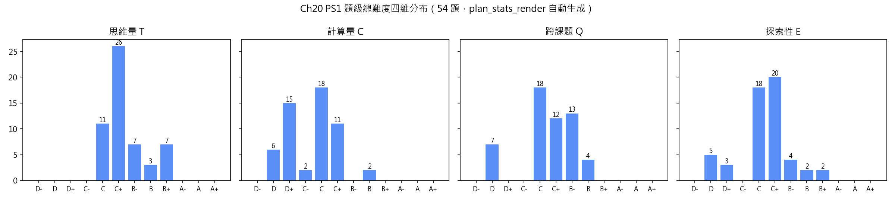
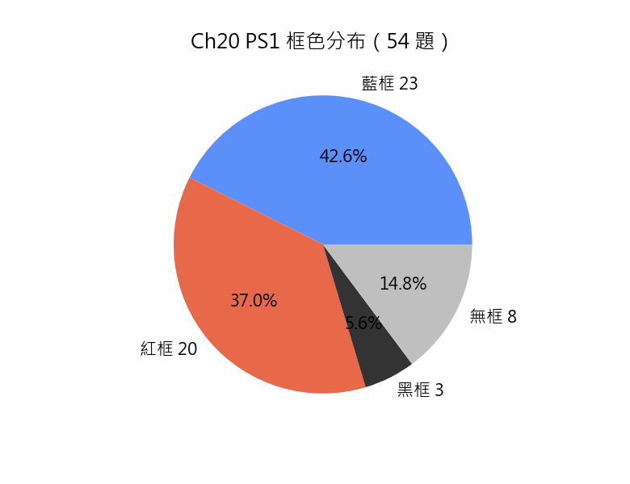

# Chapter 20「直線方程」習題冊規劃方案（2026-09-28 全面重規、2026-09-29 註釋修訂＋補題輪：54 題，對齊《習題冊規劃說明方案.md》v3.5 與 2026-09-27 第五輪講義）

> 本檔為 2026-09-28 依**現行講義結構**（§20.1 圖形、方程與點集／§20.2 斜率／§20.3 直線的方程（六個子節）／§20.4 兩直線的位置關係／§20.5 距離）與**現行規範 v3.4→v3.5**（4.5.1／4.5.2 表達規範、5.1 標記框三步總則、7.2.1 超綱思想方法紅線、7.6 統計表、7.7 講義節上限對照、3.1 非題目方案板塊從簡）的**整份重生成版**，經 2026-09-29 註釋修訂輪與補題輪（新增 4 題）現為 **54 題**全要素（題干／分題／考核目標／詳細解答／四維難度標記＋逐維判定理由／配圖判定／題目修改欄／標記框 checkbox）。舊 59 題版已逐題審計（保留改造 33／淘汰 9／併入他題 17），逐題映射與偏差分類計數見 `.workbuddy/tmp/ch20_replan0928/audit_old59.md`，結論數字記入「十一、修訂記錄」。命題範圍唯一來源為講義；框色依《官方考綱與課題講義關聯分析.md》Ch20 條目逐題引用；打標依《習題難度標記方案-規劃.md》v1.4。

## 〇、詳細解答規範與難度評分依據（2026-09-28，依《習題冊規劃說明方案.md》第六章與 7.2–7.3）

**詳細解答**依規範第六章（6.1 融合寫法＋6.2 撰寫要求＋6.3.3／6.3.4 算式與文字排版，.md 與 .tex 同口徑）：

- 策略與切入點自然織入每一步推導，不單列「解題思路」板塊、不設開篇策略段；原式抄入首行；每步註明依據；多步變形鏈 `aligned[t]` 每步一行、逐步附 `$\quad\text{（依據）}$`；`$\implies$` 開頭句獨立成行；禁 `\therefore`／`\because`；
- 易錯點注意逐條以「易錯：」開頭（每題 2–3 條）；答案只寫解題所需（題面未問、解題不須者一律不寫）；證明結束後不加任何記號；
- 恆等號區分依 3.3（Ch04 起生效，本章適用）：恆等變形用 `≡`，代入數值與解方程用 `=`；
- 解答正文不標講義章節號，依據只寫定理／方法名稱（判定理由保留課題引用，寫法 `Ch NN`）。

**難度評分**基於上述詳細解答逐維分析（四維 T 思維量／C 計算量／E 探索性／Q 跨課題，12 檔 D-～A+，四維獨立不合成總分）：

- 末級（分題與小分題）獨立標完整四維＋逐維判定理由，父分題層不設標記行；大題總標＝各末級逐維最大值，只註明「取各分題最大值」；`task` 與無結構類整題一標（帶四行理由、不加取最大值括號注）；
- **計步公約（v1.3）**：T 維鏈長只計異質概念環節（建模翻譯、坐標與幾何雙向轉換、含參反推、分類討論、構造反例、等價性論證、存在唯一性論證），同質重復（`task` 逐項、逐點代入、逐邊同型計算）依「數量疊加僅加半級」不計入鏈長；
- **超綱思想方法紅線（v1.4）**：反證、參數化構造（本冊僅題 49(b) 的內分點 $R=(1-\lambda)P+\lambda Q$）、雙向包含的分類窮盡（本冊僅題 51、52、54 的存在唯一性論證）——一律由題面交出臺階，且**不得作為 T／E 抬檔依據**，檔位按學生在引導下可及之作答評定；
- **Q 維實際調用口徑（本章自訂，沿用 Ch29 板塊／課題兩層）**：①只用本小節所立的**單一**結論直算／代入 → D；①附註：**同一小節內兩個以上不同結論協同完成一問**（引理＋推論、定義＋注記）→ C；②調用本章另一小節的一個課題，或 Ch15／Ch08 的辨識性工具（中點、兩點距離、比例、相似）→ C；③實際調用三個課題 → C+；④需實際解出他板塊對象 → B-；⑤跨板塊且需幾何⟷代數雙向轉換（先以代數解出係數或交點，再回到圖形判讀類型／位置關係，或反之）→ B；⑥承接前分題結論與本章已建立的記號語言（$L_{AB}$、$m_{AB}$、一般式係數）不另計課題；⑦以單變量一次方程反求參數屬本章算法常規，記 C、不記 B-。**④的觸發附註**：「解二元聯立方程組得交點」只在**該題核心考核落在交點以外的他板塊對象**時才計 B-（如以交點作三角形頂點再求面積、以交點反求他式參數）；若核心即「解聯立並判讀位置關係」（§20.4.1 本身的算法）記 C，`task` 批量直套記 D。「解一元二次方程（Ch18）」「含參不等式刻畫的點集（Ch11）」一律計 B-。
- 排序依四維字典序 **T→C→Q→E** 逐維升序（宏觀遞增；小節歸組優先於逐對排序，交界處容許局部回退，回退對數由 `plan_stats_render.py` 實算並記入「四」節）；
- **措辭與格式落點（規範 4.5.2 三規＋v3.5 五條＋2026-09-29 註釋輪新規已逐題執行）**：證明類一律「證明 …」（全卷無「求證」型問法、無「證明：」型冒號）；宣稱判斷的宣稱全部為**陳述句**（題 9、17、25、31、36(c)、43(c)、45(b)、50(c)；題 17 由兩個互相獨立的陳述句並列），且**不附任何驗證提醒**（「試就…判斷」「試以…檢驗」「試計算兩者」「試逐段計算」已全清）；宣稱判斷尾句一律「試解釋你的答案」（題 36(c)、43(c)、50(c) 原「試證明你的答案」已改）；全卷無「由此說明…」型問法（題 49(c)、53(c) 用「由此證明…」）；分題不以「問」字起頭、疑問句以問號結尾；題面符號一律先定義；不寫「全部值／就每個值」類注釋；除刻意考核形式者（題 18 慣用一般式、題 25(a) 退化係數特徵、題 26／50 截距式、題 27／28 形式轉換與讀取操練）外**不要求直線方程的表達方式**，點斜式與兩點式只作解題方法；除專門要求化簡者外不寫「化為最簡」；本章無以配方法為考核目標的題，故無「利用配方法，…」句式。

**超綱方法自檢**：以 `DSE 課題講義/Chapter 20 直線方程.md`（§20.1–§20.5）及前置章節講義（Ch00–Ch19，前置＝章號序在前的全部章節）為工具清單逐題核對，結果見「十一、修訂記錄」末條。**全卷嚴禁動用**（講義未建立或明文留後）：傾斜角與 $m=\tan\alpha$（講義 §20.2.2 注記明文本章不用、留待解析幾何(II)）、三角函數與弧度、Ch21 二次函數的頂點與最值、Ch28 一元二次不等式與線性規劃、Ch29 三角形四心、Ch30 軌跡語言與軌跡方程、Ch31 圓的方程與直線圓的代數交點、Ch32 和角倍角公式、反三角記號、微積分與極限、同餘記號、向量內積判垂直（§20.4.4 走初等距離鏈）。

## 一、命題範圍與設計原則

- **唯一內容來源**：`DSE 課題講義/Chapter 20 直線方程.md`（§20.1–§20.5；§20.6 小結與詞匯表不設節題目）。官方考綱只用於標記框判定，不決定內容範圍。
- 本冊涵蓋（逐節列講義實際建立的結論）：
  - **§20.1 圖形、方程與點集**：§20.1.1 方程作為代數約束（水平線 $y=k$、鉛垂線 $x=h$、斜直線三類）；§20.1.2 定義（幾何圖形的方程，集合論表述）$G=\{(x,y)\in\mathbb{R}^{2}\mid P(x,y)\}$ 與「$Q(x_0,y_0)$ 在 $G$ 上 $\iff P(x_0,y_0)$ 為真」、記號約定 $L:\ldots$、約束強弱與點集包含（$P\implies Q\implies$ 對應點集 $\subseteq$）、定義（平面上的直線）$L_{AB}$ 與共線／點在直線上的用語約定；
  - **§20.2 斜率**：斜率定義回指 Ch15 §15.2.6（本章不重下）；定理（斜率與取點無關）；斜率的幾何意義四態（$m>0$ 升、$m<0$ 降、$m=0$ 水平線、$m$ 不存在鉛垂線）與 $\lvert m\rvert$ 度量陡峭程度（取 $\Delta x=1$ 的鉛垂腿）；注記（傾斜角）明文本章不使用；
  - **§20.3 直線的方程**：§20.3.1 引理（三點共線的距離刻畫）三式取等號、引理（三點共線的坐標判據）、推論（三點共線的斜率判定）、**定理（直線的斜率刻畫）**（2026-09-30 講義第六輪新立：$Q\in L\iff m_{P_1Q}=m$，點斜式由它展開）、推論（過兩點的直線方程）（講義已明示為主幹的理論樞紐、不是求方程的常規走法）、注記（五種說法的對照）；§20.3.2 定義（一般式）$Ax+By+C=0$（$A^2+B^2\ne0$）、注記（鉛垂線與水平線的一般式）（$A=0$／$B=0$／$C=0$ 三條係數特徵）、**推論（由一般式讀斜率）**（2026-09-30 第七輪由「讀斜率與 $y$ 截距」拆半改名）、注記（從係數讀幾何信息）**兩問兩答**（斜率、某點在不在 $L$ 上；兩截距一條已移往 §20.4.2）、示例（由一般式讀斜率）；§20.3.3 定理（點斜式）、推論（兩點式）與注記（兩點式的兩種退化）；§20.3.4 定理（斜截式）（**第七輪起陳述改「過點」語言**：「$L$ 為斜率是 $m$ 且過點 $(0,c)$ 的直線」，不出現「截距」一詞）與 Ch19 線性函數記號對照；§20.3.5 定理（截距式）（**陳述改「過 $A(a,0)$ 與 $B(0,b)$」**）與 $a\ne0$、$b\ne0$ 前提及三種寫不成的情形；§20.3.6 五形式總表（「已知條件」欄改「斜率與 $y$ 軸交點的縱坐標」「兩軸交點的坐標」）、三條讀法、注記（一般式的不唯一性）；**截距的定義與讀法已於第七輪移往 §20.4.2**；
  - **§20.4 兩直線的位置關係**：§20.4.1 推論（聯立解集即交集）與注記（三重對照一覽）（唯一解／無解／無窮多解 ⟺ 相交／平行／重合）；**§20.4.2 直線與坐標軸的交點：截距（2026-09-30 第七輪新立，自 §20.3.2 遷入）**——定義（$x$ 截距與 $y$ 截距）（與軸**恰有一個公共點**時該點坐標）、注記（截距是坐標，不是距離）、推論（由一般式讀兩截距）（$A\ne0$、$B\ne0$ 時 $-C/A$、$-C/B$）、注記（由一般式讀兩截距）（$B=0$ 鉛垂線無 $y$ 截距、$A=0$ 水平線無 $x$ 截距、$C=0$ 是過原點而非不存在）、示例（由一般式讀兩截距）；§20.4.3 定理（平行的斜率判定）$m_1=m_2$ 且 $c_1\ne c_2$、定理（重合的判定）$m_1=m_2$ 且 $c_1=c_2$；§20.4.4 定理（垂直的斜率判據）$m_1m_2=-1$、注記（鉛垂線與水平線）（一鉛垂一水平才垂直）；
  - **§20.5 距離**：§20.5.1 定理（點到直線的距離）$d=\dfrac{\lvert Ax_0+By_0+C\rvert}{\sqrt{A^2+B^2}}$（含 $A=0$／$B=0$ 退化與 $P\in L$ 時兩端皆 $0$）、點在直線哪一側的符號判據；§20.5.2 定理（兩平行線間的距離）$d=\dfrac{\lvert C_1-C_2\rvert}{\sqrt{A^2+B^2}}$ 與其使用前提「先把 $A$、$B$ 係數化同」。
- **§20.1 的命題界線**：本節各題**不就定義（平面上的直線）$L_{AB}$ 命題**——依講義備課提示「集合論表述與這條點集定義都屬【完全超綱】……這類表述不命題」，且「點是否與 $A$、$B$ 共線」的坐標驗算要到 §20.3.1 的兩條引理才建立；本節只考描述法表示、代入檢驗、約束強弱與包含、三類約束（水平／鉛垂／斜）的辨識。
- **範圍邊界**：兩直線位置關係不引入一般式係數判準 $A_1B_2=A_2B_1$、$A_1A_2+B_1B_2=0$ 作為**解題工具**（講義該注記為板塊級增潤、明文「超出常規課程的要求，作擴展閱讀」「不進入統一測驗範圍」；本冊只在理論習題題 51、52 要求學生**證明**這兩條只述未證的結論，常規操練題一律走斜率與截距）；不出圓、軌跡、線性規劃、四心、傾斜角、三角函數。
- **小節內不得越界（用戶 Ch20 裁定的本質判據，逐題把關）**：§20.1（題 1–5）不用斜率、不用坐標判據、不用任何方程形式；§20.2（題 6–10）不用三點共線的斜率判定（現為 §20.3.1 推論）、不用方程形式、不用平行／垂直判據、不用三角函數；§20.3（題 11–28）不用交點與位置關係、**不用 §20.5 的兩條距離公式**（Ch15 的兩點距離公式屬前置工具，§20.3.1 的距離刻畫引理與題 13、24 均得用），子節內部不前支（§20.3.1 題不用「一般式」名詞、§20.3.2 題不用點斜式、§20.3.3–4 題不用截距式；題 27、28 為 §20.3 末的形式轉換與讀取操練（規範 v3.5 4.2），置於全部形式之後不涉前支；**例外：§20.3.6 的注記（一般式的不唯一性）屬純代數同解性質，允許題 18、21(a) 前用**）；§20.4（題 29–36）不用距離公式；§20.5 與綜合、理論板塊可用全章。**2026-09-30 第七輪登記（處置未定，見「十、待確認事項」第 19 項）**：截距的定義與讀法已自 §20.3.2 移往 §20.4.2，而題 15、17(b)、23、26(b)(c)、28 等在 §20.3 題號範圍（題 11–28）內、原以「§20.3.2 的截距定義」為出處，改指 §20.4.2 即構成「§20.3 題用後節工具」的新越界；本輪未改題面與判定理由。
- **跨章聯動**：聯動題＝題級 Q 維達 C 檔或以上（規範 4.1，按題計）；主要聯動 Ch05 一次方程與聯立、Ch06 恒等變形與根式化簡、Ch08 平面幾何(I)（公理兩點連線、三角形不等式、等腰三角形、平行四邊形與對角線、中點定理）、Ch11 不等式與絕對值、Ch15 解析幾何(I)（兩點距離、中點、軸反射與旋轉、坐標面積）、Ch16 集合論、Ch18 一元二次方程與判別式、Ch19 函數及其圖像（線性函數記號）。
- **配圖口徑（用戶 2026-09-28 裁定，本章落實）**：視考核目的而定——**具體數值的幾何構型（具頂點字母的三角形／四邊形）或可建模為直角三角形的現實情境才配圖**；**強調抽象思維的高難度題、以字母係數表述的題、純代數運算／恒等式／`task` 批量題一律不配圖**（配圖會降低理解難度與抽象程度）；另依 9.3，**圖面不得承載題目所求或待證的元素**——故題 10（三段走向與陡度即所求）、題 42（三角形三頂點即所求）、題 40（$MN\parallel BC$ 即待證，預畫即洩露）雖屬具體數值情境仍不配圖。全章配圖 3 題（題 24、34、45），逐題判定見「十二、配圖判定總表」。
- **數據與計算器約定**：坐標與係數一律取整數或簡潔分數，答案為整數／簡潔分數／可分母有理化的根式（$\tfrac{12\sqrt{13}}{13}$、$\tfrac{\sqrt{34}}{2}$、$2\sqrt5$ 一類）；題幹不給任何計算器可得的數值；本章不涉四捨五入，故無「答案須取三位有效數字」標註；字母係數題（題 51、52、54）不配圖。
- 題目只列中文題面，**不標分數**；英文對譯於正文 .tex 以 `entranslation` 提供（規範 5.2 框數與位置口徑）。
- 難度由描述法與代入檢驗、斜率直算，逐步升至含參分類、存在性論證與新概念的探索性證明；綜合練習與理論習題承擔全章難度高峰。
- **本輪註釋新規（2026-09-29 用戶 `%%` 註釋確立，全檔逐題落實）**：①題面符號必須在題面定義，未定義符號不用（題 15、39、41 已改）；②分題不以「問」字起頭，疑問以問號結尾（9 處已改）；③點斜式／兩點式只作方法，最終表示只接受一般式與斜截式（題 20 重構）；④除非刻意考核（題 18、25(a)、26、50 與操練題 27、28），不要求答案的表達方式（題 20、21、22、24、33、48 已刪）；⑤不寫「全部值／所有值／就每個值」類注釋，多值與否由學生自判（題 16、32、41 已改）；⑥宣稱題不附驗證提醒、不出講義明文查表即答的命題（題 17、25(b)、31 重寫，題 9、10(c) 改）；⑦題干不寫核心解法與元程序（題 14、29、38(b)、39(a) 重構，題 4、5 刪指定驗證點）；⑧「位置關係」只作分類任務（相交／平行／重合）使用，前提已顯明或所指不明者改問具體量（題 30(b)、36(b)、41(b) 已改）；⑨冷門引理由題面點名交出、所指代數式須有明確指代（題 13 已改）；⑩空轉分題（同義反覆、定義直代）一律刪除（題 20(b)、30(b)、34(b)、42(a) 已刪）；⑪批量題數據不得與講義示例逐字相同（題 6(a)(b) 已換）。以上十一項已於同日全數寫入《習題冊規劃說明方案》v3.5（分見 4.2／4.3／4.4／4.5.1／4.5.2），本條為章節版落地清單（括注題號已按 2026-09-29 補題輪後新編號更新）。
## 二、框色邊界（頭部匯總聲明，依規範 5.1 三步總則；須與各題「標記框」勾選一致）

- **藍框（考綱內＋題級至少一維 C+～B+＋無 A 維，共 23 題）**：題 7–10（由兩點求斜率、走向與陡度、退化辨識、坐標縮放與單位換算）、題 15–17、19–24（一般式讀係數、截距、兩點式退化、一點一斜率求方程、過兩點方程、斜截式與含參截距範圍、三角形三邊——必修 10.1 明列「由方程描述斜率、與兩軸的截距、某點是否在直線上」與三種給定條件求方程）、題 30–36（交點、平行、重合、垂直及其應用——必修 10.2）、題 44、45、48（直線系過定點、平行四邊形對角線、旋轉與距離——必修 10 ＋初中 23／26）。本冊藍框一律不查講義，只按官方考綱與四維量化判據判定（規範 5.1.1）。
- **紅框（考綱外＋講義覆蓋＋關聯分析檢到支持條目，共 20 題；逐題引用）**：
  - 以集合論／點集語言發問（關聯分析 Ch20「§20.1 圖形、方程與點集｜【完全超綱】：20.1.2 用集合論語言重述（圖形 $=\{(x,y)\mid P(x,y)\}$ 點集定義）＝【完全超綱】——必修 2.1 明文排除集合語言嚴格化，官方 10.1 無集合論表述」，另依用戶 2026-08-26 裁定「任何涉及集合論的表述方式都是超綱問法」的表述方式例外）：**題 3、4、5、46、47**；
  - 三點共線的判據體系（關聯分析 Ch20「§20.3 直線的方程｜§20.3.1 兩條引理（距離刻畫、坐標判據）＋推論（三點共線的斜率判定）＋定理（直線的斜率刻畫）＋推論（過兩點的直線方程）＝【完全超綱】（官方無三點共線判據的要求）」）：**題 12、13、14**；
  - 形式間的轉換與係數倍（關聯分析 Ch20「§20.3.6 五種形式關係總表＝【深度超出】（官方明文『各形式間的轉換並非課程重點』）」）：**題 18、25**；
  - 截距式（關聯分析 Ch20「截距式＝【深度超出】（官方 10.1 只列兩點／斜率＋一點／斜率＋截距三種條件）」）：**題 26、50**；
  - 點到直線的距離與兩平行線間的距離（關聯分析 Ch20「§20.5 距離｜【完全超綱】：$d=\lvert Ax_0+By_0+C\rvert/\sqrt{A^2+B^2}$ 與兩平行線間距離官方考綱全文無對應」）：**題 38、39、40、41、42、43、47**（題 47 同時掛 §20.1 集合論條目）；
  - 注記（一般式下的平行與垂直）只述未證的結論（關聯分析 Ch20「§20.4｜注記（一般式下的平行與垂直）＝【深度超出】（$A_1B_2=A_2B_1$、$A_1A_2+B_1B_2=0$，正文自標『超出常規課程的要求，作擴展閱讀』，只述結論不給證明）」；同節另載「平行與重合兩條判定定理的證明＝【深度超出】（初中 26.8 明文不須加以證明）」）：**題 51、52**。
- **黑框（題面自給新概念／新名詞，於其下探索並證明，共 3 題）**：題 49（**偏差值** $\delta(P)=Ax_0+By_0+C$——在其下刻畫並證明「兩側 $\iff$ 異號 $\iff$ 線段與直線恰有一公共點」）、題 53（**同傾對稱**——斜率互為相反數的兩直線，證明等腰性質並補全定義的邊界情形）、題 54（**等距線**——證明平行線情形存在唯一並推廣到相交情形判其條數與相互關係）。三題的新概念一律由題面交出，探索鏈不重複講義任何證明。
- **無框（太基礎／無任何維達 C+，共 8 題）**：題 1、2、6、11、27、28、29、37——`task` 批量操練（題 1、6、11、27、28、29、37）與單步代入的描述法練習（題 2），題級四維無一達 C+（規範 5.1③ 無框第一類）；其中題 11、27、28、29、37 的內容雖屬考綱外（坐標判據、截距式與三形式轉換、聯立解況、距離公式），但按 5.1①「若屬太基礎批量操練 → 可標無框」與 Ch20 2026-08-26 先例（舊題 1 紅→無框）處理。
- 說明：本章藍／紅比例由講義結構決定——§20.5 距離全節為【完全超綱】、§20.3.1 判據體系為【完全超綱】，故紅框占比 37.0%，屬考綱結構使然而非難度取向；紅／黑框之成立只取決於內容範圍與題面是否自給新概念，與難度檔位無關（規範 5.1 合併口徑）。

## 三、題型結構規劃

| 類型 | 題號 | 數量 | 命題用途 |
| --- | --- | --: | --- |
| `task` 類 | 1、6、11、27、28、29、37 | 7 | 批量操練描述法與從屬、斜率直算、共線判據、形式互化與讀取、聯立解況、點線距離 |
| 無結構類 | 2、3、4、5、7、9、14、17、18、31 | 10 | 單一概念的完整運用或宣稱判斷（§20.1 因節上限 C 維為 D，整節不出結構化分題） |
| 簡單結構類（無小分題） | 8、12、13、15、19、20、22、23、25、30、32、34、35、38、39、40、42、44、45、46、47、48、51、52 | 24 | 恰 (a)(b) 兩分題，(b) 綜合 (a) 的結論或引入新條件 |
| 簡單結構類（有小分題） | 16、21、33、41 | 4 | 在 (b) 引入新條件後再分 (i)(ii)，末級獨立打標 |
| 複雜結構類 | 10、24、26、36、43、49、50、53、54 | 9 | 三問以上層層遞進的綜合與理論題（理論習題 4 題中 2 題、綜合練習 7 題中 2 題在此類，複雜結構占比 16.7% 高於 4.1 參考比 2:7:1 的原因即此，於「十、待確認事項」登記） |
| 綜合練習 | 44、45、46、47、48、49、50 | 7 | 融合全章考點的 DSE 卷一長題風格（49、50 為 a-b-c，其餘 (a)(b) 分題內含多步操作） |
| 理論習題 | 51、52、53、54 | 4 | 以已建定理證明注記只述未證的結論、於自給新概念下探索性質，不重複講義證明 |

> 共 54 題（§20.1–§20.5 共 43 題＋綜合練習 7＋理論習題 4）；結構類型以 (a)(b)(c) 大分題個數為準（i,ii 小分題不計），綜合練習與理論習題的結構類型已於其上類型欄另計。

## 四、難度與框色統計表（依規範 7.6，由題目定級自動重算）

> **本節為自動產物，勿手改**：由 `.workbuddy/scripts/plan_stats_render.py` 取「七、題目方案」的**末級定級行**重算題級四維（逐維取各末級最大值）、框色勾選與所屬大節，整節覆蓋（片段層覆寫後須重跑本章組裝器）。檔位、框色或題目增刪後**重跑本腳本即可**（連同兩個 PNG），不必逐處對照；欲保留人工解釋文字，寫成以 `> 備註：` 起始的引用塊即自動保留。
> 統計口徑：只計**題級總難度**（不統計分題與小分題，2026-09-01 用戶裁定）；「B 檔及以上」＝**任一維達 B- 或以上**；「C 檔及以上」＝任一維達 C- 或以上；「跨章聯動」按題計、以題級 Q 維達 C 或以上為準（規範 7.6）。

### 四維分布表（題級總難度，54 題）

| 維度 | D- | D | D+ | C- | C | C+ | B- | B | B+ | A- | A | A+ | B 檔及以上合計 |
| --- | --: | --: | --: | --: | --: | --: | --: | --: | --: | --: | --: | --: | --: | ---: |
| 思維量（T） | 0 | 0 | 0 | 0 | 11 | 26 | 7 | 3 | 7 | 0 | 0 | 0 | 17 |
| 計算量（C） | 0 | 6 | 15 | 2 | 18 | 11 | 0 | 2 | 0 | 0 | 0 | 0 | 2 |
| 跨課題（Q） | 0 | 7 | 0 | 0 | 18 | 12 | 13 | 4 | 0 | 0 | 0 | 0 | 17 |
| 探索性（E） | 0 | 5 | 3 | 0 | 18 | 20 | 4 | 2 | 2 | 0 | 0 | 0 | 8 |

（思維量最高 B+（題 43、49、50、51、52、53、54）；計算量最高 B（題 43、50）；跨課題最高 B（題 5、43、45、54）；探索性最高 B+（題 53、54）。全章無 A 檔維。按上述口徑：**B 檔及以上 22 題（40.7%）**、C 檔及以上 54 題（100.0%）、題級 Q 維達 C 或以上（跨章聯動）47 題（87.0%）。B 檔及以上題號：5、10、17、26、30、32、35、36、41、42、43、44、45、46、47、48、49、50、51、52、53、54。）

**統計圖表**（同上腳本自動生成，重跑即覆寫同名 PNG）：





### 按題號難度一覽（B 檔及以上，22 題，佔 40.7%）

| 題號 | 總難度 | 框色 | 要點 |
| --- | --- | --- | --- |
| 5 | **T C｜C D｜E C｜Q B** | 紅 | 由兩點從屬反求約束的係數與圖形類型【§20.1 觸頂】 |
| 10 | T B-｜C D+｜E C+｜Q C | 藍 | 變化量與陡峭度的綜合 |
| 17 | T B-｜C D+｜E B-｜Q C | 藍 | 「截距就是公共點到原點的距離」宣稱的判斷 |
| 26 | **T B-｜C C+｜E B-｜Q C+** | 紅 | 截距式與三角形面積【§20.3 觸頂】 |
| 30 | T C+｜C C｜E C｜Q B- | 藍 | 交點的判別與反求參數 |
| 32 | T C+｜C C｜E C+｜Q B- | 藍 | 相遇問題與交點的現實意義 |
| 35 | T C+｜C C｜E C+｜Q B- | 藍 | 相遇問題與交點的現實意義 |
| 36 | T B｜C C｜E C+｜Q C+ | 藍 | 含參兩直線的全部位置關係 |
| 41 | T B-｜C C+｜E C+｜Q C+ | 紅 | 平行四邊形的對角線 |
| 42 | T C+｜C C+｜E C｜Q B- | 紅 | 等距點集與三角形的面積 |
| 43 | **T B+｜C B｜E B｜Q B** | 紅 | 平行線之間的地帶【§20.5 觸頂】 |
| 44 | T B-｜C C｜E C｜Q B- | 藍 | 旋轉後的圖形與距離 |
| 45 | T B-｜C C｜E C+｜Q B | 藍 | 偏差值：兩側關係的刻畫 |
| 46 | T B-｜C C+｜E C+｜Q B- | 紅 | 截距式、面積與存在性 |
| 47 | T B｜C C｜E C｜Q B- | 紅 | 一般式下的垂直條件 |
| 48 | T B｜C C+｜E C｜Q B- | 藍 | 一般式下的平行與重合條件 |
| 49 | T B+｜C C+｜E B｜Q B- | 黑 | 同傾對稱線與等腰三角形 |
| 50 | T B+｜C B｜E C+｜Q B- | 紅 | 等距線 |
| 51 | T B+｜C C+｜E B-｜Q B- | 紅 | 一般式下的垂直條件 |
| 52 | T B+｜C C+｜E B-｜Q B- | 紅 | 一般式下的平行與重合條件 |
| 53 | T B+｜C C+｜E B+｜Q B- | 黑 | 同傾對稱線與等腰三角形 |
| 54 | T B+｜C C+｜E B+｜Q B | 黑 | 等距線 |

### 框色分布表

| 部分 | 藍框 | 紅框 | 黑框 | 無框 | 小計 |
| --- | --: | --: | --: | --: | --: |
| §20.1（題 1–5） | 0 | 3 | 0 | 2 | 5 |
| §20.2（題 6–10） | 4 | 0 | 0 | 1 | 5 |
| §20.3（題 11–28） | 9 | 6 | 0 | 3 | 18 |
| §20.4（題 29–36） | 7 | 0 | 0 | 1 | 8 |
| §20.5（題 37–43） | 0 | 6 | 0 | 1 | 7 |
| 綜合練習（題 44–50） | 3 | 3 | 1 | 0 | 7 |
| 理論習題（題 51–54） | 0 | 2 | 2 | 0 | 4 |
| **合計** | **23** | **20** | **3** | **8** | **54** |

- 紅框 20 題（37.0%）：題 3、4、5、12、13、14、18、25、26、38、39、40、41、42、43、46、47、50、51、52。
- 黑框 3 題（5.6%）：題 49、53、54。
- 無框 8 題（14.8%）：題 1、2、6、11、27、28、29、37。

### 分布檢查結論

- ①**宏觀遞增與次序**：同小節內相鄰兩題按四維字典序 T→C→Q→E 升序排列；實算**小節內回退 8 對**（§20.3 13→14；§20.3 17→18；§20.3 24→25；§20.3 26→27；§20.4 30→31；§20.4 32→33；§20.4 33→34；§20.5 41→42）；另有**小節交界回退 0 對**（無）——依規範 7.5「小節歸組優先於逐對排序」，交界回退屬正常形態，如實報數、不重排。
- ②**全章檔位**：B 檔及以上 22 題（40.7%）、C 檔及以上 54 題（100.0%）；全章最高檔 T B+／C B／E B+／Q B；**全章無** A 檔維。
- ③**講義節上限對照（7.7，逐維）**：§20.1 上限 T C｜C D｜E C｜Q B｜越限 無｜四維全同觸頂 5；§20.2 上限 T B+｜C D+｜E C+｜Q C｜越限 無｜四維全同觸頂 ⚠ 無；§20.3 上限 T B-｜C C+｜E B-｜Q C+｜越限 無｜四維全同觸頂 26；§20.4 上限 T B｜C C｜E C+｜Q B-｜越限 無｜四維全同觸頂 ⚠ 無；§20.5 上限 T B+｜C B｜E B｜Q B｜越限 無｜四維全同觸頂 43；綜合練習 不適用（7.7）；理論習題 不適用（7.7）。
- ④**框色結構**：藍框 23 題（42.6%）為操練主體；紅框 20 題（37.0%）；黑框 3 題（5.6%）為題面自給新概念的探索題；無框 8 題（14.8%）。紅／黑框成立與否只取決於內容範圍與題面是否自給新概念（規範 5.1，A 維限制只約束藍框），逐題引用見「二、框色邊界」。
- ⑤**跨章聯動**：題級 Q 維達 C 或以上 47 題（87.0%）（按題計；規範 7.6 已取消「全章 ≥30%」與「每節至少一題」配額，只留標準）。
## 五、講義節難度上限對照（2026-09-28，依規範 7.7）

> 對照來源＝講義各 `##` 節標題下的「本節難度上限」行（2026-09-25 重排後現行值；§20.1 行 21、§20.2 行 224、§20.3 行 521、§20.4 行 1750、§20.5 行 2368；§20.6 為小結不設）。口徑：**不突破**＝節內每題題級各維均不超過節上限對應維；**觸頂**＝至少一題與節上限**四維全同**；綜合練習與理論習題不適用。本章無講義另立「本小節內容上限」行的增潤 `###` 小節（§20.4.4 末注記（一般式下的平行與垂直）為板塊級增潤，本冊不據以出常規題，只在理論習題題 51、52 要求學生證明其結論）。

| 講義節 | 節難度上限 | 本節題目 | 節內各維最高（實算） | 觸頂題（四維全同） | 檢查結論 |
| --- | --- | --- | --- | --- | --- |
| §20.1 圖形、方程與點集 | T C｜C D｜E C｜Q B | 題 1–5 | T C｜C D｜E C｜Q B | **題 5** | ①通過（無題任何維超上限）；②觸頂達標；因上限 C 維為 D，本節一律不出結構化分題（見「十」第 2 項） |
| §20.2 斜率 | T B+｜C D+｜E C+｜Q C | 題 6–10 | T B-｜C D+｜E C+｜Q C | **無** | ①通過；②**未觸頂**——T 維差兩檔（2026-09-29 註釋輪題 10(c) 刪鉛垂元提問後 T 由 B 如實降 B-；該節 T B+ 的支撐為 §20.2.1 覆述型長鏈證明，依「講義覆述型長鏈證明不計入節內題可支撐上限」的附則，本冊不以覆述湊檔），待用戶裁定，見「十」第 1 項 |
| §20.3 直線的方程 | T B-｜C C+｜E B-｜Q C+ | 題 11–28 | T B-｜C C+｜E B-｜Q C+ | **題 26** | ①通過；②觸頂達標 |
| §20.4 兩直線的位置關係 | T B｜C C｜E C+｜Q B- | 題 29–36 | T B｜C C｜E C+｜Q B- | **無** | ①通過（Q 維最高 B- 由題 30(b)、32(a)、35(b) 支撐）；②**未觸頂**——原觸頂題 36（原題 33）的 (b)(c) Q 維判定理由與〇節口徑④附註／⑦不符，如實更正為 C+／C 後題級 Q 降 C+，無題四維全同上限，見「十」第 15 項 |
| §20.5 距離 | T B+｜C B｜E B｜Q B | 題 37–43 | T B+｜C B｜E B｜Q B | **題 43** | ①通過；②觸頂達標 |
| 綜合練習 | 不適用（7.7） | 題 44–50 | T B+｜C B｜E B｜Q B | — | 承擔難度高峰，不受節上限約束；板塊內按字典序 T→C→Q→E 嚴格升序 |
| 理論習題 | 不適用（7.7） | 題 51–54 | T B+｜C C+｜E B+｜Q B | — | 同上 |

## 六、各節題目分配

| 講義部分 | 題目 | 主要考點 | 主要跨章聯動 |
| --- | --- | --- | --- |
| §20.1 圖形、方程與點集 | 1–5 | 約束與描述法、代入檢驗、恒等／矛盾／退化約束、約束強弱與包含、由從屬反求係數並判圖形類型 | Ch05、Ch06、Ch11、Ch16 |
| §20.2 斜率 | 6–10 | 斜率直算、四態走向、$\lvert m\rvert$ 陡度、取點無關、變化量與單位換算 | Ch08、Ch15 |
| §20.3 直線的方程 | 11–28 | 共線三判據與過兩點方程、一般式讀係數與截距、兩點式退化、點斜式、斜截式與含參截距範圍、截距式、五形式選用與係數不唯一、三形式互化與讀取操練 | Ch05、Ch06、Ch08、Ch11、Ch15、Ch19 |
| §20.4 兩直線的位置關係 | 29–36 | 聯立解況與交點、三重對照、相遇追及、平行與重合、垂直及其退化、含參全討論 | Ch05、Ch08、Ch15、Ch18 |
| §20.5 距離 | 37–43 | 點到直線距離、點與直線的側別、平行線間距離與係數化同、三角形中位線與平行距離、帶域距離之和 | Ch06、Ch08、Ch11、Ch15 |
| 綜合練習 | 44–50 | 直線系過定點、平行四邊形對角線、等距點集與面積、平行地帶、旋轉與距離、偏差值（新概念）、截距式與存在性 | Ch05、Ch06、Ch08、Ch11、Ch15、Ch16、Ch18 |
| 理論習題 | 51–54 | 一般式的垂直條件、一般式的平行與重合條件、同傾對稱（新概念）、等距線（新概念） | Ch06、Ch08、Ch11、Ch15、Ch16 |

## 七、題目方案

### §20.1　圖形、方程與點集

#### 題 1（`task` 類）——約束與圖形的批量判斷

**題干**

判斷下列各點是否屬於相應約束所確定的圖形，並寫出該圖形的描述法表示。

(a) 約束 $y=-3$，點 $P(4,-3)$；

(b) 約束 $x=5$，點 $Q(2,5)$；

(c) 約束 $2x-y=7$，點 $R(4,1)$；

(d) 約束 $3x+4y=12$，點 $T(0,4)$。

**考核目標**

批量操練「點在圖形上 $\iff$ 坐標使約束為真」的代入檢驗，並以描述法寫出約束所確定的圖形，含水平線與鉛垂線只限制單一坐標的情形。

**詳細解答**

(a) 約束 $y=-3$ 只限制縱坐標。$P(4,-3)$ 的縱坐標為 $-3$，代入約束得 $-3=-3$，成立，故 $P$ 屬於該圖形，其橫坐標不受限制。

$\implies$ 該圖形是水平線 $\{(x,y)\in\mathbb{R}^{2}\mid y=-3\}$。

(b) 約束 $x=5$ 只限制橫坐標。$Q(2,5)$ 的橫坐標為 $2$，代入約束得 $2=5$，不成立，故 $Q$ 不屬於該圖形。

$\implies$ 該圖形是鉛垂線 $\{(x,y)\in\mathbb{R}^{2}\mid x=5\}$。

(c) 把 $R(4,1)$ 的坐標代入約束 $2x-y=7$：左端 $2(4)-1=7$，與右端相等，約束成立，故 $R$ 屬於該圖形。

$\implies$ 該圖形是 $\{(x,y)\in\mathbb{R}^{2}\mid 2x-y=7\}$。

(d) 把 $T(0,4)$ 的坐標代入約束 $3x+4y=12$：左端 $3(0)+4(4)=16\ne12$，與右端不相等，約束不成立，故 $T$ 不屬於該圖形。

$\implies$ 該圖形是 $\{(x,y)\in\mathbb{R}^{2}\mid 3x+4y=12\}$。

**易錯點注意**

- 易錯：(b) 鉛垂線 $x=5$ 只檢驗橫坐標——$Q(2,5)$ 的 $5$ 落在縱坐標上，$x=2\ne5$，故不從屬；勿因坐標中出現 $5$ 就判為屬於。
- 易錯：(a)(b) 兩類圖形只限制單一坐標，另一坐標自由，圖形是整條線而非一點；勿把 $y=-3$ 誤解為「只有點 $(0,-3)$ 屬於該圖形」。
- 易錯：描述法須連點集記號與所在平面一併寫出（$G=\{(x,y)\in\mathbb{R}^{2}\mid x=5\}$），勿只寫「$x=5$」。

**難度**

> 題 1｜難度：**T C｜C D｜E D｜Q D**
>
> 判定理由（T）：四項均為「點在圖形上 $\iff$ 坐標使約束為真」的代入檢驗，屬同質重複不抬檔；其中 (b) 須辨識鉛垂線只限制 $x$（$Q(2,5)$ 的 $5$ 在縱坐標上），(a)(b) 還須把單坐標約束還原為整條線，取 C。
>
> 判定理由（C）：代入與數值比較（$2(4)-1=7$、$3(0)+4(4)=16$）各 1 至 2 步，純整數運算，取 D。
>
> 判定理由（E）：直接套從屬判據與水平線、鉛垂線的定義，四項路徑唯一，取 D。
>
> 判定理由（Q）：只用本小節所立的約束、圖形與描述法記號直算，未調用其他小節或前置章課題（描述法屬本章已建立的記號語言，不另計課題），取 D。

**配圖**：無（`task` 類批量小題，各項為單點對單約束的數值代入，不配圖。）

**題目修改欄**

- [ ] 加強計算量（建議：把 (c) 的點改為 $R\left(\dfrac{9}{2},2\right)$，使左端出現分數運算）
- [ ] 加強思維量（建議：把 (d) 的點改為 $T(t,3)$，要求就 $t$ 的取值判斷從屬——由 $3t+12=12$ 得 $t=0$）
- [ ] 分題分得過細（建議：無，四項互相獨立，屬並列批量）
- [ ] 重寫（建議：無）
- [ ] 數值醜陋（建議：無）

**標記框**

- [x] 無標記框
- [ ] 紅框
- [ ] 藍框
- [ ] 黑框

---

---

#### 題 2（無結構類）——由從屬條件辨識圖形的形狀

**題干**

設 $k$ 為常數，圖形 $G$ 由約束 $kx-3y=6$ 確定，且已知 $A(2,-2)\in G$。求 $k$ 的值；判斷 $B(3,1)$ 是否屬於 $G$，並解釋你的答案；當 $k$ 取所求的值時，$G$ 是怎樣的圖形？

**考核目標**

由「點在圖形上 $\iff$ 坐標使約束為真」反求約束中的參數，看清係數退化（$k=0$）後約束只剩單一坐標的情形，並以描述法辨識所得圖形。

**詳細解答**

圖形 $G$ 的約束為 $kx-3y=6$，且 $A(2,-2)\in G$，故 $A$ 的坐標使約束為真：

$\begin{aligned}[t] k(2)-3(-2) &= 6 \quad \text{（把 } A(2,-2) \text{ 代入 } kx-3y=6 \text{）} \\ 2k+6 &= 6 \\ 2k &= 0 \quad \text{（兩邊同減 } 6 \text{）} \\ k &= 0 \quad \text{（兩邊同除以 } 2 \text{）} \end{aligned}$

把 $k=0$ 代回約束：$0\cdot x-3y=6$，即 $-3y=6$。

$\begin{aligned}[t] -3y &= 6 \\ y &= -2 \quad \text{（兩邊同除以 } -3 \text{）} \end{aligned}$

約束中 $x$ 的係數是 $0$，$x$ 不再受限制，只剩縱坐標被定死為 $-2$。

$\implies$ $G=\{(x,y)\in\mathbb{R}^{2}\mid y=-2\}$，是水平線 $y=-2$。

$B(3,1)$ 的從屬：把 $B$ 的坐標代入 $k=0$ 時的約束 $0\cdot x-3y=6$，左端 $0(3)-3(1)=-3\ne6$，約束不成立。

$\implies$ $B\notin G$。

**易錯點注意**

- 易錯：代入 $A(2,-2)$ 時漏掉縱坐標的負號——$-3(-2)=+6$，故得 $2k+6=6$，而非 $2k-6=6$。
- 易錯：求出 $k=0$ 後把圖形誤當成全平面——$k=0$ 只是 $x$ 的係數退化為 $0$，$y=-2$ 的限制仍在，$G$ 是水平線而非 $\mathbb{R}^{2}$。
- 易錯：判斷 $B(3,1)$ 時忘記取 $k=0$，仍以含 $k$ 的約束代入；須先把 $k=0$ 代回約束再作檢驗。

**難度**

> 題 2｜難度：**T C｜C D｜E D｜Q C**
>
> 判定理由（T）：由 $A\in G$ 立 $k$ 的一次方程 → 解得 $k=0$ → 代回辨識約束退化為 $-3y=6$ 並化為 $y=-2$ → 判斷 $B$ 的從屬，四個環節皆為從屬判據與一次方程的直接運用，無方法選擇，取 C。
>
> 判定理由（C）：解 $2k+6=6$ 得 $k=0$，並代入檢驗 $-3(1)=-3$，皆為整數一步運算，取 D。
>
> 判定理由（E）：路徑唯一——先由從屬條件反求參數、再檢驗第二點，無方法取捨，取 D。
>
> 判定理由（Q）：除本小節的從屬判據與水平線、鉛垂線的辨識外，實際調用 Ch05 解一元一次方程（由 $A\in G$ 反求 $k$）一個前置課題，取 C。

**配圖**：無（以點集的從屬判斷為主，無具體幾何構型，不配圖。）

**題目修改欄**

- [ ] 加強計算量（建議：無——在「$k=0$ 退化」的考核點下，凡 $A(x_0,-2)$（$x_0\ne0$）都迫使 $k=0$，改數據無法增加計算量）
- [ ] 加強思維量（建議：改問「是否存在 $k$ 使 $G$ 為鉛垂線」，並證明你的答案——$kx-3y=6$ 的 $y$ 係數恆為 $-3\ne0$，故不存在）
- [ ] 分題分得過細（建議：無）
- [ ] 重寫（建議：無）
- [ ] 數值醜陋（建議：無）

**標記框**

- [x] 無標記框
- [ ] 紅框
- [ ] 藍框
- [ ] 黑框

---

---

#### 題 3（無結構類）——恆等約束、矛盾約束與退化約束

**題干**

考慮以下三條約束：

$4x-8\equiv4(x-2)$，$4x-8=4(x-4)$，$4x-8=0$。

求各約束所確定的圖形，並說明理由。

**考核目標**

辨識約束恆真（圖形為全平面）、恆假（圖形為空集）與只限制單一坐標（圖形為鉛垂線）三種極端情形，並以恆等變形區分恆等式與矛盾式。

**詳細解答**

記三條約束所確定的圖形依次為 $G_1$、$G_2$、$G_3$。$G_1$ 的約束為 $4x-8\equiv4(x-2)$。由分配律 $4(x-2)\equiv4x-8$，左右兩端是同一表達式，故約束對每個實數 $x$ 都為真，即對平面上每個點 $(x,y)$ 都為真。

$\implies$ $G_1=\{(x,y)\in\mathbb{R}^{2}\mid 4x-8\equiv4(x-2)\}=\mathbb{R}^{2}$，即全平面。

$G_2$ 的約束為 $4x-8=4(x-4)$。由分配律 $4(x-4)\equiv4x-16$，故約束與 $4x-8=4x-16$ 是同一條件：

$\begin{aligned}[t] 4x-8 &= 4x-16 \\ -8 &= -16 \quad \text{（兩邊同減 } 4x \text{）} \end{aligned}$

$-8=-16$ 恆假，沒有點能使約束為真。

$\implies$ $G_2=\varnothing$，即空集（無點）。

$G_3$ 的約束為 $4x-8=0$：

$\begin{aligned}[t] 4x-8 &= 0 \\ 4x &= 8 \quad \text{（兩邊同加 } 8 \text{）} \\ x &= 2 \quad \text{（兩邊同除以 } 4 \text{）} \end{aligned}$

約束只限制橫坐標 $x=2$，縱坐標自由。

$\implies$ $G_3=\{(x,y)\in\mathbb{R}^{2}\mid x=2\}$，是鉛垂線 $x=2$。

**易錯點注意**

- 易錯：把恆真約束 $4x-8\equiv4(x-2)$ 當一般方程去解——左右兩端恆等，圖形是全平面而非某一條線。
- 易錯：$G_2$ 化為 $4x-8=4x-16$ 後，兩端消去 $4x$ 得 $-8=-16$，恆假；若把 $G_2$ 與 $G_3$ 混為一談而寫出解 $x=2$，是把恆假的等式當成有解。
- 易錯：$G_3$ 只限制 $x$，圖形是整條鉛垂線而非單獨一點 $(2,0)$。

**難度**

> 題 3｜難度：**T C｜C D｜E C｜Q C+**
>
> 判定理由（T）：三項各為一個異質環節——$G_1$ 由恆等變形辨識恆真約束、$G_2$ 消去 $4x$ 後辨識恆假約束、$G_3$ 解一次方程並辨識鉛垂線；三個環節屬不同類型且皆直接，取 C。
>
> 判定理由（C）：分配律展開與兩邊同加、同減、同除各 1 至 2 步的整數運算，取 D。
>
> 判定理由（E）：須自行把「恆真／恆假」翻譯為 $\mathbb{R}^{2}$／$\varnothing$，並自行判定三條約束各屬哪一類，方法選擇層，取 C。
>
> 判定理由（Q）：實際調用 Ch20 的約束與圖形（本小節）、Ch06 恆等變形、Ch05 解一元一次方程三個課題（集合的寫法屬本章已建立的記號語言，不另計），取 C+。

**配圖**：無（三條約束為純代數式，無頂點構型，不配圖。）

**題目修改欄**

- [ ] 加強計算量（建議：把 $G_3$ 改為 $4(2x-1)=7$，解得 $x=\dfrac{11}{8}$，使點集由含分數的坐標刻畫）
- [ ] 加強思維量（建議：另給含參約束 $4x-8=4(x-2)+k$，要求就 $k$ 的取值判斷圖形是 $\mathbb{R}^{2}$ 還是 $\varnothing$）
- [ ] 分題分得過細（建議：無）
- [ ] 重寫（建議：無）
- [ ] 數值醜陋（建議：無）

**標記框**

- [ ] 無標記框
- [x] 紅框
- [ ] 藍框
- [ ] 黑框

---

---

#### 題 4（無結構類）——約束強弱與圖形的包含

**題干**

設 $S_1=\{(x,y)\in\mathbb{R}^{2}\mid 2x-y=4\}$、$S_2=\{(x,y)\in\mathbb{R}^{2}\mid 2x-y=4 \text{ 且 } x\ge2\}$。判斷 $S_2\subseteq S_1$ 與 $S_1\subseteq S_2$ 是否成立，並解釋你的答案。

**考核目標**

以「約束越強、點集越小」判定子集關係，並以見證點否定反向包含；辨析「同時屬於兩集合」不足以證明包含。

**詳細解答**

$S_2$ 的約束是「$2x-y=4$ 且 $x\ge2$」，比 $S_1$ 的約束「$2x-y=4$」多一個條件，故 $S_2$ 的約束較強。

若點屬於 $S_2$，則該點必滿足 $2x-y=4$，即必屬於 $S_1$（滿足強約束的點必定滿足弱約束）。

$\implies$ $S_2\subseteq S_1$ 成立。

取點 $B(0,-4)$ 檢驗：$2(0)-(-4)=4$，故 $B$ 滿足 $S_1$ 的約束，$B\in S_1$；但 $B$ 的橫坐標為 $0$，$0\ge2$ 不成立，故 $B$ 不滿足 $S_2$ 的約束，$B\notin S_2$。

$\implies$ 存在點 $B$ 屬於 $S_1$ 而不屬於 $S_2$，故 $S_1\subseteq S_2$ 不成立。

**易錯點注意**

- 易錯：找到一個同時屬於 $S_1$、$S_2$ 的點（如 $A(2,0)$：$2(2)-0=4$ 且 $2\ge2$）就斷定 $S_1\subseteq S_2$——同時屬於兩集合只是「有公共元素」，包含關係要求每一點都成立；否定包含須找屬於前者而不屬於後者的見證點（如 $B(0,-4)$）。
- 易錯：判定 $B(0,-4)$ 不屬於 $S_2$ 時只比較等式部分——$B$ 滿足 $2x-y=4$，但違反 $x\ge2$；兩個條件須全部滿足才算屬於 $S_2$。
- 易錯：把「約束較強」誤認為「點集較大」——約束越強、滿足它的點越少，故只能是 $S_2\subseteq S_1$，而非反向。

**難度**

> 題 4｜難度：**T C｜C D｜E C｜Q C+**
>
> 判定理由（T）：比較兩約束的強弱 → 由強約束推出 $S_2\subseteq S_1$ → 自行選取見證點 $B(0,-4)$ 否定反向包含，三個環節皆為判據的直接運用，取 C。
>
> 判定理由（C）：兩處代入檢驗（$2(2)-0=4$、$2(0)-(-4)=4$）與 $0\ge2$、$2\ge2$ 的比較，整數運算，取 D。
>
> 判定理由（E）：須自行選取「正向用約束強弱、反向用見證點」兩條不同路徑，見證點亦須自行找出，方法選擇層，取 C。
>
> 判定理由（Q）：各環節為「代入檢驗＋一次不等式比較」（$0\ge2$ 不成立、$2\ge2$ 成立），未實際解出他板塊對象，依本章 Q 口徑③（同板塊三課題：Ch16 子集語言、Ch11 一次不等式、本章約束與圖形），取 C+。

**配圖**：無（題面以點集的描述法與不等式刻畫為主，屬抽象表述，不配圖。）

**題目修改欄**

- [ ] 加強計算量（建議：把 $x\ge2$ 改為 $x\le\dfrac{5}{2}$，使見證點的選取須作分數比較）
- [ ] 加強思維量（建議：把 $S_2$ 的條件改為 $x\ge c$（$c$ 為常數），要求就 $c$ 的取值討論 $S_1\subseteq S_2$ 是否可能成立）
- [ ] 分題分得過細（建議：無）
- [ ] 重寫（建議：無）
- [ ] 數值醜陋（建議：無）

**標記框**

- [ ] 無標記框
- [x] 紅框
- [ ] 藍框
- [ ] 黑框

---

---

#### 題 5（無結構類）——由兩點從屬反求約束的係數與圖形類型

**題干**

設 $G$ 為約束 $ax+by=10$ 確定的圖形，其中 $a$、$b$ 為常數，且 $P(2,1)$ 與 $Q(-1,4)$ 都在 $G$ 上。以描述法表示 $G$，求 $a$、$b$ 的值，並判斷 $G$ 是水平線、鉛垂線還是斜直線，試解釋你的答案。

**考核目標**

由兩點的從屬情形立方程組反求約束的係數，再由係數是否為零判讀圖形屬水平線、鉛垂線還是斜直線（約束與圖形、描述法；解二元一次方程組）。

**詳細解答**

圖形 $G$ 的約束為 $ax+by=10$，且 $P(2,1)$、$Q(-1,4)$ 都在 $G$ 上，故兩點的坐標都使約束為真。

把 $P(2,1)$ 代入約束，得 $2a+b=10$ …… (1)

把 $Q(-1,4)$ 代入約束，得 $-a+4b=10$ …… (2)

聯立 (1)、(2)：

$\begin{cases} 2a+b=10 & (1) \\ -a+4b=10 & (2) \end{cases}$

由 (1)，$b=10-2a$。

把 $b=10-2a$ 代入 (2)：

$\begin{aligned}[t] -a+4(10-2a) &= 10 \quad \text{（代入消元）} \\ -a+40-8a &= 10 \\ -9a+40 &= 10 \\ -9a &= -30 \quad \text{（兩邊同減 } 40 \text{）} \\ a &= \dfrac{10}{3} \quad \text{（兩邊同除以 } -9 \text{）} \end{aligned}$

把 $a=\dfrac{10}{3}$ 代回 $b=10-2a$：

$b=10-2\times\dfrac{10}{3}=10-\dfrac{20}{3}=\dfrac{10}{3}$

檢驗：把 $a=\dfrac{10}{3}$、$b=\dfrac{10}{3}$ 代回約束 $ax+by=10$，$P(2,1)$ 給 $2\times\dfrac{10}{3}+\dfrac{10}{3}=\dfrac{30}{3}=10$，成立；$Q(-1,4)$ 給 $-\dfrac{10}{3}+4\times\dfrac{10}{3}=\dfrac{30}{3}=10$，成立。

$\implies$ 所求為 $a=\dfrac{10}{3}$、$b=\dfrac{10}{3}$。

以描述法表示 $G$：$G=\{(x,y)\in\mathbb{R}^{2}\mid ax+by=10\}$，把所求的係數代入，並把約束同乘 $\dfrac{3}{10}$（恆等變形）：

$G=\left\{(x,y)\in\mathbb{R}^{2}\mid \dfrac{10}{3}x+\dfrac{10}{3}y=10\right\}=\{(x,y)\in\mathbb{R}^{2}\mid x+y=3\}$

判讀圖形類型：所求的 $a=\dfrac{10}{3}$、$b=\dfrac{10}{3}$ 都不為零，故約束對 $x$ 與 $y$ 都施加限制——$x$ 的係數不為零，$x$ 不是自由的；$y$ 的係數不為零，$y$ 也不是自由的。

若 $a=0$，約束只限制 $y$（化為 $y$ 恆等於某數），$G$ 是水平線；若 $b=0$，約束只限制 $x$（化為 $x$ 恆等於某數），$G$ 是鉛垂線；本題兩個係數都不為零。

$\implies$ $G$ 是斜直線。

**易錯點注意**

- 易錯：$P$、$Q$ 兩點代入的是同一個約束 $ax+by=10$，須把坐標對號入座——$P(2,1)$ 得 $2a+b=10$，$Q(-1,4)$ 得 $-a+4b=10$，$x=-1$ 的負號勿漏。
- 易錯：$a$、$b$ 都不為零才可以斷定 $G$ 是斜直線——若解出 $a=0$（約束只限制 $y$）或 $b=0$（只限制 $x$），圖形分別是水平線、鉛垂線。
- 易錯：描述法須寫明所在平面與約束（$G=\{(x,y)\in\mathbb{R}^{2}\mid x+y=3\}$），勿只寫「$x+y=3$」而漏去 $G$ 與 $\mathbb{R}^{2}$。

**難度**

> 題 5｜難度：**T C｜C D｜E C｜Q B**
>
> 判定理由（T）：由兩點的從屬各立一個方程 → 解聯立方程組得 $a$、$b$ → 由係數是否為零判讀圖形類型；描述法、係數、類型三個結論疊成單鏈，各環節均為從屬判據與消元的直接運用，無方法選擇，取 C。
>
> 判定理由（C）：純數值的二元一次方程組（代入消元得 $-9a=-30$）與一次化簡 $b=10-\dfrac{20}{3}=\dfrac{10}{3}$，未涉代數式運算，取 D。
>
> 判定理由（E）：消元路徑可選（代入法或加減法），圖形類型亦可由「$a$、$b$ 是否為零」或「兩點的橫、縱坐標是否分別相同」兩條路完成，方法選擇層，取 C。
>
> 判定理由（Q）：以代數板塊的聯立方程實際解出係數（Ch05 解二元一次方程組），再回到圖形與空間板塊判讀圖形類型（本小節的三類約束），跨板塊且需雙向轉換——先由從屬條件解出係數，再由係數回判圖形，取 B。

**配圖**：無（題面為含參約束與點集語言，屬抽象思維題；且圖形類型是所求的結論，畫出即洩露答案。）

**題目修改欄**

- [ ] 加強計算量（建議：把 $Q$ 改為 $Q(-2,3)$，得 $2a+b=10$ 與 $-2a+3b=10$，兩式相加即消去 $a$，解出 $b=5$、$a=\dfrac{5}{2}$，約束化為 $x+2y=4$，仍為斜直線）
- [ ] 加強思維量（建議：把 $P$、$Q$ 改為 $P(0,2)$、$Q(3,2)$，解出 $a=0$、$b=5$，學生須辨識係數退化後圖形為水平線而非斜直線）
- [ ] 分題分得過細（建議：無）
- [ ] 重寫（建議：無）
- [ ] 數值醜陋（建議：無）

**標記框**

- [ ] 無標記框
- [x] 紅框
- [ ] 藍框
- [ ] 黑框
---

---


### §20.2　斜率

#### 題 6（`task` 類）——求斜率與辨識斜率不存在

**題干**

求過下列各對點的直線的斜率；若斜率不存在，請說明原因。

(a) $A(-2,4)$ 與 $B(3,-6)$；

(b) $C(4,-3)$ 與 $D(-1,5)$；

(c) $E(-4,1)$ 與 $F(6,1)$；

(d) $G(2,-3)$ 與 $H(2,7)$；

(e) $I(5,4)$ 與 $J(2,-5)$；

(f) $K(-3,-2)$ 與 $L(0,4)$。

**考核目標**

批量操練斜率定義 $m=\dfrac{\Delta y}{\Delta x}$，含同縱（$m=0$）、同橫（斜率不存在）、負坐標與分母為負各情形。

**詳細解答**

依斜率定義 $m_{AB}=\dfrac{y_2-y_1}{x_2-x_1}$（分子 $\Delta y$ 為鉛垂變化、分母 $\Delta x$ 為水平變化），逐項計算。

(a) $\begin{aligned}[t] m_{AB} &= \dfrac{-6-4}{3-(-2)} \quad \text{（斜率定義）} \\ &= \dfrac{-10}{5} \\ &= -2 \end{aligned}$

(b) $\begin{aligned}[t] m_{CD} &= \dfrac{5-(-3)}{-1-4} \\ &= \dfrac{8}{-5} \\ &= -\dfrac{8}{5} \end{aligned}$

(c) $\begin{aligned}[t] m_{EF} &= \dfrac{1-1}{6-(-4)} \\ &= \dfrac{0}{10} \\ &= 0 \end{aligned}$

$\implies$ $m_{EF}=0$，兩點縱坐標同為 $1$，該直線是水平線。

(d) 兩點的橫坐標同為 $2$，故 $\Delta x=2-2=0$，分母為零，$\dfrac{\Delta y}{\Delta x}$ 沒有意義。

$\implies$ 斜率不存在；該直線是鉛垂線，其上每一點的橫坐標都是 $2$。

(e) $\begin{aligned}[t] m_{IJ} &= \dfrac{-5-4}{2-5} \\ &= \dfrac{-9}{-3} \\ &= 3 \end{aligned}$

(f) $\begin{aligned}[t] m_{KL} &= \dfrac{4-(-2)}{0-(-3)} \\ &= \dfrac{6}{3} \\ &= 2 \end{aligned}$

**易錯點注意**

- 易錯：分子是縱坐標之差、分母是橫坐標之差，勿顛倒為 $\dfrac{x_2-x_1}{y_2-y_1}$。
- 易錯：(c) 的 $m=0$ 對應水平線，(d) 的分母為 $0$ 對應鉛垂線；分母為零時不得寫 $m=0$ 或 $m=\infty$，應寫「斜率不存在」。
- 易錯：(b)(e) 的分子或分母含負號，須連同符號一起計算——$\dfrac{8}{-5}=-\dfrac{8}{5}$、$\dfrac{-9}{-3}=3$。

**難度**

> 題 6｜難度：**T C｜C D+｜E D｜Q D**
>
> 判定理由（T）：六項均為套用斜率定義求值，屬同質重複不抬檔；其中 (d) 須辨識 $\Delta x=0$ 而說明斜率不存在、並指出其為鉛垂線，多一個判別環節，取 C。
>
> 判定理由（C）：六項含負數減法與約分（$-\dfrac{8}{5}$、$3$、$-2$），分母為負的除法與分數符號的處理各一次，運算量輕但項數疊加，取 D+。
>
> 判定理由（E）：直接套斜率定義，六項路徑唯一，取 D。
>
> 判定理由（Q）：只用本小節所立的斜率定義直算，未調用其他小節或前置章課題，取 D。

**配圖**：無（`task` 類批量小題，各項為單對點的數值代入，不配圖。）

**題目修改欄**

- [ ] 加強計算量（建議：把 (f) 的點改為 $K\left(-\dfrac{1}{2},-2\right)$ 與 $L\left(\dfrac{3}{2},4\right)$，使 $\Delta y$、$\Delta x$ 皆含分數）
- [ ] 加強思維量（建議：另加一項「$M(a,1)$ 與 $N(a+2,1)$」，須辨識斜率恆為 $0$ 而與 $a$ 無關）
- [ ] 分題分得過細（建議：無，六項互相獨立，屬並列批量）
- [ ] 重寫（建議：無）
- [ ] 數值醜陋（建議：無）

**標記框**

- [x] 無標記框
- [ ] 紅框
- [ ] 藍框
- [ ] 黑框

---

---

#### 題 7（無結構類）——走向與陡度的排列

**題干**

四條直線 $L_1$、$L_2$、$L_3$、$L_4$ 分別過 $A_1(0,1)$ 與 $A_2(3,3)$、$B_1(0,5)$ 與 $B_2(2,0)$、$C_1(-2,4)$ 與 $C_2(5,4)$、$D_1(3,-1)$ 與 $D_2(3,6)$。指出各直線的走向；把 $L_1$、$L_2$、$L_3$ 按陡峭程度由小到大排列，並解釋何以 $L_4$ 不能參與這個比較。

**考核目標**

由兩點求出各線斜率，由斜率的符號讀出直線的走向，由 $\lvert m\rvert$（取 $\Delta x=1$ 的鉛垂腿）比較陡峭程度，並辨析斜率不存在的鉛垂線無從參與 $\lvert m\rvert$ 比較。

**詳細解答**

斜率的分子是鉛垂變化 $\Delta y$、分母是水平變化 $\Delta x$；取 $\Delta x=1$，鉛垂腿就是 $\Delta y=m$，故 $\lvert m\rvert$ 越大，同一水平距離內的高度變化越大，直線越陡。

逐線求斜率：$\begin{aligned}[t] m_1 &= \dfrac{3-1}{3-0}=\dfrac{2}{3} \\ m_2 &= \dfrac{0-5}{2-0}=-\dfrac{5}{2} \\ m_3 &= \dfrac{4-4}{5-(-2)}=0 \end{aligned}$
$D_1$、$D_2$ 的橫坐標同為 $3$，$\Delta x=0$，$m_4$ 不存在，$L_4$ 是鉛垂線。
$m_1=\dfrac{2}{3}>0$：$L_1$ 由左下向右上延伸（上升）。

$m_2=-\dfrac{5}{2}<0$：兩段變化量異號，$L_2$ 由左上向右下延伸（下降）。

$m_3=0$：$L_3$ 是水平線，不升不降。

陡峭程度由 $\lvert m\rvert$ 量出：$\lvert m_3\rvert=0$，$\left\lvert m_1\right\rvert=\dfrac{2}{3}$，$\left\lvert m_2\right\rvert=\dfrac{5}{2}$，而 $0<\dfrac{2}{3}<\dfrac{5}{2}$。

$\implies$ $L_1$、$L_2$、$L_3$ 由平緩到陡峭的次序為 $L_3$、$L_1$、$L_2$。

$L_4$ 的斜率不存在，$\lvert m_4\rvert$ 不是一個數值，無從與 $0$、$\dfrac{2}{3}$、$\dfrac{5}{2}$ 比較大小。

$\implies$ $L_4$ 不能參與這個以 $\lvert m\rvert$ 為度量的排列。

**易錯點注意**

- 易錯：把 $m$ 的正負當作陡峭程度——符號定走向、絕對值定陡峭度；$m_2=-\dfrac{5}{2}$ 比 $m_1=\dfrac{2}{3}$ 陡，與正負無關。
- 易錯：$m_3=0$ 不是「沒有斜率」——$m_3=0$ 是水平線，斜率存在且等於 $0$；只有 $L_4$ 才是斜率不存在。
- 易錯：把 $L_4$ 硬排進次序的某一端——$\lvert m_4\rvert$ 不是一個數值，$L_4$ 無從參與以 $\lvert m\rvert$ 為度量的排列，須解釋它不能參與比較的原因。

**難度**

> 題 7｜難度：**T C+｜C D+｜E C+｜Q D**
>
> 判定理由（T）：由兩點坐標求四線斜率（同型重複不累加）→ 由符號判走向 → 以 $\lvert m\rvert$ 把三條排序 → 論證「$m_4$ 不存在」使 $L_4$ 無從參與比較，末環節無從直接套模板，取 C+。
>
> 判定理由（C）：四組坐標差與約分（$\dfrac{2}{3}$、$-\dfrac{5}{2}$、$0$）加上 $\lvert m\rvert$ 的大小比較，項數疊加，取 D+。
>
> 判定理由（E）：題面只給「陡峭程度」而不給度量，須自行決定以 $\lvert m\rvert$ 為度量，並自行為 $L_4$ 不能參與比較組織理由，方法選擇與論證組織超出直接套模板，取 C+。
>
> 判定理由（Q）：只用本小節所立的斜率定義（回指 Ch15 由兩點求斜率）與 $\lvert m\rvert$ 同陡峭度的關係直算，未調用其他小節課題，取 D。

**配圖**：無（題面只給四個斜率值，無具體頂點構型，不配圖。）

**題目修改欄**

- [ ] 加強計算量（建議：把 $L_1$ 的兩點改為 $(1,2)$、$(12,9)$，$L_2$ 的兩點改為 $(2,7)$、$(8,-6)$，得 $m_1=\dfrac{7}{11}$、$m_2=-\dfrac{13}{6}$，$\lvert m\rvert$ 的比較須跨分母比較分數）
- [ ] 加強思維量（建議：另給第五條直線過 $A(-1,3)$、$B(2,3)$，要求由其坐標自行求出斜率後再併入排序）
- [ ] 分題分得過細（建議：無）
- [ ] 重寫（建議：無）
- [ ] 數值醜陋（建議：無）

**標記框**

- [ ] 無標記框
- [ ] 紅框
- [x] 藍框
- [ ] 黑框

---

---

#### 題 8（簡單結構類）——鉛垂線與水平線的斜率辨識

**題干**

設 $A(2,5)$、$B(2,-3)$、$C(8,k)$，其中 $k$ 為常數。

**分題**

(a) 求 $m_{AB}$，或說明其不存在；並判斷 $A$、$B$ 所確定的圖形與 $y$ 軸有沒有公共點，試解釋你的答案。

(b) 是否存在 $k$ 使 $m_{AC}=0$？試解釋你的答案。

**考核目標**

由兩點橫坐標是否相同辨識斜率不存在並判斷所定圖形與 $y$ 軸的公共點情形，再由 $m=0$ 反求點的縱坐標，分清「斜率為 $0$」與「斜率不存在」兩種退化情形。

**詳細解答**

(a) 依斜率定義 $m_{AB}=\dfrac{y_2-y_1}{x_2-x_1}$。$A$、$B$ 的橫坐標同為 $2$：

$\begin{aligned}[t] m_{AB} &= \dfrac{-3-5}{2-2} \\ &= \dfrac{-8}{0} \end{aligned}$

分母為 $0$，$\dfrac{\Delta y}{\Delta x}$ 沒有意義。

$\implies$ $m_{AB}$ 不存在。

$A$、$B$ 的橫坐標同為 $2$ 而縱坐標不同，故 $A$、$B$ 所確定的圖形上每一點的橫坐標都是 $2$；$y$ 軸上每一點的橫坐標都是 $0$，而 $2\ne0$，故該圖形與 $y$ 軸沒有公共點。

(b) $A(2,5)$、$C(8,k)$ 的橫坐標不同（$8\ne2$），故 $\Delta x=8-2=6\ne0$，$m_{AC}$ 有意義：

$m_{AC}=\dfrac{k-5}{8-2}=\dfrac{k-5}{6}$

$m_{AC}=0$ 當且僅當分子為零而分母不為零：

$\begin{aligned}[t] k-5 &= 0 \\ k &= 5 \quad \text{（兩邊同加 } 5 \text{）} \end{aligned}$

當 $k=5$ 時，$C(8,5)$ 與 $A(2,5)$ 縱坐標相同而橫坐標不同（$8\ne2$），分母 $6\ne0$，故 $m_{AC}=\dfrac{0}{6}=0$。

$\implies$ 存在這樣的 $k$，即 $k=5$；此時 $A$、$C$ 所確定的圖形是水平線。

**易錯點注意**

- 易錯：(a) 不得把 $\dfrac{-8}{0}$ 寫成 $0$ 或「無限大」——分母為 $0$ 時斜率不存在，這是鉛垂線的特徵。
- 易錯：(b) 只令分子 $k-5=0$ 就交卷——還須確認分母 $8-2=6\ne0$（即 $A$、$C$ 不是同一點、橫坐標不同），否則 $m_{AC}$ 同樣不存在。
- 易錯：把 $m_{AC}=0$ 對應的圖形寫成鉛垂線——$m=0$ 是水平線，$A$、$C$ 縱坐標相同正是水平線的特徵。

**難度**

> 分題 (a)｜難度：**T C｜C D+｜E C｜Q C**
>
> 判定理由（T）：比較兩點的橫坐標 → 辨識 $\Delta x=0$ 而說明斜率不存在 → 由橫坐標恆為 $2$ 判斷該圖形與 $y$ 軸無公共點，三個環節皆為定義的直接運用，取 C。
>
> 判定理由（C）：只作 $2-2=0$ 與 $-3-5=-8$ 的整數減法，含負數運算，取 D+。
>
> 判定理由（E）：須自行判定「不存在」而不硬算，並自行給出圖形類型的辨識，取 C。
>
> 判定理由（Q）：調用本小節的斜率定義，並回指本章另一小節對鉛垂線（$x=h$）的辨識，共兩個課題，取 C。
>
> 分題 (b)｜難度：**T C+｜C D+｜E C｜Q C**
>
> 判定理由（T）：寫出 $m_{AC}$ 的表達式 → 由 $m_{AC}=0$ 立 $k-5=0$ → 解得 $k=5$ → 核驗分母 $8-2=6\ne0$ 並辨識水平線；四個環節，末環須對「解出的 $k$ 是否使斜率有意義」把關，取 C+。
>
> 判定理由（C）：分式 $\dfrac{k-5}{6}$ 的建立與一次方程 $k-5=0$，運算量輕，取 D+。
>
> 判定理由（E）：須自行以「分子為零且分母不為零」兩個條件組織存在性論證，取 C。
>
> 判定理由（Q）：同 (a)，調用本小節的斜率定義與本章另一小節對水平線（$y=k$）的辨識，共兩個課題，取 C。
>
> 題 8｜難度：**T C+｜C D+｜E C｜Q C**（取各分題最大值）

**配圖**：無（純坐標與代數運算，無具體幾何構型，不配圖。）

**題目修改欄**

- [ ] 加強計算量（建議：把 (b) 的 $C$ 改為 $C(-4,k)$，使 $m_{AC}=\dfrac{k-5}{-6}$ 的分母為負，須同時處理符號）
- [ ] 加強思維量（建議：(b) 追加「是否存在 $k$ 使 $m_{AC}$ 不存在」——由 $A$、$C$ 的橫坐標 $2$ 與 $8$ 恆不相同知不可能）
- [ ] 分題分得過細（建議：無）
- [ ] 重寫（建議：無）
- [ ] 數值醜陋（建議：無）

**標記框**

- [ ] 無標記框
- [ ] 紅框
- [x] 藍框
- [ ] 黑框

---

---

#### 題 9（無結構類）——「縱坐標三倍化」宣稱的判斷

**題干**

$L$ 為一條不鉛垂的直線，$A$、$B$ 為 $L$ 上兩點。某人宣稱「把 $A$、$B$ 的縱坐標都改為原來的 $3$ 倍、橫坐標不變，則新兩點所確定直線的斜率是 $L$ 的斜率的 $3$ 倍。」該宣稱是否正確？試解釋你的答案。

**考核目標**

以一般坐標按斜率定義論證縱坐標縮放對斜率的影響，並辨識「不鉛垂」前提保證斜率存在（Ch15 斜率定義；Ch20 §20.2 斜率四態）。

**詳細解答**

設 $A(x_1,y_1)$、$B(x_2,y_2)$ 為 $L$ 上兩點。$L$ 不鉛垂，故可取 $x_1\ne x_2$，$L$ 的斜率存在：

$m=\dfrac{y_2-y_1}{x_2-x_1}$。

把縱坐標改為原來的 $3$ 倍、橫坐標不變，得新兩點 $A'(x_1,3y_1)$、$B'(x_2,3y_2)$；$x_1\ne x_2$ 仍成立，故 $A'$、$B'$ 所確定直線的斜率存在：

$\begin{aligned}[t]
m' &= \frac{3y_2-3y_1}{x_2-x_1} \\
&= \frac{3(y_2-y_1)}{x_2-x_1} \quad \text{（提取公因式 }3\text{）} \\
&= 3m
\end{aligned}$

$\implies$ $m'=3m$，該宣稱正確。

**易錯點注意**

- 易錯：只取一對具體數值點驗證便當作證明——宣稱對不鉛垂直線上的**任意**兩點成立，須以一般坐標 $(x_1,y_1)$、$(x_2,y_2)$ 論證。
- 易錯：以為 $A'$、$B'$ 仍在 $L$ 上——縱坐標三倍化後，除縱坐標為 $0$ 的點外一般都離開 $L$，$A'$、$B'$ 所確定的是另一條直線。
- 易錯：漏掉「不鉛垂」前提的作用——它保證 $x_1\ne x_2$，斜率定義中的分母不為零，$m$ 與 $m'$ 才都存在。

**難度**

> 題 9｜難度：**T C+｜C D+｜E C+｜Q C**
>
> 判定理由（T）：設一般兩點並寫出 $m$ → 寫出變換後的新兩點 → 以提取公因式得 $m'=3m$ → 收結，一般坐標論證屬抽象環節，異質環節三，取 C+。
>
> 判定理由（C）：只有 $3y_2-3y_1$ 的提取公因式一步符號運算，取 D+。
>
> 判定理由（E）：須自行認出「數值驗證不足以證明一般宣稱」而改用一般坐標論證，屬論證方式的選擇，取 C+。
>
> 判定理由（Q）：調用斜率定義（回指 Ch15）與「不鉛垂 ⟹ 斜率存在」的前提辨識（§20.2 四態）兩個課題，取 C。

**配圖**：無（結論涉及任意兩點的一般性論證，屬抽象思維題，不配圖。）

**題目修改欄**

- [ ] 加強計算量（建議：把變換改為「縱坐標改為原來的 $2$ 倍再加 $1$」，則 $m'=2m$，論證中多一步常數相消）
- [ ] 加強思維量（建議：追加「把橫坐標改為原來的 $3$ 倍、縱坐標不變時斜率如何變化」，得 $m'=\dfrac{m}{3}$，與本題對照）
- [ ] 分題分得過細（建議：無）
- [ ] 重寫（建議：無）
- [ ] 數值醜陋（建議：無）

**標記框**

- [ ] 無標記框
- [ ] 紅框
- [x] 藍框
- [ ] 黑框

---

---

#### 題 10（複雜結構類）——變化量與陡峭度的綜合

**題干**

某山地段由三段直線路徑 $P_1P_2$、$P_2P_3$、$P_3P_4$ 組成，其坐標依次為 $P_1(0,1)$、$P_2(4,3)$、$P_3(8,3)$、$P_4(11,-3)$，其中橫坐標為水平距離、縱坐標為高度，單位為 km。

**分題**

(a) 求三段路徑的斜率，並指出各段的走向。

(b) 利用 (a) 所得的三段斜率，判斷某人把坐標的單位由 km 改為 m 後，三段路徑的斜率之值是否改變，並解釋你的答案。

(c) 某人宣稱「各段路徑中，某一段的斜率之絕對值越大，該段的高度隨水平距離增加而變化越快；$P_3P_4$ 段比 $P_1P_2$ 段平緩。」該宣稱是否正確？試解釋你的答案。

**考核目標**

以 $\dfrac{\Delta y}{\Delta x}$ 計算各段斜率並由符號判走向，論證單位換算不改變比值，並辨析宣稱中「$\lvert m\rvert$ 越大變化越快」與「$P_3P_4$ 較平緩」兩個並列斷言的真偽。

**詳細解答**

(a) 依斜率定義 $m=\dfrac{\Delta y}{\Delta x}$（$\Delta y$ 為高度變化、$\Delta x$ 為水平距離變化）：

$\begin{aligned}[t] m_{P_1P_2} &= \dfrac{3-1}{4-0} \quad \text{（斜率定義）} \\ &= \dfrac{2}{4} \\ &= \dfrac{1}{2} \end{aligned}$

$\begin{aligned}[t] m_{P_2P_3} &= \dfrac{3-3}{8-4} \\ &= \dfrac{0}{4} \\ &= 0 \end{aligned}$

$\begin{aligned}[t] m_{P_3P_4} &= \dfrac{-3-3}{11-8} \\ &= \dfrac{-6}{3} \\ &= -2 \end{aligned}$

$m_{P_1P_2}=\dfrac{1}{2}>0$，故沿水平距離增大的方向高度上升，$P_1P_2$ 段由左下向右上。

$m_{P_2P_3}=0$，故 $P_2P_3$ 的兩端點高度相同，該段是水平路徑，高度不隨水平距離改變。

$m_{P_3P_4}=-2<0$，故沿水平距離增大的方向高度下降，$P_3P_4$ 段由左上向右下。

(b) 單位由 km 改為 m 後，每個坐標都變為原來的 $1000$ 倍（$1\text{ km}=1000\text{ m}$），故每段路徑的 $\Delta y$ 與 $\Delta x$ 都乘 $1000$：

$\dfrac{1000\,\Delta y}{1000\,\Delta x}\equiv\dfrac{\Delta y}{\Delta x} \quad \text{（分子、分母同除以 } 1000 \text{）}$

以 $P_1P_2$ 段核驗：新坐標下 $P_1(0,1000)$、$P_2(4000,3000)$，$m_{P_1P_2}=\dfrac{3000-1000}{4000-0}=\dfrac{2000}{4000}=\dfrac{1}{2}$，與 (a) 相同；其餘兩段同理。故三段斜率之值不變，仍分別是 $\dfrac{1}{2}$、$0$、$-2$。

$\implies$ 三段路徑的斜率之值不改變。

(c) 逐段計算斜率的絕對值：$\left\lvert m_{P_1P_2}\right\rvert=\dfrac{1}{2}$、$\left\lvert m_{P_2P_3}\right\rvert=0$、$\left\lvert m_{P_3P_4}\right\rvert=2$。

宣稱的前一句：在某一段路徑上取 $\Delta x=1$，則該段的高度變化 $\Delta y=m$，即該段的水平距離每增加 $1$ 個單位，高度就改變 $\lvert m\rvert$ 個單位；故各段之中，某段的 $\lvert m\rvert$ 越大，該段在同一個水平距離內的高度變化越大。

$\implies$ 「各段路徑中，某一段的斜率之絕對值越大，該段的高度隨水平距離增加而變化越快」正確。

宣稱的後一句：$\left\lvert m_{P_3P_4}\right\rvert=2$ 大於 $\left\lvert m_{P_1P_2}\right\rvert=\dfrac{1}{2}$，故 $P_3P_4$ 段比 $P_1P_2$ 段陡。

$\implies$ 「$P_3P_4$ 段比 $P_1P_2$ 段平緩」不正確。

$\implies$ 該宣稱不正確。

**易錯點注意**

- 易錯：把 $P_2P_3$ 段的高度變化算成 $3$——兩端點的縱坐標都是 $3$，$\Delta y=3-3=0$，該段斜率為 $0$ 而非正數。
- 易錯：(b) 把單位換算當成改變圖形形狀——$\Delta y$ 與 $\Delta x$ 同乘 $1000$，比值不變，三段斜率之值一個也不變。
- 易錯：(c) 只看斜率的正負比較陡峭——$\lvert-2\rvert=2$ 大於 $\left\lvert\dfrac{1}{2}\right\rvert$，故 $P_3P_4$ 段比 $P_1P_2$ 段陡，宣稱的後一句與事實相反。

**難度**

> 分題 (a)｜難度：**T C+｜C D+｜E C｜Q C**
>
> 判定理由（T）：三段各以兩點坐標求斜率，屬同質重複不抬檔；另須由符號判走向並辨識 $m_{P_2P_3}=0$ 為水平段（高度不隨水平距離改變）；異質環節三個而各環節均為定義的直接運用，取 C+。
>
> 判定理由（C）：三次代入與約分（$\dfrac{2}{4}$、$\dfrac{0}{4}$、$\dfrac{-6}{3}$），含負數與約分，取 D+。
>
> 判定理由（E）：直接套斜率定義求值、再依符號讀走向，路徑唯一，取 C。
>
> 判定理由（Q）：調用本小節的斜率定義與符號定走向的判據，並回指本章另一小節對水平線與鉛垂線的辨識，取 C。
>
> 分題 (b)｜難度：**T B-｜C D+｜E C｜Q C**
>
> 判定理由（T）：辨識單位換算使每個坐標同乘 $1000$ → 分析 $\Delta y$ 與 $\Delta x$ 同乘同一倍數得比值不變 → 以 (a) 的三段斜率具體核驗；屬把「換單位」翻譯為分子、分母同步縮放的抽象論證，取 B-。
>
> 判定理由（C）：只作「同乘 $1000$」的倍數觀察，無實質數值運算，取 D+。
>
> 判定理由（E）：須自行選擇以 $\Delta y$、$\Delta x$ 的同步縮放作論證，並自行判定「分子與分母同乘一個非零數後 $\dfrac{\Delta y}{\Delta x}$ 之值不變」的一般性理由，取 C。
>
> 判定理由（Q）：調用本小節的斜率定義（單位換算作用在坐標上，$1000\,\Delta y$ 與 $1000\,\Delta x$ 的同步縮放屬定義內的數值操作，不另計課題），並回指本章另一小節對點的坐標表示，取 C。
>
> 分題 (c)｜難度：**T C+｜C D+｜E C+｜Q C**
>
> 判定理由（T）：宣稱由兩個獨立陳述句並列，須承接 (a) 逐段取 $\lvert m\rvert$ 分別判真 → 以 $\Delta x=1$ 的鉛垂腿解釋「某段變化越快」 → 以 $\left\lvert m_{P_3P_4}\right\rvert>\left\lvert m_{P_1P_2}\right\rvert$ 否定後一句；三個異質環節，取 C+。
>
> 判定理由（C）：逐段比較 $\left\lvert\dfrac{1}{2}\right\rvert$、$0$、$2$ 與 $\Delta x=1$ 時 $\Delta y=m$ 的觀察，運算量輕，取 D+。
>
> 判定理由（E）：須自行組織對兩個並列陳述句的分別判真、自建以 $\Delta x=1$ 說明「某段變化越快」的解釋框架，多重論證組織，取 C+。
>
> 判定理由（Q）：調用本小節的斜率定義、$\lvert m\rvert$ 與陡峭度的關係，並回指本章另一小節對鉛垂線（斜率不存在）的辨識，取 C。
>
> 題 10｜難度：**T B-｜C D+｜E C+｜Q C**（取各分題最大值）

**配圖**：無（三段路徑的走向與陡峭程度即 (a)(c) 所求，畫出折線即洩露答案）

**題目修改欄**

- [ ] 加強計算量（建議：把 $P_4$ 改為 $(11,-7)$，使 $m_{P_3P_4}=-\dfrac{10}{3}$，$\lvert m\rvert$ 的比較須處理分數）
- [ ] 加強思維量（建議：追加「把整段路徑的坐標平移 $(h,k)$ 後三段斜率之值是否改變」——須說明平移量在 $\Delta y$、$\Delta x$ 中相消）
- [ ] 分題分得過細（建議：無）
- [ ] 重寫（建議：無）
- [ ] 數值醜陋（建議：無）

**標記框**

- [ ] 無標記框
- [ ] 紅框
- [x] 藍框
- [ ] 黑框

---

---


### §20.3　直線的方程

#### 題 11（`task` 類）——用坐標判據判斷三點共線

**題干**

判斷下列各組三點是否共線。

(a) $(1,2)$、$(4,8)$、$(7,14)$。

(b) $(0,0)$、$(2,5)$、$(4,5)$。

(c) $(-3,1)$、$(1,1)$、$(5,1)$。

(d) $(2,-4)$、$(2,3)$、$(2,9)$。

**考核目標**

以三點共線的坐標判據逐組驗算共線性，並用兩段斜率相等作對照（引理（三點共線的坐標判據）；推論（三點共線的斜率判定）；Ch15 斜率定義）。

**詳細解答**

各項均取每組第一點為 $A(x_1,y_1)$、第二點為 $B(x_2,y_2)$、第三點為 $C(x_3,y_3)$，以引理（三點共線的坐標判據）即 $(x_2-x_1)(y_3-y_1)=(y_2-y_1)(x_3-x_1)$ 逐組驗算。

(a) 取 $A(1,2)$、$B(4,8)$、$C(7,14)$：

$\begin{aligned}[t](x_2-x_1)(y_3-y_1)&=(4-1)(14-2)\\&=3\times12=36\\ (y_2-y_1)(x_3-x_1)&=(8-2)(7-1)\\&=6\times6=36\end{aligned}$

兩端相等，故 $(1,2)$、$(4,8)$、$(7,14)$ 三點共線。

(b) 取 $A(0,0)$、$B(2,5)$、$C(4,5)$：

$\begin{aligned}[t](x_2-x_1)(y_3-y_1)&=(2-0)(5-0)\\&=10\\ (y_2-y_1)(x_3-x_1)&=(5-0)(4-0)\\&=20\end{aligned}$

兩端不相等，故 $(0,0)$、$(2,5)$、$(4,5)$ 三點不共線。

(c) 取 $A(-3,1)$、$B(1,1)$、$C(5,1)$：

$\begin{aligned}[t](x_2-x_1)(y_3-y_1)&=(1-(-3))(1-1)\\&=4\times0=0\\ (y_2-y_1)(x_3-x_1)&=(1-1)(5-(-3))\\&=0\times8=0\end{aligned}$

兩端相等，故 $(-3,1)$、$(1,1)$、$(5,1)$ 三點共線，這三個點同在水平線 $y=1$ 上。

(d) 取 $A(2,-4)$、$B(2,3)$、$C(2,9)$：

$\begin{aligned}[t](x_2-x_1)(y_3-y_1)&=(2-2)(9-(-4))\\&=0\times13=0\\ (y_2-y_1)(x_3-x_1)&=(3-(-4))(2-2)\\&=7\times0=0\end{aligned}$

兩端相等，故 $(2,-4)$、$(2,3)$、$(2,9)$ 三點共線，這三個點同在鉛垂線 $x=2$ 上。

判據裡的兩個坐標差 $x_2-x_1$ 與 $y_2-y_1$ 不全為零，故 $A$、$B$ 是不同的點。

**易錯點注意**

- 易錯：(a) 把 $(x_2-x_1)(y_3-y_1)$ 的坐標差寫成 $y_1-y_3$ 或 $x_1-x_3$——判據的兩端須同取「第二點減第一點」與「第三點減第一點」的方向，改變方向會使兩端同時變號以外的情形出現假相等。
- 易錯：(b) 只比較 $B$、$C$ 的縱坐標同為 $5$ 就斷定共線——$A(0,0)$ 不在水平線 $y=5$ 上，$B$、$C$ 兩點本身不能決定整組的共線性。
- 易錯：(d) 見三點橫坐標同為 $2$ 便說「斜率不存在，判據不適用」——坐標判據的推導過程中沒有除以任何坐標差，鉛垂線在覆蓋之內，應照常代入驗算。

**難度**

> 題 11｜難度：**T C｜C D｜E D｜Q D**

> 判定理由（T）：各項均為「按判據取三個坐標差、算兩個乘積、比較相等」的同型直套，四項屬同一概念的連續執行，依計步公約不計入鏈長；退化項（(c) 水平、(d) 鉛垂）只須辨識出一個零因子，不作抬檔，取 C。

> 判定理由（C）：整數減法與一位數乘法各兩次，運算全為有理數四則，取 D。

> 判定理由（E）：四項共用同一判據，無路徑選擇亦無新概念，取 D。

> 判定理由（Q）：只用本章的坐標判據一項工具，未調用他章課題，取 D。

**配圖**：無（`task` 類批量，逐組預畫反成提示）

**題目修改欄**

- [ ] 加強計算量（建議：把 (a) 改為含負坐標與分數坐標的一組，如 $(-3,-1)$、$(1,3)$、$(5,7)$，令坐標差與乘積不再全為一位數）
- [ ] 加強思維量（建議：增設一項「三點中有一點重合」的組，如 $(1,2)$、$(4,8)$、$(1,2)$，迫使學生回到坐標判據並說明兩點重合時結論仍成立）
- [ ] 分題分得過細（建議：無）
- [ ] 重寫（建議：無）
- [ ] 數值醜陋（建議：無）

**標記框**

- [x] 無標記框
- [ ] 紅框
- [ ] 藍框
- [ ] 黑框

---

---

#### 題 12（簡單結構類）——兩種判據的覆蓋範圍

**題干**

設 $A(2,1)$、$B(2,7)$、$C(2,k+3)$ 為平面上三點，其中 $k$ 為常數。

**分題**

(a) 能否用「兩段斜率相等」判斷 $A$、$B$、$C$ 三點共線？試說明原因。

(b) 當 $k=-8$ 時，判斷 $C$ 是否與 $A$、$B$ 共線，並寫出 $A$、$B$ 所確定的圖形的坐標條件式。

**考核目標**

辨析推論（三點共線的斜率判定）的前提 $x_2\ne x_1$ 與 $x_3\ne x_1$，並以引理（三點共線的坐標判據）完成全覆蓋的共線判定與條件式寫出。

**詳細解答**

(a) 按斜率的定義，過 $A(2,1)$、$B(2,7)$ 的斜率為

$\begin{aligned}[t]m_{AB}&=\frac{7-1}{2-2}\\&=\frac{6}{0}\end{aligned}$

分母為零，故 $m_{AB}$ 不存在。

同樣地，過 $A(2,1)$、$C(2,k+3)$ 的斜率 $m_{AC}$ 的分母為 $2-2=0$，故 $m_{AC}$ 也不存在。

推論（三點共線的斜率判定）要求 $x_2\ne x_1$ 且 $x_3\ne x_1$，本題中 $A$、$B$、$C$ 的橫坐標同為 $2$，兩個前提都不成立。

$\implies$ 不能用「兩段斜率相等」判斷這三點共線。

(b) 取 $k=-8$，則 $C(2,-8+3)$，即 $C(2,-5)$。

引理（三點共線的坐標判據）：$A$、$B$、$C$ 三點共線 $\iff (x_2-x_1)(y_3-y_1)=(y_2-y_1)(x_3-x_1)$。

把 $A(2,1)$、$B(2,7)$ 代進判據，得 $A$、$B$ 所確定的圖形的坐標條件式：

$\begin{aligned}[t](x_2-x_1)(y-y_1)&=(y_2-y_1)(x-x_1)\\ (2-2)(y-1)&=(7-1)(x-2)\\ 0&=(x-2)\times6\\ x&=2\end{aligned}$

把 $C(2,-5)$ 代入條件式左端 $(2-2)(-5-1)=0$，右端 $(7-1)(2-2)=0$，兩端相等。

$\implies C(2,-5)$ 與 $A$、$B$ 共線。

**易錯點注意**

- 易錯：(a) 見到 $\dfrac{6}{0}$ 便說「斜率是無窮大」或「斜率不存在時取值的比較一律失效」——斜率不存在說的是這個比值無意義，故推論的前提不成立，不是「無窮大」與「無窮大」相等。
- 易錯：(b) 以「$A$、$B$、$C$ 的橫坐標同為 $2$，憑圖形即知共線」代替判據驗算——須把 $C$ 的坐標代進條件式並寫出兩端的值。
- 易錯：(b) 在條件式裡漏掉 $(x_2-x_1)$ 這一個零因子，把式子寫成 $0=(y_2-y_1)(x-x_1)$——如此會得到 $x=x_1$ 以外的錯誤結論。

**難度**

> 分題 (a)｜難度：**T C｜C D+｜E C｜Q C**

> 判定理由（T）：先算 $m_{AB}$ 的分母為零、再核對推論的兩個前提、最後把結論翻譯成「不能以斜率相等判斷」的否定陳述，三個環節順承，取 C。

> 判定理由（C）：一次除法算式與兩處零的辨識，運算極少，然須處理分母為零的分式形式，取 D+。

> 判定理由（E）：須自行判斷工具可用與否並退回另一判據，屬工具選用層的方法選擇，取 C。

> 判定理由（Q）：本題只用推論（三點共線的斜率判定）一個結論，並以其前提不成立判定該工具不可用，工具出處的兩段斜率定義屬 Ch15 前置，取 C。

> 分題 (b)｜難度：**T C+｜C D+｜E C｜Q C**

> 判定理由（T）：把 $A$、$B$ 代進坐標判據寫出條件式 → 化為 $x=2$ → 代入 $C$ 並比對兩端，三個異質環節（判據展開、條件式化簡、逐點核驗），三環不足四環，取 C+。

> 判定理由（C）：一次減法與一次乘法，並須完成條件式的化簡，步驟量少而形式簡單，取 D+。

> 判定理由（E）：(a) 排除斜率判定後，須自行改用坐標判據（或距離刻畫）完成判斷，屬工具選用層，取 C。

> 判定理由（Q）：同小節內引理（三點共線的坐標判據）與推論（過兩點的直線方程）兩個不同結論協同完成同一問（條件式的寫出與判據的驗算），依本章 Q 維口徑取 C。

> 題 12｜難度：**T C+｜C D+｜E C｜Q C**（取各分題最大值）

**配圖**：無（三點共線的判別一旦預畫，$x=2$ 的結論即洩露）

**題目修改欄**

- [ ] 加強計算量（建議：把三點改為含分數坐標者，如 $A\left(2,\dfrac12\right)$、$B\left(2,\dfrac72\right)$、$C\left(2,-\dfrac52\right)$，使坐標差與乘積出現分數運算（仍保留三點同橫坐標的退化特徵））
- [ ] 加強思維量（建議：在 (a) 增問「若只知 $x_2=x_1$，是否還有別的辦法判斷共線」，把兩判據的取捨交由學生自行提出）
- [ ] 分題分得過細（建議：無）
- [ ] 重寫（建議：無）
- [ ] 數值醜陋（建議：無）

**標記框**

- [ ] 無標記框
- [x] 紅框
- [ ] 藍框
- [ ] 黑框

---

---

#### 題 13（簡單結構類）——距離刻畫與中間點

**題干**

設 $A(-1,2)$、$B(5,-6)$、$P(2,-2)$、$R(8,-10)$ 為平面上四點。

**分題**

(a) 求 $PA$、$PB$、$AB$，並就引理（三點共線的距離刻畫）的三式指出哪一式取等號，從而判斷 $A$、$B$、$P$ 是否共線。

(b) $A$、$B$、$R$ 三點中，哪一點在另兩點之間？試解釋你的答案。

**考核目標**

以引理（三點共線的距離刻畫）的三式判定共線並定位中間點，配合 Ch15 兩點距離公式與 Ch08 三角形不等式。

**詳細解答**

(a) 按兩點距離公式 $PQ=\sqrt{(x_Q-x_P)^2+(y_Q-y_P)^2}$：

$\begin{aligned}[t]PA&=\sqrt{(2-(-1))^2+(-2-2)^2}\\&=\sqrt{3^2+(-4)^2}\\&=\sqrt{25}=5\\ PB&=\sqrt{(2-5)^2+(-2-(-6))^2}\\&=\sqrt{(-3)^2+4^2}\\&=\sqrt{25}=5\\ AB&=\sqrt{(5-(-1))^2+(-6-2)^2}\\&=\sqrt{6^2+(-8)^2}\\&=\sqrt{100}=10\end{aligned}$

把三個距離代進引理（三點共線的距離刻畫）的三式：

$\begin{aligned}[t]PA+PB&=5+5=10=AB\\ PA+AB&=5+10=15\ne PB=5\\ PB+AB&=5+10=15\ne PA=5\end{aligned}$

三式中取等號的是 $PA+PB=AB$。

$\implies$ 依引理（三點共線的距離刻畫），$A$、$B$、$P$ 三點共線。

(b) 按兩點距離公式：

$\begin{aligned}[t]AB&=\sqrt{(5-(-1))^2+(-6-2)^2}\\&=\sqrt{6^2+(-8)^2}\\&=\sqrt{100}=10\\ BR&=\sqrt{(8-5)^2+(-10-(-6))^2}\\&=\sqrt{3^2+(-4)^2}\\&=\sqrt{25}=5\\ AR&=\sqrt{(8-(-1))^2+(-10-2)^2}\\&=\sqrt{9^2+(-12)^2}\\&=\sqrt{225}=15\end{aligned}$

把三個距離代進引理（三點共線的距離刻畫）的三式，逐式驗算：

- $AB+BR=10+5=15=AR$，成立。
- $AB+AR=10+15=25\ne BR=5$，不成立。
- $BR+AR=5+15=20\ne AB=10$，不成立。

三式中有且僅有 $AB+BR=AR$ 一式取等號，故線段 $AR$ 被 $B$ 分成 $AB$、$BR$ 兩段，$B$ 在 $A$ 與 $R$ 之間。

**易錯點注意**

- 易錯：把距離刻畫的三式記成「三個距離中有一個等於另外兩個之和」卻把三式寫成 $PA=PB+AB$ 型——三式的被加項與和被量須與引理原文對應，寫反會把中間點認成端點。
- 易錯：(a) 見 $PA=PB=5$ 便斷言 $P$ 不在 $A$、$B$ 之間（或直接說 $P$ 是 $AB$ 的中點而不加核驗）——本題中 $P$ 確為 $AB$ 的中點，但結論須以 $PA+PB=AB$ 取等號為據（Ch08 三角形不等式的等號條件）。
- 易錯：(b) 由 $AR=15$ 最大便斷言 $R$ 在中間——最長的一段是兩端點之間的距離，$R$ 是 $AR$ 的端點而非中間點。

**難度**

> 分題 (a)｜難度：**T C+｜C C｜E C｜Q C**

> 判定理由（T）：算三個距離 → 逐式代入並判定取等號者 → 引引理（三點共線的距離刻畫）得共線，三個異質環節，取 C+。

> 判定理由（C）：三次根式計算，每次為整數平方和後開方，步驟量與形式均屬基本代數根式運算，取 C。

> 判定理由（E）：引理由題面點明，只須逐式代入，無路徑選擇，取 C。

> 判定理由（Q）：調用 Ch15 兩點距離公式與引理（三點共線的距離刻畫）（本章課題），兩個課題，取 C。

> 分題 (b)｜難度：**T C+｜C C｜E C｜Q C+**

> 判定理由（T）：算三個距離 → 逐式代入定位取等號的一式 → 由取等號的加項結構定出中間點，三個異質環節；較 (a) 多出由加項結構反推位置歸屬的一步，取 C+。

> 判定理由（C）：三次根式計算，均為整數平方和後開方，取 C。

> 判定理由（E）：引理由題面點明，代入路徑直接，無方法選擇，取 C。

> 判定理由（Q）：Ch15 兩點距離公式 × 引理（三點共線的距離刻畫）× Ch08 三角形不等式的取等號條件，三個課題，取 C+。

> 題 13｜難度：**T C+｜C C｜E C｜Q C+**（取各分題最大值）

**配圖**：無（距離判別題，預畫即洩露四點的相對位置與中間點）

**題目修改欄**

- [ ] 加強計算量（建議：把 (b) 設為 $R$ 的坐標由 $k$ 給出，如 $R(2k+2,-3k+2)$，令三個距離均帶參數再比較）
- [ ] 加強思維量（建議：(b) 增問「若 $A$、$B$、$R$ 三式中恰有一式取等號，則該式是否唯一決定中間點」，把唯一性交由學生論證）
- [ ] 分題分得過細（建議：無）
- [ ] 重寫（建議：無）
- [ ] 數值醜陋（建議：無）

**標記框**

- [ ] 無標記框
- [x] 紅框
- [ ] 藍框
- [ ] 黑框

---

---

#### 題 14（無結構類）——點是否在兩點所確定的直線上

**題干**

設 $A(1,3)$、$B(6,-2)$、$P(3,1)$ 為平面上三點。判斷 $P$ 是否在 $A$、$B$ 所確定的直線上，並解釋你的答案。

**考核目標**

自行選用注記（四種說法的對照）中的一種說法，完成「點在兩點所確定的直線上」的判斷（引理（三點共線的坐標判據）；推論（三點共線的斜率判定）；引理（三點共線的距離刻畫））。

**詳細解答**

四種說法（幾何、距離、坐標、斜率）都可完成本判斷，此處走坐標說法。由引理（三點共線的坐標判據），$P$ 在 $A$、$B$ 所確定的直線上 $\iff (x_2-x_1)(y-y_1)=(y_2-y_1)(x-x_1)$ 對 $P$ 的坐標成立。

把 $A(1,3)$、$B(6,-2)$、$P(3,1)$ 的坐標代進：

$\begin{aligned}[t](x_2-x_1)(y-y_1)&=(y_2-y_1)(x-x_1)\\ (6-1)(1-3)&=(-2-3)(3-1)\\ 5\times(-2)&=(-5)\times2\\ -10&=-10\end{aligned}$

兩端相等，故 $P$ 在 $A$、$B$ 所確定的直線上。

**易錯點注意**

- 易錯：把距離說法寫成「$PA+PB=AB$ 成立」一式——引理說的是三式中至少有一式成立，單寫一式會漏掉 $A$ 或 $B$ 落在中間的情形。
- 易錯：把坐標說法的兩端寫成 $(x_2-x_1)(y-y_2)=(y_2-y_1)(x-x_2)$——引理（三點共線的坐標判據）的被減項固定為 $y_1$、$x_1$，隨意換點會使等式兩端不再同時為零。
- 易錯：把斜率說法的不便記成「斜率可能有無窮大」——該說法失效的原因是前提 $x_2\ne x_1$、$x\ne x_1$ 不成立，此時 $m_{AB}$ 與 $m_{AP}$ 都不存在，兩個式子無從比較。

**難度**

> 題 14｜難度：**T C+｜C D+｜E C+｜Q C**

> 判定理由（T）：自行在四種說法間選定判據 → 把三點坐標代進坐標判據並比對兩端 → 下結論，三個異質環節（首環為方法選取），取 C+。

> 判定理由（C）：只做整數減法與乘法各兩次，無根式亦無分式，取 D+。

> 判定理由（E）：題面不指定判據，須自行在四種說法間選擇並完成判斷，屬工具全已知下的方法選擇，取 C+。
> 判定理由（Q）：同小節內注記（四種說法的對照）與引理（三點共線的坐標判據）兩個不同結論協同完成同一問，依本章 Q 維口徑取 C。

**配圖**：無（判斷型題目，圖會直接顯示 $P$ 落在 $A$、$B$ 所確定的直線上）

**題目修改欄**

- [ ] 加強計算量（建議：把 $P$ 改為 $(3,1)$ 以外的點，如 $P(4,-1)$，使坐標說法與斜率說法須各算一次以完成否證）
- [ ] 加強思維量（建議：增問「若 $A$、$B$ 的橫坐標相同，四種說法中哪幾種仍可用」，把覆蓋範圍的比較擴為四種說法的完整分類）
- [ ] 分題分得過細（建議：無）
- [ ] 重寫（建議：無）
- [ ] 數值醜陋（建議：無）

**標記框**

- [ ] 無標記框
- [x] 紅框
- [ ] 藍框
- [ ] 黑框

---

---

#### 題 15（簡單結構類）——由一般式讀斜率與截距

**題干**

設直線 $L:5x-3y-15=0$。

**分題**

(a) 寫出 $L$ 的斜率、$x$ 截距與 $y$ 截距。

(b) 直線的一般式中，$y$ 的係數為零時，能否由係數讀出該直線的 $y$ 截距？就此考慮直線 $L':2x+7=0$，並指出它與坐標軸的公共點個數。

**考核目標**

由一般式的係數讀出斜率與兩個截距，並辨析 $B=0$ 時 $y$ 截距的存在性（推論（由一般式讀斜率與 $y$ 截距）；注記（從係數讀幾何信息）；定義（$x$ 截距與 $y$ 截距））。

**詳細解答**

(a) 原式 $L:5x-3y-15=0$，其中 $A=5$、$B=-3$、$C=-15$。

因 $B=-3\ne0$，由推論（由一般式讀斜率與 $y$ 截距）：

$\begin{aligned}[t]m&=-\frac{A}{B}\\&=-\frac{5}{-3}=\frac{5}{3}\\ y\text{ 截距}&=-\frac{C}{B}\\&=-\frac{-15}{-3}=-5\end{aligned}$

$x$ 截距由 $A\ne0$ 按注記（從係數讀幾何信息）取得：令 $y=0$，得 $5x-15=0$，即 $x=3$。

$\implies$ $L$ 的斜率為 $\dfrac{5}{3}$，$x$ 截距為 $3$，$y$ 截距為 $-5$。

(b) 一般式中 $y$ 的係數為零，即 $B=0$ 時，直線的一般式為 $Ax+C=0$。因 $A\ne0$，解得唯一的 $x=-\dfrac{C}{A}$，故它是鉛垂線 $x=-\dfrac{C}{A}$，與 $y$ 軸平行。

就它與 $y$ 軸的公共點數目分兩種情形：

- $C\ne0$ 時，$-\dfrac{C}{A}\ne0$，該直線與 $y$ 軸沒有公共點。
- $C=0$ 時，該直線的方程為 $x=0$，它就是 $y$ 軸本身，與 $y$ 軸的公共點不唯一。

兩種情形都不滿足「與 $y$ 軸恰有一個公共點」，故按定義（$x$ 截距與 $y$ 截距），它沒有 $y$ 截距。

就 $L':2x+7=0$，其中 $A=2$、$B=0$，由 $2x+7=0$ 得 $x=-\dfrac{7}{2}$。

$\implies$ $L'$ 是鉛垂線 $x=-\dfrac{7}{2}$，與 $x$ 軸恰有一個公共點 $\left(-\dfrac{7}{2},0\right)$，與 $y$ 軸沒有公共點，即與坐標軸恰有一個公共點。

**易錯點注意**

- 易錯：(a) 由 $5x-3y-15=0$ 直接寫斜率為 $-\dfrac{5}{3}$ 或 $-5$——推論的係數 $A=5$、$B=-3$ 須連同符號一併代入 $-\dfrac{A}{B}$，得 $\dfrac{5}{3}$。
- 易錯：(a) 把 $y$ 截距寫成 $5$ 或 $-15$——按定義，$y$ 截距是直線與 $y$ 軸的唯一公共點的縱坐標，即 $x=0$ 時的 $y$ 值。
- 易錯：(b) 就 $L':2x+7=0$ 說「$y$ 截距為 $0$」——它與 $y$ 軸沒有公共點，$y$ 截距不存在，不取 $0$。

**難度**

> 分題 (a)｜難度：**T C｜C D+｜E C｜Q C**

> 判定理由（T）：由係數直接讀斜率與 $y$ 截距，再令 $y=0$ 求 $x$ 截距，三個提問點同屬「按係數代入公式」，路徑直接，取 C。

> 判定理由（C）：兩次除法加一次解一元一次方程，運算形式簡單而步驟略多，取 D+。

> 判定理由（E）：工具與路徑由題面與講義的讀法固定，無選擇餘地，取 C。
> 判定理由（Q）：同小節內推論（由一般式讀斜率與 $y$ 截距）與注記（從係數讀幾何信息）兩個不同結論協同完成同一問（斜率與兩截距），依本章 Q 維口徑取 C。

> 分題 (b)｜難度：**T C+｜C D+｜E C+｜Q C**

> 判定理由（T）：從 $B=0$ 認出直線為鉛垂線 → 由「與 $y$ 軸平行」斷定 $y$ 截距不存在 → 就 $L'$ 具體數出與兩軸的公共點個數，三個異質環節；較 (a) 多出存在性判斷，取 C+。

> 判定理由（C）：$2x+7=0$ 的一次方程求解，運算量與 (a) 同級，取 D+。

> 判定理由（E）：須自行判定 $B=0$ 與截距存在與否的關聯，屬方法選擇層，取 C+。
> 判定理由（Q）：同小節內定義（$x$ 截距與 $y$ 截距）、注記（從係數讀幾何信息）與推論（由一般式讀斜率與 $y$ 截距）三個不同結論協同完成同一問（$B=0$ 時 $y$ 截距的存在性與公共點個數），依本章 Q 維口徑取 C。

> 題 15｜難度：**T C+｜C D+｜E C+｜Q C**（取各分題最大值）

**配圖**：無（純係數讀取，圖不承載任何題面未給的信息）

**題目修改欄**

- [ ] 加強計算量（建議：把 $L$ 改為 $7x+4y-14=0$，令斜率與 $y$ 截距化為分數：斜率 $-\dfrac74$、$y$ 截距 $\dfrac72$、$x$ 截距仍為 $2$）
- [ ] 加強思維量（建議：在 (b) 增問「一般式中哪一個係數為零時 $x$ 截距不存在」，把三條係數特徵一併交由學生歸納）
- [ ] 分題分得過細（建議：無）
- [ ] 重寫（建議：無）
- [ ] 數值醜陋（建議：無）

**標記框**

- [ ] 無標記框
- [ ] 紅框
- [x] 藍框
- [ ] 黑框

---

---

#### 題 16（簡單結構類）——含參一般式的截距條件

**題干**

設 $L:(m-2)x+3y+(m+4)=0$，其中 $m$ 為常數。

**分題**

(a) 求使 $L$ 與 $x$ 軸沒有公共點的 $m$ 值。

(b) 當 $m\ne2$ 時：

  (b)(i) 以 $m$ 表示 $L$ 的 $x$ 截距與 $y$ 截距。

  (b)(ii) 求 $m$ 使兩截距相等。

**考核目標**

以 $A=0$、$B\ne0$ 的係數特徵判定直線與 $x$ 軸無公共點，並由一般式讀出含參截距後解一次方程（定義（$x$ 截距與 $y$ 截距）；推論（由一般式讀斜率與 $y$ 截距）；Ch05 解一元一次方程）。

**詳細解答**

(a) 直線與 $x$ 軸有公共點，等價於把 $y=0$ 代入方程後有解，即 $(m-2)x+(m+4)=0$ 有解。

當 $m-2=0$ 即 $m=2$ 時，方程成為 $0\cdot x+6=0$，即 $6=0$，無解。

此時 $L$ 的方程為 $3y+6=0$，即 $y=-2$，是水平線，與 $x$ 軸平行。

$\implies$ 當 $m=2$ 時，$L$ 與 $x$ 軸沒有公共點。

當 $m\ne2$ 時，$m-2\ne0$，方程 $(m-2)x+(m+4)=0$ 有唯一解 $x=-\dfrac{m+4}{m-2}$，故 $L$ 與 $x$ 軸恰有一個公共點。

(b)(i) 當 $m\ne2$ 時，$A=m-2\ne0$，令 $y=0$：

$\begin{aligned}[t](m-2)x+(m+4)&=0\\ (m-2)x&=-(m+4)\\ x&=-\frac{m+4}{m-2}\end{aligned}$

又 $B=3\ne0$，令 $x=0$：

$\begin{aligned}[t]3y+(m+4)&=0\\ 3y&=-(m+4)\\ y&=-\frac{m+4}{3}\end{aligned}$

$\implies$ 當 $m\ne2$ 時，$L$ 的 $x$ 截距為 $-\dfrac{m+4}{m-2}$，$y$ 截距為 $-\dfrac{m+4}{3}$。

(b)(ii) 設兩截距相等：

$\begin{aligned}[t]-\frac{m+4}{m-2}&=-\frac{m+4}{3}\\ \frac{m+4}{m-2}&=\frac{m+4}{3}\\ 3(m+4)&=(m+4)(m-2)\quad \text{（兩邊同乘 }3(m-2)\text{，}m-2\ne0\text{）}\\ 3(m+4)-(m+4)(m-2)&=0\\ (m+4)\big[3-(m-2)\big]&=0\\ (m+4)(5-m)&=0\\ m&=-4\quad \text{或}\quad m=5\end{aligned}$

就 $m=-4$：$L$ 的方程為 $-6x+3y+0=0$，即 $y=2x$，與 $x$ 軸、$y$ 軸各恰有一個公共點 $(0,0)$，$x$ 截距與 $y$ 截距同為 $0$。

就 $m=5$：$L$ 的方程為 $3x+3y+9=0$，即 $x+y+3=0$，與 $x$ 軸交於 $(-3,0)$、與 $y$ 軸交於 $(0,-3)$，$x$ 截距與 $y$ 截距同為 $-3$。

兩個值均使 $L$ 與兩軸各恰有一個公共點，故截距均存在。

$\implies$ $m=-4$ 或 $m=5$。

**易錯點注意**

- 易錯：(a) 見 $m=2$ 使 $x$ 的係數為零便說「$L$ 與 $x$ 軸無公共點」而不寫出等式——須把 $m=2$ 代回得 $3y+6=0$，指出它是與 $x$ 軸平行的水平線，理由才成立。
- 易錯：(b)(ii) 兩邊同乘 $(m-2)$ 時漏寫 $m\ne2$ 的條件，或化簡後漏掉 $m=-4$ 這一支——$m=-4$ 使 $(m+4)$ 為零，是解的一支而非例外。
- 易錯：(b)(ii) 以「截距相等即兩截距同號非負」為由捨去 $m=-4$——截距是坐標、可為零、可為負，$m=-4$ 時直線過原點，兩截距同為 $0$，仍符合定義。

**難度**

> 分題 (a)｜難度：**T C+｜C C｜E C｜Q C**

> 判定理由（T）：把「與 $x$ 軸無公共點」翻譯為 $(m-2)x+(m+4)=0$ 無解 → 認出 $m=2$ → 代回說明此時為水平線，三個異質環節（翻譯、參數定位、退化辨識），取 C+。

> 判定理由（C）：一次含參一次方程的討論與一次代入化簡，取 C。

> 判定理由（E）：退化情形的辨識由題面點明，路徑直接，取 C。

> 判定理由（Q）：調用本章的係數特徵（$A=0$）與 Ch05 解一元一次方程兩個課題，取 C。

> 分題 (b)(i)｜難度：**T C｜C C｜E C｜Q C**

> 判定理由（T）：令 $y=0$、令 $x=0$ 兩次同型代入並各解一個含參一次方程，屬同一概念的連續執行，取 C。

> 判定理由（C）：兩次含參一次方程求解，涉及分式形式 $-\dfrac{m+4}{m-2}$，取 C。

> 判定理由（E）：由題面指定 $m\ne2$，只須按定義求截距，無選擇，取 C。

> 判定理由（Q）：調用定義（$x$ 截距與 $y$ 截距）與 Ch05 解一元一次方程兩個課題，取 C。

> 分題 (b)(ii)｜難度：**T C+｜C C+｜E C｜Q C**

> 判定理由（T）：列兩截距相等的方程 → 去分母化為一次方程 → 移項提取公因式得兩支 → 逐支代回核驗截距存在，四個環節中前三個順承、末環為退化核驗，取 C+。

> 判定理由（C）：分式方程化整與一元一次方程求解兩類運算混合，含公因式提取，取 C+。

> 判定理由（E）：解法路徑單一，由題面限定 $m\ne2$，無方法選擇，取 C。

> 判定理由（Q）：本章的定義（$x$ 截距與 $y$ 截距）與 Ch05 解一元一次方程兩個課題協同完成同一問；因式分解屬解方程的常規步驟，不另計課題，依本章 Q 維口徑取 C。

> 題 16｜難度：**T C+｜C C+｜E C｜Q C**（取各分題最大值）

**配圖**：無（含字母係數，且退化情形若配圖會提示 $m$ 的取捨方向）

**題目修改欄**

- [ ] 加強計算量（建議：把 $L$ 改為 $(2m-1)x+(m+3)y-(3m+2)=0$，使兩個截距的分母均含參數）
- [ ] 加強思維量（建議：把條件改為「$x$ 截距是 $y$ 截距的 $2$ 倍」，得 $(m+4)\left(\dfrac{1}{m-2}-\dfrac{2}{3}\right)=0$，除 $m=-4$ 外還須解分式方程 $\dfrac{1}{m-2}=\dfrac{2}{3}$（得 $m=\dfrac72$），多一層分式運算）
- [ ] 分題分得過細（建議：無）
- [ ] 重寫（建議：無）
- [ ] 數值醜陋（建議：無）

**標記框**

- [ ] 無標記框
- [ ] 紅框
- [x] 藍框
- [ ] 黑框

---

---

#### 題 17（無結構類）——「截距就是公共點到原點的距離」宣稱的判斷

**題干**

某人宣稱「直線的 $x$ 截距是直線與 $x$ 軸的公共點到原點的距離。截距恆為非負數。」該宣稱是否正確？試解釋你的答案。

**考核目標**

以定義辨析「截距是坐標而非距離」，並自行構造反例直線計算兩個截距，逐句反駁「截距恆為非負數」（定義（$x$ 截距與 $y$ 截距）；注記（截距是坐標，不是距離））。

**詳細解答**

按定義（$x$ 截距與 $y$ 截距），截距是直線與坐標軸的唯一公共點的橫坐標或縱坐標，是一個實數，可正可負；而公共點到原點的距離恆為非負，兩者不是同一個量。

構造反例。取直線 $L:2x+3y+12=0$。令 $y=0$：

$\begin{aligned}[t]2x+12&=0\\ x&=-6\end{aligned}$

$L$ 與 $x$ 軸的唯一公共點是 $(-6,0)$，$x$ 截距為 $-6$；該公共點到原點的距離是 $6\ne-6$，宣稱的前半句不成立。

令 $x=0$：

$\begin{aligned}[t]3y+12&=0\\ y&=-4\end{aligned}$

$L$ 與 $y$ 軸的唯一公共點是 $(0,-4)$，$y$ 截距為 $-4<0$，宣稱的後半句「截距恆為非負數」不成立。

$\implies$ 該宣稱不正確：截距是坐標而不是距離，且截距可取負值。

**易錯點注意**

- 易錯：把 $x$ 截距 $-6$ 與公共點 $(-6,0)$ 到原點的距離 $6$ 混為一談——兩者只差一個符號，正因為截距是坐標、距離是非負數。
- 易錯：求 $2x+3y+12=0$ 的 $y$ 截距時誤得 $4$ 或 $-12$——須令 $x=0$ 解出 $3y+12=0$，得 $y$ 截距 $-4$。
- 易錯：只反駁宣稱的一個斷言——宣稱由兩個互相獨立的陳述句並列，兩句都須各給出反駁（坐標與距離之別、負截距之例），判斷才算完整。

**難度**

> 題 17｜難度：**T B-｜C D+｜E B-｜Q C**

> 判定理由（T）：拆解宣稱的兩個獨立斷言 → 以定義辨析「坐標」與「距離」之別 → 自行構造一條兩截距皆負的直線作反例 → 代入求兩截距並逐句反駁 → 收結，四個異質環節且含反例構造，取 B-。

> 判定理由（C）：兩次一元一次方程求解與一處符號比較，運算極少，取 D+。

> 判定理由（E）：反例須自行構造（題面不給任何直線），並自行決定以哪兩個截距反駁哪一句，屬構造反例的探索層，取 B-。

> 判定理由（Q）：同小節內定義（$x$ 截距與 $y$ 截距）與注記（截距是坐標，不是距離）兩個不同結論協同完成同一問，依本章 Q 維口徑取 C。

**配圖**：無（辨析型題目，反例直線由學生自行構造，無圖可配）

**題目修改欄**

- [ ] 加強計算量（建議：無——反例直線由學生自行構造，計算量隨所構直線而定）
- [ ] 加強思維量（建議：把宣稱改為「截距是坐標，且過原點的直線沒有截距」兩句，令第二句須靠定義中的「恰有一個公共點」辨析）
- [ ] 分題分得過細（建議：無）
- [ ] 重寫（建議：無）
- [ ] 數值醜陋（建議：無）

**標記框**

- [ ] 無標記框
- [ ] 紅框
- [x] 藍框
- [ ] 黑框

---

---

#### 題 18（無結構類）——由一般式的係數倍判同一圖形

**題干**

設直線 $L_1:4x-6y+10=0$ 與 $L_2:-2x+3y-5=0$。這兩個方程是否確定同一圖形？試解釋你的答案，並寫出 $L_1$ 的慣用一般式形式。

**考核目標**

以「一邊同乘非零常數、另一邊不變」辨識同一圖形的兩個不同方程，並由約公因數與 $x$ 係數取正定出慣用的一般式（定義（一般式）；注記（一般式的不唯一性）；注記（從係數讀幾何信息））。

**詳細解答**

原式 $L_1:4x-6y+10=0$，$L_2:-2x+3y-5=0$。

把 $L_2$ 的一邊同乘非零常數 $-2$：

$\begin{aligned}[t]-2x+3y-5&=0\\ (-2)\times(-2x+3y-5)&=(-2)\times0\\ 4x-6y+10&=0\end{aligned}$

乘積為零當且僅當被乘的因式為零，而 $-2\ne0$，故對任意點 $(x,y)$，

$-2x+3y-5=0\iff 4x-6y+10=0$

兩個方程的解集相同，即 $L_1$ 與 $L_2$ 是同一批點。

$\implies$ 兩個方程確定同一圖形。

把 $L_1$ 的兩邊同除以非零常數 $2$：

$\begin{aligned}[t]4x-6y+10&=0\\ \frac{4x-6y+10}{2}&=\frac{0}{2}\\ 2x-3y+5&=0\end{aligned}$

所得方程的解集與 $L_1$ 相同，其中 $x$ 的係數 $2$ 為正、三個係數 $2$、$-3$、$5$ 沒有公因數。

$\implies$ $L_1$ 的慣用一般式形式為 $2x-3y+5=0$。

**易錯點注意**

- 易錯：把 $L_2$ 的一邊同乘 $-2$ 後連右端也改寫成 $-2\times0$ 以外的數——右端 $0$ 同乘 $-2$ 仍是 $0$，方程的形式改變但解集不變。
- 易錯：由兩式寫法不同（係數看似不相等）而斷定它們是兩條不同的直線——須先看三個係數是否成同一非零倍：$(4,-6,10)=(-2)\times(-2,3,-5)$，比值同為 $-2$，故兩式確定同一圖形。
- 易錯：把慣用形式寫成 $4x-6y+10=0$ 只把常數項約簡，或寫成 $-2x+3y-5=0$ 而 $x$ 的係數仍為負——慣用形式要求 $x$ 係數取正、三個係數約去公因數。

**難度**

> 題 18｜難度：**T C+｜C D+｜E C｜Q C**

> 判定理由（T）：比對兩組係數取得倍數關係 $-2$ → 由乘積為零的等價性斷定兩方程同解 → 由解集相同斷定同一圖形，再另起一環約簡係數得慣用形式，前三個異質環節加末環的係數規範化，取 C+。

> 判定理由（C）：兩次整數乘除與一處公因數約簡，無分式亦無根式，取 D+。

> 判定理由（E）：須自行在兩式之間找出倍數關係，屬工具已知下的辨識型方法選擇，取 C。

> 判定理由（Q）：調用定義（一般式）、注記（一般式的不唯一性）與注記（從係數讀幾何信息）三項本章工具，取 C。

**配圖**：無（代數係數辨析，圖形亦無從顯示兩個方程的不同寫法）

**題目修改欄**

- [ ] 加強計算量（建議：把兩式改為含分數係數者，如 $L_1:3x-2y+4=0$、$L_2:-\dfrac{9}{2}x+3y-6=0$，令倍數關係須先辨識分數比）
- [ ] 加強思維量（建議：增問「是否存在非零實數 $k$ 使 $L_2$ 化為 $kL_1$ 的係數形式；若不存在，兩式是否仍能確定同一圖形」，把同一圖形的判準交由學生陳述）
- [ ] 分題分得過細（建議：無）
- [ ] 重寫（建議：無）
- [ ] 數值醜陋（建議：無）

**標記框**

- [ ] 無標記框
- [x] 紅框
- [ ] 藍框
- [ ] 黑框

---

---

#### 題 19（簡單結構類）——兩點式的兩種退化

**題干**

平面上四點 $A(2,1)$、$B(2,-4)$、$C(-3,5)$、$D(4,5)$。

**分題**

(a) 求過 $A$、$B$ 兩點的直線的方程。

(b) 求過 $C$、$D$ 兩點的直線的方程；並就 (a)、(b) 兩組點，指出兩點式各缺少哪一個前提。

**考核目標**

以推論（過兩點的直線方程）處理兩點式前提不成立的兩種退化（橫坐標相同的鉛垂線、縱坐標相同的水平線），並就具體兩組點指出兩點式各缺哪一個前提。

**詳細解答**

(a)

過 $A$、$B$ 的直線記作 $L_{AB}$。

$A$、$B$ 的橫坐標同為 $2$，即 $x_2-x_1=0$，兩點式的右分母為 $0$，故兩點式在此不適用。

由推論（過兩點的直線方程），$Q\in L_{AB}\iff (y_1-y_2)x+(x_2-x_1)y+\big[(x_1-x_2)y_1+(y_2-y_1)x_1\big]=0$。

取 $(x_1,y_1)=(2,1)$、$(x_2,y_2)=(2,-4)$：

$\begin{aligned}[t]
(1-(-4))x+(2-2)y+\big[(2-2)\cdot1+(-4-1)\cdot2\big] &= 0 \quad \text{（代入兩點坐標）} \\
5x-10 &= 0 \quad \text{（合併同類項）} \\
x &= 2 \quad \text{（兩邊同除以 }5\text{）}
\end{aligned}$

$\implies$ $L_{AB}$ 的方程是 $x=2$，即一般式 $x-2=0$。

(b)

過 $C$、$D$ 的直線記作 $L_{CD}$。

$C$、$D$ 的縱坐標同為 $5$，即 $y_2-y_1=0$，兩點式的左分母為 $0$，故兩點式在此不適用。

同由推論（過兩點的直線方程），取 $(x_1,y_1)=(-3,5)$、$(x_2,y_2)=(4,5)$：

$\begin{aligned}[t]
(5-5)x+(4-(-3))y+\big[(-3-4)\cdot5+(5-5)\cdot(-3)\big] &= 0 \quad \text{（代入兩點坐標）} \\
7y-35 &= 0 \quad \text{（合併同類項）} \\
y &= 5 \quad \text{（兩邊同除以 }7\text{）}
\end{aligned}$

$\implies$ $L_{CD}$ 的方程是 $y=5$，即一般式 $y-5=0$。

兩點式要求兩個分母都不為零，即 $x_1\ne x_2$ 且 $y_1\ne y_2$。

(a) 的兩點橫坐標相同，缺的是 $x_1\ne x_2$；(b) 的兩點縱坐標相同，缺的是 $y_1\ne y_2$。

**易錯點注意**

- 易錯：(a) 的 $x_2-x_1=0$ 使兩點式的右分母為零，勿把 $\dfrac{y-1}{-5}=\dfrac{x-2}{0}$ 當作有效等式繼續運算。
- 易錯：(b) 得到 $7y-35=0$ 後須看出這是水平線 $y=5$（一般式裡 $x$ 的係數為 $0$），勿把它誤讀成 $x$ 的方程。
- 易錯：兩點式的前提是兩個分母都不為零，只檢查 $x_1\ne x_2$ 而漏掉 $y_1\ne y_2$，就會誤用於 (b) 的一組。

**難度**

> 分題 (a)｜難度：**T C｜C D+｜E C｜Q C**
>
> 判定理由（T）：辨識 $A$、$B$ 橫坐標相同使兩點式失去前提 → 代入推論（過兩點的直線方程）→ 合併同類項後讀出鉛垂線 $x=2$，三個異質環節，取 C。
>
> 判定理由（C）：係數代入與 $5x-10=0$ 的一次方程求解兩步同型簡單運算疊加，取 D+。
>
> 判定理由（E）：兩點式不可用時須自行改走推論一條路，屬工具選擇層，取 C。
>
> 判定理由（Q）：§20.3.3 的兩點式（前提為 $x_1\ne x_2$ 且 $y_1\ne y_2$）與 §20.3.1 的推論（過兩點的直線方程）協同——先由前者判定兩點式不適用，再由後者寫出方程，屬兩個不同結論協同，取 C。
>
> 分題 (b)｜難度：**T C+｜C D+｜E C｜Q C**
>
> 判定理由（T）：辨識縱坐標相同使 $y_2-y_1=0$ → 代入推論 → 讀出水平線 $y=5$（一般式裡 $x$ 的係數為 $0$）→ 與 (a) 的一般式裡 $y$ 的係數為 $0$ 對照，兩個退化各缺一個前提的比較使鏈長跨半級，取 C+。
>
> 判定理由（C）：同 (a) 的係數代入與 $7y-35=0$ 的一次方程求解，取 D+。
>
> 判定理由（E）：與 (a) 一樣須自行選路，工具全已知，取 C。
>
> 判定理由（Q）：同 (a) 的兩個結論協同——兩點式前提的判別與推論（過兩點的直線方程）各出一結論，並須就兩組點分別比對兩種退化，取 C。
>
> 題 19｜難度：**T C+｜C D+｜E C｜Q C**（取各分題最大值）

**配圖**：無（純坐標代數與退化辨識，題面未給具體幾何構型；且一畫出兩軸上的位置就洩露所求圖形的類型。）

**題目修改欄**

- [ ] 加強計算量（建議：把 $B$ 改為 $B(2,-7)$，方程成 $8x-16=0$，係數與常數項都增大）
- [ ] 加強思維量（建議：(b) 追加一組兩點橫縱坐標都互異的點作對照，使學生須自行判定該組可用兩點式）
- [ ] 分題分得過細（建議：無）
- [ ] 重寫（建議：無）
- [ ] 數值醜陋（建議：無）

**標記框**

- [ ] 無標記框
- [ ] 紅框
- [x] 藍框
- [ ] 黑框

---

---

#### 題 20（簡單結構類）——由一點與斜率求方程

**題干**

直線 $L$ 過 $P(-1,4)$，且 $L$ 的斜率為 $-\dfrac{2}{3}$。

**分題**

(a) 求 $L$ 的方程。

(b) 求 $L$ 與兩坐標軸的公共點的坐標。

**考核目標**

由一點與斜率求出直線方程（點斜式只作過程工具，最終表示為一般式或斜截式），再由方程求與兩坐標軸的公共點。

**詳細解答**

(a)

$L$ 過 $P(-1,4)$ 且斜率為 $-\dfrac{2}{3}$，由定理（點斜式），$L$ 上的點 $(x,y)$ 滿足 $y-y_1=m(x-x_1)$，取 $x_1=-1$、$y_1=4$、$m=-\dfrac{2}{3}$：

$\begin{aligned}[t]
y-4 &= -\frac{2}{3}\big(x-(-1)\big) \quad \text{（代入點斜式）} \\
y-4 &= -\frac{2}{3}(x+1) \quad \text{（去括號內的負號）} \\
3(y-4) &= -2(x+1) \quad \text{（兩邊同乘 }3\text{）} \\
3y-12 &= -2x-2 \quad \text{（展開）} \\
2x+3y-10 &= 0 \quad \text{（移項）}
\end{aligned}$

$\implies$ $L$ 的方程是 $2x+3y-10=0$。

(b)

由 (a)，$L:2x+3y-10=0$。

與 $x$ 軸的公共點滿足 $y=0$：

$\begin{aligned}[t]
2x+3(0)-10 &= 0 \quad \text{（代入 }y=0\text{）} \\
2x &= 10 \quad \text{（移項）} \\
x &= 5 \quad \text{（兩邊同除以 }2\text{）}
\end{aligned}$

與 $y$ 軸的公共點滿足 $x=0$：

$\begin{aligned}[t]
2(0)+3y-10 &= 0 \quad \text{（代入 }x=0\text{）} \\
3y &= 10 \quad \text{（移項）} \\
y &= \frac{10}{3} \quad \text{（兩邊同除以 }3\text{）}
\end{aligned}$

$\implies$ $L$ 與 $x$ 軸的公共點是 $(5,0)$，與 $y$ 軸的公共點是 $\left(0,\dfrac{10}{3}\right)$。

**易錯點注意**

- 易錯：$P(-1,4)$ 代入點斜式時 $x-x_1$ 是 $x-(-1)=x+1$，漏掉括號內的負號會寫成 $y-4=-\dfrac{2}{3}(x-1)$。
- 易錯：(b) 求與 $y$ 軸的公共點時誤令 $y=0$——與 $y$ 軸的公共點須令 $x=0$ 解出 $y=\dfrac{10}{3}$，與 $x$ 軸的公共點才令 $y=0$。

**難度**

> 分題 (a)｜難度：**T C+｜C C｜E C｜Q C**
>
> 判定理由（T）：認出定點與斜率並代入點斜式 → 去分母、展開與移項整理成一般式 → 確認 $x$、$y$ 的係數不全為零，三個異質環節（代入、恆等變形整理、形式確認），取 C+。
>
> 判定理由（C）：分數係數的同乘去分母、展開與移項，低次代數式運算達四步以上，取 C。
>
> 判定理由（E）：一點一斜率的方程可先寫點斜式再整理，亦可直接寫出 $y=mx+c$ 型再移項，路徑須自行選取，取 C。
>
> 判定理由（Q）：調用本章 §20.3.3 的定理（點斜式）立式，並以 §20.3.2 的一般式整理結果，另一小節一個課題，依口徑②取 C。
>
> 分題 (b)｜難度：**T C-｜C D+｜E D+｜Q C**
>
> 判定理由（T）：令 $y=0$ 解一次方程得與 $x$ 軸的公共點 → 令 $x=0$ 解一次方程得與 $y$ 軸的公共點，兩步同型，依計步公約不累加鏈長，取 C-。
>
> 判定理由（C）：$2x=10$ 與 $3y=10$ 的兩次一次方程求解，同型疊加，取 D+。
>
> 判定理由（E）：路徑固定（分別令 $y=0$、$x=0$ 代入求解），無方法選擇，取 D+。
>
> 判定理由（Q）：承接 (a) 的方程（口徑⑥不另計），調用 §20.3.2 的截距定義（公共點與坐標軸），取 C。
>
> 題 20｜難度：**T C+｜C C｜E C｜Q C**（取各分題最大值）

**配圖**：無（一點與斜率求方程屬代數運算，題面未給具體幾何構型。）

**題目修改欄**

- [ ] 加強計算量（建議：斜率改為 $-\dfrac{5}{6}$，一般式成 $5x+6y-19=0$，去分母的乘數由 $3$ 增為 $6$）
- [ ] 加強思維量（建議：(b) 追加一問，問斜率與 $y$ 截距都相同的兩條直線是否必為同一條直線）
- [ ] 分題分得過細（建議：無）
- [ ] 重寫（建議：無）
- [ ] 數值醜陋（建議：無）

**標記框**

- [ ] 無標記框
- [ ] 紅框
- [x] 藍框
- [ ] 黑框

---

---

#### 題 21（簡單結構類，含小分題）——過兩點的直線方程與係數待定

**題干**

直線 $L$ 過 $A(3,-2)$ 與 $B(-5,4)$ 兩點。

**分題**

(a) 求 $L$ 的方程。

(b) 就 (a) 所得的方程：

  (b)(i) 點 $C(7,k)$ 在 $L$ 上，求 $k$。

  (b)(ii) $L$ 上是否存在橫坐標與縱坐標互為相反數的點？若存在，求出該點的坐標。

**考核目標**

由兩點寫出直線的方程，借助點在直線上的判據反求待定係數，並把「橫坐標與縱坐標互為相反數」的坐標條件代入方程求點。

**詳細解答**

(a)

$L$ 過 $A(3,-2)$、$B(-5,4)$，且 $A\ne B$。

由推論（過兩點的直線方程），取 $(x_1,y_1)=(3,-2)$、$(x_2,y_2)=(-5,4)$：

$\begin{aligned}[t]
(-2-4)x+(-5-3)y+\big[(3-(-5))\cdot(-2)+(4-(-2))\cdot3\big] &= 0 \quad \text{（代入兩點坐標）} \\
-6x-8y+2 &= 0 \quad \text{（合併同類項）} \\
3x+4y-1 &= 0 \quad \text{（兩邊同除以 }-2\text{）}
\end{aligned}$

$\implies$ $L$ 的方程是 $3x+4y-1=0$。

(b)(i)

$C(7,k)$ 在 $L$ 上，按點在直線上的判據，把 $C$ 的坐標代入 $L$ 的方程：

$\begin{aligned}[t]
3(7)+4k-1 &= 0 \quad \text{（代入 }(7,k)\text{）} \\
20+4k &= 0 \quad \text{（合併同類項）} \\
4k &= -20 \quad \text{（移項）} \\
k &= -5 \quad \text{（兩邊同除以 }4\text{）}
\end{aligned}$

$\implies$ $k=-5$。

(b)(ii)

橫坐標與縱坐標互為相反數的點可寫成 $(x,-x)$。

把 $(x,-x)$ 代入 $L$ 的方程：

$\begin{aligned}[t]
3x+4(-x)-1 &= 0 \quad \text{（代入 }(x,-x)\text{）} \\
-x-1 &= 0 \quad \text{（合併同類項）} \\
x &= -1 \quad \text{（移項）}
\end{aligned}$

$\implies$ 縱坐標是 $-(-1)=1$，所求的點是 $(-1,1)$，故 $L$ 上存在橫坐標與縱坐標互為相反數的點。

**易錯點注意**

- 易錯：推論（過兩點的直線方程）裡 $x$ 的係數是 $y_1-y_2$、$y$ 的係數是 $x_2-x_1$，兩者次序顛倒會使常數項的符號出錯。
- 易錯：(b)(i) 的 $C(7,k)$ 是 $L$ 上的一點，須把 $x=7$、$y=k$ 代入方程，勿把 $k$ 放到 $x$ 的位置。
- 易錯：(b)(ii) 的條件是縱坐標等於橫坐標的相反數，即所設的點是 $(x,-x)$，勿誤設為 $(x,x)$。

**難度**

> 分題 (a)｜難度：**T C+｜C C｜E C｜Q C**
>
> 判定理由（T）：代入推論（過兩點的直線方程）展開三項 → 合併同類項 → 約去公因數 $-2$ 化簡，三個異質環節（公式代入、整式化簡、約簡），取 C+。
>
> 判定理由（C）：整數係數的乘法、常數項合併與約去公因數，低次代數式運算達四步以上，取 C。
>
> 判定理由（E）：兩點求方程可走推論，亦可先求斜率再代點斜式，路徑須自行選取，取 C。
>
> 判定理由（Q）：實際調用本章 §20.3.1 的推論（過兩點的直線方程）與 §20.3.6 的注記（一般式的不唯一性，化簡依據）兩個課題，取 C。
>
> 分題 (b)(i)｜難度：**T C｜C C｜E C｜Q C**
>
> 判定理由（T）：把「$C$ 在 $L$ 上」翻譯成坐標代入方程 → 解一元一次方程得 $k$，兩個異質環節，取 C。
>
> 判定理由（C）：$3(7)-1$ 的整數運算與 $4k=-20$ 的一次方程求解，取 C。
>
> 判定理由（E）：工具全已知，只須自行把「在直線上」轉為代入運算並鎖定未知量 $k$，取 C。
>
> 判定理由（Q）：承接 (a) 的方程（依口徑⑥不另計課題）＋本章「點在圖形上 $\iff$ 坐標使方程為真」的判據，屬同小節兩個結論協同，取 C。
>
> 分題 (b)(ii)｜難度：**T C+｜C C｜E C+｜Q C**
>
> 判定理由（T）：把「橫坐標與縱坐標互為相反數」翻譯成單變量點 $(x,-x)$ → 代入 $L$ 的方程 → 解一次方程並回寫縱坐標得點，三個異質環節（建模翻譯、代入、回寫點），取 C+。
>
> 判定理由（C）：$3x-4x-1$ 的合併同類項與 $-x=1$ 的一次方程，取 C。
>
> 判定理由（E）：坐標條件須自行化為單變量的點再代入，屬選擇與組合的一層半，取 C+。
>
> 判定理由（Q）：承接 (a) 的方程（口徑⑥不另計），調用本章「點在圖形上 $\iff$ 坐標使方程為真」的判據；坐標條件的翻譯屬常規，取 C。
>
> 題 21｜難度：**T C+｜C C｜E C+｜Q C**（取各分題最大值）

**配圖**：無（純坐標代數，以點在直線上的判據與係數待定為考核核心，題面未給具體幾何構型。）

**題目修改欄**

- [ ] 加強計算量（建議：把 $B$ 改為 $B(-6,5)$，一般式成 $7x+9y-3=0$，係數增大而不再有公因數可約）
- [ ] 加強思維量（建議：(b)(ii) 改問橫坐標與縱坐標之和為 $4$ 的點，使學生須先寫出坐標條件再代入）
- [ ] 分題分得過細（建議：無）
- [ ] 重寫（建議：無）
- [ ] 數值醜陋（建議：無）

**標記框**

- [ ] 無標記框
- [ ] 紅框
- [x] 藍框
- [ ] 黑框

---

---

#### 題 22（簡單結構類）——斜截式與函數記號的對照

**題干**

設 $f(x)=3x-7$。

**分題**

(a) 寫出圖形 $y=f(x)$ 的斜率與 $y$ 截距，並判斷點 $R(4,-5)$ 是否在圖形 $y=f(x)$ 上。

(b) 直線 $L$ 與 $f$ 的圖形有相同的 $y$ 截距，且 $L$ 的斜率是 $f$ 的圖形的斜率的一半。寫出 $L$ 的方程，並求 $L$ 與 $x$ 軸的公共點的坐標。

**考核目標**

把線性函數 $f(x)=kx+b$ 的記號與斜截式 $y=mx+c$ 的記號對照（$m$ 即 $k$、$c$ 即 $b$），由函數式讀出斜率與 $y$ 截距、以代入檢驗點的從屬，再由斜率與 $y$ 截距定出另一條直線並求它與 $x$ 軸的公共點。

**詳細解答**

(a)

$f$ 的圖形是直線 $y=f(x)$，即 $y=3x-7$。

線性函數 $f(x)=kx+b$ 的記號中，$k$ 是圖形的斜率、$b$ 是圖形的 $y$ 截距；與斜截式 $y=mx+c$ 對照，$m$ 即 $k$、$c$ 即 $b$，故 $m=3$、$c=-7$。

$\implies$ $f$ 的圖形的斜率是 $3$，$y$ 截距是 $-7$。

把 $x=4$ 代入 $y=3x-7$：

$\begin{aligned}[t]
y &= 3(4)-7 \\
&= 5
\end{aligned}$

$5\ne-5$，故 $R(4,-5)$ 的坐標不使 $y=3x-7$ 成立。

$\implies$ $R(4,-5)$ 不在圖形 $y=f(x)$ 上。

(b)

由 (a)，$f$ 的圖形的斜率是 $3$、$y$ 截距是 $-7$。

$L$ 的斜率是 $3$ 的一半，即 $\dfrac{3}{2}$；$L$ 與 $f$ 的圖形有相同的 $y$ 截距，即 $-7$。

由定理（斜截式），$L$ 的方程是

$y=\dfrac{3}{2}x-7$。

$L$ 與 $x$ 軸的公共點滿足 $y=0$：

$\begin{aligned}[t]
\frac{3}{2}x-7 &= 0 \quad \text{（代入 }y=0\text{）} \\
\frac{3}{2}x &= 7 \quad \text{（移項）} \\
x &= \frac{14}{3} \quad \text{（兩邊同乘 }\frac{2}{3}\text{）}
\end{aligned}$

$\implies$ $L$ 與 $x$ 軸的公共點是 $\left(\dfrac{14}{3},0\right)$。

**易錯點注意**

- 易錯：$y$ 截距是 $-7$ 而非 $7$，$f(x)=3x-7$ 的常數項帶負號，寫斜截式時勿丟負號。
- 易錯：「斜率是 $f$ 的圖形的斜率的一半」是對斜率取一半（得 $\dfrac{3}{2}$），不是對 $y$ 截距取一半。
- 易錯：$L$ 與 $x$ 軸的公共點須令 $y=0$ 解得 $\left(\dfrac{14}{3},0\right)$，勿與與 $y$ 軸的公共點 $(0,-7)$ 混淆。

**難度**

> 分題 (a)｜難度：**T C｜C D+｜E C｜Q C**
>
> 判定理由（T）：由 $f(x)=kx+b$ 的記號讀出斜率與 $y$ 截距 → 把 $x=4$ 代入求對應值 → 與 $R$ 的縱坐標比對下判斷，三個異質環節（記號辨識、代入求值、比對判斷），取 C。
>
> 判定理由（C）：$3(4)-7=5$ 的整數代入與比較，運算極少，取 D+。
>
> 判定理由（E）：可由函數記號直讀，亦可先寫斜截式再讀；從屬檢驗路徑固定，取 C。
>
> 判定理由（Q）：調用 Ch19 線性函數的記號與本章「點在圖形上 $\iff$ 坐標使方程為真」的判據兩個課題，取 C。
>
> 分題 (b)｜難度：**T C+｜C C｜E C｜Q C+**
>
> 判定理由（T）：把「一半」化為斜率 $\dfrac{3}{2}$ 並承相同的 $y$ 截距寫出斜截式 → 令 $y=0$ 解一次方程 → 回寫與 $x$ 軸的公共點，三個異質環節（斜率翻譯、解方程、回寫點），取 C+。
>
> 判定理由（C）：$\dfrac{3}{2}x=7$ 的分數係數一次方程求解，取 C。
>
> 判定理由（E）：只須把斜截式的兩個參數按條件定出，方法選擇層的餘地小，取 C。
>
> 判定理由（Q）：調用 Ch19 線性函數、本章 §20.3.4 的斜截式與 §20.3.2 的 $x$ 截距（與 $x$ 軸的公共點）三個課題，取 C+。
>
> 題 22｜難度：**T C+｜C C｜E C｜Q C+**（取各分題最大值）

**配圖**：無（函數圖像依配圖判定標準明文不配圖，且此處所求為方程與公共點。）

**題目修改欄**

- [ ] 加強計算量（建議：$f(x)=4x-9$，則 $L:y=2x-9$，與 $x$ 軸的公共點成 $\left(\dfrac{9}{2},0\right)$，數值仍簡潔）
- [ ] 加強思維量（建議：(b) 改為問兩條直線與 $x$ 軸的公共點是否相同，使學生須自行比較兩條直線的 $x$ 截距）
- [ ] 分題分得過細（建議：無）
- [ ] 重寫（建議：無）
- [ ] 數值醜陋（建議：無）

**標記框**

- [ ] 無標記框
- [ ] 紅框
- [x] 藍框
- [ ] 黑框

---

---

#### 題 23（簡單結構類）——斜截式的含參截距範圍

**題干**

設 $L_1:y=2x-3$、$L_2:y=2x+5$、$L_3:y=(k+1)x+(2k-1)$，其中 $k$ 為常數。

**分題**

(a) 求使 $L_3$ 的 $y$ 截距介乎 $L_1$ 與 $L_2$ 的 $y$ 截距之間、且 $L_3$ 的斜率不小於 $1$ 的 $k$ 的取值範圍。

(b) 求 $k$ 使 $L_3$ 的斜率等於其 $y$ 截距，並判斷此 $k$ 值是否落在 (a) 所求的範圍內。

**考核目標**

由斜截式讀出斜率與 $y$ 截距，把「截距介乎兩者之間」與「斜率不小於」翻譯為一次不等式組求解取交集，再由斜率與截距相等反求參數並核驗區間從屬（Ch20 定理（斜截式）、定義（$x$ 截距與 $y$ 截距）；Ch11 一元一次不等式）。

**詳細解答**

(a) 由斜截式讀出：$L_1$ 的 $y$ 截距為 $-3$、$L_2$ 的 $y$ 截距為 $5$；$L_3$ 的斜率為 $k+1$、$y$ 截距為 $2k-1$。

把條件翻譯為不等式組：

$\begin{cases} -3 < 2k-1 < 5 \\ k+1 \ge 1 \end{cases}$

解第一式：

$\begin{aligned}[t]
-3 < 2k-1 &< 5 \\
-2 < 2k &< 6 \quad \text{（三段同加 }1\text{）} \\
-1 < k &< 3 \quad \text{（三段同除以 }2\text{）}
\end{aligned}$

解第二式：$k+1\ge1$，即 $k\ge0$。

兩式同時成立，取交集：

$\implies$ $0\le k<3$。

(b) 斜率等於 $y$ 截距：

$\begin{aligned}[t]
k+1 &= 2k-1 \\
k &= 2 \quad \text{（移項）}
\end{aligned}$

核驗：$0\le2<3$ 成立。

$\implies$ $k=2$，此值落在 (a) 所求的範圍內。

**易錯點注意**

- 易錯：(a) 解 $-3<2k-1<5$ 時只處理一邊的不等式——連不等式須三段同作運算（或拆成兩個不等式求交集），漏一邊會把範圍放大。
- 易錯：(a) 漏取「斜率不小於 $1$」這個條件的交集——兩條件是「且」的關係，答案為 $0\le k<3$ 而非 $-1<k<3$。
- 易錯：(b) 求出 $k=2$ 後不回核區間——題目問「是否落在 (a) 所求的範圍內」，須明確比較 $0\le2<3$。

**難度**

> 分題 (a)｜難度：**T C+｜C C｜E C｜Q C+**
>
> 判定理由（T）：由斜截式讀三線的斜率與截距 → 把「介乎之間」與「不小於」翻譯為連不等式與不等式 → 分別求解 → 取交集寫出範圍，三至四個異質環節，取 C+。
>
> 判定理由（C）：兩個一次不等式的移項、除法與交集書寫，全為整係數運算，取 C。
>
> 判定理由（E）：條件的翻譯方向由題型直接決定，解不等式路徑唯一，取 C。
>
> 判定理由（Q）：調用 §20.3.4 斜截式讀取、§20.3.2 截距定義與 Ch11 一元一次不等式三個課題（解 $k$ 的取值範圍屬不等式常規運算，非口徑④「含參不等式刻畫的點集」情形），依口徑③取 C+。
>
> 分題 (b)｜難度：**T C｜C C-｜E C｜Q C**
>
> 判定理由（T）：由「斜率等於 $y$ 截距」立一次方程 → 解出 $k$ → 回核 (a) 的範圍，兩至三個異質環節，取 C。
>
> 判定理由（C）：$k+1=2k-1$ 的一步移項與一次區間比較，取 C-。
>
> 判定理由（E）：翻譯與核驗路徑直接，無方法選擇，取 C。
>
> 判定理由（Q）：承接 (a) 的範圍（口徑⑥不另計），調用本章斜截式讀取與 Ch05 解一次方程，取 C。
>
> 題 23｜難度：**T C+｜C C｜E C｜Q C+**（取各分題最大值）

**配圖**：無（含參範圍屬抽象代數討論；畫出某一 $k$ 的 $L_3$ 特例反而誤導）

**題目修改欄**

- [ ] 加強計算量（建議：把 $L_3$ 改為 $y=(2k-1)x+\dfrac{k+4}{2}$，求解須先去分數）
- [ ] 加強思維量（建議：把 (a) 改為「$y$ 截距介乎兩者之間或斜率不小於 $1$」，使答案改取聯集）
- [ ] 分題分得過細（建議：無；(a) 求範圍與 (b) 反求核驗各承擔一個提問點）
- [ ] 重寫（建議：無）
- [ ] 數值醜陋（建議：無；範圍 $0\le k<3$ 與 $k=2$ 均簡潔）

**標記框**

- [ ] 無標記框
- [ ] 紅框
- [x] 藍框
- [ ] 黑框

---

---

#### 題 24（複雜結構類）——三角形的三邊方程與周長

**題干**

$\triangle ABC$ 的三個頂點為 $A(-2,1)$、$B(4,1)$、$C(1,5)$。

**分題**

(a) 求三邊 $AB$、$BC$、$CA$ 所在直線的方程。

(b) 求 $\triangle ABC$ 的周長。

(c) 判斷 $\triangle ABC$ 的形狀，試解釋你的答案。

**考核目標**

由兩頂點寫出三邊所在直線的方程（含縱坐標相同的一邊的退化處理），以兩點距離公式求三邊長並算周長，再由三邊長的比較判斷三角形的形狀。

**詳細解答**

(a)

邊 $AB$：$A(-2,1)$ 與 $B(4,1)$ 的縱坐標同為 $1$，故 $AB$ 所在直線是水平線 $y=1$，即一般式 $y-1=0$（$x$ 的係數為 $0$）。

邊 $BC$：由推論（過兩點的直線方程），取 $B(4,1)$ 為 $(x_1,y_1)$、$C(1,5)$ 為 $(x_2,y_2)$：

$\begin{aligned}[t]
(1-5)x+(1-4)y+\big[(4-1)\cdot1+(5-1)\cdot4\big] &= 0 \quad \text{（代入兩點坐標）} \\
-4x-3y+19 &= 0 \quad \text{（合併同類項）} \\
4x+3y-19 &= 0 \quad \text{（兩邊同乘 }-1\text{）}
\end{aligned}$

邊 $CA$：同由推論（過兩點的直線方程），取 $C(1,5)$ 為 $(x_1,y_1)$、$A(-2,1)$ 為 $(x_2,y_2)$：

$\begin{aligned}[t]
(5-1)x+(-2-1)y+\big[(1-(-2))\cdot5+(1-5)\cdot1\big] &= 0 \quad \text{（代入兩點坐標）} \\
4x-3y+11 &= 0 \quad \text{（合併同類項）}
\end{aligned}$

$\implies$ 三邊所在直線的方程是 $AB:y-1=0$、$BC:4x+3y-19=0$、$CA:4x-3y+11=0$。

(b)

由兩點距離公式：

- $AB=\sqrt{(4-(-2))^{2}+(1-1)^{2}}=\sqrt{36}=6$。
- $BC=\sqrt{(1-4)^{2}+(5-1)^{2}}=\sqrt{25}=5$。
- $CA=\sqrt{(-2-1)^{2}+(1-5)^{2}}=\sqrt{25}=5$。

$\implies$ 周長 $=AB+BC+CA=6+5+5=16$。

(c)

由 (b)，$BC=5$ 且 $CA=5$，故 $BC=CA$，兩邊相等。

$\implies$ $\triangle ABC$ 是等腰三角形，等長的兩邊是 $BC$ 與 $CA$，即以 $C$ 為兩腰的公共頂點、以 $AB$ 為底邊。

又由 (b)，$AB=6\ne5=BC$，三邊不全相等，故 $\triangle ABC$ 不是等邊三角形。

**易錯點注意**

- 易錯：$A$、$B$ 的縱坐標相同，$AB$ 是水平線 $y=1$，其一般式裡 $x$ 的係數為 $0$，勿硬套兩點式而寫出分母為零的式子。
- 易錯：$BC$ 與 $CA$ 兩次代入推論（過兩點的直線方程）時兩端點的次序不同，同一條直線會相差一個負號，整理時宜統一把 $x$ 的係數化為正，以免比對時出錯。
- 易錯：判斷形狀須先比較三邊長，$BC=CA=5$ 而 $AB=6$，故是等腰而非等邊，只寫「等腰」而漏掉與 $AB$ 的比較，形狀還未定滿。

**難度**

> 分題 (a)｜難度：**T C｜C C｜E C｜Q C**
>
> 判定理由（T）：辨識 $AB$ 的縱坐標相同而直接寫出水平線的一般式 → 代入推論求 $BC$ → 代入推論求 $CA$（後兩環同型），三個異質環節中後兩環同質只加半級，取 C。
>
> 判定理由（C）：三組係數的乘法、常數項合併與變號整理，低次代數式運算多步，取 C。
>
> 判定理由（E）：有一邊退化為水平線，須改走水平線的一般式而不走推論，屬工具選擇層，取 C。
>
> 判定理由（Q）：實際調用本章 §20.3.1 的推論（過兩點的直線方程）與 §20.1.1 的水平線（一般式裡 $x$ 的係數為 $0$）兩個課題，取 C。
>
> 分題 (b)｜難度：**T C+｜C C｜E C｜Q C+**
>
> 判定理由（T）：由坐標差寫出三邊的距離式 → 認出 $AB$ 的縱坐標相同故距離就是橫坐標之差 $6$ → 化簡 $\sqrt{25}$ 得 $BC$、$CA$ → 加得周長，三個異質環節（退化邊的辨識、根式化簡、周長合成），取 C+。
>
> 判定理由（C）：三組平方和與開方，其中兩組為 $\sqrt{25}=5$、一組退化為橫坐標之差，數值運算多步而形式簡單，取 C。
>
> 判定理由（E）：$AB$ 可用兩點距離公式，亦可由水平線直接讀出橫坐標之差，兩條路徑須自行選取，取 C。
>
> 判定理由（Q）：實際調用 Ch15 的兩點距離公式、Ch06 的根式化簡（$\sqrt{25}=5$）與本章 §20.1.1 水平線的判別（$AB$ 的縱坐標差為 $0$）三個課題，取 C+。
>
> 分題 (c)｜難度：**T C+｜C C｜E C+｜Q C**
>
> 判定理由（T）：比較三邊長得 $BC=CA$ → 判定為等腰並指出等長的兩邊 → 以 $AB\ne BC$ 排除等邊，三個異質環節（相等邊的定位、形狀判定、等邊的排除），取 C+。
>
> 判定理由（C）：只作三個邊長的大小比較，無新的運算，取 C。
>
> 判定理由（E）：須自行決定以邊長關係定形狀並排除等邊，屬選擇與組合的一層半，取 C+。
>
> 判定理由（Q）：調用 Ch08 等腰三角形（兩邊相等的三角形）與等邊三角形（三邊都相等的三角形）兩個結論，前者判定等腰、後者以 $AB\ne BC$ 排除等邊，屬兩個不同結論協同，取 C。
>
> 題 24｜難度：**T C+｜C C｜E C+｜Q C+**（取各分題最大值）

**配圖**：有（題面已給三頂點的具體坐標與頂點字母，屬具體幾何構型；只標三頂點與三邊，不標坐標數值、不標邊長、不標等長符號；圖為示意、特意畫成不等邊樣態，不呈現 (c) 待判斷的等腰關係，不按真實比例作圖）

```tikz
\begin{document}
\begin{tikzpicture}[scale=1]
\coordinate (A) at (-2.6,0.4);
\coordinate (B) at (2.2,1.0);
\coordinate (C) at (-0.2,3.4);
\draw (A) -- (B) -- (C) -- cycle;
\node[below left] at (A) {$A$};
\node[below right] at (B) {$B$};
\node[above] at (C) {$C$};
\end{tikzpicture}
\end{document}
```

**題目修改欄**

- [ ] 加強計算量（建議：把 $C$ 改為 $C(1,8)$，三邊長為 $6$、$\sqrt{58}$、$\sqrt{58}$，周長須處理根式）
- [ ] 加強思維量（建議：(c) 追加一問，改為已知 $\triangle ABC$ 的面積反求某一頂點的縱坐標）
- [ ] 分題分得過細（建議：無）
- [ ] 重寫（建議：無）
- [ ] 數值醜陋（建議：無）

**標記框**

- [ ] 無標記框
- [ ] 紅框
- [x] 藍框
- [ ] 黑框

---

---

#### 題 25（簡單結構類）——按已知條件選形式

**題干**

設 $P(2,-3)$、$Q(-1,5)$ 為平面上兩點。

**分題**

(a) 直線 $L_{1}$ 過 $P$ 且斜率為 $0$，直線 $L_{2}$ 過 $Q$ 且斜率不存在。分別寫出 $L_{1}$、$L_{2}$ 的一般式，並指出其中哪一條寫不成點斜式，試解釋你的答案。

(b) 就 (a) 的 $L_1$，某人宣稱「$L_1$ 寫得成斜截式 $y=mx+c$（$m$、$c$ 為實數），且這樣的寫法只有一種。」該宣稱是否正確？試解釋你的答案。

**考核目標**

由一點與斜率寫出直線的一般式，辨識斜率為 $0$ 與斜率不存在兩種退化各自可用與不可用的方程形式，並就水平線論證其斜截式的存在性與唯一性。

**詳細解答**

(a)

$L_{1}$ 過 $P(2,-3)$ 且斜率為 $0$，故 $L_{1}$ 上每一點的縱坐標都是 $-3$。

$\implies$ $L_{1}$ 的一般式是 $y+3=0$，即 $0\cdot x+y+3=0$，其中 $x$ 的係數為 $0$。

$L_{2}$ 過 $Q(-1,5)$ 且斜率不存在，故 $L_{2}$ 上每一點的橫坐標都是 $-1$。

$\implies$ $L_{2}$ 的一般式是 $x+1=0$，即 $x+0\cdot y+1=0$，其中 $y$ 的係數為 $0$。

點斜式 $y-y_{1}=m(x-x_{1})$ 中的 $m$ 是直線的斜率，只有斜率存在時才寫得出。

$L_{1}$ 的斜率是 $0$，取 $m=0$、$(x_{1},y_{1})=(2,-3)$ 得 $y-(-3)=0\cdot(x-2)$，即 $y+3=0$，故 $L_{1}$ 寫得成點斜式。

$L_{2}$ 的斜率不存在，$m$ 無從取值，故 $L_{2}$ 寫不成點斜式。

$\implies$ 寫不成點斜式的是 $L_{2}$。

(b)

該宣稱正確，兩部分分別論證如下。

先證「寫得成」。由 (a)，$L_{1}:y+3=0$，即 $y=-3$。取 $m=0$、$c=-3$：$y=0\cdot x+(-3)$ 與 $y=-3$ 是同一個條件，故 $L_{1}$ 寫得成斜截式，且 $m=0$ 是允許的。

再證「只有一種」。設 $y=mx+c$ 是任一代表 $L_{1}$ 的斜截式，則 $L_{1}$ 上每一點的坐標都滿足它。$L_{1}$ 過 $(0,-3)$ 與 $(1,-3)$（兩點坐標均滿足 $y+3=0$）：

$\begin{aligned}[t]
\text{代入 }(0,-3)\text{：}\quad -3 &= m\cdot0+c \\
c &= -3
\end{aligned}$

$\begin{aligned}[t]
\text{代入 }(1,-3)\text{：}\quad -3 &= m\cdot1+(-3) \\
m &= 0
\end{aligned}$

故任何代表 $L_{1}$ 的斜截式必有 $m=0$、$c=-3$，即 $y=-3$，寫法只有一種。

$\implies$ 該宣稱正確。

**易錯點注意**

- 易錯：斜率為 $0$ 的直線是水平線，其一般式裡 $x$ 的係數為 $0$；斜率不存在的直線是鉛垂線，其一般式裡 $y$ 的係數為 $0$，兩者勿顛倒。
- 易錯：斜率為 $0$ 不等於斜率不存在，$L_{1}$ 的點斜式取 $m=0$ 仍寫得出，只是化成 $y+3=0$，不可把它也判作寫不成點斜式。
- 易錯：(b) 認為 $y=-3$ 「沒有 $x$ 項」便不是斜截式，或只寫出一種寫法就斷言唯一——$m=0$ 是允許的；唯一性須設 $y=mx+c$ 為任一代表 $L_{1}$ 的斜截式，代入 $L_{1}$ 上兩點證出 $m$、$c$ 被強制。

**難度**

> 分題 (a)｜難度：**T C+｜C D+｜E C+｜Q C**
>
> 判定理由（T）：辨識斜率為 $0$ 得水平線並寫出其一般式 → 辨識斜率不存在得鉛垂線並寫出其一般式 → 以點斜式對斜率的前提判別哪一條不可用，三個異質環節（兩種退化的辨識各一環、前提判別一環），取 C+。
>
> 判定理由（C）：兩條直線各一次方程與係數辨識，同型簡單運算疊加，取 D+。
>
> 判定理由（E）：須自行判斷兩條直線可用與不可用的形式並組織解釋，屬工具選擇與組合，取 C+。
>
> 判定理由（Q）：實際調用本章 §20.3.3 的點斜式與 §20.1.1 的水平線與鉛垂線兩個課題，取 C。
>
> 分題 (b)｜難度：**T C+｜C D+｜E C+｜Q C**
>
> 判定理由（T）：辨識 $y=-3$ 即 $m=0$ 的斜截式（存在性）→ 設任一斜截式代表 $L_{1}$ 並代入兩點 $(0,-3)$、$(1,-3)$ → 解出 $m$、$c$ 被強制而定（唯一性），三個異質環節，取 C+。
>
> 判定理由（C）：只有 $m\cdot0+c=-3$ 與 $m\cdot1+c=-3$ 的兩步一次運算，取 D+。
>
> 判定理由（E）：存在性與唯一性兩段須自行組織，其中唯一性要以「任一表示」作一般性論證，屬論證自建構，取 C+。
>
> 判定理由（Q）：調用本章 §20.3.4 的斜截式與 §20.1.2 的點在圖形上判據兩個課題，取 C。
>
> 題 25｜難度：**T C+｜C D+｜E C+｜Q C**（取各分題最大值）

**配圖**：無（形式選用與適用範圍的辨析題，題面未給具體幾何構型，且一畫出 $L_{1}$、$L_{2}$ 就把所求的退化情形直接呈現。）

**題目修改欄**

- [ ] 加強計算量（建議：把 $L_{1}$ 的條件改為過 $P(2,-3)$ 且斜率為 $\dfrac{1}{2}$，一般式成 $x-2y-8=0$，須處理分數係數）
- [ ] 加強思維量（建議：(a) 追加一問，問斜率與 $y$ 截距都寫得出的直線須排除哪一類直線）
- [ ] 分題分得過細（建議：無）
- [ ] 重寫（建議：無）
- [ ] 數值醜陋（建議：無）

**標記框**

- [ ] 無標記框
- [x] 紅框
- [ ] 藍框
- [ ] 黑框

---

---

#### 題 26（複雜結構類）——截距式與三角形面積

**題干**

直線 $L$ 過 $P(2,3)$。$L$ 的 $x$ 截距為 $a$、$y$ 截距為 $b$，其中 $a$、$b$ 都是非零常數，且 $b=2a$。

**分題**

(a) 寫出 $L$ 的截距式，並求 $a$ 與 $b$ 的值。

(b) 求 $L$ 與兩坐標軸所圍成的三角形的面積。

(c) 設直線 $M$ 過 $P(2,3)$，且 $M$ 的 $x$ 截距與 $y$ 截距都是 $0$。求 $M$ 的方程，寫出 $M$ 與 $x$ 軸的公共點及與 $y$ 軸的公共點，並說明 $M$ 寫不成截距式、與兩坐標軸不能圍成三角形。

**考核目標**

以截距式把「過一定點」化為兩截距的方程並解出兩截距，由截距（坐標）定出兩軸上的公共點並求所圍直角三角形的面積，並辨識兩截距都為 $0$ 這一寫不成截距式的退化情形。

**詳細解答**

(a)

$L$ 的 $x$ 截距是 $a$、$y$ 截距是 $b$，其中 $a$、$b$ 都是非零常數。

由定理（截距式），$L$ 上的點 $(x,y)$ 滿足

$\dfrac{x}{a}+\dfrac{y}{b}=1$。

由 $b=2a$，$L$ 的截距式可寫成 $\dfrac{x}{a}+\dfrac{y}{2a}=1$。

$P(2,3)$ 在 $L$ 上，把 $P$ 的坐標代入：

$\begin{aligned}[t]
\frac{2}{a}+\frac{3}{2a} &= 1 \quad \text{（代入 }P(2,3)\text{ 並代 }b=2a\text{）} \\
\frac{4}{2a}+\frac{3}{2a} &= 1 \quad \text{（通分）} \\
\frac{7}{2a} &= 1 \quad \text{（合併同類項）} \\
7 &= 2a \quad \text{（兩邊同乘 }2a\text{，}a\ne0\text{）} \\
a &= \frac{7}{2} \quad \text{（兩邊同除以 }2\text{）}
\end{aligned}$

$\implies$ $a=\dfrac{7}{2}$，$b=2a=7$。

$\implies$ $L$ 的截距式是 $\dfrac{x}{7/2}+\dfrac{y}{7}=1$，即 $2x+y=7$，亦即一般式 $2x+y-7=0$。

(b)

由 (a)，$a=\dfrac{7}{2}$、$b=7$。

$x$ 截距是 $L$ 與 $x$ 軸的公共點的橫坐標，故 $L$ 與 $x$ 軸的公共點是 $\left(\dfrac{7}{2},0\right)$；$y$ 截距是 $L$ 與 $y$ 軸的公共點的縱坐標，故 $L$ 與 $y$ 軸的公共點是 $(0,7)$。

$L$ 與兩坐標軸所圍成的三角形以原點 $O$、$\left(\dfrac{7}{2},0\right)$、$(0,7)$ 為三個頂點；兩坐標軸互相垂直，故 $O$ 處是直角，兩條直角邊分別是 $x$ 軸上以 $O$ 與 $\left(\dfrac{7}{2},0\right)$ 為兩端、$y$ 軸上以 $O$ 與 $(0,7)$ 為兩端的那兩段，長分別為 $\dfrac{7}{2}$ 與 $7$。

$\begin{aligned}[t]
\text{面積} &= \frac{1}{2}\times\frac{7}{2}\times7 \quad \text{（直角三角形兩直角邊之半）} \\
&= \frac{49}{4}
\end{aligned}$

$\implies$ 所求面積是 $\dfrac{49}{4}$。

(c)

$M$ 過 $P(2,3)$，且 $M$ 的 $x$ 截距與 $y$ 截距都是 $0$。

截距為 $0$ 表示 $M$ 與 $x$ 軸的公共點是 $(0,0)$，與 $y$ 軸的公共點也是 $(0,0)$，故 $M$ 過原點。

由推論（過兩點的直線方程），取 $(x_{1},y_{1})=(0,0)$、$(x_{2},y_{2})=(2,3)$：

$\begin{aligned}[t]
(0-3)x+(2-0)y+\big[(0-2)\cdot0+(3-0)\cdot0\big] &= 0 \quad \text{（代入兩點坐標）} \\
-3x+2y &= 0 \quad \text{（合併同類項）} \\
3x-2y &= 0 \quad \text{（兩邊同乘 }-1\text{）}
\end{aligned}$

$\implies$ $M$ 的方程是 $3x-2y=0$，即 $y=\dfrac{3}{2}x$。

$M$ 與 $x$ 軸的公共點：令 $y=0$ 得 $3x=0$，即 $x=0$，公共點是 $(0,0)$。

$M$ 與 $y$ 軸的公共點：令 $x=0$ 得 $-2y=0$，即 $y=0$，公共點是 $(0,0)$。

截距式 $\dfrac{x}{a}+\dfrac{y}{b}=1$ 要求 $a\ne0$ 且 $b\ne0$，而 $M$ 的兩個截距都是 $0$，代入會使分母為零，故 $M$ 寫不成截距式。

$M$ 與兩坐標軸的公共點都是 $(0,0)$ 同一個點，$M$ 與兩坐標軸的公共點只有這一個，圍不成三角形，故 $M$ 與兩坐標軸不能圍成三角形。

**易錯點注意**

- 易錯：截距是坐標而非距離，本題 (a) 的 $a$、$b$ 都是正數，但求面積時仍應以截距的絕對值作邊長，不可把截距一律當作正數。
- 易錯：(c) 的 $M$ 過原點，兩個截距都是 $0$ 而不是沒有截距，故不可套截距式 $\dfrac{x}{a}+\dfrac{y}{b}=1$——$a=b=0$ 會使兩邊的分母為零。
- 易錯：(b) 所圍三角形的第三個頂點是原點 $O$，兩條直角邊落在兩坐標軸上，其長由兩截距定出，勿把 $L$ 上的 $P(2,3)$ 誤作三角形的頂點。

**難度**

> 分題 (a)｜難度：**T C+｜C C+｜E C｜Q C**
>
> 判定理由（T）：以截距式把「$P$ 在 $L$ 上」寫成 $\dfrac{2}{a}+\dfrac{3}{b}=1$ → 代入 $b=2a$ 化為單變量 → 通分合併 → 解一次方程得 $a$ 並回寫 $b$，三個異質環節（建模翻譯、單變量化、解方程），取 C+。
>
> 判定理由（C）：$\dfrac{2}{a}+\dfrac{3}{2a}$ 的通分與含 $a\ne0$ 的分式一次方程求解，涉分式形式，取 C+。
>
> 判定理由（E）：由兩截距與所過的定點求截距式屬單一路徑，工具全已知，取 C。
>
> 判定理由（Q）：實際調用本章 §20.3.5 的截距式與 Ch05 的含參分式一次方程兩個課題，依口徑②取 C。
>
> 分題 (b)｜難度：**T C+｜C C+｜E C｜Q C+**
>
> 判定理由（T）：以截距定出 $L$ 與兩軸的公共點（同時定出直角三角形的兩個頂點），再選兩條直角邊為底與高立式算面積；依計步公約，「寫出兩軸公共點」「認出第三個頂點是原點」「判定該處為直角」是同一件事的三個面向，只計「以截距定兩軸公共點」與「選底高立式」兩個異質環節，取 C+。
>
> 判定理由（C）：$\dfrac{1}{2}\times\dfrac{7}{2}\times7$ 的分數乘法與約簡得 $\dfrac{49}{4}$，取 C+。
>
> 判定理由（E）：面積可由兩直角邊直接算，亦可先寫 $L$ 的截距式再讀兩軸公共點，工具選擇層，取 C。
>
> 判定理由（Q）：同 (a) 的截距式與截距定義兩課題，另調用 Ch15 的坐標三角形面積（兩直角邊之半），共三個課題，取 C+。
>
> 分題 (c)｜難度：**T B-｜C C+｜E B-｜Q C+**
>
> 判定理由（T）：由兩截距都是 $0$ 定出 $M$ 過原點 → 代入推論（過兩點的直線方程）寫出 $M$ 的一般式 → 分別求 $M$ 與兩軸的公共點 → 由兩公共點重合判定截距式的前提不成立並說明圍不成三角形，四個異質環節順承，末環為退化情形的辨析，取 B-。
>
> 判定理由（C）：推論代入的三項係數運算與 $3x=0$、$-2y=0$ 兩次一次方程，並須把 $3x-2y=0$ 寫成 $y=\dfrac{3}{2}x$ 的分數形式，取 C+。
>
> 判定理由（E）：題面只交出「兩截距都是 $0$」，須自行把它翻譯為「過原點」，再判斷截距式的適用前提與圍成三角形所需的相異頂點數，屬新情境下的性質辨析，取 B-。
>
> 判定理由（Q）：調用本章 §20.3.5 的截距式前提、§20.3.1 的推論與 §20.3.2 的截距定義三個課題，取 C+。
>
> 題 26｜難度：**T B-｜C C+｜E B-｜Q C+**（取各分題最大值）

**配圖**：無（本題以「寫不成截距式」的退化情形為考核核心，屬高階抽象辨析；且面積圖一旦畫出即洩露兩截距的符號取捨。）

**題目修改欄**

- [ ] 加強計算量（建議：把 $P$ 改為 $P(4,2)$、條件改為 $b=3a$，得 $a=\dfrac{14}{3}$、$b=14$，通分的係數增大）
- [ ] 加強思維量（建議：(c) 追加一問：過 $P$ 的其他寫不成截距式的直線有哪些？使學生須自行列舉退化類別）
- [ ] 分題分得過細（建議：無）
- [ ] 重寫（建議：無）
- [ ] 數值醜陋（建議：無）

**標記框**

- [ ] 無標記框
- [x] 紅框
- [ ] 藍框
- [ ] 黑框

---

---

#### 題 27（`task` 類）——三種形式的互相轉換

**題干**

把下列各直線方程化為指定的形式；若某一形式寫不成，說明原因。

(a) $3x-4y+12=0$ 化為斜截式；

(b) $2x+3y-6=0$ 化為截距式；

(c) $3x-2y=0$ 化為截距式；

(d) $y=-\dfrac{2}{3}x+4$ 化為一般式；

(e) $y=\dfrac{1}{2}x-3$ 化為截距式；

(f) $\dfrac{x}{4}+\dfrac{y}{-2}=1$ 化為一般式；

(g) $\dfrac{x}{-3}+\dfrac{y}{6}=1$ 化為斜截式；

(h) $2x-7=0$ 化為斜截式。

**考核目標**

一般式、斜截式、截距式三種形式之間互化（六個方向）的批量操練，並辨析寫不成某一形式的退化情形——過原點寫不成截距式、鉛垂線寫不成斜截式（Ch20 §20.3.6 五形式總表與三條讀法；定理（截距式）的 $a\ne0$、$b\ne0$ 前提；注記（鉛垂線與水平線的一般式））。

**詳細解答**

各項以等價變形化為指定形式；寫不成者按形式的前提判定。

(a) $\begin{aligned}[t] 3x-4y+12 &= 0 \\ 4y &= 3x+12 \quad \text{（移項）} \\ y &= \frac{3}{4}x+3 \quad \text{（兩邊同除以 }4\text{）} \end{aligned}$

(b) $\begin{aligned}[t] 2x+3y &= 6 \quad \text{（移項）} \\ \frac{x}{3}+\frac{y}{2} &= 1 \quad \text{（兩邊同除以 }6\text{）} \end{aligned}$

(c) $3x-2y=0$ 過原點，兩截距都是 $0$；截距式要求 $a\ne0$ 且 $b\ne0$，故寫不成截距式。

(d) $\begin{aligned}[t] y &= -\frac{2}{3}x+4 \\ 3y &= -2x+12 \quad \text{（兩邊同乘 }3\text{）} \\ 2x+3y-12 &= 0 \quad \text{（移項）} \end{aligned}$

(e) $y=\dfrac{1}{2}x-3$：令 $y=0$ 得 $x=6$，$y$ 截距為 $-3$，故截距式是 $\dfrac{x}{6}+\dfrac{y}{-3}=1$。

(f) $\begin{aligned}[t] \frac{x}{4}+\frac{y}{-2} &= 1 \\ x-2y &= 4 \quad \text{（兩邊同乘 }4\text{）} \\ x-2y-4 &= 0 \quad \text{（移項）} \end{aligned}$

(g) $\begin{aligned}[t] \frac{y}{6} &= 1+\frac{x}{3} \quad \text{（移項）} \\ y &= 2x+6 \quad \text{（兩邊同乘 }6\text{）} \end{aligned}$

(h) $2x-7=0$ 即 $x=\dfrac{7}{2}$，是鉛垂線，斜率不存在，故寫不成斜截式 $y=mx+c$。

**易錯點注意**

- 易錯：一般式化斜截式時把符號弄錯——$3x-4y+12=0$ 移項得 $4y=3x+12$，斜率是 $\dfrac{3}{4}$ 而非 $-\dfrac{3}{4}$；「$y$ 的係數為負」不等於「斜率為負」。
- 易錯：(c)、(h) 強行寫出形式——截距式要求 $a\ne0$ 且 $b\ne0$（過原點寫不成），斜截式要求斜率存在（鉛垂線寫不成），須先判前提再變形。
- 易錯：(f) 兩邊同乘 $4$ 時漏乘右端的 $1$——等價變形須兩邊同作，右端應得 $4$。

**難度**

> 題 27｜難度：**T C｜C D+｜E D+｜Q C**
>
> 判定理由（T）：八項均為「辨識原形式的係數→等價變形→寫出目標形式」的直套，(c)、(h) 另須作退化前提的判別，同型重複依計步公約不累加鏈長，取 C。
>
> 判定理由（C）：去分母、移項、約分全為基本運算，八項連續執行依「數量疊加」只加半級，取 D+。
>
> 判定理由（E）：變形路徑由目標形式確定，僅退化項須自行判斷前提，選擇餘地小，取 D+。
>
> 判定理由（Q）：調用 §20.3.2–§20.3.5 各形式的定義與定理作直接改寫（跨小節多結論但全為直套），依口徑②取 C。

**配圖**：無（`task` 批量操練，依配圖判定標準不配圖）

**題目修改欄**

- [ ] 加強計算量（建議：把係數改為須先約公因數者，如 $6x-9y+18=0$，化斜截式前先同除 $3$）
- [ ] 加強思維量（建議：追加「就 $\dfrac{x}{a}+\dfrac{y}{b}=1$ 其中 $ab<0$，判斷該直線經過哪幾個象限」，把形式接到圖形讀解）
- [ ] 分題分得過細（建議：無，八項並列獨立，屬 `task` 批量）
- [ ] 重寫（建議：無）
- [ ] 數值醜陋（建議：無；各轉換結果均為整係數或簡潔分數）

**標記框**

- [x] 無標記框
- [ ] 紅框
- [ ] 藍框
- [ ] 黑框

---

---

#### 題 28（`task` 類）——由三種形式讀取斜率與兩截距

**題干**

寫出下列各直線的斜率、$x$ 截距與 $y$ 截距；不存在者說明原因。

(a) $4x-5y-20=0$；

(b) $2x-9=0$；

(c) $3y+8=0$；

(d) $y=-\dfrac{3}{2}x+6$；

(e) $y=\dfrac{1}{4}x-2$；

(f) $\dfrac{x}{6}+\dfrac{y}{-2}=1$；

(g) $\dfrac{x}{-4}+\dfrac{y}{3}=1$；

(h) $4x+6y=0$。

**考核目標**

由一般式、斜截式、截距式三種形式批量讀取斜率與兩個截距，並辨析鉛垂線（斜率與 $y$ 截距不存在）、水平線（$x$ 截距不存在）、過原點直線（兩截距皆為 $0$ 而非不存在）三種退化情形（Ch20 推論（由一般式讀斜率與 $y$ 截距）、注記（從係數讀幾何信息）、定義（$x$ 截距與 $y$ 截距）、定理（斜截式）、定理（截距式））。

**詳細解答**

讀法：一般式以推論讀斜率與 $y$ 截距、令 $y=0$ 求 $x$ 截距；斜截式直讀斜率與 $y$ 截距、令 $y=0$ 求 $x$ 截距；截距式直讀兩截距、化為斜截式讀斜率。

(a) 斜率 $-\dfrac{A}{B}=\dfrac{4}{5}$；令 $y=0$ 得 $4x=20$，$x$ 截距 $5$；令 $x=0$ 得 $-5y=20$，$y$ 截距 $-4$。

(b) $2x-9=0$ 即 $x=\dfrac{9}{2}$，是鉛垂線：斜率不存在；$x$ 截距 $\dfrac{9}{2}$；與 $y$ 軸沒有公共點，$y$ 截距不存在。

(c) $3y+8=0$ 即 $y=-\dfrac{8}{3}$，是水平線：斜率 $0$；與 $x$ 軸沒有公共點，$x$ 截距不存在；$y$ 截距 $-\dfrac{8}{3}$。

(d) 斜率 $-\dfrac{3}{2}$、$y$ 截距 $6$；令 $y=0$ 得 $\dfrac{3}{2}x=6$，$x$ 截距 $4$。

(e) 斜率 $\dfrac{1}{4}$、$y$ 截距 $-2$；令 $y=0$ 得 $\dfrac{1}{4}x=2$，$x$ 截距 $8$。

(f) $x$ 截距 $6$、$y$ 截距 $-2$；化斜截式：$\dfrac{y}{-2}=1-\dfrac{x}{6}$，即 $y=\dfrac{1}{3}x-2$，斜率 $\dfrac{1}{3}$。

(g) $x$ 截距 $-4$、$y$ 截距 $3$；化斜截式：$\dfrac{y}{3}=1+\dfrac{x}{4}$，即 $y=\dfrac{3}{4}x+3$，斜率 $\dfrac{3}{4}$。

(h) $4x+6y=0$ 過原點：斜率 $-\dfrac{4}{6}=-\dfrac{2}{3}$；$x$ 截距與 $y$ 截距都是 $0$（存在且為 $0$，不是不存在）。

**易錯點注意**

- 易錯：(f)、(g) 把截距式的 $a$、$b$ 讀成倒數——$\dfrac{x}{a}+\dfrac{y}{b}=1$ 中 $a$、$b$ 本身就是兩截距，無須再取倒數或另解方程。
- 易錯：(b) 把鉛垂線的斜率寫成 $0$——$0$ 是水平線的斜率；鉛垂線的斜率不存在，兩者不可混。
- 易錯：(h) 把過原點直線的截距寫成「不存在」——過原點時直線與兩軸恰有公共點 $(0,0)$，兩截距都是 $0$；「截距為 $0$」與「截距不存在」是兩回事。

**難度**

> 題 28｜難度：**T C｜C C-｜E D+｜Q D**
>
> 判定理由（T）：八項均為「辨識形式→按讀法讀取或先轉化→退化判別」的直套，(b)、(c)、(h) 的退化判別屬同型判別環節，不累加鏈長，取 C。
>
> 判定理由（C）：每項含一次一元一次方程求解或一次分數約簡，三量乘八項依「數量疊加」上修半級後仍屬輕量，取 C-。
>
> 判定理由（E）：讀取路徑由形式固定，僅退化項須判別，取 D+。
>
> 判定理由（Q）：八項均為本章 §20.3 各形式讀法的批量直套，未實際解出他板塊對象，取 D。

**配圖**：無（`task` 批量操練，依配圖判定標準不配圖）

**題目修改欄**

- [ ] 加強計算量（建議：把 (f)、(g) 改為含分數係數的一般式，如 $\dfrac{1}{2}x-\dfrac{2}{3}y=1$，讀取前須先去分母）
- [ ] 加強思維量（建議：追加一項「斜率為 $2$、$x$ 截距為 $-3$ 的直線，寫出其截距式」，把讀取接到反向寫出）
- [ ] 分題分得過細（建議：無，八項並列獨立，屬 `task` 批量）
- [ ] 重寫（建議：無）
- [ ] 數值醜陋（建議：無；讀取結果均為整數或簡潔分數）

**標記框**

- [x] 無標記框
- [ ] 紅框
- [ ] 藍框
- [ ] 黑框

---

---


### §20.4　兩直線的位置關係

#### 題 29（`task` 類）——聯立解況與位置關係

**題干**

判斷下列每對直線的位置關係。

(a) $y=2x+1$ 與 $y=-x+7$；

(b) $3x-2y+4=0$ 與 $6x-4y+9=0$；

(c) $4x+2y-6=0$ 與 $2x+y-3=0$；

(d) $x+y=5$ 與 $x-y=1$。

**考核目標**

以聯立方程組的解集判定兩直線的位置關係——唯一解對應相交於一點、無解對應平行、無窮多解對應重合（Ch20 聯立解集即交集、三重對照一覽）。

**詳細解答**

(a) 把兩線方程聯立 $\begin{cases} y=2x+1 \\ y=-x+7 \end{cases}$，記兩式為 (1)、(2)。

把 (1) 的 $y$ 代入 (2)：

$\begin{aligned}[t]
2x+1 &= -x+7 \quad \text{（(1) 代入 (2)）} \\
3x &= 6 \quad \text{（兩邊同加 } x-1\text{）} \\
x &= 2 \quad \text{（兩邊同除以 } 3\text{）}
\end{aligned}$

把 $x=2$ 代回 (1)：$y=2(2)+1=5$。

$\implies$ 方程組有唯一解 $(2,5)$，兩直線相交於一點 $(2,5)$。

(b) 把兩線方程聯立 $\begin{cases} 3x-2y+4=0 \\ 6x-4y+9=0 \end{cases}$，記兩式為 (1)、(2)。

由 (1)：兩邊同減 $4$ 得 $3x-2y=-4$。

由 (2)：兩邊同減 $9$ 得 $6x-4y=-9$。

再把前式兩邊同乘 $2$，左邊得 $6x-4y$，與後式的左邊逐項相同。

兩式的左邊相同而右邊分別為 $-8$ 與 $-9$，$-8\ne-9$，故沒有數對同時滿足兩式，方程組無解。

$\implies$ 方程組無解，兩直線平行。

(c) 把兩線方程聯立 $\begin{cases} 4x+2y-6=0 \\ 2x+y-3=0 \end{cases}$，記兩式為 (1)、(2)。

(2) 兩邊同乘 $2$ 得 $4x+2y-6=0$，與 (1) 逐字相同。

兩式同解，由 (1)：兩邊同減 $2x$、同加 $6$ 得 $y=-2x+3$，$x$ 取任何實數都得一組解。

$\implies$ 方程組有無窮多解，兩直線重合。

(d) 把兩線方程聯立 $\begin{cases} x+y=5 \\ x-y=1 \end{cases}$，記兩式為 (1)、(2)。

把 (1)、(2) 兩邊相加：

$\begin{aligned}[t]
2x &= 6 \quad \text{（兩式相加，} y \text{ 項抵消）} \\
x &= 3 \quad \text{（兩邊同除以 } 2\text{）}
\end{aligned}$

把 $x=3$ 代入 (1)：$3+y=5$，兩邊同減 $3$ 得 $y=2$。

$\implies$ 方程組有唯一解 $(3,2)$，兩直線相交於一點 $(3,2)$。

**易錯點注意**

- 易錯：(b) 把兩式相減後見到左邊抵消就寫「$0=0$」——化作 $6x-4y$ 後右邊分別是 $-8$ 與 $-9$，矛盾出在常數項，不得當作恆等。
- 易錯：(c) 見兩式的係數成倍數就斷定「同解」而不化同——須先把 (2) 乘 $2$ 化為與 (1) 逐字相同，方能宣告兩線重合。
- 易錯：把三種對應關係顛倒——無解對應平行、無窮多解對應重合，切勿互換。

**難度**

> 題 29｜難度：**T C｜C D+｜E D+｜Q D**
>
> 判定理由（T）：四項均為「消去一個未知數→代回求另一個→按解的個數翻譯為位置關係」三個環節的直線操作，依計步公約同質重複不累加鏈長；(b)(c) 須辨別係數成倍數時的兩種相反結局（無解與無窮多解），屬一個異質的辨別環節，取 C。
>
> 判定理由（C）：四項均為整係數一次聯立，加減消元與代回各一至兩步，屬有理數與整式的基本運算；四項連續執行依「數量疊加」只加半級，取 D+。
>
> 判定理由（E）：每項須自行選定判斷路徑（聯立求解數解，或化斜截式比較斜率與截距），批量直套、選擇餘地小，取 D+。
>
> 判定理由（Q）：四項均為批量直套本章 §20.4.1 的聯立算法（聯立解集即交集與三重對照一覽），核心考核即「解聯立並判讀位置關係」，未實際解出他板塊對象，取 D。

**配圖**：無（`task` 批量；四項的答案正是三種位置關係本身，配圖會預示「唯一解／無解／重合」的判定結果）

**題目修改欄**

- [ ] 加強計算量（建議：把四項改為係數不成簡單倍數的一般式，如 $5x-3y+7=0$ 與 $7x-4y+11=0$，消元時須處理非整倍數）
- [ ] 加強思維量（建議：追加一項「$2x+y=5$ 與 $4x+2y=k$」，就 $k$ 的取值討論兩線的位置關係）
- [ ] 分題分得過細（建議：無）
- [ ] 重寫（建議：無）
- [ ] 數值醜陋（建議：無）

**標記框**

- [x] 無標記框
- [ ] 紅框
- [ ] 藍框
- [ ] 黑框

---

---

#### 題 30（簡單結構類）——交點的判別與反求參數

**題干**

設 $L_1:2x-y+3=0$、$L_2:x+y-6=0$。

**分題**

(a) 求 $L_1$ 與 $L_2$ 的交點 $P$。

(b) 設 $L_3:kx+3y-17=0$（$k$ 為常數）。若 $L_1$、$L_2$、$L_3$ 三線共點，求 $k$。

**考核目標**

求兩直線的交點，並由「點在直線上」的坐標條件反求含參直線的係數，再以一般式讀出的斜率判定另一對直線的公共點情形（Ch20 聯立解集即交集、由一般式讀斜率）。

**詳細解答**

(a) 原式 $L_1:2x-y+3=0$、$L_2:x+y-6=0$，記兩式為 (1)、(2)。

把 (1)、(2) 兩邊相加：

$\begin{aligned}[t]
3x-3 &= 0 \quad \text{（兩式相加，} y \text{ 項抵消）} \\
3x &= 3 \quad \text{（兩邊同加 } 3\text{）} \\
x &= 1 \quad \text{（兩邊同除以 } 3\text{）}
\end{aligned}$

把 $x=1$ 代入 (2)：$1+y-6=0$，兩邊同加 $5$ 得 $y=5$。

$\implies$ $L_1$ 與 $L_2$ 的交點為 $P(1,5)$。

(b) 三線共點，即 $P(1,5)$ 同時在 $L_1$、$L_2$、$L_3$ 上，故 $P$ 的坐標滿足 $L_3$ 的方程：

$\begin{aligned}[t]
k(1)+3(5)-17 &= 0 \quad \text{（把 } (1,5) \text{ 代入 } kx+3y-17=0\text{）} \\
k-2 &= 0 \quad \text{（合併常數項）} \\
k &= 2 \quad \text{（兩邊同加 } 2\text{）}
\end{aligned}$

故 $L_3:2x+3y-17=0$。由一般式讀斜率，$L_1$、$L_2$、$L_3$ 的斜率分別為 $2$、$-1$、$-\dfrac23$，三者互不相等，故三條直線兩兩不重合。

$\implies$ $k=2$；此時 $L_3:2x+3y-17=0$ 過 $P(1,5)$，且三線斜率互異、兩兩不重合，三線確共點於 $P(1,5)$。

**易錯點注意**

- 易錯：(b) 把「$L_3$ 經過 $P$」寫成「$L_3$ 與 $L_1$ 的交點是 $P$」後就此收筆——須交代 $L_1$、$L_2$ 的公共點唯一，三線才共點於同一點。
- 易錯：把 $k$ 求得後不回代檢驗——三線共點要求三條直線互不重合，須核對 $L_3:2x+3y-17=0$ 的斜率 $-\dfrac23$ 與 $L_1$、$L_2$ 的斜率 $2$、$-1$ 都不相等。
- 易錯：把「兩線有公共點」與「兩線重合」混為一談——有公共點只說明相交或重合，重合與否要另行比對係數。

**難度**

> 分題 (a)｜難度：**T C+｜C C｜E C｜Q C**
>
> 判定理由（T）：由一般式的係數直接相加消去 $y$ → 解一次方程得 $x$ → 代回求 $y$，三個環節；消元方式的選取（相加而不用代入）須自行判斷，取 C+。
>
> 判定理由（C）：$3x-3=0$ 的一次方程與代回後的整數運算各一步，全為整係數的加減，取 C。
>
> 判定理由（E）：存在多條可通解路徑（兩式相加消元、由 (1) 解出 $y$ 再代入 (2)），路徑須自行選擇，取 C。
>
> 判定理由（Q）：實際調用一般式的係數讀取與聯立解集即交集兩個本章課題，未涉其他章課題，取 C。
>
> 分題 (b)｜難度：**T C+｜C C｜E C｜Q B-**
>
> 判定理由（T）：把「三線共點」翻譯為「點在直線上的坐標條件」並代入含參方程解出 $k$ → 再由三條直線的斜率互不相等判定它們兩兩不重合，從而斷定三線的公共點唯一，兩個異質環節；承接 (a) 的交點依計步公約不另計環節，而「三線共點須三線互異」屬易漏處，依思維陷阱上修半級，取 C+。
>
> 判定理由（C）：代入後合併常數項的一次方程與三個斜率的讀取（含分數 $-\dfrac23$）及比較，共三至四步基本代數運算，取 C。
>
> 判定理由（E）：把幾何條件「三線共點」轉成代數代入式，並自行補上三線互異的核驗，屬方法選擇層，取 C。
>
> 判定理由（Q）：以 (a) 的交點作參數反求 $k$，屬實際解出他板塊對象（二元一次聯立方程組）之後的幾何判讀，並須以一般式的係數比較定出兩線的公共點情形，取 B-。
>
> 題 30｜難度：**T C+｜C C｜E C｜Q B-**（取各分題最大值）

**配圖**：無（交點為本題所求，預畫即洩露答案）

**題目修改欄**

- [ ] 加強計算量（建議：把 $L_1$、$L_2$ 改為係數不成簡單倍數者，如 $3x-4y+17=0$ 與 $5x+2y-15=0$，使消元須先通分係數）
- [ ] 加強思維量（建議：把 (b) 改問「求 $k$ 使 $L_3$ 與 $L_1$ 平行」：由 $-\dfrac{k}{3}=2$ 得 $k=-6$，此時三線不再共點，須重新判斷三者的位置關係）
- [ ] 分題分得過細（建議：無）
- [ ] 重寫（建議：無）
- [ ] 數值醜陋（建議：無）

**標記框**

- [ ] 無標記框
- [ ] 紅框
- [x] 藍框
- [ ] 黑框

---

---

#### 題 31（無結構類）——含參兩線「必相交」宣稱的判斷

**題干**

某人宣稱「對任何實數 $k$，直線 $y=kx+1$ 與直線 $y=2x+k$ 必相交。」該宣稱是否正確？試解釋你的答案。

**考核目標**

把含量詞的宣稱化為含參聯立方程組的解況討論：就一次項係數是否為零分類，退化分支以平行的斜率判定構造反例（Ch20 聯立解集即交集、平行的斜率判定；Ch05 含參一次方程）。

**詳細解答**

兩線相交，即聯立方程組 $\begin{cases} y=kx+1 \\ y=2x+k \end{cases}$ 有唯一解。把第一式的 $y$ 代入第二式：

$\begin{aligned}[t]
kx+1 &= 2x+k \\
(k-2)x &= k-1 \quad \text{（移項並提取 }x\text{）}
\end{aligned}$

分兩種情形。

若 $k\ne2$，則 $k-2\ne0$，兩邊同除以 $k-2$ 得唯一解 $x=\dfrac{k-1}{k-2}$，代回得 $y=2\cdot\dfrac{k-1}{k-2}+k=\dfrac{k^{2}-2}{k-2}$，方程組有唯一解，兩線相交。

若 $k=2$，方程成為 $0\cdot x=1$，無解。此時兩線為 $y=2x+1$ 與 $y=2x+2$：斜率同為 $2$、$y$ 截距 $1\ne2$，由平行的斜率判定，兩線平行，沒有公共點，不相交。

$\implies$ $k=2$ 是反例，該宣稱不正確。

**易錯點注意**

- 易錯：只驗證 $k\ne2$ 的情形能解出交點就同意宣稱——宣稱是「對任何實數 $k$」，還須檢查一次項係數為零的退化值 $k=2$。
- 易錯：$k=2$ 時把 $0\cdot x=1$ 當作「$x$ 可任取」——$0\cdot x=1$ 是矛盾式，無解；與 $0\cdot x=0$（恆真、無窮多解）區分開。
- 易錯：以「兩線斜率相等」直接斷言平行而不比對截距——$k=2$ 時兩線斜率同為 $2$ 而截距 $1\ne2$，須兩項都核對才得平行（而非重合）。

**難度**

> 題 31｜難度：**T C+｜C C-｜E C+｜Q C+**
>
> 判定理由（T）：把「對任何 $k$ 必相交」翻譯為含參聯立方程組的解況 → 消元化為 $(k-2)x=k-1$ → 就一次項係數是否為零分類 → 退化分支構造反例並以平行判定收結，異質環節三至四而分類屬單層，取 C+。
>
> 判定理由（C）：含參一次方程的移項與 $\dfrac{k-1}{k-2}$、$\dfrac{k^{2}-2}{k-2}$ 的分式整理，取 C-。
>
> 判定理由（E）：退化值 $k=2$ 須自行發現，反例的論證須自行組織，屬工具已知下的方法選擇與建構，取 C+。
>
> 判定理由（Q）：調用 §20.4.1 聯立解集即交集、§20.4.3 平行的斜率判定與 Ch05 含參一次方程三個課題，取 C+。

**配圖**：無（含參分類屬抽象辨析，畫出某一特例反而誤導）

**題目修改欄**

- [ ] 加強計算量（建議：把兩線改為 $y=kx+2$ 與 $y=3x+k$，退化值改為 $k=3$，交點坐標化為 $\left(\dfrac{k-2}{k-3},\dfrac{k^{2}-6}{k-3}\right)$）
- [ ] 加強思維量（建議：追加「就 $k\ne2$，以 $k$ 表示兩線交點的坐標」，把分類討論接到含參交點）
- [ ] 分題分得過細（建議：無）
- [ ] 重寫（建議：無）
- [ ] 數值醜陋（建議：無）

**標記框**

- [ ] 無標記框
- [ ] 紅框
- [x] 藍框
- [ ] 黑框

---

---

#### 題 32（簡單結構類）——平行的斜率判定與排除重合

**題干**

設 $L_1:ax+2y-4=0$、$L_2:3x+(a-1)y+5=0$，其中 $a$ 為常數。

**分題**

(a) 求 $a$ 使 $L_1$ 與 $L_2$ 的斜率相等，並判斷兩直線的位置關係。

(b) 求使 $L_1$ 與 $L_2$ 重合的 $a$ 的值；若不存在，試說明理由。

**考核目標**

由一般式讀出兩直線的斜率，求使兩線斜率相等的參數值，並以平行的斜率判定與重合的判定判斷兩直線的位置關係（Ch20 平行的斜率判定、重合的判定、由一般式讀斜率）。

**詳細解答**

(a) 原式 $L_1:ax+2y-4=0$、$L_2:3x+(a-1)y+5=0$。

(1) 中 $y$ 的係數為 $2\ne0$，故 $L_1$ 的斜率恆存在，$m_1=-\dfrac{a}{2}$（由一般式讀斜率）。

(2) 中 $y$ 的係數為 $a-1$，故 $L_2$ 的斜率存在當且僅當 $a\ne1$。

若 $a=1$，$L_2:3x+5=0$ 即 $x=-\dfrac53$，是一條鉛垂線，斜率不存在，與 $L_1$ 的斜率 $-\dfrac12$ 不相等，故 $a=1$ 不在所求之列；以下設 $a\ne1$。

兩線的斜率相等時，兩線的斜率都存在，令 $m_1=m_2$：

$\begin{aligned}[t]
-\dfrac{a}{2} &= -\dfrac{3}{a-1} \quad \text{（令 } m_1=m_2\text{）} \\
a(a-1) &= 6 \quad \text{（兩邊同乘 } -2(a-1)\text{）} \\
a^{2}-a-6 &= 0 \quad \text{（展開並移項）} \\
(a-3)(a+2) &= 0 \quad \text{（十字相乘）} \\
a &= 3 \text{ 或 } a=-2
\end{aligned}$

逐一判斷兩直線的位置關係（斜率相等時，$y$ 截距不等即平行、相等即重合）：

$a=3$ 時，$L_1:3x+2y-4=0$ 即 $y=-\dfrac32x+2$，$L_2:3x+2y+5=0$ 即 $y=-\dfrac32x-\dfrac52$，斜率同為 $-\dfrac32$ 而 $y$ 截距 $2\ne-\dfrac52$，故由平行的斜率判定得 $L_1\parallel L_2$。

$a=-2$ 時，$L_1:-2x+2y-4=0$，兩邊同除以 $-2$ 得 $x-y+2=0$，即 $y=x+2$；$L_2:3x-3y+5=0$，兩邊同除以 $3$ 得 $x-y+\dfrac53=0$，即 $y=x+\dfrac53$。斜率同為 $1$ 而 $y$ 截距 $2\ne\dfrac53$，故由平行的斜率判定得 $L_1\parallel L_2$。

$\implies$ $a=3$ 或 $a=-2$；兩個值下兩線的 $y$ 截距都不相等，故兩直線的位置關係都是平行。

(b) 重合的兩條直線有相同的斜率，故由 (a)，$a$ 只可能為 $3$ 或 $-2$（$a=1$ 時 $L_2$ 為鉛垂線而 $L_1$ 不是，兩線不重合）。

$a=3$ 時兩線的 $y$ 截距為 $2$ 與 $-\dfrac52$，$a=-2$ 時為 $2$ 與 $\dfrac53$，兩組都不相等，故由重合的判定，這兩個值都不能使 $L_1$ 與 $L_2$ 重合。

$\implies$ 不存在使 $L_1$ 與 $L_2$ 重合的 $a$：使兩線斜率相等的兩個值都給出不同的 $y$ 截距，兩線只能平行。

**易錯點注意**

- 易錯：漏掉 $a=1$ 的退化——此時 $L_2$ 是鉛垂線、斜率不存在，與 $L_1$ 的斜率 $-\dfrac12$ 不相等，$a=1$ 不在所求值之列，而兩線實際相交。
- 易錯：解 $a(a-1)=6$ 時漏根——兩邊同乘 $(a-1)$ 後須整理為 $a^{2}-a-6=0$ 再因式分解，$a=3$ 與 $a=-2$ 缺一不可。
- 易錯：見到斜率相等就宣告平行——平行的斜率判定要求截距不等，須把兩式化為斜截式比對 $y$ 截距，否則會把重合誤判為平行。

**難度**

> 分題 (a)｜難度：**T C+｜C C-｜E C+｜Q B-**
>
> 判定理由（T）：由一般式讀出兩斜率 → 辨識 $a=1$ 時 $L_2$ 鉛垂而排除該情形 → 令 $m_1=m_2$ 解出 $a$，三個異質環節；把兩個根代回比對 $y$ 截距屬同型重複，依計步公約不另計鏈長，其中「斜率相等不足以斷定平行」是易漏處，取 C+。
>
> 判定理由（C）：分式等式化整與解一元二次方程兩類運算混合，但係數皆為小整數、步驟不多，未達 C 級整級的步驟量，取 C-。
>
> 判定理由（E）：處理次序須自行安排（先排除斜率不存在者、再比較斜率、最後驗截距），且兩根都要回代檢驗，取 C+。
>
> 判定理由（Q）：平行的斜率判定與由一般式讀斜率屬本章兩個課題，解一元二次方程須實際解出他板塊對象，取 B-。
>
> 分題 (b)｜難度：**T C+｜C C｜E C+｜Q C**
>
> 判定理由（T）：由「重合須先有相同的斜率」把 $a$ 收窄到 (a) 的兩根 → 逐一比對兩線的 $y$ 截距 → 得不存在，另須補上 $a=1$ 的退化情形，三個異質環節順承，取 C+。
>
> 判定理由（C）：把兩式化為斜截式後比較 $y$ 截距，只有分數的化簡與比較，取 C。
>
> 判定理由（E）：須自行選定以「重合 ⟹ 斜率相等」收窄討論範圍，而非重新解 $m_1=m_2$ 且 $c_1=c_2$ 的方程組；方法選擇層再疊退化情形的補漏，取 C+。
>
> 判定理由（Q）：重合的判定與平行的斜率判定屬同小節兩個結論協同，根與化簡結果承接 (a)（口徑⑥不另計），未新解他板塊對象，取 C。
>
> 題 32｜難度：**T C+｜C C｜E C+｜Q B-**（取各分題最大值）

**配圖**：無（含參數情形須分類，配圖會固定其中一種構型而誤導）

**題目修改欄**

- [ ] 加強計算量（建議：把 $L_1$ 改為 $(a-1)x+ay-4=0$，令 $m_1=-\dfrac{a-1}{a}$，解方程升為二次並須討論 $a=0$ 的退化）
- [ ] 加強思維量（建議：追加「求 $a$ 使 $L_1$ 與 $L_2$ 垂直」，與 (a) 的值對照）
- [ ] 分題分得過細（建議：無）
- [ ] 重寫（建議：無）
- [ ] 數值醜陋（建議：無）

**標記框**

- [ ] 無標記框
- [ ] 紅框
- [x] 藍框
- [ ] 黑框

---

---

#### 題 33（簡單結構類）——垂直判據與鉛垂水平的補充

**題干**

設直線 $L$ 經過 $A(1,3)$ 與 $B(5,1)$。

**分題**

(a) 求 $L$ 的方程。

(b) 設 $C(4,6)$。

  (b)(i) 求經過 $C$ 且與 $L$ 垂直的直線的方程。

  (b)(ii) 與 $L$ 垂直的直線之中，是否存在斜率不存在的直線？試解釋你的答案。

**考核目標**

由兩點求直線方程，並以垂直的斜率判據求垂線；再就「斜率不存在」的情形辨析鉛垂線只與水平線垂直（Ch20 垂直的斜率判據、鉛垂線與水平線）。

**詳細解答**

(a) 原式：$L$ 經過 $A(1,3)$ 與 $B(5,1)$。

$m_{AB}=\dfrac{1-3}{5-1}=-\dfrac12$（斜率定義）。

由點斜式：

$\begin{aligned}[t]
y-3 &= -\dfrac12(x-1) \quad \text{（點斜式，過 } A(1,3)\text{）} \\
2y-6 &= -(x-1) \quad \text{（兩邊同乘 } 2\text{）} \\
x+2y-7 &= 0 \quad \text{（移項）}
\end{aligned}$

$\implies$ $L$ 的方程為 $x+2y-7=0$。

(b)(i) 由 (a)，$L$ 的斜率為 $-\dfrac12$。設與 $L$ 垂直的直線的斜率為 $m$，由垂直的斜率判據：

$\begin{aligned}[t]
\left(-\dfrac12\right)m &= -1 \quad \text{（垂直的斜率判據）} \\
m &= 2 \quad \text{（兩邊同乘 } -2\text{）}
\end{aligned}$

所求直線經過 $C(4,6)$，由點斜式：

$\begin{aligned}[t]
y-6 &= 2(x-4) \quad \text{（點斜式，過 } C(4,6)\text{）} \\
y-6 &= 2x-8 \quad \text{（展開）} \\
2x-y-2 &= 0 \quad \text{（移項）}
\end{aligned}$

$\implies$ 所求直線的方程為 $2x-y-2=0$。

(b)(ii) $L$ 的斜率為 $-\dfrac12$，存在且不為 $0$，故 $L$ 既不是鉛垂線也不是水平線。

兩條直線的斜率都存在時，垂直由 $m_1m_2=-1$ 判定；由 (b)(i) 的計算，與 $L$ 垂直的直線必有斜率 $2$，斜率存在。

而斜率不存在的直線是鉛垂線，按「一條鉛垂、一條水平時兩者垂直」，鉛垂線只與水平線垂直，$L$ 不是水平線。

$\implies$ 與 $L$ 垂直的直線之中不存在斜率不存在的直線。

**易錯點注意**

- 易錯：(b)(i) 把垂直的斜率關係寫成 $m_1=m_2$ 或 $m_1m_2=1$——垂直判據是斜率之積為 $-1$，垂線的斜率應為 $L$ 的斜率的負倒數。
- 易錯：(a) 由兩點求斜率時把坐標差寫反——$m_{AB}=\dfrac{y_B-y_A}{x_B-x_A}$，分母與分子的點序必須一致。
- 易錯：(b)(ii) 以為「垂直」總能配出一條鉛垂線——只有與水平線垂直的直線才是鉛垂線；$L$ 的斜率為 $-\dfrac12$，其垂線斜率存在。

**難度**

> 分題 (a)｜難度：**T C｜C C｜E C｜Q C**
>
> 判定理由（T）：由兩點求斜率 → 由點斜式寫出方程 → 整理為一般式，三步順承且跨度小，未達四步，取 C。
>
> 判定理由（C）：$\dfrac{1-3}{5-1}$ 的分數化簡與 $2y-6=-(x-1)$ 的展開移項，屬基本整式與分數運算，取 C。
>
> 判定理由（E）：存在多條可通解路徑（先求斜率再寫點斜式、或用兩點式直接寫出），路徑須自行選擇，取 C。
>
> 判定理由（Q）：實際調用本章過兩點的直線方程與一般式兩個課題，取 C。
>
> 分題 (b)(i)｜難度：**T C+｜C C｜E C｜Q C+**
>
> 判定理由（T）：由 (a) 的一般式讀出 $L$ 的斜率 → 由垂直判據取負倒數得 $2$ → 點斜式寫出所求直線並整理為一般式（同屬一次式改寫，合為一環），三個異質環節順承、跨度小，取 C+。
>
> 判定理由（C）：由 $-\dfrac12$ 取負倒數與 $y-6=2(x-4)$ 的展開移項，皆為一次式的簡單運算，取 C。
>
> 判定理由（E）：須自行決定走「先讀斜率再取負倒數」的路徑，並自行選用點斜式，取 C。
>
> 判定理由（Q）：同時調用由一般式讀斜率、點斜式與垂直的斜率判據三個本章課題，取 C+。
>
> 分題 (b)(ii)｜難度：**T C+｜C D+｜E C+｜Q C**
>
> 判定理由（T）：辨識 $L$ 既非鉛垂也非水平 → 據垂直判據斷定其垂線斜率存在 → 據「鉛垂線只與水平線垂直」反向排除斜率不存在者，三個異質環節；「垂直是否總能配出鉛垂線」屬易漏的思維陷阱，取 C+。
>
> 判定理由（C）：只有斜率 $-\dfrac12$ 的符號與是否為 $0$ 的判斷，無實質數值運算，取 D+。
>
> 判定理由（E）：判斷可走垂直判據（算出垂線斜率），也可走鉛垂線與水平線的注記（作分類排除），兩路徑須自行選取與對照，取 C+。
>
> 判定理由（Q）：實際調用垂直的斜率判據與鉛垂線、水平線的判定兩個本章課題，取 C。
>
> 題 33｜難度：**T C+｜C C｜E C+｜Q C+**（取各分題最大值）

**配圖**：無（垂線為本題所求，預畫即洩露答案）

**題目修改欄**

- [ ] 加強計算量（建議：把 $A$、$B$ 改為 $A(2,5)$、$B(6,-1)$，令 (a) 的一般式不呈 $x+2y-7=0$ 這樣簡潔的係數）
- [ ] 加強思維量（建議：追加「求經過 $C$ 且與 $L$ 垂直的直線與兩坐標軸圍成的三角形面積」，把垂直結果接到截距與面積上）
- [ ] 分題分得過細（建議：無）
- [ ] 重寫（建議：無）
- [ ] 數值醜陋（建議：無）

**標記框**

- [ ] 無標記框
- [ ] 紅框
- [x] 藍框
- [ ] 黑框

---

---

#### 題 34（簡單結構類）——等腰三角形底邊上的中線

**題干**

設 $\triangle ABC$ 的頂點為 $A(3,-2)$、$B(-2,-1)$、$C(4,3)$。

**分題**

(a) 證明 $AB=AC$，並求底邊 $BC$ 的中點 $M$。

(b) 證明 $AM\perp BC$。

**考核目標**

以兩點距離公式與中點公式定出等腰三角形的底邊中點，再用垂直的斜率判據證明中線垂直於底邊（Ch20 垂直的斜率判據；Ch15 兩點距離、中點公式）。

**詳細解答**

(a) 原式：$A(3,-2)$、$B(-2,-1)$、$C(4,3)$。

$\begin{aligned}[t]
AB &= \sqrt{(3-(-2))^{2}+(-2-(-1))^{2}} \quad \text{（兩點距離公式）} \\
&= \sqrt{25+1} = \sqrt{26}
\end{aligned}$

$\begin{aligned}[t]
AC &= \sqrt{(3-4)^{2}+(-2-3)^{2}} \quad \text{（兩點距離公式）} \\
&= \sqrt{1+25} = \sqrt{26}
\end{aligned}$

兩者相等，故 $AB=AC$，$\triangle ABC$ 是以 $BC$ 為底邊的等腰三角形。

由中點公式：

$\begin{aligned}[t]
M &= \left(\dfrac{-2+4}{2},\ \dfrac{-1+3}{2}\right) \quad \text{（中點公式）} \\
&= (1,1)
\end{aligned}$

$\implies$ $AB=AC=\sqrt{26}$，底邊 $BC$ 的中點為 $M(1,1)$。

(b) 由斜率定義：

$\begin{aligned}[t]
m_{BC} &= \dfrac{3-(-1)}{4-(-2)} \\
&= \dfrac{4}{6} = \dfrac23
\end{aligned}$

$\begin{aligned}[t]
m_{AM} &= \dfrac{1-(-2)}{1-3} \\
&= \dfrac{3}{-2} = -\dfrac32
\end{aligned}$

兩線的斜率都存在，且

$m_{BC}\cdot m_{AM}=\dfrac23\times\left(-\dfrac32\right)=-1$。

由垂直的斜率判據得 $AM\perp BC$。

**易錯點注意**

- 易錯：(a) 比較 $AB$ 與 $AC$ 時把坐標差寫反或漏平方——須逐項取兩點坐標之差再平方，兩式都得 $\sqrt{26}$ 才能斷定等腰。
- 易錯：(b) 由 $AB=AC$ 與 $M$ 是 $BC$ 中點就直接斷言 $AM\perp BC$——須實際算出 $m_{BC}$ 與 $m_{AM}$ 並檢驗其乘積為 $-1$。
- 易錯：算 $m_{AM}$ 時把 $A$、$M$ 的點序顛倒——由斜率定義，分子與分母的點序必須一致，否則得 $\dfrac32$ 而看不出乘積為 $-1$。

**難度**

> 分題 (a)｜難度：**T C+｜C C｜E C｜Q C**
>
> 判定理由（T）：用兩點距離公式算 $AB$ 與 $AC$ → 比較兩者斷定等腰 → 用中點公式求 $M$，三個異質環節；比較須自行決定「比平方」而非「開方後比」，取 C+。
>
> 判定理由（C）：兩次根式化簡（$25+1$、$1+25$）與中點公式的分數或整數運算，屬基本代數運算，取 C。
>
> 判定理由（E）：距離與中點的求法固定，但「如何比較兩段長」有直接比 $\sqrt{26}$ 與先平方再比兩條路徑，須自行選擇，取 C。
>
> 判定理由（Q）：實際調用 Ch15 的兩點距離公式與中點公式（同屬解析幾何一個板塊的兩個課題），根式化簡屬基本前知不另計課題，未實際解出他板塊對象，取 C。
>
> 分題 (b)｜難度：**T C｜C C｜E C+｜Q C**
>
> 判定理由（T）：承接 (a) 的 $M$ → 算 $m_{BC}$ 與 $m_{AM}$ 並驗其乘積為 $-1$ → 由垂直的斜率判據收結（兩次斜率計算同屬斜率定義的連續執行，依計步公約合為一環），兩個異質環節，取 C。
>
> 判定理由（C）：兩次分數斜率的化簡與一次乘積運算（$\dfrac23\times\left(-\dfrac32\right)$），取 C。
>
> 判定理由（E）：判定垂直可走斜率乘積，也可循等腰三角形底邊中線的性質作推理，兩條路徑須自行選取，取 C+。
>
> 判定理由（Q）：垂直的斜率判據屬本章課題，兩點距離與中點公式已由 (a) 承接、不另計課題，取 C。
>
> 題 34｜難度：**T C+｜C C｜E C+｜Q C**（取各分題最大值）

**配圖**：有（呈現 $\triangle ABC$ 與底邊 $BC$ 上的中線 $AM$ 的構型，支撐 (b) 的斜率比較；圖中只標頂點 $A$、$B$、$C$ 與中點 $M$ 及各線段，不標坐標數值、不預畫 $M$ 處的直角符號——$AM\perp BC$ 是 (b) 待證的結論；圖為示意，不按坐標精確比例作圖）

```tikz
\begin{document}
\begin{tikzpicture}[scale=1]
\coordinate (A) at (-2.8,3.1);
\coordinate (B) at (-2.4,-1.4);
\coordinate (C) at (2.4,1.4);
\coordinate (M) at (0,0);
\draw (A) -- (B);
\draw (A) -- (C);
\draw (B) -- (C);
\draw (A) -- (M);
\node[above left] at (A) {$A$};
\node[below left] at (B) {$B$};
\node[above right] at (C) {$C$};
\node[below right] at (M) {$M$};
\end{tikzpicture}
\end{document}
```

**題目修改欄**

- [ ] 加強計算量（建議：把頂點改為 $A(4,-3)$、$B(-3,-1)$、$C(6,4)$，此時 $AB=AC=\sqrt{53}$、$BC=\sqrt{106}$，斜率與距離的運算量提升）
- [ ] 加強思維量（建議：追加「證明 $\angle BAC=90^\circ$」——本題數據下 $m_{AB}\cdot m_{AC}=-\dfrac15\times5=-1$，可與 (b) 的垂直判定對照）
- [ ] 分題分得過細（建議：無）
- [ ] 重寫（建議：無）
- [ ] 數值醜陋（建議：無）

**標記框**

- [ ] 無標記框
- [ ] 紅框
- [x] 藍框
- [ ] 黑框

---

---

#### 題 35（簡單結構類）——相遇問題與交點的現實意義

**題干**

甲車與乙車沿同一條筆直的道路行駛。$t$ 小時後，甲車的位置為 $s=45t+18$，乙車的位置為 $s=-30t+168$，其中 $s$ 為兩車沿道路距同一參考點的位置（單位略）。

**分題**

(a) 求兩車相遇的時刻與相遇位置。

(b) 求相遇前兩車相距 $30$ 單位的時刻。

**考核目標**

把相遇與相距的現實條件翻譯為兩直線的聯立方程，並以交點與解的個數回答實際問題（Ch20 聯立解集即交集；速率與比的關係）。

**詳細解答**

(a) 相遇即兩車在同一時刻 $t$ 位於同一位置 $s$，即求兩條直線的公共點。原式 $\begin{cases} s=45t+18 \\ s=-30t+168 \end{cases}$，記兩式為 (1)、(2)。

由 (1)、(2) 的右邊相等：

$\begin{aligned}[t]
45t+18 &= -30t+168 \quad \text{（相遇即兩車位置相同）} \\
75t &= 150 \quad \text{（兩邊同加 } 30t-18\text{）} \\
t &= 2 \quad \text{（兩邊同除以 } 75\text{）}
\end{aligned}$

把 $t=2$ 代入 (1)：$s=45(2)+18=108$。

$\implies$ 兩車在出發後 $2$ 小時相遇，相遇位置為 $s=108$。

(b) 兩車相距 $30$ 單位，即兩車位置的差為 $30$：

$\begin{aligned}[t]
\lvert 45t+18-(-30t+168)\rvert &= 30 \\
\lvert 75t-150\rvert &= 30 \quad \text{（合併同類項）}
\end{aligned}$

故 $75t-150=30$ 或 $75t-150=-30$。

前式給 $75t=180$，兩邊同除以 $75$ 得 $t=\dfrac{12}{5}$；後式給 $75t=120$，兩邊同除以 $75$ 得 $t=\dfrac85$。

由 (a)，相遇時刻為 $t=2$，而 $\dfrac85<2<\dfrac{12}{5}$，故只有 $t=\dfrac85$ 在相遇之前。

$\implies$ 相遇前兩車相距 $30$ 單位的時刻為 $t=\dfrac85$（即出發後 $1.6$ 小時）。

**易錯點注意**

- 易錯：(b) 解 $\lvert 75t-150\rvert=30$ 時只取一個解——絕對值方程給出 $t=\dfrac85$ 與 $\dfrac{12}{5}$ 兩個時刻，須按「相遇前」篩去後者。
- 易錯：把「相距 $30$」直接寫成 $45t+18-(-30t+168)=30$ 而不取絕對值——兩車在相遇前後都會出現相距 $30$ 的時刻，去掉絕對值就只剩相遇後的那一個。
- 易錯：(a) 求出 $t=2$ 就當作答案——相遇位置還要把 $t$ 代回其中一式求 $s$，並可用另一式核對。

**難度**

> 分題 (a)｜難度：**T C+｜C C｜E C｜Q C**
>
> 判定理由（T）：把「相遇」翻譯為兩車位置相同的方程 → 解一次方程得時刻 → 代回求位置，三個異質環節；首環是現實情境到方程的建模翻譯，取 C+。
>
> 判定理由（C）：$75t=150$ 與 $45(2)+18$ 的整數運算，取 C。
>
> 判定理由（E）：可走「兩式聯立求交點」，也可逐個時刻比較兩車位置，路徑須自行選擇，取 C。
>
> 判定理由（Q）：核心即「解聯立求交點」（相遇時刻與位置），屬 §20.4.1 本身的算法，依口徑④附註取 C；代回解一元一次方程屬常規（口徑⑦）不另計。
>
> 分題 (b)｜難度：**T C+｜C C｜E C+｜Q B-**
>
> 判定理由（T）：把「相距 $30$」翻譯為含絕對值的方程 → 解出兩個時刻 → 按「相遇前」篩去相遇後的那一個，三個異質環節，其中篩選準則須自行確定，取 C+。
>
> 判定理由（C）：$\lvert 75t-150\rvert=30$ 的兩個一次方程各化為分數解 $\dfrac85$、$\dfrac{12}{5}$，取 C。
>
> 判定理由（E）：可用絕對值方程一次處理，也可按 $t<2$ 與 $t>2$ 分情形討論；處理方式與篩選準則皆須自行選定，取 C+。
>
> 判定理由（Q）：以 Ch11 的絕對值方程刻畫「相距 $30$」的條件並實際解出他板塊對象，依口徑④取 B-。
>
> 題 35｜難度：**T C+｜C C｜E C+｜Q B-**（取各分題最大值）

**配圖**：無（路程—時間圖不屬可建模為直角三角形的現實情境，且圖上兩線的交點會直接提示相遇時刻與位置）

**題目修改欄**

- [ ] 加強計算量（建議：把相距改為 $45$：$\lvert 75t-150\rvert=45$，得 $t=\dfrac75$ 或 $\dfrac{13}{5}$，相遇前取 $t=\dfrac75$，須多一層篩選）
- [ ] 加強思維量（建議：追加「相遇後兩車相距 $60$ 單位的時刻」，須取相遇後的那一個解，與 (b) 的取解方向相反）
- [ ] 分題分得過細（建議：無）
- [ ] 重寫（建議：無）
- [ ] 數值醜陋（建議：無）

**標記框**

- [ ] 無標記框
- [ ] 紅框
- [x] 藍框
- [ ] 黑框

---

---

#### 題 36（複雜結構類）——含參兩直線的全部位置關係

**題干**

設 $L_1:y=2x+1$、$L_2:y=mx+4$（$m$ 為常數）、$L_3:3x-y+1=0$。

**分題**

(a) 求 $L_1$ 與 $L_3$ 的交點。

(b) 求 $m$ 使 $L_2$ 與 $L_1$ 平行，並就此時判斷 $L_2$ 與 $L_3$ 的位置關係、求它們的公共點（如有）。

(c) 某人宣稱「存在實數 $m$ 使 $L_2$ 同時與 $L_1$、$L_3$ 都垂直。」該宣稱是否正確？試解釋你的答案。

**考核目標**

含參兩直線的位置關係：由平行的斜率判定反求參數並檢驗不重合、求交點，並以分類討論證明「同時垂直」的宣稱不成立（Ch20 平行的斜率判定、垂直的斜率判據、聯立解集即交集）。

**詳細解答**

(a) 原式 $L_1:y=2x+1$、$L_3:3x-y+1=0$。

把 $L_3$ 整理為斜截式：

$\begin{aligned}[t]
3x-y+1 &= 0 \\
y &= 3x+1 \quad \text{（移項）}
\end{aligned}$

聯立 $\begin{cases} y=2x+1 \\ y=3x+1 \end{cases}$，記兩式為 (1)、(2)。

由 (1)、(2) 的右邊相等：

$\begin{aligned}[t]
2x+1 &= 3x+1 \quad \text{（(1)、(2) 的 } y \text{ 相等）} \\
2x &= 3x \quad \text{（兩邊同減 } 1\text{）} \\
x &= 0 \quad \text{（兩邊同減 } 2x\text{）}
\end{aligned}$

把 $x=0$ 代入 (1)：$y=2(0)+1=1$。

$\implies$ $L_1$ 與 $L_3$ 的交點為 $(0,1)$。

(b) $L_1$ 的斜率為 $2$。由平行的斜率判定：

$\begin{aligned}[t]
m &= 2 \quad \text{（平行的斜率判定，$L_2$ 與 $L_1$ 的斜率相等）}
\end{aligned}$

$m=2$ 時 $L_2:y=2x+4$，其 $y$ 截距為 $4$ 而 $L_1$ 的為 $1$，兩者不等，故 $L_2\parallel L_1$ 且兩線不重合。

再求 $L_2$ 與 $L_3$ 的公共點。原式 $\begin{cases} y=2x+4 \\ y=3x+1 \end{cases}$，記兩式為 (1)、(2)（其中 (2) 為 (a) 中整理所得的 $L_3$）。

由 (1)、(2) 的右邊相等：

$\begin{aligned}[t]
2x+4 &= 3x+1 \\
4 &= x+1 \quad \text{（兩邊同減 } 2x\text{）} \\
x &= 3 \quad \text{（兩邊同減 } 1\text{）}
\end{aligned}$

把 $x=3$ 代入 (1)：$y=2(3)+4=10$。

$L_2$ 與 $L_3$ 的斜率分別為 $2$ 與 $3$，兩者不等，由平行的斜率判定它們不平行，故只有一個公共點。

$\implies$ $m=2$，此時 $L_2\parallel L_1$；$L_2$ 與 $L_3$ 相交，公共點為 $(3,10)$。

(c) 原式 $L_1:y=2x+1$、$L_3:3x-y+1=0$、$L_2:y=mx+4$。

$L_2$ 對任何實數 $m$ 都是一條斜率存在的直線（不鉛垂），故 $L_2$ 與 $L_1$、$L_3$ 的每一種配對都可用垂直的斜率判據。

設 $L_2\perp L_1$。$L_1$ 的斜率為 $2$，由垂直的斜率判據：

$\begin{aligned}[t]
2m &= -1 \quad \text{（垂直的斜率判據）} \\
m &= -\dfrac12 \quad \text{（兩邊同除以 } 2\text{）}
\end{aligned}$

此時 $L_2$ 的斜率為 $-\dfrac12$ 而 $L_3$ 的斜率為 $3$：

$-\dfrac12\times3=-\dfrac32\ne-1$，

故 $L_2$ 不垂直於 $L_3$。

設 $L_2\perp L_3$。由 (a) 已得 $L_3$ 的斜率為 $3$，由垂直的斜率判據：

$\begin{aligned}[t]
3m &= -1 \quad \text{（垂直的斜率判據）} \\
m &= -\dfrac13 \quad \text{（兩邊同除以 } 3\text{）}
\end{aligned}$

此時 $L_2$ 的斜率為 $-\dfrac13$ 而 $L_1$ 的斜率為 $2$：

$-\dfrac13\times2=-\dfrac23\ne-1$，

故 $L_2$ 不垂直於 $L_1$。

兩種情形窮盡了「$L_2$ 同時與 $L_1$、$L_3$ 都垂直」的全部可能，而每一種都使另一種垂直不成立。

$\implies$ 該宣稱不正確：不存在實數 $m$ 使 $L_2$ 同時與 $L_1$、$L_3$ 都垂直。

**易錯點注意**

- 易錯：(a) 未把 $L_3$ 整理為斜截式就套用 $L_1$ 的 $y$——$3x-y+1=0$ 須先寫成 $y=3x+1$ 才能與 $L_1$ 聯立。
- 易錯：(b) 求出 $m=2$ 就斷定 $L_2\parallel L_1$——平行的斜率判定還要求 $y$ 截距不等，須比對 $4$ 與 $1$；同時求兩線的公共點時要與 (a) 的 $L_3$ 聯立，不可再拿 $L_1$。
- 易錯：(c) 只算出 $m=-\dfrac12$ 就下結論——須把兩種垂直情形都算到底，並指出兩個 $m$ 值互不相容，宣稱才算被否定。

**難度**

> 分題 (a)｜難度：**T C+｜C C｜E C｜Q C**
>
> 判定理由（T）：把 $L_3$ 由一般式整理為斜截式 → 與 $L_1$ 聯立解出 $x$ → 代回求 $y$ 並核對兩式，三個異質環節；首環「原式不是斜截式、須先整理」是易漏處，取 C+。
>
> 判定理由（C）：移項整理與 $2x+1=3x+1$ 的一次方程，皆為整係數運算，取 C。
>
> 判定理由（E）：可走「整理後聯立」，也可寫成一般式後消元，路徑須自行選擇，取 C。
>
> 判定理由（Q）：只調用本章 §20.4.1 的聯立算法與一般式的係數讀取（把 $L_3$ 整理為斜截式、與 $L_1$ 聯立），核心即「求兩直線的交點」，屬本章已建立之算法，未實際解出他板塊對象，取 C。
>
> 分題 (b)｜難度：**T B-｜C C｜E C｜Q C+**
>
> 判定理由（T）：由平行的斜率判定定出 $m=2$ → 比對 $y$ 截距排除重合 → 再與 $L_3$ 聯立求公共點 → 以兩線斜率不等確認公共點唯一，四個異質環節順承、跨度小，取 B-。
>
> 判定理由（C）：一次方程與代回求值的整數運算共兩步，取 C。
>
> 判定理由（E）：平行條件的檢驗須自行安排（先定 $m$ 再驗截距），求公共點的路徑（聯立或代入）亦須自行選擇，取 C。
>
> 判定理由（Q）：調用 §20.4.3 平行的斜率判定、§20.4.1 聯立求公共點（解二元聯立屬手段、公共點即交點本身，依口徑④附註不升 B-）與承接 (a) 的斜截式整理三個課題，取 C+。
>
> 分題 (c)｜難度：**T B｜C C｜E C+｜Q C**
>
> 判定理由（T）：辨明 $L_2$ 對任何 $m$ 都斜率存在（垂直判據適用）→ 假設 $L_2\perp L_1$ 解出 $m=-\dfrac12$ 並檢驗它對 $L_3$ 不成立 → 假設 $L_2\perp L_3$ 解出 $m=-\dfrac13$ 並檢驗它對 $L_1$ 不成立 → 由兩情形窮盡否定宣稱，四個異質環節且含分類討論；兩個互相排斥的條件須並用同一判據檢驗，屬多概念協同推出結論，取 B。
>
> 判定理由（C）：$2m=-1$、$3m=-1$ 與兩個分數乘積的比較，全為一次式運算，取 C。
>
> 判定理由（E）：題面已交出「證明」的方向，但反駁的組織（分兩種情形、各自算到底、再指出互斥）須自行建構，屬方法選擇層再疊一步，取 C+。
>
> 判定理由（Q）：調用 §20.4.4 垂直的斜率判據與「$L_2$ 恆不鉛垂」的斜率存在性辨識（§20.2 四態）兩個課題，$L_3$ 的斜率承接 (a)（口徑⑥不另計），全程未解任何聯立方程組，取 C。
>
> 題 36｜難度：**T B｜C C｜E C+｜Q C+**（取各分題最大值）

**配圖**：無（含參分類討論與宣稱判斷屬抽象思維題，且 $L_2$ 隨 $m$ 變動，畫出某一特例反而誤導）

**題目修改欄**

- [ ] 加強計算量（建議：把 $L_3$ 改為 $4x-y+2=0$，令 (a) 的交點為 $\left(-\dfrac12,0\right)$，(b) 的聯立出現分數坐標）
- [ ] 加強思維量（建議：把 (c) 的宣稱改為「存在實數 $m$ 使 $L_2$ 與 $L_1$、$L_3$ 之中的一條平行、與另一條垂直」，須作四種情形的分類）
- [ ] 分題分得過細（建議：無）
- [ ] 重寫（建議：無）
- [ ] 數值醜陋（建議：無）

**標記框**

- [ ] 無標記框
- [ ] 紅框
- [x] 藍框
- [ ] 黑框

---

---


### §20.5　距離

#### 題 37（`task` 類）——點到直線的距離的基本操練

**題干**

求點到下列各直線的距離。

(a) $(2,1)$ 到 $3x+4y+5=0$；

(b) $(0,0)$ 到 $5x-12y+13=0$；

(c) $(3,4)$ 到 $y=2$；

(d) $(-1,5)$ 到 $x=3$。

**考核目標**

點到直線距離公式的直接操練，涵蓋一般式、水平線（$A=0$）與鉛垂線（$B=0$）三類情形（Ch20 點到直線的距離的定理）。

**詳細解答**

由點到直線的距離的定理，$L:Ax+By+C=0$、$P(x_{0},y_{0})$ 時 $d=\dfrac{\lvert Ax_{0}+By_{0}+C\rvert}{\sqrt{A^{2}+B^{2}}}$。

(a) 把 $(x_{0},y_{0})=(2,1)$ 代入 $3x+4y+5=0$：

$\begin{aligned}[t]
d &= \frac{\lvert 3(2)+4(1)+5\rvert}{\sqrt{3^{2}+4^{2}}} \quad \text{（距離公式）} \\
&= \frac{15}{5} \\
&= 3
\end{aligned}$

$\implies$ 距離為 $3$。

(b) 把 $(x_{0},y_{0})=(0,0)$ 代入 $5x-12y+13=0$：

$\begin{aligned}[t]
d &= \frac{\lvert 5(0)-12(0)+13\rvert}{\sqrt{5^{2}+(-12)^{2}}} \quad \text{（距離公式）} \\
&= \frac{13}{13} \\
&= 1
\end{aligned}$

$\implies$ 距離為 $1$。

(c) $y=2$ 是水平線，先寫成 $0x+y-2=0$（$A=0$、$B=1$、$C=-2$）：

$\begin{aligned}[t]
d &= \frac{\lvert 0(3)+1(4)-2\rvert}{\sqrt{0^{2}+1^{2}}} \quad \text{（距離公式，}A=0\text{）} \\
&= \frac{2}{1} \\
&= 2
\end{aligned}$

$\implies$ 距離為 $2$。

(d) $x=3$ 是鉛垂線，先寫成 $x+0y-3=0$（$A=1$、$B=0$、$C=-3$）：

$\begin{aligned}[t]
d &= \frac{\lvert 1(-1)+0(5)-3\rvert}{\sqrt{1^{2}+0^{2}}} \quad \text{（距離公式，}B=0\text{）} \\
&= \frac{4}{1} \\
&= 4
\end{aligned}$

$\implies$ 距離為 $4$。

**易錯點注意**

- 易錯：分子須整項取絕對值、分母須開方——$(0,0)$ 到 $5x-12y+13=0$ 的分母是 $\sqrt{5^{2}+(-12)^{2}}=13$，不是 $5+12=17$。
- 易錯：代入時常數項須連同符號——(d) 的 $x=3$ 寫成 $x+0y-3=0$ 後 $C=-3$，分子是 $\lvert -1+0-3\rvert$。
- 易錯：(d) 勿把方程 $x=3$ 中的 $3$ 當作距離——$P(-1,5)$ 與鉛垂線 $x=3$ 的距離是 $\lvert -1-3\rvert=4$，即兩橫坐標之差的絕對值。

**難度**

> 題 37｜難度：**T C｜C D+｜E D｜Q D**
> 
> 判定理由（T）：四項均為「辨識係數（含 $A=0$／$B=0$ 時補齊係數）→代入公式→取絕對值與開方」二至三步，四項同類重複依計步公約不計鏈長，取 C。
> 
> 判定理由（C）：四項均為整數平方、加減、開方與約分的數值運算，同類運算連續執行四項依「數量疊加」上修半級，取 D+。
> 
> 判定理由（E）：直接套距離公式的固定模板，無方法選擇空間，取 D。
> 
> 判定理由（Q）：點到直線的距離公式與其退化情形的處理同屬本小節，單一課題，取 D。

**配圖**：無（`task` 批量直套，依配圖判定標準不配圖）

**題目修改欄**

- [ ] 加強計算量（建議：把 (a) 改為 $(2,1)$ 到 $3x+4y-25=0$，使分子為負值並須處理符號）
- [ ] 加強思維量（建議：把各項改為「求直線上與已知點距離最小的點的坐標」型問法）
- [ ] 分題分得過細（建議：無；四項並列互不依存，屬 `task` 批量）
- [ ] 重寫（建議：無）
- [ ] 數值醜陋（建議：無；四項答案依次為 $3$、$1$、$2$、$4$）

**標記框**

- [x] 無標記框
- [ ] 紅框
- [ ] 藍框
- [ ] 黑框

---

---

#### 題 38（簡單結構類）——兩點到同一直線的距離

**題干**

直線 $L:3x+4y-12=0$，點 $A(4,1)$ 及 $B(-1,2)$。

**分題**

(a) 求 $A$ 到 $L$ 的距離與 $B$ 到 $L$ 的距離。

(b) $A$、$B$ 是否位於 $L$ 的同一側？試解釋你的答案。

**考核目標**

點到直線距離公式的運用，以及以代入值的符號判別點與直線的相對位置（Ch20 點到直線的距離的定理與「點在直線的哪一側」的符號判據；Ch11 絕對值）。

**詳細解答**

(a) $L:3x+4y-12=0$ 中 $A=3$、$B=4$、$C=-12$，故 $\sqrt{A^{2}+B^{2}}=\sqrt{3^{2}+4^{2}}=5$。

把 $A(4,1)$ 的坐標代入公式：

$\begin{aligned}[t]
d_{A} &= \frac{\lvert 3(4)+4(1)-12\rvert}{5} \quad \text{（距離公式）} \\
&= \frac{\lvert 4\rvert}{5} \\
&= \frac{4}{5}
\end{aligned}$

把 $B(-1,2)$ 的坐標代入公式：

$\begin{aligned}[t]
d_{B} &= \frac{\lvert 3(-1)+4(2)-12\rvert}{5} \quad \text{（距離公式）} \\
&= \frac{\lvert -7\rvert}{5} \\
&= \frac{7}{5}
\end{aligned}$

$\implies$ $A$ 到 $L$ 的距離為 $\dfrac{4}{5}$，$B$ 到 $L$ 的距離為 $\dfrac{7}{5}$。

(b) 承接 (a) 的代入，$3(4)+4(1)-12=4>0$、$3(-1)+4(2)-12=-7<0$，兩次代入所得的值異號。

由「點在直線的哪一側」的符號判據，代入值異號表示兩點分別位於直線的兩側。

$\implies$ $A$、$B$ 不位於 $L$ 的同一側。

**易錯點注意**

- 易錯：(a) 分母是 $\sqrt{3^{2}+4^{2}}=5$，勿寫成 $3+4=7$，亦勿漏開方寫成 $\sqrt{7}$。
- 易錯：(b) 由 $d_{A}=\dfrac{4}{5}<d_{B}=\dfrac{7}{5}$ 推論「$A$ 較近故同側」——距離只給出遠近，不含位置資訊，判側須看代入值本身的符號。
- 易錯：(b) 代入 $B(-1,2)$ 得 $-7$，判側用的是 $-7$ 的符號，而非取絕對值後的 $7$。

**難度**

> 分題 (a)｜難度：**T C｜C C｜E D｜Q C**
> 
> 判定理由（T）：兩點各經「代入公式→取絕對值→約分」的同型三步，依計步公約同質重複不計鏈長，取 C。
> 
> 判定理由（C）：兩次分數形式的數值代入與約分，運算為整數加減與約分，取 C。
> 
> 判定理由（E）：兩點均不在 $L$ 上，公式直接適用而無退化路徑可選，路徑唯一，取 D。
> 
> 判定理由（Q）：實際調用點到直線的距離公式與 Ch11 絕對值的取正處理兩個課題，取 C。
> 
> 分題 (b)｜難度：**T C+｜C C｜E C｜Q C**
> 
> 判定理由（T）：承接 (a) 的兩次代入值 → 比較兩值符號 → 把「異號」翻譯為「位於兩側」的結論，三個異質環節順承，取 C+。
> 
> 判定理由（C）：兩次整數代入求值，運算量小，取 C。
> 
> 判定理由（E）：須自行把「同一側」的要求化為「兩代入值同號」的檢驗口徑，屬方法選擇層，取 C。
> 
> 判定理由（Q）：調用「點在直線的哪一側」的符號判據一個課題，承接 (a) 的代入值（口徑⑥不另計），符號比較屬常規，取 C。
> 
> 題 38｜難度：**T C+｜C C｜E C｜Q C**（取各分題最大值）

**配圖**：無（點與直線的相對位置正是 (b) 的結論，預畫即洩露答案）

**題目修改欄**

- [ ] 加強計算量（建議：把 $L$ 改為 $5x-12y+13=0$，使分母為 $13$ 且兩分子均不整除）
- [ ] 加強思維量（建議：增問「若 $B$ 取 $L$ 上某一點，則 $A$ 到該點的距離最小值為何」）
- [ ] 分題分得過細（建議：無；(b) 須用 (a) 的代入值符號，兩分題聯動）
- [ ] 重寫（建議：無）
- [ ] 數值醜陋（建議：無；答案為 $\dfrac{4}{5}$、$\dfrac{7}{5}$，代入值為 $4$ 與 $-7$）

**標記框**

- [ ] 無標記框
- [x] 紅框
- [ ] 藍框
- [ ] 黑框

---

---

#### 題 39（簡單結構類）——平行線間的距離與係數化同

**題干**

設直線 $L_{1}:6x-8y+10=0$ 與 $L_{2}:3x-4y-20=0$。

**分題**

(a) 判斷 $L_{1}$ 與 $L_{2}$ 的位置關係。

(b) 求 $L_{1}$ 與 $L_{2}$ 之間的距離。

**考核目標**

以平行的斜率判定確認兩線平行，再把係數化同後套用兩平行線間的距離公式（Ch20 平行的斜率判定；兩平行線間的距離的定理；一般式的不唯一性）。

**詳細解答**

(a) (a) 由推論（由一般式讀斜率與 $y$ 截距）：

$\begin{aligned}[t]
L_{1}\text{ 的斜率} &= -\frac{6}{-8}=\frac{3}{4} \\
L_{2}\text{ 的斜率} &= -\frac{3}{-4}=\frac{3}{4}
\end{aligned}$

兩線的斜率相等。再比較 $y$ 截距：$L_{1}$ 的 $y$ 截距為 $-\dfrac{10}{-8}=\dfrac{5}{4}$，$L_{2}$ 的 $y$ 截距為 $-\dfrac{-20}{-4}=-5$，兩者不等。

$\implies$ 由平行的斜率判定，$L_{1}\parallel L_{2}$（不重合）。

(b) 兩平行線間的距離公式要求兩式的 $A$、$B$ 係數相同。$L_{1}$ 的係數 $(6,-8)$ 是 $L_{2}$ 的係數 $(3,-4)$ 的 $2$ 倍，尚未化同；把 $L_{1}$ 的兩邊同除以 $2$：

$\begin{aligned}[t]
6x-8y+10 &= 0 \\
3x-4y+5 &= 0
\end{aligned}$

$L_{2}$ 已是 $3x-4y-20=0$，化同後 $A=3$、$B=-4$、$C_{1}=5$、$C_{2}=-20$，$\sqrt{A^{2}+B^{2}}=\sqrt{3^{2}+(-4)^{2}}=5$，代入公式：

$\begin{aligned}[t]
d &= \frac{\lvert 5-(-20)\rvert}{\sqrt{3^{2}+(-4)^{2}}} \quad \text{（兩平行線間的距離）} \\
&= \frac{25}{5} \\
&= 5
\end{aligned}$

$\implies$ 兩線之間的距離為 $5$。

**易錯點注意**

- 易錯：未把 $A$、$B$ 係數化同就代入 $C_{1}=10$、$C_{2}=-20$——直接代入得 $3$，是錯誤的距離；須先把 $L_{1}$ 約簡為 $3x-4y+5=0$。
- 易錯：化同時只除 $A$、$B$ 而漏除常數項——$L_{1}$ 同除以 $2$ 後常數項是 $+5$，不是 $+10$。
- 易錯：化同後仍沿用原式的 $C_{1}=10$——公式中的 $C_{1}$ 須與化同後的係數配套，取 $3x-4y+5=0$ 中的 $5$。

**難度**

> 分題 (a)｜難度：**T C｜C C-｜E C｜Q C**
> 
> 判定理由（T）：由一般式讀兩線斜率（同型兩次）→ 比較斜率相等 → 比較 $y$ 截距不等 → 由平行的斜率判定收結，異質環節三而同型代入不另計，取 C。
> 
> 判定理由（C）：兩次分數約簡（$\dfrac{6}{8}$、$\dfrac{10}{8}$、$\dfrac{20}{4}$）與比較，取 C-。
> 
> 判定理由（E）：判平行走斜率與截距比較，路徑由題型直接決定，取 C。
> 
> 判定理由（Q）：調用 §20.4.3 平行的斜率判定與 §20.3.2 由一般式讀斜率與截距兩個課題，取 C。
> 
> 分題 (b)｜難度：**T C+｜C C｜E C+｜Q C**
> 
> 判定理由（T）：辨識公式前提（係數須化同）→ 把 $L_{1}$ 約簡 → 取化同後的 $C_{1}$、$C_{2}$ 代入公式 → 約分收結，異質環節三至四，取 C+。
> 
> 判定理由（C）：同除以 $2$ 的約簡、平方和開方、絕對值與約分，共四步數值運算，取 C。
> 
> 判定理由（E）：化同前提須自行認出（題面不點明），直接代入會得錯值 $3$，屬方法選擇層，取 C+。
> 
> 判定理由（Q）：實際調用兩平行線間的距離公式與一般式的不唯一性（化同依據）兩個課題，取 C。
> 
> 題 39｜難度：**T C+｜C C｜E C+｜Q C**（取各分題最大值）

**配圖**：無（兩平行線的示意圖會提示「先化同」的取捨）

**題目修改欄**

- [ ] 加強計算量（建議：把 $L_{2}$ 改為 $3x-4y-45=0$，化同後分子化為 $50$）
- [ ] 加強思維量（建議：把 $L_{2}$ 改為 $-3x+4y+10=0$，化同須先兩邊同乘 $-1$，得距離 $3$）
- [ ] 分題分得過細（建議：無；(a) 判定與 (b) 化同求距離各承擔一個提問點）
- [ ] 重寫（建議：無）
- [ ] 數值醜陋（建議：無；答案為 $5$）

**標記框**

- [ ] 無標記框
- [x] 紅框
- [ ] 藍框
- [ ] 黑框

---

---

#### 題 40（簡單結構類）——三角形的中位線與兩平行線間的距離

**題干**

$\triangle ABC$ 的頂點為 $A(1,7)$、$B(-3,1)$、$C(5,-3)$；$M$、$N$ 分別為 $AB$、$AC$ 的中點。

**分題**

(a) 求 $M$、$N$ 的坐標，並證明 $MN\parallel BC$。

(b) 求直線 $MN$ 與直線 $BC$ 之間的距離。

**考核目標**

以中點公式定出兩邊中點，以平行的斜率判定證明中位線平行於底邊，再把兩線係數化同後套用兩平行線間的距離公式（Ch20 平行的斜率判定、兩平行線間的距離；Ch15 中點公式；Ch08 三角形中位線定理可作對照）。

**詳細解答**

(a) 由中點公式：

$\begin{aligned}[t]
M &= \left(\dfrac{1+(-3)}{2},\ \dfrac{7+1}{2}\right) = (-1,4) \quad \text{（中點公式）} \\
N &= \left(\dfrac{1+5}{2},\ \dfrac{7+(-3)}{2}\right) = (3,2) \quad \text{（中點公式）}
\end{aligned}$

由斜率定義：

$\begin{aligned}[t]
m_{MN} &= \dfrac{2-4}{3-(-1)} = -\dfrac{2}{4} = -\dfrac{1}{2} \\
m_{BC} &= \dfrac{-3-1}{5-(-3)} = \dfrac{-4}{8} = -\dfrac{1}{2}
\end{aligned}$

兩線斜率相等。再比較 $y$ 截距：直線 $MN$ 過 $(-1,4)$、斜率 $-\dfrac12$，按斜截式整理得 $y=-\dfrac12x+\dfrac72$，$y$ 截距 $\dfrac72$；直線 $BC$ 過 $(-3,1)$，即 $y=-\dfrac12x-\dfrac12$，$y$ 截距 $-\dfrac12$。兩者不等。

$\implies$ 由平行的斜率判定，$MN\parallel BC$（不重合）。

(b) 把兩線寫成 $x$、$y$ 係數相同的一般式：

$\begin{aligned}[t]
MN &: x+2y-7=0 \quad \text{（由 } y=-\tfrac12x+\tfrac72 \text{ 兩邊同乘 } 2 \text{ 再移項）} \\
BC &: x+2y+1=0 \quad \text{（由 } y=-\tfrac12x-\tfrac12 \text{ 兩邊同乘 } 2 \text{ 再移項）}
\end{aligned}$

兩式的 $A=1$、$B=2$ 已化同，由兩平行線間的距離公式：

$\begin{aligned}[t]
d &= \frac{\lvert -7-1 \rvert}{\sqrt{1^{2}+2^{2}}} \quad \text{（兩平行線間的距離）} \\
&= \frac{8}{\sqrt{5}} \\
&= \frac{8\sqrt{5}}{5} \quad \text{（分母有理化）}
\end{aligned}$

$\implies$ 直線 $MN$ 與直線 $BC$ 之間的距離為 $\dfrac{8\sqrt{5}}{5}$。

**易錯點注意**

- 易錯：(a) 算出兩斜率相等就直接斷言平行——平行的斜率判定還要求 $y$ 截距不等（排除重合），須補比對 $\dfrac72\ne-\dfrac12$。
- 易錯：(b) 未確認兩式 $A$、$B$ 係數已化同就代公式——本題兩線恰已同為 $x+2y$ 形態，仍須先核對 $C_1=-7$、$C_2=1$ 與係數配套。
- 易錯：(b) 把 $\dfrac{8}{\sqrt5}$ 留在分母含根式的形式——須分母有理化為 $\dfrac{8\sqrt5}{5}$。

**難度**

> 分題 (a)｜難度：**T C+｜C C｜E C+｜Q C+**
>
> 判定理由（T）：以中點公式求 $M$、$N$ → 寫兩段斜率並比較 → 化斜截式比較 $y$ 截距排除重合 → 由平行的斜率判定收結，三至四個異質環節，取 C+。
>
> 判定理由（C）：兩次中點、兩次斜率約分與分數截距的整理比較，全為整數與簡潔分數運算，取 C。
>
> 判定理由（E）：證平行可走斜率判定的代數路徑，也可走 Ch08 三角形中位線定理的綜合路徑，兩條路徑須自行選取，取 C+。
>
> 判定理由（Q）：調用 Ch15 中點公式、§20.4.3 平行的斜率判定與 §20.3.4 斜截式讀取三個課題，依口徑③取 C+。
>
> 分題 (b)｜難度：**T C｜C C｜E C｜Q C**
>
> 判定理由（T）：承接 (a) 把兩線寫成係數化同的一般式 → 核對前提 → 代距離公式並有理化，環節順承且同型，取 C。
>
> 判定理由（C）：移項化同、$\lvert -7-1\rvert$ 與 $\sqrt5$ 的運算及分母有理化，取 C。
>
> 判定理由（E）：公式唯一、係數已化同，路徑固定，取 C。
>
> 判定理由（Q）：調用 §20.5.2 兩平行線間的距離公式，兩線方程承接 (a)（口徑⑥不另計），取 C。
>
> 題 40｜難度：**T C+｜C C｜E C+｜Q C+**（取各分題最大值）

**配圖**：無（(a) 待證 $MN\parallel BC$，圖面畫出 $M$、$N$ 與兩線即預示平行構型，違反 9.3「圖不承載待證元素」）

**題目修改欄**

- [ ] 加強計算量（建議：把 $A$ 改為 $A(2,9)$，得 $M\left(-\dfrac12,5\right)$、$N\left(\dfrac72,3\right)$，斜率與截距均含分數）
- [ ] 加強思維量（建議：追加 (c)「求四邊形 $MNCB$ 的面積」，以中位線 $MN=\dfrac12 BC$ 與兩平行線間距離接梯形面積，得 $24$）
- [ ] 分題分得過細（建議：無；(a) 證明與 (b) 求距離各承擔一個提問點）
- [ ] 重寫（建議：無）
- [ ] 數值醜陋（建議：無；$M(-1,4)$、$N(3,2)$、$d=\dfrac{8\sqrt5}{5}$ 皆簡潔）

**標記框**

- [ ] 無標記框
- [x] 紅框
- [ ] 藍框
- [ ] 黑框

---

---

#### 題 41（簡單結構類）——含參數的點到直線距離

**題干**

點 $P(2,3)$ 到直線 $L_{k}:4x-3y+k=0$（$k$ 為常數）的距離為 $5$。

**分題**

(a) 求 $k$。

(b) 設 (a) 所得 $k$ 值對應的直線為 $L_{1}$、$L_{2}$：

  (b)(i) 判斷 $L_{1}$ 與 $L_{2}$ 的位置關係。

  (b)(ii) 求與 $L_{1}$、$L_{2}$ 距離相等的直線的方程。

**考核目標**

距離公式與絕對值方程的求解，並由此確定兩直線的位置關係與到兩線距離相等的直線（Ch20 兩條距離公式；Ch11 絕對值；Ch05 解一次方程）。

**詳細解答**

(a) $L_{k}:4x-3y+k=0$ 中 $A=4$、$B=-3$、$C=k$，故 $\sqrt{A^{2}+B^{2}}=\sqrt{4^{2}+(-3)^{2}}=5$。

由距離公式及「距離為 $5$」：

$\begin{aligned}[t]
\frac{\lvert 4(2)-3(3)+k\rvert}{5} &= 5 \quad \text{（距離公式）} \\
\frac{\lvert k-1\rvert}{5} &= 5 \\
\lvert k-1\rvert &= 25
\end{aligned}$

去絕對值，得 $k-1=25$ 或 $k-1=-25$。

解得 $k=26$ 或 $k=-24$。

$\implies$ $k=26$ 或 $k=-24$。

(b)(i) $k=26$ 與 $k=-24$ 對應的直線為 $L_{1}:4x-3y+26=0$ 與 $L_{2}:4x-3y-24=0$。

設兩線有公共點，其坐標同時滿足兩式；把兩式相減：

$\begin{aligned}[t]
(4x-3y+26)-(4x-3y-24) &= 0 \\
50 &= 0
\end{aligned}$

$50=0$ 是矛盾，故假設不成立，兩線沒有公共點。

由一般式讀斜率 $m=-\dfrac{A}{B}$，兩式的斜率同為 $-\dfrac{4}{-3}=\dfrac{4}{3}$。

由平行的斜率判定，兩條直線互相平行且不重合。

$\implies$ $L_{1}$ 與 $L_{2}$ 的位置關係為平行（不重合）。

(b)(ii) 兩式的 $A$、$B$ 係數相同，故與兩線平行的直線可寫成 $4x-3y+c=0$。

兩線之間的距離為

$\begin{aligned}[t]
d &= \frac{\lvert 26-(-24)\rvert}{\sqrt{4^{2}+(-3)^{2}}} \quad \text{（兩平行線間的距離）} \\
&= \frac{50}{5} \\
&= 10
\end{aligned}$

所求直線與兩線距離相等，必位於兩線之間（若在兩線外側，到兩線的距離必不相等），故它到兩線的距離各為 $\dfrac{10}{2}=5$：

$\begin{aligned}[t]
\frac{\lvert c-26\rvert}{5} &= 5 \quad \text{（距離公式，距離為 }5\text{）} \\
\lvert c-26\rvert &= 25
\end{aligned}$

得 $c=51$ 或 $c=1$。

把兩值核對 $\lvert c+24\rvert=25$：$c=1$ 時 $\lvert 1+24\rvert=25$，成立；$c=51$ 時 $\lvert 51+24\rvert=75$，不成立（舍去）。

$\implies$ 所求直線的方程為 $4x-3y+1=0$。

**易錯點注意**

- 易錯：(a) 去絕對值時只取一支——$\lvert k-1\rvert=25$ 有 $k=26$ 與 $k=-24$ 兩個解，各對應一條直線。
- 易錯：(b)(i) 兩個 $k$ 值不同不代表兩線相交——把兩式相減得 $50=0$，是矛盾，兩線無公共解，平行且不重合。
- 易錯：(b)(ii) 勿把兩線間距離 $10$ 當作所求直線與兩線的距離——居中直線到兩線各距 $5$，其常數項為 $1$。

**難度**

> 分題 (a)｜難度：**T C+｜C C｜E C｜Q C+**
> 
> 判定理由（T）：由「距離為 $5$」立出含 $k$ 的絕對值方程 → 去絕對值分兩支 → 各解一次方程得兩個 $k$，三步鏈含分類，取 C+。
> 
> 判定理由（C）：整數加減、約分與兩個一次方程的求解，取 C。
> 
> 判定理由（E）：須自行把「距離等於 $5$」翻譯為絕對值方程，屬方法選擇層，取 C。
> 
> 判定理由（Q）：實際調用距離公式、Ch11 的絕對值方程與 Ch05 的解一次方程三個課題，取 C+。
> 
> 分題 (b)(i)｜難度：**T C+｜C C｜E C+｜Q C**
> 
> 判定理由（T）：由 (a) 的兩個 $k$ 寫出兩條直線的方程 → 把兩式相減得 $50=0$ 的矛盾，判無公共解 → 由一般式讀斜率並用平行的斜率判定得平行且不重合，三步順承，取 C+。
> 
> 判定理由（C）：兩式的係數逐項比較，無實質運算，取 C。
> 
> 判定理由（E）：須自行在「相交」「平行」「重合」之間辨析，並選定以係數比較作判斷的口徑，探究層次略高於套公式，取 C+。
> 
> 判定理由（Q）：實際調用平行的判定與由一般式讀係數兩個課題（(a) 的結論依計步公約不另計課題），取 C。
> 
> 分題 (b)(ii)｜難度：**T B-｜C C+｜E C｜Q C+**
> 
> 判定理由（T）：承接 (b)(i) 的平行關係 → 由常數項之差求兩線間距離 → 取半定出所求直線到兩線的距離 → 立絕對值方程並捨去不合的一支 → 寫出方程，四步皆異質（建模、取半、捨根、回譯），取 B-。
> 
> 判定理由（C）：$\lvert 26+24\rvert$、開方、約分、$\lvert c-26\rvert=25$ 的兩根及其逐一核對，多步數值運算疊加，取 C+。
> 
> 判定理由（E）：可走「設 $4x-3y+c=0$ 解絕對值方程」，亦可走「取兩常數項的中間值」，兩條路徑須自行選取，屬方法選擇層，取 C。
> 
> 判定理由（Q）：實際調用兩平行線間的距離公式、由係數寫出平行直線（平行的判定）與 Ch11 的絕對值方程三個課題，取 C+。
> 
> 題 41｜難度：**T B-｜C C+｜E C+｜Q C+**（取各分題最大值）

**配圖**：無（含參數與絕對值方程屬抽象代數討論；示意圖亦會提示 (b) 的居中位置）

**題目修改欄**

- [ ] 加強計算量（建議：把 $L_{k}$ 改為 $5x-12y+k=0$，使距離公式的分母由 $5$ 變為 $13$，兩個 $k$ 化為 $91$ 與 $-39$）
- [ ] 加強思維量（建議：(b)(ii) 增問「到兩線的距離之和為 $10$ 的點集是什麼」）
- [ ] 分題分得過細（建議：無；(b)(i) 定位、(b)(ii) 求方程各承擔一個提問點）
- [ ] 重寫（建議：無）
- [ ] 數值醜陋（建議：無；答案為 $k=26$、$-24$ 與 $4x-3y+1=0$）

**標記框**

- [ ] 無標記框
- [x] 紅框
- [ ] 藍框
- [ ] 黑框

---

---

#### 題 42（簡單結構類）——三直線圍成的三角形

**題干**

三條直線 $L_{1}:x=0$、$L_{2}:y=0$、$L_{3}:2x+3y-12=0$ 圍成一個三角形。

**分題**

(a) 求三條直線兩兩的公共點。

(b) 求原點到 $L_{3}$ 的距離，並求該三角形的面積。

**考核目標**

以兩兩公共點定出三角形的頂點，再以點到直線的距離作對應的高求面積（Ch20 聯立解集即交集的推論與點到直線的距離的定理；Ch15 兩點距離）。

**詳細解答**

(a) $L_{1}$ 與 $L_{2}$：由 $\begin{cases}x=0 \\ y=0\end{cases}$ 得 $O(0,0)$。

$L_{2}$ 與 $L_{3}$：把 $y=0$ 代入 $2x+3y-12=0$：

$\begin{aligned}[t]
2x-12 &= 0 \\
x &= 6
\end{aligned}$

得 $A(6,0)$。

$L_{1}$ 與 $L_{3}$：把 $x=0$ 代入 $2x+3y-12=0$：

$\begin{aligned}[t]
3y-12 &= 0 \\
y &= 4
\end{aligned}$

得 $B(0,4)$。

$\implies$ 所圍三角形的三個頂點為 $O(0,0)$、$A(6,0)$、$B(0,4)$。

(b) $L_{3}$ 中 $A=2$、$B=3$、$C=-12$，把 $O(0,0)$ 代入距離公式：

$\begin{aligned}[t]
d &= \frac{\lvert 2(0)+3(0)-12\rvert}{\sqrt{2^{2}+3^{2}}} \quad \text{（距離公式）} \\
&= \frac{12}{\sqrt{13}} \\
&= \frac{12\times\sqrt{13}}{\sqrt{13}\times\sqrt{13}} \quad \text{（分母有理化）} \\
&= \frac{12\sqrt{13}}{13}
\end{aligned}$

由 (a)，$L_{3}$ 上的兩個頂點為 $A(6,0)$、$B(0,4)$，故以 $AB$ 為底：

$\begin{aligned}[t]
\lvert AB\rvert &= \sqrt{(6-0)^{2}+(0-4)^{2}} \quad \text{（兩點距離公式）} \\
&= \sqrt{52} \\
&= 2\sqrt{13}
\end{aligned}$

高為原點到 $L_{3}$ 的距離 $d$，故

$\begin{aligned}[t]
\triangle OAB\text{ 的面積} &= \frac{1}{2}\cdot\lvert AB\rvert\cdot d \\
&= \frac{1}{2}\cdot 2\sqrt{13}\cdot\frac{12\sqrt{13}}{13} \\
&= \frac{12\times 13}{13} \\
&= 12
\end{aligned}$

$\implies$ 三角形的面積為 $12$。

**易錯點注意**

- 易錯：(b) 底與高須對應——以 $L_{3}$ 上兩頂點所連的線段為底時，高才是原點到 $L_{3}$ 的距離 $\dfrac{12\sqrt{13}}{13}$；若把 $2\sqrt{13}$ 當作高，底、高即配錯。
- 易錯：$\dfrac{12}{\sqrt{13}}$ 須分母有理化為 $\dfrac{12\sqrt{13}}{13}$，並在面積的乘積中約去 $\sqrt{13}$。
- 易錯：(a) $L_{1}$、$L_{2}$ 就是 $y$ 軸與 $x$ 軸，其公共點是原點，勿漏這一對。

**難度**

> 分題 (a)｜難度：**T C+｜C C｜E C｜Q B-**
> 
> 判定理由（T）：主鏈為「把兩兩公共點翻譯為三對聯立求解並命名頂點」；三對求公共點屬解同型一次方程的重複執行，依計步公約不計鏈長，取 C+。
> 
> 判定理由（C）：三對公共點各須一次代入與一元一次方程求解，數值運算為整數加減與除法，取 C。
> 
> 判定理由（E）：$L_{1}$、$L_{2}$ 為退化式，須自行判斷何時可直接讀出公共點、何時須代入求解，屬方法選擇層，取 C。
> 
> 判定理由（Q）：求兩兩公共點須實際解出聯立方程的解作為頂點（需實際解出他板塊的對象），並調用聯立解集即交集的推論，取 B-。
> 
> 分題 (b)｜難度：**T C+｜C C+｜E C｜Q C+**
> 
> 判定理由（T）：取 (a) 的頂點定底 → 以距離公式定高 → 代三角形面積公式，三步順承且各步為標準代入，取 C+。
> 
> 判定理由（C）：$\dfrac{12}{\sqrt{13}}$ 的分母有理化、$\sqrt{52}=2\sqrt{13}$ 的化簡與根式乘除的約分，混合根式運算，取 C+。
> 
> 判定理由（E）：須自行認清底與高的對應關係，屬方法選擇與組合層，取 C。
> 
> 判定理由（Q）：實際調用點到直線的距離公式、兩點距離公式與三線交點的求法三個課題，取 C+。
> 
> 題 42｜難度：**T C+｜C C+｜E C｜Q B-**（取各分題最大值）

**配圖**：無（三角形三頂點即 (a) 所求，預畫即洩露答案；三直線圍成的構型由題面三個方程即可還原）

**題目修改欄**

- [ ] 加強計算量（建議：把 $L_{3}$ 改為 $5x+12y-60=0$，使距離的分母為 $13$、面積仍為整數）
- [ ] 加強思維量（建議：(b) 增問「原點到 $L_{3}$ 的垂足坐標」）
- [ ] 分題分得過細（建議：無；(b) 須取用 (a) 的三個頂點定底）
- [ ] 重寫（建議：無）
- [ ] 數值醜陋（建議：無；$d=\dfrac{12\sqrt{13}}{13}$、面積 $12$ 皆簡潔）

**標記框**

- [ ] 無標記框
- [x] 紅框
- [ ] 藍框
- [ ] 黑框

---

---

#### 題 43（複雜結構類）——平行帶域與距離之和

**題干**

設兩平行線 $L_{1}:3x+4y-12=0$ 與 $L_{2}:3x+4y+8=0$。

**分題**

(a) 求 $L_{1}$ 與 $L_{2}$ 之間的距離。

(b) 設 $P(x_{0},y_{0})$ 為位於 $L_{1}$ 與 $L_{2}$ 之間的一點。證明 $P$ 到 $L_{1}$ 的距離與到 $L_{2}$ 的距離之和為定值，並求該定值。

(c) 某人宣稱「到 $L_{1}$ 與 $L_{2}$ 的距離之和等於 $4$ 的點，必位於 $L_{1}$ 與 $L_{2}$ 之間（含兩線上的點）。」該宣稱是否正確？試解釋你的答案。

**考核目標**

兩平行線間的距離公式與點到直線的距離公式的綜合運用，並以絕對值對「帶內／帶外」作分類論證（Ch20 兩條距離公式；Ch11 絕對值與一次不等式）。

**詳細解答**

(a) 兩式的 $A$、$B$ 係數同為 $3$、$4$，已化同，故 $\sqrt{A^{2}+B^{2}}=\sqrt{3^{2}+4^{2}}=5$。

代入兩平行線間的距離公式：

$\begin{aligned}[t]
d &= \frac{\lvert -12-8\rvert}{\sqrt{3^{2}+4^{2}}} \quad \text{（兩平行線間的距離）} \\
&= \frac{20}{5} \\
&= 4
\end{aligned}$

$\implies$ 兩線之間的距離為 $4$。

(b) 記 $t=3x_{0}+4y_{0}$。

$L_{1}$ 即 $3x+4y=12$、$L_{2}$ 即 $3x+4y=-8$；$P$ 位於兩線之間。取原點作參照點：$3(0)+4(0)-12=-12<0$、$3(0)+4(0)+8=8>0$，且原點同在兩線之間；由「點在直線的哪一側」的符號判據，$P$ 與原點位於各線的同一側，故 $3x_{0}+4y_{0}-12<0$ 且 $3x_{0}+4y_{0}+8>0$，即 $-8<t<12$。

$P$ 到 $L_{1}$ 的距離與到 $L_{2}$ 的距離分別為

$d_{1}=\dfrac{\lvert t-12\rvert}{\sqrt{3^{2}+4^{2}}}=\dfrac{12-t}{5}$（因 $t<12$），$d_{2}=\dfrac{\lvert t+8\rvert}{\sqrt{3^{2}+4^{2}}}=\dfrac{t+8}{5}$（因 $t>-8$）。

$\begin{aligned}[t]
d_{1}+d_{2} &= \frac{12-t}{5}+\frac{t+8}{5} \\
&= \frac{20}{5} \\
&= 4
\end{aligned}$

所得的和中不含 $x_{0}$、$y_{0}$，故它與 $P$ 的取法無關，是定值。

$\implies$ 距離之和為定值 $4$，即 (a) 所求的兩線之間的距離。

(c) 宣稱正確，證明如下。

設 $t=3x_{0}+4y_{0}$，$P(x_{0},y_{0})$ 到 $L_{1}$、$L_{2}$ 的距離之和為 $S=\dfrac{\lvert t-12\rvert}{5}+\dfrac{\lvert t+8\rvert}{5}$。

當 $t\ge 12$ 時，$t-12\ge 0$、$t+8>0$，故

$\begin{aligned}[t]
S &= \frac{t-12}{5}+\frac{t+8}{5} \quad \text{（去絕對值）} \\
&= \frac{2t-4}{5} \\
&\ge \frac{2\times 12-4}{5} \quad \text{（}t\ge 12\text{）} \\
&= 4
\end{aligned}$

且其中等號僅當 $t=12$。

當 $-8\le t\le 12$ 時，$t-12\le 0$、$t+8\ge 0$，故

$\begin{aligned}[t]
S &= \frac{12-t}{5}+\frac{t+8}{5} \quad \text{（去絕對值）} \\
&= \frac{20}{5} \\
&= 4
\end{aligned}$

當 $t<-8$ 時，$t-12<0$、$t+8<0$，故

$\begin{aligned}[t]
S &= \frac{12-t}{5}+\frac{-(t+8)}{5} \quad \text{（去絕對值）} \\
&= \frac{4-2t}{5} \\
&> \frac{4-2\times(-8)}{5} \quad \text{（}t<-8\text{）} \\
&= 4
\end{aligned}$

三段合起來，$S=4$ 當且僅當 $-8\le t\le 12$，即 $P$ 位於 $L_{1}$ 與 $L_{2}$ 之間（含兩線上的點）。

$\implies$ 該宣稱正確。

**易錯點注意**

- 易錯：(c) 只驗證一兩個點就下結論——帶外（$t>12$ 或 $t<-8$）的點其距離之和嚴格大於 $4$，故三段必須逐一處理。
- 易錯：去絕對值前未先判 $t-12$、$t+8$ 的符號，直接把兩項寫成 $t-12$ 與 $t+8$，以致在帶外情形得出錯誤的式子。
- 易錯：(b) 由「$P$ 在兩線之間」直接斷言距離之和等於兩線間距離而不作去絕對值的推導——仍須由 $-8<t<12$ 推得 $d_{1}+d_{2}=\dfrac{20}{5}=4$。

**難度**

> 分題 (a)｜難度：**T C+｜C C｜E C｜Q C**
> 
> 判定理由（T）：核對兩式的 $A$、$B$ 係數是否已化同 → 取常數項之差的絕對值 → 求分母 → 約分，三步順承，取 C+。
> 
> 判定理由（C）：$\lvert -12-8\rvert=20$、$\sqrt{3^{2}+4^{2}}=5$、$20\div 5=4$ 三步純數值運算，與題 36(b) 同型，取 C。
> 
> 判定理由（E）：須先自行核對公式的前提（係數是否已化同，本例已同）並選定公式，屬方法選擇層，取 C。
> 
> 判定理由（Q）：實際調用兩平行線間的距離公式與由一般式讀係數（係數化同的口徑）兩個課題，取 C。
> 
> 分題 (b)｜難度：**T B｜C C+｜E C+｜Q B-**
> 
> 判定理由（T）：以 $t$ 記號化 → 由「在兩線之間」翻譯為 $-8<t<12$ → 依符號把兩個絕對值分別去號 → 相加化簡得與 $P$ 無關的常數，四個環節含建模翻譯與條件翻譯，末環須自行辨識「式中不含 $x_{0}$、$y_{0}$」即是「與取法無關的定值」的結構，取 B。
> 
> 判定理由（C）：含 $t$ 的兩個分式相加與約分，並須先定 $t$ 的範圍以判符號，取 C+。
> 
> 判定理由（E）：在「逐點代入判側」與「以 $t$ 記號化後去絕對值」兩條路徑間須自行取捨，方法選擇層略高，取 C+。
> 
> 判定理由（Q）：實際調用距離公式與 Ch11 的絕對值、含參不等式刻畫（解出 $-8<t<12$ 所刻畫的點集）兩板塊的工具，取 B-。
> 
> 分題 (c)｜難度：**T B+｜C B｜E B｜Q B**
> 
> 判定理由（T）：以 $t$ 記號化 → 依 $t$ 與 $-8$、$12$ 的大小分三段（分段端點須自行定出）→ 各段去絕對值並化簡 → 以不等式比較判定各段的 $S$ 與 $4$ 的大小 → 由「大於 $4$」排除帶外情形、由等號位置辨識兩線上的點 → 回譯為「必位於兩線之間（含兩線上的點）」，計五個異質環節（記號化、分段、逐段不等號、端點取等、結論回譯），取 B+。
> 
> 判定理由（C）：三段各含兩個絕對值的拆解與分式加減，另須對 $\dfrac{2t-4}{5}$、$\dfrac{4-2t}{5}$ 作含參不等式的比較，含參分式運算取 B。
> 
> 判定理由（E）：題面只交出宣稱與證明的方向，分段的口徑、端點的取法與整體論證路徑均須自行設計，屬概念遷移層，取 B。
> 
> 判定理由（Q）：橫跨解析幾何（距離公式、平行線的帶域）與代數（Ch11 絕對值與含參不等式）兩個板塊，取 B。
> 
> 題 43｜難度：**T B+｜C B｜E B｜Q B**（取各分題最大值）

**配圖**：無（帶域與絕對值的整體論證屬抽象思維題；且圖會預示 (c) 的「帶內／帶外」分類）

**題目修改欄**

- [ ] 加強計算量（建議：把 $L_{1}$、$L_{2}$ 改為 $5x+12y-60=0$ 與 $5x+12y+5=0$，使 (a) 的距離化為 $\dfrac{65}{13}=5$，並把 (c) 的宣稱值改為 $5$）
- [ ] 加強思維量（建議：(c) 增問「到兩線的距離之積為定值的點集是什麼」）
- [ ] 分題分得過細（建議：無；(b) 的定值即 (a) 的距離，(c) 須沿用 (b) 的帶內結論）
- [ ] 重寫（建議：無）
- [ ] 數值醜陋（建議：無；答案為 $4$，定值亦為 $4$）

**標記框**

- [ ] 無標記框
- [x] 紅框
- [ ] 藍框
- [ ] 黑框

---

---


### 綜合練習

#### 題 44（簡單結構類）——含參直線系的公共圖形

**題干**

設 $k$ 為任意實數，直線 $L_k:(2k-1)x+(k+3)y-(3k+2)=0$。

**分題**

(a) 證明無論 $k$ 取何值，$L_k$ 都經過一個定點，並求該定點的坐標。

(b) 求經過該定點且與直線 $L_1$ 垂直的直線方程。

**考核目標**

以恆等條件的概念處理含參直線系，從係數的整理看出與 $k$ 無關的公共點，再結合垂直判據寫出所求直線方程。

**詳細解答**

(a) 原式 $(2k-1)x+(k+3)y-(3k+2)=0$。

$L_k$ 經過定點是指存在一對實數 $(x,y)$，使這對數對每個 $k$ 都滿足方程。把左邊按 $k$ 的同次項歸併：

$\begin{aligned}[t]
(2k-1)x+(k+3)y-(3k+2) &= 2kx-x+ky+3y-3k-2 \\
&\equiv k(2x+y-3)+(-x+3y-2) \quad \text{（合併同類項）}
\end{aligned}$

於是對每個實數 $k$，

$\begin{aligned}[t]
(2k-1)x+(k+3)y-(3k+2) &= 0 \\
\iff k(2x+y-3)+(-x+3y-2) &= 0
\end{aligned}$

左邊視為 $k$ 的一次式。$k$ 取 $0$、取 $1$、取任意值都要使等式成立，即一次多項式為零多項式，故其兩項係數同時為零：

$\begin{cases}
2x+y-3=0 & (1) \\
-x+3y-2=0 & (2)
\end{cases}$

由 (1)、(2) 解這個聯立方程組。由 (1)，$y=3-2x$，代入 (2)：

$\begin{aligned}[t]
-x+3(3-2x)-2 &= 0 \quad \text{（代入）} \\
-x+9-6x-2 &= 0 \quad \text{（展開）} \\
-7x+7 &= 0 \quad \text{（合併同類項）} \\
x &= 1
\end{aligned}$

把 $x=1$ 代入 (1)：$2(1)+y-3=0$，解得 $y=1$。

$\implies$ 無論 $k$ 取何值，$L_k$ 都經過定點 $(1,1)$。

(b) 當 $k=1$ 時，

$\begin{aligned}[t]
L_1:(2-1)x+(1+3)y-(3+2) &= 0 \quad \text{（代入 } k=1\text{）} \\
x+4y-5 &= 0
\end{aligned}$

由 (a)，定點為 $(1,1)$。把 $L_1$ 寫成斜截式：$y=-\dfrac14x+\dfrac54$，故 $L_1$ 的斜率為 $-\dfrac14$。

設所求直線的斜率為 $m$。兩直線垂直要求 $m\cdot\left(-\dfrac14\right)=-1$，解得 $m=4$。

所求直線經過 $(1,1)$ 而斜率為 $4$，代點斜式：

$\begin{aligned}[t]
y-1 &= 4(x-1) \quad \text{（點斜式）} \\
y-1 &= 4x-4 \quad \text{（展開）} \\
4x-y-3 &= 0 \quad \text{（移項）}
\end{aligned}$

$\implies$ 所求直線方程為 $4x-y-3=0$。

**易錯點注意**

- 易錯：(a) 只把幾個 $k$ 值代入求出若干交點就宣稱找到了定點——須把左邊整理為 $k$ 的一次式並說明兩項係數同時為零，這才是「無論 $k$ 取何值」的意思。
- 易錯：(b) 見到「垂直」就取 $L_1$ 斜率的相反數得 $\dfrac14$——垂直要求兩斜率之積為 $-1$，故所求斜率是 $4$。
- 易錯：(b) 所求直線過 $L_1$ 上的點 $(1,1)$，但「過 $L_1$ 上一點」不等於與 $L_1$ 垂直；垂直仍須由斜率之積為 $-1$ 求出 $m=4$。

**難度**

> 分題 (a)｜難度：**T B-｜C C｜E C｜Q B-**
>
> 判定理由（T）：把含參式按 $k$ 歸併 → 認出「無論 $k$ 取何值」即零多項式條件 → 立出 $x$、$y$ 的二元一次方程組 → 解得定點，四個異質環節（含一次多項式恆等的翻譯），取 B-。
>
> 判定理由（C）：整理含 $k$ 係數的一次式、合併同類項，再作一次代入消元解二元一次方程組，均為整係數運算，取 C。
>
> 判定理由（E）：須自行把「定點」的存在性翻成 $k$ 的係數條件，題面未提示整理方向，但路徑一經認出即唯一，取 C。
>
> 判定理由（Q）：實際調用本章一般式記號（承接題干已建立的 $L_k$、$L_1$ 語言）與 Ch06 恆等變形，並實際解出 $k$ 的各次冪係數所定的二元一次方程組，屬「需實際解出他板塊對象」，取 B-。
>
> 分題 (b)｜難度：**T C+｜C C｜E C｜Q C**
>
> 判定理由（T）：求 $L_1$ 的斜率 → 由斜率之積為 $-1$ 反求 $4$ → 代點斜式 → 化為一般式，四步順承而每步自洽，無額外概念環節，取 C+。
>
> 判定理由（C）：$k=1$ 的整數代入、斜率 $-1/4$ 的負倒數與點斜式展開移項，皆為一次的整係數運算，取 C。
>
> 判定理由（E）：垂直判據與點斜式均為已建立工具的直套，題面「經過該定點且與 $L_1$ 垂直」已把兩個條件交齊，無方法選擇空間，取 C。
>
> 判定理由（Q）：實際調用本章的一般式與垂直判據兩個課題，未涉其他板塊，取 C。

> 題 44｜難度：**T B-｜C C｜E C｜Q B-**（取各分題最大值）

**配圖**：無（直線系隨 $k$ 變動，畫出某一特例反而誤導，且本題以係數整理與定點刻畫為核心，屬抽象思維題）

**題目修改欄**

- [ ] 加強計算量（建議：改用 $L_k:(2k+1)x+(k-3)y-3k+2=0$——整理為 $k(2x+y-3)+(x-3y+2)=0$ 後定點仍為 $(1,1)$，但 $k$ 的兩項係數與原題不同，聯立求解的係數運算量增加；已驗算 $2(1)+(1)-3=0$、$1-3(1)+2=0$）
- [ ] 加強思維量（建議：追加 (c)「是否存在 $k$ 使 $L_k$ 與 $y$ 軸的交點為原點？試說明理由。」）
- [ ] 分題分得過細（建議：無）
- [ ] 重寫（建議：無）
- [ ] 數值醜陋（建議：無）

**標記框**

- [ ] 無標記框
- [ ] 紅框
- [x] 藍框
- [ ] 黑框

---

---

#### 題 45（簡單結構類）——平行四邊形的對角線

**題干**

四邊形 $ABCD$ 的頂點為 $A(1,1)$、$B(6,2)$、$C(4,7)$、$D(-1,6)$。

**分題**

(a) 證明 $ABCD$ 為平行四邊形，並求對角線 $AC$ 與 $BD$ 的公共點 $M$。

(b) 某人宣稱「$ABCD$ 是菱形。」該宣稱是否正確？試解釋你的答案。

**考核目標**

以平行的斜率判定辨識平行四邊形，用中點公式定出兩對角線的公共點，再由垂直判據檢驗對角線是否垂直以判斷菱形。

**詳細解答**

(a) 原題給出四頂點 $A(1,1)$、$B(6,2)$、$C(4,7)$、$D(-1,6)$。

四邊形的邊依次為 $AB$、$BC$、$CD$、$DA$。四邊的斜率都存在，逐條計算：

$\begin{aligned}[t]
m_{AB} &= \frac{2-1}{6-1} = \frac15 \\
m_{BC} &= \frac{7-2}{4-6} = -\frac52 \\
m_{CD} &= \frac{6-7}{-1-4} = \frac15 \\
m_{DA} &= \frac{1-6}{1-(-1)} = -\frac52
\end{aligned}$

$m_{AB}=m_{CD}=\dfrac15$，由平行的斜率判定得 $AB\parallel CD$。

$m_{BC}=m_{DA}=-\dfrac52$，同理得 $BC\parallel DA$。

兩組對邊分別平行，故 $ABCD$ 為平行四邊形。

平行四邊形的對角線互相平分，故 $AC$ 與 $BD$ 的中點重合，該中點即兩者的公共點 $M$。由中點公式：

$\begin{aligned}[t]
M &= \left(\frac{1+4}{2},\ \frac{1+7}{2}\right) = \left(\frac52,\ 4\right) \quad \text{（}AC\text{ 的中點）} \\
&= \left(\frac{6+(-1)}{2},\ \frac{2+6}{2}\right) = \left(\frac52,\ 4\right) \quad \text{（}BD\text{ 的中點，兩者重合）}
\end{aligned}$

$\implies M\left(\dfrac52,\ 4\right)$。

(b) 兩對角線的斜率都存在：

$\begin{aligned}[t]
m_{AC} &= \frac{7-1}{4-1} = 2 \\
m_{BD} &= \frac{2-6}{6-(-1)} = -\frac47
\end{aligned}$

由 (a)，$ABCD$ 為平行四邊形而兩對角線都非鉛垂，故菱形的判定落在兩對角線是否垂直上：

$\begin{aligned}[t]
m_{AC}\cdot m_{BD} &= 2\times\left(-\frac47\right) \\
&= -\frac87
\end{aligned}$

而 $-\dfrac87\ne-1$，故 $AC$ 與 $BD$ 不垂直。

若 $ABCD$ 為菱形，則它的兩對角線互相垂直；如今兩對角線不垂直，故 $ABCD$ 不是菱形。

$\implies$ 該宣稱不正確。

**易錯點注意**

- 易錯：(a) 比較平行須把對邊配對正確（$AB$ 對 $CD$、$BC$ 對 $DA$），不可拿相鄰兩邊相比；配對後再比較斜率。
- 易錯：(a) 用「兩組對邊相等」代替「兩組對邊平行」——本題的目的是以斜率判據辨識平行四邊形，須落到 $m_{AB}=m_{CD}$ 與 $m_{BC}=m_{DA}$。
- 易錯：(b) 把「對角線互相平分」當作菱形的判據——平分是平行四邊形皆有的性質，判菱形還須對角線垂直（本題 $m_{AC}\cdot m_{BD}=-\dfrac87\ne-1$）或四邊相等（本題 $AB=\sqrt{26}\ne\sqrt{29}=BC$，此路亦通）。

**難度**

> 分題 (a)｜難度：**T B-｜C C｜E C｜Q B-**
>
> 判定理由（T）：逐條算四個斜率 → 由斜率相等證兩組對邊平行 → 引「平行四邊形對角線互相平分」定出公共點 → 以中點公式算出 $M$ 並核對兩對角線中點重合，四個異質環節，含幾何性質到坐標計算的轉換，取 B-。
>
> 判定理由（C）：四條斜率的整數差商與兩組中點公式的各兩次整數加除，數值全為整數或簡潔分數，取 C。
>
> 判定理由（E）：用斜率證平行之路徑由題材直接決定，$M$ 亦可由中點公式直取，題面已把四頂點交齊，無須自行建模，取 C。
>
> 判定理由（Q）：實際調用本章的平行斜率判定與 Ch15 中點公式，並以 Ch08 平行四邊形的對角線性質定位公共點、實際解出 $M$ 的坐標，跨板塊（代數與平面幾何）而無雙向轉換，取 B-。
>
> 分題 (b)｜難度：**T B-｜C C｜E C+｜Q B**
>
> 判定理由（T）：承接 (a) 的平行四邊形結論 → 算兩對角線的斜率 → 作乘積與 $-1$ 比較 → 由「菱形對角線互相垂直」反推宣稱不成立，四個異質環節，末環為性質的逆用（反例式論證），取 B-。
>
> 判定理由（C）：兩條對角線斜率的有理數商與乘積 $2\times\left(-\dfrac47\right)=-\dfrac87$，含分數乘積與與 $-1$ 的比較，取 C。
>
> 判定理由（E）：須自行決定「以對角線垂直」而非「以四邊相等」作為判據，題面只給出面對角線的方向，取法須自選，取 C+。
>
> 判定理由（Q）：實際調用本章的垂直判據，並以 Ch08 菱形對角線性質作幾何條件後回代代數計算，構成幾何⟷代數雙向轉換，取 B。

> 題 45｜難度：**T B-｜C C｜E C+｜Q B**（取各分題最大值）

**配圖**：有（四邊形 $ABCD$ 與兩條對角線 $AC$、$BD$ 的示意圖，只標四頂點與對角線，不標坐標數值、不預畫 $M$ 處的直角符號、不按比例——菱形與垂直關係是 (b) 待判斷的結論）

```tikz
\begin{document}
\begin{tikzpicture}[scale=1]
\coordinate (A) at (-1.9,0.9);
\coordinate (B) at (2.1,1.3);
\coordinate (C) at (1.1,3.4);
\coordinate (D) at (-2.9,3.0);
\draw (A) -- (B);
\draw (B) -- (C);
\draw (C) -- (D);
\draw (D) -- (A);
\draw (A) -- (C);
\draw (B) -- (D);
\node[below left] at (A) {$A$};
\node[below right] at (B) {$B$};
\node[above right] at (C) {$C$};
\node[above left] at (D) {$D$};
\end{tikzpicture}
\end{document}
```

**題目修改欄**

- [ ] 加強計算量（建議：改 $A(1,1)$、$B(5,3)$、$C(6,7)$、$D(2,5)$——已驗算為平行四邊形（$m_{AB}=m_{DC}=\dfrac12$、$m_{BC}=m_{AD}=2$），對角線 $m_{AC}=\dfrac65$、$m_{BD}=-\dfrac23$ 乘積為 $-\dfrac45\ne-1$，仍非菱形，而四邊與對角線斜率的分子分母各不相同）
- [ ] 加強思維量（建議：追加 (c)「是否存在點 $E$ 使 $ABCE$ 為平行四邊形？若存在，求 $E$ 的坐標。」）
- [ ] 分題分得過細（建議：無）
- [ ] 重寫（建議：無）
- [ ] 數值醜陋（建議：無）

**標記框**

- [ ] 無標記框
- [ ] 紅框
- [x] 藍框
- [ ] 黑框

---

---

#### 題 46（簡單結構類）——等距點集與三角形的面積

**題干**

設 $A(-2,0)$、$B(4,0)$ 為平面上兩點。

**分題**

(a) 設 $S$ 為平面上滿足 $PA=PB$ 的點 $P$ 所成的點集。以描述法表示 $S$，並求 $S$ 的方程。

(b) 設 $P\in S$，且 $\triangle PAB$ 的面積為 $12$。求 $P$ 的坐標。

**考核目標**

以描述法刻畫「與兩定點等距」的點集，並把距離條件翻譯成只含坐標的方程，再用坐標面積反求點的位置。

**詳細解答**

以描述法表示 $S$，即把「滿足 $PA=PB$」寫成只含坐標的條件：

設 $P(x,y)\in S$。由兩點距離公式，$PA=PB$ 即
$\begin{aligned}[t]
\sqrt{(x+2)^{2}+y^{2}} &= \sqrt{(x-4)^{2}+y^{2}} \quad \text{（兩點距離公式）} \\
(x+2)^{2}+y^{2} &= (x-4)^{2}+y^{2} \quad \text{（兩邊平方）} \\
x^{2}+4x+4+y^{2} &= x^{2}-8x+16+y^{2} \quad \text{（展開）} \\
12x &= 12 \quad \text{（移項、合併同類項）} \\
x &= 1
\end{aligned}$

故 $S$ 的方程為 $x=1$。由本章的注記（鉛垂線與水平線的一般式），這是一條與 $y$ 軸平行的鉛垂線，它過 $AB$ 的中點 $(1,0)$。

$\implies$ $S=\{(x,y)\in\mathbb{R}^{2}\mid x=1\}$，即直線 $x=1$。

(b) 由題設，$A(-2,0)$、$B(4,0)$ 都在 $x$ 軸上。取 $AB$ 為 $\triangle PAB$ 的底：

$\begin{aligned}[t]
AB &= 4-(-2) \\
&= 6 \quad \text{（兩點距離公式）}
\end{aligned}$

設 $P$ 到直線 $AB$（即 $x$ 軸）的距離為 $h$，即 $h$ 為 $P$ 的縱坐標的絕對值。由三角形面積公式：

$\begin{aligned}[t]
12 &= \frac12\cdot AB\cdot h \\
12 &= \frac12\cdot6\cdot h \quad \text{（代入 } AB=6\text{）} \\
h &= \frac{12\times2}{6} \quad \text{（兩邊同乘 } 2\text{ 並除以 } 6\text{）} \\
h &= 4
\end{aligned}$

故 $P$ 的縱坐標為 $4$ 或 $-4$。由 (a)，$P\in S$ 要求 $P$ 的橫坐標為 $1$。

$\implies P(1,4)$ 或 $P(1,-4)$。

反過來，$P(1,4)$ 的橫坐標為 $1$，故 $P\in S$；以 $AB$ 為底、高 $4$，面積為 $\dfrac12\times6\times4=12$，合乎題設。$P(1,-4)$ 同理。

**易錯點注意**

- 易錯：(a) 把 $S$ 的方程寫成 $y=0$——$y=0$ 是直線 $AB$ 本身，而 $PA=PB$ 刻畫的是 $AB$ 的垂直平分線，兩者不可混；本題兩定點同在 $x$ 軸上，垂直平分線恰為鉛垂線 $x=1$。
- 易錯：(b) 由面積求出 $h=4$ 後只寫出 $P(1,4)$——點到直線 $AB$ 的距離取絕對值，故縱坐標有正負兩解，須兩個都寫出。
- 易錯：(b) 把 $P$ 到 $A$ 與 $P$ 到 $B$ 的距離當作底與高——面積公式中的高是 $P$ 到直線 $AB$ 的距離，不是 $PA$ 或 $PB$。

**難度**

> 分題 (a)｜難度：**T C+｜C C｜E C+｜Q B-**
>
> 判定理由（T）：異質環節為三個——「以描述法把 $PA=PB$ 翻成只含坐標的條件」、「兩邊平方去根號」、由所得的 $12x=12$ 判明 $S$ 為鉛垂線；其間的展開 $x^{2}+4x+4$ 與 $x^{2}-8x+16$ 及合併同類項屬同一恆等變形的連續執行，依計步公約不另計鏈長，故取 C+。
>
> 判定理由（C）：兩邊平方後展開 $x^{2}+4x+4$ 與 $x^{2}-8x+16$ 再合併同類項，運算集中而無分式，取 C。
>
> 判定理由（E）：須自行選擇「兩邊平方去根號」的路徑，並自行認定所得方程為關於 $x$ 的一次方程，題面未給任何方法提示，取 C+。
>
> 判定理由（Q）：實際調用 Ch15 兩點距離公式與本章的注記（鉛垂線），並實際解出距離條件所定的一次方程得點集的方程，取 B-。
>
> 分題 (b)｜難度：**T B-｜C C+｜E C｜Q B-**
>
> 判定理由（T）：承接 (a) 的 $P\in S$ 得橫坐標 → 以 $AB$ 為底立面積方程 → 取絕對值得縱坐標兩解 → 回代核對，四個異質環節，其中「距離取絕對值故有兩解」為關鍵分支，取 B-。
>
> 判定理由（C）：$AB$ 的差運算、$\dfrac12\cdot6\cdot h=12$ 的分式與整數乘除、反解 $h=4$，另含兩解的符號處理，較 (a) 略重，取 C+。
>
> 判定理由（E）：面積法的底與高須自行認定，且須自覺距離的非負性帶來兩解，路徑一經認定即順直，取 C。
>
> 判定理由（Q）：實際調用本章的點集包含關係（$P\in S$ 給出橫坐標）與 Ch15 坐標三角形面積，並由面積方程解出所求點，取 B-。

> 題 46｜難度：**T B-｜C C+｜E C+｜Q B-**（取各分題最大值）

**配圖**：無（點集與「等距」的論述為本題核心，畫出 $x=1$ 即洩露 (a) 的結論）

**題目修改欄**

- [ ] 加強計算量（建議：改 $A(-3,0)$、$B(5,0)$，中垂線仍為 $x=1$，可另設 $A(-2,1)$、$B(4,3)$ 使中垂線方程帶有理斜率）
- [ ] 加強思維量（建議：追加 (c)「是否存在 $P\in S$ 使 $\triangle PAB$ 為等腰三角形？試說明理由。」）
- [ ] 分題分得過細（建議：無）
- [ ] 重寫（建議：無）
- [ ] 數值醜陋（建議：無）

**標記框**

- [ ] 無標記框
- [x] 紅框
- [ ] 藍框
- [ ] 黑框

---

---

#### 題 47（簡單結構類）——平行線之間的地帶

**題干**

設 $L_1:2x-y+2=0$、$L_3:2x-y-8=0$。

**分題**

(a) 證明 $L_1\parallel L_3$，並求 $L_1$ 與 $L_3$ 之間的距離。

(b) 設 $R=\{(x,y)\in\mathbb{R}^{2}:2x-y+2\ge 0 \text{ 且 } 2x-y-8\le 0\}$。判斷 $P(0,0)$ 與 $Q(5,1)$ 是否屬於 $R$，並證明 $R$ 中的點到 $L_1$ 與 $L_3$ 的距離之和為定值。

**考核目標**

以平行的斜率判定辨識兩平行線並求出它們之間的距離，再把兩條一次不等式所刻畫的點集理解為夾於兩平行線之間的地帶，並證明其上的點到兩線的距離之和恆定。

**詳細解答**

(a) 原式 $L_1:2x-y+2=0$、$L_3:2x-y-8=0$。

兩式的 $x$、$y$ 係數完全相同，斜率都存在且同為 $2$：

$\begin{aligned}[t]
L_1:y &= 2x+2 \quad \text{（移項）} \\
L_3:y &= 2x-8 \quad \text{（移項）}
\end{aligned}$

兩者的斜率同為 $2$ 而 $y$ 截距分別為 $2$ 與 $-8$，不相等，故由平行的斜率判定得 $L_1\parallel L_3$。

兩線已寫成 $Ax+By+C=0$ 的形式而 $A$、$B$ 對應相同，由兩平行線間的距離公式：

$\begin{aligned}[t]
d &= \frac{\lvert 2-(-8)\rvert}{\sqrt{2^{2}+(-1)^{2}}} \quad \text{（}C_1=2,\ C_2=-8\text{）} \\
&= \frac{10}{\sqrt{5}} \\
&= \frac{10\sqrt{5}}{5} \quad \text{（分母有理化）} \\
&= 2\sqrt{5}
\end{aligned}$

$\implies L_1$ 與 $L_3$ 之間的距離為 $2\sqrt{5}$。

(b) 原式 $R=\{(x,y)\in\mathbb{R}^{2}:2x-y+2\ge 0 \text{ 且 } 2x-y-8\le 0\}$。

逐點檢驗從屬情形。把 $P(0,0)$ 的坐標代入兩條約束式：

$\begin{aligned}[t]
2(0)-0+2 &= 2\ge 0 \quad \text{（成立）} \\
2(0)-0-8 &= -8\le 0 \quad \text{（成立）}
\end{aligned}$

兩條約束都成立，故 $P(0,0)\in R$。

把 $Q(5,1)$ 的坐標代入兩條約束式：

$\begin{aligned}[t]
2(5)-1+2 &= 11\ge 0 \quad \text{（成立）} \\
2(5)-1-8 &= 1\le 0 \quad \text{（不成立）}
\end{aligned}$

第二條約束不成立，故 $Q(5,1)\notin R$。

由 (a)，$L_1\parallel L_3$，故約束 $2x-y+2\ge 0$ 與 $2x-y-8\le 0$ 分別以 $L_1$、$L_3$ 為邊界，$R$ 即夾在兩線之間的地帶。

設 $(x,y)\in R$，由 $R$ 的定義，$2x-y+2\ge 0$ 且 $2x-y-8\le 0$：

$\begin{aligned}[t]
2x-y+2 &\ge 0 \\
8-2x+y &\ge 0 \quad \text{（第二式移項）}
\end{aligned}$

由點到直線的距離公式，該點到 $L_1$ 與 $L_3$ 的距離之和為

$\begin{aligned}[t]
&\ \frac{\lvert 2x-y+2\rvert}{\sqrt{2^{2}+(-1)^{2}}}+\frac{\lvert 2x-y-8\rvert}{\sqrt{2^{2}+(-1)^{2}}} \\
={}&\ \frac{(2x-y+2)+(8-2x+y)}{\sqrt{5}} \quad \text{（兩式均非負，可去絕對值）} \\
={}&\ \frac{10}{\sqrt{5}} \quad \text{（分子合併同類項）} \\
={}&\ 2\sqrt{5} \quad \text{（分母有理化）}
\end{aligned}$

右端與 $(x,y)$ 無關，故 $R$ 中的點到 $L_1$ 與 $L_3$ 的距離之和為定值 $2\sqrt{5}$。

**易錯點注意**

- 易錯：(a) 沒有先確認平行就把係數代進 $\dfrac{\lvert C_1-C_2\rvert}{\sqrt{A^{2}+B^{2}}}$——兩平行線間的距離公式只適用於兩式 $A$、$B$ 對應相同（或成比例）的兩條直線，本題只有 $L_1$ 與 $L_3$ 符合，任意兩條直線不得套用。
- 易錯：(b) 只把點的坐標代入兩條約束式中的一條就下結論——「且」要求兩條同時成立，$Q(5,1)$ 正是被第二條排除的例子。
- 易錯：(b) 誤以為距離之和在整個平面上恆為 $2\sqrt{5}$——在 $R$ 內兩式分別非負與非正，去絕對值後才對消成定值；地帶之外的點兩式同號，其和隨位置改變。

**難度**

> 分題 (a)｜難度：**T C+｜C C｜E C｜Q B-**
>
> 判定理由（T）：由係數對應相同（或同化成斜截式後比較斜率與 $y$ 截距）判定平行 → 認出適用兩平行線間的距離公式 → 代係數求值 → 分母有理化，三個異質環節，路徑順直無分支，取 C+。
>
> 判定理由（C）：$C_1-C_2$ 的整數差、$\sqrt{2^{2}+1^{2}}$ 的開方、$\dfrac{10}{\sqrt5}$ 的有理化，運算集中，取 C。
>
> 判定理由（E）：由題面同時給出兩條同係數直線，選用平行線距離公式幾乎是唯一路徑，無須自行建模或選法，取 C。
>
> 判定理由（Q）：實際調用本章的平行斜率判定與兩平行線間的距離公式，並實際算出兩線間的距離這一他板塊對象，跨本節兩個課題，取 B-。
>
> 分題 (b)｜難度：**T B｜C C｜E C｜Q B-**
>
> 判定理由（T）：承接 (a) 的平行結論認定 $R$ 為兩線間的地帶 → 逐點代入兩條約束判從屬 → 認出 $R$ 內兩式一非負一非正而去絕對值 → 合併同類項得定值，四個異質環節，其中「先定符號再去絕對值」為本題關鍵環節，取 B。
>
> 判定理由（C）：兩個點各兩次整數代入、不等式符號的比較，以及 $\sqrt5$ 為分母的分式合併，取 C。
>
> 判定理由（E）：定值如何得出未給任何提示，須自覺「距離之和為定值」的證明成敗繫於絕對值的符號，惟一旦認定符號即為直算，取 C。
>
> 判定理由（Q）：實際調用本章的點集描述法（描述法與從屬判據）與點到直線的距離公式，並把 Ch11 的一次不等式所刻畫的點集實際解讀為地帶以完成定值證明，取 B-。

> 題 47｜難度：**T B｜C C｜E C｜Q B-**（取各分題最大值）

**配圖**：無（地帶與半平面為不等式刻畫的抽象對象，且「距離之和為定值」是待答結論，畫出帶域即洩露）

**題目修改欄**

- [ ] 加強計算量（建議：改 $L_1:3x-2y+1=0$、$L_3:3x-2y-13=0$，距離化為 $\sqrt{13}$ 系數的形式，有理化運算加重）
- [ ] 加強思維量（建議：追加 (c)「設 $T$ 為 $R$ 中到 $L_1$ 的距離為到 $L_3$ 的距離兩倍的點。$T$ 構成怎樣的圖形？試說明理由。」）
- [ ] 分題分得過細（建議：無）
- [ ] 重寫（建議：無）
- [ ] 數值醜陋（建議：無）

**標記框**

- [ ] 無標記框
- [x] 紅框
- [ ] 藍框
- [ ] 黑框

---

---

#### 題 48（簡單結構類）——旋轉後的圖形與距離

**題干**

點 $A(4,1)$ 繞原點 $O$ 逆時針旋轉 $90^{\circ}$ 得點 $B$。

**分題**

(a) 求 $B$ 的坐標，並寫出直線 $AB$ 的方程。

(b) 求 $O$ 到直線 $AB$ 的距離，並由此求 $\triangle OAB$ 的面積。

**考核目標**

以繞原點旋轉的坐標變換求出 $B$，用過兩點的直線方程寫出 $AB$ 的方程，再以點到直線的距離公式與三角形面積公式作綜合計算。

**詳細解答**

(a) 原題給出 $A(4,1)$，繞原點 $O$ 逆時針旋轉 $90^{\circ}$。

由繞原點旋轉的坐標變換公式，逆時針旋轉 $90^{\circ}$ 的對應為 $(x,y)\mapsto(-y,x)$。把 $x=4$、$y=1$ 代入：

$\begin{aligned}[t]
B &= (-1,\ 4) \quad \text{（旋轉公式）}
\end{aligned}$

求 $AB$ 的方程。$A$、$B$ 的橫坐標互異且縱坐標互異，由過兩點的直線方程，取 $(x_1,y_1)=(4,1)$、$(x_2,y_2)=(-1,4)$：

$\begin{aligned}[t]
(y_1-y_2)x+(x_2-x_1)y+\big[(x_1-x_2)y_1+(y_2-y_1)x_1\big] &= 0 \quad \text{（過兩點的直線方程）} \\
(1-4)x+(-1-4)y+\big[(4-(-1))\times1+(4-1)\times4\big] &= 0 \quad \text{（代入坐標）} \\
-3x-5y+17 &= 0 \quad \text{（展開、合併同類項）} \\
3x+5y-17 &= 0 \quad \text{（兩邊同乘 } -1\text{）}
\end{aligned}$

$\implies B(-1,4)$，直線 $AB$ 的方程為 $3x+5y-17=0$。

(b) 由 (a)，$O$ 到 $AB$ 的距離即點 $(0,0)$ 到直線 $3x+5y-17=0$ 的距離。由點到直線的距離公式，取 $A_1=3$、$B_1=5$、$C_1=-17$：

$\begin{aligned}[t]
d &= \frac{\lvert 3(0)+5(0)-17\rvert}{\sqrt{3^{2}+5^{2}}} \quad \text{（代入）} \\
&= \frac{17}{\sqrt{34}} \\
&= \frac{17\sqrt{34}}{34} \quad \text{（分母有理化）} \\
&= \frac{\sqrt{34}}{2} \quad \text{（約分）}
\end{aligned}$

$\implies O$ 到 $AB$ 的距離為 $\dfrac{\sqrt{34}}{2}$。

由 (a)，$A(4,1)$、$B(-1,4)$，故以 $AB$ 為底：

$\begin{aligned}[t]
AB &= \sqrt{(-1-4)^{2}+(4-1)^{2}} \quad \text{（兩點距離公式）} \\
&= \sqrt{25+9} \quad \text{（展開）} \\
&= \sqrt{34}
\end{aligned}$

$AB$ 為 $\triangle OAB$ 的底而 (b) 已求得的高是 $O$ 到 $AB$ 的距離，故

$\begin{aligned}[t]
\text{面積} &= \frac12\cdot AB\cdot d \quad \text{（三角形面積公式）} \\
&= \frac12\cdot\sqrt{34}\cdot\frac{\sqrt{34}}{2} \quad \text{（代入）} \\
&= \frac{34}{4} \quad \text{（}AB\text{ 與 }d\text{ 相乘）} \\
&= \frac{17}{2}
\end{aligned}$

$\implies \triangle OAB$ 的面積為 $\dfrac{17}{2}$。

**易錯點注意**

- 易錯：(a) 把逆時針旋轉 $90^{\circ}$ 的變換記成 $(x,y)\mapsto(y,-x)$——$(y,-x)$ 是逆時針旋轉 $270^{\circ}$（順時針 $90^{\circ}$）的變換，兩者相差一個負號，$B$ 會錯成 $(1,-4)$。
- 易錯：(b) 把 $O$ 到 $AB$ 的距離與 $OA$ 混淆——$OA=\sqrt{4^{2}+1^{2}}=\sqrt{17}$，而 $O$ 到直線 $AB$ 的距離須由點到直線的距離公式算出。
- 易錯：(b) 漏看旋轉角 $\angle AOB=90^{\circ}$ 給出 $OA\perp OB$——$\triangle OAB$ 的面積亦可由 $\frac12\cdot OA\cdot OB=\frac{17}{2}$ 直接算得，與 $\frac12\cdot AB\cdot d$ 的結果互相核驗；但 $OA$ 本身不是「$O$ 到直線 $AB$ 的距離」，兩者不可混用。

**難度**

> 分題 (a)｜難度：**T C+｜C C｜E C｜Q C+**
>
> 判定理由（T）：選定逆時針 $90^{\circ}$ 的變換公式 → 代坐標得 $B$ → 代過兩點的直線方程 → 展開合併得 $AB$ 的方程，四個環節而後三步同屬一次代數順承，異質環節計二，取 C+。
>
> 判定理由（C）：旋轉公式的一次座標替換，加過兩點公式的整數代入與展開（$-3x-5y+17=0$ 化為 $3x+5y-17=0$ 的符號整理），全為整係數運算，取 C。
>
> 判定理由（E）：變換公式與過兩點的直線方程均由題材直接指路，題面已給旋轉方向與角度，無方法選擇空間，取 C。
>
> 判定理由（Q）：實際調用 Ch15 繞原點旋轉的坐標變換與本章的過兩點直線方程，並實際解出旋轉後的點 $B$ 及由兩點寫出的一般式，兩個課題的實際調用，取 C+。
>
> 分題 (b)｜難度：**T B｜C C+｜E C｜Q B-**
>
> 判定理由（T）：承接 (a) 的一般式認出 $A_1$、$B_1$、$C_1$ → 代點到直線的距離公式求 $d$ → 另求底 $AB$ → 以 $\dfrac12\cdot AB\cdot d$ 求面積，四個異質環節，其中「先有高再求底」的兩線並進須自行安排，取 B。
>
> 判定理由（C）：$\sqrt{34}$ 的開方，$\dfrac{17}{\sqrt{34}}$ 的分母有理化與約分至 $\dfrac{\sqrt{34}}{2}$，再作 $\sqrt{34}$ 的乘積與約分得 $\dfrac{17}{2}$，含根式運算三處，取 C+。
>
> 判定理由（E）：題面已指定「求距離，並由此求面積」，高由公式直取、底由兩點距離直取，無須自行選法，取 C。
>
> 判定理由（Q）：實際調用本章的點到直線的距離公式與 Ch15 兩點距離、坐標三角形面積，並須實際解出他板塊對象（坐標三角形的面積），跨板塊調用而無幾何⟷代數的雙向轉換，依口徑④取 B-。

> 題 48｜難度：**T B｜C C+｜E C｜Q B-**（取各分題最大值）

**配圖**：無（旋轉構型與所求距離為本題計算對象，畫圖即提示 $B$ 的位置與 $O$ 到 $AB$ 的垂足）

**題目修改欄**

- [ ] 加強計算量（建議：改 $A(3,-2)$——已驗算 $B=(2,3)$、$m_{AB}=-5$、$AB:5x+y-13=0$、$AB=\sqrt{26}$、$O$ 到 $AB$ 的距離 $=\dfrac{\lvert -13\rvert}{\sqrt{26}}=\dfrac{\sqrt{26}}{2}$（無理數），面積仍為 $\dfrac{13}{2}$；此時 $O$ 到 $AB$ 的垂足恰為 $A$，兩分題的計算路徑與原題不同）
- [ ] 加強思維量（建議：追加 (c)「是否存在點 $A$ 使 $\triangle OAB$ 的面積為 $1$？試證明你的答案。」）
- [ ] 分題分得過細（建議：無）
- [ ] 重寫（建議：無）
- [ ] 數值醜陋（建議：無）

**標記框**

- [ ] 無標記框
- [ ] 紅框
- [x] 藍框
- [ ] 黑框

---

---

#### 題 49（複雜結構類）——偏差值：兩側關係的刻畫

**題干**

設 $L:Ax+By+C=0$，其中 $A$、$B$ 不全為零。對任意一點 $P(x_0,y_0)$，記 $\delta(P)=Ax_0+By_0+C$，稱 $\delta(P)$ 為 $P$ 關於 $L$ 的**偏差值**。

本題所說的「$P$、$Q$ 位於 $L$ 的兩側」，嚴格讀法為：線段 $PQ$ 與 $L$ 有且只有一個公共點。

**分題**

(a) 就 $L:3x+4y-12=0$，求 $M(4,1)$、$N(-1,2)$ 的偏差值，並說明 $\delta(P)$ 與 $P$ 到 $L$ 的距離之間的關係。

(b) 設 $P$、$Q$ 都不在 $L$ 上，記線段 $PQ$ 的內分點為 $R=(1-\lambda)P+\lambda Q$，其中 $0<\lambda<1$。證明 $\delta(R)=(1-\lambda)\delta(P)+\lambda\delta(Q)$，並由此證明 $\delta(P)$ 與 $\delta(Q)$ 同號時線段 $PQ$ 上除端點外沒有點在 $L$ 上。

(c) 由此證明線段 $PQ$ 與 $L$ 恰有一個公共點 $\iff$ $\delta(P)$ 與 $\delta(Q)$ 異號，並求當線段 $PQ$ 與 $L$ 恰有一個公共點時，該公共點的坐標（以 $\delta(P)$、$\delta(Q)$ 表示）。

**考核目標**

在題面給出的偏差值概念下作探索：先由實例讀出偏差值與距離的關係，再把「兩點位於直線兩側」翻譯成偏差值異號，並由此證明該條件與「線段與直線恰有一個公共點」等價。

**詳細解答**

(a) 原式 $L:3x+4y-12=0$，偏差值的定義為 $\delta(P)=3x_0+4y_0-12$，其中 $P(x_0,y_0)$。

把 $M(4,1)$ 的坐標代入：

$\begin{aligned}[t]
\delta(M) &= 3(4)+4(1)-12 \quad \text{（代入）} \\
&= 12+4-12 \\
&= 4
\end{aligned}$

把 $N(-1,2)$ 的坐標代入：

$\begin{aligned}[t]
\delta(N) &= 3(-1)+4(2)-12 \quad \text{（代入）} \\
&= -3+8-12 \\
&= -7
\end{aligned}$

$\implies \delta(M)=4$，$\delta(N)=-7$。

由點到直線的距離公式，$P$ 到 $L$ 的距離為 $d=\dfrac{\lvert 3x_0+4y_0-12\rvert}{\sqrt{3^{2}+4^{2}}}$，而 $3x_0+4y_0-12$ 正是 $\delta(P)$，故

$\begin{aligned}[t]
d &= \frac{\lvert\delta(P)\rvert}{\sqrt{A^{2}+B^{2}}} \\
&= \frac{\lvert\delta(P)\rvert}{5} \quad \text{（代入 } A=3,\ B=4\text{）}
\end{aligned}$

$\implies \delta(P)$ 的絕對值與 $P$ 到 $L$ 的距離成正比：$P$ 到 $L$ 的距離為 $\dfrac{\lvert\delta(P)\rvert}{5}$。

(b) 設 $P(x_1,y_1)$、$Q(x_2,y_2)$ 都不在 $L$ 上，$R=(1-\lambda)P+\lambda Q=(x_1+\lambda(x_2-x_1),\ y_1+\lambda(y_2-y_1))$，其中 $0<\lambda<1$。

由 (a)，$\delta(P)\ne 0$、$\delta(Q)\ne 0$。把 $R$ 的坐標代入偏差值的定義：

$\begin{aligned}[t]
\delta(R) &= A\big(x_1+\lambda(x_2-x_1)\big)+B\big(y_1+\lambda(y_2-y_1)\big)+C \quad \text{（代入 }R\text{ 的坐標）} \\
&\equiv Ax_1+By_1+C+\lambda\big(A(x_2-x_1)+B(y_2-y_1)\big) \quad \text{（展開、按 }\lambda\text{ 歸併）} \\
&\equiv \delta(P)+\lambda\big[(Ax_2+By_2+C)-(Ax_1+By_1+C)\big] \quad \text{（加減 }C\text{）} \\
&\equiv \delta(P)+\lambda\big(\delta(Q)-\delta(P)\big) \quad \text{（偏差值的定義）} \\
&\equiv (1-\lambda)\delta(P)+\lambda\delta(Q) \quad \text{（合併同類項）}
\end{aligned}$

先設 $\delta(P)$ 與 $\delta(Q)$ 同號。$0<\lambda<1$ 給出 $1-\lambda>0$ 與 $\lambda>0$。設 $\delta(P)>0$、$\delta(Q)>0$，則 $(1-\lambda)\delta(P)>0$ 且 $\lambda\delta(Q)>0$，兩正項之和為正：

$\delta(R)=(1-\lambda)\delta(P)+\lambda\delta(Q)>0$

設 $\delta(P)<0$、$\delta(Q)<0$ 時同理，兩負項之和為負，故 $\delta(R)<0$。兩種情形都有 $\delta(R)\ne 0$，即 $R$ 不在 $L$ 上。

$\implies$ $\delta(P)$ 與 $\delta(Q)$ 同號時，線段 $PQ$ 上除端點外的每一點都不在 $L$ 上，即線段 $PQ$ 與 $L$ 沒有公共點。

(c) 沿用 (b) 的記號 $P(x_1,y_1)$、$Q(x_2,y_2)$、$R=(1-\lambda)P+\lambda Q$（$0<\lambda<1$）。由 (b)，對每個 $0<\lambda<1$ 都有

$\delta(R)=(1-\lambda)\delta(P)+\lambda\delta(Q) \quad (5)$

先證（$\impliedby$）：設 $\delta(P)$ 與 $\delta(Q)$ 異號。

$\delta(P)\ne 0$、$\delta(Q)\ne 0$，故 $\lvert\delta(P)\rvert+\lvert\delta(Q)\rvert>0$。取

$\lambda^{*}=\frac{\lvert\delta(P)\rvert}{\lvert\delta(P)\rvert+\lvert\delta(Q)\rvert}$

分母為正而分子為正，故 $0<\lambda^{*}<1$，$\lambda=\lambda^{*}$ 對應線段 $PQ$ 上的一個內分點 $R(\lambda^{*})$。把 $\lambda^{*}$ 代入 (5)：

$\begin{aligned}[t]
\delta(R(\lambda^{*})) &= (1-\lambda^{*})\delta(P)+\lambda^{*}\delta(Q) \quad \text{（代入 }(5)\text{）} \\
&= \frac{\lvert\delta(Q)\rvert}{\lvert\delta(P)\rvert+\lvert\delta(Q)\rvert}\delta(P)+\frac{\lvert\delta(P)\rvert}{\lvert\delta(P)\rvert+\lvert\delta(Q)\rvert}\delta(Q) \quad \text{（代入 }1-\lambda^{*}\text{ 與 }\lambda^{*}\text{）} \\
&= \frac{\lvert\delta(Q)\rvert\delta(P)+\lvert\delta(P)\rvert\delta(Q)}{\lvert\delta(P)\rvert+\lvert\delta(Q)\rvert} \quad \text{（同分母合併）} \\
&= \frac{\lvert\delta(Q)\rvert\delta(P)-\lvert\delta(Q)\rvert\delta(P)}{\lvert\delta(P)\rvert+\lvert\delta(Q)\rvert} \quad \text{（異號故 }\lvert\delta(P)\rvert\delta(Q)=-\lvert\delta(Q)\rvert\delta(P)\text{）} \\
&= 0
\end{aligned}$

即 $R(\lambda^{*})\in L$，故線段 $PQ$ 與 $L$ 至少有一個公共點。

再證公共點唯一。由 (5)，$\delta(R)$ 是 $\lambda$ 的一次式，其一次項係數為 $\delta(Q)-\delta(P)$；$\delta(P)$ 與 $\delta(Q)$ 異號，故 $\delta(Q)-\delta(P)\ne 0$，一次方程 $\delta(R)=0$ 恰有一個解。

$\implies$ 滿足 $\delta(R)=0$ 的內分點恰有一個，線段 $PQ$ 與 $L$ 恰有一個公共點。

再證（$\implies$）：設線段 $PQ$ 與 $L$ 恰有一個公共點。

由 (b) 的逆否命題，$\delta(P)$ 與 $\delta(Q)$ 不可能同號。

$\implies$ $\delta(P)$ 與 $\delta(Q)$ 異號。

現求該公共點的坐標。設對應的內分點為 $R(\lambda_0)$，其中 $\lambda_0$ 滿足 $0<\lambda_0<1$ 與 $\delta(R(\lambda_0))=0$。把 (5) 的右端展開、移項：

$\begin{aligned}[t]
(1-\lambda_0)\delta(P)+\lambda_0\delta(Q) &= 0 \\
\delta(P)+\lambda_0\big(\delta(Q)-\delta(P)\big) &= 0 \quad \text{（按 }\lambda_0\text{ 歸併）} \\
\lambda_0\big(\delta(Q)-\delta(P)\big) &= -\delta(P) \quad \text{（移項）} \\
\lambda_0\big(\delta(P)-\delta(Q)\big) &= \delta(P) \quad \text{（兩邊同乘 } -1\text{）} \\
\lambda_0 &= \frac{\delta(P)}{\delta(P)-\delta(Q)} \quad \text{（兩邊同除以 }\delta(P)-\delta(Q)\text{，非零）}
\end{aligned}$

由 $\delta(P)$ 與 $\delta(Q)$ 異號，$\delta(P)-\delta(Q)$ 與 $\delta(P)$ 同號，且 $\lvert\delta(P)-\delta(Q)\rvert=\lvert\delta(P)\rvert+\lvert\delta(Q)\rvert>\lvert\delta(P)\rvert>0$，故 $0<\lambda_0<1$，$R(\lambda_0)$ 確為線段 $PQ$ 的內分點。

$\implies$ 所求公共點是 $R=(1-\lambda_0)P+\lambda_0 Q$，其中 $\lambda_0=\dfrac{\delta(P)}{\delta(P)-\delta(Q)}$。

**易錯點注意**

- 易錯：(a) 把偏差值當作距離使用——$\delta(P)$ 可正可負，距離是其絕對值除以 $\sqrt{A^{2}+B^{2}}$，本題為 $\dfrac{\lvert\delta(P)\rvert}{5}$。
- 易錯：(b) 把「同號時各內分點與端點同號（故線段不交 $L$）」與「異號時存在唯一內分點使偏差值為零」兩件事混為一件——兩者方向相反，須各證一次：同號由 $1-\lambda>0$、$\lambda>0$ 的加權和保號證明，異號則須另造出使偏差值為零的內分點。
- 易錯：(c) 求出 $\lambda_0=\dfrac{\delta(P)}{\delta(P)-\delta(Q)}$ 後只核驗 $0<\lambda_0<1$ 就斷定有公共點——還須指出一次式 $\delta(R)$ 的係數 $\delta(Q)-\delta(P)$ 非零，零點才唯一，否則「恰有一個公共點」只證了半邊。

**難度**

> 分題 (a)｜難度：**T C+｜C C｜E C+｜Q C**
>
> 判定理由（T）：按題面定義分別代入 $A$、$B$ 的坐標求偏差值 → 引點到直線的距離公式並認出被代入的式子即偏差值 → 建立 $\lvert\delta(P)\rvert$ 與距離的比例關係，三個異質環節（含「新概念與已有距離公式對接」的翻譯），取 C+。
>
> 判定理由（C）：兩次代數式的整數代入，以及 $\sqrt{3^{2}+4^{2}}=5$ 的開方與 $\dfrac{\lvert\delta(P)\rvert}{5}$ 的分式書寫，取 C。
>
> 判定理由（E）：偏差值的形式與點到直線距離公式中分子形式相同，須自行發現這一對應才能作答，題面未作任何指引，取 C+。
>
> 判定理由（Q）：實際調用本章的點到直線的距離公式，並以題面新給的偏差值作對接計算，屬本節兩個課題的實際調用，取 C。
>
> 分題 (b)｜難度：**T C+｜C C+｜E C+｜Q C**
>
> 判定理由（T）：兩個異質環節——「把內分點 $R$ 的坐標代入偏差值定義、化歸為 $\delta(R)=(1-\lambda)\delta(P)+\lambda\delta(Q)$」與「同號時由 $1-\lambda>0$、$\lambda>0$ 的加權和保號（正正、負負兩類同型執行）證明各內分點都不在 $L$ 上」；其間的展開、加減 $C$、合併同類項屬同一恆等變形的連續執行，依計步公約不另計鏈長，故取 C+。
>
> 判定理由（C）：$\delta(R)$ 的三步恆等變形（展開、加減 $C$、合併同類項），加 $\lambda^{*}$ 的分式構造與兩類符號的加權和化簡，取 C+。
>
> 判定理由（E）：本分題由題面「證明…並由此證明…」直接指明所要的兩件事，路徑無須自行選取；惟「同號」與「異號」兩向各有一次符號分析，取 C+。
>
> 判定理由（Q）：內分點的參數式由題面交出，依口徑⑥不另計 Ch08 課題；以題面自給的偏差值定義作恆等變形，並用 Ch11 的符號法則完成加權和的保號判斷，兩項協同，取 C。
>
> 分題 (c)｜難度：**T B+｜C C｜E B｜Q B-**
>
> 判定理由（T）：四個異質環節——「認出線段上的內分點由 $\lambda$ 參數化、公共點即 (5) 的解」、「造出 $\lambda^{*}=\dfrac{\lvert\delta(P)\rvert}{\lvert\delta(P)\rvert+\lvert\delta(Q)\rvert}$ 代入 (5) 驗得偏差值為 $0$（存在性）」、「由一次式係數 $\delta(Q)-\delta(P)\ne 0$ 斷定零點唯一（唯一性）」、「反向由恰有一個公共點經 (b) 的逆否命題斷定異號，再解出 $\lambda_0$、核 $0<\lambda_0<1$ 後以 $R=(1-\lambda_0)P+\lambda_0 Q$ 回寫公共點坐標」；每一步換一類工作（翻譯、構造、唯一性、逆否與回寫），異質環節計四，取 B+。
>
> 判定理由（C）：(5) 的移項求解與 $\lambda_0=\dfrac{\delta(P)}{\delta(P)-\delta(Q)}$ 的化歸、$\sigma$ 乘不等式的符號整理，以及 $\dfrac{4}{11}$ 代入 $R=(1-\lambda_0)P+\lambda_0Q$ 得 $\left(\dfrac{24}{11},\dfrac{13}{11}\right)$ 的分數運算，全為一次分式與有理數運算，取 C。
>
> 判定理由（E）：由「恰有一個公共點」反推異號屬逆向探索，須自行選用一次式而非其他手段，並自行決定先排除 $\lambda_0$ 取端點與係數為零兩種退化情形，取 B。
>
> 判定理由（Q）：以「點在直線上 $\iff$ 偏差值為零」的從屬語言（承接前分題）把 Ch05 解含參一次方程的操作套用於 (5) 以實際解得 $\lambda_0$，並以「兩條相異直線至多一個公共點」（Ch08 板塊）完成唯一性論證，跨板塊解出他對象，取 B-。

> 題 49｜難度：**T B+｜C C+｜E B｜Q B-**（取各分題最大值）

**配圖**：無（新概念下的兩側刻畫與證明屬抽象思維題，配圖會把「兩側」與內分點直接呈現）

**題目修改欄**

- [ ] 加強計算量（建議：改 $L:5x-12y+26=0$ 並改問 $\delta$ 與距離之比，分母化為 $13$，數值運算加重）
- [ ] 加強思維量（建議：追加 (d)「設線段 $PQ$ 與 $L$ 的公共點為 $R$，證明 $\dfrac{PR}{RQ}=\dfrac{\lvert\delta(P)\rvert}{\lvert\delta(Q)\rvert}$」——公共點坐標已在 (c) 求出，此問改考核距離之比與偏差值之比的一致性）
- [ ] 分題分得過細（建議：不得再拆——(b) 的雙向論證與 (c) 的兩次等價轉換各自成套）
- [ ] 重寫（建議：無）
- [ ] 數值醜陋（建議：無）

**標記框**

- [ ] 無標記框
- [ ] 紅框
- [ ] 藍框
- [x] 黑框

---

---

#### 題 50（複雜結構類）——截距式、面積與存在性

**題干**

直線 $L$ 過點 $P(2,3)$，與 $x$ 軸正半軸交於 $A(a,0)$，與 $y$ 軸正半軸交於 $B(0,b)$，其中 $a>0$、$b>0$。記 $\triangle AOB$ 的面積為 $S$，其中 $O$ 為原點。

**分題**

(a) 用 $a$、$b$ 寫出 $L$ 的截距式，並由 $P$ 在 $L$ 上推出 $a$、$b$ 滿足的關係式。

(b) 當 $S=12$ 時，求 $L$ 的方程。

(c) 某人宣稱「存在過 $P$ 且與兩軸正半軸圍成面積 $8$ 的直線。」該宣稱是否正確？試解釋你的答案。

**考核目標**

由截距式設立含參的直線方程，把已知點代入得約束關係，再配合面積條件作聯立與消元；存在性問題以消元後所得一元二次方程的判別式論定。

**詳細解答**

(a) 原題給出 $a>0$、$b>0$，且 $L$ 與 $x$ 軸、$y$ 軸的正半軸分別交於 $A(a,0)$、$B(0,b)$。

$a$、$b$ 就是 $L$ 的 $x$ 截距與 $y$ 截距，且均不為零，故 $L$ 的截距式為

$\frac{x}{a}+\frac{y}{b}=1$

由 $P(2,3)\in L$，把 $P$ 的坐標代入上式：

$\begin{aligned}[t]
\frac{2}{a}+\frac{3}{b} &= 1 \quad \text{（代入）} \\
\frac{2b+3a}{ab} &= 1 \quad \text{（通分）} \\
2b+3a &= ab \quad \text{（兩邊同乘 } ab\text{，}a>0\text{、}b>0\text{ 故不為零）}
\end{aligned}$

$\implies a$、$b$ 滿足 $\dfrac2a+\dfrac3b=1$，即 $3a+2b=ab$。

(b) $\triangle AOB$ 在 $O$ 處是直角三角形，兩條直角邊分別為 $OA=a$、$OB=b$，故

$\begin{aligned}[t]
S &= \frac12\cdot OA\cdot OB \\
&= \frac12 ab
\end{aligned}$

當 $S=12$ 時，$\dfrac12ab=12$，兩邊同乘 $2$ 得

$ab=24 \quad (1)$

由 (a) 的關係式 $3a+2b=ab$，把 $ab=24$ 代入得

$3a+2b=24 \quad (2)$

聯立 (1)、(2)：

$\begin{cases}
ab=24 & (1) \\
3a+2b=24 & (2)
\end{cases}$

由 (2)，$b=\dfrac{24-3a}{2}$，代入 (1)：

$\begin{aligned}[t]
a\cdot\frac{24-3a}{2} &= 24 \quad \text{（代入）} \\
a(24-3a) &= 48 \quad \text{（兩邊同乘 } 2\text{）} \\
24a-3a^{2} &= 48 \quad \text{（展開）} \\
a^{2}-8a+16 &= 0 \quad \text{（移項、兩邊同除以 } 3\text{）}
\end{aligned}$

$\implies$ 所求為 $a^{2}-8a+16=0$，即 $(a-4)^{2}=0$。解這個方程：

$\begin{aligned}[t]
a^{2}-8a+16 &= 0 \\
(a-4)^{2} &= 0 \quad \text{（完全平方）} \\
a &= 4
\end{aligned}$

把 $a=4$ 代入 (2)：$3(4)+2b=24$，解得 $b=6$。

由 $\dfrac{x}{4}+\dfrac{y}{6}=1$，兩邊同乘 $12$：

$\begin{aligned}[t]
3x+2y &= 12 \\
3x+2y-12 &= 0 \quad \text{（移項）}
\end{aligned}$

$\implies a=4$、$b=6$，直線 $L$ 的方程為 $3x+2y-12=0$。

(c) 原題的宣稱是：存在過 $P$ 且與兩軸正半軸圍成面積 $8$ 的直線。由 (a)，過 $P$ 而與兩軸正半軸相交的直線都由一對 $a>0$、$b>0$ 決定，故所求存在性等價於方程組

$\begin{cases}
\dfrac12 ab=8 & (3) \\
3a+2b=ab & (4)
\end{cases}$

有沒有一對正實數解。

由 (3)，$ab=16$，代入 (4)：

$\begin{aligned}[t]
3a+2b &= 16 \quad \text{（代入）} \\
b &= \frac{16-3a}{2} \quad \text{（移項、兩邊同除以 } 2\text{）}
\end{aligned}$

把 $b=\dfrac{16-3a}{2}$ 代入 $ab=16$：

$\begin{aligned}[t]
a\cdot\frac{16-3a}{2} &= 16 \quad \text{（代入）} \\
a(16-3a) &= 32 \quad \text{（兩邊同乘 } 2\text{）} \\
16a-3a^{2} &= 32 \quad \text{（展開）} \\
3a^{2}-16a+32 &= 0 \quad \text{（移項、兩邊同除以 } -1\text{）}
\end{aligned}$

判別 $3a^{2}-16a+32=0$ 是否有實數解：

$\begin{aligned}[t]
\Delta &= (-16)^{2}-4\times3\times32 \\
&= 256-384 \\
&= -128
\end{aligned}$

$\Delta=-128<0$，方程 $3a^{2}-16a+32=0$ 沒有實數解，故不存在滿足 (3)、(4) 的正實數 $a$、$b$。

$\implies$ 不存在過 $P$ 且與兩軸正半軸圍成面積 $8$ 的直線，該宣稱不正確。

**易錯點注意**

- 易錯：(a) 直接把坐標代入 $x$、$y$ 位置求出兩個數值就當作 $a$、$b$——$P(2,3)$ 給的是 $a$、$b$ 之間的一條關係式，不是逐一分離的取值。
- 易錯：(b) 誤以為 $ab=12$——面積是 $\dfrac12ab$，$S=12$ 給出 $ab=24$，係數 $\dfrac12$ 漏掉會使 $a$、$b$ 的取值錯誤，亦會使代回 $P\in L$ 的檢驗不再成立。
- 易錯：(c) 以「畫圖時看不出」或「$a$、$b$ 看起來可取小一點」斷定不存在——存在性須由消元後的一元二次方程的判別式 $\Delta=-128<0$ 論定。

**難度**

> 分題 (a)｜難度：**T C+｜C C+｜E C｜Q C**
>
> 判定理由（T）：認出 $a$、$b$ 即兩截距而寫出截距式 → 代入 $P$ 的坐標 → 通分並去分母得 $a$、$b$ 的關係式，三個異質環節（含「已知點在直線上」到「係數約束」的翻譯），取 C+。
>
> 判定理由（C）：截距式的分式書寫、$\dfrac2a+\dfrac3b=1$ 的通分與兩邊同乘 $ab$ 的分式等式化整，含分式運算兩處，取 C+。
>
> 判定理由（E）：截距式的已知條件（兩截距）與題面給出的 $A$、$B$ 直接對應，形式選擇幾乎無餘地，取 C。
>
> 判定理由（Q）：實際調用本章的截距式與定義（$x$ 截距與 $y$ 截距），並把 Ch05 的一次方程操作套用於含參的分式等式，屬本章內兩個課題的實際調用，取 C。
>
> 分題 (b)｜難度：**T B｜C B｜E C｜Q B-**
>
> 判定理由（T）：由面積公式得 $ab=24$ → 結合 (a) 的關係式立聯立方程組 → 消元得 $a$ 的一元二次方程 → 解方程（此題為完全平方，$a=4$）→ 回求 $b$ 並寫出直線方程，五個異質環節順承，取 B。
>
> 判定理由（C）：分式消元、展開 $a(24-3a)$、二次方程配方得 $a=4$，再作 $3x+2y-12=0$ 的係數整理，步驟量大而全為整數運算，取 B。
>
> 判定理由（E）：消元方向（以 (2) 表示 $b$ 再代入 (1)）與面積公式的選用均由題材直指，無須在多條路徑中選擇，取 C。
>
> 判定理由（Q）：實際調用本章的截距式（化回一般式）與 Ch15 坐標三角形面積，並實際解出聯立方程組所定的 $a$、$b$，取 B-。
>
> 分題 (c)｜難度：**T B+｜C B｜E C+｜Q B-**
>
> 判定理由（T）：把「存在直線」翻譯為「存在 $a>0$、$b>0$」的存在性命題 → 由 $S=8$ 得 $ab=16$ → 與 (a) 的關係式消元得 $3a^{2}-16a+32=0$ → 計算判別式得 $\Delta=-128$ → 由無實數解否定存在性，五個異質環節，含存在性命題的翻譯與否定，取 B+。
>
> 判定理由（C）：與 (b) 同型的含參消元與展開，另加 $16^{2}-4\times3\times32$ 的判別式運算，取 B。
>
> 判定理由（E）：須自行把存在性化歸為一元二次方程的解的存在性，並自覺選用判別式而非試值，題面只給出宣稱，取 C+。
>
> 判定理由（Q）：實際調用本章的截距式與 Ch18 一元二次方程及判別式，並實際解出消元所得的二次方程所對應的判別式以論定存在性，跨板塊且需以方程解的存在性回代幾何存在性，取 B-。

> 題 50｜難度：**T B+｜C B｜E C+｜Q B-**（取各分題最大值）

**配圖**：無（以存在性論證與含參推導為主，屬高階抽象題；畫圖會預示 $a$、$b$ 的取捨方向）

**題目修改欄**

- [ ] 加強計算量（建議：改 $P(3,4)$ 並問面積 $S$ 的最小可能值的存在性，消元後方程化為係數較大的形式）
- [ ] 加強思維量（建議：追加 (d)「$S$ 的取值中哪些可使 $a$、$b$ 為整數？試證明你的答案。」）
- [ ] 分題分得過細（建議：不得再拆——(b) 的聯立消元與 (c) 的判別式論證各自成套）
- [ ] 重寫（建議：無）
- [ ] 數值醜陋（建議：無）

**標記框**

- [ ] 無標記框
- [x] 紅框
- [ ] 藍框
- [ ] 黑框

---

---


### 理論習題

#### 題 51（簡單結構類）——一般式下的垂直條件

**題干**

設 $L_1:A_1x+B_1y+C_1=0$、$L_2:A_2x+B_2y+C_2=0$ 為兩條直線，其中 $A_1$、$B_1$ 不全為零，$A_2$、$B_2$ 不全為零。

**分題**

(a) 設 $B_1\ne0$、$B_2\ne0$（兩線的斜率都存在）。證明 $L_1\perp L_2 \iff A_1A_2+B_1B_2=0$。

(b) 設 $B_1=0$（即 $L_1$ 為鉛垂線）。證明此時仍有 $L_1\perp L_2 \iff A_1A_2+B_1B_2=0$，並證明此時 $L_2$ 必為水平線。

**考核目標**

以推論（由一般式讀斜率與 $y$ 截距）把兩線的斜率寫成係數之比，再以定理（垂直的斜率判據）把「垂直」換成係數的等式；並就斜率不存在的退化情形，以注記（從係數讀幾何信息）與注記（鉛垂線與水平線）補全判定：證明講義只述結論而未證的一般式垂直判準（Ch20 §20.3.2 的推論與注記；§20.4.4 的定理與兩條注記）。

**詳細解答**

(a) 原式 $L_1:A_1x+B_1y+C_1=0$、$L_2:A_2x+B_2y+C_2=0$，且 $B_1\ne0$、$B_2\ne0$。

由推論（由一般式讀斜率與 $y$ 截距），兩線的斜率都存在，且

$\begin{aligned}[t]
m_1 &= -\dfrac{A_1}{B_1} \quad \text{（由一般式讀斜率）} \\
m_2 &= -\dfrac{A_2}{B_2}
\end{aligned}$

兩線的斜率都存在，故定理（垂直的斜率判據）適用於它們：

$\begin{aligned}[t]
L_1\perp L_2 &\iff m_1m_2=-1 \quad \text{（垂直的斜率判據）} \\
&\iff \left(-\dfrac{A_1}{B_1}\right)\left(-\dfrac{A_2}{B_2}\right)=-1 \quad \text{（代入 } m_1\text{、}m_2\text{）} \\
&\iff \dfrac{A_1A_2}{B_1B_2}=-1 \quad \text{（同號相乘得正）}
\end{aligned}$

$B_1\ne0$、$B_2\ne0$，故 $B_1B_2\ne0$，兩邊同乘 $B_1B_2$ 是等價變形：

$\begin{aligned}[t]
\dfrac{A_1A_2}{B_1B_2}=-1 &\iff A_1A_2=-B_1B_2 \quad \text{（去分母）} \\
&\iff A_1A_2+B_1B_2=0 \quad \text{（移項）}
\end{aligned}$

鏈上每一步都是等價變形，正反兩個方向同時成立：

$\implies$ $L_1\perp L_2 \iff A_1A_2+B_1B_2=0$。

(b) 原式 $L_1:A_1x+B_1y+C_1=0$，其中 $B_1=0$，故 $A_1\ne0$。

由注記（從係數讀幾何信息），$B_1=0$ 時 $L_1$ 是鉛垂線

$x=-\dfrac{C_1}{A_1}$，

它的斜率不存在；$L_1$ 與 $y$ 軸平行，且與 $x$ 軸恰交於一點：令 $y=0$，解出唯一的 $x=-\dfrac{C_1}{A_1}$，即 $\left(-\dfrac{C_1}{A_1},0\right)\in L_1$。

把 $B_1=0$ 代入等式左端：

$\begin{aligned}[t]
A_1A_2+B_1B_2 &\equiv A_1A_2+0\cdot B_2 \\
&\equiv A_1A_2
\end{aligned}$

由 $A_1\ne0$，兩邊同除以 $A_1$ 是等價變形：

$\implies$ $A_1A_2+B_1B_2=0 \iff A_2=0$。

由 $A_2$、$B_2$ 不全為零，$A_2=0$ 給出 $B_2\ne0$；再由注記（從係數讀幾何信息），$A_2=0$ 時 $L_2$ 是水平線

$y=-\dfrac{C_2}{B_2}$。

由注記（鉛垂線與水平線），一條鉛垂線與一條水平線互相垂直：

$\implies$ $A_1A_2+B_1B_2=0 \implies L_1\perp L_2$。

反向：設 $L_1\perp L_2$。$L_1$ 是鉛垂線，由注記（鉛垂線與水平線），與鉛垂線垂直的直線必須是水平線，故 $L_2$ 是水平線；水平線與 $x$ 軸平行，其方程中 $x$ 的係數為零，即 $A_2=0$。代入得

$A_1A_2+B_1B_2 = A_1\cdot0+0\cdot B_2 = 0$。

再核對兩線都鉛垂的情形：設 $B_1=0$ 且 $B_2=0$，則 $A_1\ne0$、$A_2\ne0$，左端為 $A_1A_2\ne0$，等式不成立；而此時 $L_1$、$L_2$ 都是鉛垂線，由注記（鉛垂線與水平線），兩條鉛垂線不垂直。等式與結論仍然一致。

$\implies$ 在 $B_1=0$ 的情形，等式 $A_1A_2+B_1B_2=0$ 與「$L_1\perp L_2$」互為充要，且此時 $L_2$ 必為水平線。

**易錯點注意**

- 易錯：(a) 對斜率不存在的情形套用定理（垂直的斜率判據）——該定理以兩線的斜率都存在為前提，$B_1$、$B_2$ 中有一個為零時 $m_1m_2$ 無從算起。
- 易錯：(a) 去分母時不寫出 $B_1B_2\ne0$——缺了這個前提，等價鏈斷成單向，$A_1A_2+B_1B_2=0$ 未必推得回垂直。
- 易錯：(b) 由 $A_2=0$ 就收結——還要用「$A_2$、$B_2$ 不全為零」定出 $B_2\ne0$，才看得出 $L_2$ 是水平線。

**難度**

> 分題 (a)｜難度：**T B｜C C+｜E C+｜Q C**
>
> 判定理由（T）：由 $B_1B_2\ne0$ 判定兩線的斜率都存在（前提辨識）→ 由一般式讀出 $m_1$、$m_2$ → 以定理（垂直的斜率判據）把幾何的「垂直」換成代數的 $m_1m_2=-1$ → 代入係數並通分去分母整理成 $A_1A_2+B_1B_2=0$ → 說明各步皆為等價變形故兩個方向同時成立（雙向窮盡由題面的「$\iff$」指令交出，未據此抬 T／E 檔），五個異質環節含一次幾何與代數的雙向翻譯，取 B。
>
> 判定理由（C）：一般係數下的兩次分式相乘、兩邊同乘非零的 $B_1B_2$ 去分母、移項與合併，共四步低次代數分式運算；其中「一般係數的分式等式化整」屬含代數係數的代數變形，超出一格，取 C+。
>
> 判定理由（E）：工具（由一般式讀斜率、垂直的斜率判據）全已知，須自行選擇把兩者串成等價鏈並自行組織兩個方向，屬方法選擇層；其中「以係數等式取代幾何判定」帶有概念遷移的成分，上修半級，取 C+。
>
> 判定理由（Q）：實際調用 Ch20 §20.3.2 的推論（由一般式讀斜率與 $y$ 截距）與 §20.4.4 的定理（垂直的斜率判據）兩個課題，同屬坐標幾何板塊，取 C。

> 分題 (b)｜難度：**T B+｜C C｜E B-｜Q B-**
>
> 判定理由（T）：由 $B_1=0$ 讀出 $L_1$ 是鉛垂線並解出其 $x$ 截距（解一元一次方程）→ 代入等式化簡為 $A_1A_2$ → 由 $A_1\ne0$ 得 $A_2=0$ → 由係數不全為零得 $B_2\ne0$ 並讀出 $L_2$ 是水平線 → 以注記（鉛垂線與水平線）收成正向 → 反向由垂直推出 $L_2$ 水平再回代 → 另核對兩線都鉛垂的退化情形（反證與雙向窮盡由題面的「$\iff$」與「$B_1=0$」指令交出，未據此抬 T／E 檔），六至七個異質環節，取 B+。
>
> 判定理由（C）：一般係數的代入與化簡（$A_1A_2+B_1B_2$ 在 $B_1=0$ 下化為 $A_1A_2$、由 $A_1A_2=0$ 同除以 $A_1$ 得 $A_2=0$、兩線都鉛垂時 $A_1A_2\ne0$ 的代值核對），共四步低次代數式運算，取 C。
>
> 判定理由（E）：定理（垂直的斜率判據）在此失效，須自行把判定退回注記（鉛垂線與水平線）並處理斜率不存在的邊界情形，屬把既有定義遷移到新情境；因題面已指明「$B_1=0$」，遷移範圍受限定，取 B-。
>
> 判定理由（Q）：本問在代數條件（$A_1A_2+B_1B_2=0$）與幾何事實（交成直角、鉛垂、水平）之間雙向翻譯，須以 §20.3.2 的注記（從係數讀幾何信息）實際讀出 $L_1$ 的 $x$ 截距與 $L_2$ 的斜率式，並以 §20.4.4 的注記（鉛垂線與水平線）替換失效的斜率判據，屬幾何⟷代數的雙向轉換，取 B-。

> 題 51｜難度：**T B+｜C C+｜E B-｜Q B-**（取各分題最大值）

**配圖**：無（理由：一般係數／新概念的論證題，屬抽象思維題且配圖會提示論證方向）

**題目修改欄**

- [ ] 加強計算量（建議：在 (a) 追加一問，把 $A_1A_2+B_1B_2$ 以 $m_1$、$m_2$ 與 $B_1$、$B_2$ 兩種寫法各表示一次並核對兩者相等）
- [ ] 加強思維量（建議：追加一問「設 $B_1=0$、$B_2\ne0$ 而 $A_2\ne0$，判斷 $A_1A_2+B_1B_2$ 的符號並據此判斷 $L_1$、$L_2$ 的位置關係」）
- [ ] 分題分得過細（建議：無——(a)(b) 各為完整的雙向論證，均無 T／C 落 D 檔）
- [ ] 重寫（建議：無）
- [ ] 數值醜陋（建議：無——全題以一般係數論證，未用數值）

**標記框**

- [ ] 無標記框
- [x] 紅框
- [ ] 藍框
- [ ] 黑框

---

---

#### 題 52（簡單結構類）——一般式下的平行與重合條件

**題干**

設 $L_1:A_1x+B_1y+C_1=0$、$L_2:A_2x+B_2y+C_2=0$ 為兩條直線，其中 $A_1$、$B_1$ 不全為零，$A_2$、$B_2$ 不全為零。

**分題**

(a) 設 $B_1\ne0$、$B_2\ne0$。證明 $L_1$ 與 $L_2$ 平行或重合 $\iff A_1B_2=A_2B_1$。

(b) 在 $A_1B_2=A_2B_1$ 的前提下，證明 $L_1$ 與 $L_2$ 重合 $\iff$ 存在非零實數 $k$ 使 $A_2=kA_1$、$B_2=kB_1$、$C_2=kC_1$，並證明 $B_1=0$ 的情形結論仍成立。

**考核目標**

以推論（由一般式讀斜率與 $y$ 截距）與定理（平行的斜率判定）、定理（重合的判定）把「平行或重合」換成係數的等式，再以注記（一般式的不唯一性）與兩線的公共點定出「重合」的係數特徵並分情形補全：證明講義只述結論而未證的一般式平行判準與重合判準（Ch20 §20.3.2 的推論與注記、§20.3.6 的注記；§20.4.1；§20.4.3 的兩條判定定理）。

**詳細解答**

(a) 原式 $L_1:A_1x+B_1y+C_1=0$、$L_2:A_2x+B_2y+C_2=0$，且 $B_1\ne0$、$B_2\ne0$。

由推論（由一般式讀斜率與 $y$ 截距），兩線的斜率與 $y$ 截距都存在：

$\begin{aligned}[t]
m_1 &= -\dfrac{A_1}{B_1},\quad c_1=-\dfrac{C_1}{B_1} \quad \text{（由一般式讀斜率與 }y\text{ 截距）} \\
m_2 &= -\dfrac{A_2}{B_2},\quad c_2=-\dfrac{C_2}{B_2}
\end{aligned}$

兩條直線的位置關係只有相交、平行、重合三種，故「平行或重合」即「不是相交」。由定理（平行的斜率判定）與定理（重合的判定）：

$\begin{aligned}[t]
L_1\parallel L_2 &\iff m_1=m_2\ \text{且}\ c_1\ne c_2 \quad \text{（平行的斜率判定）} \\
L_1=L_2 &\iff m_1=m_2\ \text{且}\ c_1=c_2 \quad \text{（重合的判定）}
\end{aligned}$

兩個條件都以 $m_1=m_2$ 為必備成分，而 $c_1\ne c_2$ 與 $c_1=c_2$ 兩者必有一個成立，故

$L_1\parallel L_2\ \text{或}\ L_1=L_2 \iff m_1=m_2$。

代入 $m_1$、$m_2$ 的係數式：

$\begin{aligned}[t]
m_1=m_2 &\iff -\dfrac{A_1}{B_1}=-\dfrac{A_2}{B_2} \\
&\iff \dfrac{A_1}{B_1}=\dfrac{A_2}{B_2} \quad \text{（兩邊同乘 }-1\text{）} \\
&\iff A_1B_2=A_2B_1 \quad \text{（兩邊同乘非零的 }B_1B_2\text{）} \\
\end{aligned}$

鏈上每一步都是等價變形（$B_1B_2\ne0$ 保證去分母與約分都合法），正反兩個方向同時成立：

$\implies$ $L_1$ 與 $L_2$ 平行或重合 $\iff A_1B_2=A_2B_1$。

(b) 原式 $L_1:A_1x+B_1y+C_1=0$、$L_2:A_2x+B_2y+C_2=0$，並設 $A_1B_2=A_2B_1$（由 (a)，這正是 $L_1$、$L_2$ 平行或重合）。

充分性：設存在非零實數 $k$ 使 $A_2=kA_1$、$B_2=kB_1$、$C_2=kC_1$。此時 $L_2$ 的方程

$A_2x+B_2y+C_2=0$

就是 $kA_1x+kB_1y+kC_1=0$。由注記（一般式的不唯一性），$k\ne0$ 時 $Ax+By+C=0$ 與 $kAx+kBy+kC=0$ 同解，故兩個方程同解，即兩者的解集相同；而直線本身正是其方程的解集（點集），故 $L_1=L_2$：

$\implies$ 存在非零實數 $k$ 使三個等式成立 $\implies L_1$ 與 $L_2$ 重合。

必要性：設 $L_1=L_2$。

先設 $B_1\ne0$。記

$k=\dfrac{B_2}{B_1}$，

則 $B_2=kB_1$ 直接成立；又

$\begin{aligned}[t]
kA_1 &= \dfrac{B_2A_1}{B_1} \\
&= \dfrac{A_2B_1}{B_1} \quad \text{（用前提 } A_1B_2=A_2B_1\text{）} \\
&= A_2 \quad \text{（約去非零的 }B_1\text{）}
\end{aligned}$

$k\ne0$：若 $k=0$，則 $B_2=0$，由前提 $A_1B_2=A_2B_1$ 得 $0=A_2B_1$，而 $B_1\ne0$，故 $A_2=0$；於是 $A_2$、$B_2$ 全為零，與「$A_2$、$B_2$ 不全為零」矛盾。

$L_1=L_2$ 表示兩者是同一個點集，故 $L_1$ 上的每一個點都在 $L_2$ 上。取 $L_1$ 與 $y$ 軸的交點：$B_1\ne0$，令 $x=0$ 解出唯一的 $y=-\dfrac{C_1}{B_1}$，即 $\left(0,-\dfrac{C_1}{B_1}\right)\in L_1\subseteq L_2$。把它代入 $L_2$ 的方程：

$\begin{aligned}[t]
A_2\cdot0+B_2\left(-\dfrac{C_1}{B_1}\right)+C_2 &= 0 \\
C_2 &= \dfrac{B_2C_1}{B_1} \quad \text{（移項並整理）} \\
&= kC_1 \quad \text{（代入 } k=\dfrac{B_2}{B_1}\text{）}
\end{aligned}$

故三式在 $B_1\ne0$ 時全部成立。

現交代 $B_1=0$ 的情形。此時 $A_1\ne0$；前提 $A_1B_2=A_2B_1$ 給出 $A_1B_2=A_2\cdot0=0$，故 $B_2=0$，即 $L_2$ 也是鉛垂線。記

$k=\dfrac{A_2}{A_1}$，

則 $A_2=kA_1$ 直接成立；而 $B_2=0=k\cdot0=kB_1$ 亦成立；$k\ne0$：若 $k=0$ 則 $A_2=0$，於是 $A_2$、$B_2$ 全為零，與「$A_2$、$B_2$ 不全為零」矛盾。

取 $L_1$ 與 $x$ 軸的交點：$A_1\ne0$，令 $y=0$ 解出唯一的 $x=-\dfrac{C_1}{A_1}$，即 $\left(-\dfrac{C_1}{A_1},0\right)\in L_1\subseteq L_2$。代入 $L_2$ 的方程（$B_2=0$）：

$\begin{aligned}[t]
A_2\left(-\dfrac{C_1}{A_1}\right)+0+C_2 &= 0 \\
C_2 &= \dfrac{A_2C_1}{A_1} \quad \text{（移項並整理）} \\
&= kC_1 \quad \text{（代入 } k=\dfrac{A_2}{A_1}\text{）}
\end{aligned}$

$B_1=0$ 時三式同樣成立。原因是：$B_1=0$ 使直線與 $y$ 軸的交點不存在（它與 $y$ 軸平行），改用與 $x$ 軸的交點同樣能定出 $C_2$；而此時 $A_1\ne0$，$k$ 改由 $A$ 係數之比給出。

兩個方向合起來：

$\implies$ 在 $A_1B_2=A_2B_1$ 的前提下，$L_1$ 與 $L_2$ 重合 $\iff$ 存在非零實數 $k$ 使 $A_2=kA_1$、$B_2=kB_1$、$C_2=kC_1$。

**易錯點注意**

- 易錯：(a) 把「平行或重合」只當成平行而漏掉重合——兩者都以 $m_1=m_2$ 為必備成分，缺了重合這一分支就證不出「$\iff$」中「$\Leftarrow$」的方向。
- 易錯：(a) 由 $A_1B_2=A_2B_1$ 兩邊直接約去 $B_1B_2$ 而不先寫出 $B_1B_2\ne0$——本問的前提保證了它非零，但省略這一句會使等價鏈失去依據。
- 易錯：(b) 只對 $B_1\ne0$ 論證就收結——$B_1=0$ 時與 $y$ 軸的交點不存在，須改用與 $x$ 軸的交點定出 $C_2$。

**難度**

> 分題 (a)｜難度：**T B｜C C｜E C+｜Q B-**
>
> 判定理由（T）：由 $B_1B_2\ne0$ 判定兩線的斜率與 $y$ 截距都存在 → 併用平行的斜率判定與重合的判定，看出兩者共有的必備成分是 $m_1=m_2$ → 由位置關係的三分類把複合條件「平行或重合」翻成 $m_1=m_2$ → 代入係數比作分式等式化整得 $A_1B_2=A_2B_1$ → 以 $B_1B_2\ne0$ 說明各步皆等價而兩個方向同時成立（雙向窮盡由題面的「$\iff$」指令交出，未據此抬 T／E 檔），五個異質環節，取 B。
>
> 判定理由（C）：一般係數下一次分式相等、兩邊同乘 $-1$ 與兩邊同乘非零的 $B_1B_2$ 去分母，三步低次代數分式運算，取 C。
>
> 判定理由（E）：須自行判斷兩條判定定理該如何併用、並自行把「平行或重合」這一複合條件重組為單一條件 $m_1=m_2$，屬方法選擇層之上的一層條件重組，取 C+。
>
> 判定理由（Q）：把幾何的位置關係（平行或重合）與代數的係數等式雙向翻譯，須同時調用 §20.4.1 的位置關係三分類、§20.4.3 的兩條判定定理與 §20.3.2 的推論（實際讀出 $m$、$c$ 四個係數式），屬幾何⟷代數的雙向轉換，取 B-。

> 分題 (b)｜難度：**T B+｜C C+｜E B-｜Q B-**
>
> 判定理由（T）：承接 (a) 得兩線平行或重合 → 充分性：係數成比例 $\implies$ 兩方程同解 $\implies$ 同一點集 → 必要性：由係數之比定出 $k$ 並用前提驗證 $A$ 係數式 → 用 $A_2$、$B_2$ 不全為零檢驗 $k\ne0$ → 取與 $y$ 軸的公共點定出 $C_2=kC_1$ → 另設 $B_1=0$ 改取與 $x$ 軸的公共點重做一遍（雙向窮盡與分情形由題面的「$\iff$」及「證明 $B_1=0$ 的情形結論仍成立」指令交出，未據此抬 T／E 檔），六至七個異質環節，取 B+。
>
> 判定理由（C）：$k=\dfrac{B_2}{B_1}$ 的比例驗算、$B_2\left(-\dfrac{C_1}{B_1}\right)$ 的分式化簡與 $\dfrac{B_2C_1}{B_1}=kC_1$ 的整理，一般係數下的分式運算多步執行，取 C+。
>
> 判定理由（E）：在 (a) 的係數判準上繼續推進，須自行決定「用哪一個坐標軸上的公共點定 $C_2$」，並自行組織充分性與必要性兩個方向；$B_1=0$ 的處理由題面點明，自構幅度受限定，取 B-。
>
> 判定理由（Q）：把「兩線重合即同一個點集」這一集合語言與「係數成比例」這一代數條件互相翻譯，並須實際取直線與坐標軸的交點（解一元一次方程）再回代，屬幾何⟷代數的雙向轉換，取 B-。

> 題 52｜難度：**T B+｜C C+｜E B-｜Q B-**（取各分題最大值）

**配圖**：無（理由：一般係數／新概念的論證題，屬抽象思維題且配圖會提示論證方向）

**題目修改欄**

- [ ] 加強計算量（建議：在 (b) 追加一問，把 $L_2$ 的方程先乘以 $\dfrac{1}{3}$ 再與 $L_1$ 逐項核對，增加一輪係數比例運算）
- [ ] 加強思維量（建議：追加一問「就 $A_1B_2=A_2B_1$ 而 $C_2\ne kC_1$ 的情形，證明 $L_1$ 與 $L_2$ 沒有公共點」）
- [ ] 分題分得過細（建議：無——(a)(b) 各為完整的雙向論證，均無 T／C 落 D 檔）
- [ ] 重寫（建議：無）
- [ ] 數值醜陋（建議：無——全題以一般係數論證，未用數值）

**標記框**

- [ ] 無標記框
- [x] 紅框
- [ ] 藍框
- [ ] 黑框

---

---

#### 題 53（複雜結構類）——同傾對稱線與等腰三角形

**題干**

設兩條直線的斜率都存在。若兩者的斜率互為相反數，則稱這兩條直線**同傾對稱**。又設 $L:2x-3y+1=0$，$P(1,2)$。

**分題**

(a) 求與 $L$ 同傾對稱且經過 $P$ 的直線方程。

(b) 設 $L_1$、$L_2$ 同傾對稱且相交於 $x$ 軸上的一點 $T$；$L_1$ 與 $y$ 軸交於 $U$，$L_2$ 與 $y$ 軸交於 $V$。證明 $TU=TV$。

(c) 設 $L_1$ 為鉛垂線。證明 $L_1$ 不與任何直線同傾對稱；再證明同傾對稱且斜率都存在的兩直線關於某一條水平線對稱。

**考核目標**

在題面自給的新名詞「同傾對稱」下探索並證明其性質：由一般式讀斜率取相反數並以點斜式立式（(a)）；以 $T(t,0)$ 立出兩線的方程、求與 $y$ 軸的交點，再用兩點距離公式證明 $TU=TV$（(b)）；就斜率不存在的情形證明鉛垂線不與任何直線同傾對稱，並以軸反射證明同傾對稱的兩線必關於某條水平線對稱（(c)。Ch20 §20.3.2 推論、§20.3.3 定理、§20.4.1；§20.2 斜率四態；Ch15 §15.2.2 兩點距離公式、§15.4.2 軸反射）。

**詳細解答**

(a) 原式 $L:2x-3y+1=0$。

$B=-3\ne0$，由推論（由一般式讀斜率與 $y$ 截距）：

$m_L=-\dfrac{A}{B}=-\dfrac{2}{-3}=\dfrac{2}{3}$。

設所求直線為 $L'$。$L'$ 與 $L$ 同傾對稱，即兩者的斜率互為相反數：

$m_{L'}=-\dfrac{2}{3}$。

$L'$ 經過 $P(1,2)$，由定理（點斜式）：

$\begin{aligned}[t]
y-2 &= -\dfrac{2}{3}(x-1) \quad \text{（點斜式）} \\
3(y-2) &= -2(x-1) \quad \text{（兩邊同乘 }3\text{）} \\
3y-6 &= -2x+2 \\
2x+3y-8 &= 0 \quad \text{（移項）}
\end{aligned}$

$\implies$ 所求直線為 $2x+3y-8=0$。

(b) 設 $T(t,0)$。$L_1$、$L_2$ 同傾對稱，故兩者的斜率都存在且互為相反數；記 $L_1$ 的斜率為 $m$，則 $L_2$ 的斜率為 $-m$。

$m\ne0$：若 $m=0$，則 $L_1$、$L_2$ 的斜率都是 $0$，兩者都是水平線；斜率相等的兩條水平線若相異則沒有公共點、若相同則有無窮多個公共點，兩種情形都不可能恰交於一點，與題設矛盾。

兩線都經過 $T(t,0)$，由定理（點斜式）：

$\begin{aligned}[t]
L_1 &: y = m(x-t), \\
L_2 &: y = -m(x-t)
\end{aligned}$

$U$ 是 $L_1$ 與 $y$ 軸的交點，把 $x=0$ 代入 $L_1$ 的方程：

$y=m(0-t)=-mt$，即 $U(0,-mt)$。

同法把 $x=0$ 代入 $L_2$ 的方程，得 $V(0,mt)$。

由兩點距離公式：

$\begin{aligned}[t]
TU &= \sqrt{(t-0)^2+(0-(-mt))^2} \quad \text{（兩點距離公式）} \\
&\equiv \sqrt{t^2+m^2t^2} \\
&\equiv \lvert t\rvert\sqrt{1+m^2} \quad \text{（提取公因式，}\sqrt{t^2}=\lvert t\rvert\text{）}
\end{aligned}$

$\begin{aligned}[t]
TV &= \sqrt{(t-0)^2+(0-mt)^2} \\
&\equiv \sqrt{t^2+m^2t^2} \\
&\equiv \lvert t\rvert\sqrt{1+m^2}
\end{aligned}$

兩個表達式的末端相同：

$\implies$ $TU=TV$。

(c) 設 $L_1$ 為鉛垂線。

先證明 $L_1$ 不與任何直線同傾對稱。鉛垂線的斜率不存在（斜率四態），故 $L_1$ 沒有可用的斜率。

設 $L_2$ 為任一直線，就定義中「$L_1$、$L_2$ 的斜率互為相反數」這一條件分兩種情形核對。

若 $L_2$ 的斜率也不存在（$L_2$ 也鉛垂），則條件中的兩個符號都沒有可代入的對象，條件無從檢驗。

若 $L_2$ 的斜率存在，記為 $m_2$：$-m_2$ 是一個實數，而 $L_1$ 的斜率不存在，兩者不是同一個對象，「互為相反數」同樣無從成立。

兩種情形都排除了同傾對稱：

$\implies$ 鉛垂線不與任何直線同傾對稱。

缺口只在鉛垂線，$0$ 不妨事：兩線的斜率都存在時「互為相反數」總有意義，而 $m=0$ 時 $0=-0$，故斜率都是 $0$ 的兩條水平線互為相反數，它們符合同傾對稱的定義。

由圖形看，關於水平線的軸反射只把點的縱坐標變號（定義（軸反射）），故鉛垂線 $x=h$ 關於任何水平線的反射像都是它自己，配不出另一條直線。

再證明第二問。設 $L_1$、$L_2$ 同傾對稱且斜率都存在，由定理（斜截式）記

$\begin{aligned}[t]
L_1 &: y = mx+c_1, \\
L_2 &: y = -mx+c_2
\end{aligned}$

取水平線 $\ell:y=k$，其中

$k=\dfrac{c_1+c_2}{2}$。

這樣取是因為要使 $L_1$ 的像落在 $L_2$ 上，須有 $2k-c_1=c_2$，否則像的斜率雖為 $-m$、常數項卻對不上。

由定義（軸反射），點 $(x,y)$ 關於 $\ell$ 的反射像是 $(x,\ 2k-y)$：兩點的中點 $(x,k)$ 在 $\ell$ 上，連線鉛垂而與水平的 $\ell$ 垂直。

$L_1$ 上任一點 $(x,\ mx+c_1)$ 的像是

$\begin{aligned}[t]
(x,\ 2k-(mx+c_1)) &\equiv \left(x,\ (c_1+c_2)-(mx+c_1)\right) \quad \text{（代入 } 2k=c_1+c_2\text{）} \\
&\equiv (x,\ -mx+c_2)
\end{aligned}$

$(x,\ -mx+c_2)$ 滿足 $L_2$ 的方程，故 $L_1$ 的每一點的像都落在 $L_2$ 上。

同法，$L_2$ 上任一點 $(x,\ -mx+c_2)$ 的像是 $\left(x,\ (c_1+c_2)-(-mx+c_2)\right) \equiv (x,\ mx+c_1)$，落在 $L_1$ 上。

兩線的點互為關於 $\ell$ 的反射像：

$\implies$ 同傾對稱且斜率都存在的兩條直線，關於水平線 $y=\dfrac{c_1+c_2}{2}$ 對稱。

退化情形：$m=0$ 時兩線是水平線 $y=c_1$、$y=c_2$，上面的反射軸仍是 $y=\dfrac{c_1+c_2}{2}$；若再有 $c_1=c_2$（兩線重合），反射軸就是這條直線本身。

**易錯點注意**

- 易錯：(a) 把「同傾對稱」誤當成「關於 $x$ 軸對稱」，於是把 $P(1,2)$ 換成 $(1,-2)$ 再作點斜式——定義的內容只是兩線的斜率互為相反數，與 $y$ 軸的交點、點的坐標無關。
- 易錯：(b) 由 $U(0,-mt)$、$V(0,mt)$ 看出 $U$、$V$ 關於 $x$ 軸對稱，而 $T$ 在 $x$ 軸上；書寫時仍須以兩點距離公式（或垂直平分線的性質）交代依據，不可只寫「由對稱性」。
- 易錯：(c) 把「鉛垂線與自己也同傾對稱」當成定義的一部分——斜率不存在時定義中的條件沒有可代入的對象，故鉛垂線不與任何直線同傾對稱，無須也不得為它添一個例外的對象。

**難度**

> 分題 (a)｜難度：**T C+｜C C｜E B-｜Q C**
>
> 判定理由（T）：由一般式讀出 $L$ 的斜率 → 按新定義取其相反數 → 以點斜式立式 → 去分母並化為一般式，四個環節且後兩者屬本章的常規算法、跨度小，取 C+。
>
> 判定理由（C）：$-\dfrac{2}{-3}=\dfrac{2}{3}$ 的符號處理、點斜式代入、兩邊同乘 $3$ 去分母與移項整理，四步低次代數運算，取 C。
>
> 判定理由（E）：題面給出新定義「同傾對稱」，須先理解它再把「斜率互為相反數」遷移到一組具體方程上，屬概念遷移層；因只需取一次相反數、遷移幅度小，取 B-。
>
> 判定理由（Q）：實際調用 Ch20 §20.3.2 的推論（由一般式讀斜率）與 §20.3.3 的定理（點斜式）兩個課題，同屬坐標幾何板塊，取 C。

> 分題 (b)｜難度：**T B｜C C+｜E B-｜Q B-**
>
> 判定理由（T）：由「相交於一點」排除 $m=0$（分情形辨析）→ 記 $T(t,0)$ 並以點斜式寫出兩線（把 $x$ 軸交點翻譯成方程）→ 令 $x=0$ 解出 $U$、$V$ → 由兩點距離公式算出 $TU$、$TV$ → 比較兩式收結，五個異質環節，取 B。
>
> 判定理由（C）：兩次根式化簡（$\sqrt{t^2+m^2t^2}\equiv\lvert t\rvert\sqrt{1+m^2}$，含提取公因式與 $\sqrt{t^2}=\lvert t\rvert$）加上 $x=0$ 的兩次代入求值，多步但每步為低次代數與根式運算，取 C+。
>
> 判定理由（E）：新定義下須自行選定「以 $T(t,0)$ 立式、再以兩點距離收結」的路徑，方法的組織未由題面給出；因 (a) 已示範過定義的遷移，本問只加深一層，取 B-。
>
> 判定理由（Q）：把線段長這一個幾何量翻成兩點的坐標式（Ch15 的兩點距離公式），再回代本章的直線方程，屬幾何⟷代數的雙向轉換，並實際調用 §20.3.2、§20.3.3、§20.4.1（求與 $y$ 軸的交點）三個課題，取 B-。

> 分題 (c)｜難度：**T B+｜C C｜E B+｜Q B-**
>
> 判定理由（T）：由斜率四態認出鉛垂線的斜率不存在 → 檢驗定義中「互為相反數」有無對象，並分「$L_2$ 也鉛垂」「$L_2$ 的斜率存在」兩種情形核對 → 辨明 $m=0$ 時 $0=-0$ 使兩條水平線仍符合同傾對稱（易漏的邊界） → 由軸反射的定義寫出反射像的坐標式 → 由「像的常數項須等於 $c_2$」解出反射軸 $k=\dfrac{c_1+c_2}{2}$ → 反向驗證 $L_2$ 的像落在 $L_1$ 上而得兩線互為反射像 → 交代 $m=0$ 與兩線重合的退化情形，六至七個異質環節，取 B+。
>
> 判定理由（C）：$0=-0$ 的一次方程判定、$2k-(mx+c_1)\equiv -mx+c_2$（代入 $2k=c_1+c_2$）的低次代數化簡與 $m$、$-m$ 的符號處理，共四步低次代數運算，取 C。
>
> 判定理由（E）：題面把「斜率不存在」與「關於某一條水平線對稱」兩個新情境疊加在同一新定義上，須自行檢驗定義的適用範圍、自行寫出反射像的坐標式並自行定出反射軸，屬兩個及以上課程外成分的疊加；反射軸由「像的常數項須等於 $c_2$」直接解出，屬題面所明示的結論形式下的機械步驟，未據此抬 T／E 檔，取 B+。
>
> 判定理由（Q）：第二問以 Ch15 的軸反射（反射像的坐標式與反射軸）為主要工具，再回指本章的斜率四態與鉛垂線的係數特徵（$B=0$），跨越解析幾何(I) 與直線方程兩個板塊的常見配套組合，取 B-。

> 題 53｜難度：**T B+｜C C+｜E B+｜Q B-**（取各分題最大值）

**配圖**：無（理由：一般係數／新概念的論證題，屬抽象思維題且配圖會提示論證方向）

**題目修改欄**

- [ ] 加強計算量（建議：把 (a) 的 $L$ 改為 $4x-6y+7=0$，斜率與其相反數均為分數，去分母與移項的運算加重）
- [ ] 加強思維量（建議：追加一問：設 $L_1$、$L_2$ 同傾對稱且相交於 $x$ 軸上一點 $T$，證明 $x$ 軸平分 $\angle UTV$（用 $TU=TV$ 與等腰三角形性質））
- [ ] 分題分得過細（建議：無——(a)(b)(c) 各為完整的一問，均無 T／C 落 D 檔）
- [ ] 重寫（建議：無）
- [ ] 數值醜陋（建議：無——(a) 得 $2x+3y-8=0$，係數為整數；(b)(c) 為一般論證，未用數值）

**標記框**

- [ ] 無標記框
- [ ] 紅框
- [ ] 藍框
- [x] 黑框

---

---

#### 題 54（複雜結構類）——等距線

**題干**

設 $L_1$、$L_2$ 為兩條直線。若直線 $M$ 上任意一點到 $L_1$ 的距離與到 $L_2$ 的距離相等，則稱 $M$ 為 $L_1$、$L_2$ 的一條**等距線**。又設 $L_1:Ax+By+C_1=0$、$L_2:Ax+By+C_2=0$，其中 $A$、$B$ 不全為零且 $C_1\ne C_2$。

**分題**

(a) 就 $L_1:3x+4y-12=0$ 與 $L_2:3x+4y+8=0$，求 $L_1$、$L_2$ 的等距線方程，並判斷該等距線與 $L_1$、$L_2$ 的位置關係。

(b) 就題干所設的一般 $L_1$、$L_2$，證明 $L_1$、$L_2$ 恰有一條等距線，其方程為 $2Ax+2By+C_1+C_2=0$。

(c) 設 $L_3:px+qy+r=0$、$L_4:p'x+q'y+r'=0$ 為兩條相交的直線，其中 $pq'-p'q\ne0$。判斷 $L_3$、$L_4$ 的等距線共有幾條，並證明你的答案。

**考核目標**

在題面自給的新名詞「等距線」下探索並證明其存在性、唯一性與推廣：以點到直線的距離公式把「距離相等」化成含絕對值的一次方程，去絕對值後判別分支、再以兩直線的包含關係論證唯一性（(a)(b)）；把定義用於相交的兩線，由去絕對值得兩條一次方程，並以一般式的係數證明兩者垂直（(c)。Ch20 §20.5.1／§20.5.2；§20.4.3；Ch11 絕對值方程）。

**詳細解答**

(a) 原式 $L_1:3x+4y-12=0$、$L_2:3x+4y+8=0$。

設 $P(x_0,y_0)$ 為 $L_1$、$L_2$ 的等距線 $M$ 上任一點。由定義，$P$ 到 $L_1$ 的距離等於 $P$ 到 $L_2$ 的距離。由定理（點到直線的距離）：

$\begin{aligned}[t]
\dfrac{\lvert 3x_0+4y_0-12\rvert}{\sqrt{3^2+4^2}} &= \dfrac{\lvert 3x_0+4y_0+8\rvert}{\sqrt{3^2+4^2}} \quad \text{（點到直線的距離）} \\
\lvert 3x_0+4y_0-12\rvert &= \lvert 3x_0+4y_0+8\rvert \quad \text{（兩邊同乘非零的 }5\text{）}
\end{aligned}$

記 $u=3x_0+4y_0$。由絕對值方程 $\lvert u-12\rvert=\lvert u+8\rvert$，分兩個分支。

分支一 $u-12=u+8$，即 $-12=8$，對任何 $u$ 都不成立，此分支無解。

分支二 $u-12=-(u+8)$：

$\begin{aligned}[t]
u-12 &= -u-8 \\
2u &= 4 \quad \text{（移項）} \\
u &= 2
\end{aligned}$

即 $3x_0+4y_0=2$。故 $M$ 上任一點都滿足 $3x+4y-2=0$。

反之，設 $Q(x_0,y_0)$ 滿足 $3x_0+4y_0=2$，代入兩條距離公式：

$\begin{aligned}[t]
\dfrac{\lvert 3x_0+4y_0-12\rvert}{5} &= \dfrac{\lvert 2-12\rvert}{5} = 2 \quad \text{（代入 } 3x_0+4y_0=2\text{）} \\
\dfrac{\lvert 3x_0+4y_0+8\rvert}{5} &= \dfrac{\lvert 2+8\rvert}{5} = 2
\end{aligned}$

兩者相等，故 $Q$ 到 $L_1$ 的距離等於到 $L_2$ 的距離，$3x+4y-2=0$ 的解集確為一條等距線。

$\implies$ 所求等距線為 $M:3x+4y-2=0$。

位置關係：$L_1$、$L_2$、$M$ 三式的 $x$、$y$ 係數同為 $3$、$4$，故三者的斜率同為 $-\dfrac{3}{4}$，方向相同。

任取兩式相減（$x$、$y$ 項互消，只剩常數）：

$\begin{aligned}[t]
L_1-L_2 &: (-12)-8=-20\ne0 \quad \text{（無公共解）} \\
L_1-M &: (-12)-(-2)=-10\ne0 \\
L_2-M &: 8-(-2)=10\ne0
\end{aligned}$

每一對都得到「$0=$ 非零常數」的矛盾式，故任兩式都沒有公共解，三線兩兩平行且互不重合。

再算距離：$M$ 到 $L_1$ 的距離為 $2$、到 $L_2$ 的距離為 $2$，而由定理（兩平行線間的距離）：

$\dfrac{\lvert -12-8\rvert}{\sqrt{3^2+4^2}} = \dfrac{20}{5} = 4$

即 $L_1$ 與 $L_2$ 之間的距離為 $4$；$2+2=4$，故 $M$ 落在 $L_1$ 與 $L_2$ 之間，與兩者等距。

(b) 原式 $L_1:Ax+By+C_1=0$、$L_2:Ax+By+C_2=0$，其中 $A$、$B$ 不全為零且 $C_1\ne C_2$。

設 $M$ 為 $L_1$、$L_2$ 的等距線，$P(x_0,y_0)$ 為 $M$ 上任一點。由定義與定理（點到直線的距離）：

$\begin{aligned}[t]
\dfrac{\lvert Ax_0+By_0+C_1\rvert}{\sqrt{A^2+B^2}} &= \dfrac{\lvert Ax_0+By_0+C_2\rvert}{\sqrt{A^2+B^2}} \\
\lvert Ax_0+By_0+C_1\rvert &= \lvert Ax_0+By_0+C_2\rvert \quad \text{（兩邊同乘非零的 }\sqrt{A^2+B^2}\text{）}
\end{aligned}$

記 $\alpha=Ax_0+By_0+C_1$、$\beta=Ax_0+By_0+C_2$。由絕對值方程：

$\lvert\alpha\rvert=\lvert\beta\rvert \iff \alpha=\beta\ \text{或}\ \alpha=-\beta$。

分支一 $\alpha=\beta$，即 $C_1=C_2$，與題設 $C_1\ne C_2$ 矛盾，此分支無解。

分支二 $\alpha=-\beta$：

$\begin{aligned}[t]
Ax_0+By_0+C_1 &= -(Ax_0+By_0+C_2) \\
2Ax_0+2By_0+C_1+C_2 &= 0 \quad \text{（移項並合併同類項）}
\end{aligned}$

故 $M$ 上的每一個點都滿足方程

$2Ax+2By+C_1+C_2=0$。

記該方程的解集為 $M_0$。$A$、$B$ 不全為零，故 $2A$、$2B$ 不全為零，$M_0$ 是一條直線。

反之，設 $Q(x_0,y_0)\in M_0$，即 $2Ax_0+2By_0+C_1+C_2=0$，兩邊除以 $2$ 得 $Ax_0+By_0=-\dfrac{C_1+C_2}{2}$，於是

$\alpha=\dfrac{C_1-C_2}{2}$，$\beta=\dfrac{C_2-C_1}{2}=-\alpha$，

故 $\lvert\alpha\rvert=\lvert\beta\rvert$，即 $Q$ 到 $L_1$ 的距離等於到 $L_2$ 的距離：

$\implies$ $M_0$ 是一條等距線。

唯一性：設 $M$ 為任一條等距線。上面的推導對 $M$ 上任一點都成立，故 $M$ 的每一個點都在 $M_0$ 上，即 $M\subseteq M_0$。$M$ 與 $M_0$ 都是直線：若 $M\ne M_0$，兩條相異直線至多有一個公共點，而 $M$ 有無窮多個點，不可能全部落在 $M_0$ 上。

$\implies M=M_0$，故 $L_1$、$L_2$ 的等距線恰有一條，其方程為 $2Ax+2By+C_1+C_2=0$。

(c) 原式 $L_3:px+qy+r=0$、$L_4:p'x+q'y+r'=0$，其中 $pq'-p'q\ne0$。

記 $s_1=\sqrt{p^2+q^2}$、$s_2=\sqrt{p'^2+q'^2}$；由 $p$、$q$ 不全為零與 $p'$、$q'$ 不全為零，$s_1$、$s_2$ 都是正數。

設 $M$ 為 $L_3$、$L_4$ 的等距線，$P(x_0,y_0)$ 為 $M$ 上任一點。由定義與定理（點到直線的距離）：

$\begin{aligned}[t]
\dfrac{\lvert px_0+qy_0+r\rvert}{s_1} &= \dfrac{\lvert p'x_0+q'y_0+r'\rvert}{s_2} \\
s_2\lvert px_0+qy_0+r\rvert &= s_1\lvert p'x_0+q'y_0+r'\rvert \quad \text{（兩邊同乘正的 }s_1s_2\text{）}
\end{aligned}$

由絕對值方程，分兩個分支。

分支一 $s_2(px_0+qy_0+r)=s_1(p'x_0+q'y_0+r')$，展開並整理得

$(s_2p-s_1p')x_0+(s_2q-s_1q')y_0+(s_2r-s_1r')=0$。 … (1)

分支二 $s_2(px_0+qy_0+r)=-s_1(p'x_0+q'y_0+r')$，同樣整理得

$(s_2p+s_1p')x_0+(s_2q+s_1q')y_0+(s_2r+s_1r')=0$。 … (2)

先確認 (1)、(2) 各是一條直線，即各自的係數不全為零。

若 $s_2p-s_1p'=0$ 且 $s_2q-s_1q'=0$，則 $(p,q)=\dfrac{s_1}{s_2}(p',q')$，兩組係數成比例，於是

$pq'-p'q \equiv \dfrac{s_1}{s_2}p'q'-p'\cdot\dfrac{s_1}{s_2}q' \equiv 0$，

與題設 $pq'-p'q\ne0$ 矛盾，故 (1) 的係數不全為零。

同法，若 $s_2p+s_1p'=0$ 且 $s_2q+s_1q'=0$，則 $(p,q)=-\dfrac{s_1}{s_2}(p',q')$，同樣得 $pq'-p'q=0$，與題設矛盾，故 (2) 的係數不全為零。

把 (1)、(2) 的解集分別記為 $M_1$、$M_2$，兩者都是直線。

$M$ 上任一點必落入分支一或分支二，即必滿足 (1) 或 (2)，故 $M$ 的每一個點都在 $M_1\cup M_2$ 上。若 $M\ne M_1$ 且 $M\ne M_2$，則 $M$ 與 $M_1$ 至多有一個公共點、與 $M_2$ 至多有一個公共點，於是 $M$ 至多有兩個點，與 $M$ 有無窮多個點矛盾。

$\implies M=M_1$ 或 $M=M_2$，即 $L_3$、$L_4$ 的等距線至多兩條。

反向：設 $Q(x_0,y_0)\in M_1$，即 (1) 成立，則 $s_2(px_0+qy_0+r)=s_1(p'x_0+q'y_0+r')$；兩邊取絕對值得 $s_2\lvert px_0+qy_0+r\rvert=s_1\lvert p'x_0+q'y_0+r'\rvert$，再除以正的 $s_1s_2$，即得 $Q$ 到 $L_3$ 的距離等於到 $L_4$ 的距離。同法，$M_2$ 上每一點也如此。

$\implies M_1$、$M_2$ 都是 $L_3$、$L_4$ 的等距線，故 $L_3$、$L_4$ 的等距線必為 $M_1$、$M_2$ 之一或兩者。

再證 $M_1$、$M_2$ 互相垂直，這同時也證明了 $M_1\ne M_2$。記

$\begin{aligned}[t]
P_1 &= s_2p-s_1p',\quad Q_1=s_2q-s_1q', \\
P_2 &= s_2p+s_1p',\quad Q_2=s_2q+s_1q',
\end{aligned}$

則 $M_1:P_1x+Q_1y+(s_2r-s_1r')=0$、$M_2:P_2x+Q_2y+(s_2r+s_1r')=0$。

$\begin{aligned}[t]
P_1P_2+Q_1Q_2 &\equiv (s_2p-s_1p')(s_2p+s_1p')+(s_2q-s_1q')(s_2q+s_1q') \\
&\equiv \left(s_2^2p^2-s_1^2p'^2\right)+\left(s_2^2q^2-s_1^2q'^2\right) \quad \text{（平方差）} \\
&\equiv s_2^2(p^2+q^2)-s_1^2(p'^2+q'^2) \quad \text{（合併同類項）} \\
&= s_2^2s_1^2-s_1^2s_2^2 \quad \text{（代入 } s_1^2=p^2+q^2\text{、}s_2^2=p'^2+q'^2\text{）} \\
&= 0
\end{aligned}$

現分情形收結。

若 $Q_1\ne0$ 且 $Q_2\ne0$，則 $M_1$、$M_2$ 的斜率都存在，分別為 $-\dfrac{P_1}{Q_1}$、$-\dfrac{P_2}{Q_2}$；由 $P_1P_2+Q_1Q_2=0$ 得 $P_1P_2=-Q_1Q_2$，故

$\left(-\dfrac{P_1}{Q_1}\right)\left(-\dfrac{P_2}{Q_2}\right)=\dfrac{P_1P_2}{Q_1Q_2}=\dfrac{-Q_1Q_2}{Q_1Q_2}=-1$，

由定理（垂直的斜率判據），$M_1\perp M_2$。

若 $Q_1=0$，則 $P_1P_2=-Q_1Q_2=0$；又 (1) 的係數不全為零而 $Q_1=0$，故 $P_1\ne0$，於是 $P_2=0$。此時 $M_1$ 是鉛垂線；而 (2) 的係數不全為零且 $P_2=0$，故 $Q_2\ne0$，$M_2$ 是水平線，由注記（鉛垂線與水平線），$M_1\perp M_2$。$Q_2=0$ 的情形同法。

$\implies M_1\perp M_2$；同一條直線不可能與自己垂直，故 $M_1\ne M_2$，兩者是兩條不同的直線。

配合上面「等距線必為 $M_1$、$M_2$ 之一」（即至多兩條）與「$M_1$、$M_2$ 都是等距線」：

$\implies$ $L_3$、$L_4$ 的等距線恰有兩條，即 $M_1$ 與 $M_2$，且兩者互相垂直。

最後交代題設「相交」不可省。若 $pq'=p'q$，兩組係數 $(p,q)$ 與 $(p',q')$ 成比例。

情形一：$L_3$、$L_4$ 不重合。此時 $(p',q')=\mu(p,q)$（$\mu\ne0$）；把 $L_4$ 的方程兩邊除以 $\mu$，便得到與 $L_3$ 有相同 $x$、$y$ 係數的方程，由 (b) 的結論，等距線恰有一條。

情形二：$L_3$、$L_4$ 重合。此時三個係數都成比例，兩個方程同解，$L_3$ 與 $L_4$ 是同一個點集，任一線上任一點到兩線的距離都相等，故每一條直線都是等距線，有無窮多條。

$\implies$ 題設的 $pq'-p'q\ne0$（兩線相交）不可省：只有相交的兩條直線，等距線才恰有兩條。

**易錯點注意**

- 易錯：(a) 由 $\lvert u-12\rvert=\lvert u+8\rvert$ 只取「兩式相等」一個分支——另一個分支 $u-12=-(u+8)$ 才是給出等距線的那一支，只取一支會漏掉答案。
- 易錯：(b) 由「$M$ 上的點都滿足 $2Ax+2By+C_1+C_2=0$」就斷定唯一——還須反向驗證該直線上的點到兩線的距離相等，並以兩直線的包含關係排除另一條直線。
- 易錯：(c) 把「兩條」說成「一條」——相交的兩線去掉絕對值後有兩個分支，兩個分支各給一條直線，兩者都符合定義。

**難度**

> 分題 (a)｜難度：**T C+｜C C+｜E B-｜Q B-**
>
> 判定理由（T）：把「$M$ 上任意點」翻譯為距離相等的等式（定義的翻譯）→ 代入點到直線的距離公式 → 記 $u$ 後去絕對值分兩個分支 → 排除矛盾分支並解出 $3x+4y-2=0$ → 反向驗證該直線上的點等距 → 判它與兩線平行且居於其間，四個異質環節且跨度小，取 C+。
>
> 判定理由（C）：$\sqrt{3^2+4^2}=5$、$u-12=-(u+8)$ 的移項、$\dfrac{10}{5}=2$ 與 $\dfrac{20}{5}=4$ 的距離驗算，多步但每步為整數運算，依「多步簡單運算」取 C+。
>
> 判定理由（E）：題面給出新名詞「等距線」，須先理解定義再把「距離相等」遷移到一組具體方程上，屬概念遷移層；因只有一組數據、遷移幅度小，取 B-。
>
> 判定理由（Q）：把「距離相等」這一幾何關係化成含絕對值的一次方程，再由係數讀回位置關係，須同時調用 §20.5.1 的距離公式、§20.5.2 的兩平行線間距離與 Ch11 的絕對值方程，屬幾何⟷代數的雙向轉換，取 B-。

> 分題 (b)｜難度：**T B｜C C｜E B｜Q B**
>
> 判定理由（T）：由定義寫出距離等式 → 代入一般係數的距離公式 → 記 $\alpha$、$\beta$ 並去絕對值分情形 → 排除 $C_1=C_2$ 的矛盾分支 → 得候選方程並由 $2A$、$2B$ 不全為零確認它是一條直線 → 反向驗證該直線確為等距線 → 以兩直線的包含關係論證唯一，七個異質環節，取 B。
>
> 判定理由（C）：一般係數下兩邊同乘根式、移項合併同類項與 $\alpha=\dfrac{C_1-C_2}{2}$ 的分式整理，四步低次代數運算，取 C。
>
> 判定理由（E）：候選方程的構造式已由題面交出，不屬自構（依紅線④「題面已交出構造對象與構造式者不屬自構」）；但存在性與唯一性的論證路徑（反向驗證＋包含關係）仍須自行組織，且須把新定義遷移到一般係數情形，存在唯一性論證由題面的「恰有一條」與所給方程交出（反證與雙向窮盡亦由「證明」指令交出），未據此抬 T／E 檔，取 B。
>
> 判定理由（Q）：以集合語言的「包含」判定兩條直線是否同一（由 $M\subseteq M_0$ 進而 $M=M_0$），並在一般係數下調用 §20.5.1 的距離公式與 Ch11 的絕對值方程，跨越集合與代數兩個板塊，取 B。

> 分題 (c)｜難度：**T B+｜C C+｜E B+｜Q B**
>
> 判定理由（T）：把兩條距離公式的等式化為帶根式係數的絕對值方程 → 去絕對值分兩個分支並整理成兩條一次方程 → 用 $pq'\ne p'q$ 檢驗兩者的係數不全為零（兩次反證式檢驗）→ 建立「等距線只能是其一」的唯一性論證 → 反向驗證兩者確為等距線 → 以 $P_1P_2+Q_1Q_2=0$ 分情形證明兩者垂直 → 另交代 $pq'=p'q$（平行或重合）的情形，六至七個異質環節，取 B+。
>
> 判定理由（C）：一般係數的根式係數代入、乘積展開與平方差、$s_2^2(p^2+q^2)$ 的合併同類項以及 $\dfrac{P_1P_2}{Q_1Q_2}=-1$ 的化簡，多步代數運算且形式為一般符號，取 C+。
>
> 判定理由（E）：把同一新定義遷移到「相交兩線」這一新情境，條數、去絕對值的分支處理與垂直性的證法均未由題面給出，屬新定義與新情境兩個探究成分的疊加；其中反證式檢驗與存在唯一性論證由題面（「判斷共有幾條，並證明你的答案」連同 $pq'\ne p'q$ 的前提）交出，未據此抬 T／E 檔，取 B+。
>
> 判定理由（Q）：以絕對值方程的分支（Ch11）承接距離公式與斜率判據（Ch20），並在 §20.4.4 的定理與注記之間切換以處理斜率不存在的情形，跨代數與坐標幾何兩個板塊，取 B。

> 題 54｜難度：**T B+｜C C+｜E B+｜Q B**（取各分題最大值）

**配圖**：無（理由：一般係數／新概念的論證題，屬抽象思維題且配圖會提示論證方向）

**題目修改欄**

- [ ] 加強計算量（建議：把 (a) 的 $L_2$ 改為 $6x+8y+16=0$，迫使學生先按注記（一般式的不唯一性）約簡係數再算距離）
- [ ] 加強思維量（建議：追加一問「把定義中的『距離相等』改為『到兩線的距離之比為 $1:2$』，判斷這樣的直線共有幾條，並證明你的答案」）
- [ ] 分題分得過細（建議：無——(a)(b)(c) 各為完整的一問，均無 T／C 落 D 檔）
- [ ] 重寫（建議：無）
- [ ] 數值醜陋（建議：無——(a) 得 $3x+4y-2=0$、距離為 $2$ 與 $4$；(b)(c) 為一般論證，未用數值）

**標記框**

- [ ] 無標記框
- [ ] 紅框
- [ ] 藍框
- [x] 黑框

---

---

## 八、題庫與命題資料參考

1. **課題講義（唯一內容來源）**：`DSE 課題講義/Chapter 20 直线方程.md`（2026-09-27 第五輪版，2810 行；§20.1–§20.5 共 58 個板塊、63 幅配圖）。
2. **官方考綱（僅作標記框判定）**：`大綱/DSE 官方考点大纲.md` 必修單位 10（10.1 直線方程的三種給定條件與由方程讀斜率／截距／點是否在線上；10.2 兩直線的位置關係與聯立的圖解法）、初中單位 26（26.7 斜率；26.8 平行與垂直的性質，明文「不須加以證明」）。
3. **紅框判定必檢檔**：`大綱/官方考纲与课题讲义关联分析.md` Ch20（第二部分逐節概要；第三部分六行判定，2026-09-28 現行版）——本冊紅框 20 題逐題引用其條目，見「二、框色邊界」。
4. **打標基準**：`习题难度标记/习题难度标记方案-规划.md` v1.4（四維判據＋36 條速查判據＋30 條判例庫）。本章直接對照的判例：1／2／3（2023 CP01 Q14 圓與切線的四步鏈定 T B-／T B，本冊題 26、36、43 的長鏈定檔據此）、5（思維陷阱上修半級，本冊題 12、30 的「前提失效」「三線須互異」）、17（2026 CP01 Q14(a) 多路徑定 E C，本冊題 14、20 的方法選擇）、19（無圖＋全符號化上修，本冊題 51、52、54 的字母係數論證）、22／23（6–7 步長鏈定 T B+ 而 C 僅 C+，本冊題 43(c)、48、49）、26（跨板塊課題數不抬級，本冊 Q 維 B 的封頂依據）、30（批量同型不抬 T，本冊七道 `task`）。
5. **歷屆真題錨點**（沿用 2026-08 版已核對清單，按新題號重掛；對標其分題層次與難度，不照搬題面）：2012 Q17（斜率、$y$ 截距、交點 → 題 15、30）；2012 Q14（平行線與等距 → 題 46、54 的編排參考，不引入軌跡語言）；2014 Q8（以坐標及斜率證明垂直 → 題 34）；2016 Q10（等距條件 → 題 46，僅吸收「條件確定點集」的命題思想）；2013 Q14（平行地帶 → 題 47）；2022 Q7（由變換求坐標再求直線方程 → 題 48）；2025 Q13（幾何關係 → 方程 → 面積的編排 → 題 24、42）；2020 Q14（超本章講義範圍，僅參考其分題層次）。
6. **新結論題說明**：題 51、52 所證的 $A_1A_2+B_1B_2=0$ 與 $A_1B_2=A_2B_1$ 為講義 §20.4.4 注記只述未證的結論（增潤、擴展閱讀），屬「以已建工具推新結論」，不構成重複講義證明；題 49、53、54 的新概念（偏差值／同傾對稱／等距線）由題面自給，講義全章無此三詞。

## 九、正式 LaTeX 階段的執行備忘

- **格式起點**：`ProblemsetTemplates\ProblemSet.tex`（xeCJK＋fontspec＋unicode-math；`tasks` 定義 `onecolunm`／`twocolunm`／`fourcolunm`）；前言「須知」第一條依規範 5.3 固定樣式，課題名寫「直線方程 (Equation of Straight Line)」（中英兩列，不帶 (I)/(II)）。
- **分節與題號**：七個 `\section`（§20.1–§20.5 用純課題名、**不寫節號**〔2026-09-14 用戶裁定〕，另「綜合練習」「理論習題」）；`series=mainlist`＋`resume*=mainlist` 跨節連續，題 1–54 無缺無重；每個 `\section` 前 `\newpage` 由管線產生，個別分頁手改後由 `plan2tex.py breaks` 登記復現。
- **落框**：以各題「標記框」勾選為準（藍 23／紅 20／黑 3／無框 8）；連續同色併入同一環境、嚴禁跨 `\section` 嵌套（規範 5.1.5 規則①②）；無框題以裸 `\item` 呈現。
- **`task` 欄數**：七道 `task` 題（1、6、11、27、28、29、37）全數以 cfg `task_group` 併為單一 `twocolunm` 環境（緊湊如英文板塊；2026-10-01 用戶先裁「Q27 28 换 twocolumn」、再裁「其余五道题都改成twocolumn」）；該七題不出項級分頁錨點（多項環境不支援項級分頁，只留題級與 `.en` 錨點）；答案側統一 `onecolunm`，「易錯點注意」不得夾在 task 環境內部。
- **`entranslation`（規範 5.2／v3.4 口徑）**：一般題每題一框、置於該題中文內容下方；本冊三道配圖題（24、34、45）均非 `task`，故走單框路徑，**框內不配圖**；配圖以 `center`＋`tikzpicture` 置於中文題干之後、英文框之前。
- **配圖 tikz**：規劃 .md 的 ` ```tikz ` 塊轉 .tex 時先剝去 `\begin{document}`／`\end{document}` 兩行外殼（規範 9.3）；命令逐行、`scale=1`、頂點字母必標、不畫頂點圓點、不標數值與角度、不標題目所求或待證元素。
- **答案 .tex**：每末級（分題／小分題）解答結束後**即時**標一個 `difficulty`（四維中文名檔位＋逐維判定理由四行，理由之間留空行）；大題總標置於全題解答與主圖之後，只寫檔位＋「（取各分題最大值）」；`task` 與無結構題只標整題一標（帶四行理由、不加括號注）；易錯點用 `\textbf{易錯點注意}`＋`itemize`；現行範本＝Ch08 與 Ch28 答案檔（不寫節號、與正文同步）。
- **管線**：`plan2tex.py`（規劃 → 正文／答案，含 `normalize_chapter_refs` 把判定理由的 `§x.y.z` 轉 `Ch NN`）→ `verify`／`texlint`／`check_answer_tex`／`check_norm_md` 五套校驗；**既有 `Ch20_PS1.tex` 與 `Answer\Ch20_PS1_Answer.tex` 為舊 59 題版，須整份重生成，不得單側手改**（Ch08 教訓：多輪手改會積累結構性損壞）。

## 十、待確認事項

- [ ] **1. §20.2 未觸頂（T 維差兩檔）**：講義 §20.2 上限 `T B+｜C D+｜E C+｜Q C`，本冊該節題目最高為題 10 的 `T B-`（C、E、Q 三維均已達上限；2026-09-29 註釋輪刪去題 10(c) 鉛垂元提問後如實下修）。該節 T B+ 的支撐來自 §20.2.1 定理（斜率與取點無關）的相似三角形長鏈證明，屬覆述型證明、依附則不計入節內題可支撐上限，故本冊未以覆述湊檔。三選：**(A) 維持如實登記未觸頂**（本檔現狀，推薦）；(B) 講義 §20.2 上限 T 維 B+→B（須同步《課題講義寫作規範》4.6 流程與講義該行，並重跑本檔「四」「五」兩節）；(C) 另造一題強行觸頂（須覆述講義證明，觸「禁重複講義證明」，不建議）。
- [ ] **2. §20.1／§20.2 的 C 維上限（D／D+）與 4.4「分題任一維為 D 即屬拆分過細」的張力**：§20.1 上限 `T C｜C D｜E C｜Q B`、§20.2 上限 `T B+｜C D+｜E C+｜Q C`，兩節的結構化分題 C 維必落 D 或 D+ 檔。本冊處理＝①§20.1 五題一律出 `task` 與無結構題（不出結構化分題），節上限的 Q B 交由題 5 觸頂；②本冊把 4.4 的「D 檔」讀作 **D-／D 兩檔**，D+（依 C 維判據「數量疊加加半級」、已非一步出答案）不觸發「過細」。請確認此讀法（影響各節 T 或 C 維落 D+ 檔之末級，明細以「四」節實算為準；原列題號已隨 2026-09-29 補題輪改編），或裁定「§20.1／§20.2 免檢 C 維 D 檔分題」條款（同型待決項見 Ch28「十」第 2 條）。
- [ ] **3. §20.1 的命題範圍寬窄**：講義備課提示載「這類表述不命題，§20.1 的題目只考描述法與代入檢驗」，而本冊依 2026-08-26 舊裁定（§20.1 考描述法／點集從屬／等價約束／約束強弱）仍出題 3（恒等與矛盾約束）、題 4（約束強弱與包含）、題 5（由從屬反求係數並判圖形類型），三題一律紅框；定義（平面上的直線）$L_{AB}$ 則**不命題**。請裁定：**(A) 維持**（與關聯分析【完全超綱】＋紅框處理一致，推薦）；(B) 收窄為只考描述法與代入檢驗（題 3、4、5 須淘汰或改掛他節，§20.1 僅餘 2 題，全章題數降至 51，且該節失去觸頂題）。
- [ ] **4. 紅框占比 37.0%（20/54）**：高於 Ch28 的 27.8%。成因＝§20.5 距離全節【完全超綱】（6 題，含新題 40）＋§20.3.1 判據體系【完全超綱】（3 題）＋截距式與形式轉換【深度超出】（4 題：題 18、25、26、50）＋集合論表述（5 題）＋一般式係數判準證明（2 題）。請確認接受，或指示壓縮方向（如題 18 併入題 25、§20.5 酌併）。
- [ ] **5. 複雜結構 9 題（16.7%）高於 4.1 參考比（≈10%）**：理論習題 4 題中 2 題、綜合練習 7 題中 2 題、小節 5 題（10、24、26、36、43）為 a-b-c。是否接受，或把題 53 改組為 (a)(b) 簡單結構（其 (c) 為定義邊界情形的補注，可併入 (b)）。
- [ ] **6. 題 48 的框色取態**：以 Ch15 旋轉為核心考點、同時調用 §20.5 距離公式（考綱外工具），本冊判**藍框**（依 5.1① 以課題主體判定）。請確認，或改判紅框（掛 §20.5【完全超綱】條目；改判後紅框 21 題、藍框 22 題）。
- [ ] **7. 題 45(b) 的判別路徑**：現以「對角線不垂直 ⟹ 不是菱形」作判別（Ch08 菱形性質）；是否改以「四邊不全等長」直接判別（更短鏈，T 維可能由 B- 降為 C+，將使「四」節 B 檔占比少 1 題）。
- [ ] **8. 黑框 3 題的新概念選材**：偏差值（題 49）、同傾對稱（題 53）、等距線（題 54）是否照准；未用候選另有「中點線」「等截距線」「斜率互補對」。
- [ ] **9. Q 維口徑的兩項附註是否追認**：①口徑④的觸發附註——本冊把「解二元聯立方程組得交點」限定為**只在核心考核落在交點以外的他板塊對象時**才計 B-（否則記 C，`task` 批量記 D），據此題 29 記 Q D、題 30(a) 與題 36(a) 記 Q C、題 30(b)（以交點反求他式參數）與題 42(a)（以交點作三角形頂點再求面積）記 Q B-；若改採「凡解聯立即 B-」的寬讀法，題 29 將由無框變藍框、§20.4 多題 Q 維上移。②口徑①的附註——「只用本小節所立的**單一**結論直算／代入 → D；同一小節內**兩個以上不同結論**（引理＋推論、定義＋注記）協同完成一問 → C」，據此題 12(b)、14、15、17 的 Q C 成立（原判定理由把同小節結論誤稱「另一小節課題」，已改準）；若改採嚴讀法（同小節一律 D），該四題題級 Q 降 D、跨章聯動題數由實算值再降 4 題，「四」「五」兩節須重算。
- [ ] **10. 題 53(c) 調用 Ch15 軸反射**：為說明「斜率不存在的直線在同傾對稱定義下無對應對象」，(c) 的解答引用了 Ch15 的軸反射（前置章已建立，但不在本冊「一、」節所列的工具清單內）。請確認可用，或改以「鉛垂線與水平線互為唯一垂直搭檔」的注記取代（不改檔位）。
- [x] **11. 審計查出的兩處考點缺口是否補題——已落實（2026-09-29 用戶「落实」，與形式操練題同輪執行）**：①斜截式＋含參截距範圍 → **新題 23**（插於題 22 後，藍框）；②中位線＋平行線間距離 → **新題 40**（插於原題 36、現題 39 之後，紅框）；全章 50→54 題，舊題 23–50 順延（映射見「十一、修訂記錄」本輪條）。
- [ ] **12. 講義側的一項建議（另輪處理）**：講義 §20.4.4 注記（一般式下的平行與垂直）只述結論未給證明，而本冊題 51、52 正是要求學生證明這兩條；建議在該注記加「證明見習題冊題 51、52」的互見註，避免學生誤以為可直接引用。
- [x] **13. tex 階段——已完成（2026-10-01）**：用戶指認「正文文件以及规划文件的题目数量不一样」後，正文與答案 .tex 已由 54 題規劃經 `plan2tex.py` 管線整份重生成（正文 2066 行／20 頁 0 錯 0 缺字 0 Overfull；答案 5408 行／70 頁 0 錯 0 缺字、殘留 Overfull 5 處屬已知類型），舊 59 題版備份 `.bak_plan2tex1001`；詳見「十一、修訂記錄」本輪條。
- [ ] **14. 雙向與存在唯一性論證的臺階形式**：題 49(b)、51(a)(b)、52(a)(b)、54(b)(c) 的雙向論證只由題面的「$\iff$」「恰有一條」「證明」指令交出，未把兩向拆成兩個分題（7.2.1 例⑥ 認可的臺階形式是「(a) 證 $A\subseteq B$；(b) 證 $B\subseteq A$」）。五題均**未據此抬 T／E 檔**（此點合規），但臺階是否充足請裁定：**(A) 維持現狀**（「$\iff$」與「證明」已明示兩向，推薦）；**(B)** 把題 51、52 的 (a)(b) 再各拆兩向小分題（題數不變、末級數增加，「四」節須重算）。
- [ ] **15. §20.4 未觸頂（2026-09-29 註釋輪產生）**：原觸頂題 33（現題 36）的 (b)(c) Q 維判定理由與〇節口徑不符——(b) 的 $m$ 由平行條件而非交點反求、(c) 全程未解任何聯立方程組——依口徑④附註與⑦如實更正為 C+／C 後，題 36 題級 Q 降為 C+，該節遂無題與上限 `T B｜C C｜E C+｜Q B-` 四維全同（Q 維最高 B- 由題 30(b)、32(a)、35(b) 支撐；T B 僅題 36）。二選：**(A) 維持如實登記未觸頂**（同 §20.2 現狀，推薦）；**(B)** 指示另造一題或把題 36(b) 改組為「以交點反求參數」型使 Q 維落 B-，恢復觸頂。
- [x] **16. 本輪註釋新規是否同步《習題冊規劃說明方案》——已裁定並執行（2026-09-29 用戶「先改动规范层」）**：八條新規會同「基礎操作的機械化操練須由 `task` 承載」「習題數據不得與講義示例逐字相同」兩條已寫入規範 **v3.5**（4.2／4.3／4.4／4.5.1／4.5.2，均附本章真實例；備份 `.bak_v35sync0929`）；存量 Ch00–Ch28 依既有裁定不追溯。
- [x] **17. 形式操練 `task` 題的落實方案（規範 v3.5 4.2 新條；2026-09-29 用戶指認缺口）——已執行（2026-09-29 用戶「落实」，與第 11 項併輪、一次重編號）**：新題 27「三種形式的互相轉換」與新題 28「由三種形式讀取斜率與兩截距」（各八項，含退化判斷項）已插入 §20.3 末（題 26 之後），依 5.1① 標無框（截距式項涉考綱外，依題 11／29／37 先例）；全章 50→54 題，舊題 23–50 順延，「二／三／四／五／六／八／九／十二」各節已同步重算重編（映射見「十一、修訂記錄」本輪條）。
- [ ] **18. 講義 §20.3 第六輪（2026-09-30）連帶待裁**：講義本輪按用戶 5 處批注整改——§20.3.1 新立**定理（直線的斜率刻畫）**（$L$ 斜率為 $m$、$P_1\in L$、$x\ne x_1$ 時 $Q\in L\iff m_{P_1Q}=m$，點斜式改由它展開，原「延長鉛垂線 $x=x_1+1$ 求交點」的構造刪除）、**推論（過兩點的直線方程）明示降為主幹的理論枢纽而非求方程的公式**（求方程一律走兩點式或點斜式，兩種退化直接寫 $x=x_1$／$y=y_1$）、§20.3.2 只留「由一般式讀斜率與兩截距」的示例而三角形三邊示例遷往 §20.3.6 改用兩點式、§20.3.3 與 §20.3.5 各新增一個求方程示例（§20.3 的 ad-example 3→6）、注記（四種說法的對照）擴為五種說法、七塊雙向證明改「等價鏈即證明」（方向分段 12∶12→5∶5，規範 4.4.2（三）已回寫）。本冊受影響面：①「一、」節 §20.3 板塊清單須補**定理（直線的斜率刻畫）**（歸 §20.3.1）；②題 14、17、26(c)、25(c) 等 4 處 Q 維判定理由仍以推論（過兩點的直線方程）為解題工具——該推論仍是 §20.3.1 的正式結論，判定理由不作廢，但講義已明示它不是常規走法，**是否把這幾題的解答路徑改寫為兩點式／點斜式**請裁定：**(A) 不改**，只在判定理由補一句「講義已明示非常規走法」（推薦；不動題面、數據與檔位，7.6／7.7 免重算）；**(B) 改寫解答路徑**，4 題解答與判定理由同批改走兩點式，須複核 Q 維檔位與 7.6／7.7；③難度上限五節一行未動，本輪未動題面、數據與分題結構。
- [ ] **19. 講義 §20.4.2 截距遷移（2026-09-30 第七輪）連帶待裁**：講義按用戶指示「有关直线的 x y 轴截距，也要移到相交与交点之后再讲」把截距的定義與讀法自 §20.3.2 移入新立的 **§20.4.2 直線與坐標軸的交點：截距**（動因＝截距以「與坐標軸恰有一個公共點」立定義，而交點要到 §20.4.1 才教，屬工具前置），原 §20.4.2 平行與重合→§20.4.3、原 §20.4.3 垂直→§20.4.4；推論（由一般式讀斜率與 $y$ 截距）拆為 **推論（由一般式讀斜率）**（§20.3.2）與 **推論（由一般式讀兩截距）**（§20.4.2），示例（由一般式讀斜率與兩截距）同法拆半；定理（斜截式）改陳述為「$L$ 為斜率是 $m$ **且過點 $(0,c)$** 的直線」、定理（截距式）改「$L$ 為**過 $A(a,0)$ 與 $B(0,b)$** 的直線」，兩節不再出現「截距」一詞。本冊受影響面：**(a) 新越界（須裁定）**——題 15（由一般式讀斜率與截距）、題 17(b)、題 23、題 26(b)(c)、題 28（由三形式讀取斜率與兩截距）等在 §20.3 題號範圍（題 11–28）內、原以「§20.3.2 的截距定義」為出處，改指 §20.4.2 即觸發「小節內不得越界」條款。三選：**(A) 改題面措辭**為「與 $x$／$y$ 軸交點的坐標」，出處改指 §20.3.4／§20.3.5 的「過點」陳述（推薦；不動題號、數據與檔位，7.6／7.7 免重算）；**(B)** 把這幾題移到 §20.4 題組（題號重編、五節分配與 7.6／7.7 全重算）；**(C)** 在越界條款加例外（截距雖住 §20.4.2，但它是 §20.3.4／§20.3.5 兩種形式的參數，故 §20.3 的題目得用）。**(b) 推論改名與拆分**——本檔約 15 處按名引用「推論（由一般式讀斜率與 $y$ 截距）」或其簡寫（行 1304、1310、1346、1355、1396、2675、2679、3832、3876、5419、5425、5502、5551、5557、5560、5716）須逐處判讀用的是斜率半邊、截距半邊還是兩半，改指對應的新推論；其中行 1346、1355、3876、5502、5659 五處判定理由明寫「兩個／三個不同結論協同」，拆成兩條推論後**課題計數可能變動**、須連帶複核 Q 維檔位——本輪未動，待 (a) 定案後一併處理（與第 18 項同批）。**(c)** 本輪已同批完成者：「一、」節 §20.3 與 §20.4 兩行板塊清單重寫、全文 18 處節號（§20.4.3→§20.4.4 十處、§20.4.2→§20.4.3 八處，`✅` 區歷史條目不動）、越界條款登記。**(d)** 難度上限五節一行未動，題面、數據與分題結構未動，正文與答案 .tex 未動，7.6／7.7 免重算。

## 十一、修訂記錄

✅ **全面重規（2026-09-28）**：依用戶指示「重新規劃 chapter 20 的习题，参照最新的规划说明方案与课题讲义」整份重生成——**59 題 → 50 題**，舊檔備份 `Ch20_直线方程_PS1_規劃.md.bak_replan0928`。

- ①**內容來源改掛 2026-09-27 第五輪講義**：三點共線的距離刻畫／坐標判據／斜率判定／過兩點方程一律歸 §20.3.1（舊規劃掛 §20.1／§20.2）、直線點集定義 $L_{AB}$ 歸 §20.1.2（且依備課提示**不命題**）、截距按現行定義（與軸**恰有一個公共點**的坐標）改寫、一般式為主幹且不再援引已於第四輪刪除的「一般式與直線互為充要」推論、垂直判據改引講義已補的初等證明路徑（舊題 58 的黑框理由作廢）。
- ②**舊 59 題逐題審計**（映射表與偏差分類另存 `.workbuddy/tmp/ch20_replan0928/audit_old59.md`）：**保留改造 33 題／淘汰 9 題／併入他題 17 題**；偏差主因分類計數——考點易節 8（舊題 9、10、11、12、14、18、20、26）、C 或 T 維超新節上限 5（舊題 4、5、7、33、35）、數據與講義示例逐字相同 1（舊題 15 與講義 §20.2 示例（求斜率）(a) 同數據）、依據已被講義刪除的板塊 0、黑框理由隨講義補證失效 2（舊題 57、58）、與新題考點重複而合併 12、規範新規導致改寫 6（4.5.2 措辭／4.4 過細／禁重複講義證明）、舊檔自身登錄缺口 1（舊題 17 標無結構卻含 (a)(b)(c)；舊題 58 未列入題型結構表）、其餘正常改造 24。新 50 題中**改造自舊題 33 題、全新命題 17 題**。
- ③**7.7 從「三節超限＋五節全未觸頂」改為「零超限＋四節觸頂」**：§20.1 題 5、§20.3 題 25、§20.4 題 33、§20.5 題 39 各與節上限四維全同；§20.2 差 T 一檔如實登記（「十」第 1 項）。舊檔登記的 14 處超限（§20.1 六處、§20.2 六處、§20.4 兩處）全部解除。
- ④**7.6 達標**（數字由 `plan_stats_render.py` 實算，已含下方「獨立驗算輪」的六處如實下調）：B 檔及以上 **21 題（42.0%）**、C 檔及以上 50 題（100%）、跨章聯動（題級 Q 維達 C 以上）**44 題（88.0%）**；全章最高檔 T B+／C B／E B+／Q B，**無 A 檔維**（符合 PS1 定位）；舊檔 B 檔僅 6 題（10.2%）、未達 30% 的缺失已解除。四維分布表、按題號一覽、框色分布表與分布檢查結論均寫入「四」節（含小節內回退 9 對、交界回退 0 對的實算）。
- ⑤**「標記框」checkbox 全量落位**（舊檔 59 題零勾選、框色只寫在執行備忘的聲明裡）：藍 22／紅 19／黑 3／無框 6，與「二、框色邊界」逐題一致。
- ⑥**紅框依據升級**：舊檔記「紅框題的考綱依據為用戶裁定視角；關聯分析 Ch20 超綱條目待補充」，現逐題引用 2026-09-28 現行關聯分析 Ch20 條目（六類標籤齊備）。
- ⑦**配圖 0 → 3 題**（題 23、31、41），並按用戶 2026-09-28 新口徑改寫判定標準（具體數值幾何構型才配圖；抽象思維題與字母係數題不配圖），廢除舊檔「本章 59 題一律不配圖」的自訂約定；另依 9.3 把原擬配圖的題 10（走向與陡度即所求）與題 38（三頂點即所求）改為不配圖。
- ⑧**規範 v3.3／v3.4 新規逐題落實**：證明類分題一律以「證明 …」起句（舊檔同型問法已全部改寫，全卷零殘留）；宣稱全部為陳述句，題 9 與題 17 的宣稱原含「因為」「因此」推理連接詞，已改為兩個互相獨立並列的陳述句；「說明型」尾句與「化簡」贅語一律清零（改以「證明…」「由此證明…」承接）；`task` 與無結構題只標整題一標；小分題獨立打標、父層不設行（題 16、21、30、37）。
- ⑨**撰寫階段的數據類自修與裁定**（依 4.4 錯誤分層，均不涉題面邏輯）：題 5 整題重寫（原設計要求以坐標驗算共線，屬 §20.3.1 內容，越界）；題 6 第五項數據改 $(5,4)$、$(2,-5)$ 免與第三項同得 $0$；題 13(b) 改 $R(8,-10)$（原 $R(7,-12)$ 不共線）；題 21(b)(ii) 改問「橫縱坐標互為相反數的點」（原「相等」得 $\tfrac17$）；題 25 題干改「$a$、$b$ 都是非零常數」（原「不經過原點」與 (c) 提問互相削弱）；題 27 的 $L_3$ 改 $kx+3y-17=0$（原 $kx+2y-12=0$ 在 $k=2$ 時與 $L_2$ 重合，三線共點退化）；題 31 頂點改 $A(3,-2)$、$B(-2,-1)$、$C(4,3)$（原數據與講義 §20.4.3 示例逐字相同）；題 32(b) 相距改 $30$（原 $27$ 得 $t=\tfrac{41}{25}$）；題 33 的 $L_3$ 改 $3x-y+1=0$（原 $3x+y-7=0$ 得交點 $(\tfrac65,\tfrac{17}5)$）；題 34(a) 直線改 $3x+4y+5=0$（原 $3x+4y-10=0$ 使點落在線上、距離為 $0$）。
- ⑩**Q 維計數口徑新增④的觸發附註**（見「〇」節），據此把題 26 記 Q D、題 27(a) 與題 33(a) 記 Q C、題 31(a) 記 Q C（原清單誤記 C+ 致題級與末級最大值不符，已按「末級改、題級不動」修正）；另修正題 36 的題級 C 維（末級 (a) C D+、(b) C C，最大值應為 C，原清單誤記 D+）；又 4.4「分題任一維為 D 即屬過細」的「D 檔」本冊讀作 D-／D（D+ 屬「數量疊加加半級」、非一步出答案，不觸發），據此保留題 8、10、12、15、19、24、36 的 D+ 末級（已列入「十」第 2 項待裁）。以上修正均未改變題級檔位與字典序。
- ⑪**排序**：小節部分（題 1–39）採「小節歸組優先」（規範 7.5 宏觀遞增口徑），綜合練習與理論習題按四維字典序 T→C→Q→E **嚴格升序重排並重編題號**（舊綜合 40、42、41、43、45、46、44 → 新 40–46；舊理論 47、49、48、50 → 新 47–50），交界處回退對數由腳本實算記入「四」節。
- ⑫tex 側未動（用戶選「只交規劃」），舊 59 題版正文與答案 .tex 待批准後以 `plan2tex.py` 整份重生成。

✅ **超綱方法自檢（2026-09-28）**：依規範第八章，以 `DSE 課題講義/Chapter 20 直線方程.md`（§20.1–§20.5）與前置章節講義（Ch00–Ch19 全部）為工具清單逐題核對——50 題解答所用方法全部有出處：**本章**（描述法與從屬判據、約束強弱、三類約束的辨識、斜率定義與取點無關、四態與陡度、坐標判據與距離刻畫、過兩點方程、一般式與係數讀法、截距定義、點斜式／兩點式／斜截式／截距式、形式選用與係數不唯一、聯立解集即交集、三重對照、平行／重合／垂直三條判定、點到直線距離、兩平行線間距離、側別符號判據）；**前置**（Ch05 一次方程與聯立、Ch06 恒等變形與根式化簡及分母有理化、Ch08 公理兩點連線／三角形不等式／等腰三角形／平行四邊形與對角線／中點定理、Ch11 一次不等式與絕對值、Ch15 兩點距離／中點／軸反射與旋轉／坐標面積、Ch16 集合與描述法／子集／從屬、Ch18 一元二次方程與判別式、Ch19 線性函數記號）。**未動用**：傾斜角與 $m=\tan\alpha$、三角函數、Ch21 二次函數頂點與最值、Ch28 一元二次不等式與線性規劃、Ch29 四心、Ch30 軌跡語言、Ch31 圓方程、向量內積判垂直、反三角記號、同餘記號。**紅線自查（7.2.1）**：題 45(b) 的內分點參數式 $R=(1-\lambda)P+\lambda Q$ 由題面交出（例④處置）；題 39(c)、46(c)、47、48、50 的分類與存在唯一性論證均由分題臺階與「證明你的答案」交出方向（例⑥處置），且一律未據此抬 T／E 檔；全卷無 ε／δ 選取、無上確界、無否定量詞、無自補引理、無以未引入概念入手。

✅ **獨立驗算輪（2026-09-28，組裝後）**：以兩個未參與命題的驗算代理逐題重算 50 題（題 1–25、題 26–50），查出並修正如下。

- ①**數學硬錯 2 處**：題 13(b) 的距離刻畫三式誤用 (a) 的 $PA$、$PB$（$P$ 不在 $A$、$B$、$R$ 之內，且 $PA+AB=15$ 恰與正確的 $AB+BR=15$ 同值而掩蓋錯誤），已改為 $AB+BR=AR$／$AB+AR\ne BR$／$BR+AR\ne AB$ 且逐式成行；題 45(b)（偏差值）的充分性含假命題（「異號兩項之和必不為零」，$\lambda=\frac12$ 時為零）、必要性因式分解只在 $\delta(Q)>0$ 成立且把 $\delta(R_0)\ne0$ 誤判為矛盾，**兩向皆未證成**，已整段重寫（先立 $\delta(R)=(1-\lambda)\delta(P)+\lambda\delta(Q)$；充分性取 $\lambda^{*}=\frac{|\delta(P)|}{|\delta(P)|+|\delta(Q)|}$ 得零點、再以一次式零點唯一證唯一性；必要性反設同號得凸組合恆同號非零），並把「兩側」的嚴格讀法統一為「線段與 $L$ 恰有一個公共點」，(c) 改「由此證明 …」並写出該公共點坐標。
- ②**推理漏分支 1 處**：題 15(b) 補上 $B=0$ 且 $C=0$ 時直線即 $y$ 軸（公共點不唯一）的分支，結論（$y$ 截距不存在）不變。
- ③**易錯點數學錯誤 4 條**：題 40（定點依構造在每條 $L_k$ 上，非「巧合」）、題 41（斜率與端點次序無關，改為「對邊配對」）、題 45（同號／異號兩向混淆）、題 49（$U$、$V$ 關於 $x$ 軸對稱而 $T$ 在軸上，$TU=TV$ 立即成立）。
- ④**越界 1 處**：題 50(a) 原引增潤注記的 $A_1B_2=A_2B_1$ 作解題工具，已改為「三式 $x$、$y$ 係數同為 $3$、$4$ 故斜率同為 $-\frac34$，任取兩式相減得常數矛盾」。
- ⑤**規範違規 7 處**：題 24(b) 以反證抬 T 檔（違 7.2.1⑩）已改直接論證並把 (b) 的 T 由 C+ 降為 C；題 41(b) 題干的方法提示「試以對角線的位置關係解釋」已刪；題 48(b)「說明何以…仍成立」改「證明…」；題 45(c)「由此證明：」刪冒號；題 49(c) 原「問：…如何處理＋補一條注記」（非 DSE 體例且提問定義本身）改為兩問證明（鉛垂線不與任何直線同傾對稱；同傾對稱且斜率存在者關於某條水平線對稱）；題 29(a) 空問（「平行」已含不重合）改為「求使斜率相等的 $a$ 並判斷位置關係」；題 42(a) 指令重複（題面已給描述法又要求寫描述法）已改寫。
- ⑥**題面冗餘與記號 2 處**：題 36(a) 的 $C_1$、$C_2$ 於題干命名；題 43 刪去全題未用的 $L_2$。
- ⑦**如實打標下調 6 處**：題 4 的 Q 由 B- 降 C+（未實際解出他板塊對象）、題 24(b) 的 T 由 C+ 降 C、題 25(b) 的 T 由 B- 降 C+（三環實為一事）、題 39(a) 的 C 由 C+ 降 C（與題 39(b) 同型同檔）、題 42(a) 的 T 由 B- 降 C+（展開合併屬同質執行）、題 45(b) 的 Q 由 B- 降 C+（內分點式由題面交出、不另計 Ch08）；除題 4 外**題級均不受影響**（触頂題 5／25／33／39 全部保留）；題 4 題級由 Q B- 改 Q C+，B 檔題數由 22 減為 21，「四」節已重跑。
- ⑧**修改欄數據瑕疵 12 處**（已逐項驗算後改寫）：題 31（原建議數據使 $AB\ne AC$，改 $A(4,-3)$、$B(-3,-1)$、$C(6,4)$，$AB=AC=\sqrt{53}$）、題 32（$\frac75$ 與 $\frac{13}5$ 分母相同，敘述改正）、題 27（原建議「$L_3$ 過 $P$ 且與 $L_2$ 垂直」兩條件不相容，改為求 $k$ 使 $L_3\parallel L_1$ 得 $k=-6$）、題 40（原建議式定點非整數，改 $(2k+1)x+(k-3)y-3k+2=0$）、題 41（斜率敘述不符）、題 49（交於 $y$ 軸時 $U=V=T$ 線段退化，改為證 $x$ 軸平分 $\angle UTV$）、題 15（$7x+4y-28=0$ 兩截距實為整數，改 $7x+4y-14=0$）、題 12（建議自相矛盾，改含分數坐標且保留同橫坐標退化）、題 16（「不能再提公因式」不確，改為「$x$ 截距是 $y$ 截距的 $2$ 倍」得 $m=-4$ 或 $\frac72$）、題 2（原建議退化，改為「是否存在 $k$ 使 $G$ 為鉛垂線」）、題 1（$4.5$ 改 $\frac92$）、題 18（易錯點語意不通）；另題 10(c) 宣稱「同一段路徑上…越大」屬語病（同段斜率為常數），已改「各段路徑中，某一段…」。
- ⑨**配圖 1 處**：題 23 的 tikz 取點使圖上 $AC>BC$、與 (c) 正解 $BC=CA$ 相反（「不按比例」註記不在學生可見的題干內），已把 $C$ 移到 $(0,3.0)$ 使兩邊目視等長。
- ⑩**口徑修訂 2 處**：Q 維口徑①增「同一小節內兩個以上不同結論協同 → C」附註（據此題 12(b)、14、15、17 的 Q C 成立，理由措辭已改準）；§20.3 的越界條款改寫為「不用 §20.5 的兩條距離公式」（Ch15 兩點距離屬前置工具，題 13、23 得用），並明訂 §20.3.6 注記（一般式的不唯一性）允許題 18、21(a) 前用。
- ⑪**驗算代理另確認（未發現問題項）**：50 題答案值逐題重算相符（除上述題 45(b)）、題級＝末級逐維最大值 50／50、§20.1–§20.5 零越限、四節觸頂如實、綜合練習與理論習題字典序回退 0 對（理論題 47／48 題級四維並列，屬同檔非回退）、三幅 tikz 以 standalone＋pdflatex 實編全過。

✅ **註釋修改輪＋全檔命題糾錯（2026-09-29）**：用戶 13 處 `%%` 註釋全部落實並清除（題 13、14、15、17、18、20、21、24、26、27、28、29、31；題 14 勾選「重寫」已執行並復位 checkbox），另依《習題冊規劃說明方案》四章＋7.2.1＋六章與〇節 Q 維口徑全檔逐題普查（稽核代理四組＋人工複核，50 題全覆蓋、數值逐題重算），合計修改 48 題（題 11、48 經查未動）。備份 `Ch20_直线方程_PS1_規劃.md.bak_annot0929`。要點：

- ①**整題重寫 3**：題 9（原「換點換值」宣稱即定理（斜率與取點無關）的直接反面、查表即答，改為「縱坐標三倍化則斜率×3」的一般坐標論證）、題 24(b)（原「任何直線都寫得成斜截式」為五形式總表明文，改為就 (a) 的 $L_1$ 論證「斜截式存在且唯一」，須以任一表示代點強制 $m$、$c$）、題 28（原「無解即重合」為三重對照明文，改為含參宣稱「對任何 $k$，$y=kx+1$ 與 $y=2x+k$ 必相交」，反例 $k=2$ 須自行發現）。
- ②**題面重構 6**：題 7（斜率改由兩點求出，刪「斜率不存在最陡」的講義未建結論與「排末位」預設）、題 14（刪「先寫四種表達再選一種並說明其餘不便」元程序，改直問從屬）、題 20（刪點斜式交付與換定點重寫，(b) 改求與兩軸公共點）、題 26（task 改「判斷下列每對直線的位置關係」，各項由聯立方程組改為線對）、題 36(a)（「能否直接代入 $C_1$、$C_2$」查表元問題改為「判斷位置關係」實作，化同前提由學生自辨）、題 37(b)（「正中間且與兩者平行」改為「與 $L_1$、$L_2$ 距離相等」，(i) 不再被 (ii) 預設）。
- ③**空轉分題刪 4**：題 20(b) 換定點重寫點斜式並說明同解、題 27(b)「指出 $L_3$ 與 $L_2$ 的位置關係及公共點」（三線共點前提下顯明）、題 31(b)「並由此證明 $AM$ 是高」（垂直＋中點即高之定義直代）、題 38(a)「並寫出三個頂點的坐標」（與兩兩公共點同義）。
- ④**措辭機械清理**：「問」字起頭 9 處（題 2、8、12、13、15、18、21、35、36、37 內）；「全部值／就每個值」7 處（題 16、29、37 題面與解答、題 29 修改欄）；宣稱題驗證提醒 4 處（題 9「試計算兩者」、題 10「試逐段計算」、題 17「試就 $L$ 的兩個截距判斷」、題 28「試以…檢驗」）；表達方式要求 6 處（題 20、21、22、23、30、44 的「寫成／化為一般式」，刻意考核之題 18、24(a)、25、46 保留）；「試證明你的答案」改「試解釋你的答案」3 處（題 33(c)、39(c)、46(c)，判斷＋證明型之題 50(c) 不在此列）；修改欄建議內「問…」起頭 8 處同步清理（題 25、40、41、42、43、44、46 及題 28 舊建議隨重寫更新）。
- ⑤**數學與事實錯誤 6**：題 19「左／右分母」互換 3 處（解答 2＋易錯 1）；題 41 易錯#3 原文把有效算法（比較鄰邊 $AB\ne BC$）誤判為易錯，已改為「對角線互相平分≠菱形判據」並註明兩條有效路徑；題 44 易錯#3 原文稱 $OA$、$OB$ 不能作底與高——$\angle AOB=90^{\circ}$ 時 $\frac12\cdot OA\cdot OB$ 本為有效算法，已改為核驗提示；題 3 易錯#2 機制描述錯誤（$G_2$ 移項生不出 $x=2$）已改寫；題 42(a) 解答補描述法交付 $S=\{(x,y)\in\mathbb{R}^{2}\mid x=1\}$（題面有要求而解答缺）；題 45(c) 解答與提問不符（題面求以 $\delta(P)$、$\delta(Q)$ 表示的一般式，解答卻代 (a) 的數值）並刪除重複論證異號的冗余 σ 段，改為一般式收結。
- ⑥**符號規範（R1）**：題 15(b) 未定義的「$B=0$」改「$y$ 的係數為零」（解答側沿用講義記號）；題 36(a) 未定義的 $A$、$B$ 隨重構消滅；題 37 題干補「$k$ 為常數」；題 45 點名 $A$、$B$ 與一般式係數 $A$、$B$ 撞名，改 $M(4,1)$、$N(-1,2)$；題 4(a) 刪題面點名見證點 $A$、$B$（方法提示）；題 3 題干 $G_1$–$G_3$ 依講義記號約定改稱三條約束（解答開頭命名圖形）；題 1 解答 $G$ 一符號四用已刪；題 46(a)「$P\in L$」改「$P$ 在 $L$ 上」。
- ⑦**打標更正 15 處**（判定理由與解答不符或違〇節口徑，均如實重算）：題 10(c) T B→C+（刪鉛垂環）、題 10 題級 T B→B-；題 29(b) Q B-→C（理由稱「實際解出他板塊對象」與解答不符，根承接 (a)）；題 32(a) Q B-→C（口徑④附註＋⑦：核心即交點本身）；題 33(b) Q B-→C+、(c) Q B-→C（(c) 未解任何聯立）、題 33 題級 Q B-→C+（觸頂喪失，登「十」第 15 項）；題 35(a) T C+→C、E C→D（理由所述「排除退化路徑」解答並無）、(b) Q C+→C（理由誤稱用距離公式）、題 35 題級 Q C+→C；題 36 依新題面重打（題級 T C+｜C C｜E C+｜Q C 不變）；題 44(b) Q B→B-（口徑⑤須雙向轉換方得 B）；題 17 重寫後題級 T B-｜C D+｜E B-｜Q C（新入 B 檔）；題 20 題級 E C+→C；題 26 E D→D+（方法不再由題面交出）；題 13(b) E 行原已為 C（與理由一致，未動）。**重複判定理由（Q）行 3 條刪除**（題 14、題 15(a)(b)，係 2026-09-28 口徑⑩修訂時新行插入未刪舊行的組裝殘留），判定理由行 395→392。
- ⑧**數據與建議纠错**：題 6(a)(b) 數據與講義 §20.2.1 示例（求斜率）逐字相同（含答案 $2$、$-\frac65$），改 $A(-2,4)$、$B(3,-6)$（$m=-2$）與 $C(4,-3)$、$D(-1,5)$（$m=-\frac85$）；題 2 修改欄「$A(\frac32,-2)$ 使 $k$ 須處理分數」經驗算不成立（$k$ 恆為 $0$），改為如實說明；題 5 修改欄建議數據 $a=\frac{60}{13}$、$b=\frac{50}{13}$ 違數值簡潔約定，改 $Q(-2,3)$（$a=\frac52$、$b=5$）；題 4 修改欄與題面點名見證點的衝突隨題面修改消解；題 23 tikz 原圖 $C$ 居 $AB$ 中垂線上、目視等腰而洩露 (c) 結論，已改畫不等邊示意。
- ⑨**連帶同步**：〇節「措辭與格式落點」改寫（宣稱題清單更新為題 9、17、24、28、33(c)、39(c)、41(b)、46(c)，新增「不附驗證提醒」與本輪各新規）；一節新增「本輪註釋新規」條（11 項）；二節藍框要點「點斜式」改「一點一斜率求方程」、題 7–10 要點更新；五節 §20.2 行（T 維 B→B-、差兩檔）與 §20.4 行（觸頂改「無」）更新；十節第 1 項更新、新增第 15 項（§20.4 未觸頂）與第 16 項（新規是否入規範）。「四」節由 `plan_stats_render.py` 整節重算（B 檔及以上 21→22 題、44.0%，新增題 17；回退對數以實算為準），`check_norm_md 50` 與 `check_plan_stats 50` 重跑。

✅ **規範層同步（2026-09-29）**：依用戶指示「先改动规范层」——本輪註釋新規十一項，會同「基礎操作的機械化操練須由 `task` 承載」（用戶指認缺口：「缺少直线的一般式、斜截式、截距式三者之间的互相转换，以及从这三种形式之间读取斜率，x y 轴截距的机械化操练类题目。」）與「習題數據不得與講義示例逐字相同」，寫入《習題冊規劃說明方案》**v3.5**（2054→2124 行，備份 `.bak_v35sync0929`；未涉打標口徑，《習題難度標記方案-規劃.md》不同步）。「十」第 16 項結案（勾選），新增第 17 項（§20.3 末插入兩道形式操練 `task` 之方案：形式互化＋讀取斜率截距，舊題 26–50 順延為 28–52，是否與第 11 項兩道補題併輪執行待裁）。本檔「七、題目方案」未動，正文／答案 .tex 未動。

✅ **補題輪：形式操練與缺口補題（2026-09-29，用戶「落实」）**：依規範 v3.5 4.2「基礎操作的機械化操練須由 `task` 承載」與「十、待確認事項」第 11、17 項（併輪執行、一次重編號），新增 4 題，全章 **50 → 54 題**；舊題 23–50 順延，**題號映射**：新 23＝斜截式含參截距範圍（缺口①，插於題 22 後，藍框）；新 24–26＝舊 23–25；**新 27＝三形式互化操練（`task` 八項：一般式／斜截式／截距式六方向互化＋過原點、鉛垂退化判斷）**、**新 28＝由三形式讀取斜率與兩截距操練（`task` 八項：含鉛垂／水平／過原點判斷）**（兩題插於 §20.3 末，依 5.1① 標無框，截距式項涉考綱外依題 11／29／37 先例）；新 29–39＝舊 26–36；**新 40＝三角形中位線與兩平行線間的距離（缺口②，$M$、$N$ 為兩邊中點，證 $MN\parallel BC$ 後求距離 $\dfrac{8\sqrt5}{5}$，紅框 §20.5 距離條）**（插於原題 36 後）；新 41–43＝舊 37–39；新 44–50＝舊 40–46；新 51–54＝舊 47–50。新題打標：題 23 T C+｜C C｜E C｜Q C+；題 27 T C｜C D+｜E D+｜Q C；題 28 T C｜C C-｜E D+｜Q D；題 40 T C+｜C C｜E C+｜Q C+。本節歷史條目的舊題號照原文不動，以本映射對照；題目塊內部引用「與題 36(b) 同型同檔」同步改「與題 39(b) 同型同檔」。連帶重算：標題與引言、〇節紅線與措辭落點、一節界線與新規條括注題號、二節框色（藍 23／紅 20／黑 3／無框 8，紅框占比 37.0%）、三節題型結構（`task` 7 道、合計 54、複雜結構 16.7%）、五節上限對照（§20.3 觸頂題改題 26、§20.5 改題 43，範圍全改）、六節分配、八節錨點與判例、九節備忘（`task` 欄數、配圖三題 24／34／45、題 1–54）、十節第 2–17 項題號更新且第 11、17 項結案、十二節配圖總表（不配圖 51 題四類）全數改寫；「四」節由 `plan_stats_render.py` 重跑；`check_norm_md 54`、`check_plan_stats 54` 重跑。正文／答案 .tex 仍為舊 59 題版，待批准以 `plan2tex.py` 整份重生成。

✅ **講義側同步（2026-09-30·第七輪：截距遷往 §20.4.2）**：講義按用戶指示「有关直线的 x y 轴截距，也要移到相交与交点之后再讲」把截距的定義與讀法自 §20.3.2 移入新立的 §20.4.2（動因＝工具前置：截距以「與坐標軸恰有一個公共點」立定義，而交點要到 §20.4.1 才教），原 §20.4.2 平行與重合→§20.4.3、原 §20.4.3 垂直→§20.4.4；推論（由一般式讀斜率與 $y$ 截距）拆為推論（由一般式讀斜率）（§20.3.2）與推論（由一般式讀兩截距）（§20.4.2），示例同法拆半；定理（斜截式）與定理（截距式）的陳述改用「過點」語言（不再出現「截距」一詞）；`##` 級節號零重編。本檔同批**只改出處不改題**：①「一、」節 §20.3 與 §20.4 兩行板塊清單重寫；②全文 18 處節號（§20.4.3→§20.4.4 十處、§20.4.2→§20.4.3 八處，均在正文區，`✅` 區歷史條目照舊不動）；③「小節內不得越界」條款登記新越界風險；④「十、待確認事項」新增第 19 項（(a) 題 15／17(b)／23／26(b)(c)／28 的新越界三選、(b) 約 15 處推論按名引用須逐處判讀半邊並可能觸發 Q 維課題計數變動，與第 18 項同批處理）。**難度上限五節一行未動**（判定問句：§20.3 少了截距定義但斜截式／截距式仍以「過點」語言支撐同類題目、§20.4 新增的截距讀取屬基本代入，兩節可支撐的題目類型未增未減），故 7.6／7.7 免重算；題面、數據與分題結構一律未動，正文與答案 .tex 未動。

✅ **tex 整份重生成輪（2026-10-01，用戶指認「正文文件以及规划文件的题目数量不一样」觸發）**：正文 `Ch20_PS1.tex`（2066 行／20 頁，0 錯 0 缺字 0 Overfull 0 Underfull）與答案 `Ch20_PS1_Answer.tex`（5408 行／70 頁，0 錯 0 缺字，殘留 Overfull 5 處皆已知類型：`\qquad` 併排 62.7pt、長引導語黏連 32.9pt、寬展開行 60.4pt、偏差值長鏈 54.4pt、等距線 15.4pt，同 Ch29 終態先例）由 54 題規劃經 `plan2tex.py` 管線整份重生成，舊 59 題版自動備份 `.bak_plan2tex1001`。英文對譯 `ch20_en.json`（54 題／instr 57 行／items 121 項）由 `stems` 匯出、六批翻譯、`mk_en_json.py` 校驗合併；`verify` 全綠（difficulty 141、理由行 416、括號注 37、易錯 54、entranslation 54、逐題比對 0 異常）；`texlint`、`check_answer_tex` 全綠；配圖 3 題（24、34、45）經 `tikz_extract` 剝殼入正文、答案只附整題主圖。**規劃側結構歸一 4 處（內容零改動）**：①題 11（task）項刪「**分題**」標題歸位題干（與其餘六道 task 同構）；②題 33、41 小分題改縮進「  (b)(i)」式（原裸「(i)」行被管線誤析為獨立分題）；③題 12、13、15、16 分題由題干歸位「**分題**」節（否則 difficulty 末級標無從錨定，verify 曾報 6 項異常）；④§20.4 節標題復位至題 28 之後（補題輪 patch6 曾把操練題 27、28 誤插於該標題之後，dump 節歸屬據此修正為 §20.3 十八題／§20.4 八題，「四」節統計已重跑）。**管線層修復 2 項（Ch29 24 片段 SHA256 回歸通過、Ch28 內容中性）**：①`parse_plan` 的題目／節掃描守衛由寫死 `i>190` 改為動態定位「## X、題目方案」標題（Ch20 前置僅 170 行，原守衛漏題 1 與 §20.1 節）；②`fix_chars` 對上標／下標星號（`^{*}`／`_{*}`，如 $\lambda^{*}$）以哨兵遮蔽後再做粗斜體配對、並保護 `$…$` 數學段（aligned 逐步行經 `$` 剝離後亦走該函數，未遮蔽時 Ch20 題 49 實測致 xelatex 7 錯），另補 `⟷`→`$\longleftrightarrow$` 缺字轉換。工作目錄 `.workbuddy\tmp\ch20_tex\`（cfg、兩 head、六批 en 譯文、parts 8 批）。基線已登 `PSTEX_PIPELINE.md`。「十」第 13 項結案。

## 十二、配圖判定總表（2026-09-28 初版、2026-09-29 補題修訂，54 題）

### 判定標準

- 依規範 9.2 兩大類：①題干描述具體幾何圖形（具頂點字母的三角形／四邊形）；②可建模為直角三角形的現實情境。其餘（純代數運算、恒等式證明、函數圖像、`task` 類批量、要求學生自主構造者）一律不配圖。
- **本章加兩條用戶 2026-09-28 口徑**：①配圖會降低理解難度與抽象程度，故**強調抽象思維的高難度題、以字母係數表述的題一律不配圖**，只有「具體數值＋幾何構型或現實情境」兩者俱備才配圖；②依 9.3，**圖面不得承載題目所求或待證的元素**，故所求即圖面主體者（題 10 的走向與陡度、題 42 的三角形三頂點、題 40 的待證 $MN\parallel BC$ 構型）雖屬具體情境仍不配圖。
- 圖面規則（9.3）：只標點線與頂點字母，不標數值與角度、不按比例、不畫頂點圓點、不標題目所求或待證的元素（交點坐標、待求長度、待證的直角符號一律不預畫）。

### 逐題判定

- **需配圖（3 題）**：題 24（$\triangle ABC$ 三頂點與三邊；圖為示意、畫成不等邊樣態，不呈現 (c) 待判斷的等腰關係）、題 34（$\triangle ABC$ 與底邊中點 $M$；不預畫 $M$ 處直角符號——$AM\perp BC$ 是 (b) 待證）、題 45（四邊形 $ABCD$ 與兩條對角線；不標坐標、不預畫直角符號、不按比例——菱形與垂直關係是 (b) 待判斷）。
- **不配圖（51 題）**：1、2、3、4、5、6、7、8、9、10、11、12、13、14、15、16、17、18、19、20、21、22、23、25、26、27、28、29、30、31、32、33、35、36、37、38、39、40、41、42、43、44、46、47、48、49、50、51、52、53、54。理由分四類：①`task` 批量題（1、6、11、27、28、29、37，共 7 題）；②純代數與係數／方程形式辨析（2、3、7、8、9、12、14、15、16、17、18、19、20、21、22、23、25、30、31、32、33、35、36、38、39、41、44，共 27 題）；③所求元素即圖面主體或待證構型、預畫即洩答案（4、5、10、13、26、40、42、46、47、48，共 10 題）；④字母係數與新概念的抽象論證題（43、49、50、51、52、53、54，共 7 題）。
