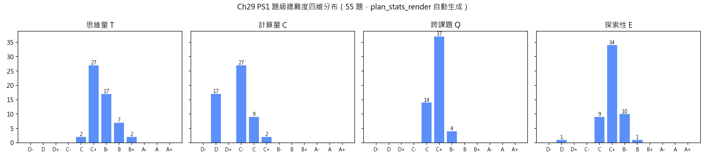
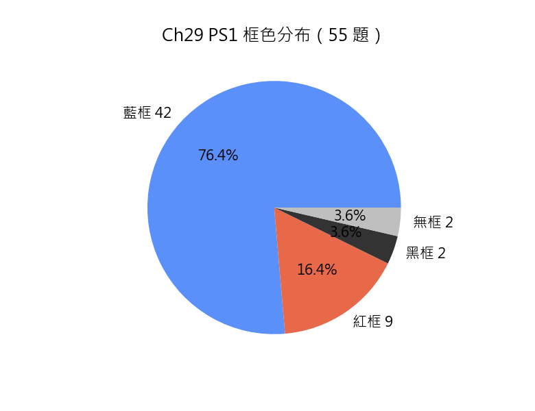

# Chapter 29「平面幾何 (II)」習題冊規劃方案（初稿 2026-09-23：55 題）

> 本規劃文件為 Ch29 命題規劃：55 題全要素（題干／分題／考核目標／詳細解答／四維難度標記＋逐維判定理由／配圖判定／題目修改欄／標記框 checkbox），與後續正文、答案 .tex 三處同步。結構分類依題面實際分題結構（`task` 類 6／無結構類 5／簡單結構類 32／複雜結構類 12）；所有含大分題的題均逐分題獨立打標，分題再拆 (i)(ii) 時逐小分題獨立打標、父層不設標記行（2026-09-09 用戶裁定），大題難度取各分題與小分題各維最大值。命題範圍以講義 `DSE 課題講義/Chapter 29 平面几何 (II).md`（§29.1–§29.4）為唯一內容來源；框色判定依《習題冊規劃說明方案.md》5.1 三步總則與《官方考綱與課題講義關聯分析.md》Ch29 條目；難度判定依《習題難度標記方案-規劃.md》v1.4。
>
> **框色終態：藍 42／紅 9／黑 2／無框 2（合計 55 題）。** 藍框 42 題為官方必修 11「圓的基本性質」11.1–11.6 與初中 24「三角形的心」24.1–24.3 明文課題，並有卷一真題直接錨點（2012 Q8、2015 Q8、2016 Q20、2018 Q8、2019 Q13、2020 Q18、2023 Q7、2025 Q18）；紅框 9 題全部有《官方考綱與課題講義關聯分析.md》Ch29 明文條目支持——圓冪定理類 6 題（題 29、30、31、32、47、51，引 §29.2.3【完全超綱】「相交弦定理、切割線定理、點對圓的冪在初中 32 單位、必修 20 單位、M1 21 單位、M2 18 單位中均無對應學習重點」；題 48 同引該條目，因其核心為乘積結構 $TC^2=TB\cdot TA$）、外心位置類 1 題（題 39，引 §29.3.2【深度超出】「外心的位置定理＋證明＝官方無此學習重點，正文自標『只要求會判斷，論證屬擴展閱讀』」）、四心比例類 2 題（題 41，引 §29.3.3【深度超出】「重心 $2:1$ 分割比：官方只要求認識形心定義，比例結論＝【深度超出】」；題 48 屬圓冪條目）；黑框 2 題：題 50（**圓的外切四邊形**——題面自給新名詞並在其下以「外點兩切線等長」探索對邊和關係、推論至平行四邊形必為菱形）、題 54（**托勒密定理**——題面交出輔助點 $K$ 的取法與定理名稱，於其下以講義已建的 AA 相似與同弓形角完成一般性證明）；無框 2 題：題 1、19（四維無任何維達 C+ 的 `task` 批量操練，5.1 無框第一類）。
>
> **真題錨點**：§29.1 的「圓上求角／求線段」為卷一甲部(1)—(2) 高頻題族——2023 Q7（4 分，圓周角與直徑）、2015 Q8（5 分，圓內接四邊形與等腰倒角）、2018 Q8（5 分，圓內接四邊形與平行線，以 $\theta$ 表 $x$、$y$）、2019 Q13（8 分，圓心、直徑與扇形周界之宣稱判斷）、2017 Q10（6 分，全等三角形與圓的性質）直接對標題 4、8、10、11、12、15；§29.1.3 的四點共圓有 2019 Q19（12 分）、2025 Q18（9 分）兩道大題的「共圓」分問對標題 13、16、17；§29.2.1 的切線有 2020 Q18（7 分，切線＋相似＋直徑＋圓周）對標題 20、22、23、28；§29.2.3 圓冪的考綱內版本即 2012 Q8（5 分，兩弦相交、寫出兩對相似三角形並求 $AE$、再判斷垂直）——本冊題 47 與其同族，據此「以相似現場推導乘積」屬可對標題型，標紅係因題目要求超出講義 11.6「簡單幾何證明」的一般化乘積結論與逆命題；§29.3 的四心有 2016 Q20（12 分，鈍角三角形的內心與外心共線 ⟹ 證 $OP=PQ$）、2025 Q19／2022 Q19（各 12 分，圓的切線與內切圓、外接圓）、2025 Q18（重心坐標）對標題 33、35、36、39、41、46、49。

## 〇、詳細解答規範與難度評分依據（2026-09-23 初稿，依《習題冊規劃說明方案.md》3.2／第四章／第六章／7.2–7.3 與《習題難度標記方案-規劃.md》v1.4）

**詳細解答**（每題必備）須為完整、健全的解答，包含兩部分：

1. **解答主體**：解題思路與分步推導**自然融合**——不單列策略板塊、不生硬分出開篇策略段；策略與切入點織入每一步推導，隨推導逐步交代；每一步註明依據與中間結果、完整推理鏈，禁止只寫結論。證明題每步以括注附幾何依據（「（同弓形內的圓周角）」「（RHS）」「（畢氏定理）」），證明結束後不加任何記號。**只寫解題所需**（2026-09-23 用戶裁定）：凡完成該題提問並不需要、或題目未問的內容一律不寫——附註／附帶說明／「原因：」式方法評述／幾何解釋／一般理由段落／跨題方法總述／重複題干／對未被問到的性質的說明皆刪除；確屬易錯者移入「易錯點注意」。
2. **易錯點注意**：常見錯誤與避免方法——概念混淆、運算疏漏、邏輯陷阱、符號誤用等。本章高發處依講義 §29.4「易錯點」九條落實到各題（弧與弦的正比誤用、反角取否、同弓形與兩側之別、內錯弓形配對、切線判定兩條件缺一、割線分段與整條割線之混、外心與內心的等距對象相反、判別法與性質定理的方向用反、平行弦兩解）。

**書寫形式（依規範 6.2／6.3.3 與 2026-09-23 用戶裁定「哪個中學生會寫出這種答案？全文整改」）**：

- 多步 `=`／`≡` 變形鏈一律 `$\begin{aligned}[t]…\end{aligned}$` 每步一行並逐步以 `\quad \text{（依據）}` 附註，**不得寫成行內 `$A \implies B \implies C$`**；
- 以 `$\implies$` 開頭的句子單獨成行；每個獨立句子獨占一行；段落之間以空行分隔，**禁 `\\`**；
- 需反覆執行的同型步驟（task 逐項、逐角標記、逐約束驗證）**列成清單**逐條處理；
- 求解須先為各方程編號再以 `cases` 聯立；驗證一律寫明代入對象與結果，不得只寫「驗證成立」；
- 角度記號一律完整三字母（`\angle BAC`，頂點居中），`\sin`／`\cos`／`\tan` 後亦寫三字母；解答正文不標講義章節位置，依據只寫定理／方法名稱本身；
- 恆等變形用 `≡`、代入數值與解方程用 `=`（Ch04 起生效，本章沿用）；分數一律假分數；近似值一律由題干注明「答案須取三位有效數字」。

**難度評分**基於上述詳細解答逐維分析（四維 T 思維量／C 計算量／E 探索性／Q 跨課題，檔位 D- 至 A+ 共 12 檔）：

- 每個分題（及小分題）的四維標記之判定理由，須引用詳細解答中的具體環節，而非籠統表述；每個維度各一條，分題判定理由不得合併；
- 整題總標記只需註明取各分題與小分題最大值，不附逐維判定理由；`task`／無結構類按附錄 A.1／A.2 模板保留四行理由、不加取最大值括號注；
- **計步公約（v1.3）**：判 T 維鏈長時「步」只計**異質概念環節**（建模翻譯、分類討論、反證、構造、等價性論證、方向辨析）；同一概念之連續執行（task 逐項同型計算、逐角重複使用同弓形角）依 C 維「數量疊加僅加半級」判據不計入鏈長；
- **超綱思想方法紅線（2026-09-23 用戶裁定）**：ε／δ 選取、上確界、否定量詞、參數化任意點、有限集取最小、雙向包含窮盡、自補引理、定義多層符號展開、注意到未引導的複雜構造、以未引入概念入手——十款手法在**引導充足**（分題台階或題干末（提示：…）交出構造對象與構造式）時正當使用，但**一律不得作為 T／E 維抬檔依據**；未給引導即判錯題。本章落點：題 52(c) 的「$\Gamma_2$ 上任一點確定唯一一條切線弦」、題 53 的「$OM\le OP$，等號僅當 $M$ 與 $P$ 重合」兩處均由題面提示交出，故按學生在引導下可及之作答評定檔位；
- **單步直接套定義 → T D**（不因項數重複抬檔；須 2–3 個異質環節或涉及 2 個以上知識點才升 C）；
- **Q 維實際調用口徑（v1.3，本章採板塊／課題兩層，詳見「一」節末條）**；
- 難度排序採四維字典序 **T→C→Q→E** 逐維升序，宏觀遞增（規範 7.5；小節歸組優先於逐對排序，交界處容許局部回退）。

**超綱方法自檢**：以 `DSE 課題講義/Chapter 29 平面几何 (II).md`（§29.1–§29.4）及前置章節講義為工具清單。**前置章節可用工具**：Ch00 命題邏輯與充分必要條件；Ch01 整數與整除；Ch02 估算與有效數字（題 44、45(b)）；Ch05 一元一次方程（題 12(b)、45(a)）；Ch06 根式運算與分母有理化（題 5、9、23、26、48）；Ch07 比例記號與比例分配、乘積式與比例式的互化（題 1(e)、7、12(d)、51(a)）；**Ch08 平面幾何(I)——本章主力前置**：全等判定 SSS/SAS/AAS/RHS（§8.4）、相似判定 AA／三邊成比例／兩邊成比例且夾角相等（SAS∼）與面積比 $k^2$（§8.4）、畢氏定理與逆定理（§8.5）、平行線與內錯角／同位角與中點定理（§8.6）、三角形內角和與外角定理（§8.2）、多邊形內角和與外角（§8.3）、等腰三角形等邊對等角與三線合一（§8.7）、特殊四邊形與等腰梯形（§8.8）、圓形及扇形的弧長與面積（§8.9，含「弧長與圓心角成正比」為本章既定事實）；Ch09 特殊角三角比表（題 23、26）；Ch16 集合與屬於語言（僅作表述，題 4、20）；Ch18 一元二次方程因式分解法與公式法（題 31、32）。**本章自身工具**：見「一、命題範圍與設計原則」逐節清單。

全卷**嚴禁**動用（講義未教或明言留後）：Ch30 軌跡語言（講義備課提示 8：本章刻意不用軌跡語言，「到定點等距的點集」只在定義圓時以集合式出現一次）；Ch31 圓的方程、直線與圓的代數交點、以判別式討論直線與圓（同條提示）；圓內接四邊形的面積公式；正弦定理、餘弦定理與外接圓半徑公式 $\dfrac{abc}{4\Delta}$（同條提示）；有向角與模 $360^\circ$ 同余語言；反三角記號；解析法求圓心坐標（題面未給直角坐標系者一律走綜合幾何）；歐拉線、九點圓、根軸、極線與調和分割、密克點、蝴蝶定理等講義未及的圓幾何結論一律不出（題 50 之「外切四邊形」與題 54 之「托勒密定理」依 5.1 黑框判據**由題面自給新概念**並在引導下證明，不作為默記結論使用）。結果見「十一、修訂記錄」末條。

## 一、命題範圍與設計原則

- **唯一內容來源**：`DSE 課題講義/Chapter 29 平面几何 (II).md`（§29.1–§29.3 共十三個 `###` 小節；§29.4 為小結、方法總表與詞彙表，不設節題目）。官方考綱只用來判別框色（藍框／紅框），不決定內容範圍、不增刪內容。
- 本習題冊涵蓋（逐節列出講義實際建立的結論）：
  - **§29.1.1 圓上的弧與弦**：圓 $C(O,r)$ 的集合式定義、直徑 $d=2r$、等圓；弦、弧（劣弧 $\widehat{AB}$／優弧 $\widehat{ACB}$）、弓形、扇形、弦心距；等弦截取等弧（雙向）；圓心至弦的垂線平分該弦；圓心與弦中點的連線垂直於該弦（直徑除外）；弦的垂直平分線經過圓心；等弦⇔等弦心距（雙向）；過三點的圓存在且唯一；弦長與圓心角**不成**正比；平行弦距離的同側／異側兩解。
  - **§29.1.2 圓上的角**：圓心角與圓周角定義、「所對的弧＝不含頂點的一段」、優弧對**反角**的記號約定；圓心角定理 $\angle AOB=2\angle APB$；同弓形內的圓周角相等；半圓內的圓周角為直角；直角圓周角所對的弦是直徑；弧與圓周角成正比。
  - **§29.1.3 圓內接四邊形與四點共圓**：圓內接四邊形與外接圓、頂點順序與「對角」；對角互補；四邊形的外角與**內對角**（先定義後使用）；外角等於內對角；#### 四點共圓的三條判別法（同側等角、對角互補、外角等於內對角）。
  - **§29.2.1 切線的性質與判定**：切線與割線、切點；點在圓內／上／外（$OP$ 與 $r$ 比較）；直線與圓的位置關係定理（$d<r$／$=r$／$>r$ 三情形雙向）；切線垂直於過切點的半徑；切線的判定（過半徑外端**且**垂直，兩條件缺一不可）；過切點垂直於切線的直線經過圓心；外點的兩條切線（切線長相等、$OP$ 平分 $\angle APB$ 與 $\angle AOB$、$OP$ 垂直平分切點弦 $AB$）。
  - **§29.2.2 弦切角與內錯弓形**：弦切角、截取的弧、內錯弓形；一對弦切角互補；弦切角定理（弦切角等於內錯弓形內的圓周角）；弦切角定理的逆（角等 ⟹ 相切）；辨認弦切角的三特徵。
  - **§29.2.3 圓冪定理**（講義自標超出常規課程、作擴展閱讀）：相交弦定理 $PA\cdot PB=PC\cdot PD$；切割線定理（兩割線式與 $PT^2=PA\cdot PB$）；過一點兩段乘積為定值 $\lvert r^2-h^2\rvert$；點對圓的冪 $\mathrm{Pow}_\Gamma(P)=OP^2-r^2$。
  - **§29.3.1 特殊線段與兩條等距性質**：中線、高（含鈍角三角形的高在形外）、角平分線、邊的垂直平分線之定義；角平分線上的點到兩邊等距（雙向，AAS／RHS 各證一回）；邊的垂直平分線等距性質（承 §29.1.1 引理）。
  - **§29.3.2 內心與外心**：三內角平分線共點且到三邊等距 ⟹ 內心 $I$ 與內切圓；三邊垂直平分線共點且到三頂點等距 ⟹ 外心 $O$ 與外接圓（半徑 $R$）；外心的位置（銳角內、直角在斜邊中點、鈍角外）；直角三角形 $R=\dfrac{BC}{2}$；用三邊判斷外心位置（把 §8.5 逆定理補全為三條等價式）；內切圓半徑與面積 $pr=2a$（面積記 $a$、周長記 $p$、三邊一律寫 $AB$、$BC$、$CA$）。
  - **§29.3.3 重心與垂心**：三中線共點且按 $2:1$ 分割（靠頂點較長）⟹ 重心 $G$；三高所在直線共點 ⟹ 垂心 $H$（銳角內、直角頂點、鈍角外）。
  - **§29.3.4 四心的比較**：四心對照（構造線、共點依據、關聯圓、關鍵數量、位置）；外心與內心最易混淆的辨析；$\angle BIC=90^\circ+\frac12\angle BAC$、$\angle BOC=2\angle BAC$（僅 $\angle BAC$ 為銳角時）；等邊三角形四心合一、內心與外心重合 ⟹ 等邊三角形。
- **範圍邊界**（講義未建立或明文留後者一律不考）：Ch30 的軌跡概念與軌跡方程；Ch31 的圓方程、直線與圓的代數交點、以判別式處理直線與圓；圓內接四邊形面積公式；正弦定理、餘弦定理、外接圓半徑 $\dfrac{abc}{4\Delta}$；根軸、極線、調和分割、密克點、蝴蝶定理、九點圓、歐拉線等講義未及的圓幾何對象；有向角與模 $360^\circ$ 同余；反三角記號；微積分與極限。
- **小節內不得越界**（用戶 Ch20 裁定的本質判據，逐題把關）：§29.1.1 各題（題 1–5）只用弦、弧、弦心距、垂直平分線與過三點的圓，**不得出現圓周角、切線、四心**；§29.1.2 各題（題 6–11）得用圓心角定理及其四推論，**不得用對角互補與共圓判別**（題 8 因此須以「反角＋圓心角定理」取得兩側圓周角互補，不得預支 §29.1.3）；§29.1.3 各題（題 12–18）得用對角互補、外角等於內對角與三判別法，**不得用切線、弦切角、圓冪、四心**（題 18(a) 因此必須走 AA 相似推 $AX\cdot CX=BX\cdot DX$，不得出現「相交弦定理」字樣）；§29.2.1 各題（題 19–23）可用圓的全部性質＋切線定理群，**不得用弦切角與任何乘積定理**（題 21 的 $\angle ATX=\angle TCA$ 須以「切線⊥半徑＋等腰三角形＋半圓推論」取得）；§29.2.2 各題（題 24–28）**不得使用圓冪／相交弦／切割線**（題 28(b) 的 $TU^2=TV\cdot TW$ 由 $\triangle TUV\sim\triangle TWU$ 的對應邊比例推出）；§29.2.3 各題（題 29–32）得用全部 §29.1–§29.2.2 工具與 Ch18 一元二次方程；§29.3.1 各題（題 33–34）只用四條特殊線段定義與兩條等距性質；§29.3.2 各題（題 35–39）得用內心外心的共點結論與數量公式；§29.3.3 各題（題 40–41）得用重心 $2:1$、垂心；§29.3.4 各題（題 42–43）為四心對照與辨析。綜合練習與理論習題可用全章與全部前置內容。各節題目已逐題把關（見「〇」節超綱自檢與各題判定理由）。
- **跨章聯動**：聯動 Ch00 命題語言（宣稱判斷句式，題 3、11、13、20、22、28、31、38、41、43、44、47、52、55）、Ch02 估算與有效數字（題 44、45(b)）、Ch05 一元一次方程（題 12(b)、45(a)）、Ch06 根式與分母有理化（題 5、9、23、26、48）、Ch07 比例（題 1(e)、7、12(d)）、**Ch08 平面幾何(I)**（全章主力前置：全等與相似、畢氏與逆定理、平行線與內錯角、內角和與外角、等腰三線合一、中點定理、扇形弧長——題 1–55 全部實際調用）、Ch09 特殊角三角比（題 23、26）、Ch16 集合語言（題 4、20）、Ch18 一元二次方程（題 31、32）。**聯動題（題級 Q 維 ≥ C）55 題，佔 100%**，遠超規範 4.1 之 30%；§29.1、§29.2、§29.3 三節均有 Q 達節上限之題，**無豁免需求**。
- **跨章聯動之 Q 維計數口徑（本章自訂，依 v1.3「實際調用」判據採板塊／課題兩層）**：①只用本小節（`###` 級）所立的定義與算法者記 **D**；②實際調用本節之外的**一個**課題（其他 `###` 小節的定理群、或 Ch08／Ch09／Ch18 等前置課題）者記 **C**；③實際調用**三個**課題者記 **C+**；④須以 Ch18 **解出**一元二次方程、以 Ch05 **解出**一次方程、以 Ch02 作**有效數字估算**等「實際解出他板塊對象」者記 **B-**；⑤「承接前一問結論」不等於實際調用；⑥本章自身建立的語言（弦心距一詞、弧記號、$pr=2a$ 的記號約定）不另計課題。**說明**：講義三節上限（§29.1 Q C+／§29.2 Q B-／§29.3 Q C+）即按此口徑打標，本章沿用；Ch08 曾於 2026-09-19 另行裁定「Q 維只計跨章節工具、本章 §8.x 互用記 D」，該裁定未推及本章（見「十、待確認事項」）。
- **DSE 宣稱句式**：「某人宣稱……你是否同意／該宣稱是否正確？試解釋你的答案」分布於題 3、4(b)、11(b)、13(b)、17(b)(ii)、20(a)、22(b)、26(b)、28(c)、31(b)、38(b)、41(b)、43、44(b)、47、51、52(c)、55(c) 等，沿用 2014 Q18、2019 Q13、2020 Q18 之卷一慣用句式。
- **數據與計算器約定**：長度與角度數據一律取可構造、可反算的整數或簡潔根式（勾數族 $5,12,13$／$6,8,10$／$8,15,17$／$9,40,41$ 與 $13,14,15$、$3,4,5$ 之倍形），涉無理數處一律以根式精確值表示；僅題 44(a)、45(b) 兩处以「答案須取三位有效數字」明標計算器取位（Ch02 聯動）；題干不給任何可由計算器求得之數值；常用對數與三角函數圖像不在本章出現。
- 題目只列中文題面，**不標分數**；英文對譯於正文 .tex 以 `entranslation` 提供。
- 難度由弦、弧、弦心距的批量直算（§29.1.1 前段）與圓上角倒角（§29.1.2），提升至四點共圓與相似鏈（§29.1.3）、切線長與切線判定辨析（§29.2.1）、弦切角綜合鏈（§29.2.2）、圓冪與二次方程（§29.2.3）、四心的數量關係與位置判斷（§29.3），並由綜合練習（切線長估算、圓弧軌道反算、直角三角形雙圓、兩弦相交一般化、直徑切線根式鏈、內心外心共線）與理論習題（外切四邊形、相交弦逆、同心圓定值弦、過定點最長最短弦、托勒密、弦長一般式）承擔難度高峰。
- **全局命題原則（沿用 Ch23–Ch28 定稿條款，本章適用部分）**：
  - G-措辭：採用講義詞彙——「弦心距」「劣弧／優弧」「反角」「同弓形內的圓周角」「對角互補」「內對角」「四點共圓」「同一法」「切線／割線／切點」「內錯弓形」「弦切角」「點對圓的冪」「中線／高／角平分線／邊的垂直平分線」「內心／外心／重心／垂心」「內切圓／外接圓」；`task` 指令統一「求下列各題中指定的長度」／「求下列各題中指定的角或比」；「化為最簡」不寫（2026-09-03 全局條款）；角度記號一律三字母；圓一律寫「圓 $C(O,r)$」或記 $\Gamma$，全章不用 `⊙O`；三角形面積記 $a$、周長記 $p$（依講義 §29.3.2 記號）；
  - **G-方法**：解答選用通用、顯然的方法（標角 $\alpha,\beta$ 後列等量關係、作半徑／連切點／取弦之中點作垂線等講義已示的通用輔助線；垂徑定理＋畢氏求弦心距；圓心角定理與同弓形角倒角；AA 相似推比例）；**禁止以超綱思想方法作為解題路徑或評分依據**；非顯然的關鍵一步一律以分題台階或題干（提示：…）寫入題面；
  - G-唯一性：題目條件須使所求對象唯一確定——凡位置未定者一律要求寫出**所有可能值**（題 5、32(c)、45、55(c) 的弦心距同側／異側與割線條數），不以限制條件掩蓋多解；含參數題一律聲明參數範圍（題 52 $R>r>0$、題 55 $0\le d_1<d_2<r$）；
  - G-自洽：逐題驗算數據（弦長不超過直徑、點與圓的位置與所述一致、四邊形內角和 $360^\circ$、圓內接四邊形對角和 $180^\circ$、割線三段大小次序 $PA<PB$ 且 $PB-PA=AB$、相似比與面積比自洽）；
  - G-分題：分題須有意義、不過細；分題間有聯動；**同一題干下有多個提問點者一律開分題／小分題**；**數據或情境互不相干者不得併入一題**；解題的必然中間步驟（「求弦心距」「求半徑」）不另設獨立提問；「承 (a)」等冗語一律不寫；
  - G-禁釋定理：**不出「定義／定理直接解釋型」題目**（2026-09-09 全局條款）——凡提問對象為定義、定理本身且背誦講義原文即完成者一律不出；本章以「在具体實例上套用定理並產出新值／新判斷」為準（題 43 屬改正宣稱並算具體 $r$、$R$ 值，題 16、17 屬以判別法證共圓後再推新角，題 50、54 屬黑框新概念探索，均屬允許之 B 類）；
  - G-意義：避免純機械操作——批量操練限於 `task` 題（題 1、6、12、19、24、33），單題必承載判別點（同側與異側兩解、反角與非反角、同弓形與兩側之別、切線判定兩條件缺一、弦切角與內錯弓形配對、割線分段與整線之混、外心與內心的等距對象相反、判別法與性質定理的方向、$2:1$ 與面積三等、乘積的定值性）。
- **代數紅線沿用**（Ch04 全局條款）：解答不得以「依某恆等式模式」作方法依據、不談因式分解的「域」、不用判別式判斷二次式可否分解；題 31(a)、32(b) 的 $(x-7)(x-8)$、$(x+9)(x-4)$ 型分解以十字相乘＋因數配對與交叉和核驗寫出。

## 二、框色邊界（頭部匯總聲明）

- **`recquestion`（藍框，考綱內＋至少一維 C+~B+＋無 A-/A/A+ 維）42 題**：題 2–18（§29.1，除題 1 無框）、題 20–28（§29.2.1–§29.2.2，除題 19 無框）、題 33–38、40、42、43（§29.3）、題 44、45、46、49（綜合練習）、題 52、53、55（理論習題）——課題在官方必修 11「圓的基本性質」11.1–11.6 與初中 24「三角形的心」24.1–24.3 的明文學習重點之內，並有卷一真題直接錨點（見頂部「真題錨點」段）。其中 §29.1.3 的四點共圓三判別法、§29.2.1 的外點兩切線、§29.2.2 的弦切角及其逆，講義雖自標「延伸內容」，關聯分析 Ch29 逐小節對照表仍判為【對應】必修 11.4／11.5（⬆️非基礎課題，屬考綱內），故一律判藍；§29.3.1 的兩條等距性質與 §29.3.2 的三內角平分線共點、三邊垂直平分線共點為初中 24.1／24.2 明文「須從定義和運用全等三角形的判別條件證明」之條目，判藍；題 52（同心圓的切線弦定值）與題 53（過圓內定點的最長最短弦）及題 55（弦長一般式 $2\sqrt{r^2-d^2}$ 與平行弦距離合併條件）雖為以已建定理推出之新結論，其工具與考點全在必修 11.1 之內，判藍。
- **`ofsquestion`（紅框，超 DSE 必修考綱但講義覆蓋，逐題引用）9 題**：
  - 題 29、30、31、32（過圓外一點的乘積定值／切割線定理與相似比／相交弦與一元二次方程／切線長·割線弦長·割線條數）——關聯分析 Ch29 §29.2.3 條目【完全超綱】：「相交弦定理、切割線定理、點對圓的冪在初中 32 單位、必修 20 單位、M1 21 單位、M2 18 單位中均無對應學習重點（必修 11 只要求用圓的基本性質作簡單證明）」；講義 L3179 自標「這兩條超出常規課程的要求，此處作為擴展閱讀給出」；備課提示第 7 條並列「不進入統一測驗範圍」；
  - 題 47（兩弦相交的一般化 $a\cdot c=b\cdot d$ 與 $AB:DC$）、題 51（相交弦定理的逆 ⟹ 四點共圓）——同引 §29.2.3【完全超綱】條目。二者之具體操作雖與 2012 Q8「寫出兩對相似三角形並求 $AE$」同型（屬考綱內），但題目要求的**一般化乘積結論**與**逆命題**超出必修 11.6「運用圓的基本性質作簡單幾何證明」之要求，依 5.1①「表述方式亦屬內容範圍」判紅；
  - 題 48（直徑、切線、$\triangle TCB\sim\triangle TAC$ 與 $TC^2=TB\cdot TA$）——同引 §29.2.3【完全超綱】條目（(c) 以乘積關係列方程求解為本題核心考點）；
  - 題 39（以 $13,14,15$ 三邊判角、確定外心在形內、論證外心與內心不重合）——關聯分析 Ch29 §29.3.2 條目【深度超出】：「外心的位置定理＋證明＝官方無此學習重點，正文自標『只要求會判斷，論證屬擴展閱讀』；『用三邊判斷外心位置』注記把初中 25.2 畢氏定理逆定理補全為三條等價式＝【深度超出】」；
  - 題 41（重心 $2:1$ 分割與三小面積相等之一般論證）——關聯分析 Ch29 §29.3.3 條目【深度超出】：「重心 $2:1$ 分割比——官方只要求認識形心定義，比例結論＝【深度超出】」；同條另記「三條中線共點、三條高共點，官方明言『學生不須證明上述幾何性質』」。
- **`exquestion`（黑框，2026-09-03 用戶裁定判據：題面給出新概念／新名詞並於其下作探索性解釋或證明；單純以既有工具證明一個公式不屬之）2 題**：題 50（**圓的外切四邊形**——題面定義「四邊皆與同一圓相切的四邊形」並命名其內切圓，於該新概念下以「外點兩切線等長」探索對邊和相等 $AB+CD=BC+DA$，並推論「外切平行四邊形必為菱形」）；題 54（**托勒密定理**——題面交出對角線上點 $K$ 的取法（$\angle ABK=\angle DBC$）與定理名稱，學生在其下完成兩對 AA 相似並合併為一般定理，末問以長方形驗算）。二者之論證工具（同弓形角、AA 相似、比例性質）皆為講義已建，新概念本身由題面自給，不要求課外默記。
- **無框 2 題**：題 1、19——兩者為 `task` 批量操練且四維無任何維度達 C+（題 1：T C｜C D｜E D｜Q C；題 19：T C｜C D｜E C｜Q C），依 5.1 無框第一類（顯著低於卷一同型題的基礎操練：2015 Q9、2019 Q13 之扇形與圓周計算鏈更長）。本章**無**無框第二類（出現 A-／A／A+ 維的高難度題）——全章無 A 檔維。
- 頭部聲明與各題「標記框」checkbox 勾選及各節框色分布表一致（見「四、難度與框色統計表」）。

## 三、題型結構規劃

| 類型 | 題號 | 數量 | 命題用途 |
| --- | --- | --: | --- |
| `task` 類 | 1、6、12、19、24、33 | 6 | 批量操練：半徑·弦長·弦心距互算（四項）、圓心角與圓周角及同弓形角與弧比（五項）、圓內接四邊形角度（四項）、切線長（四項）、弦切角（四項）、四心相關量直算（四項） |
| 無結構類 | 3、7、29、34、43 | 5 | 單一概念的完整運用：「圓心角加倍弦加倍」宣稱之反例計算、弧比定圓心角再求圓周角、過圓外一點的乘積定值、角平分線等距與面積分割、外心與內心等距對象宣稱的改正與驗算 |
| 簡單結構類 | 2、4、5、8、9、11、13、14、15、16、17、20、21、22、23、25、26、27、30、31、35、36、37、38、40、41、42、44、45、47、51、53 | 32 | 每題恰有 (a)(b) 兩大分題：等弦心距雙向辨析、拱橋劣弧與優弧、同心圓平行弦梯形、兩側圓周角與弧長、直角圓周角與面積法高、對角線分角倒角與宣稱、同側等角判別與「改為互補」反例、兩高共圓與相似面積比、等腰與同弓形角倒角、共圓判別反求 $AF$、外角判別與方向辨析、「垂直於半徑即切線」辨析、切線與直徑等腰角鏈、垂徑定理求割線弦長、外點兩切線的角與面積、弦切角逆定理判切線、過切點垂線過圓心、弦切角與內接四邊形倒角、切割線與相似比、相交弦與二次方程、直角三角形外接圓與中點定理、內切圓切點分段、三邊垂直平分線共點、內心角與互補宣稱、垂心角與共圓、重心 $2:1$ 與三等面積、等邊四心與面積比、切線長估算宣稱、圓弧軌道反算、兩弦相交一般化、相交弦逆命題、過定點最長最短弦 |
| 複雜結構類 | 10、18、28、32、39、46、48、49、50、52、54、55 | 12 | 三分題及以上（或含小分題）：平行弦截等弧與以 $\theta$ 表角（三問）、對角線垂直的圓內接四邊形（四問，§29.1 觸頂）、切線＋相似＋割線（三問）、切線長·割線弦長·割線條數（三問，§29.2 觸頂）、三邊判角·外心位置·四心重合（三問，§29.3 觸頂）、直角三角形雙圓與 $OI$（三問含小分題）、直徑切線相似與根式（三問）、內心外心共線 ⟹ 等腰（三問）、外切四邊形（三問）、同心圓定值弦（三問）、托勒密定理（四問）、弦長一般式與平行弦距離（三問） |
| 綜合練習 | 44–49 | 6 | 融合全章考點之 DSE 卷一長題風格，按難度字典序 T→C→Q→E 排列 |
| 理論習題 | 50–55 | 6 | 以已建定理推新結論（外切四邊形對邊和、相交弦逆命題、同心圓定值弦、過定點最長最短弦、托勒密定理、弦長與平行弦距離一般式），不重複講義證明，按字典序排列 |

> 全章共 55 題（§29.1 題 1–18 共 18 題；§29.2 題 19–32 共 14 題；§29.3 題 33–43 共 11 題；綜合練習 6 題；理論習題 6 題），其中 `task` 類 6 題。結構類型以 (a)(b)(c) 大分題個數為準（(i)(ii) 小分題不計）。非 `task` 題 49 題中「無結構 : 簡單結構 : 複雜結構」＝ **5 : 32 : 12**，規範 4.2 之參考比 2 : 7 : 1 折算為 10 : 35 : 5——本章無結構偏少、複雜偏多。成因：本幾何章的「求角（或求長度）→ 反求參數 → 判斷宣稱」三段式題目天然需要三個分題（卷一真題 2016 Q20、2019 Q13、2020 Q18 皆此形態），而單問即可成立的基礎題大多已歸入 `task` 批量。另有 5 題（題 23、41、50、52、55）的相鄰分題可合併以貼近參考比，處理方案列入「十、待確認事項」俟裁。帶小分題 (i)(ii) 者 4 題（題 16(b)、17(b)、30(b)、46(b)）；簡單結構類內部「有小分題 : 無小分題」＝ 2 : 30，低於規範參考之 1 : 2（同列待確認）。

## 四、難度與框色統計表（依規範 7.6，由題目定級自動重算）

> **本節為自動產物，勿手改**：由 `.workbuddy/scripts/plan_stats_render.py` 取「七、題目方案」的**末級定級行**重算題級四維（逐維取各末級最大值）、框色勾選與所屬大節，整節覆蓋（片段層覆寫後須重跑本章組裝器）。檔位、框色或題目增刪後**重跑本腳本即可**（連同兩個 PNG），不必逐處對照；欲保留人工解釋文字，寫成以 `> 備註：` 起始的引用塊即自動保留。
> 統計口徑：只計**題級總難度**（不統計分題與小分題，2026-09-01 用戶裁定）；「B 檔及以上」＝**任一維達 B- 或以上**；「C 檔及以上」＝任一維達 C- 或以上；「跨章聯動」按題計、以題級 Q 維達 C 或以上為準（規範 7.6）。

### 四維分布表（題級總難度，55 題）

| 維度 | D- | D | D+ | C- | C | C+ | B- | B | B+ | A- | A | A+ | B 檔及以上合計 |
| --- | --: | --: | --: | --: | --: | --: | --: | --: | --: | --: | --: | --: | --: | ---: |
| 思維量（T） | 0 | 0 | 0 | 0 | 2 | 27 | 17 | 7 | 2 | 0 | 0 | 0 | 26 |
| 計算量（C） | 0 | 17 | 0 | 27 | 9 | 2 | 0 | 0 | 0 | 0 | 0 | 0 | 0 |
| 跨課題（Q） | 0 | 0 | 0 | 0 | 14 | 37 | 4 | 0 | 0 | 0 | 0 | 0 | 4 |
| 探索性（E） | 0 | 1 | 0 | 0 | 9 | 34 | 10 | 1 | 0 | 0 | 0 | 0 | 11 |

（思維量最高 B+（題 18、32）；計算量最高 C+（題 23、32）；跨課題最高 B-（題 31、32、48、49）；探索性最高 B（題 32）。全章無 A 檔維。按上述口徑：**B 檔及以上 29 題（52.7%）**、C 檔及以上 55 題（100.0%）、題級 Q 維達 C 或以上（跨章聯動）55 題（100.0%）。B 檔及以上題號：10、11、13、14、15、16、17、18、20、21、22、23、28、31、32、38、39、41、45、46、47、48、49、50、51、52、53、54、55。）

**統計圖表**（同上腳本自動生成，重跑即覆寫同名 PNG）：





### 按題號難度一覽（B 檔及以上，29 題，佔 52.7%）

| 題號 | 總難度 | 框色 | 要點 |
| --- | --- | --- | --- |
| 10 | T B-｜C D｜E C+｜Q C+ | 藍 | 平行弦截等弧證 $AB=DC$、以 $\theta$ 表 $\angle DAC$ 與 $\angle BAD$、$\theta=36^\circ$ 判 $AB$ 是否直徑 |
| 11 | T B-｜C D｜E B-｜Q C | 藍 | 對角線分角下的三段同弓形角倒角；「$\angle ACB=\angle ACD$ 故 $CA$ 平分 $\angle BCD$」宣稱之辨析 |
| 13 | T B-｜C D｜E C+｜Q C | 藍 | 同側等角判別證共圓；「改為互補仍共圓」宣稱之反證與反例 |
| 14 | T B-｜C C-｜E C+｜Q C+ | 藍 | 兩高共圓並指直徑 $AB$；$\triangle CDE\sim\triangle CAB$、$CB=16$ 與面積比 $1:4$ |
| 15 | T B-｜C D｜E C+｜Q C+ | 藍 | 等腰、對角互補與同弓形角連續倒角求 $\angle ABE=7^\circ$（2015 Q8 同族） |
| 16 | T B-｜C C-｜E C+｜Q C+ | 藍 | 兩高共圓（直徑 $BC$）＋$\triangle AFE\sim\triangle ACB$ 反求 $AF=5$（含小分題） |
| 17 | T B-｜C D｜E C+｜Q C+ | 藍 | 外角等於內對角 ⟹ 對角互補判別；「同弧兩角互補」方向辨析（含小分題） |
| 18 | **T B+｜C C｜E B-｜Q C+** | 藍 | 對角線垂直的圓內接四邊形：相似推乘積、四邊長、面積、$AB^2+CD^2=BC^2+DA^2$ 之**一般論證**【§29.1 觸頂】 |
| 20 | T C+｜C D｜E B-｜Q C | 藍 | 「垂直於一條半徑即切線」宣稱辨析；改半徑後同一直線成為切線 |
| 21 | T C+｜C D｜E B-｜Q C+ | 藍 | 切線⊥半徑、等腰三角形、半圓推論三者串鏈求 $\angle TCA$ 與 $\angle ATX$ 並判斷相等 |
| 22 | T B-｜C C｜E C+｜Q C | 藍 | 由 $B$ 在圓上定半徑 $r=15$，判 $OA<r$ 知 $\ell$ 為割線，再以垂徑定理定 $A$ 為弦的中點求截得弦長 $18\text{ cm}$ |
| 23 | T B-｜C C+｜E C+｜Q C+ | 藍 | 外點兩切線的 $30^\circ$ 結構、切線長 $5\sqrt3$、四邊形 $OAPB$ 與等邊 $\triangle PAB$ 面積 |
| 28 | T B-｜C C-｜E C+｜Q C+ | 藍 | 切線＋割線的 $\triangle TUV\sim\triangle TWU$、以相似得 $TU^2=TV\cdot TW$、$UV:UW$ 宣稱（2020 Q18 同族） |
| 31 | T C+｜C C｜E B-｜Q B- | 紅 | 相交弦乘積 $56$、一元二次方程求兩段 $7,8$、再由定值推論反求 $r=15$ |
| 32 | **T B+｜C C+｜E B｜Q B-** | 紅 | 切線長定半徑、割線弦長列二次方程、以中點與對稱性判割線**恰有兩條**【§29.2 觸頂】 |
| 38 | T B-｜C D｜E C+｜Q C | 藍 | 內心角 $\angle BIC$ 現場推導；「$\angle AIB$ 與 $\angle ACB$ 恆互補」宣稱之反例 |
| 39 | **T B｜C C-｜E C+｜Q C+** | 紅 | $13,14,15$ 三邊判角、確定外心在三角形內部、論證外心與內心不重合【§29.3 觸頂】 |
| 41 | T B-｜C C-｜E C+｜Q C+ | 紅 | 重心 $2:1$ 與 $\triangle GBC$ 面積；三小面積相等之**一般論證** |
| 45 | T B-｜C C-｜E C+｜Q C+ | 藍 | 圓弧軌道由跨度 $24$ 與拱高 $8$ 反求半徑 $13$、再求距中點 $4$ 處的高度 $3\sqrt{17}-5$ |
| 46 | T B-｜C C-｜E C+｜Q C+ | 藍 | 直角三角形內切圓與外接圓：$CDIE$ 為正方形、$AF=6$、$OF=1$、$OI=\sqrt5$（含小分題） |
| 47 | T B-｜C C-｜E B-｜Q C+ | 紅 | 兩弦相交的一般化 $a\cdot c=b\cdot d$ 與 $AB:DC=b:c$（2012 Q8 同族） |
| 48 | T B｜C C｜E C+｜Q B- | 紅 | 直徑、切線、$\triangle TCB\sim\triangle TAC$ 與含根式一次方程解 $TB=\sqrt5$ |
| 49 | T B｜C C｜E C+｜Q B- | 藍 | $A$、$I$、$O$ 共線 ⟹ $AB=AC$（AAS 全等），再求 $R$、$r$ 與 $OI=\frac54$（2016 Q20 同族） |
| 50 | T B-｜C C-｜E C+｜Q C+ | 黑 | **圓的外切四邊形**：八條切線段、$AB+CD=BC+DA$、外切平行四邊形必為菱形 |
| 51 | T B-｜C C-｜E C+｜Q C+ | 紅 | **相交弦定理的逆**：乘積改寫為比例＋對頂角 ⟹ SAS 相似 ⟹ 同側等角共圓；垂直弦配置求 $r=\sqrt{65}$ |
| 52 | T B｜C C-｜E B-｜Q C+ | 藍 | 同心圓過外點切線弦：$PQ=\sqrt{R^2-r^2}$、$PT=2PQ$、此類弦有無窮多條且等長 |
| 53 | T B｜C C-｜E B-｜Q C+ | 藍 | 過圓內定點的最長弦 $2r$ 與最短弦 $2\sqrt{r^2-h^2}$（垂直於 $OP$）及其一般化 |
| 54 | T B｜C C-｜E B-｜Q C+ | 黑 | **托勒密定理**：題給 $K$ 之取法，兩對 AA 相似 ⟹ 一般定理 ⟹ 長方形對角線乘積 $169$ |
| 55 | T B｜C C｜E B-｜Q C+ | 藍 | 弦長一般式 $2\sqrt{r^2-d^2}$、等弦⇔等弦心距之雙向證明、平行弦距離合併條件 $d_1=0$ |

### 框色分布表

| 部分 | 藍框 | 紅框 | 黑框 | 無框 | 小計 |
| --- | --: | --: | --: | --: | --: |
| §29.1（題 1–18） | 17 | 0 | 0 | 1 | 18 |
| §29.2（題 19–32） | 9 | 4 | 0 | 1 | 14 |
| §29.3（題 33–43） | 9 | 2 | 0 | 0 | 11 |
| 綜合練習（題 44–49） | 4 | 2 | 0 | 0 | 6 |
| 理論習題（題 50–55） | 3 | 1 | 2 | 0 | 6 |
| **合計** | **42** | **9** | **2** | **2** | **55** |

- 紅框 9 題（16.4%）：題 29、30、31、32、39、41、47、48、51。
- 黑框 2 題（3.6%）：題 50、54。
- 無框 2 題（3.6%）：題 1、19。

### 分布檢查結論

- ①**宏觀遞增與次序**：同小節內相鄰兩題按四維字典序 T→C→Q→E 升序排列；實算**小節內回退 4 對**（§29.1.1 2→3；§29.1.2 10→11；§29.1.3 14→15；§29.1.3 16→17）；另有**小節交界回退 6 對**（5→6、11→12、23→24、28→29、39→40、41→42）——依規範 7.5「小節歸組優先於逐對排序」，交界回退屬正常形態，如實報數、不重排。
- ②**全章檔位**：B 檔及以上 29 題（52.7%）、C 檔及以上 55 題（100.0%）；全章最高檔 T B+／C C+／E B／Q B-；**全章無** A 檔維。
- ③**講義節上限對照（7.7，逐維）**：§29.1 上限 T B+｜C C｜E B-｜Q C+｜越限 無｜四維全同觸頂 18；§29.2 上限 T B+｜C C+｜E B｜Q B-｜越限 無｜四維全同觸頂 32；§29.3 上限 T B｜C C-｜E C+｜Q C+｜越限 無｜四維全同觸頂 39；綜合練習 不適用（7.7）；理論習題 不適用（7.7）。
- ④**框色結構**：藍框 42 題（76.4%）為操練主體；紅框 9 題（16.4%）；黑框 2 題（3.6%）為題面自給新概念的探索題；無框 2 題（3.6%）。紅／黑框成立與否只取決於內容範圍與題面是否自給新概念（規範 5.1，A 維限制只約束藍框），逐題引用見「二、框色邊界」。
- ⑤**跨章聯動**：題級 Q 維達 C 或以上 55 題（100.0%）（按題計；規範 7.6 已取消「全章 ≥30%」與「每節至少一題」配額，只留標準）。

> 備註：以下為定性判斷，腳本重跑時原樣保留；可計算的數字一律不寫進備註，以免與實算衝突。
> 備註：T 維 C 檔為兩個 `task` 批量題（無框第一類），C+ 檔主體為各節兩至三個異質環節的倒角與證明分題；全章高檔由「加異質環節、加分類討論、加一般化論證」取得，不用超綱思想方法抬檔（〇節紅線；用戶 2026-08-27 原話「整份规划里所有习题几乎没有出现 B,A 级的难度」為本節取態之由來）。
> 備註：C 維集中於 D 與 C-——幾何章的運算負擔本質低於代數章，僅個別批量與二次方程題達 C+，全章無一題 C 達 B。
> 備註：Q 維多數題目須同時調用三個課題（圓的性質 × Ch08 全等或相似 × Ch08 畢氏或平行線）；達 B- 者為實際以 Ch18 解一元二次方程、或以 Ch02 取位之題。
> 備註：E 維最高檔取於「數割線條數」的概念遷移題；E B- 集中於辨析誤區與新配置遷移。
> 備註：紅框成因集中於 §29.2.3 圓冪整節超綱與 §29.3 的兩個【深度超出】結論；本章十三個小節中十二個屬考綱內課題，逐題引用見「二、框色邊界」。
> 備註：**工作紀律**——往後改檔位只改「七、題目方案」的末級定級行，再跑 `scripts/plan_stats_render.py`（覆寫本節與兩個 PNG）與本章組裝器即可；本節的表、一覽、占比、節內回退與 7.7 對照皆由實算產出，不再手工對照。

## 五、講義節難度上限對照（2026-09-23 初稿，依規範 7.7）

> 對照來源＝`DSE 課題講義/Chapter 29 平面几何 (II).md` 各 `##` 節標題下「本節難度上限」行（講義僅 §29.1／§29.2／§29.3 三節設该行，§29.4 為小結不設）。口徑：小節部分每題題級總難度各維**不突破**節上限，且至少一題與節上限四維全同（觸頂）；綜合練習與理論習題不適用。本章**無**講義另立「本小節內容上限」行的增潤小節（§29.2.3 圓冪為整節擴展閱讀，而非 `###` 級增潤節，其題目以紅框標示並照常受 §29.2 大節上限校驗）。

| 講義節 | 節難度上限 | 本節題目 | 觸頂題（維度） | 檢查結論 |
| --- | --- | --- | --- | --- |
| §29.1 圓的基本性質 | T B+｜C C｜E B-｜Q C+ | 題 1–18 | 題 18 四維全同 | 無題超過（T ≤ B+ 僅題 18；C ≤ C，節內最高為題 4、5、9、18 之 C，無一題達 C+；E ≤ B-，僅題 11、18 取 B-；Q ≤ C+，節內 12 題取 C+）；觸頂 ✓ |
| §29.2 涉及切線的幾何 | T B+｜C C+｜E B｜Q B- | 題 19–32 | 題 32 四維全同 | 無題超過（T ≤ B+ 為題 32；C ≤ C+ 為題 23、32；E ≤ B 為題 32，其餘最高 B-；Q ≤ B- 為題 31、32）；觸頂 ✓ |
| §29.3 三角形的四心 | T B｜C C-｜E C+｜Q C+ | 題 33–43 | 題 39 四維全同 | 無題超過（T ≤ B 為題 39；C ≤ C- 全節滿足，本節無一題 C 達 C；E ≤ C+ 全節滿足；Q ≤ C+ 全節滿足）；觸頂 ✓ |
| 綜合練習 | 不適用（7.7） | 題 44–49 | — | 承擔難度高峰（題 48、49 皆 T B｜C C｜E C+｜Q B-） |
| 理論習題 | 不適用（7.7） | 題 50–55 | — | 承擔難度高峰（題 50、54 為黑框探索題，全節最高 T B，無 A 檔維） |

> 複核要點：①§29.3 的 C 維上限僅 C-，故本節題目一律以整數或最簡根式給數、不安排多步代數變形（題 42 的 $6\sqrt3\to4\sqrt3,2\sqrt3$ 屬「簡單根式乘法」，如實記 C-）；②§29.1 的 C 維上限為 C，題 18(b) 的四個畢氏平方與 $\sqrt{45}=3\sqrt5$、$\sqrt{52}=2\sqrt{13}$ 化簡構成 C 而非 C+（四步同型、無分式與除法）；③§29.2 的 Q 維上限 B- 使題 31、32 得如實標 B-（實際以 Ch18 解出一元二次方程）；④§29.1 的 E 維上限 B- 與題 11、18 的 E B-（辨析誤區、遷移到新配置）相符，題 32 的 E B 落在 §29.2 上限之內；⑤三節上限一律**逐維**對照，非僅看 T 維（用戶 2026-09-13 裁定的逐維口徑；Ch08 曾因上限行多維誤標 D 而整章返工，本節按講義現行上限逐題核對）。

## 六、各節題目分配

| 講義部分 | 題目 | 主要內容 | 跨章聯動 |
| --- | --- | --- | --- |
| §29.1.1 圓上的弧與弦 | 1、2、3、4、5 | 半徑·弦長·弦心距互算（四項批量）、等弦心距雙向與等弧及面積、「圓心角加倍弦加倍」宣稱、圓弧拱橋劣優弧兩解、同心圓平行弦梯形面積與周界 | Ch06、Ch08（畢氏、全等、梯形周界與面積）|
| §29.1.2 圓上的角 | 6、7、8、9、10、11 | 圓心角與圓周角及同弓形角與弧比批量（五項）、弧比定圓心角再求圓周角、兩側圓周角與劣弧長、直角圓周角與面積法高、平行弦截等弧與以 $\theta$ 表角、對角線分角倒角與宣稱 | Ch07、Ch08（內角和、等腰、扇形弧長）|
| §29.1.3 圓內接四邊形與四點共圓 | 12、13、14、15、16、17、18 | 內接四邊形角度批量、同側等角判別與互補宣稱、兩高共圓與相似面積比、等腰與同弓形角倒角、共圓判別反求 $AF$、外角判別與方向辨析、對角線垂直四邊形全鏈（觸頂） | Ch08（AA 相似、面積比 $k^2$、外角定理）|
| §29.2.1 切線的性質與判定 | 19、20、21、22、23 | 切線長批量（四項）、「垂直於半徑」不等於切線、切線與直徑等腰角鏈、垂徑定理求割線弦長、外點兩切線的角與面積 | Ch08（全等、畢氏、等腰三線合一、四邊形內角和）、Ch09（特殊角）、Ch29 自身（§29.1.1 垂徑定理）|
| §29.2.2 弦切角與內錯弓形 | 24、25、26、27、28 | 弦切角批量（四項）、逆定理判切線、過切點垂線過圓心、弦切角與內接四邊形倒角、切線＋相似＋割線（2020 Q18 同族） | Ch08（AA 相似、內角和）、Ch06（根式）|
| §29.2.3 圓冪定理 | 29、30、31、32 | 過圓外一點乘積定值、切割線與相似比、相交弦與一元二次方程、切線長·割線弦長·割線條數（觸頂） | Ch18（二次方程）、Ch06、Ch08 |
| §29.3.1 特殊線段與等距性質 | 33、34 | 四心相關量批量（四項）、角平分線等距與面積分割 | Ch08（AAS/RHS、點到直線距離、面積）|
| §29.3.2 內心與外心 | 35、36、37、38、39 | 直角三角形外接圓與中點定理、內切圓切點分段與 $pr=2a$、三邊垂直平分線共點與 $R$、內心角與互補宣稱、三邊判外心位置與四心重合（觸頂） | Ch08（畢氏逆定理、中點定理、全等）|
| §29.3.3 重心與垂心 | 40、41 | 垂心與 $A,F,H,E$ 共圓及 $\angle BHC$、重心 $2:1$ 與三等面積（一般論證） | Ch08（三線合一、中點定理、面積）|
| §29.3.4 四心的比較 | 42、43 | 等邊三角形四心與內外圓面積比、外心內心等距對象宣稱之改正與驗算 | Ch08、Ch29 自身 |
| 綜合練習 | 44、45、46、47、48、49 | 切線長估算宣稱、圓弧軌道反求半徑與高度、直角三角形雙圓與 $OI$、兩弦相交一般化、直徑切線相似根式、內心外心共線 ⟹ 等腰（按字典序排列） | Ch02、Ch05、Ch06、Ch08、Ch09、Ch18、Ch29 |
| 理論習題 | 50、51、52、53、54、55 | 圓的外切四邊形（黑框）、相交弦定理的逆、同心圓切線定值弦、過圓內定點最長最短弦、托勒密定理（黑框）、弦長與平行弦距離一般式（按字典序排列） | Ch00、Ch05、Ch06、Ch08、Ch29 |

## 七、題目方案

### §29.1.1　圓上的弧與弦

#### 題 1（`task` 類）——半徑、弦長與弦心距互算

**題干**

求下列各題中指定的長度（各題中 $O$ 為圓心，長度單位均為 $\text{cm}$，答案以整數或根式表示）。

(a) 圓 $C(O,r)$ 的半徑為 $10$，弦 $AB=16$。求 $O$ 到 $AB$ 的距離。
(b) 圓 $C(O,r)$ 的半徑為 $15$，弦 $CD$ 的弦心距為 $9$。求 $CD$。
(c) 圓 $C(O,r)$ 中，弦 $EF=80$，弦心距為 $9$。求 $r$。
(d) 兩同心圓的圓心同為 $O$，半徑分別為 $8$ 與 $17$。大圓的弦 $PQ$ 的中點恰落在小圓上。求 $PQ$。

**考核目標**

以垂徑定理（圓心至弦的垂線平分該弦、圓心與弦中點的連線垂直於該弦）與畢氏定理，對半徑、弦長、弦心距三者作互算的直接操練（Ch29 §29.1.1；Ch08 畢氏定理）。

**詳細解答**

(a) 設 $M$ 為 $O$ 到 $AB$ 的垂足，則 $M$ 為 $AB$ 的中點（圓心至弦的垂線平分該弦），$AM=8$。

$\begin{aligned}[t] OM &= \sqrt{OA^2-AM^2} \quad \text{（畢氏定理）} \\ &= \sqrt{10^2-8^2} = \sqrt{36} = 6 \end{aligned}$

$\implies$ $O$ 到 $AB$ 的距離為 $6$。

(b) 設 $N$ 為 $O$ 到 $CD$ 的垂足，則 $ON=9$ 為弦心距，且 $N$ 為 $CD$ 的中點（圓心至弦的垂線平分該弦）。

$\begin{aligned}[t] CN &= \sqrt{OC^2-ON^2} \quad \text{（畢氏定理）} \\ &= \sqrt{15^2-9^2} = \sqrt{144} = 12 \end{aligned}$

$\implies$ $CD=2CN=24$。

(c) 設 $N$ 為 $O$ 到 $EF$ 的垂足，則 $ON=9$，且 $N$ 為 $EF$ 的中點（圓心至弦的垂線平分該弦），$EN=40$。

$\begin{aligned}[t] r=OE &= \sqrt{ON^2+EN^2} \quad \text{（畢氏定理）} \\ &= \sqrt{9^2+40^2} = \sqrt{1681} = 41 \end{aligned}$

$\implies$ 半徑為 $41$。

(d) 設 $M$ 為 $PQ$ 的中點。因 $M$ 落在小圓上，$OM=8$；又圓心與弦中點的連線垂直於該弦，$OM\perp PQ$。

$\begin{aligned}[t] PM &= \sqrt{OP^2-OM^2} \quad \text{（畢氏定理）} \\ &= \sqrt{17^2-8^2} = \sqrt{225} = 15 \end{aligned}$

$\implies$ $PQ=2PM=30$。

**易錯點注意**

- 易錯：(c) 把整條弦長 $80$ 直接代入畢氏定理——須先取半得 $EN=40$，三個量滿足的關係是「半徑²＝弦心距²＋半弦²」。
- 易錯：(b)(d) 求出半弦 $CN=12$、$PM=15$ 後忘記乘 $2$——弦長應為 $24$、$30$。
- 易錯：(d) 不會用「弦的中點落在小圓上」這一條件——它給出弦心距 $OM=8$，再配「圓心與弦中點的連線垂直於該弦」才能構成直角三角形。

**難度**

> 題 1｜難度：**T C｜C D｜E D｜Q C**
>
> 判定理由（T）：每項均為「定垂足（識中點）→畢氏定理→還原弦長或半徑」約三個環節，四項同質重複不抬檔；(d) 須把「弦中點落在小圓上」翻譯為弦心距 $OM=8$，屬一個異質建模環節，取 C。
>
> 判定理由（C）：四項均為整數畢氏三元組（$6$-$8$-$10$、$9$-$12$-$15$、$9$-$40$-$41$、$8$-$15$-$17$）的平方、加減與開方，純數值運算，取 D。
>
> 判定理由（E）：直接套「垂徑定理＋畢氏定理」的固定模板，無方法選擇空間，取 D。
>
> 判定理由（Q）：除 §29.1.1 弦心距定義與垂徑定理（本小節）外，實際調用 Ch08 畢氏定理一個前置課題，取 C。

**配圖**：有（各項構型獨立，逐項配四幅小圖；圖中只畫題述元素，所求長度不標出、不標數值、不按比例）

分題 (a) 附圖：

```tikz
\begin{document}
\begin{tikzpicture}[scale=1]
\coordinate (O) at (0,0);
\draw (O) circle (1.6);
\coordinate (A) at (200:1.6);
\coordinate (B) at (340:1.6);
\draw[very thick] (A) -- (B);
\node[below left] at (A) {$A$};
\node[below right] at (B) {$B$};
\node[above right] at (O) {$O$};
\end{tikzpicture}
\end{document}
```

分題 (b) 附圖：

```tikz
\begin{document}
\begin{tikzpicture}[scale=1]
\coordinate (O) at (0,0);
\draw (O) circle (1.6);
\coordinate (C) at (205:1.6);
\coordinate (D) at (335:1.6);
\coordinate (N) at (0,-0.68);
\draw[very thick] (C) -- (D);
\draw[dashed] (O) -- (N);
\draw (0.12,-0.68) -- (0.12,-0.56) -- (0,-0.56);
\node[below left] at (C) {$C$};
\node[below right] at (D) {$D$};
\node[below right] at (N) {$N$};
\node[above left] at (O) {$O$};
\end{tikzpicture}
\end{document}
```

分題 (c) 附圖：

```tikz
\begin{document}
\begin{tikzpicture}[scale=1]
\coordinate (O) at (0,0);
\draw (O) circle (1.6);
\coordinate (E) at (155:1.6);
\coordinate (F) at (25:1.6);
\coordinate (N) at (0,0.68);
\draw[very thick] (E) -- (F);
\draw[dashed] (O) -- (N);
\draw (0.12,0.68) -- (0.12,0.56) -- (0,0.56);
\node[above left] at (E) {$E$};
\node[above right] at (F) {$F$};
\node[above right] at (N) {$N$};
\node[below left] at (O) {$O$};
\end{tikzpicture}
\end{document}
```

分題 (d) 附圖：

```tikz
\begin{document}
\begin{tikzpicture}[scale=1]
\coordinate (O) at (0,0);
\draw (O) circle (1.8);
\draw (O) circle (0.85);
\coordinate (P) at (62:1.8);
\coordinate (Q) at (298:1.8);
\coordinate (M) at (0.85,0);
\draw[very thick] (P) -- (Q);
\draw[dashed] (O) -- (M);
\node[above right] at (P) {$P$};
\node[below right] at (Q) {$Q$};
\node[below right] at (M) {$M$};
\node[above left] at (O) {$O$};
\end{tikzpicture}
\end{document}
```

**題目修改欄**

- [ ] 加強計算量（建議：把 (b) 改為半徑 $14$、弦心距 $9$，使弦長化為 $2\sqrt{115}$，須保留根式）
- [ ] 加強思維量（建議：加一項須分類討論的題，如「兩平行弦分處圓心同側與異側時求兩弦距離」，與題 5 呼應）
- [ ] 分題分得過細（建議：無）
- [ ] 重寫（建議：無）
- [ ] 數值醜陋（建議：無）

**標記框**

- [x] 無標記框
- [ ] 紅框
- [ ] 藍框
- [ ] 黑框

---

#### 題 2（簡單結構類）——等弦心距⟹等弦與等弧的雙向辨析

**題干**

在圓 $C(O,r)$ 中，$AB$ 與 $CD$ 為兩條弦（均非直徑），$M$、$N$ 各為 $AB$、$CD$ 的中點，且 $OM=ON$。

**分題**

(a) 證明 $AB=CD$。

(b) $\widehat{AB}$（劣弧）與 $\widehat{CD}$（劣弧）是否相等？$\triangle OAB$ 與 $\triangle OCD$ 的面積是否相等？試解釋你的答案。

**考核目標**

以「圓心與弦中點的連線垂直於該弦」與 RHS 全等由等弦心距證等弦，並辨析等弦截取等弧與全等三角形面積相等的雙向結論（Ch29 §29.1.1；Ch08 RHS、SSS 全等）。

**詳細解答**

(a) 因 $M$、$N$ 各為弦 $AB$、$CD$ 的中點，且兩弦均非直徑，$OM\perp AB$、$ON\perp CD$（圓心與弦中點的連線垂直於該弦）。

連 $OA$、$OC$。在 $\triangle OMA$ 與 $\triangle ONC$ 中：$\angle OMA=\angle ONC=90^\circ$，斜邊 $OA=OC=r$（半徑），直角邊 $OM=ON$（已知），故 $\triangle OMA\cong\triangle ONC$（RHS）。

$\implies$ $AM=CN$（全等三角形的對應邊）。

又 $M$、$N$ 各為 $AB$、$CD$ 的中點，$AB=2AM$、$CD=2CN$，故 $AB=CD$。

(b) $\widehat{AB}=\widehat{CD}$（均指劣弧）。由 (a)，$AB=CD$，等弦截取等弧，故兩弦所對的劣弧相等。

$\triangle OAB$ 與 $\triangle OCD$ 的面積相等。理由：在 $\triangle OAB$ 與 $\triangle OCD$ 中，$OA=OC=r$、$OB=OD=r$（半徑）、$AB=CD$（由 (a)），故 $\triangle OAB\cong\triangle OCD$（SSS），而全等三角形的面積相等。

**易錯點注意**

- 易錯：(a) 未先論證 $OM\perp AB$ 就把 $OM$、$ON$ 當作弦心距使用——須引「圓心與弦中點的連線垂直於該弦」；條件「均非直徑」正是為排除中點與 $O$ 重合的退化情形。
- 易錯：RHS 配對時把 $OM=ON$ 誤當斜邊——斜邊是半徑 $OA$、$OC$，$OM$、$ON$ 是直角邊。
- 易錯：(b) 只答「弧相等」而不指明是劣弧還是優弧——等弦所對的**劣弧**相等，優弧亦對應相等，但須說清所指。
- 易錯：(b) 由「兩弦位置不同」斷定面積不等——全等只看邊長，位置不影響面積。

**難度**

> 分題 (a)｜難度：**T C+｜C D｜E D｜Q C**
>
> 判定理由（T）：把中點條件翻譯為 $OM\perp AB$、$ON\perp CD$ → 辨識斜邊（半徑）與直角邊（$OM=ON$）配成 RHS 全等 → 倍還原得 $AB=CD$，三個異質環節；「均非直徑」的排除條件構成易漏辨識，依思維陷阱判據由 C 上修半級，取 C+。
>
> 判定理由（C）：全程幾何論證，僅符號書寫而無數值運算，取 D。
>
> 判定理由（E）：題設已交出中點 $M$、$N$ 與 $OM=ON$，直接套「中點→垂直→RHS 全等→倍還原」的標準模板完成證明，無實質方法選擇，取 D。
>
> 判定理由（Q）：除 §29.1.1 推論（本小節）外，實際調用 Ch08 RHS 全等判別一個前置課題，取 C。
>
> 分題 (b)｜難度：**T C+｜C D｜E C+｜Q C+**
>
> 判定理由（T）：先調用 (a) 結論 $AB=CD$，再引「等弦截取等弧」判定劣弧相等；面積部分須把等弦與等弦心距翻譯為 SSS 全等（或等底等高），兩個異質辨析任務共約三個環節，且定理方向易用反，取 C+。
>
> 判定理由（C）：無數值運算，取 D。
>
> 判定理由（E）：面積相等可走 SSS 全等或「$\frac12\times$ 底 $\times$ 高」（$AB\cdot OM$ 與 $CD\cdot ON$）兩條路徑，弧的結論須在雙向定理中選對方向，方法選擇成分疊加，取 C+。
>
> 判定理由（Q）：實際調用 §29.1.1 等弦截取等弧、Ch08 SSS 全等判別與三角形面積公式（另一路徑另用到承接自 (a) 的垂直關係）三個課題，取 C+。
>
> 題 2｜難度：**T C+｜C D｜E C+｜Q C+**（取各分題最大值）

**配圖**：有（須呈現兩弦及其中點 $M$、$N$ 與 $OM=ON$ 的位置關係；直角記號不預畫（垂直關係是 (a) 的論證首步），不標數值）

```tikz
\begin{document}
\begin{tikzpicture}[scale=1]
\coordinate (O) at (0,0);
\draw (O) circle (1.6);
\coordinate (A) at (110:1.6);
\coordinate (B) at (200:1.6);
\coordinate (C) at (290:1.6);
\coordinate (D) at (20:1.6);
\coordinate (M) at (-1.03,0.48);
\coordinate (N) at (1.03,-0.48);
\draw[very thick] (A) -- (B);
\draw[very thick] (C) -- (D);
\draw (O) -- (M);
\draw (O) -- (N);
\draw (-0.479,0.312) -- (-0.547,0.167);
\draw (0.547,-0.167) -- (0.479,-0.312);
\node[above left] at (A) {$A$};
\node[below left] at (B) {$B$};
\node[below] at (C) {$C$};
\node[right] at (D) {$D$};
\node[above right] at (M) {$M$};
\node[below left] at (N) {$N$};
\node[above right] at (O) {$O$};
\end{tikzpicture}
\end{document}
```

**題目修改欄**

- [ ] 加強計算量（建議：給出 $r=13$、$OM=5$ 的具體值，另要求計算 $AB$ 與 $\triangle OAB$ 的面積——$AB=24$、面積 $=60$）
- [ ] 加強思維量（建議：加 (c)：把條件改為 $AB=CD$，求證 $OM=ON$，完成「等弦⟺等弦心距」的雙向論證）
- [ ] 分題分得過細（建議：無）
- [ ] 重寫（建議：無）
- [ ] 數值醜陋（建議：無）

**標記框**

- [ ] 無標記框
- [ ] 紅框
- [x] 藍框
- [ ] 黑框

---

#### 題 3（無結構類）——宣稱：圓心角加倍，弦是否加倍

**題干**

在同圓 $C(O,r)$ 中，某人宣稱「圓心角增大為原來的 $2$ 倍時，它所對的弦也增大為原來的 $2$ 倍。」試求圓心角 $90^\circ$ 與 $180^\circ$ 所對的弦長（以 $r$ 表示），並判斷該宣稱是否正確，解釋你的答案。

**考核目標**

以 $90^\circ$ 與 $180^\circ$ 圓心角的弦長具體計算，駁斥「弦長與圓心角成正比」的誤解（Ch29 §29.1.1 弦長與圓心角不成正比；Ch08 畢氏定理）。

**詳細解答**

設圓心角 $90^\circ$ 所對的弦為 $AB$，即 $\angle AOB=90^\circ$；設圓心角 $180^\circ$ 所對的弦為 $CD$，即 $\angle COD=180^\circ$。

在 $\triangle OAB$ 中，$OA=OB=r$，$\angle AOB=90^\circ$，由畢氏定理：
$\begin{aligned}[t] AB &= \sqrt{OA^2+OB^2} \\ &= \sqrt{r^2+r^2} = \sqrt{2r^2} = \sqrt2\,r \end{aligned}$

$\angle COD=180^\circ$ 為平角，故 $C$、$O$、$D$ 三點共線，$CD$ 經過圓心，按定義為直徑：$CD=2r$。

圓心角由 $90^\circ$ 增大為 $180^\circ$，恰為原來的 $2$ 倍；若宣稱成立，弦應由 $\sqrt2\,r$ 增大為 $2\times\sqrt2\,r=2\sqrt2\,r$。

但 $2r\ne2\sqrt2\,r$（$r>0$，$2<2\sqrt2$）；實際弦長只由 $\sqrt2\,r$ 增大為 $2r$，僅為原來的 $\sqrt2$ 倍而非 $2$ 倍。

$\implies$ 該宣稱不正確：圓心角加倍時，所對的弦並不加倍，弦長與圓心角不成正比。

**易錯點注意**

- 易錯：把 $90^\circ$ 圓心角所對的弦誤當作 $r$——只有圓心角為 $60^\circ$ 時弦才等於半徑（等邊三角形情形）；$90^\circ$ 時弦為 $\sqrt2\,r$。
- 易錯：只求出兩個弦長而未完成比較——須指出「加倍本應得 $2\sqrt2\,r$，實際卻是 $2r$」，反駁才算完整。
- 易錯：把 $2\times\sqrt2\,r$ 誤算為 $2r$——$2\times\sqrt2\,r=2\sqrt2\,r\approx2.83r$，明顯大於 $2r$。

**難度**

> 題 3｜難度：**T C+｜C D｜E C+｜Q C**
>
> 判定理由（T）：畢氏定理求 $90^\circ$ 弦 $\sqrt2\,r$ → 辨識 $180^\circ$ 弦為直徑 $2r$ → 把宣稱翻譯為「應為 $2\sqrt2\,r$」並與實際 $2r$ 比較否定，三個異質環節；「應然值是 $2\sqrt2\,r$ 而非 $2r$」屬易混的思維陷阱，依思維陷阱判據由 C 上修半級，取 C+。
>
> 判定理由（C）：僅 $r^2+r^2=2r^2$、$\sqrt{2r^2}$ 化為 $\sqrt2\,r$ 與 $2<2\sqrt2$ 的數值比較，符號運算不超過兩步，取 D。
>
> 判定理由（E）：題面已引導計算 $90^\circ$ 與 $180^\circ$ 兩個弦，但反駁的組織方式（「加倍」的應然值為何、與何者比較）與一般結論的陳述須自行建構，超出直接套模板，取 C+。
>
> 判定理由（Q）：實際調用 Ch08 畢氏定理一個前置課題，另用 §29.1.1 弦、圓心角與直徑的定義；根式化簡屬基本前知不另計，取 C。

**配圖**：有（須同時呈現 $90^\circ$ 圓心角的弦 $AB$ 與 $180^\circ$ 圓心角的直徑 $CD$ 兩個構型，支撐弦長比較；不標數值、不標所求弦長的值）

```tikz
\begin{document}
\begin{tikzpicture}[scale=1]
\coordinate (O) at (0,0);
\draw (O) circle (1.6);
\coordinate (A) at (65:1.6);
\coordinate (B) at (155:1.6);
\coordinate (C) at (215:1.6);
\coordinate (D) at (35:1.6);
\draw[very thick] (A) -- (B);
\draw[very thick] (C) -- (D);
\draw (O) -- (A);
\draw (O) -- (B);
\draw (0.076,0.163) -- (-0.087,0.239) -- (-0.163,0.076);
\node[above] at (A) {$A$};
\node[above left] at (B) {$B$};
\node[below left] at (C) {$C$};
\node[right] at (D) {$D$};
\node[below left] at (O) {$O$};
\end{tikzpicture}
\end{document}
```

**題目修改欄**

- [ ] 加強計算量（建議：另求 $90^\circ$ 與 $180^\circ$ 所對弦長之比並有理化分母——$\sqrt2\,r:2r=1:\sqrt2=\sqrt2:2$）
- [ ] 加強思維量（建議：疊加辨析「圓心角加倍時，所對的劣弧是否加倍」，與弦長結論對照——弧長與圓心角成正比是既定事實）
- [ ] 分題分得過細（建議：無）
- [ ] 重寫（建議：無）
- [ ] 數值醜陋（建議：無）

**標記框**

- [ ] 無標記框
- [ ] 紅框
- [x] 藍框
- [ ] 黑框

---

#### 題 4（簡單結構類）——圓弧拱橋（垂徑定理與畢氏定理的實際應用）

**題干**

一圓形拱橋的拱圈是某圓 $C(O,r)$ 上的一段弧，拱圈兩端 $A$、$B$ 的水平距離 $AB=24\text{ m}$，圓心 $O$ 到 $AB$ 的距離為 $9\text{ m}$。

**分題**

(a) 求 $r$。

(b) 若拱圈為劣弧，求拱高（弧的中點到 $AB$ 的距離）；某人宣稱「改取優弧作拱圈時，拱高為 $15\text{ m}$。」你是否同意？試解釋你的答案。

**考核目標**

把拱橋的實際情境建模為弦與弦心距的互算，並就劣弧與優弧兩種拱高作辨析（Ch29 §29.1.1；Ch08 畢氏定理）。

**詳細解答**

(a) 設 $M$ 為 $O$ 到 $AB$ 的垂足，則 $OM=9$，且 $M$ 為 $AB$ 的中點（圓心至弦的垂線平分該弦），$AM=12$。

連 $OA$。在直角三角形 $\triangle OAM$ 中，由畢氏定理：
$\begin{aligned}[t] OA &= \sqrt{OM^2+AM^2} \\ &= \sqrt{9^2+12^2} = \sqrt{225} = 15 \end{aligned}$

$\implies$ $r=OA=15\text{ m}$。

(b) 設 $T$ 為劣弧 $\widehat{AB}$ 的中點，則 $\widehat{TA}=\widehat{TB}$，$TA=TB$（等弧所對的弦相等），故 $T$ 在 $AB$ 的垂直平分線上（垂直平分線的等距性質）。

由 (a)，$OM\perp AB$ 且 $M$ 為 $AB$ 的中點，故直線 $OM$ 就是 $AB$ 的垂直平分線（過 $M$ 垂直於 $AB$ 的直線唯一），於是 $T$ 在直線 $OM$ 上；劣弧位於 $AB$ 背離圓心 $O$ 的一側，故 $M$ 在 $O$ 與 $T$ 之間。

$T$ 在圓上，$OT=r=15$：
$\begin{aligned}[t] TM &= OT-OM \\ &= 15-9 = 6 \end{aligned}$

$\implies$ 拱高為 $6\text{ m}$。

若改取優弧作拱圈，設其中點為 $T'$：同理 $T'A=T'B$（等弧所對的弦相等），$T'$ 亦在直線 $OM$ 上，且與 $O$ 位於 $AB$ 的同一側（優弧位於 $AB$ 靠近圓心的一側），拱高 $=T'M=OT'+OM=15+9=24\text{ m}$。

$24\ne15$，故「拱高為 $15\text{ m}$」的宣稱不正確，不同意。

**易錯點注意**

- 易錯：把拱高誤當作半徑 $r=15$——劣弧拱高 $=r-OM=6$、優弧拱高 $=r+OM=24$，宣稱的錯誤正是把拱高與半徑混淆。
- 易錯：(a) 以整條弦長 $24$ 代入畢氏定理——須先取半得 $AM=12$。
- 易錯：(b) 未論證 $O$、$M$、$T$ 三點共線就直接寫 $TM=15-9$——弧的中點在 $AB$ 的垂直平分線上，須以「等弧所對的弦相等」與「垂直平分線的等距性質」支撐。
- 易錯：劣弧與優弧中點的位置混淆——劣弧中點與 $O$ 在 $AB$ 異側（拱高取差 $r-d$），優弧中點與 $O$ 在 $AB$ 同側（拱高取和 $r+d$）。

**難度**

> 分題 (a)｜難度：**T C+｜C C｜E D｜Q C**
>
> 判定理由（T）：由拱橋情境提取弦 $AB=24$ 與弦心距 $OM=9$（建模翻譯）→ 垂徑定理取半得 $AM=12$ → 畢氏定理求 $r=15$，三個異質環節，取 C+。
>
> 判定理由（C）：$12^2+9^2=225$ 的平方、求和與開方共三次整數數值運算，另須處理米制單位，取 C。
>
> 判定理由（E）：直接套「垂徑定理＋畢氏定理」模板，無方法選擇，取 D。
>
> 判定理由（Q）：實際調用 Ch08 畢氏定理一個前置課題，其餘為 §29.1.1 弦心距定義與垂徑定理（本小節），取 C。
>
> 分題 (b)｜難度：**T C+｜C D｜E C+｜Q C**
>
> 判定理由（T）：論證弧的中點 $T$ 在直線 $OM$ 上（等弧所對的弦相等＋垂直平分線的等距性質兩步）→ 劣弧拱高 $r-OM=6$ → 優弧拱高 $r+OM=24$ → 與 $15$ 比較否定宣稱，約四個異質環節而步驟間跨度小，取 C+。
>
> 判定理由（C）：僅 $15-9=6$、$15+9=24$ 兩次整數加減，取 D。
>
> 判定理由（E）：「拱高 $=r\pm d$」的路線須自行建構（共線不可視作當然），且劣弧、優弧須分別處理，反駁的比較框架自行選取，取 C+。
>
> 判定理由（Q）：論證工具（等弧所對的弦相等、垂直平分線的等距性質、弦的垂直平分線經過圓心）均在 §29.1.1 之內，外部只承接 (a) 的 Ch08 畢氏定理結論一個課題，取 C。
>
> 題 4｜難度：**T C+｜C C｜E C+｜Q C**（取各分題最大值）

**配圖**：有（拱橋情境須以圖呈現弦 $AB$、圓心 $O$ 與劣弧拱圈的位置關係；弧的中點與拱高（所求元素）不預畫，不標數值）

```tikz
\begin{document}
\begin{tikzpicture}[scale=1]
\coordinate (O) at (0,0);
\draw (O) circle (1.8);
\coordinate (A) at (140:1.8);
\coordinate (B) at (40:1.8);
\coordinate (M) at (0,1.16);
\draw (A) -- (B);
\draw[very thick] (140:1.8) arc (140:40:1.8);
\draw[dashed] (O) -- (M);
\draw (0.12,1.16) -- (0.12,1.04) -- (0,1.04);
\node[above left] at (A) {$A$};
\node[above right] at (B) {$B$};
\node[below left] at (M) {$M$};
\node[below] at (O) {$O$};
\end{tikzpicture}
\end{document}
```

**題目修改欄**

- [ ] 加強計算量（建議：改為 $AB=20$、$O$ 到 $AB$ 的距離為 $6$，使 $r=2\sqrt{34}$，答案須保留根式）
- [ ] 加強思維量（建議：題干不指明拱圈為劣弧還是優弧，(b) 要求分類討論兩種可能的拱高）
- [ ] 分題分得過細（建議：無）
- [ ] 重寫（建議：無）
- [ ] 數值醜陋（建議：無）

**標記框**

- [ ] 無標記框
- [ ] 紅框
- [x] 藍框
- [ ] 黑框

---

#### 題 5（簡單結構類）——同側平行弦與等腰梯形

**題干**

在半徑為 $13\text{ cm}$ 的圓 $C(O,13)$ 中，兩平行弦 $AB=24\text{ cm}$ 與 $CD=10\text{ cm}$ 位於圓心的同一側，且 $A$ 與 $C$、$B$ 與 $D$ 分居兩側對應位置。

**分題**

(a) 求 $O$ 到 $AB$、$O$ 到 $CD$ 的距離。

(b) 求 $AB$ 與 $CD$ 之間的距離，並求 $A$、$B$、$D$、$C$ 依次構成的四邊形的面積與周界。

**考核目標**

以垂徑定理與畢氏定理求同側平行弦的弦心距與兩弦間距離，並求所成等腰梯形的面積與周界（Ch29 §29.1.1；Ch08 畢氏定理、平行四邊形的性質；Ch06 根式）。

**詳細解答**

(a) 設 $M$、$N$ 各為 $AB$、$CD$ 的中點，則 $OM\perp AB$、$ON\perp CD$（圓心與弦中點的連線垂直於該弦），$AM=12$、$CN=5$。

$\begin{aligned}[t] OM &= \sqrt{OA^2-AM^2} \quad \text{（畢氏定理）} \\ &= \sqrt{13^2-12^2} = \sqrt{25} = 5 \end{aligned}$

$\begin{aligned}[t] ON &= \sqrt{OC^2-CN^2} \quad \text{（畢氏定理）} \\ &= \sqrt{13^2-5^2} = \sqrt{144} = 12 \end{aligned}$

$\implies$ $O$ 到 $AB$、$O$ 到 $CD$ 的距離分別為 $5\text{ cm}$ 與 $12\text{ cm}$。

(b) 因 $AB\parallel CD$ 而 $OM\perp AB$，故 $OM\perp CD$（垂直於兩平行線之一的直線亦垂直於另一條）；$O$ 到直線 $CD$ 的垂足唯一，故 $N$ 在直線 $OM$ 上，即 $O$、$M$、$N$ 三點共線，$MN$ 就是兩弦之間的距離。

兩弦位於圓心同一側且 $ON>OM$，$M$ 在 $O$、$N$ 之間：$MN=ON-OM=12-5=7\text{ cm}$。

$AB\parallel DC$ 且 $AB=24\ne10=DC$，故四邊形 $ABDC$ 為梯形，以 $AB$、$DC$ 為兩底，$MN$ 為高：
$\begin{aligned}[t] \text{面積} &= \frac12(AB+DC)\times MN \quad \text{（梯形面積公式）} \\ &= \frac12\times(24+10)\times7 = 119\text{ cm}^2 \end{aligned}$

求周界：作 $CE\perp AB$ 於 $E$。因 $NM\perp AB$，$CE\parallel NM$（垂直於同一直線的兩直線平行）；又 $CD\parallel AB$，即 $CN\parallel EM$，故四邊形 $CNME$ 的兩組對邊分別平行，為平行四邊形：$EM=CN=5$、$CE=NM=7$（平行四邊形的對邊相等）。

$AE=AM-EM=12-5=7$。

在直角三角形 $\triangle AEC$ 中，由畢氏定理：
$\begin{aligned}[t] AC &= \sqrt{AE^2+CE^2} \quad \text{（畢氏定理）} \\ &= \sqrt{7^2+7^2} = \sqrt{98} = 7\sqrt2\text{ cm} \end{aligned}$

同理，作 $DF\perp AB$ 於 $F$，可得 $FM=DN=5$、$DF=NM=7$、$BF=BM-FM=12-5=7$，故 $BD=\sqrt{7^2+7^2}=7\sqrt2\text{ cm}$。

$\implies$ 周界 $=AB+BD+DC+CA=24+7\sqrt2+10+7\sqrt2=34+14\sqrt2\text{ cm}$。

**易錯點注意**

- 易錯：把弦心距 $5$ 與 $12$ 配錯弦——較長的弦離圓心較近：$AB=24$ 對應 $OM=5$，$CD=10$ 對應 $ON=12$。
- 易錯：同側兩弦之間的距離誤算為 $12+5=17$——同側取差 $12-5=7$，只有異側才取和。
- 易錯：把四邊形 $ABDC$ 當作平行四邊形——$AB=24\ne10=DC$，它是以 $AB$、$DC$ 為兩底的梯形，面積須用「兩底和的一半乘以高」。
- 易錯：求腰時把水平差 $AE$ 弄錯——$AE=AM-EM=12-5=7$（兩底差的一半），不是 $12+5$，也不是 $24-10$。

**難度**

> 分題 (a)｜難度：**T C+｜C C｜E D｜Q C**
>
> 判定理由（T）：每條弦各須「取中點→垂直→畢氏定理」三個環節，兩弦同型連作（同質重複不抬檔），且須把 $5$ 與 $12$ 正確對應到長短不同的兩弦（較長弦離心較近），構成一個辨識環節，取 C+。
>
> 判定理由（C）：$13^2-12^2$、$13^2-5^2$ 兩組平方、相減與開方的整數運算，同型連續執行，依數量疊加判據取 C。
>
> 判定理由（E）：直接套垂徑定理與畢氏定理的模板，無方法選擇，取 D。
>
> 判定理由（Q）：實際調用 Ch08 畢氏定理一個前置課題，其餘為 §29.1.1 本小節內容，取 C。
>
> 分題 (b)｜難度：**T C+｜C C｜E C+｜Q C+**
>
> 判定理由（T）：三個並列任務：共線論證與相減得距離 $7$（兩環節）、梯形面積直接代入（一環節）、作 $CE\perp AB$ 經平行四邊形得 $AE=7$ 再畢氏求腰 $7\sqrt2$ 並合成周界（三環節）；各任務鏈短、輔助線環節可由構圖直接提示，取 C+。
>
> 判定理由（C）：$\frac12\times(24+10)\times7=119$、$7^2+7^2=98$、$\sqrt{98}=7\sqrt2$ 與根式加法 $34+14\sqrt2$，多步整數與根式運算，取 C。
>
> 判定理由（E）：面積可走梯形公式或分割為矩形與兩個三角形，腰可用兩底半差配畢氏定理或對稱性，多條可通路徑須自行選取組合，取 C+。
>
> 判定理由（Q）：實際調用 Ch08 畢氏定理與平行四邊形的性質（四邊形 $CNME$）、Ch08 平行線（垂直於同一直線的兩直線平行）、梯形面積公式（小學先備）與 Ch06 根式化簡，課題達三個以上，取 C+。
>
> 題 5｜難度：**T C+｜C C｜E C+｜Q C+**（取各分題最大值）

**配圖**：有（須呈現兩弦同側平行的構型與四邊形 $ABDC$ 的連線次序；$M$、$N$、$CE$ 等輔助線與所求長度不預畫，不標數值）

```tikz
\begin{document}
\begin{tikzpicture}[scale=1]
\coordinate (O) at (0,0);
\draw (O) circle (1.8);
\coordinate (A) at (203:1.8);
\coordinate (B) at (337:1.8);
\coordinate (C) at (247:1.8);
\coordinate (D) at (293:1.8);
\draw[very thick] (A) -- (B);
\draw[very thick] (C) -- (D);
\draw (B) -- (D);
\draw (C) -- (A);
\node[left] at (A) {$A$};
\node[right] at (B) {$B$};
\node[below left] at (C) {$C$};
\node[below right] at (D) {$D$};
\node[above] at (O) {$O$};
\end{tikzpicture}
\end{document}
```

**題目修改欄**

- [ ] 加強計算量（建議：改為 $r=\sqrt{50}$、$AB=14$、$CD=2$，使弦心距為 $1$ 與 $7$、腰為 $6\sqrt2$、周界為 $16+12\sqrt2$）
- [ ] 加強思維量（建議：刪去「同一側」條件，要求分類討論兩平行弦的距離——同側 $7$、異側 $17$）
- [ ] 分題分得過細（建議：無）
- [ ] 重寫（建議：無）
- [ ] 數值醜陋（建議：無）

**標記框**

- [ ] 無標記框
- [ ] 紅框
- [x] 藍框
- [ ] 黑框

---

### §29.1.2　圓上的角

#### 題 6（`task` 類）——圓心角與圓周角批量

**題干**

求下列各題中指定的角或比（各題中 $O$ 為圓心，相關點均在圓 $C(O,r)$ 上，角度以度為單位）。

(a) $\widehat{AB}$ 所對的圓心角為 $82^\circ$，$P$ 在優弧上。求 $\angle APB$。
(b) $Q$ 在優弧上，$\angle AQB=57^\circ$。求劣弧 $\widehat{AB}$ 所對的圓心角。
(c) $PR$ 為直徑，$S$ 在圓上，且 $\angle SPR=35^\circ$。求 $\angle PRS$。
(d) $C$、$D$ 在弦 $AB$ 的同一側，$\angle ACB=63^\circ$。求 $\angle ADB$。
(e) $\widehat{AB}$、$\widehat{BC}$ 所對的圓心角各為 $50^\circ$ 與 $80^\circ$，$P$ 在不含 $A$、$B$、$C$ 的弧上。求 $\angle APB:\angle BPC$。

**考核目標**

圓心角定理與半圓內的圓周角、同弓形內的圓周角、弧與圓周角成正比三條推論的辨析套用（Ch29 §29.1.2；Ch08 三角形內角和）。

**詳細解答**

(a) $P$ 在優弧上，$\angle APB$ 所對的弧（不含 $P$ 的一段）為 $\widehat{AB}$：$\angle APB=\frac12\times82^\circ=41^\circ$（圓心角定理）。

(b) $Q$ 在優弧上，$\angle AQB$ 所對的弧為劣弧 $\widehat{AB}$：劣弧 $\widehat{AB}$ 所對的圓心角 $=2\angle AQB=2\times57^\circ=114^\circ$（圓心角定理）。

(c) 因 $PR$ 為直徑，$\angle PSR=90^\circ$（半圓內的圓周角為直角）。在 $\triangle PSR$ 中，由三角形內角和：$\angle PRS=180^\circ-\angle SPR-\angle PSR=180^\circ-35^\circ-90^\circ=55^\circ$。

(d) $C$、$D$ 在弦 $AB$ 的同一側，$\angle ADB$ 與 $\angle ACB$ 同張一段弧：$\angle ADB=\angle ACB=63^\circ$（同弓形內的圓周角相等）。

(e) $P$ 在不含 $A$、$B$、$C$ 的弧上，$\angle APB$ 所對的弧為 $\widehat{AB}$、$\angle BPC$ 所對的弧為 $\widehat{BC}$：$\angle APB=\frac12\times50^\circ=25^\circ$、$\angle BPC=\frac12\times80^\circ=40^\circ$（圓心角定理）。

$\implies$ $\angle APB:\angle BPC=25:40=5:8$。

**易錯點注意**

- 易錯：把圓周角所對的弧認錯——$\angle APB$ 所對的是**不含** $P$ 的一段弧；各項均須先確認頂點位置，再配對相應的圓心角。
- 易錯：(c) 漏掉 $\angle PSR=90^\circ$ 而直接求 $\angle PRS$——直徑出現時先寫半圓直角，再用三角形內角和。
- 易錯：(d) 在 $C$、$D$ 位於 $AB$ 兩側時誤套「同弓形內的圓周角相等」——該推論的前提是兩點在弦的同一側（同一弓形內）。
- 易錯：(e) 把對應關係弄反或未化簡至最簡——$\angle APB$ 對應 $\widehat{AB}$（$50^\circ$）、$\angle BPC$ 對應 $\widehat{BC}$（$80^\circ$）；$25:40$ 須化為 $5:8$。

**難度**

> 題 6｜難度：**T C+｜C D｜E C｜Q C**
>
> 判定理由（T）：每項均須先判定「所對的弧＝不含頂點的一段」，再套用圓心角定理或其推論，各兩個環節，五項同質重複不抬檔；(c) 另疊加「直徑→半圓直角→內角和」的辨識，依思維陷阱判據取 C+。
>
> 判定理由（C）：僅整數的減半、加倍、加減與約分（$82\div2$、$57\times2$、$180-90-35$、$25:40$ 化 $5:8$），取 D。
>
> 判定理由（E）：五項的工具均已知（圓心角定理與三條推論），但須自行選擇配對（如 (c) 先選半圓推論再內角和、(e) 用成正比或直接減半），依方法選擇判據取 C。
>
> 判定理由（Q）：除 §29.1.2 本小節外，實際調用 Ch08 三角形內角和（(c) 項）一個前置課題，取 C。

**配圖**：有（各項構型獨立，逐項各附一幅小圖，共五幅；所求的角不預標，不標數值）

分題 (a) 附圖：

```tikz
\begin{document}
\begin{tikzpicture}[scale=1]
\coordinate (O) at (0,0);
\draw (O) circle (1.6);
\coordinate (A) at (215:1.6);
\coordinate (B) at (297:1.6);
\coordinate (P) at (60:1.6);
\draw (A) -- (B);
\draw (P) -- (A);
\draw (P) -- (B);
\draw[dashed] (O) -- (A);
\draw[dashed] (O) -- (B);
\draw (215:0.4) arc (215:297:0.4);
\node[below left] at (A) {$A$};
\node[below right] at (B) {$B$};
\node[above right] at (P) {$P$};
\node[left] at (O) {$O$};
\end{tikzpicture}
\end{document}
```

分題 (b) 附圖：

```tikz
\begin{document}
\begin{tikzpicture}[scale=1]
\coordinate (O) at (0,0);
\draw (O) circle (1.6);
\coordinate (A) at (200:1.6);
\coordinate (B) at (314:1.6);
\coordinate (Q) at (60:1.6);
\draw (A) -- (B);
\draw (Q) -- (A);
\draw (Q) -- (B);
\draw (Q) ++(220:0.35) arc (220:277:0.35);
\node[below left] at (A) {$A$};
\node[below right] at (B) {$B$};
\node[above right] at (Q) {$Q$};
\node[left] at (O) {$O$};
\end{tikzpicture}
\end{document}
```

分題 (c) 附圖：

```tikz
\begin{document}
\begin{tikzpicture}[scale=1]
\coordinate (O) at (0,0);
\draw (O) circle (1.6);
\coordinate (P) at (200:1.6);
\coordinate (R) at (20:1.6);
\coordinate (S) at (90:1.6);
\draw (P) -- (R);
\draw (S) -- (P);
\draw (S) -- (R);
\draw (P) ++(20:0.35) arc (20:55:0.35);
\node[below left] at (P) {$P$};
\node[right] at (R) {$R$};
\node[above] at (S) {$S$};
\node[below right] at (O) {$O$};
\end{tikzpicture}
\end{document}
```

分題 (d) 附圖：

```tikz
\begin{document}
\begin{tikzpicture}[scale=1]
\coordinate (O) at (0,0);
\draw (O) circle (1.6);
\coordinate (A) at (215:1.6);
\coordinate (B) at (341:1.6);
\coordinate (C) at (60:1.6);
\coordinate (D) at (115:1.6);
\draw (A) -- (B);
\draw (C) -- (A);
\draw (C) -- (B);
\draw (D) -- (A);
\draw (D) -- (B);
\draw (C) ++(228:0.35) arc (228:291:0.35);
\node[below left] at (A) {$A$};
\node[below right] at (B) {$B$};
\node[above right] at (C) {$C$};
\node[above left] at (D) {$D$};
\node[below] at (O) {$O$};
\end{tikzpicture}
\end{document}
```

分題 (e) 附圖：

```tikz
\begin{document}
\begin{tikzpicture}[scale=1]
\coordinate (O) at (0,0);
\draw (O) circle (1.6);
\coordinate (A) at (140:1.6);
\coordinate (B) at (90:1.6);
\coordinate (C) at (10:1.6);
\coordinate (P) at (250:1.6);
\draw (P) -- (A);
\draw (P) -- (B);
\draw (P) -- (C);
\draw[dashed] (O) -- (A);
\draw[dashed] (O) -- (B);
\draw[dashed] (O) -- (C);
\draw (90:0.4) arc (90:140:0.4);
\draw (10:0.4) arc (10:90:0.4);
\node[above left] at (A) {$A$};
\node[above] at (B) {$B$};
\node[right] at (C) {$C$};
\node[below] at (P) {$P$};
\node[below right] at (O) {$O$};
\end{tikzpicture}
\end{document}
```

**題目修改欄**

- [ ] 加強計算量（建議：加一項須先解一次方程的題，如「同一段弧所對的圓心角與圓周角之和為 $126^\circ$，求該圓周角」——$3x=126^\circ$、$x=42^\circ$）
- [ ] 加強思維量（建議：加一項頂點在劣弧上、須用反角的題，如「劣弧 $\widehat{AB}$ 所對圓心角為 $100^\circ$，$P$ 在劣弧上，求 $\angle APB$」——反角 $260^\circ$、答案 $130^\circ$）
- [ ] 分題分得過細（建議：無）
- [ ] 重寫（建議：無）
- [ ] 數值醜陋（建議：無）

**標記框**

- [ ] 無標記框
- [ ] 紅框
- [x] 藍框
- [ ] 黑框

---

#### 題 7（無結構類）——弧比定圓心角再求圓周角

**題干**

在圓 $C(O,r)$ 中，$A$、$B$、$C$、$D$ 依次落在圓周上，$\widehat{AB}$、$\widehat{BC}$、$\widehat{CD}$ 所對的圓心角之比為 $2:3:5$，$\widehat{DA}$ 所對的圓心角為 $100^\circ$。點 $E$ 在 $\widehat{CD}$ 上（異於 $C$、$D$）。求 $\angle AED$ 與 $\angle AEC$。

**考核目標**

以弧之比分配圓心角，再按「所對的弧是不含頂點的一段」反覆套用圓心角定理（Ch29 §29.1.2；Ch05 一元一次方程）。

**詳細解答**

設 $\widehat{AB}$、$\widehat{BC}$、$\widehat{CD}$ 所對的圓心角分別為 $2x$、$3x$、$5x$。四段弧合成整個圓周，圓心角之和為 $360^\circ$：

$\begin{aligned}[t] 2x+3x+5x+100^\circ &= 360^\circ \\ 10x &= 260^\circ \\ x &= 26^\circ \end{aligned}$

故 $\widehat{AB}$、$\widehat{BC}$、$\widehat{CD}$ 所對的圓心角依次為 $52^\circ$、$78^\circ$、$130^\circ$。

$E$ 在 $\widehat{CD}$ 上，$\angle AED$ 所對的弧（不含 $E$ 的一段）為 $\widehat{DA}$，其圓心角為 $100^\circ$：

$\angle AED=\frac12\times100^\circ=50^\circ$（圓心角定理）。

$\angle AEC$ 所對的弧（不含 $E$ 的一段）為由 $A$ 經 $B$ 至 $C$ 的弧 $\widehat{ABC}$，其圓心角為 $52^\circ+78^\circ=130^\circ$：

$\angle AEC=\frac12\times130^\circ=65^\circ$（圓心角定理）。

**易錯點注意**

- 易錯：列方程時寫成 $2x+3x+5x=360^\circ$——須先扣除已知的 $100^\circ$，三段弧的圓心角之和是 $260^\circ$。
- 易錯：把 $\angle AEC$ 所對的弧誤認為含 $E$ 的弧 $\widehat{ADC}$——所對的弧不含頂點 $E$，應取 $\widehat{ABC}$（$130^\circ$）。
- 易錯：把圓周角誤當作等於圓心角——$\angle AED=50^\circ$ 而非 $100^\circ$，圓心角定理是「圓心角為圓周角的兩倍」。

**難度**

> 題 7｜難度：**T C+｜C C-｜E C+｜Q C**
>
> 判定理由（T）：設 $2x$、$3x$、$5x$ 按比分配 → 解方程得 $x=26^\circ$ → 算出三段弧圓心角 $52^\circ$、$78^\circ$、$130^\circ$ → 對兩個角各判定「不含 $E$ 的弧」（其中 $\angle AEC$ 須辨識 $\widehat{ABC}$ 為兩弧合成 $130^\circ$）→ 減半，約四個異質環節；辨弧屬易漏陷阱，取 C+。
>
> 判定理由（C）：$260\div10=26$ 的整數除法、按比乘出 $52$、$78$、$130$ 與 $52+78$ 的加法、減半，運算量輕且全為整數，取 C-。
>
> 判定理由（E）：辨弧可走「排除含 $E$ 的弧」或「全圓周減其餘弧」兩條路；$\angle AEC$ 可徑直由 $\widehat{ABC}=130^\circ$ 求得，亦可先求 $\angle DEC=\frac12\times230^\circ=115^\circ$ 再減 $\angle AED=50^\circ$，多條可通路徑須自行摸索弧角對應，取 C+。
>
> 判定理由（Q）：除 §29.1.2 圓心角定理（本小節）外，實際調用 Ch05 一元一次方程（按比例分配）一個前置課題，取 C。

**配圖**：有（須呈現 $A$、$B$、$C$、$D$ 的依次排列與 $E$ 在 $\widehat{CD}$ 上的位置，支撐辨弧；不標數值）

```tikz
\begin{document}
\begin{tikzpicture}[scale=1]
\coordinate (O) at (0,0);
\draw (O) circle (1.8);
\coordinate (A) at (20:1.8);
\coordinate (B) at (72:1.8);
\coordinate (C) at (150:1.8);
\coordinate (D) at (280:1.8);
\coordinate (E) at (215:1.8);
\draw (E) -- (A);
\draw (E) -- (C);
\draw (E) -- (D);
\draw[dashed] (O) -- (A);
\draw[dashed] (O) -- (B);
\draw[dashed] (O) -- (C);
\draw[dashed] (O) -- (D);
\node[above right] at (A) {$A$};
\node[above] at (B) {$B$};
\node[above left] at (C) {$C$};
\node[below] at (D) {$D$};
\node[below left] at (E) {$E$};
\node[above left] at (O) {$O$};
\end{tikzpicture}
\end{document}
```

**題目修改欄**

- [ ] 加強計算量（建議：給出 $r$ 的具體值如 $r=9$，另要求 $\widehat{ABC}$ 的弧長——$\frac{130}{360}\times18\pi=\frac{13\pi}{2}$）
- [ ] 加強思維量（建議：不指明 $E$ 所在的弧，要求分類討論 $E$ 在 $\widehat{CD}$ 與 $E$ 在 $\widehat{AB}$ 兩種情形——$E$ 在 $\widehat{AB}$ 時 $\angle AED=50^\circ$、$\angle AEC=115^\circ$）
- [ ] 分題分得過細（建議：無）
- [ ] 重寫（建議：無）
- [ ] 數值醜陋（建議：無）

**標記框**

- [ ] 無標記框
- [ ] 紅框
- [x] 藍框
- [ ] 黑框

---

#### 題 8（簡單結構類）——劣弧與優弧上的兩個圓周角及弧長

**題干**

在圓 $C(O,r)$ 中，弦 $AB$ 所對的劣弧之圓心角為 $112^\circ$。點 $D$ 在優弧上、點 $C$ 在劣弧上（均異於 $A$、$B$）。

**分題**

(a) 求 $\angle ADB$，並求 $\widehat{AB}$（劣弧）的長（以 $r$ 表示）。

(b) 求 $\angle ACB$，並說明為何 $C$、$D$ 位於弦 $AB$ 兩側時兩角互補而非相等。

**考核目標**

以「圓周角所對的弧＝不含頂點的一段」辨弧，套用圓心角定理（含反角圓心角）並計算弧長（Ch29 §29.1.2；Ch08 弧長與圓心角成正比）。

**詳細解答**

(a) $D$ 在優弧上，$\angle ADB$ 所對的弧（不含 $D$ 的一段）為劣弧 $\widehat{AB}$，其圓心角為 $112^\circ$：

$\angle ADB=\frac12\times112^\circ=56^\circ$（圓心角定理）。

圓周全長為 $2\pi r$，弧長與圓心角成正比：
$\begin{aligned}[t] \text{劣弧 }\widehat{AB}\text{ 的長} &= \frac{112}{360}\times2\pi r \quad \text{（弧長與圓心角成正比）} \\ &= \frac{14}{45}\times2\pi r = \frac{28\pi r}{45} \end{aligned}$

(b) $C$ 在劣弧上，$\angle ACB$ 所對的弧（不含 $C$ 的一段）為優弧 $\widehat{ADB}$，其圓心角取反角 $360^\circ-112^\circ=248^\circ$：

$\angle ACB=\frac12\times248^\circ=124^\circ$（圓心角定理，優弧對應反角圓心角）。

兩角互補而非相等的原因：$\angle ADB$ 張向劣弧（圓心角 $112^\circ$）、$\angle ACB$ 張向優弧（圓心角 $248^\circ$），兩段弧合成整個圓周，兩個圓心角之和恆為 $360^\circ$；由圓心角定理，兩個圓周角各為相應圓心角的一半：

$\begin{aligned}[t] \angle ADB+\angle ACB &= \frac12\times112^\circ+\frac12\times248^\circ \\ &= \frac12\times(112^\circ+248^\circ) = \frac12\times360^\circ = 180^\circ \end{aligned}$

故兩角互補；兩角相等僅當兩個圓心角同為 $180^\circ$（即 $AB$ 為直徑、兩段弧同為半圓）時才成立，本題 $112^\circ\ne180^\circ$，故兩角不相等。

**易錯點注意**

- 易錯：(b) 誤套「同弓形內的圓周角相等」得 $\angle ACB=56^\circ$——$C$、$D$ 在 $AB$ 兩側、不同弓形，兩角所對的是不同的弧，不能套用。
- 易錯：優弧的圓心角不取反角——$\angle ACB$ 所對優弧的圓心角應為 $360^\circ-112^circ=248^\circ$，而非 $112^\circ$。
- 易錯：弧長公式漏乘 $2$——圓周全長是 $2\pi r$：$\frac{112}{360}\times2\pi r=\frac{28\pi r}{45}$，誤寫成 $\frac{14\pi r}{45}$ 是最常見的錯誤。
- 易錯：(b) 的說明只驗算本題 $56^\circ+124^\circ=180^\circ$——須說明一般理由：同一弦兩側的劣弧與優弧的圓心角之和恆為 $360^\circ$，故兩側圓周角之和恆為 $180^\circ$。

**難度**

> 分題 (a)｜難度：**T C+｜C C-｜E C｜Q C+**
>
> 判定理由（T）：判定 $\angle ADB$ 所對的是劣弧 → 減半得 $56^\circ$；弧長部分按比例式代入並約分得 $\frac{28\pi r}{45}$，兩個任務共約三個異質環節，辨弧易錯，取 C+。
>
> 判定理由（C）：$112\div2$ 的整數減半與 $\frac{112}{360}=\frac{14}{45}$ 的分數約分再乘 $2\pi r$，常見符號 $\pi$、$r$ 參與運算但步驟少，依符號熟悉性判據取 C-。
>
> 判定理由（E）：圓周角與弧長皆有公式可循，但須自行判定所對弧與圓心角的配對，弧長可走比例式或先求圓周再分配，有少量方法選擇，取 C。
>
> 判定理由（Q）：實際調用 §29.1.1 劣弧與優弧的定義、§29.1.2 圓心角定理與 Ch08 弧長與圓心角成正比及圓周長公式，課題達三個，取 C+。
>
> 分題 (b)｜難度：**T C+｜C D｜E C+｜Q C**
>
> 判定理由（T）：判定 $\angle ACB$ 所對的是優弧 → 取反角圓心角 $248^\circ$ → 減半得 $124^\circ$ → 把「兩側弧的圓心角和為 $360^\circ$」一般化說明互補之理並指出相等僅在 $AB$ 為直徑時成立，約四個異質環節而跨度小，取 C+。
>
> 判定理由（C）：僅 $360-112=248$ 與減半兩次運算，取 D。
>
> 判定理由（E）：互補的一般理由須只以「反角＋圓心角定理」自行組織（不可動用尚未建立的圓內接四邊形對角互補結論），論證可逐角計算或提出 $\frac12$ 合併，框架自行選取，取 C+。
>
> 判定理由（Q）：除 §29.1.2 圓心角定理與反角設定（本小節）外，外部只調用 Ch08 反角與整圓 $360^\circ$ 的角度運算一個課題，取 C。
>
> 題 8｜難度：**T C+｜C C-｜E C+｜Q C+**（取各分題最大值）

**配圖**：有（須呈現 $D$ 在優弧、$C$ 在劣弧的位置對比與 $112^\circ$ 的圓心角；$D$、$C$ 處的角（所求元素）不預標，不標數值）

```tikz
\begin{document}
\begin{tikzpicture}[scale=1]
\coordinate (O) at (0,0);
\draw (O) circle (1.8);
\coordinate (A) at (200:1.8);
\coordinate (B) at (312:1.8);
\coordinate (C) at (256:1.8);
\coordinate (D) at (90:1.8);
\draw (A) -- (B);
\draw (D) -- (A);
\draw (D) -- (B);
\draw (C) -- (A);
\draw (C) -- (B);
\draw[dashed] (O) -- (A);
\draw[dashed] (O) -- (B);
\draw (200:0.45) arc (200:312:0.45);
\node[below left] at (A) {$A$};
\node[below right] at (B) {$B$};
\node[below] at (C) {$C$};
\node[above] at (D) {$D$};
\node[above] at (O) {$O$};
\end{tikzpicture}
\end{document}
```

**題目修改欄**

- [ ] 加強計算量（建議：給出 $r$ 的具體值如 $r=9$，使劣弧長化為 $\frac{28\pi\times9}{45}=\frac{28\pi}{5}$）
- [ ] 加強思維量（建議：設劣弧的圓心角為 $\theta$，以 $\theta$ 表示 $\angle ACB-\angle ADB$——$180^\circ-\theta$）
- [ ] 分題分得過細（建議：無）
- [ ] 重寫（建議：無）
- [ ] 數值醜陋（建議：無）

**標記框**

- [ ] 無標記框
- [ ] 紅框
- [x] 藍框
- [ ] 黑框

---

#### 題 9（簡單結構類）——直角圓周角所對的弦是直徑

**題干**

在圓 $C(O,r)$ 上三點 $A$、$P$、$B$ 滿足 $\angle APB=90^\circ$，$PA=9\text{ cm}$、$PB=12\text{ cm}$。

**分題**

(a) 求 $AB$，並說明 $AB$ 經過圓心 $O$。

(b) 設 $M$ 為 $AB$ 的中點。求 $MP$ 並問 $M$ 是否即為圓心；再求 $P$ 到 $AB$ 的距離。

**考核目標**

以「直角圓周角所對的弦是直徑」定位圓心，並配合畢氏定理與面積法求長度（Ch29 §29.1.2；§29.1.1 直徑的定義；Ch08 畢氏定理）。

**詳細解答**

(a) $\angle APB=90^\circ$，故 $\triangle APB$ 為直角三角形，斜邊為 $AB$；由畢氏定理：
$\begin{aligned}[t] AB &= \sqrt{PA^2+PB^2} \\ &= \sqrt{9^2+12^2} = \sqrt{225} = 15\text{ cm} \end{aligned}$

$\angle APB$ 是圓周角且 $\angle APB=90^\circ$，直角圓周角所對的弦是直徑，故 $AB$ 為該圓的直徑，經過圓心 $O$。

(b) 由 (a)，$AB$ 為直徑；直徑的中點就是圓心（直徑的定義），而 $M$ 為 $AB$ 的中點，故 $M$ 與 $O$ 重合，$M$ 即為圓心。

$\implies$ $MP$ 為半徑：$MP=\frac{AB}{2}=\frac{15}{2}\text{ cm}$。

設 $H$ 為 $P$ 到 $AB$ 的垂足。因 $\angle APB=90^\circ$，$\triangle APB$ 的面積可寫成 $\frac12\cdot PA\cdot PB$；以 $AB$ 為底，面積又可寫成 $\frac12\cdot AB\cdot PH$；兩式相等：

$\begin{aligned}[t] \frac12\times9\times12 &= \frac12\times15\times PH \\ PH &= \frac{9\times12}{15} = \frac{108}{15} = \frac{36}{5}\text{ cm} \end{aligned}$

故 $P$ 到 $AB$ 的距離為 $\frac{36}{5}\text{ cm}$（$=7.2\text{ cm}$）。

**易錯點注意**

- 易錯：(a) 把斜邊認錯——直角在 $P$，斜邊是 $AB$：$AB=\sqrt{9^2+12^2}=15$，不是 $\sqrt{12^2-9^2}$。
- 易錯：(b) 把 $MP$ 誤當作 $P$ 到 $AB$ 的距離——$MP$ 是中線（$=\frac{15}{2}$），$PH$ 才是垂直距離（$=\frac{36}{5}$），$H$ 與 $M$ 並不重合。
- 易錯：面積法中把 $\frac12\cdot PA\cdot PB$ 當作一般三角形面積公式——它只因 $\angle APB=90^\circ$、$PA\perp PB$ 才成立。
- 易錯：斷言 $M$ 是圓心而不給理由——須引「由 (a)，$AB$ 為直徑，而直徑的中點就是圓心」。

**難度**

> 分題 (a)｜難度：**T C+｜C C｜E D｜Q C+**
>
> 判定理由（T）：辨識斜邊 $AB$ → 畢氏定理得 $15$ → 引「直角圓周角所對的弦是直徑」說明 $AB$ 經過 $O$，三個異質環節，末環屬由角到圓心位置的翻譯，取 C+。
>
> 判定理由（C）：$9^2+12^2=225$ 的平方求和與開方共兩次數值運算，取 C。
>
> 判定理由（E）：畢氏定理與直角圓周角推論直接套用，路徑唯一，取 D。
>
> 判定理由（Q）：實際調用 Ch08 畢氏定理、§29.1.2 直角圓周角所對的弦是直徑推論與 §29.1.1 直徑的定義三個課題，取 C+。
>
> 分題 (b)｜難度：**T C+｜C C｜E C+｜Q C+**
>
> 判定理由（T）：承接 (a) 判定 $M$ 即圓心 → $MP=\frac{15}{2}$ → 以面積法立式（同一面積兩種表達）→ 解得 $PH=\frac{36}{5}$，四個異質環節順承、跨度小，另須辨析 $MP\ne PH$，取 C+。
>
> 判定理由（C）：$9\times12\div15$ 的分數乘除與約分 $\frac{108}{15}=\frac{36}{5}$，涉及分數形式，取 C。
>
> 判定理由（E）：$PH$ 可走面積法，亦可設 $AH=x$ 對兩個直角三角形兩用畢氏定理列方程，多條可通路徑須自行選取，取 C+。
>
> 判定理由（Q）：實際調用 §29.1.1 直徑與圓心的定義、三角形面積公式（同一面積兩種表達）與 Ch08 畢氏定理（立式基礎與另一路徑）三個課題，取 C+。
>
> 題 9｜難度：**T C+｜C C｜E C+｜Q C+**（取各分題最大值）

**配圖**：有（須呈現 $A$、$P$、$B$ 三點在圓上與 $\angle APB=90^\circ$ 的構型；圖中弦 $AB$ 刻意不畫成經過 $O$（$AB$ 為直徑是 (a) 待論證的結論，預畫會洩露答案），$MP$、$PH$（所求元素）不畫，不標數值、不按比例）

```tikz
\begin{document}
\begin{tikzpicture}[scale=1]
\coordinate (O) at (0,0);
\draw (O) circle (1.6);
\coordinate (A) at (140:1.6);
\coordinate (B) at (250:1.6);
\coordinate (P) at (30:1.6);
\coordinate (M) at (-0.89,-0.24);
\draw (P) -- (A);
\draw (P) -- (B);
\draw (A) -- (B);
\draw (1.207,0.816) -- (1.091,0.678) -- (1.270,0.662);
\node[above left] at (A) {$A$};
\node[below] at (B) {$B$};
\node[above right] at (P) {$P$};
\node[below left] at (M) {$M$};
\node[right] at (O) {$O$};
\end{tikzpicture}
\end{document}
```

**題目修改欄**

- [ ] 加強計算量（建議：改 $PA=5$、$PB=5\sqrt3$，使 $AB=10$、$PH=\frac{5\sqrt3}{2}$，須作根式運算）
- [ ] 加強思維量（建議：另要求 $OH$——設 $AH=x$，兩用畢氏定理得 $9^2-x^2=12^2-(15-x)^2$，解得 $AH=\frac{27}{5}$、$OH=\frac{21}{10}$）
- [ ] 分題分得過細（建議：無）
- [ ] 重寫（建議：無）
- [ ] 數值醜陋（建議：無）

**標記框**

- [ ] 無標記框
- [ ] 紅框
- [x] 藍框
- [ ] 黑框

---

#### 題 10（複雜結構類）——平行弦截等弧與以 $\theta$ 表角

**題干**

圓內接四邊形 $ABCD$（頂點依次在圓周上）中，$AD\parallel BC$。記 $\angle BAC=42^\circ$、$\angle ACB=\theta$。

**分題**

(a) 證明 $AB=DC$。

(b) 以 $\theta$ 表示 $\angle DAC$ 與 $\angle BAD$。

(c) 若 $\theta=36^\circ$，求 $\angle ABC$，並問 $AB$ 是否為該圓的直徑？試解釋你的答案。

**考核目標**

以內錯角、弧與圓周角成正比、等弧所對的弦相等打通「角—弧—弦」的橋接證明，並以半圓推論的反用判別弦是否為直徑（Ch29 §29.1.1、§29.1.2；Ch08 平行線、三角形內角和）。

**詳細解答**

(a) 因 $AD\parallel BC$，$\angle DAC=\angle ACB$（內錯角）。

$\angle DAC$ 所對的弧為 $\widehat{DC}$、$\angle ACB$ 所對的弧為 $\widehat{AB}$（圓周角所對的弧是不含頂點的一段）。

弧與圓周角成正比，兩圓周角相等，故所對的弧長相等：$\widehat{DC}=\widehat{AB}$。

等弧所對的弦相等，故 $DC=AB$。

(b) 由 (a) 的論證，$\angle DAC=\angle ACB=\theta$（內錯角，$AD\parallel BC$）。

頂點依次為 $A$、$B$、$C$、$D$，射線 $AC$ 在 $\angle BAD$ 的內部：

$\angle BAD=\angle BAC+\angle DAC=42^\circ+\theta$。

(c) 當 $\theta=36^\circ$ 時，$\angle ACB=36^\circ$。在 $\triangle ABC$ 中，由三角形內角和：
$\begin{aligned}[t] \angle ABC &= 180^\circ-\angle BAC-\angle ACB \\ &= 180^\circ-42^\circ-36^\circ = 102^\circ \end{aligned}$

$AB$ 不是該圓的直徑。理由：若 $AB$ 為直徑，則 $C$ 在圓上使 $\angle ACB$ 為半圓內的圓周角，應有 $\angle ACB=90^\circ$（半圓內的圓周角為直角）；但 $\angle ACB=36^\circ\ne90^\circ$，矛盾，故 $AB$ 不是直徑。

**易錯點注意**

- 易錯：(a) 由 $AD\parallel BC$ 直接斷言「$ABCD$ 是等腰梯形，故 $AB=DC$」——須走「內錯角→等圓周角→等弧→等弦」的弧橋接。
- 易錯：把兩角所對的弧配錯——$\angle DAC$ 對 $\widehat{DC}$、$\angle ACB$ 對 $\widehat{AB}$，配反則證明對應不上。
- 易錯：(b) 把 $\angle BAD$ 誤寫為 $|\theta-42^\circ|$ 或只寫 $\theta$——射線 $AC$ 在 $\angle BAD$ 內部，應相加得 $42^\circ+\theta$。
- 易錯：(c) 用 $\angle ABC$ 是否為 $90^\circ$ 來判斷——直徑 $AB$ 所對的圓周角是 $\angle ACB$（頂點 $C$ 在圓上），應比較 $\angle ACB=36^\circ$ 與 $90^\circ$。

**難度**

> 分題 (a)｜難度：**T C+｜C D｜E C｜Q C+**
>
> 判定理由（T）：平行條件翻譯為 $\angle DAC=\angle ACB$ → 配對兩角所張的弧 → 由成正比得等弧 → 等弧得等弦，四個異質環節打通「角—弧—弦」，惟每步均直接引用既定結論、跨度小，取 C+。
>
> 判定理由（C）：純證明，無數值運算，取 D。
>
> 判定理由（E）：中段橋接可直接引「弧與圓周角成正比」，亦可經圓心角定理展開（兩角各加倍得等圓心角，再用弧長與圓心角成正比），兩種表述路徑，取 C。
>
> 判定理由（Q）：實際調用 Ch08 平行線的內錯角、§29.1.2 弧與圓周角成正比與 §29.1.1 等弧所對的弦相等三個課題，取 C+。
>
> 分題 (b)｜難度：**T C+｜C D｜E C｜Q C+**
>
> 判定理由（T）：復用內錯角結論得 $\angle DAC=\theta$ → 辨識射線 $AC$ 在 $\angle BAD$ 內部完成加法 $\angle BAD=42^\circ+\theta$，兩個環節而依賴對圖中角部分—整體關係的正確解讀，取 C+。
>
> 判定理由（C）：僅符號加法 $42^\circ+\theta$，取 D。
>
> 判定理由（E）：$\angle DAC$ 直接復用 (a) 的平行翻譯，$\angle BAD$ 須自行判斷角的加減關係，路徑非模板給出，取 C。
>
> 判定理由（Q）：實際調用 Ch08 平行線的內錯角與角的部分—整體關係，另復用 (a) 的 §29.1.2 弧角配對設定，課題共計三個，取 C+。
>
> 分題 (c)｜難度：**T B-｜C D｜E C+｜Q C+**
>
> 判定理由（T）：代入 $\theta=36^\circ$ → 三角形內角和得 $\angle ABC=102^\circ$ → 構造反設「若 $AB$ 為直徑則 $\angle ACB=90^\circ$」→ 與 $36^\circ$ 比較否定，四個異質環節含一個反設式辨析，順承而跨度小，依四步順承下限取 B-。
>
> 判定理由（C）：僅 $180-42-36=102$ 的整數加減，取 D。
>
> 判定理由（E）：直徑判別至少有半圓推論反用（$\angle ACB\ne90^\circ$）與圓心角定理（$\widehat{AB}$ 的圓心角 $2\times36^\circ=72^\circ\ne180^\circ$）兩條路徑，須自行選取並組織反設框架，取 C+。
>
> 判定理由（Q）：實際調用 Ch08 三角形內角和、§29.1.2 半圓內的圓周角推論（反用）與圓心角定理、§29.1.1 直徑的定義，課題達三個以上，取 C+。
>
> 題 10｜難度：**T B-｜C D｜E C+｜Q C+**（取各分題最大值）

**配圖**：有（須呈現 $AD\parallel BC$ 的構型與對角線 $AC$，並標出 $\angle BAC$、$\angle ACB$ 的題述角位弧；$\angle ABC$（(c) 所求）不預標，不標數值）

```tikz
\begin{document}
\begin{tikzpicture}[scale=1]
\coordinate (O) at (0,0);
\draw (O) circle (1.8);
\coordinate (A) at (156:1.8);
\coordinate (B) at (228:1.8);
\coordinate (C) at (312:1.8);
\coordinate (D) at (24:1.8);
\draw (A) -- (B) -- (C) -- (D) -- cycle;
\draw (A) -- (C);
\draw (A) ++(282:0.35) arc (282:324:0.35);
\draw (C) ++(144:0.35) arc (144:180:0.35);
\node[above left] at (A) {$A$};
\node[below left] at (B) {$B$};
\node[below right] at (C) {$C$};
\node[above right] at (D) {$D$};
\node[above left] at (O) {$O$};
\end{tikzpicture}
\end{document}
```

**題目修改欄**

- [ ] 加強計算量（建議：給出 $r=10$，在 (c) 另求 $\widehat{AB}$ 的弧長——圓心角 $2\theta=72^\circ$、弧長 $=4\pi$）
- [ ] 加強思維量（建議：加 (d)：以 $\theta$ 表示 $\angle ADC$——$\angle ADC=\theta+42^\circ$）
- [ ] 分題分得過細（建議：無）
- [ ] 重寫（建議：無）
- [ ] 數值醜陋（建議：無）

**標記框**

- [ ] 無標記框
- [ ] 紅框
- [x] 藍框
- [ ] 黑框

---

#### 題 11（簡單結構類）——對角線分角與同弓形角的連續倒角

**題干**

在圓 $C(O,r)$ 中，$A$、$B$、$C$、$D$ 依次在圓周上，對角線 $AC$ 與 $BD$ 交於圓內一點 $X$。已知 $\angle BAC=34^\circ$、$\angle ACD=62^\circ$、$\angle DAC=34^\circ$。

**分題**

(a) 求 $\angle ABD$、$\angle ABC$ 與 $\angle ACB$。

(b) 某人宣稱「$CA$ 也平分 $\angle BCD$。」你是否同意？試解釋你的答案。

**考核目標**

以同弓形內的圓周角相等作連續倒角，並辨析「$A$ 處等角蘊含 $C$ 處等角」的錯誤推理（Ch29 §29.1.2；§29.1.1 等弧所對的弦相等；Ch08 三角形內角和）。

**詳細解答**

(a) $\angle ABD$ 與 $\angle ACD$ 同張 $\widehat{AD}$（$B$、$C$ 在弦 $AD$ 的同一側）：

$\angle ABD=\angle ACD=62^\circ$（同弓形內的圓周角相等）。

$\angle DBC$ 與 $\angle DAC$ 同張 $\widehat{DC}$（$B$、$A$ 在弦 $DC$ 的同一側）：

$\angle DBC=\angle DAC=34^\circ$（同弓形內的圓周角相等）。

射線 $BD$ 在 $\angle ABC$ 的內部：$\angle ABC=\angle ABD+\angle DBC=62^\circ+34^\circ=96^\circ$。

在 $\triangle ABC$ 中，由三角形內角和：
$\begin{aligned}[t] \angle ACB &= 180^\circ-\angle BAC-\angle ABC \\ &= 180^\circ-34^\circ-96^\circ = 50^\circ \end{aligned}$

(b) 不同意。由 (a)，$\angle ACB=50^\circ$，而已知 $\angle ACD=62^\circ$：$\angle ACB\ne\angle ACD$，故 $CA$ 並不平分 $\angle BCD$。

理由：$\angle ACB$ 所對的弧為 $\widehat{AB}$、$\angle ACD$ 所對的弧為 $\widehat{AD}$；由弧與圓周角成正比，$\angle ACB=\angle ACD$ 成立當且僅當 $\widehat{AB}=\widehat{AD}$，亦即 $AB=AD$（等弧所對的弦相等）。

而 $\angle BAC=\angle DAC$ 所對的弧分別是 $\widehat{BC}$ 與 $\widehat{DC}$，只能得出 $\widehat{BC}=\widehat{DC}$，推不出 $\widehat{AB}=\widehat{AD}$。

本題中 $\widehat{AB}$ 對應的圓心角為 $2\times50^\circ=100^\circ$、$\widehat{AD}$ 對應的圓心角為 $2\times62^\circ=124^\circ$（圓心角定理），兩弧不等，故該宣稱不成立。

**易錯點注意**

- 易錯：把 $\angle ABD$ 誤配為 $34^\circ$——$\angle ABD$ 與 $\angle ACD$ 同張 $\widehat{AD}$，等於 $62^\circ$；等於 $34^\circ$ 的是 $\angle DBC$（與 $\angle DAC$ 同張 $\widehat{DC}$）。
- 易錯：把 $\angle ABC$ 只寫成 $62^\circ$——射線 $BD$ 在 $\angle ABC$ 內部，$\angle ABC=\angle ABD+\angle DBC=96^\circ$。
- 易錯：(b) 因 $\angle BAC=\angle DAC$ 的「對稱感」而同意宣稱——須以 (a) 的計算結果 $50^\circ\ne62^\circ$ 實證否定。
- 易錯：把各角所對的弧配錯——$\angle ACB$ 對 $\widehat{AB}$、$\angle ACD$ 對 $\widehat{AD}$、$\angle BAC$ 對 $\widehat{BC}$、$\angle DAC$ 對 $\widehat{DC}$，配錯任何一個都會使整條推理鏈失效。

**難度**

> 分題 (a)｜難度：**T B-｜C D｜E C｜Q C**
>
> 判定理由（T）：兩次同弓形角套用（各須核對兩點在弦同側：$\angle ABD=\angle ACD=62^\circ$、$\angle DBC=\angle DAC=34^\circ$）→ 角加成得 $\angle ABC=96^\circ$ → 三角形內角和得 $\angle ACB=50^\circ$，四個異質環節步步順承、跨度小，依四步順承下限取 B-。
>
> 判定理由（C）：僅 $62+34=96$、$180-34-96=50$ 的整數加減，取 D。
>
> 判定理由（E）：$\angle ACB$ 可走三角形內角和，亦可先在 $\triangle ABD$ 求得 $\angle ADB=180^\circ-68^\circ-62^\circ=50^\circ$ 再以同弓形角轉移，兩條可通路徑，取 C。
>
> 判定理由（Q）：除 §29.1.2 同弓形內的圓周角（本小節）外，實際調用 Ch08 三角形內角和一個前置課題，取 C。
>
> 分題 (b)｜難度：**T C+｜C D｜E B-｜Q C**
>
> 判定理由（T）：引用 (a) 結果 $50^\circ\ne62^\circ$ 否定宣稱 → 把錯誤推理回溯到弧的配對（$\angle ACB\leftrightarrow\widehat{AB}$、$\angle ACD\leftrightarrow\widehat{AD}$）→ 給出等角成立的條件 $\widehat{AB}=\widehat{AD}$ 即 $AB=AD$ → 指出 $\angle BAC=\angle DAC$ 只給出 $\widehat{BC}=\widehat{DC}$，約四個異質環節而承接 (a)、屬辨析題，跨度小，取 C+。
>
> 判定理由（C）：無新計算，僅引用與比較 $50^\circ$、$62^\circ$ 及 $100^\circ$、$124^\circ$，取 D。
>
> 判定理由（E）：須自行建構反駁框架：先代數值否定，再回溯弧的配對給出宣稱成立所需的條件，且須避開尚未建立的圓內接四邊形理論，超出一般方法選擇而近於論證自構，取 B-。
>
> 判定理由（Q）：除 §29.1.2 弧與圓周角成正比（本小節）外，實際調用 §29.1.1 等弧所對的弦相等一個他小節課題（承接 (a) 的內角和結論不另計），取 C。
>
> 題 11｜難度：**T B-｜C D｜E B-｜Q C**（取各分題最大值）

**配圖**：有（須呈現四點依次排列、對角線交於 $X$ 的構型，並標出三個已知角的題述角位弧；所求的 $\angle ABD$、$\angle ACB$ 等不預標，不標數值）

```tikz
\begin{document}
\begin{tikzpicture}[scale=1]
\coordinate (O) at (0,0);
\draw (O) circle (1.8);
\coordinate (A) at (90:1.8);
\coordinate (B) at (190:1.8);
\coordinate (C) at (258:1.8);
\coordinate (D) at (326:1.8);
\coordinate (X) at (-0.26,-0.64);
\draw (A) -- (B) -- (C) -- (D) -- cycle;
\draw (A) -- (C);
\draw (B) -- (D);
\draw (A) ++(230:0.35) arc (230:264:0.35);
\draw (A) ++(264:0.35) arc (264:298:0.35);
\draw (C) ++(22:0.35) arc (22:84:0.35);
\node[above] at (A) {$A$};
\node[left] at (B) {$B$};
\node[below] at (C) {$C$};
\node[right] at (D) {$D$};
\node[above left] at (X) {$X$};
\node[above right] at (O) {$O$};
\end{tikzpicture}
\end{document}
```

**題目修改欄**

- [ ] 加強計算量（建議：給出 $r=15$，另求 $\widehat{AD}$ 的弧長——圓心角 $124^\circ$、弧長 $=\frac{31\pi}{3}$）
- [ ] 加強思維量（建議：把 $\angle ACD=62^\circ$ 改為 $\angle AXB=84^\circ$，須先用三角形內角和求出 $\angle ABD$ 再倒角）
- [ ] 分題分得過細（建議：無）
- [ ] 重寫（建議：無）
- [ ] 數值醜陋（建議：無）

**標記框**

- [ ] 無標記框
- [ ] 紅框
- [x] 藍框
- [ ] 黑框

---

### §29.1.3　圓內接四邊形與四點共圓

#### 題 12（`task` 類）——圓內接四邊形的角度批量

**題干**

求下列各題中指定的角（各題中四邊形 $ABCD$ 內接於圓，頂點依次在圓周上，角度以度為單位）。

(a) $\angle DAB=108^\circ$，求 $\angle BCD$。

(b) $\angle DAB:\angle BCD=5:4$，求 $\angle DAB$。

(c) 延長 $AB$ 至 $E$，已知 $\angle ADC=76^\circ$，求 $\angle CBE$。

(d) $\widehat{AB}:\widehat{BC}:\widehat{CD}:\widehat{DA}=2:3:4:5$，求 $\angle DAB$。

**考核目標**

批量應用圓內接四邊形的對角互補與外角等於內對角（§29.1.3），以及圓心角定理與弧和圓心角成正比（§29.1.2）求角。

**詳細解答**

(a) $\angle DAB$ 與 $\angle BCD$ 為圓內接四邊形的一對對角，$\angle DAB+\angle BCD\equiv180^\circ$（對角互補）。

$\implies\angle BCD=180^\circ-108^\circ=72^\circ$。

(b) 設 $\angle DAB=5k$、$\angle BCD=4k$（$k>0$），兩者為一對對角：

$\begin{aligned}[t] 5k+4k & =180^\circ \quad \text{（對角互補）} \\ 9k & =180^\circ \\ k & =20^\circ \end{aligned}$

$\implies\angle DAB=5\times20^\circ=100^\circ$。

(c) 延長 $AB$ 至 $E$，$\angle CBE$ 是圓內接四邊形 $ABCD$ 在頂點 $B$ 處的外角，其內對角為 $\angle ADC$：

$\implies\angle CBE=\angle ADC=76^\circ$（外角等於內對角）。

(d) 四段弧共 $2+3+4+5=14$ 份，合成整圓的 $360^\circ$；$\angle DAB$ 所對的弧為不含 $A$ 的 $\widehat{BCD}$，佔 $3+4=7$ 份：

$\begin{aligned}[t] \widehat{BCD}\text{ 所對的圓心角} & =\frac{7}{14}\times360^\circ=180^\circ \\ \angle DAB & =\frac{1}{2}\times180^\circ=90^\circ \quad \text{（圓心角定理）} \end{aligned}$

**易錯點注意**

- 易錯：(c) 把 $\angle CBE$ 與內角 $\angle ABC$ 混淆——$\angle CBE$ 是延長 $AB$ 所得的外角，等於**內對角** $\angle ADC$，與 $\angle ABC$ 互補而非相等。
- 易錯：(d) 誤取 $\angle DAB$ 所對的弧——應取不含 $A$ 的 $\widehat{BCD}$（$3+4=7$ 份）；本題餘下兩份 $\widehat{DA}+\widehat{AB}$ 恰好也是 $7$ 份，答案碰巧相同，不可因此僥倖。
- 易錯：(b) 把比的份數配錯——$\angle DAB:\angle BCD=5:4$，$\angle DAB$ 佔 $5$ 份較大（$100^\circ$），不可誤求成 $4$ 份的 $80^\circ$。

**難度**

> 題 12｜難度：**T C+｜C D｜E C｜Q C**
>
> 判定理由（T）：每項一至兩步倒角（(a)(c) 直接套定理；(b) 設比解一次方程；(d) 弧份數轉圓心角再轉圓周角兩步），(d) 含所對弧段的辨認轉折，整體取 C+。
>
> 判定理由（C）：只有整數加減乘除與解 $9k=180^\circ$，無根式或分式運算，取 D。
>
> 判定理由（E）：(c) 須正確辨認外角與內對角、(d) 須辨認圓周角所對的弧段，屬辨識選擇層，取 C。
>
> 判定理由（Q）：(d) 調用 §29.1.2 的圓心角定理與弧和圓心角成正比（他小節課題一個），其餘三項限於 §29.1.3 本小節，取 C。

**配圖**：有（每 task 一幅小圖，置於對應分題之後；僅標點、線與頂點字母，不標數值）

分題 (a) 附圖：

```tikz
\begin{document}
\begin{tikzpicture}[scale=1]
\coordinate (A) at (50:1.6);
\coordinate (B) at (95:1.6);
\coordinate (C) at (195:1.6);
\coordinate (D) at (311:1.6);
\draw (0,0) circle (1.6);
\draw (A) -- (B) -- (C) -- (D) -- cycle;
\node[above right] at (A) {$A$};
\node[above left] at (B) {$B$};
\node[left] at (C) {$C$};
\node[below right] at (D) {$D$};
\end{tikzpicture}
\end{document}
```

分題 (b) 附圖：

```tikz
\begin{document}
\begin{tikzpicture}[scale=1]
\coordinate (A) at (30:1.6);
\coordinate (B) at (70:1.6);
\coordinate (C) at (170:1.6);
\coordinate (D) at (270:1.6);
\draw (0,0) circle (1.6);
\draw (A) -- (B) -- (C) -- (D) -- cycle;
\node[below right] at (A) {$A$};
\node[above right] at (B) {$B$};
\node[left] at (C) {$C$};
\node[below] at (D) {$D$};
\end{tikzpicture}
\end{document}
```

分題 (c) 附圖：

```tikz
\begin{document}
\begin{tikzpicture}[scale=1]
\coordinate (A) at (28:1.6);
\coordinate (B) at (95:1.6);
\coordinate (C) at (180:1.6);
\coordinate (D) at (285:1.6);
\coordinate (E) at ({1.6*cos(95)+0.85*cos(151.5)},{1.6*sin(95)+0.85*sin(151.5)});
\draw (0,0) circle (1.6);
\draw (A) -- (B) -- (C) -- (D) -- cycle;
\draw (B) -- (E);
\node[right] at (A) {$A$};
\node[above] at (B) {$B$};
\node[left] at (C) {$C$};
\node[below right] at (D) {$D$};
\node[above left] at (E) {$E$};
\end{tikzpicture}
\end{document}
```

分題 (d) 附圖：

```tikz
\begin{document}
\begin{tikzpicture}[scale=1]
\coordinate (A) at (90:1.6);
\coordinate (B) at (141:1.6);
\coordinate (C) at (219:1.6);
\coordinate (D) at (321:1.6);
\draw (0,0) circle (1.6);
\draw (A) -- (B) -- (C) -- (D) -- cycle;
\node[above] at (A) {$A$};
\node[above left] at (B) {$B$};
\node[below left] at (C) {$C$};
\node[below right] at (D) {$D$};
\end{tikzpicture}
\end{document}
```

**題目修改欄**

- [ ] 加強計算量（建議：(b) 改為「$\angle DAB$ 比 $\angle BCD$ 大 $36^\circ$」，須與互補關係聯立方程求解）
- [ ] 加強思維量（建議：增設 (e)「就 (d)，$BD$ 是否該圓的直徑？試解釋你的答案。」，答案是，因直角圓周角所對的弦是直徑）
- [ ] 分題分得過細（建議：無）
- [ ] 重寫（建議：無）
- [ ] 數值醜陋（建議：無）

**標記框**

- [ ] 無標記框
- [ ] 紅框
- [x] 藍框
- [ ] 黑框

---

#### 題 13（簡單結構類）——同側等角判別與「改為互補」宣稱

**題干**

在四邊形 $ABCD$ 中，$A$ 與 $D$ 在直線 $BC$ 的同一側，$\angle BAC=\angle BDC=52^\circ$。

**分題**

(a) 證明 $A$、$B$、$C$、$D$ 四點共圓。

(b) 某人宣稱「把條件改為 $\angle BAC+\angle BDC=180^\circ$ 時，四點仍必定共圓。」你是否同意？試解釋你的答案。

**考核目標**

考核同側等角判別法（§29.1.3）證明四點共圓，並以同弓形內的圓周角（§29.1.2）與過三點的圓唯一（§29.1.1）構造反例，否定「互補即共圓」的宣稱。

**詳細解答**

(a) $A$ 與 $D$ 在直線 $BC$ 的同一側，且兩點對線段 $BC$ 張出的角相等：$\angle BAC=\angle BDC=52^\circ$。

$\implies A$、$B$、$C$、$D$ 四點共圓（同側等角判別法）。

(b) 不同意。

取 $\angle BAC=60^\circ$，並在 $BC$ 的同一側取點 $D$ 使 $\angle BDC=120^\circ$（這樣的點 $D$ 可以作出），則 $\angle BAC+\angle BDC=180^\circ$，滿足改後的條件。

若 $D$ 在過 $A$、$B$、$C$ 三點的圓上（過三點的圓唯一），則 $\angle BDC$ 與 $\angle BAC$ 同張 $\widehat{BC}$ 且 $A$、$D$ 同側，由同弓形內的圓周角相等，應有 $\angle BDC=\angle BAC=60^\circ$，與 $\angle BDC=120^\circ$ 矛盾。

$\implies D$ 不在過 $A$、$B$、$C$ 的圓上，此時四點不共圓，宣稱不成立。

**易錯點注意**

- 易錯：(a) 漏寫「$A$、$D$ 在 $BC$ 的**同一側**」——同側等角判別法以同側為前提；若兩點分居異側，等角條件不能再推出共圓。
- 易錯：(b) 誤以為「等角可判別、互補也可判別」——$A$、$D$ 同側時共圓等價於 $\angle BAC=\angle BDC$；兩角互補且不等於 $90^\circ$ 時，四點恰恰**不**共圓。

**難度**

> 分題 (a)｜難度：**T C+｜C D｜E C｜Q C**
>
> 判定理由（T）：核對「同側＋等角」兩條件→引出同側等角判別法，兩步順承直證並含條件對齊動作，取 C+。
>
> 判定理由（C）：無數值運算，取 D。
>
> 判定理由（E）：須在三條共圓判別法中依條件形態選路（同側等角），屬方法選擇層，取 C。
>
> 判定理由（Q）：判別法為本小節結論，條件的表述調用 §29.1.2「同弓形」概念（他小節課題一個），取 C。
>
> 分題 (b)｜難度：**T B-｜C D｜E C+｜Q C**
>
> 判定理由（T）：構造反例：①取滿足互補的具體角值 $60^\circ$、$120^\circ$ ②說明這樣四點可作出 ③假設共圓時由同弓形角導出矛盾（過三點的圓唯一）④下結論，四個異質環節步步銜接，取 B-。
>
> 判定理由（C）：只有 $60+120=180$ 與 $60\ne120$ 的比較，無實質運算，取 D。
>
> 判定理由（E）：否定路徑可選構造反例，或改用「共圓則兩角必相等、互補時須各為 $90^\circ$」的一般論證，構造有自由度，取 C+。
>
> 判定理由（Q）：調用 §29.1.2 同弓形內的圓周角與 §29.1.1 過三點的圓唯一（本節之前小節課題），取 C。
>
> 題 13｜難度：**T B-｜C D｜E C+｜Q C**（取各分題最大值）

**配圖**：有（判別構型的「同側」位置關係須由圖承載；不預畫過四點的圓，避免洩露 (a) 的結論）

```tikz
\begin{document}
\begin{tikzpicture}[scale=1]
\coordinate (A) at (-1.0,1.0);
\coordinate (B) at (-1.5,-0.3);
\coordinate (C) at (1.2,-0.5);
\coordinate (D) at (0.8,1.0);
\draw (A) -- (B) -- (C) -- (D) -- cycle;
\draw (A) -- (C);
\draw (B) -- (D);
\draw (A) ++(249:0.35) arc (249:326:0.35);
\draw (D) ++(210:0.35) arc (210:285:0.35);
\node[above left] at (A) {$A$};
\node[below left] at (B) {$B$};
\node[below right] at (C) {$C$};
\node[above right] at (D) {$D$};
\end{tikzpicture}
\end{document}
```

**題目修改欄**

- [ ] 加強計算量（建議：(a) 改給 $\angle BDC=3x+8^\circ$、$\angle BAC=2x+60^\circ$，須先解得 $x=52$ 再證共圓）
- [ ] 加強思維量（建議：(b) 追加要求說明「若 $A$、$D$ 分居 $BC$ 異側且兩角互補」時的共圓判別，須改用對角互補判別法）
- [ ] 分題分得過細（建議：無）
- [ ] 重寫（建議：無）
- [ ] 數值醜陋（建議：無）

**標記框**

- [ ] 無標記框
- [ ] 紅框
- [x] 藍框
- [ ] 黑框

---

#### 題 14（簡單結構類）——兩條高給出的共圓、相似與面積比

**題干**

在銳角 $\triangle ABC$ 中，$AD\perp BC$ 於 $D$、$BE\perp AC$ 於 $E$，$AD$ 與 $BE$ 交於 $H$，連 $DE$。

**分題**

(a) 證明 $A$、$B$、$D$、$E$ 四點共圓，並指出該圓的直徑。

(b) 若 $CD=6\text{ cm}$、$CE=8\text{ cm}$、$CA=12\text{ cm}$，求 $CB$，並求 $\triangle CDE$ 與 $\triangle CAB$ 的面積比。

**考核目標**

考核以同側等角判別法證共圓、以直角圓周角所對的弦定直徑（§29.1.3、§29.1.2），並由圓內接四邊形的外角等於內對角引出 AA 相似，求長度與面積比（Ch08）。

**詳細解答**

(a) $AD\perp BC$ 於 $D$、$BE\perp AC$ 於 $E$：

$\angle ADB=\angle AEB=90^\circ$。

$\triangle ABC$ 為銳角三角形，故兩垂足 $D$、$E$ 分別在邊 $BC$、$CA$ 上，都在直線 $AB$ 的靠 $C$ 一側，且對線段 $AB$ 都張出直角：

$\implies A$、$B$、$D$、$E$ 四點共圓（同側等角判別法）。

$\angle ADB=90^\circ$ 所對的弦為 $AB$：

$\implies AB$ 是該圓的直徑（直角圓周角所對的弦是直徑）。

(b) 由 (a)，四邊形 $ABDE$ 為圓內接四邊形，頂點在圓周上的順序為 $A$、$B$、$D$、$E$。

$D$ 在邊 $BC$ 上，故 $C$ 在 $BD$ 的延長線上，$\angle CDE$ 是四邊形 $ABDE$ 在頂點 $D$ 處的外角，其內對角為 $\angle BAE$：

$\angle CDE=\angle BAE=\angle CAB$（外角等於內對角；$E$ 在邊 $AC$ 上，射線 $AE$ 與射線 $AC$ 重合）。

又 $\angle DCE=\angle ACB$（公共角，射線 $CD$ 與 $CB$、射線 $CE$ 與 $CA$ 分別重合）：

$\implies\triangle CDE\sim\triangle CAB$（AA）。

$\begin{aligned}[t] \frac{CD}{CA} & =\frac{CE}{CB} \quad \text{（相似三角形對應邊成比例）} \\ \frac{6}{12} & =\frac{8}{CB} \\ CB & =\frac{8\times12}{6}=16\text{ cm} \end{aligned}$

相似比 $\frac{CD}{CA}=\frac{6}{12}=\frac{1}{2}$：

$\implies\triangle CDE$ 與 $\triangle CAB$ 的面積比 $=\left(\frac{1}{2}\right)^2=\frac{1}{4}$，即 $1:4$（相似三角形面積比等於相似比的平方）。

**易錯點注意**

- 易錯：(a) 只寫「兩個直角故共圓」而不說明 $D$、$E$ 在 $AB$ 的**同一側**——同側條件是判別法的前提，銳角三角形保證兩垂足落在邊上。
- 易錯：(a) 直徑未給依據——須指出 $\angle ADB=90^\circ$ 所對的弦是 $AB$，引用「直角圓周角所對的弦是直徑」。
- 易錯：(b) 相似對應寫反——$\angle CDE=\angle CAB$ 決定 $D\leftrightarrow A$、$E\leftrightarrow B$，即 $\triangle CDE\sim\triangle CAB$；對應寫錯會把比例與面積比一併弄反，面積比是相似比的**平方**而非 $\frac{1}{2}$。

**難度**

> 分題 (a)｜難度：**T C+｜C D｜E C｜Q C+**
>
> 判定理由（T）：兩直角→確認同側→判別法→再以直角所對弦指出直徑，兩至三步順承，取 C+。
>
> 判定理由（C）：無數值運算，取 D。
>
> 判定理由（E）：須選擇判別法並辨認直徑的對象，屬小型方法選擇，取 C。
>
> 判定理由（Q）：調用本小節同側等角判別法、§29.1.2「直角圓周角所對的弦是直徑」與 Ch08 銳角三角形的垂足位置判斷，共計三個課題，取 C+。
>
> 分題 (b)｜難度：**T B-｜C C-｜E C+｜Q C+**
>
> 判定理由（T）：①外角等於內對角得 $\angle CDE=\angle CAB$ ②配公共角引 AA 相似 ③代比例解 $CB$ ④相似比平方得面積比，四個異質環節步步銜接，取 B-。
>
> 判定理由（C）：一個比例方程 $\frac{6}{12}=\frac{8}{CB}$ 與一次平方 $\left(\frac{1}{2}\right)^2$，整數運算，取 C-。
>
> 判定理由（E）：倒角路徑（用哪一個外角、配哪一個公共角）與相似對應須自行組織，非直接模板，取 C+。
>
> 判定理由（Q）：調用 §29.1.3 外角等於內對角、Ch08 AA 相似與相似三角形面積比，共計三個課題，取 C+。
>
> 題 14｜難度：**T B-｜C C-｜E C+｜Q C+**（取各分題最大值）

**配圖**：有（兩高構型須由圖承載；不預畫過 $A$、$B$、$D$、$E$ 的圓，避免洩露 (a) 的結論；直角記號為題設垂直所給）

```tikz
\begin{document}
\begin{tikzpicture}[scale=1]
\coordinate (A) at (0.6,2.2);
\coordinate (B) at (-1.6,-0.4);
\coordinate (C) at (2.2,-0.4);
\coordinate (D) at (0.6,-0.4);
\coordinate (E) at (1.156,1.296);
\coordinate (H) at (0.6,0.953);
\draw (A) -- (B) -- (C) -- cycle;
\draw (A) -- (D);
\draw (B) -- (E);
\draw[dashed] (D) -- (E);
\draw (0.35,-0.4) -- (0.35,-0.15) -- (0.6,-0.15);
\draw (1.025,1.509) -- (0.812,1.378) -- (0.943,1.165);
\node[above] at (A) {$A$};
\node[below left] at (B) {$B$};
\node[below right] at (C) {$C$};
\node[below] at (D) {$D$};
\node[right] at (E) {$E$};
\node[left] at (H) {$H$};
\end{tikzpicture}
\end{document}
```

**題目修改欄**

- [ ] 加強計算量（建議：(b) 追加求 $DE$，須先以畢氏定理求 $AB=\sqrt{208}=4\sqrt{13}$ cm 再取相似比一半得 $2\sqrt{13}$ cm）
- [ ] 加強思維量（建議：增設 (c)「求 $\angle DHE$」，須由四邊形 $CDHE$ 的兩個直角得 $\angle DHE=180^\circ-\angle ACB=120^\circ$）
- [ ] 分題分得過細（建議：無）
- [ ] 重寫（建議：無）
- [ ] 數值醜陋（建議：無）

**標記框**

- [ ] 無標記框
- [ ] 紅框
- [x] 藍框
- [ ] 黑框

---

#### 題 15（簡單結構類）——等腰與同弓形角的連續倒角

**題干**

圓內接四邊形 $ABCD$ 中，$E$ 為對角線 $AC$ 上的一點，使得 $BC=CE$。已知 $AB=AD$、$\angle ADB=50^\circ$、$\angle DBC=22^\circ$。

**分題**

(a) 求 $\angle ABD$ 與 $\angle BDC$。

(b) 求 $\angle ABE$。

**考核目標**

考核等腰三角形底角（Ch08）、圓內接四邊形對角互補（§29.1.3）與同弓形內的圓周角（§29.1.2）的連續倒角（2015 Q8 同族改題）。

**詳細解答**

(a) $AB=AD$，故 $\triangle ABD$ 為等腰三角形：

$\angle ABD=\angle ADB=50^\circ$（等腰三角形底角相等）。

射線 $BD$ 在 $\angle ABC$ 內部（見圖）：

$\begin{aligned}[t] \angle ABC & =\angle ABD+\angle DBC=50^\circ+22^\circ=72^\circ \\ \angle ADC & =180^\circ-\angle ABC=180^\circ-72^\circ=108^\circ \quad \text{（圓內接四邊形對角互補）} \\ \angle BDC & =\angle ADC-\angle ADB=108^\circ-50^\circ=58^\circ \end{aligned}$

(b) $\angle ACB$ 與 $\angle ADB$ 同張弧 $\widehat{AB}$，且 $C$、$D$ 在 $AB$ 同側：

$\angle ACB=\angle ADB=50^\circ$（同弓形內的圓周角）。

$E$ 在線段 $AC$ 上，故 $\angle BCE=\angle BCA=\angle ACB=50^\circ$；又 $BC=CE$，$\triangle BCE$ 為等腰三角形：

$\begin{aligned}[t] \angle CBE=\angle CEB & =\frac{180^\circ-\angle BCE}{2} \quad \text{（等腰三角形底角相等、三角形內角和）} \\ & =\frac{180^\circ-50^\circ}{2}=65^\circ \end{aligned}$

射線 $BE$ 在 $\angle ABC$ 內部（$\angle CBE=65^\circ<72^\circ=\angle ABC$）：

$\implies\angle ABE=\angle ABC-\angle CBE=72^\circ-65^\circ=7^\circ$。

**易錯點注意**

- 易錯：(a) 等腰 $\triangle ABD$ 的底角認錯——$AB=AD$ 時底角是 $\angle ABD$ 與 $\angle ADB$（等邊所對的角），不可把 $\angle BAD$ 當底角。
- 易錯：(b) 等腰 $\triangle BCE$ 的頂角認錯——$BC=CE$ 時頂角是 $\angle BCE$（即 $\angle ACB=50^\circ$），底角才是 $\angle CBE$、$\angle CEB$。
- 易錯：(b) 把 $\angle ACB$ 誤當作與 $\angle DBC$ 相等——$\angle ACB$ 與 $\angle ADB$ 同張 $\widehat{AB}$ 故同為 $50^\circ$，而 $\angle DBC=22^\circ$ 張的是 $\widehat{DC}$，所張弧不同不可混用。

**難度**

> 分題 (a)｜難度：**T B-｜C D｜E C｜Q C+**
>
> 判定理由（T）：等腰底角→角的和得 $\angle ABC$→對角互補得 $\angle ADC$→角的差得 $\angle BDC$，四步連續倒角步步依賴前一步，取 B-。
>
> 判定理由（C）：整數度數加減，無代數運算，取 D。
>
> 判定理由（E）：主鏈順承直接（$\angle BDC$ 亦可經同張 $\widehat{BC}$ 的 $\angle BAC$ 取得，路徑不唯一但等價），取 C。
>
> 判定理由（Q）：調用 Ch08 等腰三角形性質、Ch08 角的和差拆解與本小節對角互補，前置課題兩個加本節結論，取 C+。
>
> 分題 (b)｜難度：**T B-｜C D｜E C+｜Q C+**
>
> 判定理由（T）：同弓形角得 $\angle ACB$→辨認 $\angle BCE$ 即 $\angle ACB$→等腰三角形內角和得底角→角的差得 $\angle ABE$，四步倒角，取 B-。
>
> 判定理由（C）：整數加減與除以 $2$，取 D。
>
> 判定理由（E）：須看出 $E$ 在 $AC$ 上使 $\angle BCE=\angle ACB$，把 (a) 的結果轉移到 $\triangle BCE$ 再組合，路徑非直接給出，取 C+。
>
> 判定理由（Q）：調用 §29.1.2 同弓形內的圓周角、Ch08 等腰三角形內角與本小節圓內接四邊形圖形，共計三個課題，取 C+。
>
> 題 15｜難度：**T B-｜C D｜E C+｜Q C+**（取各分題最大值）

**配圖**：有（圓內接四邊形、兩條對角線與 $AC$ 上滿足 $BC=CE$ 的點 $E$ 的位置關係須由圖承載；兩處角弧為題設所給角位）

```tikz
\begin{document}
\begin{tikzpicture}[scale=1]
\coordinate (A) at (100:1.6);
\coordinate (B) at (200:1.6);
\coordinate (C) at (316:1.6);
\coordinate (D) at (0:1.6);
\coordinate (E) at (-0.123,1.285);
\draw (0,0) circle (1.6);
\draw (A) -- (B) -- (C) -- (D) -- cycle;
\draw (A) -- (C);
\draw (B) -- (D);
\draw (B) -- (E);
\draw (D) ++(140:0.4) arc (140:190:0.4);
\draw (B) ++(-12:0.4) arc (-12:10:0.4);
\node[above] at (A) {$A$};
\node[left] at (B) {$B$};
\node[below right] at (C) {$C$};
\node[right] at (D) {$D$};
\node[right] at (E) {$E$};
\end{tikzpicture}
\end{document}
```

**題目修改欄**

- [ ] 加強計算量（建議：(b) 追加求 $\angle AEB$ 與 $\angle BEC$（$115^\circ$、$65^\circ$），加強角的拆解運算）
- [ ] 加強思維量（建議：(a) 追加問「$AC$ 是否該圓的直徑？試解釋你的答案。」，答案否，因 $\angle ABC=72^\circ\ne90^\circ$）
- [ ] 分題分得過細（建議：無）
- [ ] 重寫（建議：無）
- [ ] 數值醜陋（建議：無）

**標記框**

- [ ] 無標記框
- [ ] 紅框
- [x] 藍框
- [ ] 黑框

---

#### 題 16（簡單結構類，含小分題）——共圓判別、相似與線段長

**題干**

在 $\triangle ABC$ 中，$BE\perp AC$ 於 $E$、$CF\perp AB$ 於 $F$，兩高交於 $H$，連 $EF$。已知 $AB=12\text{ cm}$、$AC=15\text{ cm}$、$AE=4\text{ cm}$。

**分題**

(a) 證明 $B$、$C$、$E$、$F$ 四點共圓，並指出該圓的直徑。

(b) 就該圖形：

  (b)(i) 證明 $\triangle AFE\sim\triangle ACB$；

  (b)(ii) 由此求 $AF$。

**考核目標**

考核以直角圓周角證共圓並定直徑（§29.1.3、§29.1.2），再以圓內接四邊形的外角等於內對角建立 AA 相似、按比例求線段長（Ch08；2019 Q19／2025 Q18 同族「共圓」考點）。

**詳細解答**

(a) $BE\perp AC$ 於 $E$、$CF\perp AB$ 於 $F$：

$\angle BEC=\angle BFC=90^\circ$。

$E$、$F$ 分別為兩條高落在邊 $AC$、$AB$ 上的垂足（$AE=4<AC=15$，見圖），故 $E$、$F$ 都在直線 $BC$ 的靠 $A$ 一側，且對線段 $BC$ 都張出直角：

$\implies B$、$C$、$E$、$F$ 四點共圓（同側等角判別法）。

$\angle BEC=90^\circ$ 所對的弦為 $BC$：

$\implies BC$ 是該圓的直徑（直角圓周角所對的弦是直徑）。

(b)(i) 由 (a)，四邊形 $BFEC$ 為圓內接四邊形，頂點在圓周上的順序為 $B$、$F$、$E$、$C$。

$F$ 在邊 $AB$ 上，故射線 $FA$ 是邊 $BF$ 過 $F$ 的延長線，$\angle AFE$ 是四邊形 $BFEC$ 在頂點 $F$ 處的外角，其內對角為 $\angle BCE$：

$\angle AFE=\angle BCE=\angle ACB$（外角等於內對角；$E$ 在邊 $AC$ 上，射線 $CE$ 與射線 $CA$ 重合）。

又 $\angle FAE=\angle CAB$（公共角，射線 $AF$ 與 $AB$、射線 $AE$ 與 $AC$ 分別重合）：

$\implies\triangle AFE\sim\triangle ACB$（AA）。

(b)(ii) 由 (b)(i)，對應關係為 $A\leftrightarrow A$、$F\leftrightarrow C$、$E\leftrightarrow B$：

$\begin{aligned}[t] \frac{AF}{AC} & =\frac{AE}{AB} \quad \text{（相似三角形對應邊成比例）} \\ \frac{AF}{15} & =\frac{4}{12} \\ AF & =\frac{15\times4}{12}=5\text{ cm} \end{aligned}$

**易錯點注意**

- 易錯：(a) 漏寫 $E$、$F$ 在 $BC$ 的**同一側**——同側等角判別法的同側條件必須點明，只寫「兩個直角」不完整。
- 易錯：(b)(i) 把 $\angle AFE$ 誤當圓內接四邊形的內角——$\angle AFE$ 是四邊形 $BFEC$ 在 $F$ 處由邊 $BF$ 延長所得的**外角**，才等於內對角 $\angle ACB$。
- 易錯：(b)(ii) 比例寫成 $\frac{AF}{AB}=\frac{AE}{AC}$——相似對應是 $F\leftrightarrow C$、$E\leftrightarrow B$，應為 $\frac{AF}{AC}=\frac{AE}{AB}$；寫反會得 $3.2$ cm 而非 $5$ cm。

**難度**

> 分題 (a)｜難度：**T C+｜C D｜E C｜Q C**
>
> 判定理由（T）：兩直角→確認同側→判別法→以直角所對弦指出直徑，兩至三步順承直證，取 C+。
>
> 判定理由（C）：無數值運算，取 D。
>
> 判定理由（E）：須選判別法並辨認直徑的對象，屬小型方法選擇，取 C。
>
> 判定理由（Q）：調用 §29.1.2「直角圓周角所對的弦是直徑」（他小節課題一個），判別法屬本小節，取 C。
>
> 分題 (b)(i)｜難度：**T B-｜C D｜E C+｜Q C+**
>
> 判定理由（T）：①由 (a) 確認四邊形 $BFEC$ 的圓周順序 ②辨認 $\angle AFE$ 為 $F$ 處外角 ③外角等於內對角得 $\angle AFE=\angle ACB$ ④配公共角引 AA，四個異質環節步步銜接，取 B-。
>
> 判定理由（C）：無數值運算，取 D。
>
> 判定理由（E）：外角結構與相似對應均須自行辨認，題面未提示切入點，取 C+。
>
> 判定理由（Q）：調用 §29.1.3 外角等於內對角、Ch08 AA 相似與 Ch08 角的拆解（射線重合辨識），共計三個課題，取 C+。
>
> 分題 (b)(ii)｜難度：**T C+｜C C-｜E C｜Q C**
>
> 判定理由（T）：由 (i) 的對應取比例→代入交叉相乘解 $AF$，兩步順承，取 C+。
>
> 判定理由（C）：整數乘除 $\frac{15\times4}{12}=5$，取 C-。
>
> 判定理由（E）：直接套用 (i) 的結論，只須辨對應邊，取 C。
>
> 判定理由（Q）：調用 Ch08 相似三角形對應邊成比例（前置課題一個），取 C。
>
> 題 16｜難度：**T B-｜C C-｜E C+｜Q C+**（取各分題最大值）

**配圖**：有（兩高構型須由圖承載；不預畫過 $B$、$C$、$E$、$F$ 的圓，避免洩露 (a) 的結論；直角記號為題設垂直所給）

```tikz
\begin{document}
\begin{tikzpicture}[scale=1]
\coordinate (A) at (0,0);
\coordinate (B) at (2.4,0);
\coordinate (C) at (1.0,2.83);
\coordinate (E) at (0.266,0.754);
\coordinate (F) at (1.0,0);
\coordinate (H) at (1.0,0.495);
\draw (A) -- (B) -- (C) -- cycle;
\draw (B) -- (E);
\draw (C) -- (F);
\draw[dashed] (E) -- (F);
\draw (1.25,0) -- (1.25,0.25) -- (1,0.25);
\draw (0.193,0.546) -- (0.401,0.473) -- (0.474,0.681);
\node[below left] at (A) {$A$};
\node[below right] at (B) {$B$};
\node[above] at (C) {$C$};
\node[left] at (E) {$E$};
\node[below] at (F) {$F$};
\node[right] at (H) {$H$};
\end{tikzpicture}
\end{document}
```

**題目修改欄**

- [ ] 加強計算量（建議：(b)(ii) 追加求 $EF$，須先以畢氏定理求 $BC=\sqrt{249}$ cm 再乘 $\frac{1}{3}$ 得 $\frac{\sqrt{249}}{3}$ cm）
- [ ] 加強思維量（建議：增設 (c)「求 $\triangle AFE$ 與 $\triangle ACB$ 的面積比」，須用相似比 $\frac{1}{3}$ 的平方得 $1:9$）
- [ ] 分題分得過細（建議：(b)(i)(ii) 可併為一分題「求證 $\triangle AFE\sim\triangle ACB$，並由此求 $AF$」）
- [ ] 重寫（建議：無）
- [ ] 數值醜陋（建議：無）

**標記框**

- [ ] 無標記框
- [ ] 紅框
- [x] 藍框
- [ ] 黑框

---

#### 題 17（簡單結構類，含小分題）——判別法與性質定理的方向

**題干**

在四邊形 $ABCD$ 中，延長 $DC$ 至 $P$。已知 $\angle BCP=78^\circ$、$\angle BAD=78^\circ$。

**分題**

(a) 證明 $A$、$B$、$C$、$D$ 四點共圓。

(b) 就 (a) 所得：

  (b)(i) 若 $\angle BAC=46^\circ$，求 $\angle BDC$；

  (b)(ii) 某人宣稱「本圖中 $\angle ABD$ 與 $\angle ACD$ 互補。」你是否同意？試解釋你的答案。

**考核目標**

考核以「外角等於內對角⟹對角互補」判別共圓（§29.1.3），辨析判別法與性質定理的方向差異（講義本節易錯點），並配合同弓形角的正向應用（§29.1.2）。

**詳細解答**

(a) $P$ 在 $DC$ 的延長線上，故 $D$、$C$、$P$ 共線，$\angle BCD$ 與 $\angle BCP$ 互為鄰補角：

$\angle BCD+\angle BCP\equiv180^\circ$（$DCP$ 為直線）。

$\implies\angle BCD=180^\circ-78^\circ=102^\circ$。

$\angle BCP$ 是四邊形 $ABCD$ 在頂點 $C$ 處的外角，$\angle BAD$ 是它的內對角，兩者同為 $78^\circ$：

$\angle BAD+\angle BCD=78^\circ+102^\circ=180^\circ$。

$\implies A$、$B$、$C$、$D$ 四點共圓（對角互補判別法）。

(b)(i) $\angle BAC$ 與 $\angle BDC$ 同張弧 $\widehat{BC}$，且 $A$、$D$ 在 $BC$ 同側：

$\implies\angle BDC=\angle BAC=46^\circ$（同弓形內的圓周角）。

(b)(ii) 不同意。

$\angle ABD$ 與 $\angle ACD$ 同張弧 $\widehat{AD}$，且 $B$、$C$ 在 $AD$ 同側：

$\implies\angle ABD=\angle ACD$（同弓形內的圓周角）。

兩角既相等，若要互補就必須各為 $90^\circ$，此時 $AD$ 為直徑；但題設條件並不迫使 $AD$ 是直徑：在 $\triangle ABD$ 中 $\angle ABD+\angle ADB=180^\circ-\angle BAD=102^\circ$，取 $\angle ABD=50^\circ$（則 $\angle ADB=52^\circ$）仍滿足全部題設，此時 $\angle ABD+\angle ACD=2\times50^\circ=100^\circ\ne180^\circ$。

$\implies$ 宣稱不成立；正確的結論是 $\angle ABD$ 與 $\angle ACD$ **相等**，而非互補。

**易錯點注意**

- 易錯：(a) 把「外角等於內對角」當**性質定理**倒用——性質定理以共圓為前提，本題共圓未證，須走「外角＝內對角⟹對角互補⟹判別法」的方向，判別法與性質定理的方向用反正是本題考核的易錯點。
- 易錯：(a) 把 $\angle BCP$ 誤當 $C$ 處的內角——$\angle BCP$ 是延長 $DC$ 所得的外角，內角 $\angle BCD=102^\circ$ 與它互補。
- 易錯：(b)(ii) 見「同張一段弧」就斷言互補——$\angle ABD$ 與 $\angle ACD$ 在 $AD$ **同側**、同張 $\widehat{AD}$，故相等；互補只出現在兩角各為 $90^\circ$（$AD$ 為直徑）的特殊情形，題設並不迫使它發生。

**難度**

> 分題 (a)｜難度：**T C+｜C D｜E C｜Q C**
>
> 判定理由（T）：平角得 $\angle BCD=102^\circ$→辨認外角與內對角→對角和湊成 $180^\circ$→判別法，三步順承，取 C+。
>
> 判定理由（C）：整數減法與加法，取 D。
>
> 判定理由（E）：須在延長線已給出的條件下選擇判別法路線（湊對角互補或逕用外角等於內對角判別法），屬小型選擇，取 C。
>
> 判定理由（Q）：判別法與外角、內對角的定義均為本小節結論，平角屬 Ch08 前置（課題一個），取 C。
>
> 分題 (b)(i)｜難度：**T B-｜C D｜E C｜Q C+**
>
> 判定理由（T）：須先承接 (a) 的判別結論確立共圓→辨認 $\angle BAC$ 與 $\angle BDC$ 同張 $\widehat{BC}$ 且 $A$、$D$ 同側→引同弓形角→代入得 $46^\circ$，依賴前問的環節逐層銜接，取 B-。
>
> 判定理由（C）：無數值運算（角度直接轉移），取 D。
>
> 判定理由（E）：直接套用同弓形角，只須辨認所張的弧，屬小型選擇，取 C。
>
> 判定理由（Q）：調用 (a) 的共圓結論（本小節）、§29.1.2 同弓形內的圓周角與同側位置的辨認，共計三個課題，取 C+。
>
> 分題 (b)(ii)｜難度：**T C+｜C D｜E C+｜Q C+**
>
> 判定理由（T）：辨認同張 $\widehat{AD}$→同弓形角得兩角相等→指出互補須各為 $90^\circ$（$AD$ 為直徑）→說明題設不迫使該特殊情形，三步辨析，取 C+。
>
> 判定理由（C）：只有 $2\times50^\circ=100^\circ$ 一類整數比較，取 D。
>
> 判定理由（E）：須在「相等」與「互補」之間辨析並構造反例角值，方法選擇明顯，取 C+。
>
> 判定理由（Q）：調用 §29.1.2 同弓形角、Ch08 三角形內角和（構造反例）與本小節共圓結論，共計三個課題，取 C+。
>
> 題 17｜難度：**T B-｜C D｜E C+｜Q C+**（取各分題最大值）

**配圖**：有（四邊形與延長線 $DC$ 至 $P$ 須由圖承載；不預畫外接圓，避免洩露 (a) 的結論；兩處角弧為題設所給角位）

```tikz
\begin{document}
\begin{tikzpicture}[scale=1]
\coordinate (A) at (-1.3,0.5);
\coordinate (B) at (1.361,0.8);
\coordinate (C) at (1.4,-0.9);
\coordinate (D) at (-0.5,-1.35);
\coordinate (P) at (2.325,-0.682);
\draw (A) -- (B) -- (C) -- (D) -- cycle;
\draw (C) -- (P);
\draw (A) -- (C);
\draw (B) -- (D);
\draw (C) ++(13:0.35) arc (13:91:0.35);
\draw (A) ++(-67:0.35) arc (-67:6:0.35);
\node[above left] at (A) {$A$};
\node[above] at (B) {$B$};
\node[below] at (C) {$C$};
\node[below] at (D) {$D$};
\node[right] at (P) {$P$};
\end{tikzpicture}
\end{document}
```

**題目修改欄**

- [ ] 加強計算量（建議：(b)(i) 追加求 $\angle CAD$ 與 $\angle CBD$（均為 $32^\circ$），加強同弧角的轉換運算）
- [ ] 加強思維量（建議：(a) 追加要求以「外角等於內對角判別法」直接寫出第二條證明路徑，並比較兩路長短）
- [ ] 分題分得過細（建議：無）
- [ ] 重寫（建議：無）
- [ ] 數值醜陋（建議：無）

**標記框**

- [ ] 無標記框
- [ ] 紅框
- [x] 藍框
- [ ] 黑框

---

#### 題 18（複雜結構類）——圓內接四邊形的垂直對角線與四邊平方的一般化

**題干**

圓內接四邊形 $ABCD$（頂點依次在圓周上）的對角線 $AC$ 與 $BD$ 交於 $X$，且 $AC\perp BD$。

**分題**

(a) 證明 $\triangle AXB\sim\triangle DXC$。

(b) 若 $AX=3\text{ cm}$、$BX=6\text{ cm}$、$CX=4\text{ cm}$，求 $DX$、$AB$ 與 $CD$。

(c) 求 $AB^2$、$BC^2$、$CD^2$、$DA^2$ 的值，並驗證 $AB^2+CD^2=BC^2+DA^2$。

(d) 設 $AX=a$、$BX=b$、$CX=c$、$DX=d$，並把 $AB^2$、$BC^2$、$CD^2$、$DA^2$ 依次以 $p$、$q$、$r$、$s$ 表示。證明 $p+r=q+s$，並說明此結論是否須用到 $A$、$B$、$C$、$D$ 四點共圓。

**考核目標**

考核以同弓形角與 AA 相似（§29.1.2、Ch08）、畢氏定理與根式化簡（Ch08、Ch06）求長和驗算，並完成以四邊平方 $p$、$q$、$r$、$s$ 表示的一般化論證與假設依賴的辨識（§29.1 觸頂題）。

**詳細解答**

(a) $ABCD$ 為圓內接四邊形，其對角線交於圓內一點 $X$，故 $X$ 在線段 $AC$、$BD$ 上。

$\angle AXB=\angle DXC$（對頂角）。

射線 $AX$ 與 $AC$、射線 $DX$ 與 $DB$ 分別重合，故 $\angle BAX$、$\angle CDX$ 就是 $\angle BAC$、$\angle BDC$，兩者同張弧 $\widehat{BC}$：

$\angle BAX=\angle CDX$（同弓形內的圓周角）。

$\implies\triangle AXB\sim\triangle DXC$（AA）。

(b) 由 (a)，$\triangle AXB\sim\triangle DXC$，對應關係為 $A\leftrightarrow D$、$X\leftrightarrow X$、$B\leftrightarrow C$：

$\begin{aligned}[t] \frac{AX}{DX} & =\frac{BX}{CX} \quad \text{（相似三角形對應邊成比例）} \\ \frac{3}{DX} & =\frac{6}{4} \\ DX & =\frac{3\times4}{6}=2\text{ cm} \end{aligned}$

$AC\perp BD$ 於 $X$，故 $\triangle AXB$、$\triangle DXC$ 均為直角在 $X$ 的直角三角形：

$\begin{aligned}[t] AB & =\sqrt{AX^2+BX^2}=\sqrt{3^2+6^2}=\sqrt{45}=3\sqrt5\text{ cm} \quad \text{（畢氏定理）} \\ CD & =\sqrt{DX^2+CX^2}=\sqrt{2^2+4^2}=\sqrt{20}=2\sqrt5\text{ cm} \quad \text{（畢氏定理）} \end{aligned}$

(c) 同理 $\triangle BXC$、$\triangle DXA$ 也是直角在 $X$ 的直角三角形，逐項用畢氏定理（單位 $\text{cm}^2$）：

- $AB^2=AX^2+BX^2=3^2+6^2=45$；
- $BC^2=BX^2+CX^2=6^2+4^2=52$；
- $CD^2=CX^2+DX^2=4^2+2^2=20$；
- $DA^2=DX^2+AX^2=2^2+3^2=13$。

$\implies AB^2+CD^2=45+20=65$，$BC^2+DA^2=52+13=65$，故 $AB^2+CD^2=BC^2+DA^2$ 成立。

(d) $AC\perp BD$ 於 $X$，故 $\triangle AXB$、$\triangle BXC$、$\triangle CXD$、$\triangle DXA$ 都是直角在 $X$ 的直角三角形，逐項用畢氏定理：

- $p=AB^2=a^2+b^2$；
- $q=BC^2=b^2+c^2$；
- $r=CD^2=c^2+d^2$；
- $s=DA^2=d^2+a^2$。

$\begin{aligned}[t] p+r & =(a^2+b^2)+(c^2+d^2)=a^2+b^2+c^2+d^2 \\ q+s & =(b^2+c^2)+(d^2+a^2)=a^2+b^2+c^2+d^2 \end{aligned}$

$\implies p+r=q+s$。

上述論證自始至終只用到 $AC\perp BD$（產生四個直角三角形）與畢氏定理，「四點共圓」及其性質（對角互補、同弓形角）完全沒有出現：

$\implies$ 此結論不須四點共圓；任何對角線互相垂直的凸四邊形，兩組對邊的平方和都相等。

**易錯點注意**

- 易錯：(a) 相似對應寫成 $\triangle AXB\sim\triangle CXD$——同弓形角給出 $\angle BAX=\angle CDX$、對頂角在 $X$，對應是 $A\leftrightarrow D$、$B\leftrightarrow C$；對應寫錯會使 (b) 的比例 $\frac{AX}{DX}=\frac{BX}{CX}$ 兩邊倒置。
- 易錯：(b) 未先求 $DX$ 就算 $CD$——$CD=\sqrt{DX^2+CX^2}$ 依賴比例解出的 $DX=2$，次序不可倒。
- 易錯：(d) 把 $p$、$q$、$r$、$s$ 與四邊的對應弄亂——依次為 $AB$、$BC$、$CD$、$DA$ 的平方，$p+r$ 與 $q+s$ 是**兩組對邊**的平方和。
- 易錯：(d) 以為結論依賴共圓——論證只用垂直與畢氏定理；但「對角線互相垂直」不可去掉，否則四個直角三角形不存在。

**難度**

> 分題 (a)｜難度：**T C+｜C D｜E C｜Q C**
>
> 判定理由（T）：對頂角→同弓形角→AA，兩至三步順承直證，取 C+。
>
> 判定理由（C）：無數值運算，取 D。
>
> 判定理由（E）：須從圖中組織兩組等角並選 AA 路線，屬小型方法選擇，取 C。
>
> 判定理由（Q）：調用 §29.1.2 同弓形內的圓周角與 Ch08 AA 相似（前置課題），取 C。
>
> 分題 (b)｜難度：**T B-｜C C｜E C｜Q C+**
>
> 判定理由（T）：①由相似取對應邊比例 ②代入解出 $DX$ ③畢氏定理求 $AB$、$CD$ ④根式化簡 $\sqrt{45}=3\sqrt5$、$\sqrt{20}=2\sqrt5$，四個異質環節步步銜接，取 B-。
>
> 判定理由（C）：一個比例方程與兩次根式化簡，屬實質代數運算，取 C。
>
> 判定理由（E）：須按 (a) 的對應關係選取正確的比例式，其後直接代入，取 C。
>
> 判定理由（Q）：調用相似比例（Ch08）、畢氏定理（Ch08）與根式化簡（Ch06），前置課題三個，取 C+。
>
> 分題 (c)｜難度：**T C+｜C C-｜E D｜Q C**
>
> 判定理由（T）：四次同型畢氏定理表述加兩次求和驗證，同型步驟重複不疊加複雜度，取 C+。
>
> 判定理由（C）：整數平方與加法（$45$、$52$、$20$、$13$），取 C-。
>
> 判定理由（E）：直接代入計算，無方法選擇空間，取 D。
>
> 判定理由（Q）：只調用 Ch08 畢氏定理（前置課題一個），取 C。
>
> 分題 (d)｜難度：**T B+｜C C-｜E B-｜Q C**
>
> 判定理由（T）：一般化論證含四個異質環節步步銜接——①由 $AC\perp BD$ 辨識四個直角三角形 ②畢氏定理把 $p$、$q$、$r$、$s$ 逐一以 $a$、$b$、$c$、$d$ 表示 ③兩組對邊平方重新分組求和，同得 $a^2+b^2+c^2+d^2$ ④檢視論證的假設依賴、辨識「共圓」全程未用並給出一般化範圍，環節數與抽象度俱達 §29.1 上限，取 B+。
>
> 判定理由（C）：只有多項式加法與重新分組，無展開、因式分解等複雜代數形式，取 C-。
>
> 判定理由（E）：須反思論證實際調用了哪些假設，看出「四點共圓」是冗餘條件並說明一般化範圍（對角線垂直的任意凸四邊形），四個環節以環節④的假設檢視為樞紐，屬方法反思與結構辨識層，取 B-。
>
> 判定理由（Q）：一般化的畢氏定理（Ch08）一個前置課題，符號操作限於加法重組，取 C。
>
> 題 18｜難度：**T B+｜C C｜E B-｜Q C+**（取各分題最大值）

**配圖**：有（圓內接四邊形與互相垂直的兩對角線須由圖承載；$X$ 處直角記號為題設垂直所給）

```tikz
\begin{document}
\begin{tikzpicture}[scale=1]
\coordinate (A) at (100:1.6);
\coordinate (B) at (190:1.6);
\coordinate (C) at (250:1.6);
\coordinate (D) at (340:1.6);
\coordinate (X) at (-0.449,-0.376);
\draw (0,0) circle (1.6);
\draw (A) -- (B) -- (C) -- (D) -- cycle;
\draw (A) -- (C);
\draw (B) -- (D);
\draw (-0.429,-0.157) -- (-0.649,-0.138) -- (-0.668,-0.357);
\node[above] at (A) {$A$};
\node[left] at (B) {$B$};
\node[below] at (C) {$C$};
\node[right] at (D) {$D$};
\node[above right] at (X) {$X$};
\end{tikzpicture}
\end{document}
```

**題目修改欄**

- [ ] 加強計算量（建議：(b) 數據改為 $AX=4$、$BX=6$、$CX=9$，得 $DX=6$、$AB=2\sqrt{13}$、$CD=3\sqrt{13}$，根式化簡量加重）
- [ ] 加強思維量（建議：(d) 追加證明「若四點共圓且對角線垂直，則 $p+r$ 等於外接圓直徑的平方」，須輔助作直徑）
- [ ] 分題分得過細（建議：(c) 可與 (d) 合併，以 (c) 作 (d) 一般結論的數值例示）
- [ ] 重寫（建議：無）
- [ ] 數值醜陋（建議：無）

**標記框**

- [ ] 無標記框
- [ ] 紅框
- [x] 藍框
- [ ] 黑框

---

### §29.2.1　切線的性質與判定

#### 題 19（`task` 類）——切線長批量

**題干**

求下列各題中指定的長度（各題中 $P$ 為圓外一點，$PT$ 為切線、$T$ 為切點，$O$ 為圓心；長度單位均為 $\text{cm}$）。

(a) $OP=13$、$r=5$，求 $PT$。

(b) $r=7$、$PT=24$，求 $OP$。

(c) $OP=10$、$PT=6$，求 $r$。

(d) 半徑為 $r$、$OP=2r$，以 $r$ 表示 $PT$。

**考核目標**

批量應用切線垂直於過切點的半徑（§29.2.1）與畢氏定理（Ch08）、根式化簡（Ch06），在直角三角形 $OTP$ 的三個量之間互算。

**詳細解答**

(a) $PT$ 切圓於 $T$，故 $OT\perp PT$（切線垂直於過切點的半徑），$\triangle OTP$ 為直角在 $T$ 的直角三角形：

$PT=\sqrt{OP^2-OT^2}=\sqrt{13^2-5^2}=\sqrt{144}=12$。

(b) 同 (a)，$\triangle OTP$ 為直角在 $T$ 的直角三角形：

$OP=\sqrt{OT^2+PT^2}=\sqrt{7^2+24^2}=\sqrt{625}=25$。

(c) $OT=\sqrt{OP^2-PT^2}=\sqrt{10^2-6^2}=\sqrt{64}=8$。

$\implies r=8$。

(d) $PT=\sqrt{OP^2-OT^2}=\sqrt{(2r)^2-r^2}=\sqrt{3r^2}=\sqrt3\,r$。

**易錯點注意**

- 易錯：把直角放在 $P$ 或 $O$——直角在**切點** $T$，$OP$ 才是斜邊，四項都圍繞 $OT^2+PT^2=OP^2$ 代入。
- 易錯：(d) 把 $\sqrt{3r^2}$ 誤化為 $3r$——應為 $\sqrt3\,r$（$r>0$）。

**難度**

> 題 19｜難度：**T C｜C D｜E C｜Q C**
>
> 判定理由（T）：每項辨識直角三角形後單步畢氏定理代入求值，依判據不足四步取 C。
>
> 判定理由（C）：整數平方與開方（$144$、$625$、$64$）及 (d) 的一次根式化簡，無方程與展開，取 D。
>
> 判定理由（E）：須辨識三個量中誰是斜邊並選擇正確的移項方向，屬小型方法選擇，取 C。
>
> 判定理由（Q）：調用 §29.2.1 切線性質（本小節）與 Ch08 畢氏定理、Ch06 根式化簡（前置課題），未跨板塊，取 C。

**配圖**：有（每 task 一幅小圖，置於對應分題之後；僅標點、線與頂點字母，不標數值；切點處的直角記號為題設「$PT$ 為切線」的直接推論，非題目所求）

分題 (a) 附圖：

```tikz
\begin{document}
\begin{tikzpicture}[scale=1]
\coordinate (O) at (0,0);
\coordinate (T) at (90:1.6);
\coordinate (P) at (-1.7,1.6);
\draw (O) circle (1.6);
\draw[very thick] (-2.2,1.6) -- (0.7,1.6);
\draw (O) -- (T);
\draw[dashed] (O) -- (P);
\draw (-0.25,1.6) -- (-0.25,1.35) -- (0,1.35);
\node[below] at (O) {$O$};
\node[above right] at (T) {$T$};
\node[above] at (P) {$P$};
\end{tikzpicture}
\end{document}
```

分題 (b) 附圖：

```tikz
\begin{document}
\begin{tikzpicture}[scale=1]
\coordinate (O) at (0,0);
\coordinate (T) at (0:1.6);
\coordinate (P) at (1.6,1.9);
\draw (O) circle (1.6);
\draw[very thick] (1.6,-1.3) -- (1.6,2.3);
\draw (O) -- (T);
\draw[dashed] (O) -- (P);
\draw (1.35,0) -- (1.35,0.25) -- (1.6,0.25);
\node[left] at (O) {$O$};
\node[below left] at (T) {$T$};
\node[right] at (P) {$P$};
\end{tikzpicture}
\end{document}
```

分題 (c) 附圖：

```tikz
\begin{document}
\begin{tikzpicture}[scale=1]
\coordinate (O) at (0,0);
\coordinate (T) at (270:1.6);
\coordinate (P) at (1.9,-1.6);
\draw (O) circle (1.6);
\draw[very thick] (-0.9,-1.6) -- (2.4,-1.6);
\draw (O) -- (T);
\draw[dashed] (O) -- (P);
\draw (0,-1.35) -- (0.25,-1.35) -- (0.25,-1.6);
\node[above left] at (O) {$O$};
\node[below left] at (T) {$T$};
\node[above] at (P) {$P$};
\end{tikzpicture}
\end{document}
```

分題 (d) 附圖：

```tikz
\begin{document}
\begin{tikzpicture}[scale=1]
\coordinate (O) at (0,0);
\coordinate (T) at (180:1.6);
\coordinate (P) at (-1.6,-1.9);
\draw (O) circle (1.6);
\draw[very thick] (-1.6,1.1) -- (-1.6,-2.3);
\draw (O) -- (T);
\draw[dashed] (O) -- (P);
\draw (-1.35,0) -- (-1.35,-0.25) -- (-1.6,-0.25);
\node[right] at (O) {$O$};
\node[left] at (T) {$T$};
\node[left] at (P) {$P$};
\end{tikzpicture}
\end{document}
```

**題目修改欄**

- [ ] 加強計算量（建議：(d) 改為 $OP=3r$，得 $PT=\sqrt{8r^2}=2\sqrt2\,r$，根式化簡加重）
- [ ] 加強思維量（建議：增設 (e)「若 $PT=r$，求 $\angle TOP$」，答案 $45^\circ$，須逆向使用 Ch09 特殊角關係）
- [ ] 分題分得過細（建議：無）
- [ ] 重寫（建議：無）
- [ ] 數值醜陋（建議：無）

**標記框**

- [x] 無標記框
- [ ] 紅框
- [ ] 藍框
- [ ] 黑框

---

#### 題 20（簡單結構類）——「過半徑外端」與「垂直」兩個條件缺一不可

**題干**

$\triangle OAB$ 中 $OA=OB$。以 $O$ 為圓心、$OA$ 為半徑作圓，$AB$ 的中點記為 $M$。

**分題**

(a) 問：直線 $AB$ 是否為該圓的切線？試解釋你的答案。

(b) 若改以 $OM$ 為半徑作圓，問直線 $AB$ 是否為該圓的切線？試解釋你的答案。

**考核目標**

辨析切線判定中「經過半徑外端」與「垂直於該半徑」兩個條件缺一不可（§29.2.1 切線與割線的定義、切線的判定），配合等腰三角形三線合一（Ch08）；兩問一律以「是否為切線」發問，使辨析對象明確。

**詳細解答**

(a) 不是切線；直線 $AB$ 是該圓的**割線**。

該圓以 $O$ 為圓心、$OA$ 為半徑，故 $A$ 在圓上。

又 $OB=OA$（已知），即 $OB$ 也等於半徑，故 $B$ 也在圓上。

$\implies$ 直線 $AB$ 與該圓有 $A$、$B$ 兩個公共點，由割線的定義，它是割線而非切線（切線與圓恰有一個公共點）。

注意：$OA=OB$ 且 $M$ 為 $AB$ 的中點，故 $OM\perp AB$（等腰三角形三線合一）；但在直角三角形 $OMA$ 中 $OM<OA$（直角邊小於斜邊），垂足 $M$ 在圓內，$OM$ 不是半徑。「直線垂直於過圓心的一條線段」並不滿足切線的判定——判定要求直線經過半徑的**外端**且垂直於該半徑，此處條件不成立，故不能據垂直斷定相切。

(b) 是切線，切點為 $M$。

由 (a)，$OM\perp AB$，垂足為 $M$，即直線 $AB$ 經過新圓半徑 $OM$ 的外端 $M$ 且垂直於這條半徑：

$\implies$ 直線 $AB$ 與新圓相切，切點為 $M$（切線的判定）。

**易錯點注意**

- 易錯：(a) 見 $OM\perp AB$ 就斷定相切——判定的兩個條件「經過半徑外端」與「垂直於該半徑」缺一不可，本圖垂足 $M$ 在圓內、$OM$ 不是半徑。
- 易錯：(a) 混淆「與半徑垂直」和「與圓相切」——切線須與圓**恰有一個**公共點；$A$、$B$ 兩點都在圓上，直接排除相切。
- 易錯：(b) 忘記核對 $M$ 在新圓上——新圓半徑正是 $OM$，$M$ 為其外端，判定的兩個條件這時才同時成立。

**難度**

> 分題 (a)｜難度：**T C+｜C D｜E B-｜Q C**
>
> 判定理由（T）：辨識 $OA$、$OB$ 均等於半徑→兩公共點→割線結論，再辨析 $OM\perp AB$ 為何不滿足判定，兩至三步論證加一次概念辨析，取 C+。
>
> 判定理由（C）：無數值運算，取 D。
>
> 判定理由（E）：須看穿「垂直於過圓心的線段」與判定兩條件結構的差異，屬概念辨析層，取 B-。
>
> 判定理由（Q）：調用本小節切線與割線的定義、切線的判定與 Ch08 等腰三角形三線合一（前置課題一個），取 C。
>
> 分題 (b)｜難度：**T C+｜C D｜E C+｜Q C**
>
> 判定理由（T）：確認 $M$ 為新圓半徑的外端→$OM\perp AB$→引判定得相切，兩步順承直證，取 C+。
>
> 判定理由（C）：無數值運算，取 D。
>
> 判定理由（E）：圓的對象切換（半徑由 $OA$ 改為 $OM$）後須重新核對判定條件，存在選擇與辨析，取 C+。
>
> 判定理由（Q）：調用本小節切線的判定與 Ch08 三線合一（前置課題一個），取 C。
>
> 題 20｜難度：**T C+｜C D｜E B-｜Q C**（取各分題最大值）

**配圖**：有（$AB$ 與圓有 $A$、$B$ 兩個公共點的位置關係須由圖如實承載，不得把 $AB$ 畫成與圓只有一個交點；$OM$ 為輔助線畫虛線，不預畫直角記號以免洩露 (a) 的辨析對象）

```tikz
\begin{document}
\begin{tikzpicture}[scale=1]
\coordinate (O) at (0,0);
\coordinate (A) at (130:1.6);
\coordinate (B) at (50:1.6);
\coordinate (M) at (0,1.226);
\draw (O) circle (1.6);
\draw (O) -- (A);
\draw (O) -- (B);
\draw[very thick] (A) -- (B);
\draw[dashed] (O) -- (M);
\node[below] at (O) {$O$};
\node[above left] at (A) {$A$};
\node[above right] at (B) {$B$};
\node[above] at (M) {$M$};
\end{tikzpicture}
\end{document}
```

**題目修改欄**

- [ ] 加強計算量（建議：給 $OA=5\text{ cm}$、$AB=8\text{ cm}$，求 $OM$（$3$ cm）並驗證 $M$ 在圓內）
- [ ] 加強思維量（建議：增設 (c) 要求以「$d$ 與 $r$ 比較」重述 (a) 的結論，強化直線與圓位置關係定理的定量刻畫）
- [ ] 分題分得過細（建議：無）
- [ ] 重寫（建議：無）
- [ ] 數值醜陋（建議：無）

**標記框**

- [ ] 無標記框
- [ ] 紅框
- [x] 藍框
- [ ] 黑框

---

#### 題 21（簡單結構類）——切線、直徑與等腰三角形的角

**題干**

直線 $\ell$ 切圓 $C(O,r)$ 於 $T$，$A$ 在圓上且 $\angle OTA=74^\circ$。連 $AO$ 並延長交圓於 $C$，連 $TC$。$X$ 為 $\ell$ 上與 $A$ 位於直線 $OT$ 同側的一點。

**分題**

(a) 求 $\angle TAC$ 與 $\angle ATC$。

(b) 求 $\angle TCA$ 與 $\angle ATX$，並判斷兩者是否相等。

**考核目標**

考核切線垂直於過切點的半徑（§29.2.1）、半圓內的圓周角（§29.1.2）與等腰三角形性質、三角形內角和（Ch08）的連續倒角。

**詳細解答**

(a) 連 $OT$、$OA$。$OA=OT=r$，故 $\triangle OAT$ 為等腰三角形：

$\angle TAC=\angle OAT=\angle OTA=74^\circ$（等腰三角形底角相等；$A$、$O$、$C$ 共線，射線 $AC$ 與射線 $AO$ 重合）。

連 $AO$ 並延長交圓於 $C$，故 $AC$ 經過圓心，為直徑：

$\implies\angle ATC=90^\circ$（半圓內的圓周角）。

(b) 在 $\triangle OAT$ 中：

$\angle AOT=180^\circ-74^\circ-74^\circ=32^\circ$（三角形內角和）。

$A$、$O$、$C$ 共線，$\angle AOC$ 為平角：

$\angle TOC=180^\circ-\angle AOT=180^\circ-32^\circ=148^\circ$。

$OT=OC=r$，故 $\triangle OTC$ 為等腰三角形：

$\angle TCA=\frac{180^\circ-\angle TOC}{2}=\frac{180^\circ-148^\circ}{2}=16^\circ$（等腰三角形底角相等）。

$\ell$ 切圓於 $T$、$X$ 在 $\ell$ 上：

$\angle OTX=90^\circ$（切線垂直於過切點的半徑）。

$X$ 與 $A$ 在直線 $OT$ 的同側，故射線 $TA$ 在 $\angle OTX$ 的內部：

$\implies\angle ATX=\angle OTX-\angle OTA=90^\circ-74^\circ=16^\circ$。

$\angle TCA=\angle ATX=16^\circ$，兩者相等。

**易錯點注意**

- 易錯：(b) 把 $\angle ATX$ 算成 $90^\circ+74^\circ=164^\circ$——只有當 $X$ 與 $A$ 在直線 $OT$ 的**異側**時射線 $TA$ 才在 $\angle OTX$ 外部；本題指明同側，應作差。
- 易錯：把 $\angle TCA$ 誤當作與 $\angle OTA$ 相等——$\angle TCA$ 是等腰 $\triangle OTC$ 的底角，須先由平角得頂角 $\angle TOC=148^\circ$ 再取餘角之半。
- 易錯：(a) 寫 $\angle ATC=90^\circ$ 而無依據——須指出 $AC$ 經過圓心為直徑，引用「半圓內的圓周角」。

**難度**

> 分題 (a)｜難度：**T C+｜C D｜E C｜Q C**
>
> 判定理由（T）：等腰底角得 $\angle TAC=74^\circ$→辨識 $AC$ 為直徑→半圓內的圓周角得 $\angle ATC=90^\circ$，兩步順承求值，取 C+。
>
> 判定理由（C）：角度直接轉移與定值，無實質運算，取 D。
>
> 判定理由（E）：須辨識「連 $AO$ 並延長交圓」即得直徑並選取「半圓內的圓周角」，屬小型方法選擇，取 C。
>
> 判定理由（Q）：調用 §29.1.2 半圓內的圓周角（他小節課題）與 Ch08 等腰三角形性質（前置課題），取 C。
>
> 分題 (b)｜難度：**T C+｜C D｜E B-｜Q C+**
>
> 判定理由（T）：兩條倒角鏈（內角和得 $\angle AOT=32^\circ$、平角得 $\angle TOC=148^\circ$、等腰得 $\angle TCA=16^\circ$；切線垂直得 $\angle OTX=90^\circ$、再作差得 $\angle ATX=16^\circ$），每步均為同型的「定理→角值」順承，無分支，取 C+。
>
> 判定理由（C）：只有整數度數的加減與取半，無代數運算，取 D。
>
> 判定理由（E）：$\angle ATX$ 取 $90^\circ-74^\circ$ 還是 $90^\circ+74^\circ$，取決於「$X$ 與 $A$ 同側」條件下射線 $TA$ 介於 $\angle OTX$ 內部的構型辨析，屬構型辨析層，取 B-。
>
> 判定理由（Q）：調用 §29.2.1 切線垂直於半徑、§29.1.2 半圓圓周角的圖形結構與 Ch08 內角和、等腰性質，共計三個課題，取 C+。
>
> 題 21｜難度：**T C+｜C D｜E B-｜Q C+**（取各分題最大值）

**配圖**：有（切線、直徑延長線與 $X$ 在 $A$ 側的位置須由圖承載；不預畫 $T$ 處直角記號，避免洩露 (b) 的關鍵步 $\angle OTX=90^\circ$；角弧為題設所給 $\angle OTA$ 的角位）

```tikz
\begin{document}
\begin{tikzpicture}[scale=1]
\coordinate (O) at (0,0);
\coordinate (T) at (90:1.6);
\coordinate (A) at (58:1.6);
\coordinate (C) at (238:1.6);
\coordinate (X) at (2.0,1.6);
\draw (O) circle (1.6);
\draw[very thick] (-2.4,1.6) -- (2.6,1.6);
\draw (O) -- (T);
\draw (A) -- (C);
\draw (T) -- (C);
\draw (T) ++(-90:0.4) arc (-90:-16:0.4);
\node[below right] at (O) {$O$};
\node[below left] at (T) {$T$};
\node[right] at (A) {$A$};
\node[below left] at (C) {$C$};
\node[above] at (X) {$X$};
\node[right] at (2.6,1.6) {$\ell$};
\end{tikzpicture}
\end{document}
```

**題目修改欄**

- [ ] 加強計算量（建議：把 $\angle OTA$ 改為 $60^\circ$，追加「以 $r$ 表示 $AT$」，$\triangle AOT$ 成等邊三角形得 $AT=r$）
- [ ] 加強思維量（建議：增設 (c)「$Y$ 為 $\ell$ 上與 $A$ 位於直線 $OT$ 異側的一點，求 $\angle ATY$」（$=164^\circ$），與 (b) 形成加減對照）
- [ ] 分題分得過細（建議：無）
- [ ] 重寫（建議：無）
- [ ] 數值醜陋（建議：無）

**標記框**

- [ ] 無標記框
- [ ] 紅框
- [x] 藍框
- [ ] 黑框

---

#### 題 22（簡單結構類）——由一點在圓上定半徑，再求割線所截的弦長

**題干**

一直線 $\ell$ 與圓 $C(O,r)$ 有公共點，$A$ 為 $O$ 到 $\ell$ 的垂足，$B$ 為 $\ell$ 上的一點。已知 $OA=12\text{ cm}$、$OB=15\text{ cm}$，且 $B$ 在圓上。

**分題**

(a) 求 $AB$ 與 $r$。

(b) 求直線 $\ell$ 被該圓截得的弦長。

**考核目標**

考核以「點在圓上⟹到圓心的距離等於半徑」定 $r$（§29.2.1 點與圓的位置），以畢氏定理求弦心距與半弦（Ch08），再以垂徑定理（§29.1.1）定垂足為弦的中點而得全弦；途中須先判 $OA<r$ 故 $\ell$ 為割線，方有弦可求。

**詳細解答**

(a) $B$ 在圓上：

$\implies r=OB=15\text{ cm}$（點在圓上，與圓心的距離等於半徑）。

$A$ 為 $O$ 到 $\ell$ 的垂足，故 $OA\perp\ell$，$\triangle OAB$ 為直角在 $A$ 的直角三角形：

$\begin{aligned}[t] AB & =\sqrt{OB^2-OA^2} \quad \text{（畢氏定理）} \\ & =\sqrt{15^2-12^2}=\sqrt{81}=9\text{ cm} \end{aligned}$

(b) 因 $OA=12<15=r$，即圓心 $O$ 到 $\ell$ 的距離小於半徑，故 $\ell$ 與圓相交於兩點（§29.2.1 點與圓的位置關係），$\ell$ 為割線而非切線。又 $B$ 在 $\ell$ 上且在圓上，故 $B$ 即弦的一個端點，$A$ 在該弦上。

設弦的另一端為 $B'$。因 $OB=OB'$（同為半徑），$\triangle OBB'$ 為等腰三角形；又 $OA\perp BB'$ 且 $A$ 在 $BB'$ 上，由等腰三角形三線合一（亦即 §29.1.1 的垂徑定理：過圓心且垂直於弦的直線平分該弦），

$\implies A$ 為 $BB'$ 的中點，即 $AB'=AB$。

$\begin{aligned}[t] BB' & =AB+AB' \quad \text{（$A$ 在 $B$、$B'$ 之間）} \\ & =2AB \\ & =2\times9=18\text{ cm} \end{aligned}$

**易錯點注意**

- 易錯：(a) 把 $OA=12$ 當半徑——$A$ 只是垂足，$OA$ 是圓心到 $\ell$ 的距離（即弦心距）；半徑由「在圓上」的點 $B$ 決定：$r=OB=15$。
- 易錯：(b) 把 $AB=9$ 直接當成弦長——$B$ 只是弦的一個端點，$A$ 到端點的距離是**半弦**，全弦須乘 $2$。
- 易錯：(b) 未先比 $OA$ 與 $r$ 的大小就假設弦存在，或徑寫「$A$ 是中點」而不交待依據——須由 $OA=12<15=r$ 得 $\ell$ 為割線，再由垂徑定理（過圓心且垂直於弦者平分該弦）才能定 $A$ 為中點。

**難度**

> 分題 (a)｜難度：**T C+｜C C｜E D｜Q C**
>
> 判定理由（T）：由點在圓上定 $r=15$→辨識直角三角形→畢氏定理求 $AB=9$，兩步順承，取 C+。
>
> 判定理由（C）：一次開方求值 $\sqrt{225-144}=9$，屬實質運算但量輕，取 C。
>
> 判定理由（E）：直接套用畢氏定理，無方法選擇空間，取 D。
>
> 判定理由（Q）：調用 §29.2.1 點與圓的位置關係（本小節）與 Ch08 畢氏定理（前置課題一個），取 C。
>
> 分題 (b)｜難度：**T B-｜C D｜E C+｜Q C**
>
> 判定理由（T）：①先比較 $OA$ 與 $r$ 判斷 $\ell$ 為割線（弦方存在）②認出 $B$ 即弦的一個端點、$A$ 在該弦上 ③以垂徑定理（或等腰三角形三線合一）定 $A$ 為中點 ④倍乘求全弦，四個異質環節步步銜接，取 B-。
>
> 判定理由（C）：僅 $2\times9=18$ 一步倍乘（開方求 $AB$ 已歸 (a)），取 D。
>
> 判定理由（E）：須自行決定「先證弦存在、再定中點」的順序，且定中點可走 §29.1.1 垂徑定理或 Ch08 等腰三線合一兩條路徑，取 C+。
>
> 判定理由（Q）：外調 §29.1.1 垂徑定理一個他小節課題，並用至本小節點與圓的位置關係與 (a) 已求的 $AB$，取 C。
>
> 題 22｜難度：**T B-｜C C｜E C+｜Q C**（取各分題最大值）

**配圖**：有（$\ell$ 穿過圓、垂足 $A$ 與圓上的點 $B$ 須由圖承載；弦的另一端 $B'$ 與中點記號不預畫，以免把 (b) 「$A$ 為弦的中點」直接交出；直角記號為題設「垂足」所給）

```tikz
\begin{document}
\begin{tikzpicture}[scale=1]
\coordinate (O) at (0,0);
\coordinate (A) at (0,-1.2);
\coordinate (B) at (1.0583,-1.2);
\draw (O) circle (1.6);
\draw[very thick] (-2.4,-1.2) -- (2.4,-1.2);
\draw (O) -- (A);
\draw (O) -- (B);
\draw (0,-0.95) -- (0.25,-0.95) -- (0.25,-1.2);
\node[above left] at (O) {$O$};
\node[below left] at (A) {$A$};
\node[below right] at (B) {$B$};
\node[right] at (2.4,-1.2) {$\ell$};
\end{tikzpicture}
\end{document}
```

**題目修改欄**

- [ ] 加強計算量（建議：改為 $OA=5\text{ cm}$、$OB=13\text{ cm}$，得 $AB=12\text{ cm}$、弦長 $24\text{ cm}$，兩問均需開方且數值更大）
- [ ] 加強思維量（建議：(b) 追加要求另以 Ch08 等腰三角形三線合一論證 $A$ 為弦的中點，並比較該路徑與垂徑定理的長短）
- [ ] 分題分得過細（建議：無）
- [ ] 重寫（建議：無）
- [ ] 數值醜陋（建議：無）

**標記框**

- [ ] 無標記框
- [ ] 紅框
- [x] 藍框
- [ ] 黑框

---

#### 題 23（簡單結構類）——外點兩切線的角、切線長與面積

**題干**

從圓 $C(O,r)$ 外一點 $P$ 引兩條切線 $PA$、$PB$，切點為 $A$、$B$。已知 $\angle APB=60^\circ$、$OP=10\text{ cm}$。

**分題**

(a) 求 $r$ 與切線長 $PA$。

(b) 求四邊形 $OAPB$ 的面積，並求 $\triangle PAB$ 的面積。

**考核目標**

考核外點兩切線定理（§29.2.1：$OP$ 平分 $\angle APB$、兩切線等長）、切線垂直於過切點的半徑，並跨用 Ch09 特殊角（$30^\circ$ 所對直角邊為斜邊一半、等邊三角形的高）與 Ch08 畢氏定理、面積計算。

**詳細解答**

(a) 連 $OA$。$PA$ 切圓於 $A$：

$\angle OAP=90^\circ$（切線垂直於過切點的半徑）。

$PA$、$PB$ 為自外點 $P$ 所引的兩條切線，故 $OP$ 平分 $\angle APB$（外點的兩條切線）：

$\angle APO=\frac{1}{2}\times60^\circ=30^\circ$。

在直角 $\triangle OAP$ 中（直角在 $A$），$\angle APO=30^\circ$、斜邊 $OP=10\text{ cm}$：

$\begin{aligned}[t] r=OA & =\frac{1}{2}\times OP=\frac{10}{2}=5\text{ cm} \quad \text{（$30^\circ$ 所對的直角邊為斜邊的一半）} \\ PA & =\sqrt{OP^2-OA^2}=\sqrt{10^2-5^2}=\sqrt{75}=5\sqrt3\text{ cm} \quad \text{（畢氏定理）} \end{aligned}$

(b) 連 $OB$。$PB$ 切圓於 $B$，故 $\angle OBP=90^\circ$（切線垂直於過切點的半徑），且 $OB=OA=5\text{ cm}$、$PB=PA=5\sqrt3\text{ cm}$（外點的兩條切線等長）。

四邊形 $OAPB$ 由直角三角形 $OAP$ 與 $OBP$ 組成：

$\begin{aligned}[t] \text{四邊形 }OAPB\text{ 的面積} & =\frac{1}{2}\times OA\times PA+\frac{1}{2}\times OB\times PB \\ & =\frac{1}{2}\times5\times5\sqrt3+\frac{1}{2}\times5\times5\sqrt3 \\ & =25\sqrt3\text{ cm}^2 \end{aligned}$

$PA=PB$ 且 $\angle APB=60^\circ$：

$\implies\triangle PAB$ 為等邊三角形（頂角為 $60^\circ$ 的等腰三角形），邊長 $PA=5\sqrt3\text{ cm}$。

其高為 $\frac{\sqrt3}{2}\times5\sqrt3=\frac{15}{2}\text{ cm}$（等邊三角形的高，特殊角關係）：

$\implies\triangle PAB\text{ 的面積}=\frac{1}{2}\times5\sqrt3\times\frac{15}{2}=\frac{75\sqrt3}{4}\text{ cm}^2$。

**易錯點注意**

- 易錯：(a) 把「$30^\circ$ 所對直角邊為斜邊一半」用錯邊——$30^\circ$（$\angle APO$）所對的是 $OA$，斜邊是 $OP$，故 $OA=\frac{1}{2}OP$；不可把 $PA$ 減半。
- 易錯：(b) 把四邊形 $OAPB$ 的面積算成一個 $\triangle OAP$ 的面積——四邊形由兩個全等的直角三角形組成，須乘以 $2$（$\frac{1}{2}\times5\times5\sqrt3\times2=25\sqrt3$）。
- 易錯：(b) 把 $\triangle PAB$ 當一般等腰三角形硬算底和高——$PA=PB$ 且頂角 $60^\circ$ 推出等邊，直接用等邊三角形的高 $\frac{\sqrt3}{2}\times$邊長最穩。

**難度**

> 分題 (a)｜難度：**T C+｜C C｜E C｜Q C+**
>
> 判定理由（T）：切線垂直得直角→外點兩切線得 $\angle APO=30^\circ$→特殊角關係得 $r=5$→畢氏定理得 $PA=5\sqrt3$，三至四步順承單鏈，取 C+。
>
> 判定理由（C）：一次根式化簡 $\sqrt{75}=5\sqrt3$ 與取半運算，取 C。
>
> 判定理由（E）：可由 $30^\circ$ 特殊角的邊角關係或 Ch09 特殊角表的正切比兩條路徑進入，屬小型方法選擇，取 C。
>
> 判定理由（Q）：跨課題調用——§29.2.1 外點兩切線與切線性質（本小節）、Ch09 特殊角（$30^\circ$ 所對直角邊為斜邊一半）、Ch08 畢氏定理，共計三個課題，取 C+。
>
> 分題 (b)｜難度：**T B-｜C C+｜E C+｜Q C+**
>
> 判定理由（T）：①四邊形拆成兩個直角三角形並倍積 ②由 $PA=PB$ 與頂角 $60^\circ$ 判定 $\triangle PAB$ 等邊 ③特殊角關係求高 $\frac{15}{2}$ ④求面積 $\frac{75\sqrt3}{4}$，四個異質環節步步銜接，取 B-。
>
> 判定理由（C）：兩處含根式的乘法與分數運算（$25\sqrt3$、$\frac{75\sqrt3}{4}$），運算量為本題最重，取 C+。
>
> 判定理由（E）：兩個面積各須選擇分解策略（全等倍積、等邊三角形的高），方法組合不唯一，取 C+。
>
> 判定理由（Q）：跨課題調用——§29.2.1 外點兩切線等長與切線性質（本小節）、Ch09 等邊三角形的高（特殊角）、Ch08 直角三角形面積法，共計三個課題，取 C+。
>
> 題 23｜難度：**T B-｜C C+｜E C+｜Q C+**（取各分題最大值）

**配圖**：有（兩切線構型須由圖承載；不預畫半徑 $OA$、$OB$ 與切點處直角記號，避免洩露 (a) 的關鍵輔助線與步驟；角弧為題設所給 $\angle APB$ 的角位）

```tikz
\begin{document}
\begin{tikzpicture}[scale=1]
\coordinate (O) at (0,0);
\coordinate (A) at (123.5:1.6);
\coordinate (B) at (236.5:1.6);
\coordinate (P) at (-2.9,0);
\draw (O) circle (1.6);
\draw[very thick] (P) -- (A);
\draw[very thick] (P) -- (B);
\draw[dashed] (O) -- (P);
\draw (P) ++(-33:0.45) arc (-33:33:0.45);
\node[above right] at (O) {$O$};
\node[above left] at (A) {$A$};
\node[below left] at (B) {$B$};
\node[left] at (P) {$P$};
\end{tikzpicture}
\end{document}
```

**題目修改欄**

- [ ] 加強計算量（建議：$\angle APB$ 改為 $120^\circ$（$OP=10$ cm 不變），得 $r=5\sqrt3$ cm、$PA=5$ cm，根式運算加重）
- [ ] 加強思維量（建議：增設 (c)「求證 $O$、$A$、$P$、$B$ 四點共圓」，由 $\angle OAP+\angle OBP\equiv180^\circ$ 用對角互補判別法）
- [ ] 分題分得過細（建議：無）
- [ ] 重寫（建議：無）
- [ ] 數值醜陋（建議：無）

**標記框**

- [ ] 無標記框
- [ ] 紅框
- [x] 藍框
- [ ] 黑框

---

### §29.2.2　弦切角與內錯弓形

#### 題 24（`task` 類）——弦切角批量

**題干**

求下列各題中指定的角（各題中 $O$ 為圓心，直線 $XY$ 切圓 $C(O,r)$ 於 $A$，$B$、$C$ 在圓上，$B$ 靠 $Y$ 一側、$C$ 靠 $X$ 一側；角度以度為單位）。

- $\angle BAY=44^\circ$，求 $\angle ACB$。

- $\angle BAX=71^\circ$，$D$ 為靠 $Y$ 的弧 $\widehat{AB}$ 上一點，求 $\angle BDA$。

- $\angle BAY=58^\circ$，求靠 $Y$ 的弧 $\widehat{AB}$ 所對的圓心角 $\angle AOB$。

- $\angle BAY=50^\circ$、$\angle CAX=34^\circ$，求 $\angle BAC$。

**考核目標**

批量辨識弦切角的三特徵（頂點在切點、一邊在切線上、一邊為弦），先寫明其截取的弧與內錯弓形，再求內錯弓形內的圓周角、弧所對的圓心角與平角上的角（§29.2.2；(c) 聯動 §29.1.2 圓心角定理）。

**詳細解答**

(a) $\angle BAY$ 是弦切角：頂點 $A$ 在圓上、一邊 $AY$ 在切線 $XY$ 上、另一邊 $AB$ 為弦，它截取靠 $Y$ 的弧 $\widehat{AB}$。

$C$ 靠 $X$ 一側，故 $C$ 在不含這段弧的弓形內，即 $C$ 在 $\angle BAY$ 的內錯弓形內。

$\angle ACB=\angle BAY=44^\circ$（弦切角定理）。

(b) $\angle BAX$ 是弦切角，它截取靠 $X$ 的弧 $\widehat{AB}$。

$D$ 在靠 $Y$ 的弧 $\widehat{AB}$ 上，故 $D$ 在不含所截弧的弓形內，即 $D$ 在 $\angle BAX$ 的內錯弓形內。

$\angle BDA=\angle BAX=71^\circ$（弦切角定理）。

(c) $\angle BAY$ 截取靠 $Y$ 的弧 $\widehat{AB}$，而 $C$ 靠 $X$ 一側，故 $\angle ACB$ 在 $\angle BAY$ 的內錯弓形內，它所對的弧正是靠 $Y$ 的弧 $\widehat{AB}$。

$\angle ACB=\angle BAY=58^\circ$（弦切角定理）。

$\angle AOB$ 與 $\angle ACB$ 同對靠 $Y$ 的弧 $\widehat{AB}$，且該弧為劣弧，故

$\angle AOB=2\angle ACB=2\times58^\circ=116^\circ$（圓心角定理）。

(d) $X$、$A$、$Y$ 共線，$B$ 靠 $Y$ 一側、$C$ 靠 $X$ 一側，故射線 $AB$、$AC$ 均在平角內部且分處切線兩旁，$\angle BAY$、$\angle BAC$、$\angle CAX$ 三角逐次相鄰。

$\begin{aligned}[t]\angle BAC&=180^\circ-\angle BAY-\angle CAX\quad\text{（平角）}\\ &=180^\circ-50^\circ-34^\circ\quad\text{（代入已知）}\\ &=96^\circ\end{aligned}$

**易錯點注意**

- 易錯：弦切角必須寫明截取的是哪一段弧。(a) 的 $\angle BAY$ 截取靠 $Y$ 的弧 $\widehat{AB}$，(b) 的 $\angle BAX$ 截取靠 $X$ 的弧 $\widehat{AB}$，兩者的內錯弓形一含 $C$、一含 $D$，混用會把 $71^\circ$ 錯配到靠 $X$ 一側的圓周角。
- 易錯：(b) 中 $D$ 必須落在靠 $Y$ 的弧 $\widehat{AB}$ 上，$\angle BDA$ 才與 $\angle BAX$ 相等；若 $D$ 改在靠 $X$ 的弧上，$\angle BDA$ 與 $\angle BAX$ 互補（和為 $180^\circ$）而非相等。
- 易錯：(c) 所求為弧所對的圓心角，須先由弦切角得圓周角再乘 $2$；直接以 $58^\circ$ 作答或誤除成 $29^\circ$ 均錯。
- 易錯：(d) 中 $\angle BAC$ 是平角減去兩側的弦切角，寫成 $50^\circ+34^\circ$ 或 $180^\circ-50^\circ+34^\circ$ 均錯。

**難度**

> 題 24｜難度：**T C+｜C D｜E C｜Q C**
>
> 判定理由（T）：每項 2–3 步：(a)(b) 各 2 步（認弦切角三特徵並指出截取的弧與內錯弓形→寫等量），(c) 3 步（弦切角得圓周角→確認所對弧→圓心角定理乘 $2$），(d) 2 步（辨三角逐次相鄰→平角減兩角）；同型步驟重複不抬檔，最長鏈 3 步。
>
> 判定理由（C）：全題只有 $2\times58$ 與 $180-50-34$ 兩處整數運算，無根式、分數或方程。
>
> 判定理由（E）：每項都須自行在圖上辨認哪一個角是弦切角、選定它截取的弧與對應的內錯弓形，屬方法選擇層。
>
> 判定理由（Q）：(a)(b)(d) 只調用本小節的弦切角定理與平角；(c) 另調用 §29.1.2 圓心角定理（含圓周角所對弧的辨認）一個他節課題。

**配圖**：有（每項一幅小圖；須以圖固定 $B$ 靠 $Y$、$C$ 靠 $X$、$D$ 在靠 $Y$ 的弧上的位置關係，否則「截取的弧」與「內錯弓形」無從辨認。僅標圓、圓心、切線 $XY$、切點 $A$、點 $B$、$C$、$D$ 與題述角位弧，不標數值）

分題 (a) 附圖：

```tikz
\begin{document}
\begin{tikzpicture}[scale=1]
\coordinate (O) at (0,0);
\draw (O) circle (1.6);
\coordinate (A) at (270:1.6);
\coordinate (B) at (358:1.6);
\coordinate (C) at (150:1.6);
\coordinate (X) at ({1.6*cos(270)-2.6*cos(0)},{1.6*sin(270)-2.6*sin(0)});
\coordinate (Y) at ({1.6*cos(270)+2.6*cos(0)},{1.6*sin(270)+2.6*sin(0)});
\draw[very thick] (X) -- (Y);
\draw[very thick] (A) -- (B);
\draw (C) -- (A);
\draw (C) -- (B);
\draw (A) ++(0:0.55) arc (0:44:0.55);
\draw (C) ++(-60:0.5) arc (-60:-16:0.5);
\node[below right] at (O) {$O$};
\node[below left] at (A) {$A$};
\node[right] at (B) {$B$};
\node[above left] at (C) {$C$};
\node[left] at (X) {$X$};
\node[right] at (Y) {$Y$};
\end{tikzpicture}
\end{document}
```

分題 (b) 附圖：

```tikz
\begin{document}
\begin{tikzpicture}[scale=1]
\coordinate (O) at (0,0);
\draw (O) circle (1.6);
\coordinate (A) at (270:1.6);
\coordinate (B) at (128:1.6);
\coordinate (D) at (30:1.6);
\coordinate (X) at ({1.6*cos(270)-2.6*cos(0)},{1.6*sin(270)-2.6*sin(0)});
\coordinate (Y) at ({1.6*cos(270)+2.6*cos(0)},{1.6*sin(270)+2.6*sin(0)});
\draw[very thick] (X) -- (Y);
\draw[very thick] (A) -- (B);
\draw (D) -- (A);
\draw (D) -- (B);
\draw (A) ++(109:0.55) arc (109:180:0.55);
\draw (D) ++(169:0.5) arc (169:240:0.5);
\node[below right] at (O) {$O$};
\node[below left] at (A) {$A$};
\node[above left] at (B) {$B$};
\node[above right] at (D) {$D$};
\node[left] at (X) {$X$};
\node[right] at (Y) {$Y$};
\end{tikzpicture}
\end{document}
```

分題 (c) 附圖：

```tikz
\begin{document}
\begin{tikzpicture}[scale=1]
\coordinate (O) at (0,0);
\draw (O) circle (1.6);
\coordinate (A) at (270:1.6);
\coordinate (B) at (26:1.6);
\coordinate (X) at ({1.6*cos(270)-2.6*cos(0)},{1.6*sin(270)-2.6*sin(0)});
\coordinate (Y) at ({1.6*cos(270)+2.6*cos(0)},{1.6*sin(270)+2.6*sin(0)});
\draw[very thick] (X) -- (Y);
\draw[very thick] (A) -- (B);
\draw (O) -- (A);
\draw (O) -- (B);
\draw (A) ++(0:0.55) arc (0:58:0.55);
\draw (O) ++(270:0.4) arc (270:386:0.4);
\node[below left] at (O) {$O$};
\node[below left] at (A) {$A$};
\node[right] at (B) {$B$};
\node[left] at (X) {$X$};
\node[right] at (Y) {$Y$};
\end{tikzpicture}
\end{document}
```

分題 (d) 附圖：

```tikz
\begin{document}
\begin{tikzpicture}[scale=1]
\coordinate (O) at (0,0);
\draw (O) circle (1.6);
\coordinate (A) at (270:1.6);
\coordinate (B) at (10:1.6);
\coordinate (C) at (202:1.6);
\coordinate (X) at ({1.6*cos(270)-2.6*cos(0)},{1.6*sin(270)-2.6*sin(0)});
\coordinate (Y) at ({1.6*cos(270)+2.6*cos(0)},{1.6*sin(270)+2.6*sin(0)});
\draw[very thick] (X) -- (Y);
\draw[very thick] (A) -- (B);
\draw[very thick] (A) -- (C);
\draw (B) -- (C);
\draw (A) ++(0:0.55) arc (0:50:0.55);
\draw (A) ++(146:0.55) arc (146:180:0.55);
\draw (A) ++(50:0.95) arc (50:146:0.95);
\node[above right] at (O) {$O$};
\node[below left] at (A) {$A$};
\node[right] at (B) {$B$};
\node[left] at (C) {$C$};
\node[left] at (X) {$X$};
\node[right] at (Y) {$Y$};
\end{tikzpicture}
\end{document}
```

**題目修改欄**

- [ ] 加強計算量（建議：把 (c) 改為「再求靠 $Y$ 的弧 $\widehat{AB}$ 的長」，須代入半徑 $r$ 與弧長公式。）
- [ ] 加強思維量（建議：加一項「若 $\angle BAY=\theta$、$\angle CAX=2\theta$，以 $\theta$ 表示 $\angle BAC$，並求 $\theta$ 的取值範圍」。）
- [ ] 分題分得過細（建議：無）
- [ ] 重寫（建議：無）
- [ ] 數值醜陋（建議：無）

**標記框**

- [ ] 無標記框
- [ ] 紅框
- [x] 藍框
- [ ] 黑框

---

#### 題 25（簡單結構類）——用弦切角定理的逆判證切線

**題干**

如圖，$A$、$B$、$C$ 三點在圓 $\Gamma$ 上，$D$ 為過 $A$ 的直線上異於 $A$ 的一點，且 $D$ 與 $C$ 分居直線 $AB$ 兩側。已知 $\angle DAB=\angle ACB$。

**分題**

(a) 證明直線 $AD$ 與圓 $\Gamma$ 相切於 $A$。

(b) 若 $\angle ACB=58^\circ$、$\angle ABC=43^\circ$，求 $\angle DAB$ 與 $\angle DAC$。

**考核目標**

以弦切角定理的逆由「角相等」反推「直線與圓相切」，並用共線角的和差求角（§29.2.2；聯動 §29.1.2 圓周角所對的弧、Ch08 三角形內角和）。

**詳細解答**

(a) $D$ 與 $C$ 分居直線 $AB$ 兩側，故 $\angle ACB$ 所對的弧是不含 $C$ 的那段 $\widehat{AB}$，即射線 $AD$ 一側的弧 $\widehat{AB}$。

$\angle DAB$ 的頂點 $A$ 在圓 $\Gamma$ 上，一邊 $AB$ 為弦，另一邊 $AD$ 落在直線 $AD$ 上，而它恰等於射線 $AD$ 一側那段弧 $\widehat{AB}$ 所對的圓周角 $\angle ACB$（已知）。

由弦切角定理的逆，直線 $AD$ 與圓 $\Gamma$ 相切於 $A$。

(b) $\angle DAB=\angle ACB=58^\circ$（已知）。

$\begin{aligned}[t]\angle BAC&=180^\circ-\angle ACB-\angle ABC\quad\text{（三角形內角和）}\\ &=180^\circ-58^\circ-43^\circ\quad\text{（代入已知）}\\ &=79^\circ\end{aligned}$

$D$ 與 $C$ 分居直線 $AB$ 兩側，故射線 $AB$ 在 $\angle DAC$ 的內部，$\angle DAC$ 為 $\angle DAB$ 與 $\angle BAC$ 之和。

$\begin{aligned}[t]\angle DAC&=\angle DAB+\angle BAC\quad\text{（角的和差）}\\ &=58^\circ+79^\circ\quad\text{（代入上式）}\\ &=137^\circ\end{aligned}$

**易錯點注意**

- 易錯：用逆定理前必須確認「$\angle DAB$ 等於射線 $AD$ 一側那段弧所對的圓周角」；本題靠 $D$、$C$ 分居 $AB$ 兩側才使 $\angle ACB$ 所對的正是那段弧，若 $C$ 與 $D$ 同側，$\angle ACB$ 所對的是另一段弧，結論不成立。
- 易錯：不可反過來先假定 $AD$ 是切線、再用弦切角定理「證」$\angle DAB=\angle ACB$；(a) 的方向是由角相等推切線。
- 易錯：(b) 求 $\angle DAC$ 時須用 $D$、$C$ 異側得兩角相加；若誤按同側相減會得 $21^\circ$。
- 易錯：$\angle BAC$ 只能由 $\triangle ABC$ 的內角和求得，不可把 $79^\circ$ 當作弦切角或與 $\angle DAB$ 混為一角。

**難度**

> 分題 (a)｜難度：**T C+｜C D｜E C｜Q C**
>
> 判定理由（T）：3 步：由 $D$、$C$ 異側確認 $\angle ACB$ 所對的弧正是射線 $AD$ 一側的 $\widehat{AB}$→核對 $\angle DAB$ 符合弦切角的三特徵→套用弦切角定理的逆得切線；含「逆定理條件是否滿足」的辨識，非單步直代。
>
> 判定理由（C）：無計算。
>
> 判定理由（E）：須在弦切角定理與其逆之間選對方向（由角相等推切線，而非由切線推角相等），屬方法選擇層。
>
> 判定理由（Q）：調用本小節弦切角定理的逆，並以 §29.1.2「圓周角所對的弧」確認位置關係，一個他節課題。

> 分題 (b)｜難度：**T C+｜C D｜E C｜Q C+**
>
> 判定理由（T）：3 步：$\angle DAB$ 由已知等式直取→$\triangle ABC$ 內角和求 $\angle BAC$→依 $D$、$C$ 異側把兩角相加得 $\angle DAC$；末步含角的和差判斷，須先看圖定方向。
>
> 判定理由（C）：只有 $180-58-43=79$ 與 $58+79=137$ 兩步整數加減，無根式或分數。
>
> 判定理由（E）：須自行判斷 $\angle DAC$ 為兩角之和而非差，並決定先求 $\angle BAC$ 的次序，屬方法選擇層。
>
> 判定理由（Q）：調用已知等式與 (a) 的切線結論（本小節）、Ch08 三角形內角和、Ch08 鄰角與平角的和差共三個課題。

> 題 25｜難度：**T C+｜C D｜E C｜Q C+**（取各分題最大值）

**配圖**：有（須以圖固定 $D$ 與 $C$ 分居直線 $AB$ 兩側的位置關係，(a) 的逆定理條件與 (b) 的角的和差才可辨認；依講義圖 29-66 的約定，證切線的圖不預畫半徑 $OA$、不畫圓心、不標直角記號，免洩露待證結論）

```tikz
\begin{document}
\begin{tikzpicture}[scale=1]
\draw (0,0) circle (1.6);
\coordinate (A) at (90:1.6);
\coordinate (B) at (334:1.6);
\coordinate (C) at (176:1.6);
\coordinate (D) at ({1.6*cos(90)+2.2*cos(0)},{1.6*sin(90)+2.2*sin(0)});
\coordinate (E) at ({1.6*cos(90)-1.5*cos(0)},{1.6*sin(90)-1.5*sin(0)});
\draw[very thick] (E) -- (D);
\draw[very thick] (A) -- (B);
\draw (A) -- (C);
\draw (B) -- (C);
\draw (A) ++(-58:0.5) arc (-58:0:0.5);
\draw (C) ++(-15:0.5) arc (-15:43:0.5);
\draw (B) ++(122:0.5) arc (122:165:0.5);
\node[above] at (A) {$A$};
\node[below right] at (B) {$B$};
\node[left] at (C) {$C$};
\node[above right] at (D) {$D$};
\end{tikzpicture}
\end{document}
```

**題目修改欄**

- [ ] 加強計算量（建議：(b) 改為已知 $\angle DAC=137^\circ$、$\angle ABC=43^\circ$，反求 $\angle ACB$，使計算方向倒轉。）
- [ ] 加強思維量（建議：加問「若 $D$ 與 $C$ 改為在直線 $AB$ 的同一側，(a) 的結論是否仍然成立？」，迫使學生檢查逆定理的條件。）
- [ ] 分題分得過細（建議：無）
- [ ] 重寫（建議：無）
- [ ] 數值醜陋（建議：無）

**標記框**

- [ ] 無標記框
- [ ] 紅框
- [x] 藍框
- [ ] 黑框

---

#### 題 26（簡單結構類）——過切點垂直於切線的直線經過圓心

**題干**

如圖，直線 $\ell$ 切圓 $C(O,r)$ 於 $A$，$AB$ 為圓的弦，$X$ 為 $\ell$ 上異於 $A$ 的一點。已知 $\angle BAX=90^\circ$、$AB=8\text{ cm}$。

**分題**

(a) 求 $r$，並說明理由。

(b) $C$ 在圓上且 $AC=4\sqrt3\text{ cm}$，$Y$ 為 $\ell$ 上與 $X$ 分居 $A$ 兩側的一點。求 $\angle BAC$ 與 $\angle CAY$。

**考核目標**

由切點處的垂直認出弦為直徑，再接半圓內的圓周角、畢氏定理、特殊角與弦切角求角（§29.2.1 切線的性質與 §29.2.2 弦切角定理；聯動 §29.1.2 半圓內的圓周角、Ch08 畢氏定理、Ch09 特殊角表）。

**詳細解答**

(a) $\angle BAX=90^\circ$ 即 $AB\perp\ell$，而垂足 $A$ 正是切點。

由「過切點垂直於切線的直線經過圓心」，直線 $AB$ 經過圓心 $O$。

$A$、$B$ 均在圓 $C(O,r)$ 上且 $O$ 在直線 $AB$ 上，故 $AB$ 為圓的直徑，$AB=2r$。

$r=\dfrac{8}{2}=4\text{ cm}$。

(b) 由 (a)，$AB$ 為直徑，而 $C$ 在圓上，故 $\angle ACB=90^\circ$（半圓內的圓周角）。

$\begin{aligned}[t]BC&=\sqrt{AB^2-AC^2}\quad\text{（畢氏定理）}\\ &=\sqrt{8^2-(4\sqrt3)^2}\quad\text{（代入已知）}\\ &=\sqrt{64-48}\quad\text{（展開）}\\ &=4\text{ cm}\end{aligned}$

$\begin{aligned}[t]\cos\angle BAC&=\dfrac{AC}{AB}\quad\text{（鄰邊比斜邊）}\\ &=\dfrac{4\sqrt3}{8}\quad\text{（代入已知）}\\ &=\dfrac{\sqrt3}{2}\quad\text{（約分）}\end{aligned}$

$\angle BAC=30^\circ$（特殊角表）。

$\begin{aligned}[t]\angle ABC&=180^\circ-\angle ACB-\angle BAC\quad\text{（三角形內角和）}\\ &=180^\circ-90^\circ-30^\circ\quad\text{（代入已知）}\\ &=60^\circ\end{aligned}$

$\angle CAY$ 的頂點 $A$ 在圓上、一邊 $AY$ 在切線 $\ell$ 上、另一邊 $AC$ 為弦，故它是弦切角，截取靠 $Y$ 的弧 $\widehat{AC}$。

$B$ 在不含這段弧的弓形內，即 $\angle CAY$ 的內錯弓形含 $B$，而 $\angle ABC$ 正是該弓形內對弧 $\widehat{AC}$（靠 $Y$ 的一段）的圓周角。

$\angle CAY=\angle ABC=60^\circ$（弦切角定理）。

**易錯點注意**

- 易錯：(a) 只寫「$AB\perp\ell$」不足以得 $AB$ 為直徑，須援引「過切點垂直於切線的直線經過圓心」，且垂直必須發生在切點；若改引「切線垂直於過切點的半徑」，方向相反，推不出 $AB$ 過 $O$。
- 易錯：(b) 用 $\dfrac{AC}{AB}=\dfrac{\sqrt3}{2}$ 之前必須先說明 $\angle ACB=90^\circ$（$AB$ 為直徑），否則該比值不是任何角的餘弦。
- 易錯：$\angle CAY$ 是弦切角，等於內錯弓形內的圓周角 $\angle ABC=60^\circ$，而非 $\angle BAC=30^\circ$；若看錯 $Y$ 的位置而取 $\angle CAX$，會得 $120^\circ$。
- 易錯：弦切角須寫明截取靠 $Y$ 的弧 $\widehat{AC}$、內錯弓形含 $B$；漏寫位置關係時，同一圖中 $\angle CAX$ 亦為弦切角，兩者互補，結論會被反駁。

**難度**

> 分題 (a)｜難度：**T C+｜C D｜E C｜Q C**
>
> 判定理由（T）：3 步：由 $\angle BAX=90^\circ$ 認出 $AB\perp\ell$ 於切點→援引「過切點垂直於切線的直線經過圓心」得 $AB$ 過 $O$→$AB$ 為直徑故 $r=AB\div2=4$；含定理方向的辨識，非單步直代。
>
> 判定理由（C）：只有 $8\div2=4$ 一步整數除法。
>
> 判定理由（E）：須在「切線垂直於過切點的半徑」與其逆「過切點垂直於切線的直線經過圓心」之間選對方向，屬方法選擇層。
>
> 判定理由（Q）：除本小節外只調用 §29.2.1「過切點垂直於切線的直線經過圓心」一個他節課題（直徑與半徑的關係屬定義層）。

> 分題 (b)｜難度：**T C+｜C C-｜E C+｜Q C+**
>
> 判定理由（T）：5 步但每步皆為唯一定式：$AB$ 為直徑得 $\angle ACB=90^\circ$→畢氏求 $BC=4$→$\cos\angle BAC=\frac{\sqrt3}{2}$ 得 $30^\circ$→內角和得 $\angle ABC=60^\circ$→弦切角定理得 $\angle CAY=60^\circ$；無分類討論或反向構造，故仍為 C+。
>
> 判定理由（C）：含根式運算 $\sqrt{8^2-(4\sqrt3)^2}=\sqrt{16}=4$ 與分數約分 $\frac{4\sqrt3}{8}=\frac{\sqrt3}{2}$，較整數加減高一級。
>
> 判定理由（E）：須自行組織路徑（先補出 $BC$ 才能走餘弦，或改走 $\sin\angle ABC$），並在末步認出 $\angle CAY$ 是弦切角而非圓周角，屬路徑組織層。
>
> 判定理由（Q）：調用 §29.1.2 半圓內的圓周角、Ch08 畢氏定理、Ch09 特殊角表與本小節弦切角定理，他節與跨章課題達三個。

> 題 26｜難度：**T C+｜C C-｜E C+｜Q C+**（取各分題最大值）

**配圖**：有（$\angle BAX=90^\circ$ 的直角記號、$X$ 與 $Y$ 分居 $A$ 兩側、$C$ 的位置均須由圖固定，(b) 的 $\angle CAY$ 才不致與 $\angle CAX$ 混淆；本題切線為已知，故照實畫出直角記號）

```tikz
\begin{document}
\begin{tikzpicture}[scale=1]
\coordinate (O) at (0,0);
\draw (O) circle (1.6);
\coordinate (A) at (90:1.6);
\coordinate (B) at (270:1.6);
\coordinate (C) at (330:1.6);
\coordinate (X) at ({1.6*cos(90)-2.6*cos(0)},{1.6*sin(90)-2.6*sin(0)});
\coordinate (Y) at ({1.6*cos(90)+2.6*cos(0)},{1.6*sin(90)+2.6*sin(0)});
\draw[very thick] (X) -- (Y);
\draw[very thick] (A) -- (B);
\draw (A) -- (C);
\draw (B) -- (C);
\draw (-0.3,1.6) -- (-0.3,1.3) -- (0,1.3);
\draw (A) ++(270:0.5) arc (270:300:0.5);
\draw (A) ++(300:0.85) arc (300:360:0.85);
\node[right] at (O) {$O$};
\node[above] at (A) {$A$};
\node[below] at (B) {$B$};
\node[below right] at (C) {$C$};
\node[left] at (X) {$X$};
\node[right] at (Y) {$Y$};
\node[above] at (-1.9,1.6) {$\ell$};
\end{tikzpicture}
\end{document}
```

**題目修改欄**

- [ ] 加強計算量（建議：把 $AC=4\sqrt3\text{ cm}$ 改為 $AC=4\sqrt2\text{ cm}$，使 $BC=4\sqrt2$、$\angle BAC=45^\circ$，並加問 $\triangle ABC$ 的面積。）
- [ ] 加強思維量（建議：(b) 加問「滿足 $AC=4\sqrt3\text{ cm}$ 的點 $C$ 有幾個位置？各位置對應的 $\angle CAY$ 是否相同？」，答案為兩個位置、$\angle CAY$ 分別為 $60^\circ$ 與 $120^\circ$。）
- [ ] 分題分得過細（建議：無）
- [ ] 重寫（建議：無）
- [ ] 數值醜陋（建議：無）

**標記框**

- [ ] 無標記框
- [ ] 紅框
- [x] 藍框
- [ ] 黑框

---

#### 題 27（簡單結構類）——弦切角與圓內接四邊形的連續倒角

**題干**

如圖，直線 $XY$ 切圓 $\Gamma$ 於 $A$，$B$、$C$ 在 $\Gamma$ 上，$B$ 靠 $Y$ 一側、$C$ 靠 $X$ 一側。已知 $\angle BAY=52^\circ$、$\angle CAX=34^\circ$。

**分題**

(a) 求 $\angle ABC$ 與 $\angle ACB$。

(b) 求 $\angle BAC$；若 $D$ 為不含 $A$ 的弧 $\widehat{BC}$ 上一點，求 $\angle BDC$。

**考核目標**

用弦切角把切線上的角搬進圓內，再接三角形內角和與圓內接四邊形對角互補作連續倒角（§29.2.2；聯動 §29.1.3 圓內接四邊形、Ch08 三角形內角和）。

**詳細解答**

(a) $\angle BAY$ 是弦切角（頂點 $A$ 在圓上、一邊 $AY$ 在切線 $XY$ 上、另一邊 $AB$ 為弦），它截取靠 $Y$ 的弧 $\widehat{AB}$。

$C$ 靠 $X$ 一側，故 $C$ 在不含這段弧的弓形內，即 $C$ 在 $\angle BAY$ 的內錯弓形內。

$\angle ACB=\angle BAY=52^\circ$（弦切角定理）。

$\angle CAX$ 是弦切角，它截取靠 $X$ 的弧 $\widehat{AC}$。

$B$ 靠 $Y$ 一側，故 $B$ 在 $\angle CAX$ 的內錯弓形內。

$\angle ABC=\angle CAX=34^\circ$（弦切角定理）。

(b) $X$、$A$、$Y$ 共線，$B$ 靠 $Y$ 一側、$C$ 靠 $X$ 一側，故射線 $AB$、$AC$ 均在平角內部，$\angle BAY$、$\angle BAC$、$\angle CAX$ 三角逐次相鄰。

$\begin{aligned}[t]\angle BAC&=180^\circ-\angle BAY-\angle CAX\quad\text{（平角）}\\ &=180^\circ-52^\circ-34^\circ\quad\text{（代入已知）}\\ &=94^\circ\end{aligned}$

$D$ 在不含 $A$ 的弧 $\widehat{BC}$ 上，故圓周上四點的次序為 $A$、$B$、$D$、$C$，四邊形 $ABDC$ 為圓內接四邊形，且 $A$、$D$ 分居弦 $BC$ 兩側。

$\angle BAC$ 與 $\angle BDC$ 是四邊形 $ABDC$ 的一組對角。

$\begin{aligned}[t]\angle BDC&=180^\circ-\angle BAC\quad\text{（圓內接四邊形對角互補）}\\ &=180^\circ-94^\circ\quad\text{（代入上式）}\\ &=86^\circ\end{aligned}$

**易錯點注意**

- 易錯：$\angle BAY$ 與 $\angle CAX$ 截取的弧不同（前者靠 $Y$ 的 $\widehat{AB}$、後者靠 $X$ 的 $\widehat{AC}$），內錯弓形分別含 $C$ 與含 $B$；把兩者的對應關係互換會得出 $\angle ACB=34^\circ$、$\angle ABC=52^\circ$ 的錯解。
- 易錯：(b) 的 $\angle BDC$ 與 $\angle BAC$ 是對角而非同弓形內的圓周角，因 $A$、$D$ 分居弦 $BC$ 兩側；若誤用「同弓形內的圓周角相等」會得 $94^\circ$。
- 易錯：求 $\angle BAC$ 時須用 $X$、$A$、$Y$ 共線的平角，寫成 $52^\circ+34^\circ=86^\circ$ 是把 $\angle BAC$ 與 $\angle BDC$ 弄反。
- 易錯：寫四邊形時頂點次序須為 $ABDC$（依圓周次序），寫成 $ABCD$ 會使對角配錯。

**難度**

> 分題 (a)｜難度：**T C+｜C D｜E C｜Q C+**
>
> 判定理由（T）：兩角各 2 步（認弦切角並指出截取的弧與內錯弓形→寫等量），同型步驟重複不抬檔，最長鏈 2 步但每步須先在圖上定位弓形。
>
> 判定理由（C）：無計算。
>
> 判定理由（E）：須自行分辨 $\angle BAY$ 截取靠 $Y$ 的弧 $\widehat{AB}$（內錯弓形含 $C$）與 $\angle CAX$ 截取靠 $X$ 的弧 $\widehat{AC}$（內錯弓形含 $B$），屬方法選擇層。
>
> 判定理由（Q）：調用本小節弦切角定理與內錯弓形的辨認，並以 §29.1.2「圓周角所對的弧」確認 $B$、$C$ 的位置，合計三個課題。

> 分題 (b)｜難度：**T C+｜C C-｜E C+｜Q C+**
>
> 判定理由（T）：3 步：平角減兩角得 $\angle BAC=94^\circ$→由 $D$ 在不含 $A$ 的弧 $\widehat{BC}$ 上認出圓周次序 $A$、$B$、$D$、$C$ 與四邊形 $ABDC$→對角互補得 $\angle BDC=86^\circ$；含四點次序的辨識。
>
> 判定理由（C）：$180-52-34=94$ 與 $180-94=86$ 兩步整數加減，且兩處 $180^\circ$ 的意義不同（平角與互補），須分別處理。
>
> 判定理由（E）：須自行決定先用 (a) 的結果配平角，再把 $D$ 的位置轉化成圓內接四邊形的對角互補（而非同弓形角），屬路徑組織層。
>
> 判定理由（Q）：調用 Ch08 三角形內角和與平角、§29.1.3 圓內接四邊形對角互補、以及 (a) 的弦切角結論共三個課題。

> 題 27｜難度：**T C+｜C C-｜E C+｜Q C+**（取各分題最大值）

**配圖**：有（須以圖固定 $B$ 靠 $Y$、$C$ 靠 $X$ 與 $D$ 在不含 $A$ 的弧 $\widehat{BC}$ 上，(a) 的兩個內錯弓形與 (b) 的四點次序才可辨認；$BD$、$CD$ 為 (b) 才引入的對象，畫成虛線）

```tikz
\begin{document}
\begin{tikzpicture}[scale=1]
\draw (0,0) circle (1.6);
\coordinate (A) at (270:1.6);
\coordinate (B) at (14:1.6);
\coordinate (C) at (202:1.6);
\coordinate (D) at (100:1.6);
\coordinate (X) at ({1.6*cos(270)-2.6*cos(0)},{1.6*sin(270)-2.6*sin(0)});
\coordinate (Y) at ({1.6*cos(270)+2.6*cos(0)},{1.6*sin(270)+2.6*sin(0)});
\draw[very thick] (X) -- (Y);
\draw[very thick] (A) -- (B);
\draw[very thick] (A) -- (C);
\draw (B) -- (C);
\draw[dashed] (B) -- (D);
\draw[dashed] (C) -- (D);
\draw (A) ++(0:0.55) arc (0:52:0.55);
\draw (A) ++(146:0.55) arc (146:180:0.55);
\node[below left] at (A) {$A$};
\node[right] at (B) {$B$};
\node[left] at (C) {$C$};
\node[above] at (D) {$D$};
\node[left] at (X) {$X$};
\node[right] at (Y) {$Y$};
\end{tikzpicture}
\end{document}
```

**題目修改欄**

- [ ] 加強計算量（建議：無）
- [ ] 加強思維量（建議：(b) 加問「若 $D$ 改在含 $A$ 的弧 $\widehat{BC}$ 上，$\angle BDC$ 是多少？」，迫使學生區分對角互補與同弓形內的圓周角，答案為 $94^\circ$。）
- [ ] 分題分得過細（建議：無）
- [ ] 重寫（建議：無）
- [ ] 數值醜陋（建議：無）

**標記框**

- [ ] 無標記框
- [ ] 紅框
- [x] 藍框
- [ ] 黑框

---

#### 題 28（複雜結構類）——切線、相似與割線

**題干**

如圖，$U$、$V$、$W$ 三點在圓 $\Gamma$ 上，$T$ 為 $\Gamma$ 外一點，$TU$ 切 $\Gamma$ 於 $U$，直線 $TVW$ 交 $\Gamma$ 於 $V$、$W$，其中 $V$ 在 $T$ 與 $W$ 之間（即 $V$ 為較近 $T$ 的交點）。已知 $\angle UTW=26^\circ$、$TU=8\text{ cm}$、$TV=5\text{ cm}$。

**分題**

(a) 證明 $\triangle TUV\sim\triangle TWU$。

(b) 求 $TW$。

(c) 某人宣稱「$UV:UW=8:5$。」你是否同意？試解釋你的答案。

**考核目標**

以弦切角定理配合 AA 證兩三角形相似，再由對應邊成比例推出切線段平方與割線兩段之積的關係，並用相似比檢驗宣稱（§29.2.2；聯動 Ch08 相似三角形）。

**詳細解答**

(a) $V$ 在 $T$ 與 $W$ 之間，故射線 $TV$ 與射線 $TW$ 重合，$\angle UTV$ 與 $\angle WTU$ 是同一個角。

$\angle UTV=\angle WTU=26^\circ$（公共角）。

$TU$ 切 $\Gamma$ 於 $U$、$UV$ 為 $\Gamma$ 的弦，故 $\angle TUV$ 是弦切角，它截取不含 $W$ 的弧 $\widehat{UV}$，而 $W$ 在其內錯弓形內。

$\angle TUV=\angle UWV$（弦切角定理）。

$V$ 在 $T$ 與 $W$ 之間，故射線 $WV$ 與射線 $WT$ 重合，$\angle UWV=\angle UWT$。

$\angle UTV=\angle WTU$ 且 $\angle TUV=\angle UWT$，兩組角對應相等，故 $\triangle TUV\sim\triangle TWU$（AA）。

(b) 由 (a)，$\triangle TUV\sim\triangle TWU$，對應邊成比例（$TU$ 對 $TW$、$TV$ 對 $TU$）：

$\dfrac{TU}{TW}=\dfrac{TV}{TU}$（相似三角形對應邊成比例）

去分母得 $TU^2=TV\cdot TW$。

$\begin{aligned}[t]TW&=\dfrac{TU^2}{TV}\quad\text{（由上式變形）}\\ &=\dfrac{8^2}{5}\quad\text{（代入已知）}\\ &=\dfrac{64}{5}\text{ cm}\end{aligned}$

(c) 由 (a)，$\triangle TUV\sim\triangle TWU$，其中 $UV$ 與 $UW$ 為對應邊、$TU$ 與 $TW$ 為對應邊。

$\begin{aligned}[t]\dfrac{UV}{UW}&=\dfrac{TU}{TW}\quad\text{（相似三角形對應邊成比例）}\\ &=\dfrac{8}{\frac{64}{5}}\quad\text{（代入 (b)）}\\ &=\dfrac{5}{8}\end{aligned}$

故 $UV:UW=5:8$，與宣稱的 $8:5$ 次序顛倒，不同意該宣稱。

**易錯點注意**

- 易錯：$\triangle TUV\sim\triangle TWU$ 的頂點次序必須對應（$T$ 對 $T$、$U$ 對 $W$、$V$ 對 $U$）；次序寫錯會使 (b)、(c) 的比例式全部配錯邊，例如誤寫 $\dfrac{TU}{TU}=\dfrac{TV}{TW}$。
- 易錯：$\angle TUV$ 是弦切角（頂點在切點、一邊在切線 $TU$ 上、一邊為弦 $UV$），不可與圓周角 $\angle UWV$ 混稱為「同弓形內的圓周角」；亦須寫明它截取不含 $W$ 的弧 $\widehat{UV}$、內錯弓形含 $W$。
- 易錯：$TU^2=TV\cdot TW$ 在本題只能由 (a) 的相似比例推出；此處尚未有可直接引用的乘積型定理，逕寫定理名屬越界。
- 易錯：$\angle UTW=26^\circ$ 三問都不必代入數值，它的作用只是標出公共角；若試圖由它去求 $\angle TUV$，須再解 $\triangle TUV$，繞遠且易錯。
- 易錯：(c) 的 $UV:UW$ 是「小三角形對大三角形」的比，等於相似比 $\dfrac{TV}{TU}=\dfrac58$；宣稱的 $8:5$ 正是把它倒轉。

**難度**

> 分題 (a)｜難度：**T B-｜C D｜E C｜Q C+**
>
> 判定理由（T）：4 步且含構型辨識：由 $V$ 在 $T$、$W$ 之間認出射線 $TV$ 與 $TW$ 重合而得公共角→辨認 $\angle TUV$ 符合弦切角三特徵並定位其截取的弧與內錯弓形→再由射線 $WV$ 與 $WT$ 重合改寫圓周角→按對應頂點次序寫出相似；須先讀懂割線與切線的相對位置才能起步。
>
> 判定理由（C）：無計算。
>
> 判定理由（E）：須自行決定用 AA 並挑選哪兩組角（公共角與弦切角對圓周角），屬方法選擇層。
>
> 判定理由（Q）：實際調用三個課題——本小節弦切角定理、§29.1.2 圓周角與所對弧的辨認、Ch08 AA 相似判定。

> 分題 (b)｜難度：**T C+｜C C-｜E C｜Q C+**
>
> 判定理由（T）：3 步：由 (a) 的相似按對應邊寫出 $\dfrac{TU}{TW}=\dfrac{TV}{TU}$→去分母得 $TU^2=TV\cdot TW$→代入解出 $TW=\dfrac{64}{5}$；比例式的對應邊須配對，但路徑由 (a) 直接承接。
>
> 判定理由（C）：$8^2=64$ 與 $\dfrac{64}{5}$ 的分數運算（不整除、須以假分數作答），較整數運算高一級。
>
> 判定理由（E）：只需把 (a) 的結果按對應邊寫成比例並解出未知量，方法由分題台階給出，屬方法選擇層。
>
> 判定理由（Q）：實際調用三個課題——(a) 的相似結論（本小節）、Ch08 相似三角形對應邊成比例、分式與去分母的運算。

> 分題 (c)｜難度：**T B-｜C C-｜E C+｜Q C+**
>
> 判定理由（T）：3 步且含方向判斷：先辨出 $UV$ 與 $UW$ 是「小三角形對大三角形」的對應邊（次序易反）→代入 (b) 的 $TW$ 化簡→與宣稱的 $8:5$ 比對並作出不同意判斷；須自行檢驗宣稱而非直接求值。
>
> 判定理由（C）：$\dfrac{8}{64/5}=\dfrac58$ 的繁分數化簡與比的寫法，須處理分數中的分數。
>
> 判定理由（E）：須自行組織「寫比例→化簡→與宣稱比對→下判斷」的完整路徑，並決定用 $\dfrac{TU}{TW}$ 還是 $\dfrac{TV}{TU}$ 這條比例，屬路徑組織層。
>
> 判定理由（Q）：實際調用三個課題——(a)(b) 的相似與比例（本小節）、Ch08 相似比、分數化簡與比的表達。

> 題 28｜難度：**T B-｜C C-｜E C+｜Q C+**（取各分題最大值）

**配圖**：有（$U$ 為切點、$V$ 為較近交點、$W$ 為較遠交點的位置關係，以及 $\triangle TUV$ 與 $\triangle TWU$ 的對應頂點，均須靠圖辨認；不標數值、不標所求的 $TW$）

```tikz
\begin{document}
\begin{tikzpicture}[scale=1]
\draw (0,0) circle (1.6);
\coordinate (U) at (270:1.6);
\coordinate (V) at (195:1.6);
\coordinate (W) at (45:1.6);
\coordinate (T) at (-3.6,-1.6);
\coordinate (Z) at ({1.6*cos(270)+1.2*cos(0)},{1.6*sin(270)+1.2*sin(0)});
\draw[very thick] (T) -- (Z);
\draw[very thick] (T) -- (W);
\draw (U) -- (V);
\draw (U) -- (W);
\draw (T) ++(0:0.7) arc (0:30:0.7);
\node[below right] at (U) {$U$};
\node[above left] at (V) {$V$};
\node[above right] at (W) {$W$};
\node[below left] at (T) {$T$};
\end{tikzpicture}
\end{document}
```

**題目修改欄**

- [ ] 加強計算量（建議：(b) 後加問 $VW$（$=\dfrac{64}{5}-5=\dfrac{39}{5}\text{ cm}$），使學生多處理一次分數減法。）
- [ ] 加強思維量（建議：(c) 改為「某人宣稱 $UV:UW=TV:TU$」，要求學生由相似比一般地說明，而不代入數值。）
- [ ] 分題分得過細（建議：無）
- [ ] 重寫（建議：無）
- [ ] 數值醜陋（建議：$TW=\dfrac{64}{5}$ 為假分數，符合本章「分數一律假分數」的約定，無須修改。）

**標記框**

- [ ] 無標記框
- [ ] 紅框
- [x] 藍框
- [ ] 黑框

---

### §29.2.3　圓冪定理

#### 題 29（無結構類）——過圓外一點的乘積定值

**題干**

圓 $\Gamma=C(O,6\text{ cm})$，$P$ 為 $\Gamma$ 外一點且 $OP=10\text{ cm}$。過 $P$ 任作一條割線交 $\Gamma$ 於 $A$、$B$ 兩點（$A$ 為較近的交點）。求 $PA\cdot PB$ 的值，並說明該值與割線的方向無關。

**考核目標**

圓冪的定值推論 $PA\cdot PB=\lvert r^{2}-h^{2}\rvert$（§29.2.3）配合點在圓外的判定 $OP>r$（§29.2.1），並要求以「公式右端只含 $r$ 與 $OP$」說明乘積與割線方向無關；紅框依據：圓冪定理超出 DSE 常規課程（講義自標擴展閱讀、關聯分析列【完全超綱】）。

**詳細解答**

$OP=10>6=r$，故 $P$ 在 $\Gamma$ 外，過 $P$ 的割線與 $\Gamma$ 的兩個交點均在 $P$ 的同一側。

記 $h=OP$。由圓冪的定值推論，過 $P$ 的割線被 $\Gamma$ 截出的兩段之積為 $\lvert r^{2}-h^{2}\rvert$：

$\begin{aligned}[t] PA\cdot PB &= \lvert r^{2}-h^{2}\rvert \\ &= \lvert 6^{2}-10^{2}\rvert \quad\text{（代入 }r=6,\ h=OP=10\text{）} \\ &= \lvert 36-100\rvert \\ &= \lvert-64\rvert \\ &= 64 \end{aligned}$

$P$ 在圓外時 $h>r$，故 $\lvert r^{2}-h^{2}\rvert=h^{2}-r^{2}$；此式只含半徑 $r$ 與圓心距 $h=OP$ 兩個定值，不含任何描述割線方向的量。

過 $P$ 的割線無論怎樣轉動，$r=6$ 與 $OP=10$ 均不變，故 $PA\cdot PB$ 恆為同一個數。這正是 $P$ 對 $\Gamma$ 的冪 $\mathrm{Pow}_{\Gamma}(P)=OP^{2}-r^{2}=100-36=64$，它由點 $P$ 與圓 $\Gamma$ 唯一決定，與所取的割線無關。

$\implies PA\cdot PB=64\text{ cm}^{2}$，且該值與割線的方向無關。

**易錯點注意**

- 易錯：漏掉絕對值而得 $-64$——$P$ 在圓外時 $h>r$，$PA\cdot PB=h^{2}-r^{2}=64$；兩段長度之積必為正，統一寫法 $\lvert r^{2}-h^{2}\rvert$ 不可省略絕對值。
- 易錯：誤認 $A$、$B$ 分居 $P$ 兩側——$P$ 在圓外時兩個交點在 $P$ 的同一側，$PA<PB$ 且 $PB-PA=AB$；只有 $P$ 在圓內時才有 $PA+PB=AB$。
- 易錯：把 $OP$ 當成弦心距——$OP$ 是圓心到點 $P$ 的距離（$h$），弦心距是 $O$ 到割線的距離，兩者只在割線垂直於 $OP$ 時相等，定值推論用的是 $h=OP$。
- 易錯：以為「任作一條割線」須先求出弦長或割線方向——定值推論指出乘積只由 $r$ 與 $OP$ 決定，無須知道割線的任何其他資料。

**難度**

> 題 29｜難度：**T C+｜C C-｜E C+｜Q C**
>
> 判定理由（T）：比較 $OP$ 與 $r$ 定出 $P$ 在圓外→選定值推論 $PA\cdot PB=\lvert r^{2}-h^{2}\rvert$→代入 $r=6$、$h=10$→取絕對值得 $64$→以「右端只含 $r$、$OP$」說明與方向無關，四至五步單鏈，取 C+。
>
> 判定理由（C）：$6^{2}=36$、$10^{2}=100$、$\lvert36-100\rvert=64$ 與 $100-36=64$，整數平方與絕對值各一輪，無分式與根式，取 C-。
>
> 判定理由（E）：須自行由 $OP>r$ 判定 $P$ 在圓外以決定取 $h^{2}-r^{2}$（而非 $r^{2}-h^{2}$），並須自行把「與方向無關」譯為「公式右端不含方向量、冪只由點與圓決定」，非模板直套，取 C+。
>
> 判定理由（Q）：圓冪定值推論與點對圓的冪（§29.2.3）× 點與圓的位置關係（§29.2.1），同板塊兩個小節課題，依本章 Q 維口徑取 C。

**配圖**：有（繪圓 $\Gamma$、圓外點 $P$、過 $P$ 的一條割線交圓於 $A$（較近）與 $B$，並以虛線畫 $OP$；不標任何長度數值，不畫弦的中點與垂線，避免預示定值推論的證明構型）

```tikz
\begin{document}
\begin{tikzpicture}[scale=1]
\coordinate (O) at (0,0);
\coordinate (A) at (23.2:1.6);
\coordinate (B) at (116.9:1.6);
\coordinate (P) at (3.2,0);
\draw (O) circle (1.6);
\draw[very thick] (P) -- (B);
\draw[dashed] (O) -- (P);
\node[below left] at (O) {$O$};
\node[above right] at (A) {$A$};
\node[above] at (B) {$B$};
\node[right] at (P) {$P$};
\end{tikzpicture}
\end{document}
```

**題目修改欄**

- [ ] 加強計算量（建議：把半徑改為 $2\sqrt5\text{ cm}$、$OP$ 改為 $11\text{ cm}$，得 $PA\cdot PB=\lvert20-121\rvert=101$，並追加求切線長 $\sqrt{101}$）
- [ ] 加強思維量（建議：追加「若 $P$ 改在圓內且 $OP=4\text{ cm}$，求 $PA\cdot PB$ 並說明此時 $A$、$B$ 相對 $P$ 的位置」，須分辨 $r^{2}-h^{2}$ 與 $h^{2}-r^{2}$〔答案 $20\text{ cm}^{2}$〕）
- [ ] 分題分得過細（建議：無——無結構類，求值與說明一氣呵成）
- [ ] 重寫（建議：無）
- [ ] 數值醜陋（建議：無——$6$、$10$、$64$ 皆整數）

**標記框**

- [ ] 無標記框
- [x] 紅框（圓冪定理超出 DSE 常規課程：講義自標擴展閱讀、關聯分析列【完全超綱】）
- [ ] 藍框
- [ ] 黑框

---

#### 題 30（簡單結構類）——切割線定理與相似比

**題干**

$P$ 為圓 $\Gamma=C(O,r)$ 外一點，$PT$ 切 $\Gamma$ 於 $T$，割線 $PAB$ 交 $\Gamma$ 於 $A$、$B$ 兩點（$A$ 為較近的交點）。已知 $PT=12\text{ cm}$、$PA=8\text{ cm}$。

**分題**

(a) 求 $PB$ 與 $AB$。

(b) 就該圖形，連 $TA$、$TB$：

  (b)(i) 證明 $\triangle PTA\sim\triangle PBT$。

  (b)(ii) 由此求 $TA:BT$。

**考核目標**

切割線定理 $PT^{2}=PA\cdot PB$（§29.2.3）與割線上三點的次序（§29.2.1）求 $PB$、$AB$，再以弦切角定理（§29.2.2）配公共角得 AA 相似（Ch08）並由相似比求 $TA:BT$；紅框依據：圓冪定理超出 DSE 常規課程（講義自標擴展閱讀、關聯分析列【完全超綱】）。

**詳細解答**

(a) $PT$ 切 $\Gamma$ 於 $T$、$PAB$ 為割線，由切割線定理（切線情形的圓冪），切線長的平方等於割線外段與整條割線之積：

$\begin{aligned}[t] PT^{2} &= PA\cdot PB \\ 12^{2} &= 8\cdot PB \quad\text{（代入 }PT=12,\ PA=8\text{）} \\ 144 &= 8\,PB \\ PB &= 18 \end{aligned}$

$A$ 為較近的交點，割線上三點依次為 $P$、$A$、$B$，故 $AB=PB-PA=18-8=10$。

$\implies PB=18\text{ cm}$、$AB=10\text{ cm}$。

(b)(i) 在 $\triangle PTA$ 與 $\triangle PBT$ 中：

- $\angle TPA=\angle BPT$（同一個角：$A$ 在 $P$、$B$ 之間，射線 $PA$ 與射線 $PB$ 為同一射線）；
- $PT$ 為切線、$TA$ 為弦，$\angle PTA$ 是弦切角，截取的弧為 $\widehat{TA}$；$\angle PBT$ 即 $\angle TBA$，張向同一段弧 $\widehat{TA}$，故 $\angle PTA=\angle PBT$（弦切角定理）。

$\implies \triangle PTA\sim\triangle PBT$（AA 相似），對應頂點為 $P\leftrightarrow P$、$T\leftrightarrow B$、$A\leftrightarrow T$。

(b)(ii) 由 (b)(i) 的相似，對應邊成比例，$TA$ 對應 $BT$、$PT$ 對應 $PB$：

$\dfrac{TA}{BT}=\dfrac{PT}{PB}$

$\dfrac{TA}{BT}=\dfrac{12}{18}=\dfrac{2}{3}$

$\implies TA:BT=2:3$。

**易錯點注意**

- 易錯：把切割線定理寫成 $PT^{2}=PA\cdot AB$ 或 $PT=PA\cdot PB$——切線長的**平方**等於「外段 × 整條割線」，即 $PT^{2}=PA\cdot PB$，其中 $PB$ 是 $P$ 到較遠交點的整段長。
- 易錯：求得 $PB=18$ 後把 $AB$ 寫成 $18$ 或 $26$——$A$ 在 $P$、$B$ 之間，$AB=PB-PA=10$，既不是 $PB$ 也不是 $PA+PB$。
- 易錯：(b)(i) 把相似寫成 $\triangle PTA\sim\triangle PTB$——對應頂點須按角對角排定：公共角在 $P$、$\angle PTA=\angle PBT$，故 $T\leftrightarrow B$、$A\leftrightarrow T$；排錯會使 (b)(ii) 取成 $\dfrac{TA}{BT}=\dfrac{PA}{PB}$ 而誤得 $4:9$。
- 易錯：弦切角認錯截取的弧——$\angle PTA$ 由切線 $PT$ 與弦 $TA$ 夾成，截取 $\widehat{TA}$，等於 $\widehat{TA}$ 所對的圓周角 $\angle TBA$；若誤配 $\widehat{TB}$ 會得 $\angle TAB$，湊不出 AA。

**難度**

> 分題 (a)｜難度：**T C+｜C C-｜E D｜Q C**
>
> 判定理由（T）：套切割線定理 $PT^{2}=PA\cdot PB$→代入 $12^{2}=8\,PB$→解得 $PB=18$→由 $P$、$A$、$B$ 的次序求 $AB=PB-PA=10$，四步單鏈，取 C+。
>
> 判定理由（C）：$12^{2}=144$、$144\div8=18$、$18-8=10$，整數乘除與減法各一輪，取 C-。
>
> 判定理由（E）：切割線定理模板直用，$PB$ 與 $AB$ 的換算屬割線段定義級，無方法選擇空間，取 D。
>
> 判定理由（Q）：§29.2.3 切割線定理 × §29.2.1 割線上三點的次序（$PA<PB$、$PB-PA=AB$），同板塊兩個小節課題，取 C。

> 分題 (b)(i)｜難度：**T C+｜C D｜E C｜Q C+**
>
> 判定理由（T）：連 $TA$、$TB$→指出公共角 $\angle TPA=\angle BPT$→辨識 $\angle PTA$ 為弦切角並配出其截取的弧 $\widehat{TA}$→以弦切角定理得 $\angle PTA=\angle PBT$→AA 收結並排定對應頂點，四至五步論證鏈，取 C+。
>
> 判定理由（C）：全為角的辨識與三字母命名，無數值運算，取 D。
>
> 判定理由（E）：輔助線 $TA$、$TB$ 與「弦切角↔同弧圓周角」的配對須自行發起，惟配對對象由切點與割線交點唯一鎖定，取 C。
>
> 判定理由（Q）：§29.2.3 切割線定理的相似原型 × §29.2.2 弦切角定理與截取的弧 × Ch08 AA 相似，三個課題實際調用，取 C+。

> 分題 (b)(ii)｜難度：**T C+｜C C-｜E C｜Q C+**
>
> 判定理由（T）：由 (b)(i) 的對應頂點寫出比例式 $\dfrac{TA}{BT}=\dfrac{PT}{PB}$→代入 $12$、$18$→約分得 $\dfrac23$→改寫為比號形式，三至四步，取 C+。
>
> 判定理由（C）：$\dfrac{12}{18}$ 一次約分為 $\dfrac23$，取 C-。
>
> 判定理由（E）：對應邊須由角的對應自行排定而非按字母順序直讀，排錯即得 $\dfrac{PA}{PB}$，惟 (b)(i) 已交出對應關係，取 C。
>
> 判定理由（Q）：(b)(i) 的相似結論 × Ch08 相似三角形對應邊成比例 × §29.2.1 切線長與割線段長，三個課題，取 C+。

> 題 30｜難度：**T C+｜C C-｜E C｜Q C+**（取各分題最大值）

**配圖**：有（繪圓 $\Gamma$、圓外點 $P$、切線 $PT$ 與割線 $PAB$（均為粗線，討論主體），(b) 所需的 $TA$、$TB$ 以虛線畫出；不預畫半徑 $OT$ 與切點處的直角記號，避免洩露切線性質，亦不標任何長度）

```tikz
\begin{document}
\begin{tikzpicture}[scale=1]
\coordinate (O) at (0,0);
\coordinate (T) at (70:1.6);
\coordinate (A) at (5:1.6);
\coordinate (B) at (198.8:1.6);
\coordinate (P) at (3.3,0.5);
\draw (O) circle (1.6);
\draw[very thick] (P) -- (T);
\draw[very thick] (P) -- (B);
\draw[dashed] (T) -- (A);
\draw[dashed] (T) -- (B);
\node[below left] at (O) {$O$};
\node[above] at (T) {$T$};
\node[above right] at (A) {$A$};
\node[below left] at (B) {$B$};
\node[right] at (P) {$P$};
\end{tikzpicture}
\end{document}
```

**題目修改欄**

- [ ] 加強計算量（建議：改 $PT=15\text{ cm}$、$PA=9\text{ cm}$，得 $PB=25$、$AB=16$，$TA:BT=15:25=3:5$，約分層次較多）
- [ ] 加強思維量（建議：(b)(ii) 之後追加「求 $\triangle PTA$ 與 $\triangle PBT$ 的面積比」，須由相似比 $\dfrac23$ 取平方得 $\dfrac49$（Ch08 面積比 $k^{2}$））
- [ ] 分題分得過細（建議：無——(a) 求長度、(b)(i) 證相似、(b)(ii) 用相似比，功能各異）
- [ ] 重寫（建議：無）
- [ ] 數值醜陋（建議：無——$12$、$8$、$18$、$10$ 與 $2:3$ 皆整潔）

**標記框**

- [ ] 無標記框
- [x] 紅框（圓冪定理超出 DSE 常規課程：講義自標擴展閱讀、關聯分析列【完全超綱】）
- [ ] 藍框
- [ ] 黑框

---

#### 題 31（簡單結構類）——相交弦、一元二次方程與半徑

**題干**

圓 $\Gamma$ 內兩弦 $AB$ 與 $CD$ 相交於 $P$。已知 $PA=4\text{ cm}$、$PB=14\text{ cm}$、$CD=15\text{ cm}$。

**分題**

(a) 求 $PC\cdot PD$，並求 $CD$ 被 $P$ 分成的兩段的長。

(b) 設 $O$ 為 $\Gamma$ 的圓心且 $OP=13\text{ cm}$，求 $\Gamma$ 的半徑 $r$。

**考核目標**

相交弦定理 $PA\cdot PB=PC\cdot PD$（§29.2.3）配合「和 $PC+PD=CD$ 與積 $PC\cdot PD$」聯立，以因式分解法解一元二次方程（Ch18）求兩段長；再以圓冪定值推論的圓內情形 $PA\cdot PB=r^{2}-OP^{2}$ 逆用求半徑；紅框依據：圓冪定理超出 DSE 常規課程（講義自標擴展閱讀、關聯分析列【完全超綱】）。

**詳細解答**

(a) $P$ 為兩弦 $AB$、$CD$ 的交點，由相交弦定理：

$PC\cdot PD=PA\cdot PB=4\times14=56$

$P$ 在弦 $CD$ 之內，故 $PC+PD=CD=15$。設 $PC=x\text{ cm}$（$0<x<15$），則 $PD=(15-x)\text{ cm}$，代入 $PC\cdot PD=56$：

$\begin{aligned}[t] x(15-x) &= 56 \\ 15x-x^{2} &= 56 \quad\text{（展開左端）} \\ x^{2}-15x+56 &= 0 \quad\text{（移項，首項係數化為正）} \\ (x-7)(x-8) &= 0 \quad\text{（十字相乘：}(-7)+(-8)=-15\text{、}(-7)\times(-8)=56\text{）} \end{aligned}$

$\implies x=7$ 或 $x=8$。

$x=7$ 時 $PC=7$、$PD=15-7=8$；$x=8$ 時 $PC=8$、$PD=15-8=7$。兩根只是把 $C$、$D$ 兩端互換，對應同一組分段，$CD$ 被 $P$ 分成的兩段長為 $7\text{ cm}$ 與 $8\text{ cm}$。

$\implies PC\cdot PD=56\text{ cm}^{2}$，兩段長為 $7\text{ cm}$ 與 $8\text{ cm}$。

(b) $P$ 在弦 $AB$ 上，故 $P$ 在圓內，$h=OP=13<r$。由圓冪的定值推論（$P$ 在圓內的情形），$PA\cdot PB=r^{2}-h^{2}$；代入 (a) 所得 $PA\cdot PB=4\times14=56$ 與 $h=13$：

$\begin{aligned}[t] 56 &= r^{2}-13^{2} \quad\text{（代入 }PA\cdot PB=56,\ h=OP=13\text{）} \\ r^{2} &= 56+169 \\ &= 225 \end{aligned}$

$r=\sqrt{225}=15$（$r>0$，負根 $-15$ 捨去）。

檢核：$OP=13<15=r$，與「$P$ 在圓內」一致；弦 $AB=PA+PB=18$、弦 $CD=15$ 均小於直徑 $2r=30$，數據可作出。

$\implies \Gamma$ 的半徑 $r=15\text{ cm}$。

**易錯點注意**

- 易錯：把 $x(15-x)=56$ 展開後未移項便直接十字相乘——須先化為標準形式 $x^{2}-15x+56=0$（首項係數為正）再分解，否則符號湊不出 $(-7)+(-8)=-15$。
- 易錯：解出 $x=7$、$x=8$ 便以為有兩組不同的分段——兩根互換只是 $C$、$D$ 兩端對調，分段集合唯一為 $\{7,8\}$，答「$7\text{ cm}$ 與 $8\text{ cm}$」即可，不必分類。
- 易錯：只用乘積條件 $PC\cdot PD=56$ 而漏掉和的條件 $PC+PD=15$——兩個條件須同時使用才能定出兩段長，缺一則未知數多於方程。
- 易錯：(b) 誤用圓外公式 $PA\cdot PB=OP^{2}-r^{2}$——$P$ 是兩弦的交點，必在圓內，應取 $PA\cdot PB=r^{2}-OP^{2}$；用反會得 $r^{2}=56-169=-113$（無意義），可藉此檢出方向錯誤。
- 易錯：由 $r^{2}=225$ 寫成 $r=\pm15$ 或不註明捨根——半徑為正，$r=15$，負根須捨去。

**難度**

> 分題 (a)｜難度：**T C+｜C C｜E C｜Q B-**
>
> 判定理由（T）：套相交弦定理得 $PC\cdot PD=56$→設 $PC=x$ 並以 $CD=15$ 表 $PD$→列方程 $x(15-x)=56$→展開移項成 $x^{2}-15x+56=0$→十字相乘 $(x-7)(x-8)=0$→得兩根並辨明兩根對應同一組分段，五至六步含「和與積聯立」之建模與末端的解義辨析，取 C+。
>
> 判定理由（C）：$4\times14=56$、$x(15-x)$ 之展開、移項、十字相乘須湊出 $(-7)$、$(-8)$ 使和為 $-15$、積為 $56$，整係數二次式運算兩層，取 C。
>
> 判定理由（E）：「和 $PC+PD=15$ 與積 $PC\cdot PD=56$ 聯立設未知」須自行構造，並須自行說明兩根只是 $C$、$D$ 互換，非定理模板直套，取 C。
>
> 判定理由（Q）：相交弦定理（§29.2.3）× 一元二次方程的因式分解法（Ch18，且實際解出 $x=7$、$8$ 兩個具體根），依本章 Q 維口徑「實際解出他板塊對象」取 B-。

> 分題 (b)｜難度：**T C+｜C C｜E B-｜Q B-**
>
> 判定理由（T）：由「$P$ 在弦 $AB$ 上」判定 $P$ 在圓內→選定圓內情形 $PA\cdot PB=r^{2}-h^{2}$→代入 (a) 的 $56$ 與 $h=13$→得 $r^{2}=56+169=225$→開方取正根 $r=15$→回檢 $OP<r$ 與弦長不超直徑，五至六步含結果遷移與回檢，取 C+。
>
> 判定理由（C）：$13^{2}=169$、$56+169=225$、$\sqrt{225}=15$，整數平方、加法與開方各一輪，取 C。
>
> 判定理由（E）：須自行由「$P$ 為兩弦的交點」推出 $P$ 在圓內，進而選定 $r^{2}-h^{2}$ 而非 $h^{2}-r^{2}$（公式方向須自行辨別，用反即得負的 $r^{2}$），並須自行把 (a) 的乘積結果遷移為本問的已知量，路徑自設，取 B-。
>
> 判定理由（Q）：圓冪定值推論（§29.2.3）× 點與圓的位置關係（§29.2.1）× 一元二次方程 $r^{2}=225$ 實際解出 $r=15$（Ch18），依本章 Q 維口徑「實際解出他板塊對象」取 B-。

> 題 31｜難度：**T C+｜C C｜E B-｜Q B-**（取各分題最大值）

**配圖**：有（繪圓 $\Gamma$ 與相交於 $P$ 的兩弦 $AB$、$CD$（均為粗線，討論主體）；不畫圓心 $O$、$OP$ 與任何弦心距垂線，避免預示 (b) 的圓冪路線，亦不標長度數值）

```tikz
\begin{document}
\begin{tikzpicture}[scale=1]
\coordinate (O) at (0,0);
\coordinate (A) at (192.5:1.8);
\coordinate (B) at (27.5:1.8);
\coordinate (C) at (262.8:1.8);
\coordinate (D) at (117.3:1.8);
\coordinate (P) at (-0.55,0.05);
\draw (O) circle (1.8);
\draw[very thick] (A) -- (B);
\draw[very thick] (C) -- (D);
\node[below left] at (A) {$A$};
\node[above right] at (B) {$B$};
\node[below] at (C) {$C$};
\node[above left] at (D) {$D$};
\node[right] at (P) {$P$};
\end{tikzpicture}
\end{document}
```

**題目修改欄**

- [ ] 加強計算量（建議：改 $PA=3\text{ cm}$、$PB=28\text{ cm}$、$CD=25\text{ cm}$，得 $PC\cdot PD=84$、$x^{2}-25x+84=0$、$(x-4)(x-21)=0$，兩段為 $4$ 與 $21$，十字相乘的湊數範圍較大）
- [ ] 加強思維量（建議：(b) 之後追加「設 $M$、$N$ 分別為 $AB$、$CD$ 的中點，求 $OM$ 與 $ON$」，須以弦心距與畢氏定理計算〔$OM=\sqrt{225-81}=12$、$ON=\sqrt{225-56.25}=\dfrac{15\sqrt3}{2}$〕）
- [ ] 分題分得過細（建議：無——(a) 求兩段、(b) 求半徑，後者依賴前者的乘積結果）
- [ ] 重寫（建議：無）
- [ ] 數值醜陋（建議：無——$56$、$225$、$7$、$8$、$15$ 皆整數）

**標記框**

- [ ] 無標記框
- [x] 紅框（圓冪定理超出 DSE 常規課程：講義自標擴展閱讀、關聯分析列【完全超綱】）
- [ ] 藍框
- [ ] 黑框

---

#### 題 32（複雜結構類）——切線長、割線弦長與割線條數【§29.2 觸頂題】

**題干**

$P$ 為圓 $C(O,r)$ 外一點，$OP=10\text{ cm}$，$PT$ 切圓於 $T$ 且 $PT=6\text{ cm}$。

**分題**

(a) 求 $r$。

(b) 過 $P$ 作一割線交圓於 $A$、$B$ 兩點（$A$ 為較近的交點），使弦 $AB=5\text{ cm}$。求 $PA$。

(c) 問：滿足 (b) 的割線共有幾條？試解釋你的答案。（提示：設該弦的中點為 $M$，先用 $r$ 與半弦長求 $OM$，再由 $OM$、$OP$ 求 $PM$，並據 $PM$ 是否被唯一確定判斷條數。）

**考核目標**

切線垂直於過切點的半徑與畢氏定理（§29.2.1、Ch08）求半徑；圓冪 $PA\cdot PB=PT^{2}$（§29.2.3）配合因式分解法解一元二次方程（Ch18）求割線外段；再以垂徑定理與弦心距（§29.1.1）把已算定的 $OM$、$PM$ 由「求長」遷移為「割線條數」的計數判據，並由關於直線 $OP$ 的對稱性收結；紅框依據：圓冪定理超出 DSE 常規課程（講義自標擴展閱讀、關聯分析列【完全超綱】）。本題為 §29.2 觸頂題，題級四維與本節上限全同。

**詳細解答**

(a) 連 $OT$、$OP$。$PT$ 切圓於 $T$，$OT$ 為過切點的半徑，故 $OT\perp PT$（切線垂直於過切點的半徑），$\triangle OTP$ 為直角三角形，$OP$ 為斜邊。

由畢氏定理：

$\begin{aligned}[t] r &= OT = \sqrt{OP^{2}-PT^{2}} \\ &= \sqrt{10^{2}-6^{2}} \quad\text{（代入 }OP=10,\ PT=6\text{）} \\ &= \sqrt{100-36} \\ &= \sqrt{64} \\ &= 8 \end{aligned}$

$\implies r=8\text{ cm}$（檢核：$OP=10>8=r$，$P$ 確在圓外，自洽）。

(b) 設 $PA=x\text{ cm}$（$x>0$）。$A$ 為較近的交點，割線上三點依次為 $P$、$A$、$B$，故 $PB=PA+AB=(x+5)\text{ cm}$。由圓冪（切割線定理），$PA\cdot PB=PT^{2}$：

$\begin{aligned}[t] x(x+5) &= 6^{2} \quad\text{（代入 }PT=6\text{）} \\ x^{2}+5x &= 36 \quad\text{（展開左端）} \\ x^{2}+5x-36 &= 0 \quad\text{（移項）} \\ (x+9)(x-4) &= 0 \quad\text{（十字相乘：}9+(-4)=5\text{、}9\times(-4)=-36\text{）} \end{aligned}$

$\implies x=-9$ 或 $x=4$；$x=PA$ 為長度，須為正數，故 $x=-9$ 捨去。

檢核：$PA=4$、$PB=4+5=9$，$PA\cdot PB=4\times9=36=PT^{2}=6^{2}$，與圓冪相符。

$\implies PA=4\text{ cm}$。

(c) 設該割線被圓截出的弦為 $AB$、$M$ 為 $AB$ 的中點，連 $OM$、$OA$、$OP$。

$M$ 為弦 $AB$ 的中點，故 $OM\perp AB$（圓心與弦中點的連線垂直於該弦），且 $AM=MB=\dfrac{5}{2}=2.5$。

在直角三角形 $\triangle OMA$ 中，$OA=r=8$，由畢氏定理：

$OM^{2}=OA^{2}-AM^{2}=8^{2}-2.5^{2}=64-6.25=57.75$

$OM\perp AB$ 而 $P$、$M$ 均在直線 $AB$ 上，故 $\triangle OMP$ 亦為直角三角形（直角在 $M$），由畢氏定理：

$\begin{aligned}[t] PM^{2} &= OP^{2}-OM^{2} \\ &= 10^{2}-57.75 \quad\text{（代入 }OP=10\text{）} \\ &= 100-57.75 \\ &= 42.25 \end{aligned}$

$PM=\sqrt{42.25}=6.5$（$PM>0$）。

由 (b)，$PA=4$、$AM=2.5$，割線上四點依次為 $P$、$A$、$M$、$B$，故 $PM=PA+AM=4+2.5=6.5$，與上式相符。

驗證：$OM^{2}+PM^{2}=57.75+6.5^{2}=57.75+42.25=100=OP^{2}$，故 $\angle OMP=90^\circ$，與垂徑定理 $OM\perp AB$ 一致，這樣的弦確實存在。

$OM^{2}=57.75$ 只由 $r=8$ 與半弦長 $2.5$ 決定，$PM=6.5$ 只由 $OM$ 與 $OP=10$ 決定，兩者均與割線的方向無關，故 $\triangle OMP$ 的三邊長 $OM=\sqrt{57.75}$、$PM=6.5$、$OP=10$ 全部被唯一確定。

$O$、$P$ 為兩個定點，三邊長固定的 $\triangle OMP$ 中，$M$ 只可落在直線 $OP$ 的兩側各一個位置，兩個位置關於直線 $OP$ 對稱；每個 $M$ 唯一確定一條過 $P$ 與 $M$ 的直線（即過 $M$ 且垂直於 $OM$ 的直線），也就唯一確定一條被圓截出弦長 $5\text{ cm}$ 的割線。

$\implies$ 滿足 (b) 的割線恰有 $2$ 條（關於直線 $OP$ 對稱）。

**易錯點注意**

- 易錯：(a) 把直角認在 $P$ 而寫 $PT^{2}=OP^{2}+r^{2}$ 或 $r=\sqrt{PT^{2}-OP^{2}}$——直角在切點 $T$（$OT\perp PT$），$OP$ 才是斜邊，$r=\sqrt{OP^{2}-PT^{2}}$。
- 易錯：(b) 把圓冪寫成 $PA\cdot AB=PT^{2}$——應為「外段 × 整條割線」$PA\cdot PB=PT^{2}$，且 $PB=PA+AB=x+5$，不是 $AB-PA$。
- 易錯：(b) 解得 $x=-9$ 未捨去——長度為正，$x=-9$ 須捨去並註明，只取 $PA=4$。
- 易錯：(c) 把 $AM$ 當成 $AB$——$M$ 為弦的中點，$AM=\dfrac52=2.5$，$OM^{2}=r^{2}-AM^{2}=64-6.25=57.75$；誤用 $AB=5$ 會得 $OM^{2}=39$。
- 易錯：(c) 只由「$PM=6.5$ 被唯一確定」便答恰有 $1$ 條——$OM$、$PM$、$OP$ 唯一確定的是 $\triangle OMP$ 的三邊長（形狀與大小），而 $M$ 的位置可落在直線 $OP$ 的兩側，兩個位置關於直線 $OP$ 對稱，各給一條割線，故為 $2$ 條。
- 易錯：小數平方與開方失誤——$2.5^{2}=6.25$、$64-6.25=57.75$、$100-57.75=42.25$、$6.5^{2}=42.25$、$\sqrt{42.25}=6.5$，須逐位核對；$6.5^{2}$ 誤算為 $42.5$ 或 $40.25$ 會使驗證失敗。

**難度**

> 分題 (a)｜難度：**T C+｜C D｜E C｜Q C**
>
> 判定理由（T）：連 $OT$、$OP$→辨識直角在切點 $T$→畢氏定理列式→代入 $10$、$6$→開方得 $r=8$→回檢 $OP>r$，四至五步單鏈，取 C+。
>
> 判定理由（C）：$10^{2}-6^{2}=64$ 與 $\sqrt{64}=8$，兩步整數運算，取 D。
>
> 判定理由（E）：由切線長與圓心距求半徑為 §29.2.1 的慣常模板（畢氏定理），路徑唯一，取 C。
>
> 判定理由（Q）：§29.2.1 切線垂直於過切點的半徑 × Ch08 畢氏定理，實際調用一個前置課題，取 C。

> 分題 (b)｜難度：**T B-｜C C｜E C｜Q B-**
>
> 判定理由（T）：設 $PA=x$→以弦長 $5$ 表 $PB=x+5$→由圓冪列方程 $x(x+5)=36$→展開移項→十字相乘 $(x+9)(x-4)=0$→按 $x>0$ 捨去 $-9$→回檢 $4\times9=36=PT^{2}$，六至七個異質環節含建模與捨根，取 B-。
>
> 判定理由（C）：$x(x+5)$ 之展開、$x^{2}+5x-36=0$ 之十字相乘須湊出異號組合 $9$ 與 $-4$（和 $5$、積 $-36$），整係數二次運算兩層，取 C。
>
> 判定理由（E）：設未知與列方程屬圓冪的慣常逆用，須自行以 $AB=5$ 表出 $PB=x+5$，惟方法方向由 (a) 與題意給定，取 C。
>
> 判定理由（Q）：§29.2.3 切割線定理 × Ch18 一元二次方程（實際以因式分解法解出 $x=4$、$-9$ 兩個具體根並捨根）× §29.2.1 割線段次序，依本章 Q 維口徑「實際解出他板塊對象」取 B-。

> 分題 (c)｜難度：**T B+｜C C+｜E B｜Q C+**
>
> 判定理由（T）：設弦中點 $M$ 並連 $OM$、$OA$、$OP$→以垂徑定理得 $OM\perp AB$ 與 $AM=2.5$→在 $\triangle OMA$ 用畢氏求 $OM^{2}=57.75$→在 $\triangle OMP$ 用畢氏求 $PM=\sqrt{42.25}=6.5$→與 (b) 的 $PM=4+2.5=6.5$ 交叉檢核→由 $OM^{2}+PM^{2}=100=OP^{2}$ 確認直角與存在性→把「$OM$、$PM$ 唯一確定」轉譯為「三邊長固定的 $\triangle OMP$ 中 $M$ 只有關於直線 $OP$ 對稱的兩個位置」→每個 $M$ 唯一確定一條割線，得恰有 $2$ 條，六至七個異質環節（作輔助點、兩次畢氏、小數平方與開方、雙向檢核、存在性確認、由邊長唯一性轉為位置計數、對稱論證），依「計步公約」取 B+。
>
> 判定理由（C）：$8^{2}-2.5^{2}=64-6.25=57.75$、$10^{2}-57.75=42.25$、$\sqrt{42.25}=6.5$、$6.5^{2}=42.25$ 與 $57.75+42.25=100$，兩位小數的平方、開方與加減反覆四輪且須全程保持精度，取 C+。
>
> 判定理由（E）：「割線條數」在本節首次出現，須把已算定的 $OM$、$PM$ 從「長度」遷移為「位置個數」的判據——三邊長固定的 $\triangle OMP$ 在 $O$、$P$ 固定時有且僅有關於直線 $OP$ 對稱的兩個位置，並須自行說明每個 $M$ 對應唯一一條割線（過 $M$ 且垂直於 $OM$ 的直線），概念由「求長」跨到「計數」，屬概念遷移；題面已給中點 $M$ 的台階提示，故不按超綱手法抬檔，依「概念遷移」判據取 B。
>
> 判定理由（Q）：§29.1.1 垂徑定理與弦心距 × §29.2.3 圓冪（經 (b) 的 $PA$）× Ch08 畢氏定理與三角形三邊確定性 × §29.2.1 割線與點的位置，四個課題實際調用，取 C+。

> 題 32｜難度：**T B+｜C C+｜E B｜Q B-**（取各分題最大值）

**配圖**：有（繪圓、圓外點 $P$、切線 $PT$ 與過 $P$ 的一條割線 $PAB$（均為粗線，討論主體），虛線畫 $OP$；不預畫半徑 $OT$ 與切點處直角記號，不畫 (c) 的中點 $M$、$OM$ 與第二條割線，避免洩露 (a) 的直角三角形與 (c) 的對稱計數構型，亦不標任何長度數值）

```tikz
\begin{document}
\begin{tikzpicture}[scale=1]
\coordinate (O) at (0,0);
\coordinate (T) at (58:1.8);
\coordinate (A) at (20:1.8);
\coordinate (B) at (120.4:1.8);
\coordinate (P) at (3.4,0);
\draw (O) circle (1.8);
\draw[very thick] (P) -- (T);
\draw[very thick] (P) -- (B);
\draw[dashed] (O) -- (P);
\node[below left] at (O) {$O$};
\node[above] at (T) {$T$};
\node[below] at (A) {$A$};
\node[above] at (B) {$B$};
\node[right] at (P) {$P$};
\end{tikzpicture}
\end{document}
```

**題目修改欄**

- [ ] 加強計算量（建議：改 $OP=13\text{ cm}$、$PT=12\text{ cm}$ 得 $r=5$；(b) 弦長改 $6\text{ cm}$，則 $PA(PA+6)=144$、$PA^{2}+6PA-144=0$、$PA=3\sqrt{17}-3$，(c) 的 $OM^{2}=25-9=16$、$PM^{2}=169-16=153$，全程帶根式）
- [ ] 加強思維量（建議：本題已觸 §29.2 四維上限 T B+｜C C+｜E B｜Q B-，再加強將突破本節難度上限，不宜）
- [ ] 分題分得過細（建議：無——(a) 定半徑、(b) 定割線外段、(c) 定割線條數，逐層遞進且 (c) 依賴 (b) 的結果）
- [ ] 重寫（建議：無）
- [ ] 數值醜陋（建議：(c) 出現 $57.75$ 與 $42.25$ 兩個小數；若欲全程整數可把弦長改為 $6\text{ cm}$（$AM=3$、$OM^{2}=64-9=55$、$PM^{2}=100-55=45$），但 (b) 的 $PA$ 將變為 $3\sqrt5-3$，反失整潔，權衡下保留現行弦長 $5$ 使 $PA=4$）

**標記框**

- [ ] 無標記框
- [x] 紅框（圓冪定理超出 DSE 常規課程：講義自標擴展閱讀、關聯分析列【完全超綱】）
- [ ] 藍框
- [ ] 黑框

---

### §29.3.1　特殊線段與兩條等距性質

#### 題 33（`task` 類）——兩條等距性質與特殊線段的批量直算

**題干**

求下列各題中指定的量或判斷結果（長度單位均為 $\text{cm}$）。
(a) 在 $\triangle ABC$ 中，$\angle BAC$ 的平分線交 $BC$ 於 $D$，$DE\perp AB$ 於 $E$，且 $DE=4\text{ cm}$。求 $D$ 到 $AC$ 的距離；
(b) 直線 $\ell$ 為 $BC$ 的垂直平分線，$P$ 為 $\ell$ 上的一點且 $PB=9\text{ cm}$，求 $PC$；若 $Q$ 滿足 $QB=QC=13\text{ cm}$ 且 $BC=10\text{ cm}$，求 $Q$ 到 $BC$ 的距離；
(c) 在 $\triangle ABC$ 中，$BC=10\text{ cm}$。若 $BC$ 邊上的高為 $6\text{ cm}$，求 $\triangle ABC$ 的面積；某人宣稱「若把條件改為 $BC$ 邊上的中線長 $6\text{ cm}$，面積仍為同一值。」該宣稱是否正確？試判斷；
(d) 在 $\triangle ABC$ 中，$\angle BAC$ 為鈍角。問：三條高中有幾條的垂足落在邊上（而非邊的延長線上）？
**考核目標**

批量運用本節的兩條等距性質與四條特殊線段的定義：角平分線的點到兩邊等距、垂直平分線的點到兩端點等距（及其逆）、高與中線之別與面積計算、鈍角三角形的高在形外，聯動 Ch08 畢氏定理與三角形面積公式。

**詳細解答**

各項先辨明所用的是哪一條等距性質或哪一種特殊線段，再代入數據。

(a) $D$ 在 $\angle BAC$ 的平分線上，$DE\perp AB$ 且 $DE=4$，由角平分線的等距性質，$D$ 到 $AC$ 的距離亦為 **$4\text{ cm}$**。

(b) $P$ 在 $BC$ 的垂直平分線上，由垂直平分線的等距性質，$PC=PB=$**$9\text{ cm}$**。
又 $QB=QC$，故 $Q$ 在 $BC$ 的垂直平分線上，設其與 $BC$ 交於 $M$，則 $QM\perp BC$ 且 $BM=\dfrac{10}{2}=5$。在直角三角形 $\triangle QMB$ 中，由畢氏定理，

$\begin{aligned}[t] QM &= \sqrt{QB^{2}-BM^{2}} \\ &= \sqrt{13^{2}-5^{2}} \quad \text{（代入 $QB=13$、$BM=5$）} \\ &= \sqrt{144} \\ &= 12\text{ cm} \end{aligned}$

$\implies$ $Q$ 到 $BC$ 的距離為 $12\text{ cm}$。

(c) 高為 $6$ 時，面積 $=\dfrac12\times10\times6=30\text{ cm}^2$。
若改設 $BC$ 邊上的中線 $AM=6$，則以 $BC$ 為底的高為 $A$ 到直線 $BC$ 的垂線段 $AD$；$AD\le AM$（斜線段大於垂線段），僅當 $M$ 與垂足重疊（即 $AM\perp BC$）時取等號。
故面積 $=\dfrac12\times10\times AD\le 30\text{ cm}^2$，只有當 $AM\perp BC$（例如 $AB=AC$）時才仍為 $30\text{ cm}^2$。

$\implies$ 高的情形面積為 $30\text{ cm}^2$；該宣稱不正確：中線長為 $6$ 時高 $AD\le 6$，故面積不大於 $30\text{ cm}^2$，僅當 $AM\perp BC$ 時才恰為 $30\text{ cm}^2$。

(d) $\angle BAC$ 為鈍角，則 $\angle B$、$\angle C$ 均為銳角。從 $A$ 向 $BC$ 作高，垂足落在 $B$、$C$ 之間，即**在邊上**；而從 $B$ 向 $AC$、從 $C$ 向 $AB$ 作高時，垂足分別落在 $CA$、$BA$ 的延長線上，即**在形外**。

$\implies$ 三條高中只有 **$1$ 條**的垂足落在邊上。

**易錯點注意**

- 易錯：(a)(b) 混用兩條等距性質——角平分線上的點到**兩邊**等距，垂直平分線上的點到**兩端點**等距，對象不可互換。
- 易錯：(b) 由 $QB=QC$ 得 $Q$ 在垂直平分線上後，把 $QB=13$ 直接當作 $Q$ 到 $BC$ 的距離；須先取中點 $M$ 再用畢氏定理求 $QM$。
- 易錯：(c) 把中線當成高算面積——中線長不小於該邊上的高，僅當二者重合時才相等，故面積不能直接取 $30$。
- 易錯：(d) 只記「鈍角三角形的高在形外」而一概而論——鈍角頂點向對邊作的高仍在邊上，只有另兩條高在形外。

**難度**

> 題 33｜難度：**T C+｜C C-｜E C｜Q C+**
>
> 判定理由（T）：每項為 2–3 個異質環節的單鏈（(a) 辨等距對象為兩邊→套角平分線性質；(b) 由 $PC=PB$ 取中點 $M$→再用畢氏求 $QM$；(c) 面積公式→比較高與中線之大小→判宣稱；(d) 逐條定位三高的垂足），依計步公約四項同質批量不累計、取單項上限，評 C+。
>
> 判定理由（C）：每項一至三步純數值運算（$\sqrt{13^2-5^2}=12$、$\dfrac12\times10\times6=30$），整數、無代數式，評 C-。
>
> 判定理由（E）：每項須先在「角平分線等距」與「垂直平分線等距」兩條性質中選對對象，(c) 須自行比較高與中線何者為底上之距，(d) 須逐條判斷三條高的垂足位置，選錯可即時發現，屬方法選擇層，評 C。
>
> 判定理由（Q）：實際調用三個課題——兩條等距性質（Ch29 §29.3.1）、畢氏定理（Ch08）、三角形面積與斜線段不小於垂線段（Ch08），並需鈍角三角形高的作圖認知，評 C+。

**配圖**：無（四項均為純數值計算或方向判斷，圖形不承載位置關係，依 9.2 與 2026-09-19 task 配圖規則「純文字自足者不配圖」）

**題目修改欄**

- [ ] 加強計算量（建議：把 (c) 的高 $6$ 改為 $2\sqrt3$，使面積 $10\sqrt3$ 含根式運算。）
- [ ] 加強思維量（建議：在 (b) 加問「若點 $R$ 滿足 $RB\ne RC$，問 $R$ 是否在 $\ell$ 上」，強化等距性質逆定理的運用。）
- [ ] 分題分得過細（建議：無。）
- [ ] 重寫（建議：無。）
- [ ] 數值醜陋（建議：無。）

**標記框**

- [ ] 無標記框
- [ ] 紅框
- [x] 藍框（考綱內：初中 24.1/24.2/24.3 與必修 11 的落點）
- [ ] 黑框

---

#### 題 34（無結構類）——角平分線等距性質與面積

**題干**

在 $\triangle ABC$ 中，$AD$ 平分 $\angle BAC$ 並交 $BC$ 於 $D$，$DE\perp AB$ 於 $E$、$DF\perp AC$ 於 $F$。已知 $DE=6\text{ cm}$、$AB=15\text{ cm}$、$AC=12\text{ cm}$，求 $\triangle ABC$ 的面積。

**考核目標**

應用角平分線的等距性質（§29.3.1）得 $DF=DE$，再沿 $AD$ 把三角形分割為 $\triangle ABD$ 與 $\triangle ACD$，以三角形面積公式（Ch08 先備）求和。

**詳細解答**

$D$ 在 $\angle BAC$ 的平分線 $AD$ 上，且 $DE\perp AB$、$DF\perp AC$，由角平分線的等距性質，$DF=DE=6\text{ cm}$。

$D$ 在 $BC$ 上，故 $\triangle ABD$ 與 $\triangle ACD$ 拼成 $\triangle ABC$，而 $DE$、$DF$ 分別是底 $AB$、$AC$ 上的高：

$\begin{aligned}[t] \triangle ABC\text{ 的面積} &= \dfrac12\times AB\times DE+\dfrac12\times AC\times DF\\ &= \dfrac12\times15\times6+\dfrac12\times12\times6 \quad \text{（代入 } DE=DF=6\text{）}\\ &= 45+36\\ &= 81\text{ cm}^2 \end{aligned}$

**易錯點注意**

- 易錯：須先由等距性質得 $DF=DE$ 才可計算；直接把 $DE=6$ 當作底 $AC$ 上的高使用沒有依據。
- 易錯：分割後兩塊的底是 $AB$、$AC$，對應高為 $DE$、$DF$；若誤以 $BD$、$DC$ 為底，所需的高本題並未給出。

**難度**

> 題 34｜難度：**T C+｜C C-｜E C｜Q C+**
>
> 判定理由（T）：三個異質環節單鏈：等距性質得 $DF$→沿 $AD$ 分割為兩三角形→分別取底高求和；無繞彎與反向，評 C+。
>
> 判定理由（C）：僅 $\dfrac12\times15\times6+\dfrac12\times12\times6=81$ 的純數值乘加，評 C-。
>
> 判定理由（E）：工具全已知（Ch29 §29.3.1 等距性質與面積公式），須自行選擇分割路徑與底高對應，選錯可即時發現，評 C。
>
> 判定理由（Q）：實際調用三個課題——角平分線的等距性質（Ch29 §29.3.1）、點到直線的距離（Ch08）、三角形面積與分割求和（Ch08 先備），評 C+。

**配圖**：有（題干描述具體幾何圖形——三角形、角平分線與兩條垂線段；命令逐行、scale=1，僅標點、線、頂點字母與題述直角及 $A$ 處角位弧，不標數值、不按比例）

```tikz
\begin{document}
\begin{tikzpicture}[scale=1]
\coordinate (A) at (0,2.6);
\coordinate (B) at (-1.59,0.06);
\coordinate (C) at (1.27,0.57);
\coordinate (D) at (0,0.34);
\coordinate (E) at (-1.014,0.98);
\coordinate (F) at (1.014,0.978);
\draw[very thick] (A) -- (B) -- (C) -- cycle;
\draw (A) -- (D);
\draw[dashed] (D) -- (E);
\draw[dashed] (D) -- (F);
\draw (A) ++(237.9:0.45) arc (237.9:270:0.45);
\draw (A) ++(270:0.45) arc (270:302:0.45);
\draw (-0.95,1.082) -- (-0.849,1.018) -- (-0.913,0.916);
\draw (0.95,1.08) -- (0.848,1.016) -- (0.912,0.914);
\node[above] at (A) {$A$};
\node[below left] at (B) {$B$};
\node[below right] at (C) {$C$};
\node[below left] at (D) {$D$};
\node[above left] at (E) {$E$};
\node[above right] at (F) {$F$};
\end{tikzpicture}
\end{document}
```

**題目修改欄**

- [ ] 加強計算量（建議：把 $DE$ 改為 $2\sqrt3$、$AB$、$AC$ 改為 $13$、$14$，使面積含根式且不為整數。）
- [ ] 加強思維量（建議：加問「求證直線 $AD$ 垂直平分 $EF$」，聯動全等與垂直平分線判別。）
- [ ] 分題分得過細（建議：無。）
- [ ] 重寫（建議：無。）
- [ ] 數值醜陋（建議：無。）

**標記框**

- [ ] 無標記框
- [ ] 紅框
- [x] 藍框（考綱內：初中 24.1/24.2/24.3 與必修 11 的落點）
- [ ] 黑框

---

### §29.3.2　內心與外心

#### 題 35（簡單結構類）——直角三角形的外心、外接圓半徑與中點定理

**題干**

$\triangle ABC$ 的三邊長為 $AB=17\text{ cm}$、$BC=8\text{ cm}$、$CA=15\text{ cm}$，$O$ 為外心。

**分題**

(a) 判斷 $\triangle ABC$ 的形狀，並求外接圓半徑 $R$。

(b) 設 $M$ 為 $BC$ 的中點，求 $OM$ 與 $\triangle OBC$ 的面積。

**考核目標**

以畢氏定理逆定理（Ch08）判斷直角三角形並求外接圓半徑（§29.3.2）；再以中點定理（Ch08）求 $OM$，經垂直轉移論證後求 $\triangle OBC$ 的面積。

**詳細解答**

(a) $BC^2+CA^2=8^2+15^2=64+225=289$，$AB^2=17^2=289$，故 $BC^2+CA^2=AB^2$。

由畢氏定理逆定理，$\angle ACB=90^\circ$，$\triangle ABC$ 為直角三角形，斜邊為 $AB$。

直角三角形的外心在斜邊中點，外接圓半徑等於斜邊的一半：

$R=\dfrac{AB}{2}=\dfrac{17}{2}\text{ cm}$。

(b) 由 (a)，$O$ 為斜邊 $AB$ 的中點；又 $M$ 為 $BC$ 的中點。

在 $\triangle ABC$ 中，$O$、$M$ 分別為 $AB$、$BC$ 的中點，由中點定理，$OM\parallel CA$ 且

$OM=\dfrac12 CA=\dfrac12\times15=\dfrac{15}{2}\text{ cm}$。

$\angle ACB=90^\circ$ 即 $CA\perp BC$，而 $OM\parallel CA$，故 $OM\perp BC$，$OM$ 是 $\triangle OBC$ 中底 $BC$ 上的高。

$\triangle OBC\text{ 的面積}=\dfrac12\times BC\times OM=\dfrac12\times8\times\dfrac{15}{2}=30\text{ cm}^2$。

**易錯點注意**

- 易錯：(a) 逆定理須以「兩短邊平方和」對比「最長邊平方」；直角對最長邊 $AB$，即 $\angle ACB=90^\circ$，把直角頂點寫錯是常見錯誤。
- 易錯：(b) $OM=\dfrac12 CA$ 出自中點定理，誤取 $\dfrac12 AB$ 即錯；求 $\triangle OBC$ 面積前須先論證 $OM\perp BC$，否則 $OM$ 不是該底上的高。

**難度**

> 分題 (a)｜難度：**T C+｜C C-｜E C｜Q C+**
>
> 判定理由（T）：兩個知識點兩步鏈：畢氏逆定理判形狀→直角三角形外接圓半徑求 $R$；含「辨最長邊為斜邊、直角在 $\angle ACB$」的辨識環節，評 C+。
>
> 判定理由（C）：平方和 $64+225=289$ 與 $\dfrac{17}{2}$ 的純數值運算（答案為假分數），評 C-。
>
> 判定理由（E）：判形狀可逐邊嘗試或直接對比最長邊，再選外接圓半徑推論，多條可通路徑、選錯可即時發現，評 C。
>
> 判定理由（Q）：實際調用 Ch08 畢氏定理逆定理（含斜邊辨識）與 Ch29 §29.3.2 外心位置定理、直角三角形外接圓半徑推論，共三個課題環節，評 C+。

> 分題 (b)｜難度：**T C+｜C C-｜E C+｜Q C+**
>
> 判定理由（T）：調用 (a) 結論（$O$ 為 $AB$ 中點）後三個異質環節順承：中點定理得 $OM$→平行轉移垂直→選底高求面積；依計步公約承接前問計一個環節，評 C+。
>
> 判定理由（C）：$\dfrac12\times15=\dfrac{15}{2}$ 與 $\dfrac12\times8\times\dfrac{15}{2}=30$，純數值，評 C-。
>
> 判定理由（E）：$OM$ 可走中點定理或補全坐標式論證，且須自行補出「$OM\perp BC$ 才可作高」一環，輕度自主組織，評 C+。
>
> 判定理由（Q）：實際調用 Ch08 中點定理、平行線的垂直轉移與三角形面積（先備）三個課題，並承接 §29.3.2 外心結論，評 C+。

> 題 35｜難度：**T C+｜C C-｜E C+｜Q C+**（取各分題最大值）

**配圖**：有（題干描述具體三角形與外心 $O$、中點 $M$；不標 $\angle ACB$ 的直角記號、不畫外接圓，避免把 (a) 的形狀判斷與 $R$ 畫進圖中）

```tikz
\begin{document}
\begin{tikzpicture}[scale=1]
\coordinate (C) at (0,0);
\coordinate (B) at (2.1,0);
\coordinate (A) at (0,2.8);
\coordinate (O) at (1.05,1.4);
\coordinate (M) at (1.05,0);
\draw[very thick] (A) -- (B) -- (C) -- cycle;
\draw[dashed] (O) -- (B);
\draw[dashed] (O) -- (C);
\draw[dashed] (O) -- (M);
\node[above left] at (A) {$A$};
\node[below right] at (B) {$B$};
\node[below left] at (C) {$C$};
\node[above right] at (O) {$O$};
\node[below] at (M) {$M$};
\end{tikzpicture}
\end{document}
```

**題目修改欄**

- [ ] 加強計算量（建議：三邊改為 $8$、$15$、$17$，使 $R=\dfrac{17}{2}$、$OM=4$，數值層級提高。）
- [ ] 加強思維量（建議：加問「求 $\triangle OBC$ 與 $\triangle ABC$ 的面積比」，答案 $1:2$，須另作論證。）
- [ ] 分題分得過細（建議：無。）
- [ ] 重寫（建議：三邊 $6$、$8$、$10$ 與 $R=5$ 和講義 §29.3.2 示例數據重疊，可改為 $AB=15$、$BC=9$、$CA=12$，則 $R=\dfrac{15}{2}$、$OM=6$、$\triangle OBC$ 面積 $=27$，仍整潔。）
- [ ] 數值醜陋（建議：無。）

**標記框**

- [ ] 無標記框
- [ ] 紅框
- [x] 藍框（考綱內：初中 24.1/24.2/24.3 與必修 11 的落點）
- [ ] 黑框

---

#### 題 36（簡單結構類）——內切圓的切點分段與面積

**題干**

$\triangle ABC$ 的三邊 $AB=13\text{ cm}$、$BC=14\text{ cm}$、$CA=15\text{ cm}$，其內切圓分別切 $AB$、$BC$、$CA$ 於 $F$、$D$、$E$，已知 $AF=7\text{ cm}$。

**分題**

(a) 求 $BF$ 與 $CD$。

(b) 若內切圓半徑為 $4\text{ cm}$，求 $\triangle ABC$ 的面積。

**考核目標**

以外點兩切線等長（§29.2.1）與內切圓切點（§29.3.2）建立切線段相等關係求分段長；再以 $pr=2a$（§29.3.2）求面積。

**詳細解答**

(a) $A$、$B$、$C$ 都在內切圓外，而自圓外一點所作的兩條切線等長：

- 自外點 $A$：$AE=AF=7\text{ cm}$；
- 自外點 $B$：$BF=BD$；
- 自外點 $C$：$CD=CE$。

$F$ 在 $AB$ 上，故 $BF=AB-AF=13-7=6\text{ cm}$。

$D$ 在 $BC$ 上，且 $BD=BF=6\text{ cm}$，故 $CD=BC-BD=14-6=8\text{ cm}$。

校驗：$CE+AE=CD+AF=8+7=15=CA$，與題設三邊吻合。

(b) 周長 $p=13+14+15=42\text{ cm}$，內切圓半徑 $r=4\text{ cm}$。

由 $pr=2a$（內切圓半徑與面積定理），面積 $a=\dfrac{pr}{2}=\dfrac{42\times4}{2}=84\text{ cm}^2$。

**易錯點注意**

- 易錯：相等的兩切線段必須出自同一外點（$AF$ 與 $AE$ 同出自 $A$）；把 $AF$ 與 $BF$ 配對即錯。
- 易錯：切點一般不平分各邊，不可把 $F$、$D$、$E$ 當作邊的中點處理。
- 易錯：(b) 誤記 $pr=2a$ 為 $pr=a$，會把面積算成 $168$。

**難度**

> 分題 (a)｜難度：**T C+｜C D｜E C+｜Q C+**
>
> 判定理由（T）：三步單鏈：列三組外點切線相等→$BF=AB-AF$→$BD=BF$ 代入 $CD=BC-BD$，另含閉合校驗一環，評 C+。
>
> 判定理由（C）：僅 $13-7=6$、$14-6=8$ 兩次減法，評 D。
>
> 判定理由（E）：須自行組織「哪個外點對應哪兩條切線段」的配對，可先走 $AE=AF$ 或先走 $BF=BD$，多條路徑且配對錯誤可即時由校驗發現，評 C+。
>
> 判定理由（Q）：實際調用三個課題——外點兩切線等長（Ch29 §29.2.1）、內切圓與切點定義（Ch29 §29.3.2）、線段和差（先備），評 C+。

> 分題 (b)｜難度：**T C+｜C C-｜E C｜Q C**
>
> 判定理由（T）：兩步：求周長 $p$→把 $pr=2a$ 倒裝解出面積；公式倒裝方向為小判斷環節，評 C+。
>
> 判定理由（C）：$13+14+15=42$ 與 $\dfrac{42\times4}{2}=84$，純數值，評 C-。
>
> 判定理由（E）：直接選取 $pr=2a$ 代入，只須辨明公式方向（解 $a$ 而非解 $r$），評 C。
>
> 判定理由（Q）：實際調用兩個課題——$pr=2a$（Ch29 §29.3.2）與周長、面積運算（先備），評 C。

> 題 36｜難度：**T C+｜C C-｜E C+｜Q C+**（取各分題最大值）

**配圖**：有（題干描述三角形與內切圓及三個切點；圓上切點用極座標、半徑寫死，不標數值、不畫半徑與圓心，避免把所求分段長畫進圖中）

```tikz
\begin{document}
\begin{tikzpicture}[scale=1]
\coordinate (I0) at (0,0);
\coordinate (D) at (270:1.2);
\coordinate (E) at (36.87:1.2);
\coordinate (F) at (157.38:1.2);
\coordinate (B) at (-1.8,-1.2);
\coordinate (C) at (2.4,-1.2);
\coordinate (A) at (-0.3,2.4);
\draw[very thick] (A) -- (B) -- (C) -- cycle;
\draw (I0) circle (1.2);
\node[above] at (A) {$A$};
\node[below left] at (B) {$B$};
\node[below right] at (C) {$C$};
\node[below] at (D) {$D$};
\node[above right] at (E) {$E$};
\node[above left] at (F) {$F$};
\end{tikzpicture}
\end{document}
```

**題目修改欄**

- [ ] 加強計算量（建議：三邊改為 $26$、$28$、$30$，則 $p=84$、$AF=14$、面積 $=336$、$r=8$，運算量上一級。）
- [ ] 加強思維量（建議：加問「以三邊表示 $AF$，並說明 $AF=\dfrac{AB+CA-BC}{2}$」，把切點分段一般化。）
- [ ] 分題分得過細（建議：無。）
- [ ] 重寫（建議：無。）
- [ ] 數值醜陋（建議：無。）

**標記框**

- [ ] 無標記框
- [ ] 紅框
- [x] 藍框（考綱內：初中 24.1/24.2/24.3 與必修 11 的落點）
- [ ] 黑框

---

#### 題 37（簡單結構類）——三邊垂直平分線共點與外接圓半徑

**題干**

$\triangle ABC$ 中，$AB$ 與 $AC$ 的垂直平分線交於 $O$。

**分題**

(a) 證明 $OA=OB=OC$，並說明 $O$ 必在 $BC$ 的垂直平分線上。

(b) 若 $BC=24\text{ cm}$ 且 $O$ 到 $BC$ 的距離為 $5\text{ cm}$，求外接圓半徑；若改設 $\angle BAC=90^\circ$，問 $O$ 的位置並求 $OA$。

**考核目標**

以垂直平分線等距性質及其逆（§29.1.1 引理）證明 $OA=OB=OC$ 與三線共點；再以畢氏定理（Ch08）與直角三角形外心位置（§29.3.2）就兩種情形求外接圓半徑。

**詳細解答**

(a) $O$ 在 $AB$ 的垂直平分線上，由垂直平分線的等距性質，$OA=OB$。

$O$ 在 $AC$ 的垂直平分線上，同理 $OA=OC$。

兩式合併得 $OB=OC$，即 $O$ 到 $B$、$C$ 兩個端點的距離相等。

由垂直平分線等距性質的逆，到一條線段兩端點等距的點必在該線段的垂直平分線上，故 $O$ 必在 $BC$ 的垂直平分線上。

(b) 設 $O$ 到直線 $BC$ 的垂足為 $N$。由 (a)，$O$ 在 $BC$ 的垂直平分線上，故 $N$ 即 $BC$ 的中點：

$BN=\dfrac12\times24=12\text{ cm}$，而 $ON=5\text{ cm}$。

在直角 $\triangle ONB$ 中，由畢氏定理，外接圓半徑

$R=OB=\sqrt{BN^2+ON^2}=\sqrt{12^2+5^2}=\sqrt{169}=13\text{ cm}$。

若改設 $\angle BAC=90^\circ$：斜邊為 $BC$，直角三角形的外心在斜邊中點，故 $O$ 為 $BC$ 的中點，落在三角形的邊 $BC$ 上。

$OA=\dfrac{BC}{2}=\dfrac{24}{2}=12\text{ cm}$。

**易錯點注意**

- 易錯：(a) 等距性質有兩個方向：「在垂直平分線上⟹到兩端點等距」與「到兩端點等距⟹在垂直平分線上」，本題兩個方向各用一次，不可用反。
- 易錯：(b) 須先說明垂足 $N$ 就是 $BC$ 的中點（用 (a) 的結論），才得 $BN=12$；把 $BC=24$ 直接代入畢氏式會算錯 $R$。
- 易錯：$\angle BAC=90^\circ$ 時斜邊是 $BC$（直角所對的邊），$OA$ 等於 $BC$ 的一半，而非 $AB$ 或 $AC$ 的一半。

**難度**

> 分題 (a)｜難度：**T C+｜C D｜E C｜Q C**
>
> 判定理由（T）：三步單鏈：等距性質兩次得 $OA=OB$、$OA=OC$→傳遞得 $OB=OC$→用性質的逆下結論；兩個方向的切換為關鍵環節，評 C+。
>
> 判定理由（C）：純論證，無數值計算，評 D。
>
> 判定理由（E）：工具已知（Ch29 §29.1.1 引理的雙向），須逐步選擇正向或逆向套用，選錯可即時發現，評 C。
>
> 判定理由（Q）：實際調用兩個課題——垂直平分線等距性質及其逆（Ch29 §29.1.1）與邊的垂直平分線定義（Ch29 §29.3.1），評 C。

> 分題 (b)｜難度：**T C+｜C C-｜E C+｜Q C+**
>
> 判定理由（T）：第一情形三步順承：調用 (a) 定垂足 $N$ 為中點→$BN=12$→畢氏求 $R$；第二情形改道直角三角形外心結論；兩情形兩路徑，評 C+。
>
> 判定理由（C）：$\dfrac{24}{2}=12$、$\sqrt{12^2+5^2}=13$，純數值與簡單根式，評 C-。
>
> 判定理由（E）：兩種情形（一般三角形與 $\angle BAC=90^\circ$）須各選不同結論，情形辨識與路徑切換屬輕度自主組織，評 C+。
>
> 判定理由（Q）：實際調用 Ch08 畢氏定理、Ch29 §29.3.2 外心位置定理與直角三角形外接圓半徑推論三個課題環節，並承接 (a) 的垂直平分線結論，評 C+。

> 題 37｜難度：**T C+｜C C-｜E C+｜Q C+**（取各分題最大值）

**配圖**：有（題干描述三角形與兩條垂直平分線交於 $O$；不畫 $BC$ 的垂直平分線、不畫外接圓與 $OA$、$OB$、$OC$，避免把 (a) 的結論畫進圖中；垂直平分線以虛線直線繪出並在兩中點處標直角）

```tikz
\begin{document}
\begin{tikzpicture}[scale=1]
\coordinate (A) at (0.2,2.2);
\coordinate (B) at (-1.6,0);
\coordinate (C) at (1.8,0);
\coordinate (O) at (0.1,0.446);
\draw[very thick] (A) -- (B) -- (C) -- cycle;
\draw[dashed] (-1.061,1.395) -- (0.951,-0.251);
\draw[dashed] (-0.709,-0.143) -- (1.394,1.387);
\draw (-0.776,1.007) -- (-0.683,0.931) -- (-0.607,1.024);
\draw (1.071,1.003) -- (1.168,1.073) -- (1.097,1.171);
\node[above] at (A) {$A$};
\node[below left] at (B) {$B$};
\node[below right] at (C) {$C$};
\node[above right] at (O) {$O$};
\end{tikzpicture}
\end{document}
```

**題目修改欄**

- [ ] 加強計算量（建議：把 $O$ 到 $BC$ 的距離改為 $\sqrt7$、$BC$ 改為 $18$，則 $R=\sqrt{88}=2\sqrt{22}$，須嵌套根式化簡。）
- [ ] 加強思維量（建議：加問「若 $\angle BAC$ 為鈍角，$O$ 與 $A$ 在 $BC$ 的同側還是異側？試解釋」，聯動外心位置定理。）
- [ ] 分題分得過細（建議：無。）
- [ ] 重寫（建議：無。）
- [ ] 數值醜陋（建議：無。）

**標記框**

- [ ] 無標記框
- [ ] 紅框
- [x] 藍框（考綱內：初中 24.1/24.2/24.3 與必修 11 的落點）
- [ ] 黑框

---

#### 題 38（簡單結構類）——內心角與互補宣稱

**題干**

$\triangle ABC$ 的內心為 $I$，$\angle BAC=68^\circ$。

**分題**

(a) 求 $\angle BIC$。

(b) 某人宣稱「$\angle AIB$ 與 $\angle ACB$ 恆互補。」你是否同意？試解釋你的答案。

**考核目標**

以內心的角平分線性質與三角形內角和定理（Ch08）現場推導 $\angle BIC$ 與 $\angle AIB$（§29.3.2），並對「恆互補」宣稱作一般推導、條件辨認與反例構造。

**詳細解答**

(a) $I$ 為內心，故 $BI$、$CI$ 分別平分 $\angle ABC$、$\angle ACB$。

在 $\triangle ABC$ 中，$\angle ABC+\angle ACB=180^\circ-\angle BAC=180^\circ-68^\circ=112^\circ$（三角形內角和定理）。

$\angle IBC+\angle ICB=\dfrac12\angle ABC+\dfrac12\angle ACB=\dfrac12\times112^\circ=56^\circ$。

在 $\triangle BIC$ 中，$\angle BIC=180^\circ-(\angle IBC+\angle ICB)=180^\circ-56^\circ=124^\circ$。

(b) 同理，$AI$、$BI$ 分別平分 $\angle BAC$、$\angle ABC$：

$\begin{aligned}[t] \angle AIB &= 180^\circ-(\angle IAB+\angle IBA) \quad \text{（}\triangle AIB\text{ 內角和定理）}\\ &= 180^\circ-\dfrac12(\angle BAC+\angle ABC)\\ &= 180^\circ-\dfrac12(180^\circ-\angle ACB)\\ &\equiv 90^\circ+\dfrac12\angle ACB \quad \text{（展開及合併同類項）} \end{aligned}$

若 $\angle AIB$ 與 $\angle ACB$ 互補，則 $90^\circ+\dfrac12\angle ACB+\angle ACB=180^\circ$，即 $\dfrac32\angle ACB=90^\circ$，解得 $\angle ACB=60^\circ$。

可見兩角互補只在 $\angle ACB=60^\circ$ 時成立，並非對滿足題設的三角形恆成立。

取 $\angle ACB=50^\circ$，則 $\angle ABC=180^\circ-68^\circ-50^\circ=62^\circ>0^\circ$，這樣的三角形存在。

此時 $\angle AIB=90^\circ+\dfrac12\times50^\circ=115^\circ$，而 $115^\circ+50^\circ=165^\circ\ne180^\circ$。

故該宣稱不正確，我不同意。

**易錯點注意**

- 易錯：(a) 被平分的是 $\angle ABC$ 與 $\angle ACB$，不是 $\angle BAC$；把 $68^\circ$ 未經「先求和再折半」的次序代入會得錯誤答案。
- 易錯：(b) 構造反例時須保持三角形存在（三角和為 $180^\circ$ 且各角為正）；例如取 $\angle ACB=130^\circ$ 會使 $\angle ABC=-18^\circ$，不成三角形。

**難度**

> 分題 (a)｜難度：**T C+｜C D｜E C｜Q C**
>
> 判定理由（T）：三步單鏈：內角和求 $\angle ABC+\angle ACB$→折半得 $\angle IBC+\angle ICB$→$\triangle BIC$ 內角和求 $\angle BIC$；須現場推導而非默寫公式，評 C+。
>
> 判定理由（C）：$180-68=112$、折半得 $56$、$180-56=124$，整數加減，評 D。
>
> 判定理由（E）：路徑唯一直接（折半＋兩次內角和），屬已知工具的直接選用，評 C。
>
> 判定理由（Q）：實際調用兩個課題——內心定義與角平分線（Ch29 §29.3.2、§29.3.1）與三角形內角和定理（Ch08），評 C。

> 分題 (b)｜難度：**T B-｜C D｜E C+｜Q C**
>
> 判定理由（T）：四個異質環節順承：一般推導 $\angle AIB=90^\circ+\dfrac12\angle ACB$→設互補條件解得 $\angle ACB=60^\circ$→辨識「恆」不成立→構造合法反例並驗證；達四步順承的 B- 下限，評 B-。
>
> 判定理由（C）：折半、$90+25=115$、$115+50=165$ 與解 $\dfrac32\angle ACB=90^\circ$ 的一次運算，全部簡單數值，評 D。
>
> 判定理由（E）：判斷解釋型：可在「一般推導＋條件辨識」與「直接構造反例」兩種論證策略間自主選擇，且反例須滿足內角和約束，評 C+。
>
> 判定理由（Q）：實際調用兩個課題——內心角平分線性質（Ch29 §29.3.2）與三角形內角和定理（Ch08）；反例僅作數值驗證，不另計新課題，評 C。

> 題 38｜難度：**T B-｜C D｜E C+｜Q C**（取各分題最大值）

**配圖**：有（題干描述三角形與內心 $I$；角平分線以虛線繪出、$A$ 處標兩段角位弧；不標 $\angle BIC$ 與 $\angle AIB$ 的角位弧，避免把所求角畫進圖中）

```tikz
\begin{document}
\begin{tikzpicture}[scale=1]
\coordinate (A) at (0.2,2.65);
\coordinate (B) at (-1.7,0);
\coordinate (C) at (1.9,0);
\coordinate (I) at (0.156,0.953);
\draw[very thick] (A) -- (B) -- (C) -- cycle;
\draw[dashed] (I) -- (A);
\draw[dashed] (I) -- (B);
\draw[dashed] (I) -- (C);
\draw (A) ++(234.4:0.5) arc (234.4:268.5:0.5);
\draw (A) ++(268.5:0.5) arc (268.5:302.7:0.5);
\node[above] at (A) {$A$};
\node[below left] at (B) {$B$};
\node[below right] at (C) {$C$};
\node[left] at (I) {$I$};
\end{tikzpicture}
\end{document}
```

**題目修改欄**

- [ ] 加強計算量（建議：加問「若 $\angle AIB=125^\circ$，求 $\angle ACB$」，增添一次倒裝方程，答案 $70^\circ$。）
- [ ] 加強思維量（建議：把 (b) 的宣稱改為「$\angle BIC$ 與 $\angle BAC$ 恆互補」，須另作判斷，答案仍為不同意。）
- [ ] 分題分得過細（建議：無。）
- [ ] 重寫（建議：無。）
- [ ] 數值醜陋（建議：無。）

**標記框**

- [ ] 無標記框
- [ ] 紅框
- [x] 藍框（考綱內：初中 24.1/24.2/24.3 與必修 11 的落點）
- [ ] 黑框

---

#### 題 39（複雜結構類）——用三邊判斷外心位置與四心重合【§29.3 觸頂題】

**題干**

$\triangle ABC$ 的三邊長依次為 $BC=14\text{ cm}$、$CA=15\text{ cm}$、$AB=13\text{ cm}$。

**分題**

(a) 判斷 $BC$ 所對的角 $\angle BAC$ 是銳角、直角還是鈍角，並說明理由。

(b) 判斷該三角形的三個內角是否全為銳角，並由此確定外心 $O$ 在三角形內部、邊上還是外部。

(c) 問：該三角形的外心 $O$ 與內心 $I$ 會不會重合？試解釋你的答案。

**考核目標**

以用三邊判斷外心位置的判別法與外心位置定理（§29.3.2，關聯分析標【深度超出】）判斷角的類型與外心位置；並以等腰三角形等邊對等角、等角對等邊（Ch08）現場論證「內心與外心重合則三角形等邊」。

**詳細解答**

(a) $\angle BAC$ 所對的邊為 $BC$。

$AB^2+CA^2=13^2+15^2=169+225=394$，$BC^2=14^2=196$。

$AB^2+CA^2>BC^2$，由用三邊判斷外心位置的判別法，兩邊的平方和大於第三邊的平方時，第三邊所對的角為銳角，故 $\angle BAC$ 為銳角。

(b) 三邊中最長的是 $CA=15$，它所對的內角 $\angle ABC$ 是最大內角。

$AB^2+BC^2=169+196=365>225=15^2=CA^2$，故 $\angle ABC$ 為銳角。

最大內角已為銳角，因此 $\triangle ABC$ 的三個內角全為銳角，是銳角三角形。

由外心位置定理，銳角三角形的外心在三角形內部，故 $O$ 在 $\triangle ABC$ 內部。

(c) 假設 $O$ 與 $I$ 重合，記公共點為 $X$。

$X$ 為內心，故 $XA$、$XB$、$XC$ 分別平分 $\angle BAC$、$\angle ABC$、$\angle ACB$。

$X$ 為外心，故 $XA=XB=XC$。

由 $XA=XB$，得 $\angle XAB=\angle XBA$（等腰三角形等邊對等角）。

又 $\angle XAB=\dfrac12\angle BAC$、$\angle XBA=\dfrac12\angle ABC$，故 $\angle BAC=\angle ABC$，得 $BC=CA$（等角對等邊）。

由 $XB=XC$，同法得 $\angle XBC=\angle XCB$，故 $\dfrac12\angle ABC=\dfrac12\angle ACB$，即 $\angle ABC=\angle ACB$，得 $CA=AB$。

於是 $\triangle ABC$ 為等邊三角形，與三邊 $13$、$14$、$15$ 互異矛盾。

因此該三角形的外心 $O$ 與內心 $I$ 不會重合。

**易錯點注意**

- 易錯：(a)(b) 平方和比較必須針對「所判斷的角的對邊」；要確認三角全銳，只需檢查最長邊 $CA$ 所對的角，不可隨意抽取一角作結。
- 易錯：(b) 「外心在內部」只對銳角三角形成立；鈍角時外心在外部、直角時在斜邊中點，對應關係不可記反。
- 易錯：(c) 須同時動用內心的「在三條角平分線上」與外心的「到三頂點等距」兩個條件；只用其一推不出等邊矛盾。

**難度**

> 分題 (a)｜難度：**T C+｜C C-｜E C｜Q C**
>
> 判定理由（T）：兩步單鏈：計算兩邊平方和→與對邊平方比較判角；含「辨明 $\angle BAC$ 的對邊是 $BC$」的辨識環節，評 C+。
>
> 判定理由（C）：$169+225=394$ 對比 $196$，平方與加法共三四步純數值，評 C-。
>
> 判定理由（E）：直接套用三邊判別法，路徑唯一，評 C。
>
> 判定理由（Q）：實際調用兩個課題——用三邊判斷外心位置的判別法（Ch29 §29.3.2 注記）與 Ch08 平方比較（畢氏推理），評 C。

> 分題 (b)｜難度：**T B-｜C C-｜E C+｜Q C+**
>
> 判定理由（T）：四步順承：辨識最長邊 $CA$→判別法確認最大角 $\angle ABC$ 為銳→推得三角全銳→外心位置定理定位；達四步順承的 B- 下限，評 B-。
>
> 判定理由（C）：$169+196=365$ 對比 $225$，同型平方比較，評 C-。
>
> 判定理由（E）：須自主選取「只驗最長邊所對的角」的策略並銜接位置定理下結論，評 C+。
>
> 判定理由（Q）：實際調用三個課題環節——三邊判別法與外心位置定理（Ch29 §29.3.2）、「最長邊對最大角」結論（Ch08），評 C+。

> 分題 (c)｜難度：**T B｜C D｜E C+｜Q C+**
>
> 判定理由（T）：假設重合→同時調用內心角平分線與外心等距→等腰角等推出三角兩兩相等→三邊相等→與三邊互異矛盾排除；超過四個異質環節、多概念協同推出結論，惟步步自然無技巧跳躍，評 B。
>
> 判定理由（C）：純論證，無數值計算，評 D。
>
> 判定理由（E）：題面只問「會不會重合」，須自行組織「若重合則等邊」的論證路徑；工具全為已建結論、無新概念，屬方法選擇之上的輕度路徑自構，評 C+。
>
> 判定理由（Q）：實際調用三個課題——內心定義與角平分線、外心到三頂點等距（Ch29 §29.3.2）與等腰三角形等邊對等角、等角對等邊（Ch08），評 C+。

> 題 39｜難度：**T B｜C C-｜E C+｜Q C+**（取各分題最大值）

**配圖**：有（題干描述具體三角形；外心與內心的位置及是否重合正是所求，圖中只畫三角形與頂點字母，不畫 $O$、$I$、外接圓與內切圓，避免把答案畫進圖中）

```tikz
\begin{document}
\begin{tikzpicture}[scale=1]
\coordinate (B) at (0,0);
\coordinate (C) at (4.2,0);
\coordinate (A) at (1.5,3.6);
\draw[very thick] (A) -- (B) -- (C) -- cycle;
\node[above] at (A) {$A$};
\node[below left] at (B) {$B$};
\node[below right] at (C) {$C$};
\end{tikzpicture}
\end{document}
```

**題目修改欄**

- [ ] 加強計算量（建議：三邊改為 $25$、$29$、$36$ 等較大數值，平方運算負擔加重。）
- [ ] 加強思維量（建議：把 (c) 改為一般命題「求證：若一個三角形的內心與外心重合，則它必為等邊三角形」，抽走具體數字的支撐。）
- [ ] 分題分得過細（建議：(a) 與 (b) 同屬平方比較判角，可合併為「判斷三個內角的類型」。）
- [ ] 重寫（建議：無。）
- [ ] 數值醜陋（建議：無。）

**標記框**

- [ ] 無標記框
- [x] 紅框（依據：關聯分析 §29.3.2 條目【深度超出】——官方明言不須證明／無此學習重點）
- [ ] 藍框
- [ ] 黑框

---

### §29.3.3　重心與垂心

#### 題 40（簡單結構類）——兩高與 $A$、$F$、$H$、$E$ 共圓及垂心角

**題干**

銳角 $\triangle ABC$ 的三條高 $AD$、$BE$、$CF$ 交於垂心 $H$。

**分題**

(a) 證明 $A$、$F$、$H$、$E$ 四點共圓，並指出該圓的直徑。

(b) 若 $\angle BAC=64^\circ$，求 $\angle BHC$。

**考核目標**

以對角互補判別法（§29.1.3）與直角圓周角所對的弦是直徑（§29.1.2）證明四點共圓並指出直徑；再以圓內接四邊形對角互補與對頂角（Ch08）求垂心角（§29.3.3）。

**詳細解答**

(a) $AD$、$BE$、$CF$ 為三條高，交於 $H$：$F$ 在 $AB$ 上、$E$ 在 $AC$ 上，且 $H$ 在 $BE$、$CF$ 上。

$\angle AFH=90^\circ$（$CF\perp AB$），$\angle AEH=90^\circ$（$BE\perp AC$）。

$\angle AFH+\angle AEH=180^\circ$。

在四邊形 $AFHE$ 中，$\angle AFH$ 與 $\angle AEH$ 是一對對角且互補，由對角互補判別法，$A$、$F$、$H$、$E$ 四點共圓。

$\angle AFH=90^\circ$ 是該圓的圓周角，所對的弦為 $AH$；直角圓周角所對的弦是直徑，故該圓的直徑為 $AH$。

(b) 由 (a)，$AFHE$ 為圓內接四邊形，故 $\angle FHE+\angle FAE=180^\circ$（圓內接四邊形對角互補）。

$F$ 在 $AB$ 上、$E$ 在 $AC$ 上，故 $\angle FAE$ 就是 $\angle BAC$：

$\angle FHE=180^\circ-64^\circ=116^\circ$。

$H$ 在高 $BE$ 上，故 $B$、$H$、$E$ 共線；$H$ 在高 $CF$ 上，故 $C$、$H$、$F$ 共線。

$\angle BHC$ 與 $\angle FHE$ 為對頂角，$\angle BHC=\angle FHE=116^\circ$。

**易錯點注意**

- 易錯：(a) 四點須按圓上次序寫成 $A$、$F$、$H$、$E$（$F$、$E$ 在 $AH$ 兩側）；次序寫成 $A$、$F$、$E$、$H$ 會把鄰角當作對角。
- 易錯：(b) $\angle BHC=\angle FHE$ 依靠對頂角，前提是 $B$、$H$、$E$ 共線與 $C$、$H$、$F$ 共線；不可不經說明直接默寫結論 $\angle BHC=180^\circ-\angle BAC$。

**難度**

> 分題 (a)｜難度：**T C+｜C D｜E C｜Q C+**
>
> 判定理由（T）：三步單鏈：兩高給出 $\angle AFH=\angle AEH=90^\circ$→對角互補判別法判共圓→直角圓周角對直徑定出 $AH$；含「四點次序須為 $A$、$F$、$H$、$E$」的易錯環節，評 C+。
>
> 判定理由（C）：僅 $90^\circ+90^\circ=180^\circ$ 一步，評 D。
>
> 判定理由（E）：判共圓可走對角互補判別法，或走同側等角判別法（$\angle AFH=\angle AEH=90^\circ$ 且 $F$、$E$ 在 $AH$ 同側），多條可通路徑，評 C。
>
> 判定理由（Q）：實際調用三個課題——高與垂心（Ch29 §29.3.3）、四點共圓判別法（Ch29 §29.1.3）、直角圓周角所對的弦是直徑（Ch29 §29.1.2），評 C+。

> 分題 (b)｜難度：**T C+｜C D｜E C｜Q C+**
>
> 判定理由（T）：三步順承：調用 (a) 的圓內接四邊形→對角互補求 $\angle FHE$→對頂角轉為 $\angle BHC$；承接前問計一個環節，評 C+。
>
> 判定理由（C）：$180-64=116$ 一步減法，評 D。
>
> 判定理由（E）：$\angle FHE$ 可由圓內接四邊形對角互補，或由四邊形內角和扣兩個直角，兩條路徑可選，評 C。
>
> 判定理由（Q）：實際調用三個課題——圓內接四邊形對角互補（Ch29 §29.1.3）、對頂角（Ch08 先備）與高的共線結構（Ch29 §29.3.3），評 C+。

> 題 40｜難度：**T C+｜C D｜E C｜Q C+**（取各分題最大值）

**配圖**：有（題干描述三條高與垂心 $H$；$A$、$F$、$H$、$E$ 共圓為待證結論，不畫該圓，不標 $\angle BHC$ 與 $\angle FHE$ 的角位弧；$A$ 處標題述角 $\angle BAC$ 的角位弧，三垂足處標直角）

```tikz
\begin{document}
\begin{tikzpicture}[scale=1]
\coordinate (A) at (0,2.8);
\coordinate (B) at (-2,0);
\coordinate (C) at (2.4,0);
\coordinate (D) at (0,0);
\coordinate (E) at (0.537,2.174);
\coordinate (F) at (-0.514,2.081);
\coordinate (H) at (0,1.714);
\draw[very thick] (A) -- (B) -- (C) -- cycle;
\draw (A) -- (D);
\draw (B) -- (E);
\draw (C) -- (F);
\draw (0.14,0) -- (0.14,0.14) -- (0,0.14);
\draw (0.615,2.083) -- (0.524,2.005) -- (0.446,2.096);
\draw (-0.444,2.179) -- (-0.346,2.109) -- (-0.416,2.011);
\draw (A) ++(234.46:0.45) arc (234.46:310.6:0.45);
\node[above] at (A) {$A$};
\node[below left] at (B) {$B$};
\node[below right] at (C) {$C$};
\node[below left] at (D) {$D$};
\node[right] at (E) {$E$};
\node[left] at (F) {$F$};
\node[right] at (H) {$H$};
\end{tikzpicture}
\end{document}
```

**題目修改欄**

- [ ] 加強計算量（建議：把 $\angle BAC$ 改為符號 $x$，要求以 $x$ 表示 $\angle BHC$。）
- [ ] 加強思維量（建議：加問 (c)「求證 $B$、$C$、$E$、$F$ 四點共圓，並指出該圓的直徑」，與 (a) 形成對照。）
- [ ] 分題分得過細（建議：無。）
- [ ] 重寫（建議：無。）
- [ ] 數值醜陋（建議：無。）

**標記框**

- [ ] 無標記框
- [ ] 紅框
- [x] 藍框（考綱內：初中 24.1/24.2/24.3 與必修 11 的落點）
- [ ] 黑框

---

#### 題 41（簡單結構類）——重心分割中線與三等面積

**題干**

$\triangle ABC$ 中 $AB=AC$，$D$ 為 $BC$ 的中點，中線 $AD$ 與另兩條中線交於重心 $G$。已知 $AD=9\text{ cm}$、$BC=10\text{ cm}$。

**分題**

(a) 求 $AG$ 與 $GD$，並求 $\triangle GBC$ 的面積。

(b) 某人宣稱「$\triangle GAB$、$\triangle GBC$、$\triangle GCA$ 三個三角形的面積兩兩相等。」你是否同意？試就一般情形解釋你的答案。

**考核目標**

以重心 $2:1$ 分割比（§29.3.3，關聯分析標【深度超出】）與等腰三角形三線合一（Ch08）求分段長與面積；(b) 以一般記號 $a$、$m_a$ 配合相似三角形與面積公式（Ch08）論證重心把三角形面積三等分。

**詳細解答**

(a) $AB=AC$ 且 $D$ 為 $BC$ 的中點，故 $AD$ 是底邊上的中線，由等腰三角形三線合一，$AD\perp BC$。

$G$ 為重心，把中線 $AD$ 分成 $2:1$（靠頂點一段較長）：

$AG=\dfrac23 AD=\dfrac23\times9=6\text{ cm}$，$GD=\dfrac13 AD=\dfrac13\times9=3\text{ cm}$。

$G$ 在 $AD$ 上而 $AD\perp BC$，故 $GD\perp BC$，$GD$ 是 $\triangle GBC$ 中底 $BC$ 上的高。

$\triangle GBC\text{ 的面積}=\dfrac12\times BC\times GD=\dfrac12\times10\times3=15\text{ cm}^2$。

(b) 同意。以下就一般三角形解釋。

設 $\triangle ABC$ 中 $BC=a$，$A$ 點的中線 $AD=m_a$（$D$ 為 $BC$ 的中點），$A$ 到直線 $BC$ 的距離為 $h$。

重心 $G$ 把 $AD$ 分成 $2:1$，故 $GD=\dfrac13 m_a$，即 $\dfrac{GD}{AD}=\dfrac13$。

自 $G$ 作直線 $BC$ 的垂線，垂足為 $Q$；自 $A$ 作直線 $BC$ 的垂線，垂足為 $P$，則 $AP=h$。

$GQ\parallel AP$（同垂直於 $BC$），故 $\triangle DQG\sim\triangle DPA$（AA 相似：$\angle QDG=\angle PDA$ 為同一角、$\angle DQG=\angle DPA=90^\circ$）。

$\dfrac{GQ}{AP}=\dfrac{DG}{DA}$（相似三角形對應邊成比例），而 $DG=\dfrac13 m_a$、$DA=m_a$，故 $\dfrac{DG}{DA}=\dfrac13$，得 $GQ=\dfrac{h}{3}$。

$\triangle GBC\text{ 的面積}=\dfrac12\times a\times GQ=\dfrac12\times a\times\dfrac{h}{3}=\dfrac13\times\left(\dfrac12 ah\right)=\dfrac13\times\triangle ABC\text{ 的面積}$。

同理，把同一論證用於其餘兩條中線：

- 對中線 $BE$（$E$ 為 $CA$ 的中點）：$BG:GE=2:1$，同法得 $G$ 到 $CA$ 的距離等於 $B$ 到 $CA$ 的距離的 $\dfrac13$，故 $\triangle GCA$ 的面積 $=\dfrac13\times\triangle ABC$ 的面積；
- 對中線 $CF$（$F$ 為 $AB$ 的中點）：$CG:GF=2:1$，同法得 $G$ 到 $AB$ 的距離等於 $C$ 到 $AB$ 的距離的 $\dfrac13$，故 $\triangle GAB$ 的面積 $=\dfrac13\times\triangle ABC$ 的面積。

因此 $\triangle GAB$、$\triangle GBC$、$\triangle GCA$ 的面積兩兩相等，各為 $\triangle ABC$ 面積的 $\dfrac13$，該宣稱正確。

本例中 $\triangle ABC$ 的面積 $=\dfrac12\times10\times9=45\text{ cm}^2$，三者皆為 $15\text{ cm}^2$，與 (a) 的結果一致。

**易錯點注意**

- 易錯：(a) $AG:GD=2:1$ 中靠頂點 $A$ 的一段較長；把比值方向記反會得 $AG=3$、$GD=6$。
- 易錯：(a) $\triangle GBC$ 的高是 $GD=3$（依靠三線合一得 $AD\perp BC$）；誤以 $AD=9$ 作高會把面積算成 $45$。
- 易錯：(b) 一般三角形的中線不垂直於對應邊，不可把 $\dfrac12\times a\times\dfrac{m_a}{3}$ 直接當作 $\triangle GBC$ 的面積；須先論證 $G$ 到 $BC$ 的距離是 $A$ 到 $BC$ 距離的 $\dfrac13$。

**難度**

> 分題 (a)｜難度：**T C+｜C C-｜E C｜Q C+**
>
> 判定理由（T）：三個異質環節單鏈：三線合一立垂直→$2:1$ 求 $AG$、$GD$→辨 $GD$ 為高求面積；不足四步、步步順承，評 C+。
>
> 判定理由（C）：$\dfrac23\times9=6$、$\dfrac13\times9=3$、$\dfrac12\times10\times3=15$，分數乘法三小步，評 C-。
>
> 判定理由（E）：直接套用三線合一與重心分割比，關鍵只在辨明 $\triangle GBC$ 的高是 $GD$，屬方法選擇層，評 C。
>
> 判定理由（Q）：實際調用三個課題——重心 $2:1$ 分割（Ch29 §29.3.3）、等腰三角形三線合一（Ch08）與三角形面積（先備），評 C+。

> 分題 (b)｜難度：**T B-｜C C-｜E C+｜Q C+**
>
> 判定理由（T）：一般化論證：設記號 $a$、$m_a$、$h$→$2:1$ 轉化為 $\dfrac{GD}{AD}=\dfrac13$→作垂足 $P$、$Q$ 構造 $\triangle DQG\sim\triangle DPA$→比值得 $GQ=\dfrac h3$→面積三等分→同型轉移至其餘兩中線；四個以上異質環節步步順承，達 B- 下限，評 B-。
>
> 判定理由（C）：一般記號只參與一步分式約簡（$\dfrac{DG}{DA}=\dfrac13$）與一次乘法（$\dfrac12\times a\times\dfrac h3$）；數字驗證 $\dfrac12\times10\times9=45$ 為純數值；符號常見而步驟少，評 C-。
>
> 判定理由（E）：題面要求「就一般情形」，須自行設記號並設計高度比論證（或改走等底等高分割），屬輕度論證路徑自構；工具不越 Ch08 相似與面積、無新概念，未達概念遷移層，評 C+。
>
> 判定理由（Q）：實際調用三個課題——重心 $2:1$ 分割（Ch29 §29.3.3）、Ch08 AA 相似與三角形面積公式（先備），評 C+。

> 題 41｜難度：**T B-｜C C-｜E C+｜Q C+**（取各分題最大值）

**配圖**：有（題干描述等腰三角形、中線 $AD$ 與重心 $G$，另兩條中線以虛線繪出；不標 $D$ 處直角（$AD\perp BC$ 為待推結論）、不標 $AG$ 與 $GD$ 的刻號，避免把所求分段畫進圖中）

```tikz
\begin{document}
\begin{tikzpicture}[scale=1]
\coordinate (A) at (0,2.7);
\coordinate (B) at (-1.5,0);
\coordinate (C) at (1.5,0);
\coordinate (D) at (0,0);
\coordinate (G) at (0,0.9);
\draw[very thick] (A) -- (B) -- (C) -- cycle;
\draw[very thick] (A) -- (D);
\draw[dashed] (B) -- (0.75,1.35);
\draw[dashed] (C) -- (-0.75,1.35);
\node[above] at (A) {$A$};
\node[below left] at (B) {$B$};
\node[below right] at (C) {$C$};
\node[below left] at (D) {$D$};
\node[right] at (G) {$G$};
\end{tikzpicture}
\end{document}
```

**題目修改欄**

- [ ] 加強計算量（建議：把 $AD$ 改為 $3\sqrt5$，使 $AG=2\sqrt5$、$GD=\sqrt5$、$\triangle GBC$ 面積 $=5\sqrt5$，全程含根式。）
- [ ] 加強思維量（建議：把 (b) 改為「證明三條中線把 $\triangle ABC$ 分成的六個小三角形面積全部相等」。）
- [ ] 分題分得過細（建議：無。）
- [ ] 重寫（建議：無。）
- [ ] 數值醜陋（建議：無。）

**標記框**

- [ ] 無標記框
- [x] 紅框（依據：關聯分析 §29.3.3 條目【深度超出】——官方明言不須證明／無此學習重點）
- [ ] 藍框
- [ ] 黑框

---

### §29.3.4　四心的比較

#### 題 42（簡單結構類）——等邊三角形的四心與兩圓面積比

**題干**

等邊三角形 $ABC$ 的邊長為 $12\text{ cm}$，其外心、內心、重心、垂心依次為 $O$、$I$、$G$、$H$。

**分題**

(a) 說明四心重合，並求該公共點到一個頂點的距離與到一條邊的距離。

(b) 求該三角形內切圓與外接圓的面積比。

**考核目標**

以三線合一（Ch08）與四心構造線定義（§29.3.1–§29.3.3）說明等邊三角形四心合一；以畢氏定理與重心 $2:1$ 分割求 $R$、$r$，再求兩圓面積比。

**詳細解答**

(a) 設 $D$ 為 $BC$ 的中點，連 $AD$。

$AB=AC$，$AD$ 是底邊 $BC$ 上的中線，由等腰三角形三線合一，$AD$ 同時是 $BC$ 上的高與 $\angle BAC$ 的平分線。

又 $AD$ 經過 $BC$ 的中點 $D$ 且 $AD\perp BC$，故直線 $AD$ 就是 $BC$ 的垂直平分線。

於是自頂點 $A$ 引出的中線、高、角平分線與對邊 $BC$ 的垂直平分線四條構造線重合於直線 $AD$；同理，自 $B$、$C$ 引出的四條構造線亦各自重合。

內心 $I$（三條角平分線的交點）、外心 $O$（三條垂直平分線的交點）、重心 $G$（三條中線的交點）、垂心 $H$（三條高的交點）都是這三條重合直線的同一個交點，故四心重合，記公共點為 $X$。

在直角 $\triangle ABD$ 中，$BD=\dfrac12\times12=6\text{ cm}$：

$AD=\sqrt{AB^2-BD^2}=\sqrt{12^2-6^2}=\sqrt{108}=6\sqrt3\text{ cm}$（畢氏定理）。

$X$ 為重心，把中線 $AD$ 分成 $2:1$（靠頂點一段較長）：

$XA=\dfrac23\times6\sqrt3=4\sqrt3\text{ cm}$，$XD=\dfrac13\times6\sqrt3=2\sqrt3\text{ cm}$。

$XD\perp BC$，故 $XD$ 是 $X$ 到邊 $BC$ 的距離；$X$ 為外心，故 $XA=XB=XC$；$X$ 為內心，故 $X$ 到三邊的距離相等。

因此該公共點到一個頂點的距離為 $4\sqrt3\text{ cm}$，到一條邊的距離為 $2\sqrt3\text{ cm}$。

(b) 由 (a)，內切圓半徑 $r=2\sqrt3\text{ cm}$，外接圓半徑 $R=4\sqrt3\text{ cm}$。

$\begin{aligned}[t] \text{內切圓面積}:\text{外接圓面積} &= \pi r^2:\pi R^2\\ &= (2\sqrt3)^2:(4\sqrt3)^2\\ &= 12:48\\ &= 1:4 \end{aligned}$

**易錯點注意**

- 易錯：(a) 公共點到頂點的距離是高的 $\dfrac23$（$4\sqrt3$），到邊的距離是高的 $\dfrac13$（$2\sqrt3$）；兩者不可互換。
- 易錯：(b) 兩圓面積比是半徑比的平方；直接以 $r:R=1:2$ 當作面積比即錯。
- 易錯：四心重合是等邊三角形獨有的結論，一般三角形（含一般等腰三角形）的四心不重合，不可隨意搬用。

**難度**

> 分題 (a)｜難度：**T C+｜C C-｜E C｜Q C+**
>
> 判定理由（T）：三個異質環節單鏈：三線合一加垂直平分線定義論證四條構造線重合、四心同點→畢氏定理求高 $6\sqrt3$→$2:1$ 分出 $4\sqrt3$、$2\sqrt3$；步步順承，評 C+。
>
> 判定理由（C）：$\sqrt{144-36}=\sqrt{108}=6\sqrt3$ 的根式化簡與 $\dfrac23$、$\dfrac13$ 的簡單根式乘法，符號常見、步驟少，評 C-。
>
> 判定理由（E）：直接套用三線合一、重心分割與畢氏定理，工具已知、選擇直接，評 C。
>
> 判定理由（Q）：實際調用三個以上課題——等腰三角形三線合一與畢氏定理（Ch08）、四心構造線定義（Ch29 §29.3.1–§29.3.3）、重心 $2:1$ 分割（Ch29 §29.3.3），評 C+。

> 分題 (b)｜難度：**T C+｜C C-｜E C+｜Q C+**
>
> 判定理由（T）：調用 (a) 的 $r$、$R$→把面積比化為半徑平方比→約簡 $12:48$ 為 $1:4$；承接前問與比的方向構成兩個小環節，評 C+。
>
> 判定理由（C）：$(2\sqrt3)^2=12$、$(4\sqrt3)^2=48$ 與約簡，根式平方屬簡單根式乘法，評 C-。
>
> 判定理由（E）：可分別計算 $\pi r^2$、$\pi R^2$ 再求比，或直接取半徑比的平方，兩條路徑須自行選擇，評 C+。
>
> 判定理由（Q）：實際調用三個課題——圓面積公式（先備）、內切圓與外接圓半徑（Ch29 §29.3.2）與比的化簡（Ch07 先備），評 C+。

> 題 42｜難度：**T C+｜C C-｜E C+｜Q C+**（取各分題最大值）

**配圖**：有（題干已明言四心重合，故以一點標示公共點並在四周標 $O$、$I$、$G$、$H$ 四個字母；頂點在圓上依極座標繪出，外接圓實線、內切圓虛線，中線 $AD$ 虛線；不畫公共點到頂點或到邊的連線，避免把所求距離畫進圖中）

```tikz
\begin{document}
\begin{tikzpicture}[scale=1]
\coordinate (P) at (0,0);
\coordinate (A) at (90:1.5);
\coordinate (B) at (210:1.5);
\coordinate (C) at (330:1.5);
\coordinate (Dm) at (270:0.75);
\draw[very thick] (A) -- (B) -- (C) -- cycle;
\draw (P) circle (1.5);
\draw[dashed] (P) circle (0.75);
\draw[dashed] (A) -- (Dm);
\node[above] at (A) {$A$};
\node[below left] at (B) {$B$};
\node[below right] at (C) {$C$};
\node[above left] at (P) {$O$};
\node[above right] at (P) {$I$};
\node[below left] at (P) {$G$};
\node[below right] at (P) {$H$};
\end{tikzpicture}
\end{document}
```

**題目修改欄**

- [ ] 加強計算量（建議：把邊長改為 $6\sqrt3$，則高為 $9$、到頂點距離為 $6$、到邊距離為 $3$，根式方向反轉作對照。）
- [ ] 加強思維量（建議：加問 (c)「求 $\triangle OBC$ 與 $\triangle ABC$ 的面積比」，答案 $1:3$。）
- [ ] 分題分得過細（建議：無。）
- [ ] 重寫（建議：無。）
- [ ] 數值醜陋（建議：無。）

**標記框**

- [ ] 無標記框
- [ ] 紅框
- [x] 藍框（考綱內：初中 24.1/24.2/24.3 與必修 11 的落點）
- [ ] 黑框

---

#### 題 43（無結構類）——外心與內心的等距對象混淆宣稱

**題干**

某人宣稱「三角形的外心到三邊的距離相等，內心到三個頂點的距離相等。」該宣稱是否正確？若不正確，試改正，並就三邊為 $5\text{ cm}$、$12\text{ cm}$、$13\text{ cm}$ 的直角三角形，分別求改正後的說法中「內心到三邊等距」的距離值與「外心到三頂點等距」的距離值。

**考核目標**

辨析四心的等距對象（§29.3.4）並改正倒置的宣稱；再以 $pr=2a$ 與直角三角形外接圓半徑（§29.3.2）就 $5$、$12$、$13$ 直角三角形驗算 $r$ 與 $R$。

**詳細解答**

該宣稱不正確：它把外心與內心的等距對象剛好說反了。

改正：三角形的外心是三邊垂直平分線的交點，即外接圓的圓心，到三個頂點的距離相等（公共距離為外接圓半徑 $R$）；內心是三條內角平分線的交點，即內切圓的圓心，到三邊的距離相等（公共距離為內切圓半徑 $r$）。

就三邊為 $5\text{ cm}$、$12\text{ cm}$、$13\text{ cm}$ 的直角三角形：斜邊為最長邊 $13\text{ cm}$，兩直角邊為 $5\text{ cm}$、$12\text{ cm}$。

內心到三邊的距離即內切圓半徑 $r$：面積 $a=\dfrac12\times5\times12=30\text{ cm}^2$，周長 $p=5+12+13=30\text{ cm}$。

$\begin{aligned}[t] r &= \dfrac{2a}{p} \quad \text{（內切圓半徑與面積定理 } pr=2a\text{）}\\ &= \dfrac{2\times30}{30}\\ &= 2\text{ cm} \end{aligned}$

外心到三頂點的距離即外接圓半徑 $R$：直角三角形的外心在斜邊中點，

$R=\dfrac{13}{2}\text{ cm}$。

**易錯點注意**

- 易錯：外心配外接圓（圓過頂點，故到頂點等距）、內心配內切圓（圓切三邊，故到邊等距）；以「外接對頂點、內切對邊」口訣防混淆。
- 易錯：$R=\dfrac{13}{2}$ 取的是斜邊 $13$ 的一半；須先確認最長邊 $13$ 為斜邊，誤取直角邊之半即錯。
- 易錯：誤記 $pr=2a$ 為 $pr=a$，會把 $r$ 算成 $1$。

**難度**

> 題 43｜難度：**T C+｜C C-｜E C+｜Q C+**
>
> 判定理由（T）：三個異質環節順承：辨識倒置並改正→$pr=2a$ 求 $r$→直角三角形外接圓半徑求 $R$；不足四步，評 C+。
>
> 判定理由（C）：$\dfrac12\times5\times12=30$、$5+12+13=30$、$\dfrac{2\times30}{30}=2$ 與 $\dfrac{13}{2}$，四小步純數值，評 C-。
>
> 判定理由（E）：判斷—改正—驗算三段須自主組織；改正依賴對兩心等距對象的概念辨析，驗算公式的選擇直接，評 C+。
>
> 判定理由（Q）：實際調用三個以上課題——四心對照與等距對象（Ch29 §29.3.4）、$pr=2a$ 與直角三角形外接圓半徑（Ch29 §29.3.2），並聯動三角形面積與周長（先備），評 C+。

**配圖**：無（改正宣稱與計算 $r$、$R$ 不需圖形；畫出特定的 $5$、$12$、$13$ 直角三角形會把「外心在斜邊中點、故 $R$ 為斜邊一半」的位置提示出來）

**題目修改欄**

- [ ] 加強計算量（建議：把驗算三角形改為兩直角邊 $9$、$12$、斜邊 $15$，或改為須先以畢氏定理求高的等腰三角形再算 $r$。）
- [ ] 加強思維量（建議：加問「問：三角形的外心與內心有沒有可能重合？什麼情形下才會？」，與題 39(c) 呼應。）
- [ ] 分題分得過細（建議：無。）
- [ ] 重寫（建議：驗算數據 $5$、$12$、$13$ 與題 33(a)(b) 重複，可改為 $9$、$12$、$15$，則 $r=3$、$R=\dfrac{15}{2}$，答案仍整潔。）
- [ ] 數值醜陋（建議：無。）

**標記框**

- [ ] 無標記框
- [ ] 紅框
- [x] 藍框（考綱內：初中 24.1/24.2/24.3 與必修 11 的落點）
- [ ] 黑框

---

### 綜合練習

#### 題 44（簡單結構類）——切線長與估算、宣稱判斷

**題干**

一圓形零件的半徑為 $6\text{ cm}$，圓心為 $O$。從距 $O$ $10.5\text{ cm}$ 的一點 $P$ 向零件邊緣引一條切線，切點為 $T$。

**分題**

(a) 求切線長 $PT$，答案須取三位有效數字。

(b) 某人宣稱「若把零件半徑增加 $1\text{ cm}$ 而圓心距離不變，切線長也會增加約 $1\text{ cm}$。」你是否同意？試解釋你的答案。

**考核目標**

切線垂直於過切點的半徑（§29.2.1）與畢氏定理（Ch08）綜合求切線長，並結合估算與有效數字（Ch02）作宣稱判斷；真題錨點為 2019 Q13(b)（算得扇形周界後判斷「是否少於 $60\text{ cm}$」）之「先計算、再判斷宣稱」句式。

**詳細解答**

(a) 連 $OT$、$OP$。

$PT$ 切圓於 $T$，$OT$ 為過切點的半徑，故 $OT\perp PT$（切線垂直於過切點的半徑），$\triangle OTP$ 為直角三角形，$OP$ 為斜邊。

由畢氏定理：

$\begin{aligned}[t] PT &= \sqrt{OP^{2}-OT^{2}} \\ &= \sqrt{10.5^{2}-6^{2}} \quad \text{（代入 } OP=10.5,\ OT=6\text{）} \\ &= \sqrt{110.25-36} \\ &= \sqrt{74.25} \\ &\approx 8.62 \quad \text{（三位有效數字）} \end{aligned}$

$\implies$ 切線長 $PT\approx8.62\text{ cm}$。

(b) 半徑增加 $1\text{ cm}$ 後為 $6+1=7\text{ cm}$，$OP=10.5\text{ cm}$ 不變。設此時切線長為 $x$，同理切線垂直於過切點的半徑，由畢氏定理：

$\begin{aligned}[t] x &= \sqrt{10.5^{2}-7^{2}} \\ &= \sqrt{110.25-49} \\ &= \sqrt{61.25} \\ &\approx 7.83 \quad \text{（三位有效數字）} \end{aligned}$

$8.62-7.83=0.79$，切線長由約 $8.62\text{ cm}$ 變為約 $7.83\text{ cm}$，是**減少**約 $0.79\text{ cm}$，而非增加約 $1\text{ cm}$。

$\implies$ 不同意該宣稱。

**易錯點注意**

- 易錯：直角位置認錯——直角在切點 $T$（$OT\perp PT$），$OP$ 才是斜邊；誤把 $OP$ 當直角邊會得 $PT=\sqrt{6^{2}-10.5^{2}}$（無意義）或 $PT=\sqrt{OP^{2}+OT^{2}}$。
- 易錯：直覺認為「半徑增 $1$、切線長增約 $1$」——$PT=\sqrt{OP^{2}-r^{2}}$，$r$ 增大時被開方數減小，切線長反而減少，且變化量非線性。
- 易錯：有效數字取位失誤——$\sqrt{74.25}\approx8.6168\ldots$ 取三位有效數字為 $8.62$ 而非 $8.61$；$\sqrt{61.25}\approx7.8262\ldots$ 取三位有效數字為 $7.83$。

**難度**

> 分題 (a)｜難度：**T C+｜C C-｜E C｜Q C**
>
> 判定理由（T）：連半徑至切點→辨識直角在 $T$→畢氏定理→小數被開方數運算→三位有效數字取位，四步直鏈套用 §29.2.1 切線性質與 Ch08 畢氏定理，末端含取位處理，取 C+。
>
> 判定理由（C）：$10.5^{2}=110.25$ 之小數平方與 $\sqrt{74.25}$ 之求值，運算集中而無符號操作，取 C-。
>
> 判定理由（E）：須自行連 $OT$ 並辨識直角位置，惟切線長之路徑唯一為畢氏定理，無方法選擇空間，取 C。
>
> 判定理由（Q）：本章切線性質（§29.2.1）配畢氏定理（Ch08）一個前置課題，依本章 Q 維口徑調用一個外部課題，取 C。

> 分題 (b)｜難度：**T C+｜C C-｜E C+｜Q C+**
>
> 判定理由（T）：設新切線長→同法畢氏求值→求差→與宣稱之方向及數值比較→下判斷，含「$r$ 增大時切線長反減、變化量非 $1$」之思維陷阱，取 C+。
>
> 判定理由（C）：$\sqrt{61.25}\approx7.83$ 與差 $0.79$，與 (a) 同型數值運算，取 C-。
>
> 判定理由（E）：須自行選定「重新計算再比較」之路徑，並辨識變化方向與直覺相反，題目未提示路徑，取 C+。
>
> 判定理由（Q）：§29.2.1 切線性質 × Ch08 畢氏定理 × Ch02 估算與有效數字，三個課題實際調用，取 C+。

> 題 44｜難度：**T C+｜C C-｜E C+｜Q C+**（取各分題最大值）

**配圖**：有（繪圓、圓外點 $P$ 與切線 $PT$；不預畫半徑 $OT$ 與直角記號，避免洩露 (a) 的關鍵直角三角形）

```tikz
\begin{document}
\begin{tikzpicture}[scale=1]
\coordinate (O) at (0,0);
\coordinate (T) at (55:1.6);
\coordinate (P) at (2.8,0);
\draw (O) circle (1.6);
\draw[very thick] (T) -- (P);
\draw[dashed] (O) -- (P);
\node[below left] at (O) {$O$};
\node[above left] at (T) {$T$};
\node[right] at (P) {$P$};
\end{tikzpicture}
\end{document}
```

**題目修改欄**

- [ ] 加強計算量（建議：圓心距改為 $11.2\text{ cm}$，被開方數變 $89.44$，估算層次更深）
- [ ] 加強思維量（建議：追加 (c)「設半徑為 $x\text{ cm}$（$0<x<10.5$），以 $x$ 表切線長 $l$，並解釋 $l$ 隨 $x$ 增大而減小」）
- [ ] 分題分得過細（建議：無）
- [ ] 重寫（建議：無）
- [ ] 數值醜陋（建議：若欲紙筆精算，可改半徑 $6$、圓心距 $10$ 得切線長整數 $8$，但會失去三位有效數字考核點）

**標記框**

- [ ] 無標記框
- [ ] 紅框
- [x] 藍框
- [ ] 黑框

---

#### 題 45（簡單結構類）——圓弧軌道的垂徑與弦心距

**題干**

一圓弧形軌道為某圓的一段弧，軌道兩端點 $A$、$B$ 的距離為 $24\text{ m}$，弧的中點到 $AB$ 的距離為 $8\text{ m}$。

**分題**

(a) 求軌道所在圓的半徑。

(b) 設 $P$ 為 $AB$ 上與 $AB$ 中點距離 $4\text{ m}$ 的一點，過 $P$ 且垂直於 $AB$ 的直線交軌道於 $Q$。求 $PQ$，答案須取三位有效數字。

**考核目標**

垂徑定理與畢氏定理（§29.1.1、Ch08）在拱形實際情境的綜合：由跨度與拱高設未知數列方程反求半徑，再經矩形構造求任意點處的高度，結合 Ch05 解一次方程與 Ch02 有效數字；真題錨點為 2019 Q13(b)（圓上長度經計算後作數值判斷）之同族句式。

**詳細解答**

(a) 設軌道所在圓的圓心為 $O$、半徑為 $r\text{ m}$，$M$ 為 $AB$ 的中點，$N$ 為軌道弧的中點。

$N$ 為弧的中點，故 $\widehat{NA}=\widehat{NB}$，$NA=NB$（等弧對等弦），$N$ 在 $AB$ 的垂直平分線上；$O$ 亦在 $AB$ 的垂直平分線上，故 $O$、$M$、$N$ 共線，且 $OM\perp AB$（圓心與弦中點的連線垂直於該弦）。

$MN=8$、$ON=r$，故 $OM=\lvert r-8\rvert$；又 $AM=\dfrac{24}{2}=12$。

在直角三角形 $\triangle OMA$ 中，由畢氏定理：

$\begin{aligned}[t] r^{2} &= 12^{2}+(r-8)^{2} \quad \text{（}OM=\lvert r-8\rvert\text{，平方後去絕對值）} \\ r^{2} &= 144+r^{2}-16r+64 \quad \text{（展開）} \\ 16r &= 208 \\ r &= 13 \end{aligned}$

$\implies$ 軌道所在圓的半徑為 $13\text{ m}$（此時 $OM=13-8=5>0$，$O$ 與 $N$ 分居 $AB$ 兩側，自洽）。

(b) 過 $O$ 作 $OK$ 垂直於直線 $PQ$，垂足為 $K$，連 $OQ$。$P$ 在 $M$ 的哪一側皆可，由對稱性 $PQ$ 相同，以下設 $MP=4$。

由 (a)，$OM\perp AB$、$OM=13-8=5$；又 $PQ\perp AB$、$OK\perp PQ$，故 $\angle OMP=\angle MPK=\angle PKO=90^\circ$，四邊形內角和為 $360^\circ$ 得 $\angle KOM=90^\circ$，四邊形 $OKPM$ 為矩形，$OK=MP=4$、$KP=OM=5$。

在直角三角形 $\triangle OKQ$ 中，$OQ=r=13$，由畢氏定理：

$\begin{aligned}[t] KQ &= \sqrt{OQ^{2}-OK^{2}} \\ &= \sqrt{13^{2}-4^{2}} \\ &= \sqrt{153} \\ &= 3\sqrt{17} \end{aligned}$

$Q$ 在 $AB$ 上方的軌道上，$K$ 與 $O$ 同側、在 $AB$ 下方，故 $P$ 在 $Q$、$K$ 之間：

$PQ=KQ-KP=3\sqrt{17}-5\approx7.37$（三位有效數字）。

$\implies$ 軌道到 $P$ 的垂直距離 $PQ\approx7.37\text{ m}$。

**易錯點注意**

- 易錯：把拱高 $8$ 當弦心距——弦心距 $OM=r-8$ 含未知數 $r$，須以畢氏定理列方程 $r^{2}=12^{2}+(r-8)^{2}$ 解出 $r=13$。
- 易錯：(b) 把 $KQ=3\sqrt{17}$ 直接當答案——還須減去 $KP=OM=5$，所求為 $PQ=KQ-KP$。
- 易錯：取位失誤——$3\sqrt{17}-5\approx7.3693\ldots$，三位有效數字應為 $7.37$ 而非截斷成 $7.36$。
- 易錯：為 $P$ 在 $M$ 左側或右側分類討論——圖形關於 $OM$ 對稱，兩種情形 $PQ$ 相同，不必分類。

**難度**

> 分題 (a)｜難度：**T B-｜C C-｜E C｜Q C**
>
> 判定理由（T）：辨拱高與弦心距之別→論 $O$、$M$、$N$ 共線→設 $r$ 列畢氏方程→展開解一次方程→驗取捨自洽，五個環節含「設未知再解」之逆向思維，取 B-。
>
> 判定理由（C）：$(r-8)^{2}$ 之展開與 $16r=208$ 之求解，一次運算而含小規模符號操作，取 C-。
>
> 判定理由（E）：「弦心距＋畢氏列方程」為垂徑定理應用的慣常路徑，須自行設 $r$ 但方法方向明確，取 C。
>
> 判定理由（Q）：以本章 §29.1.1 垂徑與等弧對等弦為主幹，前置實際調用畢氏定理（Ch08）一個課題，解方程為附隨同型運算，取 C。

> 分題 (b)｜難度：**T B-｜C C-｜E C+｜Q C+**
>
> 判定理由（T）：承接 (a) 之 $OM$→作 $OK\perp PQ$ 與連 $OQ$→證 $OKPM$ 為矩形得 $OK$、$KP$→畢氏求 $KQ$→化簡根式→減 $KP$→取三位有效數字，六至七個異質環節，取 B-。
>
> 判定理由（C）：$\sqrt{153}=3\sqrt{17}$ 之化簡與小數求值，根式運算集中，取 C-。
>
> 判定理由（E）：矩形構造（作 $OK$ 垂直於過 $P$ 的垂線）須自行發起，題目未給任何提示，方法選擇層取 C+。
>
> 判定理由（Q）：§29.1.1 垂徑族 × Ch08 畢氏定理與矩形判定 × Ch02 有效數字，三個課題實際調用，取 C+。

> 題 45｜難度：**T B-｜C C-｜E C+｜Q C+**（取各分題最大值）

**配圖**：有（繪軌道弧（粗線）、弦 $AB$、虛線輔助圓與弧中點至 $AB$ 的垂直距離；不標圓心 $O$、中點 $M$，不預畫 (b) 的構造線 $OK$，避免洩露列方程與矩形構造）

```tikz
\begin{document}
\begin{tikzpicture}[scale=1]
\coordinate (A) at (157.4:1.69);
\coordinate (B) at (22.6:1.69);
\coordinate (P) at (0.52,0.65);
\draw[dashed] (0,0) circle (1.69);
\draw[very thick] (A) arc (157.4:22.6:1.69);
\draw (A) -- (B);
\draw[dashed] (0,1.69) -- (0,0.65);
\node[below left] at (A) {$A$};
\node[below right] at (B) {$B$};
\node[below] at (P) {$P$};
\end{tikzpicture}
\end{document}
```

**題目修改欄**

- [ ] 加強計算量（建議：(b) 的 $MP$ 改為 $6\text{ m}$，$KQ=\sqrt{169-36}=\sqrt{133}$ 不可化簡，估算層次更深）
- [ ] 加強思維量（建議：追加 (c)「求軌道（劣弧）的弧長」，須先求 $\angle AOB$ 再用弧長與圓心角成正比）
- [ ] 分題分得過細（建議：無）
- [ ] 重寫（建議：無）
- [ ] 數值醜陋（建議：無——$r=13$、$3\sqrt{17}$ 均屬設計內之根式）

**標記框**

- [ ] 無標記框
- [ ] 紅框
- [x] 藍框
- [ ] 黑框

---

#### 題 46（複雜結構類）——直角三角形的內切圓與外接圓

**題干**

$\triangle ABC$ 中 $\angle ACB=90^\circ$、$BC=6\text{ cm}$、$CA=8\text{ cm}$。設 $O$ 為外心、$I$ 為內心，內切圓分別切 $AB$、$BC$、$CA$ 於 $F$、$D$、$E$。

**分題**

(a) 求 $AB$、外接圓半徑 $R$ 與內切圓半徑 $r$。

(b)

  (b)(i) 證明四邊形 $CDIE$ 為正方形；

  (b)(ii) 由此求 $AF$。

(c) 求 $OF$ 與 $OI$。

**考核目標**

半圓內的圓周角之逆用（直角三角形外心在斜邊中點、$R=\frac{AB}{2}$）與 $pr=2a$（§29.3.2）、切線垂直於過切點的半徑與外點兩切線等長（§29.2.1）、畢氏定理（Ch08）的多工具綜合；真題錨點為 2016 Q20(a)（內心、外心考點，$P$、$I$、$J$ 共線證 $OP=PQ$ 同族）。

**詳細解答**

(a) $\angle ACB=90^\circ$，由畢氏定理：

$\begin{aligned}[t] AB &= \sqrt{BC^{2}+CA^{2}} \\ &= \sqrt{6^{2}+8^{2}} \\ &= \sqrt{100} \\ &= 10 \end{aligned}$

直角三角形的外心在斜邊的中點，故 $R=\dfrac{AB}{2}=5\text{ cm}$。

$\triangle ABC$ 的面積 $=\dfrac{1}{2}\times6\times8=24\text{ cm}^{2}$，周界 $p=6+8+10=24\text{ cm}$；由 $pr=2\times$ 面積：

$r=\dfrac{2\times24}{24}=2\text{ cm}$。

$\implies AB=10\text{ cm}$、$R=5\text{ cm}$、$r=2\text{ cm}$。

(b)(i) 內切圓切 $BC$、$CA$ 於 $D$、$E$，故 $ID\perp BC$、$IE\perp CA$（切線垂直於過切點的半徑），$\angle CDI=\angle CEI=90^\circ$；又 $\angle DCE=\angle ACB=90^\circ$。

四邊形 $CDIE$ 的內角和為 $360^\circ$，故 $\angle DIE=360^\circ-90^\circ-90^\circ-90^\circ=90^\circ$，四角皆為直角，$CDIE$ 為矩形；又 $ID=IE$（同為內切圓半徑 $r$），鄰邊相等。

$\implies$ 四邊形 $CDIE$ 為正方形。

(b)(ii) 由 (b)(i)，$CDIE$ 為正方形，故 $CE=CD=r=2\text{ cm}$。

$AE=CA-CE=8-2=6\text{ cm}$。

$A$ 為內切圓外一點，$AE$、$AF$ 為自 $A$ 引出的兩條切線（$E$、$F$ 為切點），故 $AF=AE=6\text{ cm}$（外點兩切線等長）。

(c) $O$ 為斜邊 $AB$ 的中點，$AO=\dfrac{AB}{2}=5\text{ cm}$；$F$ 在 $AB$ 上且 $AF=6\text{ cm}>AO$，故 $F$ 在 $O$、$B$ 之間：

$OF=AF-AO=6-5=1\text{ cm}$。

$IF\perp AB$（切線垂直於過切點的半徑），故 $\triangle OFI$ 為直角三角形，直角在 $F$，$IF=r=2\text{ cm}$；由畢氏定理：

$OI=\sqrt{OF^{2}+IF^{2}}=\sqrt{1^{2}+2^{2}}=\sqrt{5}\text{ cm}$。

$\implies OF=1\text{ cm}$、$OI=\sqrt5\text{ cm}$。

**易錯點注意**

- 易錯：(a) 把 $R=\frac{\text{一邊}}{2}$ 用錯邊——該結論只對直角三角形的**斜邊**成立，本題斜邊為 $AB=10$，$R=5$；誤取 $BC$ 或 $CA$ 均錯。
- 易錯：(b)(ii) 未走「$CE=r$ → $AE$ → $AF=AE$」路線而亂套外點兩切線——$AF$ 與 $AE$ 是自同一外點 $A$ 引出的兩切線才相等；$BF=BD$ 屬點 $B$，不可混用。
- 易錯：(c) 以為 $F$ 為 $AB$ 中點——$AF=6\ne5=AO$，$F$ 與 $O$ 不重合，$OF=AF-AO=1$。
- 易錯：(c) 求 $OI$ 時認錯直角——直角在切點 $F$（$IF\perp AB$），$OI$ 為斜邊，$OI=\sqrt{1^{2}+2^{2}}=\sqrt5$。

**難度**

> 分題 (a)｜難度：**T C+｜C C-｜E C｜Q C+**
>
> 判定理由（T）：畢氏求 $AB$→引用直角三角形外心結論求 $R$→算面積與周界→代入 $pr=2a$ 求 $r$，四步直鏈套用 §29.3.2 兩條已建結論，含兩個不同公式之選擇，取 C+。
>
> 判定理由（C）：$6$、$8$、$10$ 畢氏數與 $\frac{2\times24}{24}$，整數運算輕型，取 C-。
>
> 判定理由（E）：$R$、$r$ 的路徑均由「直角三角形」鎖定（找斜邊、$pr=2a$），方法選擇空間小，取 C。
>
> 判定理由（Q）：Ch08 畢氏定理 × 前置面積與周界 × 本章 §29.3.2 之 $R=\frac{BC}{2}$ 與 $pr=2a$，三個課題實際調用，取 C+。

> 分題 (b)(i)｜難度：**T B-｜C D｜E C+｜Q C+**
>
> 判定理由（T）：兩條半徑垂直切線得兩直角→併入 $\angle ACB=90^\circ$→以四邊形內角和補出第四角→得矩形→以 $ID=IE$ 升級為正方形，五步判定鏈，取 B-。
>
> 判定理由（C）：僅 $360^\circ-270^\circ=90^\circ$，無實質數值運算，取 D。
>
> 判定理由（E）：須自行回憶「先三直角得矩形、再鄰邊相等升正方形」的判定路線，題目只給目標未給台階，取 C+。
>
> 判定理由（Q）：§29.2.1 切線性質 × Ch08 四邊形內角和與矩形、正方形判定 × 內切圓半徑相等（§29.3.2），三個課題，取 C+。

> 分題 (b)(ii)｜難度：**T B-｜C C-｜E C｜Q C+**
>
> 判定理由（T）：由正方形取 $CE=r$→線段差求 $AE$→外點兩切線轉為 $AF$，三步短鏈但對象跨兩條切線段與正方形結論，取 B-。
>
> 判定理由（C）：$8-2=6$ 一步減法，取 C-。
>
> 判定理由（E）：題面以「由此」指明承接 (b)(i)，中間目標 $CE$、$AE$ 仍須自行選定，取 C。
>
> 判定理由（Q）：§29.2.1 外點兩切線 × (b)(i) 正方形結論 × 線段加減（前置），跨小節與前置三課題，取 C+。

> 分題 (c)｜難度：**T B-｜C C-｜E C+｜Q C+**
>
> 判定理由（T）：定 $O$ 為斜邊中點得 $AO$→比較 $AF$ 與 $AO$ 定 $F$ 位置→線段差求 $OF$→辨識 $IF\perp AB$ 得直角→畢氏求 $OI$，五個異質環節，取 B-。
>
> 判定理由（C）：$6-5=1$ 與 $\sqrt{1+4}=\sqrt5$，運算輕型，取 C-。
>
> 判定理由（E）：須自行辨識「$O$、$F$ 同在 $AB$ 上、$OF$ 以線段差求得」與「直角在 $F$」兩個位置關係，題目未提示，取 C+。
>
> 判定理由（Q）：§29.3.2 外心位置 × §29.2.1 切線性質 × Ch08 畢氏定理，三個課題，取 C+。

> 題 46｜難度：**T B-｜C C-｜E C+｜Q C+**（取各分題最大值）

**配圖**：有（繪直角三角形（粗線）、內切圓（實線，題干已名切點）與外接圓（虛線，臨時對象），標出 $O$、$I$、$F$、$D$、$E$ 與 $\angle ACB$ 的直角記號（題述角）；不預畫 $OF$、$OI$（所求元素）與半徑 $ID$、$IE$、$IF$（會洩露 (b)(c) 的直角結構））

```tikz
\begin{document}
\begin{tikzpicture}[scale=1]
\coordinate (C) at (0,0);
\coordinate (B) at (1.8,0);
\coordinate (A) at (0,2.4);
\coordinate (O) at (0.9,1.2);
\coordinate (I) at (0.6,0.6);
\coordinate (D) at (0.6,0);
\coordinate (E) at (0,0.6);
\coordinate (F) at (1.08,0.96);
\draw[dashed] (O) circle (1.5);
\draw (I) circle (0.6);
\draw[very thick] (A) -- (B) -- (C) -- cycle;
\draw (0.18,0) -- (0.18,0.18) -- (0,0.18);
\node[above] at (A) {$A$};
\node[below right] at (B) {$B$};
\node[below left] at (C) {$C$};
\node[above left] at (O) {$O$};
\node[below left] at (I) {$I$};
\node[below] at (D) {$D$};
\node[left] at (E) {$E$};
\node[above right] at (F) {$F$};
\end{tikzpicture}
\end{document}
```

**題目修改欄**

- [ ] 加強計算量（建議：三邊改為 $5$、$12$、$13$，$r=\frac{5+12-13}{2}=2$、$R=\frac{13}{2}$，出現半整數與假分數運算）
- [ ] 加強思維量（建議：追加 (d)「求 $\angle OIF$ 的正切值」或「求 $OI$ 與 $R$、$r$ 的關係式並代入本題數據驗證」）
- [ ] 分題分得過細（建議：無——(b) 已按 (i)(ii) 台階拆分，屬設計內）
- [ ] 重寫（建議：無）
- [ ] 數值醜陋（建議：無——$6$、$8$、$10$ 與 $r=2$、$OF=1$、$OI=\sqrt5$ 均整潔）

**標記框**

- [ ] 無標記框
- [ ] 紅框
- [x] 藍框
- [ ] 黑框

---

#### 題 47（簡單結構類）——兩弦相交的一般化與相似比

**題干**

圓內兩弦 $AC$ 與 $BD$ 相交於 $E$。設 $AE=a$、$BE=b$、$CE=c$、$DE=d$。已知 $BE=6\text{ cm}$、$CE=16\text{ cm}$、$DE=9\text{ cm}$。

**分題**

(a) 寫出兩對相似三角形，並求 $AE$。

(b) 以一般記號 $a$、$b$、$c$、$d$ 證明 $a\cdot c=b\cdot d$，並把 $AB:DC$ 以 $b$、$c$ 表示。

**考核目標**

以同弓形內的圓周角（§29.1.2）與 AA 相似（Ch08）推出兩弦相交的乘積關係（§29.2.3 相交弦定理族），並完成一般記號論證與相似比表示；真題錨點為 2012 Q8(a)（原文「寫出兩對相似三角形，並求 $AE$」，原題數據 $8$、$20$、$15$，本題改 $6$、$16$、$9$）。

**詳細解答**

(a) 連 $AB$、$DC$。

$\angle BAE$ 即 $\angle BAC$，$\angle CDE$ 即 $\angle CDB$，兩者同張 $\widehat{BC}$，故 $\angle BAE=\angle CDE$（同弓形內的圓周角相等）；又 $\angle AEB=\angle DEC$（對頂角相等）。

$\implies \triangle ABE\sim\triangle DCE$（AA）。

同理，$\angle ADE$ 即 $\angle ADB$，$\angle BCE$ 即 $\angle BCA$，兩者同張 $\widehat{AB}$，故 $\angle ADE=\angle BCE$（同弓形內的圓周角相等）；又 $\angle AED=\angle BEC$（對頂角相等）。

$\implies \triangle ADE\sim\triangle BCE$（AA）。

由 $\triangle ABE\sim\triangle DCE$，對應邊成比例：$\dfrac{AE}{DE}=\dfrac{BE}{CE}$，故

$AE=\dfrac{BE\cdot DE}{CE}=\dfrac{6\times9}{16}=\dfrac{54}{16}=\dfrac{27}{8}$。

$\implies AE=\dfrac{27}{8}\text{ cm}$。

(b) (a) 中相似的論證不依賴具體長度：無論四點在圓上何處，恆有 $\angle BAE=\angle CDE$（同張 $\widehat{BC}$，同弓形內的圓周角相等）與 $\angle AEB=\angle DEC$（對頂角），故 $\triangle ABE\sim\triangle DCE$（AA）恆成立。

對應邊成比例：

$\begin{aligned}[t] \frac{AE}{DE} &= \frac{BE}{CE} \quad \text{（相似三角形對應邊成比例）} \\ \frac{a}{d} &= \frac{b}{c} \quad \text{（代入 } AE=a,\ BE=b,\ CE=c,\ DE=d\text{）} \\ a\cdot c &= b\cdot d \quad \text{（兩邊同乘 } cd\ne0\text{）} \end{aligned}$

同一相似又給出 $\dfrac{AB}{DC}=\dfrac{BE}{CE}$（對應邊）。

$\implies a\cdot c=b\cdot d$，且 $AB:DC=b:c$。

**易錯點注意**

- 易錯：相似對應頂點寫錯——由 $\angle BAE=\angle CDE$ 與對頂角得 $\triangle ABE\sim\triangle DCE$ 的對應是 $A\leftrightarrow D$、$B\leftrightarrow C$、$E\leftrightarrow E$，比例為 $\frac{AE}{DE}=\frac{BE}{CE}$；誤寫 $\frac{AE}{CE}=\frac{BE}{DE}$ 會得出錯誤乘積 $a\cdot d=b\cdot c$。
- 易錯：(b) 把 (a) 的具體數值 $6$、$16$、$9$ 代入論證——一般結論須以符號 $a$、$b$、$c$、$d$ 由相似比推出，就一般情形論證（一般性原則）。
- 易錯：兩對相似三角形的張弧認錯——$\angle BAE$ 與 $\angle CDE$ 同張 $\widehat{BC}$，$\angle ADE$ 與 $\angle BCE$ 同張 $\widehat{AB}$；張弧認錯則對應全錯。

**難度**

> 分題 (a)｜難度：**T B-｜C C-｜E C｜Q C+**
>
> 判定理由（T）：連輔助線 $AB$、$DC$→組出兩組 AA 相似（兩對同弓形角＋兩對對頂角）→列比例→代入解 $AE$→約分，五個異質環節且須同時給出兩對相似，取 B-。
>
> 判定理由（C）：$\frac{6\times9}{16}=\frac{27}{8}$ 分數乘除與約分，符號運算輕型，取 C-。
>
> 判定理由（E）：題面逕問「寫出兩對相似三角形」，列比例之路徑慣常，取 C。
>
> 判定理由（Q）：§29.1.2 同弓形角 × Ch08 AA 相似與對頂角 × 分數與比的運算，三個課題實際調用，取 C+。

> 分題 (b)｜難度：**T B-｜C C-｜E B-｜Q C+**
>
> 判定理由（T）：由 (a) 抽離出一般相似→寫比例→代入四個符號→去分母得乘積→再抽第二組比例表 $AB:DC$，五個環節且全程以一般記號書寫，取 B-。
>
> 判定理由（C）：$\frac{a}{d}=\frac{b}{c}$ 之交叉相乘得 $a\cdot c=b\cdot d$，一般分式運算輕型，取 C-。
>
> 判定理由（E）：由具體數值轉為一般符號論證須自行完成，題目只給記號設定未給論證台階，取 B-。
>
> 判定理由（Q）：§29.1.2 同弓形角 × Ch08 AA 相似 × 比與比例之一般性質，三個課題，取 C+。

> 題 47｜難度：**T B-｜C C-｜E B-｜Q C+**（取各分題最大值）

**配圖**：有（繪圓、兩弦 $AC$ 與 $BD$（粗線）及交點 $E$；相似所需的輔助線 $AB$、$DC$ 以虛線繪出）

```tikz
\begin{document}
\begin{tikzpicture}[scale=1]
\coordinate (A) at (100:1.8);
\coordinate (B) at (200:1.8);
\coordinate (C) at (300:1.8);
\coordinate (D) at (30:1.8);
\coordinate (E) at (0.23,0.28);
\draw (0,0) circle (1.8);
\draw[very thick] (A) -- (C);
\draw[very thick] (B) -- (D);
\draw[dashed] (A) -- (B);
\draw[dashed] (D) -- (C);
\node[above] at (A) {$A$};
\node[left] at (B) {$B$};
\node[below] at (C) {$C$};
\node[right] at (D) {$D$};
\node[above right] at (E) {$E$};
\end{tikzpicture}
\end{document}
```

**題目修改欄**

- [ ] 加強計算量（建議：數據改為 $BE=5$、$CE=7$、$DE=3$，$AE=\frac{15}{7}$，分數運算更繁）
- [ ] 加強思維量（建議：收回 (b) 的記號設定，逕問「證明 $AE\cdot CE=BE\cdot DE$」，須自行選擇相似對並組織一般論證）
- [ ] 分題分得過細（建議：無）
- [ ] 重寫（建議：無）
- [ ] 數值醜陋（建議：無——$AE=\frac{27}{8}$ 為假分數，合規範）

**標記框**

- [ ] 無標記框
- [x] 紅框（$a\cdot c=b\cdot d$ 為相交弦定理之乘積結論，依據「關聯分析 §29.2.3【完全超綱】」）
- [ ] 藍框
- [ ] 黑框

---

#### 題 48（複雜結構類）——直徑、切線、相似與根式

**題干**

$AB$ 為圓 $\Gamma=C(O,r)$ 的直徑，$C$ 為 $\Gamma$ 上一點，$BC=3\text{ cm}$、$CA=6\text{ cm}$。過 $C$ 的 $\Gamma$ 的切線與直線 $AB$ 交於 $T$，且 $B$ 在 $T$ 與 $O$ 之間。

**分題**

(a) 求 $AB$、$r$ 及 $C$ 到 $AB$ 的距離。

(b) 證明 $\triangle TCB\sim\triangle TAC$，並寫出兩個比例關係。

(c) 求 $TB$。

**考核目標**

半圓內的圓周角（§29.1.2）、面積法求高、弦切角（§29.2.2）與 AA 相似（Ch08）綜合推出 $TC^{2}=TB\cdot TA$ 的乘積結構（§29.2.3 族），並結合 Ch06 根式運算；真題錨點為 2020 Q18（切線、相似三角形、直徑之同族結構）。

**詳細解答**

(a) $AB$ 為直徑、$C$ 在圓上，故 $\angle ACB=90^\circ$（半圓內的圓周角為直角）。

由畢氏定理：

$\begin{aligned}[t] AB &= \sqrt{BC^{2}+CA^{2}} \\ &= \sqrt{3^{2}+6^{2}} \\ &= \sqrt{45} \\ &= 3\sqrt{5} \end{aligned}$

$r=\dfrac{AB}{2}=\dfrac{3\sqrt5}{2}\text{ cm}$。

設 $C$ 到 $AB$ 的垂足為 $H$，$CH$ 即所求距離。$\triangle ABC$ 的面積以兩種底高表示：

$\dfrac{1}{2}\times CA\times CB=\dfrac{1}{2}\times AB\times CH$，即 $\dfrac{1}{2}\times6\times3=\dfrac{1}{2}\times3\sqrt5\times CH$。

$CH=\dfrac{18}{3\sqrt5}=\dfrac{6}{\sqrt5}=\dfrac{6\sqrt5}{5}\text{ cm}$。

$\implies AB=3\sqrt5\text{ cm}$、$r=\dfrac{3\sqrt5}{2}\text{ cm}$、$C$ 到 $AB$ 的距離為 $\dfrac{6\sqrt5}{5}\text{ cm}$。

(b) $TC$ 切 $\Gamma$ 於 $C$，$CB$ 為弦，弦切角 $\angle TCB$ 與內錯弓形內的圓周角 $\angle CAB$ 同對應弦 $CB$，故 $\angle TCB=\angle TAC$（弦切角等於內錯弓形內的圓周角，$\angle TAC$ 即 $\angle CAB$）。

$B$ 在 $T$ 與 $O$ 之間，故射線 $TB$ 與射線 $TA$ 為同一射線，$\angle BTC=\angle ATC$（同一角）。

$\implies \triangle TCB\sim\triangle TAC$（AA），對應為 $T\leftrightarrow T$、$C\leftrightarrow A$、$B\leftrightarrow C$。

對應邊成比例：

$\dfrac{TC}{TA}=\dfrac{TB}{TC}=\dfrac{CB}{AC}=\dfrac{3}{6}=\dfrac{1}{2}$。

$\implies$ 兩個比例關係：$\dfrac{TC}{TA}=\dfrac{1}{2}$ 與 $\dfrac{TB}{TC}=\dfrac{1}{2}$（後者即 $TC^{2}=TB\cdot TA$）。

(c) 由 (b)，$TC=\dfrac{1}{2}TA$ 且 $TC^{2}=TB\cdot TA$，代入：

$\begin{aligned}[t] \left(\frac{1}{2}TA\right)^{2} &= TB\cdot TA \\ \frac{1}{4}TA^{2} &= TB\cdot TA \\ TB &= \frac{1}{4}TA \quad \text{（兩邊除以 } TA\ne0\text{）} \end{aligned}$

$B$ 在 $T$ 與 $O$ 之間、$O$ 在 $A$ 與 $B$ 之間，故 $T$、$B$、$A$ 依次共線，$TA=TB+AB$，即 $TA-TB=AB=3\sqrt5$：

$\begin{aligned}[t] TA-\frac{1}{4}TA &= 3\sqrt5 \\ \frac{3}{4}TA &= 3\sqrt5 \\ TA &= 4\sqrt5 \end{aligned}$

$TB=\dfrac{1}{4}TA=\dfrac{1}{4}\times4\sqrt5=\sqrt5\text{ cm}$。

$\implies TB=\sqrt5\text{ cm}$。

**易錯點注意**

- 易錯：(b) 對應頂點出錯——由 $\angle TCB=\angle TAC$ 知 $C\leftrightarrow A$、$B\leftrightarrow C$，比例為 $\frac{TC}{TA}=\frac{TB}{TC}=\frac{CB}{AC}$；誤寫 $\frac{TC}{TA}=\frac{CB}{TC}$ 會推不出 $TC^{2}=TB\cdot TA$。
- 易錯：$\angle TCB=\angle CAB$ 的依據寫成「切線垂直於半徑」——正確依據是弦切角等於內錯弓形內的圓周角；切線性質給出的是 $\angle OCT=90^\circ$，與 $\angle TCB$ 不同。
- 易錯：(c) 把 $TA-TB=AB$ 的方向弄反——線上次序為 $T$、$B$、$O$、$A$，$TA=TB+AB$；誤用 $TA+TB=AB$ 或 $TB-TA=AB$ 均錯。
- 易錯：(a) 把 $\frac{6}{\sqrt5}$ 留為分母含根式——應有理化為 $\frac{6\sqrt5}{5}$。

**難度**

> 分題 (a)｜難度：**T B-｜C C｜E C｜Q C+**
>
> 判定理由（T）：半圓直角→畢氏求 $AB$→折半得 $r$→面積法列式→除法與有理化求 $CH$，五個異質環節，取 B-。
>
> 判定理由（C）：$\sqrt{45}=3\sqrt5$ 之化簡、$\frac{18}{3\sqrt5}$ 之除法與有理化，根式運算集中，取 C。
>
> 判定理由（E）：$AB$、$r$ 路徑確定；$CH$ 以面積法為慣常手段，底高對應明確，取 C。
>
> 判定理由（Q）：§29.1.2 半圓圓周角 × Ch08 畢氏定理與面積法 × Ch06 根式化簡，三個課題實際調用，取 C+。

> 分題 (b)｜難度：**T B-｜C D｜E C+｜Q C+**
>
> 判定理由（T）：辨識弦切角→援引內錯弓形圓周角相等→辨識公共角→AA 相似→定對應寫三連比→代入邊長求值，五至六個環節，取 B-。
>
> 判定理由（C）：僅 $\frac{3}{6}=\frac{1}{2}$，無實質運算，取 D。
>
> 判定理由（E）：須自行以「弦切角等於內錯弓形內的圓周角」配公共角組出 AA，並把對應頂點排對，題目未給台階，取 C+。
>
> 判定理由（Q）：§29.2.2 弦切角 × §29.1.2 圓周角 × Ch08 AA 相似，跨小節三課題調用，取 C+。

> 分題 (c)｜難度：**T B｜C C｜E C+｜Q B-**
>
> 判定理由（T）：由比例取 $TC=\frac12 TA$ 與 $TC^{2}=TB\cdot TA$→代入消 $TC$→除以 $TA$ 得 $TB=\frac14 TA$→辨識共線次序列 $TA-TB=AB$→解方程得 $TA$→回代求 $TB$，六個異質環節，取 B。
>
> 判定理由（C）：$\left(\frac12 TA\right)^{2}$ 之展開、$\frac34 TA=3\sqrt5$ 之求解與根式乘除，符號與數值運算中等，取 C。
>
> 判定理由（E）：須自行發現「以比值消去 $TC$、留單一未知數 $TA$」的消元路徑，題目未提示消元對象，取 C+。
>
> 判定理由（Q）：須實際解出含根式之一次方程得 $TA=4\sqrt5$、$TB=\sqrt5$ 之具體值（Ch05 解一次方程 × Ch06 根式運算），依本章 Q 維口徑第④款取 B-。

> 題 48｜難度：**T B｜C C｜E C+｜Q B-**（取各分題最大值）

**配圖**：有（繪圓、直徑 $AB$ 所在直線延至 $T$、切線 $TC$（粗線）與 $CA$、$CB$；不預畫半徑 $OC$ 與 $C$ 處直角記號，避免洩露 (b) 的弦切角配對與 (c) 的乘積結構）

```tikz
\begin{document}
\begin{tikzpicture}[scale=1]
\coordinate (O) at (0,0);
\coordinate (A) at (180:1.8);
\coordinate (B) at (0:1.8);
\coordinate (C) at (50:1.8);
\coordinate (T) at (2.8,0);
\draw (O) circle (1.8);
\draw (A) -- (T);
\draw[very thick] (T) -- (C);
\draw (C) -- (A);
\draw (C) -- (B);
\node[below left] at (A) {$A$};
\node[above] at (B) {$B$};
\node[above left] at (C) {$C$};
\node[right] at (T) {$T$};
\node[below] at (O) {$O$};
\end{tikzpicture}
\end{document}
```

**題目修改欄**

- [ ] 加強計算量（建議：改 $BC=2$、$CA=4\sqrt3$，引入 $30^\circ$、$60^\circ$ 特殊角且 $AB=2\sqrt{13}$，根式更繁）
- [ ] 加強思維量（建議：追加 (d)「以 $TB$ 表示 $TC$ 與 $TA$，並解釋何以恆有 $TB<TC<TA$」）
- [ ] 分題分得過細（建議：無）
- [ ] 重寫（建議：無）
- [ ] 數值醜陋（建議：無——$3\sqrt5$、$\frac{6\sqrt5}{5}$、$4\sqrt5$、$\sqrt5$ 均為整潔根式）

**標記框**

- [ ] 無標記框
- [x] 紅框（含 $TC^{2}=TB\cdot TA$ 的乘積結構，依據「關聯分析 §29.2.3【完全超綱】」，同題 47）
- [ ] 藍框
- [ ] 黑框

---

#### 題 49（複雜結構類）——內心、外心共線 ⟹ 等腰

**題干**

$\triangle ABC$ 的內心為 $I$、外心為 $O$，且 $A$、$I$、$O$ 三點共線。

**分題**

(a) 證明 $AB=AC$。

(b) 若 $AB=AC=10\text{ cm}$、$BC=12\text{ cm}$，求外接圓半徑 $R$ 與內切圓半徑 $r$。

(c) 求 $OI$。

**考核目標**

內心角平分性質（§29.3.1）與外心到三頂點等距（§29.3.2）結合等腰三角形性質、AAS 全等（Ch08）證「$A$、$I$、$O$ 共線 ⟹ 等腰」，再沿對稱軸列方程求 $R$、以 $pr=2a$ 求 $r$ 並以線段差求 $OI$；真題錨點為 2016 Q20(a)（$P$、$I$、$J$ 共線證 $OP=PQ$，同型結論之直接源頭）。

**詳細解答**

(a) $I$ 為內心，在 $\triangle ABC$ 內部，射線 $AI$ 在 $\angle BAC$ 內部，且 $\angle BAI=\angle IAC=\frac{1}{2}\angle BAC$（內心為三內角平分線的交點）。

先說明射線 $AO$ 與射線 $AI$ 為同一射線。若 $O$ 在由 $A$ 出發、與射線 $AI$ 方向相反的半直線上，則 $\angle OAB=180^\circ-\angle BAI$；因 $\angle BAI=\frac{1}{2}\angle BAC<90^\circ$，得 $\angle OAB>90^\circ$；又 $OA=OB$（外心到三頂點等距）給出 $\angle OBA=\angle OAB>90^\circ$，$\triangle OAB$ 兩角之和已超過 $180^\circ$，矛盾。故 $O$ 在射線 $AI$ 上，射線 $AO$ 與射線 $AI$ 重合。

$\implies \angle OAB=\angle BAI=\angle IAC=\angle OAC$。

$OA=OB$ 給出 $\angle OBA=\angle OAB$；$OA=OC$ 給出 $\angle OCA=\angle OAC$（等邊對等角）。

$\implies \angle ABO=\angle ACO$。

在 $\triangle ABO$ 與 $\triangle ACO$ 中：$\angle OAB=\angle OAC$、$\angle ABO=\angle ACO$、$AO=AO$（公共邊），故 $\triangle ABO\cong\triangle ACO$（AAS）。

$\implies AB=AC$（全等三角形對應邊相等）。

(b) 設 $D$ 為 $BC$ 的中點，連 $AD$。由 (a)，$AB=AC$，故 $AD\perp BC$ 且 $AD$ 平分 $\angle BAC$（等腰三角形三線合一），$BD=\dfrac{12}{2}=6\text{ cm}$。

$AD=\sqrt{AB^{2}-BD^{2}}=\sqrt{10^{2}-6^{2}}=\sqrt{64}=8\text{ cm}$（畢氏定理）。

$AD\perp BC$ 且 $D$ 為 $BC$ 的中點，故直線 $AD$ 為 $BC$ 的垂直平分線，外心 $O$ 在直線 $AD$ 上。

設 $R=OA=OB$，則 $O$ 到 $BC$ 的距離為 $OD=\lvert AD-OA\rvert=\lvert 8-R\rvert$。在直角三角形 $\triangle ODB$ 中，由畢氏定理：

$\begin{aligned}[t] OB^{2} &= OD^{2}+BD^{2} \\ R^{2} &= (8-R)^{2}+6^{2} \\ R^{2} &= 64-16R+R^{2}+36 \quad \text{（展開）} \\ 16R &= 100 \\ R &= \frac{25}{4} \end{aligned}$

$R=\dfrac{25}{4}<8=AD$，故 $O$ 落在線段 $AD$ 上，$OD=8-\dfrac{25}{4}=\dfrac{7}{4}$。

$\triangle ABC$ 的面積 $a=\dfrac{1}{2}\times12\times8=48\text{ cm}^{2}$，周長 $p=10+10+12=32\text{ cm}$；由 $pr=2a$：

$r=\dfrac{2\times48}{32}=3\text{ cm}$。

$\implies R=\dfrac{25}{4}\text{ cm}$、$r=3\text{ cm}$。

(c) $I$ 為內心，在角平分線 $AD$ 上；$AD\perp BC$ 於 $D$，故 $I$ 到 $BC$ 的垂足即 $D$，內切圓切 $BC$ 於 $D$，$ID=r=3\text{ cm}$。

$OD=8-R=8-\dfrac{25}{4}=\dfrac{7}{4}\text{ cm}$；$ID>OD$，故 $I$、$O$ 均在線段 $AD$ 上且 $I$ 較靠近 $A$：

$OI=ID-OD=3-\dfrac{7}{4}=\dfrac{5}{4}\text{ cm}$。

$\implies OI=\dfrac54\text{ cm}$。

**易錯點注意**

- 易錯：(a) 把「$A$、$I$、$O$ 共線」直接當「$AO$ 平分 $\angle BAC$」——須先排除 $O$ 在 $AI$ 反向延長線上的可能（否則 $\angle OAB$ 是 $\angle BAI$ 的補角而非本身），才得射線 $AO$ 與射線 $AI$ 重合。
- 易錯：(b) 把 $OD$ 與 $R$ 混淆——$OD=8-R$、$OB=R$，方程為 $R^{2}=(8-R)^{2}+6^{2}$；誤把 $OD$ 當 $R$ 或把 $OB$ 寫成 $8-R$ 均錯。
- 易錯：(b) 誤套 $R=\frac{BC}{2}$——該結論只對直角三角形成立，本題三邊 $10$、$10$、$12$ 非直角三角形，須以垂直平分線列方程。
- 易錯：(c) 把 $OI$ 寫成 $ID+OD$——$AD$ 上次序為 $D$、$O$、$I$、$A$（$OD=\frac74<ID=3$），應取差 $OI=3-\frac74=\frac54$。

**難度**

> 分題 (a)｜難度：**T B｜C D｜E C+｜Q C+**
>
> 判定理由（T）：內心角平分→反證排除射線 $AO$ 之位置→共線轉角得 $\angle OAB=\angle OAC$→兩次等邊對等角得 $\angle ABO=\angle ACO$→AAS 全等→結論，六個異質環節且含一段間接排除，取 B。
>
> 判定理由（C）：純證明無數值運算，取 D。
>
> 判定理由（E）：主鏈由「共線＋兩心性質」引導，惟全等三角形對之選擇與等距性質之調用須自行組織，取 C+。
>
> 判定理由（Q）：§29.3.1 內心與角平分線 × §29.3.2 外心等距 × Ch08 等腰三角形性質、AAS 全等與三角形內角和，三個以上課題實際調用，取 C+。

> 分題 (b)｜難度：**T B-｜C C｜E C｜Q B-**
>
> 判定理由（T）：三線合一作 $AD$→畢氏求 $AD$→判斷外心位置→設 $R$ 列方程→展開求解→算面積周界代 $pr=2a$，六個環節惟均為「對稱軸＋畢氏方程」之常規路線，取 B-。
>
> 判定理由（C）：$(8-R)^{2}$ 之展開、$16R=100$ 之求解得分數 $\frac{25}{4}$、$\frac{2\times48}{32}=3$，運算集中且含分數處理，取 C。
>
> 判定理由（E）：路徑由「外心在垂直平分線上」鎖定，設未知列方程為標準手段，取 C。
>
> 判定理由（Q）：須實際解出一次方程得 $R=\frac{25}{4}$ 之具體值（Ch05）× $pr=2a$（§29.3.2）× Ch08 畢氏定理，依本章 Q 維口徑第④款取 B-。

> 分題 (c)｜難度：**T B-｜C C-｜E C｜Q C+**
>
> 判定理由（T）：辨識 $I$ 在 $AD$ 上且內切圓切 $BC$ 於 $D$→$ID=r$→$OD=8-R$→比較大小定次序→線段差求 $OI$，五個環節且依賴 (b) 的兩個結果，取 B-。
>
> 判定理由（C）：$8-\frac{25}{4}=\frac74$ 與 $3-\frac74=\frac54$，分數加減，取 C-。
>
> 判定理由（E）：須自行判斷 $I$、$O$ 在 $AD$ 上的相對位置再取差，題目未提示，取 C。
>
> 判定理由（Q）：§29.3.2 內心與外心位置 × (b) 之 $R$、$r$ 結論 × Ch08 三線合一與線段加減，三個課題，取 C+。

> 題 49｜難度：**T B｜C C｜E C+｜Q B-**（取各分題最大值）

**配圖**：有（繪三角形（粗線）與共線的 $A$、$I$、$O$（虛線 $AO$ 經過 $I$，題述條件）；不預畫外接圓、內切圓與對稱軸 $AD$，避免洩露 (a) 的全等構型與 (b) 的列方程路線）

```tikz
\begin{document}
\begin{tikzpicture}[scale=1]
\coordinate (A) at (0,2.6);
\coordinate (B) at (-1.95,0);
\coordinate (C) at (1.95,0);
\coordinate (I) at (0,0.975);
\coordinate (O) at (0,0.569);
\draw[very thick] (A) -- (B) -- (C) -- cycle;
\draw[dashed] (A) -- (O);
\node[above] at (A) {$A$};
\node[below left] at (B) {$B$};
\node[below right] at (C) {$C$};
\node[left] at (I) {$I$};
\node[right] at (O) {$O$};
\end{tikzpicture}
\end{document}
```

**題目修改欄**

- [ ] 加強計算量（建議：改 $AB=AC=13$、$BC=10$，$AD=12$、$R=\frac{169}{12}$、$r=\frac{10}{3}$，分數運算更繁）
- [ ] 加強思維量（建議：追加 (d)「若改為 $B$、$I$、$O$ 共線，判斷 $\triangle ABC$ 是否必為等腰三角形並解釋」）
- [ ] 分題分得過細（建議：無）
- [ ] 重寫（建議：無）
- [ ] 數值醜陋（建議：無——$\frac{25}{4}$、$3$、$\frac54$ 均為整潔分數）

**標記框**

- [ ] 無標記框
- [ ] 紅框
- [x] 藍框
- [ ] 黑框

---

### 理論習題

#### 題 50（複雜結構類）——圓的外切四邊形

**題干**

若一個四邊形的四條邊都與同一個圓相切，則稱該四邊形為該圓的**外切四邊形**，該圓稱為四邊形的**內切圓**。設四邊形 $ABCD$ 為圓 $C(O,r)$ 的外切四邊形，四邊 $AB$、$BC$、$CD$、$DA$ 的切點依次為 $P$、$Q$、$R$、$S$。

**分題**

(a) 寫出圖中八條切線段之間的相等關係，並說明依據。

(b) 證明 $AB+CD=BC+DA$。

(c) 證明若一個平行四邊形為圓的外切四邊形，則它必為菱形。

**考核目標**

在題面自給的新名詞「外切四邊形、內切圓」下探索線段關係：外點兩切線等長（§29.2.1）的逐頂點套用、以線段加減代換推出對邊和相等，並特化到平行四邊形（Ch08 平行線與全等）判定菱形；為講義未列之新結論，不重複講義證明。

**詳細解答**

(a) $A$、$B$、$C$、$D$ 均在圓 $C(O,r)$ 外，每個頂點各向圓引出兩條切線，八條切線段兩兩成對：

- 自 $A$：$AP$、$AS$，$AP=AS$；
- 自 $B$：$BP$、$BQ$，$BP=BQ$；
- 自 $C$：$CQ$、$CR$，$CQ=CR$；
- 自 $D$：$DR$、$DS$，$DR=DS$。

依據：自圓外一點引出的兩條切線等長（外點兩切線）。

(b) $P$、$Q$、$R$、$S$ 分別在邊 $AB$、$BC$、$CD$、$DA$ 上，故 $AB=AP+PB$、$BC=BQ+QC$、$CD=CR+RD$、$DA=DS+SA$。

$\begin{aligned}[t] AB+CD &= (AP+PB)+(CR+RD) \\ &= AS+BQ+CQ+DS \quad \text{（用 (a)：} AP=AS,\ PB=BQ,\ CR=CQ,\ RD=DS\text{）} \\ &= (DS+SA)+(BQ+QC) \\ &= DA+BC \end{aligned}$

$\implies AB+CD=BC+DA$。

(c) 設平行四邊形 $ABCD$ 為圓 $C(O,r)$ 的外切四邊形。連對角線 $AC$：$AB\parallel DC$ 給出 $\angle BAC=\angle DCA$（內錯角相等）；$AD\parallel BC$ 給出 $\angle DAC=\angle BCA$（內錯角相等）；又 $AC=CA$（公共邊）。

$\implies \triangle ABC\cong\triangle CDA$（ASA），故 $AB=CD$、$BC=DA$（平行四邊形對邊相等）。

由 (b)，$AB+CD=BC+DA$；代入 $CD=AB$、$DA=BC$：

$2AB=2BC$，故 $AB=BC$。

平行四邊形 $ABCD$ 的鄰邊 $AB=BC$，配合 $AB=CD$、$BC=DA$ 得四邊都相等。

$\implies$ 外切的平行四邊形必為菱形（菱形定義：四邊相等的平行四邊形）。

**易錯點注意**

- 易錯：(a) 把八條切線段配錯對——相等關係以**頂點**為單位成對（自同一外點引出的兩段相等，如 $AP=AS$）；誤配成 $AP=BP$ 之類跨頂點組合即錯。
- 易錯：(b) 代換方向混亂——應把 $PB$ 換成 $BQ$、$RD$ 換成 $DS$，再重新分組成 $DA$ 與 $BC$；隨意代換會湊不出目標。
- 易錯：(c) 漏用平行四邊形條件——只由「外切」僅得對邊和相等，不能得四邊相等；必須疊加「對邊相等」才能推出鄰邊相等。
- 易錯：(c) 把 (b) 的結論方向用反——(b) 是「外切 ⟹ 對邊和相等」，不可當成「對邊和相等 ⟹ 外切」使用。

**難度**

> 分題 (a)｜難度：**T C+｜C D｜E C｜Q C**
>
> 判定理由（T）：辨識四個頂點各為「外點」→逐點套用外點兩切線等長→列出四組關係，同型步驟逐項執行共四輪，取 C+。
>
> 判定理由（C）：無數值運算，取 D。
>
> 判定理由（E）：依據唯一確定（外點兩切線），只須按頂點分組，方法選擇空間小，取 C。
>
> 判定理由（Q）：主工具為 §29.2.1 外點兩切線，切點辨識未跨前置課題，取 C。

> 分題 (b)｜難度：**T B-｜C D｜E C+｜Q C+**
>
> 判定理由（T）：四邊各拆為兩段→四組等量代換→重新分組成 $DA$ 與 $BC$→得結論，五個環節的符號重組，取 B-。
>
> 判定理由（C）：無數值運算，僅線段符號加減，取 D。
>
> 判定理由（E）：代換方向與重組目標（湊出 $DA$、$BC$）須自行規劃，題目未給台階，取 C+。
>
> 判定理由（Q）：§29.2.1 外點兩切線 × 線段加法公理（前置）× (a) 之結論組合，跨小節與前置調用，取 C+。

> 分題 (c)｜難度：**T B-｜C C-｜E C+｜Q C+**
>
> 判定理由（T）：連對角線→兩組內錯角→ASA 全等得對邊相等→併入 (b) 之對邊和→$2AB=2BC$→四邊相等→菱形判定，六至七個異質環節，取 B-。
>
> 判定理由（C）：僅 $2AB=2BC$ 之約簡，符號運算輕型，取 C-。
>
> 判定理由（E）：須自行想到把「平行四邊形對邊相等」疊加到 (b) 的「對邊和相等」上，關鍵組合未由題目提示，取 C+。
>
> 判定理由（Q）：Ch08 平行線內錯角與 ASA 全等 × (b) 之結論 × 菱形定義，三個課題實際調用，取 C+。

> 題 50｜難度：**T B-｜C C-｜E C+｜Q C+**（取各分題最大值）

**配圖**：有（繪外切四邊形（粗線）、內切圓與四個切點 $P$、$Q$、$R$、$S$；不預畫半徑 $OP$、$OQ$、$OR$、$OS$ 與直角記號，避免洩露 (a) 的全等路線）

```tikz
\begin{document}
\begin{tikzpicture}[scale=1]
\coordinate (A) at (-0.71,1.96);
\coordinate (B) at (2.05,0.96);
\coordinate (C) at (0.72,-2.69);
\coordinate (D) at (-2.06,-0.36);
\coordinate (P) at (70:1.6);
\coordinate (Q) at (340:1.6);
\coordinate (R) at (230:1.6);
\coordinate (S) at (150:1.6);
\coordinate (O) at (0,0);
\draw (O) circle (1.6);
\draw[very thick] (A) -- (B) -- (C) -- (D) -- cycle;
\node[above] at (A) {$A$};
\node[right] at (B) {$B$};
\node[below] at (C) {$C$};
\node[left] at (D) {$D$};
\node[above right] at (P) {$P$};
\node[right] at (Q) {$Q$};
\node[below] at (R) {$R$};
\node[above left] at (S) {$S$};
\node[below left] at (O) {$O$};
\end{tikzpicture}
\end{document}
```

**題目修改欄**

- [ ] 加強計算量（建議：追加 (d)「若 $AB=7$、$BC=5$、$CD=7$、$DA=5$，判斷該平行四邊形可否為某圓的外切四邊形並解釋」）
- [ ] 加強思維量（建議：追加「其逆：四邊形滿足 $AB+CD=BC+DA$ 時是否必有內切圓？舉例說明」作反思題）
- [ ] 分題分得過細（建議：無）
- [ ] 重寫（建議：無）
- [ ] 數值醜陋（建議：無——(a)(b)(c) 均為純證明，未用數值）

**標記框**

- [ ] 無標記框
- [ ] 紅框
- [ ] 藍框
- [x] 黑框（題面自給新名詞「外切四邊形、內切圓」，於其下探索對邊和關係並特化到平行四邊形成菱形）

---

#### 題 51（簡單結構類）——相交弦定理的逆與外接圓半徑

**題干**

兩線段 $AB$ 與 $CD$ 相交於 $P$，且 $PA\cdot PB=PC\cdot PD$。

**分題**

(a) 證明 $A$、$B$、$C$、$D$ 四點共圓。（提示：注意相似三角形的存在。）

(b) 若 $AB\perp CD$、$PA=6\text{ cm}$、$PB=8\text{ cm}$、$PC=4\text{ cm}$，求 $PD$ 及過這四點的圓的半徑。

**考核目標**

相交弦定理之逆：把乘積條件改寫為比例式，以對頂角與 Ch08 相似三角形的 SAS 判別（兩邊成比例且夾角相等）得對應角相等，再以 §29.1.3 同側等角判別法收結；(b) 以垂徑族（§29.1.1）、矩形判定與畢氏定理（Ch08）求半徑。逆命題為講義未列之新結論；(a) 的提示只交出「找相似三角形」這一構造方向，比例式的配對、相似對的選用與共圓判別法的揀選均由學生自行完成。

**詳細解答**

(a) 由題設 $PA\cdot PB=PC\cdot PD$，兩邊同除以 $PB\cdot PD$（兩線段相交於 $P$，故 $PB$、$PD$ 均不為零）：

$\implies\dfrac{PA}{PD}=\dfrac{PC}{PB}$。

因 $AB$ 與 $CD$ 是相交於 $P$ 的兩條線段，$A$、$P$、$B$ 三點共線、$C$、$P$、$D$ 三點共線，故 $\angle APC$ 與 $\angle DPB$ 為對頂角：

$\implies\angle APC=\angle DPB$。

在 $\triangle APC$ 與 $\triangle DPB$ 中，$\dfrac{PA}{PD}=\dfrac{PC}{PB}$ 且這組對應邊的夾角 $\angle APC=\angle DPB$：

$\implies\triangle APC\sim\triangle DPB$（兩邊成比例且夾角相等）。

$\implies\angle PAC=\angle PDB$（相似三角形的對應角相等）。

$P$ 在線段 $AB$ 上，故 $\angle PAC$ 即 $\angle BAC$；$P$ 在線段 $CD$ 上，故 $\angle PDB$ 即 $\angle CDB$：

$\implies\angle BAC=\angle BDC$。

又線段 $AB$ 與 $CD$ 互交於內部，$A$、$C$、$B$、$D$ 依次為四邊形的四個頂點，故 $A$、$D$ 在直線 $BC$ 的同一側。由同側等角判別法：

$\implies A$、$B$、$C$、$D$ 四點共圓。

(b) 由 $PA\cdot PB=PC\cdot PD$：

$PD=\dfrac{PA\cdot PB}{PC}=\dfrac{6\times8}{4}=12\text{ cm}$。

設 $M$、$N$ 各為 $AB$、$CD$ 的中點，$O$ 為過 $A$、$B$、$C$、$D$ 四點的圓的圓心，連 $OM$、$ON$、$OA$。

圓心與弦中點的連線垂直於該弦，故 $OM\perp AB$、$ON\perp CD$；又 $AB\perp CD$，得 $\angle OMP=\angle MPN=\angle PNO=90^\circ$，四邊形內角和為 $360^\circ$ 故 $\angle NOM=90^\circ$，四邊形 $OMPN$ 為矩形，$OM=PN$、$ON=PM$。

$AB=PA+PB=6+8=14\text{ cm}$，$AM=\dfrac{14}{2}=7\text{ cm}$；$PA=6<7$，故 $P$ 在 $A$、$M$ 之間，$PM=7-6=1\text{ cm}$。

$CD=PC+PD=4+12=16\text{ cm}$，$CN=\dfrac{16}{2}=8\text{ cm}$；$PC=4<8$，故 $P$ 在 $C$、$N$ 之間，$PN=8-4=4\text{ cm}$。

$\implies OM=PN=4\text{ cm}$、$ON=PM=1\text{ cm}$。

在直角三角形 $\triangle OMA$ 中，由畢氏定理：

$r^{2}=OM^{2}+AM^{2}=4^{2}+7^{2}=16+49=65$，故 $r=\sqrt{65}\text{ cm}$。

$\implies PD=12\text{ cm}$，過四點的圓的半徑為 $\sqrt{65}\text{ cm}$。

**易錯點注意**

- 易錯：(a) 把乘積條件直接當相似的結論用——須先改寫為 $\dfrac{PA}{PD}=\dfrac{PC}{PB}$，並把這組對應邊放進挾著同一對頂角的 $\triangle APC$ 與 $\triangle DPB$ 之中，SAS 相似判別才用得上。
- 易錯：(a) 相似對的對應關係寫錯——$\triangle APC\sim\triangle DPB$ 的對應為 $A\leftrightarrow D$、$C\leftrightarrow B$，對應一錯便取不到 $\angle BAC=\angle BDC$。
- 易錯：(a) 由 $\angle BAC=\angle BDC$ 逕下共圓結論而漏寫「$A$、$D$ 在 $BC$ 的同一側」——同側等角判別法以同側為前提。
- 易錯：(b) 把 $PM$、$PN$ 誤當半弦——$PM=AM-PA=1$、$PN=CN-PC=4$，而非 $7$、$8$。
- 易錯：(b) 未辨識 $OMPN$ 為矩形而憑空取 $OM=PN$——須由三個直角（$OM\perp AB$、$AB\perp CD$、$ON\perp CD$）支撐矩形判定。

**難度**

> 分題 (a)｜難度：**T B-｜C D｜E C+｜Q C+**
>
> 判定理由（T）：乘積改寫為比例→辨識對頂角→SAS 相似判別→對應角相等→同側等角判別法下共圓結論，五個異質環節步步順承、跨度小，依四步順承下限取 B-。
>
> 判定理由（C）：無數值運算，取 D。
>
> 判定理由（E）：提示只交出「找相似三角形」這一構造方向，比例式如何配對、取哪一組夾角、三條共圓判別法中選哪一條均須自行決定，屬方法選擇層，取 C+。
>
> 判定理由（Q）：§29.1.3 同側等角判別法 × Ch08 相似三角形的 SAS 判別與對應角（含對頂角辨識） × 乘積式與比例式的互化（比例性質），三個課題實際調用，取 C+。

> 分題 (b)｜難度：**T B-｜C C-｜E C+｜Q C+**
>
> 判定理由（T）：除法得 $PD$→取兩弦中點 $M$、$N$ 並連 $OM$、$ON$→垂徑得兩直角→矩形判定與對邊相等→求 $PM$、$PN$→畢氏求 $r$，六個異質環節，取 B-。
>
> 判定理由（C）：$\frac{48}{4}=12$、$7-6=1$、$8-4=4$、$16+49=65$，整數與分數混合運算，取 C-。
>
> 判定理由（E）：須自行想到以兩弦中點把「圓心到弦的距離」化為矩形 $OMPN$，題目未給構造提示，取 C+。
>
> 判定理由（Q）：§29.2.3 乘積結論 × §29.1.1 垂徑族 × Ch08 矩形判定與畢氏定理，三個課題，取 C+。

> 題 51｜難度：**T B-｜C C-｜E C+｜Q C+**（取各分題最大值）

**配圖**：有（僅繪 (b) 構型：圓、互相垂直的兩弦 $AB$、$CD$、交點 $P$ 與直角記號（題述條件）；不預畫圓心 $O$ 與中點 $M$、$N$，避免洩露 (b) 的矩形構造）

```tikz
\begin{document}
\begin{tikzpicture}[scale=1]
\coordinate (A) at (209.7:1.774);
\coordinate (B) at (330.3:1.774);
\coordinate (C) at (262.9:1.774);
\coordinate (D) at (97.1:1.774);
\coordinate (P) at (-0.22,-0.88);
\draw (0,0) circle (1.774);
\draw[very thick] (A) -- (B);
\draw[very thick] (C) -- (D);
\draw (-0.07,-0.88) -- (-0.07,-1.03) -- (-0.22,-1.03);
\node[left] at (A) {$A$};
\node[right] at (B) {$B$};
\node[below right] at (C) {$C$};
\node[above right] at (D) {$D$};
\node[above left] at (P) {$P$};
\end{tikzpicture}
\end{document}
```

**題目修改欄**

- [ ] 加強計算量（建議：改 $PA=9$、$PB=5$、$PC=3$，則 $PD=15$、$PM=2$、$PN=6$、$r=\sqrt{6^{2}+7^{2}}=\sqrt{85}$，數值更繁）
- [ ] 加強思維量（建議：刪去 (a) 的提示，改由學生自行把乘積改寫為比例並配對相似三角形；須依 E 維「方法選擇」判據重新評檔）
- [ ] 分題分得過細（建議：無）
- [ ] 重寫（建議：無）
- [ ] 數值醜陋（建議：無——$r=\sqrt{65}$ 已為最簡根式，合設計）

**標記框**

- [ ] 無標記框
- [x] 紅框（(a) 為相交弦定理之逆命題，其條件與結論同屬講義 §29.2.3【完全超綱】的圓冪範疇；(b) 之求 $r$ 以 (a) 所得四點共圓為前提。依據「關聯分析 §29.2.3【完全超綱】」）
- [ ] 藍框
- [ ] 黑框

---

#### 題 52（複雜結構類）——同心圓、切線與定值弦

**題干**

兩同心圓 $\Gamma_{1}=C(O,R)$ 與 $\Gamma_{2}=C(O,r)$，其中 $R>r>0$。$P$ 為 $\Gamma_{1}$ 上任意一點，過 $P$ 引 $\Gamma_{2}$ 的切線，切點為 $Q$，該切線再交 $\Gamma_{1}$ 於異於 $P$ 的點 $T$。

**分題**

(a) 用 $R$、$r$ 表示 $PQ$，並說明 $PQ$ 與 $P$ 在 $\Gamma_{1}$ 上的位置無關。

(b) 證明 $PT=2PQ$，並由此證明 $\Gamma_{1}$ 中與 $\Gamma_{2}$ 相切的弦長恆為 $2\sqrt{R^{2}-r^{2}}$。

(c) 問：$\Gamma_{1}$ 中與 $\Gamma_{2}$ 相切的弦共有多少條？其條數與 $R$、$r$ 的大小關係有關嗎？試解釋你的答案。

**考核目標**

切線垂直於過切點的半徑、點與圓及直線與圓的位置關係（§29.2.1）、垂徑定理（§29.1.1）與畢氏定理（Ch08）在一般同心圓構型的綜合：推出切線段被切點平分、弦長恆為 $2\sqrt{R^{2}-r^{2}}$ 且這樣的弦有無窮多條；為講義未列之新結論，依一般性原則全程以一般 $R$、$r$ 形式論證。

**詳細解答**

(a) 連 $OQ$、$OP$。

$P$ 在 $\Gamma_{1}$ 上，$OP=R>r$，故 $P$ 在 $\Gamma_{2}$ 外（點到圓心的距離與半徑比較），過 $P$ 可引 $\Gamma_{2}$ 的切線；若引兩條，其長相等（外點兩切線等長），取哪一條結論相同。

$PQ$ 切 $\Gamma_{2}$ 於 $Q$，$OQ$ 為過切點的半徑，故 $OQ\perp PQ$（切線垂直於過切點的半徑），$\triangle OQP$ 為直角三角形，直角在 $Q$。

$Q$ 在 $\Gamma_{2}$ 上，$OQ=r$；由畢氏定理：

$PQ=\sqrt{OP^{2}-OQ^{2}}=\sqrt{R^{2}-r^{2}}$。

此式只含 $R$、$r$，不含任何與 $P$ 位置有關的量，且上述推導對 $\Gamma_{1}$ 上任一點 $P$ 都適用。

$\implies PQ=\sqrt{R^{2}-r^{2}}$，與 $P$ 在 $\Gamma_{1}$ 上的位置無關。

(b) $P$、$T$ 均在 $\Gamma_{1}$ 上，故 $PT$ 為 $\Gamma_{1}$ 的一條弦。

$Q$ 在 $\Gamma_{2}$ 上，$OQ=r<R$，故 $Q$ 在 $\Gamma_{1}$ 內部；$Q$ 在直線 $PT$ 上，而直線位於 $\Gamma_{1}$ 內部的部分恰為弦 $PT$，故 $Q$ 落在弦 $PT$ 上。

由 (a)，$OQ\perp PT$，且 $OQ$ 經過圓心 $O$，由「圓心至弦的垂線平分該弦」，$Q$ 為 $PT$ 的中點。

$\implies PT=2PQ=2\sqrt{R^{2}-r^{2}}$。

對 $\Gamma_{1}$ 中任一條與 $\Gamma_{2}$ 相切的弦，設其切點為 $Q'$：$OQ'=r<R$，$Q'$ 在 $\Gamma_{1}$ 內部且落在該弦上；$OQ'\perp$ 該弦，同法得 $Q'$ 為該弦的中點，半弦長 $\sqrt{R^{2}-r^{2}}$（同 (a)，以畢氏定理於斜邊 $R$、一直角邊 $r$ 的直角三角形）。

$\implies$ $\Gamma_{1}$ 中與 $\Gamma_{2}$ 相切的弦，其長恆為 $2\sqrt{R^{2}-r^{2}}$，與弦的位置、方向無關。

(c) 在 $\Gamma_{2}$ 上任取一點 $Q'$：過 $Q'$ 且垂直於 $OQ'$ 的直線恰有一條（垂線的唯一性），該直線經過半徑 $OQ'$ 的外端且垂直於這條半徑，故為 $\Gamma_{2}$ 的切線（切線的判定）；圓心 $O$ 到該直線的距離為 $OQ'=r<R$，故該直線與 $\Gamma_{1}$ 相交於兩點，截出 $\Gamma_{1}$ 中一條與 $\Gamma_{2}$ 相切的弦。

反之，$\Gamma_{1}$ 中任一條與 $\Gamma_{2}$ 相切的弦，其切點在 $\Gamma_{2}$ 上；切點不同的切線必不相同（每條切線只有唯一切點），故「$\Gamma_{2}$ 上的點」與「這樣的弦」一一對應。

$\Gamma_{2}$ 上有無窮多個點。

$\implies$ $\Gamma_{1}$ 中與 $\Gamma_{2}$ 相切的弦有無窮多條；只要 $R>r$，條數恆為無窮多，與 $R$、$r$ 的具體大小無關；且由 (b)，這些弦的長度全部等於 $2\sqrt{R^{2}-r^{2}}$（長度數值由 $R$、$r$ 決定，條數則否）。

**易錯點注意**

- 易錯：(b) 未論證 $Q$ 在弦 $PT$ 上便套用垂徑定理——須先由 $OQ=r<R$ 知 $Q$ 在 $\Gamma_{1}$ 內部，$Q$ 才落在弦 $PT$ 上，「圓心至弦的垂線平分該弦」才適用。
- 易錯：(a) 把各量所屬的圓混淆——直角在切點 $Q$（切的是 $\Gamma_{2}$），兩直角邊為 $OQ=r$ 與 $PQ$，斜邊為 $OP=R$（$P$ 在 $\Gamma_{1}$ 上）；誤寫 $PQ=\sqrt{r^{2}-R^{2}}$ 無意義。
- 易錯：(c) 以對稱直觀答「兩條」「四條」等有限數——$\Gamma_{2}$ 上每一點都對應一條這樣的弦，共無窮多條。

**難度**

> 分題 (a)｜難度：**T B-｜C C-｜E C｜Q C**
>
> 判定理由（T）：論 $P$ 在 $\Gamma_{2}$ 外→連 $OQ$、$OP$→切線性質得直角→畢氏定理→說明表達式與 $P$ 無關，四至五個環節且全程一般符號論證，取 B-。
>
> 判定理由（C）：$\sqrt{R^{2}-r^{2}}$ 之一般符號根式，無數值求值，取 C-。
>
> 判定理由（E）：直角與斜邊由切線性質鎖定，路徑唯一，取 C。
>
> 判定理由（Q）：主工具為 §29.2.1 切線性質與點圓位置關係，前置僅調用畢氏定理（Ch08）一個課題，取 C。

> 分題 (b)｜難度：**T B｜C D｜E B-｜Q C+**
>
> 判定理由（T）：辨識 $PT$ 為 $\Gamma_{1}$ 的弦→$OQ=r<R$ 得 $Q$ 在 $\Gamma_{1}$ 內→$Q$ 落在弦上→垂徑得 $Q$ 為中點→$PT=2PQ$→推廣到任一條切弦，六個異質環節且含「由特定到一般」之論證，取 B。
>
> 判定理由（C）：無數值運算，取 D。
>
> 判定理由（E）：須自行辨識「切線段恰為 $\Gamma_{1}$ 的弦、切點即圓心垂足」之還原，並自行組織一般化論證，題目未給台階，取 B-。
>
> 判定理由（Q）：§29.2.1 切線垂直半徑與點圓位置 × §29.1.1 垂徑定理 × Ch08 畢氏定理，三個課題實際調用，取 C+。

> 分題 (c)｜難度：**T B-｜C C-｜E B-｜Q C**
>
> 判定理由（T）：垂線存在唯一→切線的判定→線圓位置關係保證與 $\Gamma_{1}$ 相交→建立「點與弦」一一對應→$\Gamma_{2}$ 點無窮多→結論，五個異質環節之無窮性論證，取 B-。
>
> 判定理由（C）：無運算，僅 $r<R$ 之大小比較，取 C-。
>
> 判定理由（E）：條數論證無現成模板，須自行組織「點與弦」的對應與兩側存在性，取 B-。
>
> 判定理由（Q）：主工具切線的判定與線圓位置關係同在 §29.2.1，跨課題調用淺，取 C。

> 題 52｜難度：**T B｜C C-｜E B-｜Q C+**（取各分題最大值）

**配圖**：無（三個分題均對「任意點 $P$」與「任一條切弦」作一般論證，配特定圖會固定 $P$ 的位置並暗示唯一構型，與所考核的「與位置無關」「無窮多條」結論相悖）

**題目修改欄**

- [ ] 加強計算量（建議：給 $R=5$、$r=3$，先實算 $PQ=4$、$PT=8$ 再要求推廣到一般 $R$、$r$，增加一層數值驗證）
- [ ] 加強思維量（建議：追加 (d)「設 $\Gamma_{1}$ 的一條弦到圓心的距離為 $d$（$0\le d<r$），用 $R$、$d$ 表示弦長，並由此解釋與 $\Gamma_{2}$ 相切的弦不是 $\Gamma_{1}$ 中最長的弦」）
- [ ] 分題分得過細（建議：無）
- [ ] 重寫（建議：無）
- [ ] 數值醜陋（建議：無——純符號論證，未用數值）

**標記框**

- [ ] 無標記框
- [ ] 紅框
- [x] 藍框
- [ ] 黑框

---

#### 題 53（簡單結構類）——過圓內定點的最長弦與最短弦

**題干**

$\Gamma=C(O,6\text{ cm})$，$P$ 為圓內一點且 $OP=4\text{ cm}$。過 $P$ 任作一條弦 $AB$。（提示：設 $M$ 為 $AB$ 的中點，則 $OM\perp AB$，$OM$ 即圓心到該弦的弦心距；$OM$ 不超過 $OP$，等號僅當 $M$ 與 $P$ 重合時成立。）

**分題**

(a) 用 $OM$ 表示 $AB$，並寫出 $OM$ 的取值範圍。

(b) 求過 $P$ 的弦的最大值與最小值，並指出各自對應的弦的位置；再把結論推廣為半徑 $r$、$OP=h$（$0<h<r$）的一般形式。

**考核目標**

以垂徑定理（§29.1.1）與畢氏定理（Ch08）建立弦長一般式 $AB=2\sqrt{36-OM^{2}}$，再以單調性與等號條件確定過圓內定點的最長弦、最短弦及其位置，並推廣為 $2r$ 與 $2\sqrt{r^{2}-h^{2}}$；為講義未列之新結論，依一般性原則須寫出一般表達形式。

**詳細解答**

(a) 連 $OA$、$OM$。$M$ 為弦 $AB$ 的中點，故 $OM\perp AB$（圓心與弦中點的連線垂直於該弦），且 $AM=\dfrac{AB}{2}$。

在直角三角形 $\triangle OMA$ 中，$OA=6$，由畢氏定理：

$AM=\sqrt{OA^{2}-OM^{2}}=\sqrt{36-OM^{2}}$，故 $AB=2\sqrt{36-OM^{2}}$。

取值範圍：$OM\ge0$；由提示 $OM\le OP=4$，等號僅當 $M$ 與 $P$ 重合時成立（亦可由 $OM\perp AB$、$P$ 在直線 $AB$ 上知 $\triangle OMP$ 為直角三角形，$OP$ 為斜邊，斜邊最長）。兩端都可取到：當 $AB$ 為過 $P$ 的直徑時，$M$ 即 $O$，$OM=0$；當 $AB\perp OP$ 於 $P$ 時，$O$ 到 $AB$ 的垂足即 $P$，$M$ 即 $P$，$OM=OP=4$。

$\implies AB=2\sqrt{36-OM^{2}}$，其中 $0\le OM\le4$。

(b) 當 $0\le OM\le4$ 時，$OM$ 增大則 $36-OM^{2}$ 減小，其正平方根與兩倍都不改變增減方向，故 $AB=2\sqrt{36-OM^{2}}$ 隨 $OM$ 增大而減小。

最大值：$OM$ 取最小值 $0$，此時 $M$ 即 $O$，弦 $AB$ 經過圓心，即過 $P$ 的直徑，最大值 $=2\sqrt{36}=12\text{ cm}$。

最小值：$OM$ 取最大值 $4$，等號僅當 $M$ 與 $P$ 重合，此時由 $OM\perp AB$ 得 $AB\perp OP$ 於 $P$，最小值 $=2\sqrt{36-16}=2\sqrt{20}=4\sqrt5\text{ cm}$。

推廣：對圓 $C(O,r)$ 與圓內一點 $P$（$OP=h$，$0<h<r$），同法得 $AB=2\sqrt{r^{2}-OM^{2}}$，其中 $0\le OM\le h$，且 $AB$ 隨 $OM$ 增大而減小：

- 過 $P$ 的最長弦為過 $P$ 的直徑，長 $2r$；
- 過 $P$ 的最短弦為過 $P$ 且垂直於 $OP$ 的弦，長 $2\sqrt{r^{2}-h^{2}}$。

**易錯點注意**

- 易錯：把最短弦誤當「離圓心最近」的弦——弦心距越大弦越短，最小值對應 $OM$ 的最大值 $OP$，即 $AB\perp OP$ 於 $P$。
- 易錯：漏掉等號條件——$OM\le OP$ 中等號僅當 $M$ 與 $P$ 重合時成立，這一等號條件正是最短弦位置的依據，不能只寫「$OM$ 至多為 $4$」。
- 易錯：只算出 $12$ 與 $4\sqrt5$ 便停筆——題目明言要求推廣為半徑 $r$、$OP=h$ 的一般形式 $2r$ 與 $2\sqrt{r^{2}-h^{2}}$，須就一般情形寫出結論。
- 易錯：$2\sqrt{20}$ 未化簡——應寫 $4\sqrt5$。

**難度**

> 分題 (a)｜難度：**T B-｜C C-｜E C｜Q C+**
>
> 判定理由（T）：垂徑得半弦→畢氏表出 $AM$→兩倍得 $AB$→由提示得 $OM\le OP$→論兩端可達寫出範圍，五個異質環節，取 B-。
>
> 判定理由（C）：$\sqrt{36-OM^{2}}$ 與 $2\sqrt{20}=4\sqrt5$ 之符號與根式混合運算，輕型，取 C-。
>
> 判定理由（E）：表達式之路徑由垂徑加畢氏鎖定；關鍵不等式 $OM\le OP$ 已由題面提示交出，依超綱紅線不據以抬檔，取 C。
>
> 判定理由（Q）：§29.1.1 垂徑族 × Ch08 畢氏定理 × 不等式範圍表述，三個課題實際調用，取 C+。

> 分題 (b)｜難度：**T B｜C C-｜E B-｜Q C+**
>
> 判定理由（T）：單調性論證→$OM=0$ 端點對應直徑位置→$OM=OP$ 端點對應垂直位置→算出兩個最值→推廣到 $r$、$h$ 之一般形式，六個異質環節之一般論證，取 B。
>
> 判定理由（C）：$2\sqrt{36}=12$、$2\sqrt{20}=4\sqrt5$，運算輕型，取 C-。
>
> 判定理由（E）：不等式 $OM\le OP$ 由題面提示交出，依超綱紅線不據以抬檔；惟單調性與等號條件到最值位置之串接、以及推廣到 $r$、$h$ 須自行組織，取 B-。
>
> 判定理由（Q）：§29.1.1 垂徑定理 × Ch08 畢氏定理 × Ch06 根式化簡 × 單調增減討論，多個課題實際調用，取 C+。

> 題 53｜難度：**T B｜C C-｜E B-｜Q C+**（取各分題最大值）

**配圖**：無（討論對象為「過 $P$ 的任意弦」，配特定弦的圖會洩露「最短弦垂直於 $OP$」這一關鍵位置並固定 $M$，與探索意圖相悖）

**題目修改欄**

- [ ] 加強計算量（建議：$OP=4$ 改為 $OP=3$，最小弦 $=2\sqrt{27}=6\sqrt3$，根式化簡層次更多）
- [ ] 加強思維量（建議：追加 (c)「設過 $P$ 的弦長為 $L$，寫出 $L$ 的取值範圍，並就範圍內每個 $L$ 值說明對應的弦有幾條」）
- [ ] 分題分得過細（建議：無）
- [ ] 重寫（建議：無）
- [ ] 數值醜陋（建議：無——$12$ 與 $4\sqrt5$ 均整潔）

**標記框**

- [ ] 無標記框
- [ ] 紅框
- [x] 藍框
- [ ] 黑框

---

#### 題 54（複雜結構類）——托勒密定理

**題干**

設 $ABCD$ 為圓內接四邊形（頂點依次在圓周上）。在對角線 $AC$ 上取一點 $K$，使得 $\angle ABK=\angle DBC$。關係式 $AC\cdot BD=AB\cdot CD+AD\cdot BC$ 稱為圓內接四邊形的**托勒密定理**。

**分題**

(a) 證明 $\triangle ABK\sim\triangle DBC$，並推得 $AK\cdot BD=AB\cdot CD$。

(b) 證明 $\triangle ABD\sim\triangle KBC$，並推得 $KC\cdot BD=AD\cdot BC$。

(c) 由 (a)、(b) 證明托勒密定理。

(d) 邊長依次為 $5$、$12$、$5$、$12\text{ cm}$ 的圓內接四邊形為一長方形，用托勒密定理求其兩條對角線的乘積。

**考核目標**

在題面自給的輔助點 $K$ 取法與定理名稱下探索並證明新定理：以同弓形內的圓周角（§29.1.2）與 AA 相似（Ch08）建立兩對相似三角形，各自轉化為乘積式，再以 $AK+KC=AC$ 合成 $AC\cdot BD=AB\cdot CD+AD\cdot BC$，並套用至長方形求值；工具全為講義已建，為講義未列之新結論。

**詳細解答**

(a) $K$ 在 $AC$ 上，故 $\angle BAK$ 即 $\angle BAC$；$\angle BAC$ 與 $\angle BDC$ 同張 $\widehat{BC}$，故 $\angle BAK=\angle BDC$（同弓形內的圓周角相等）。

又 $\angle ABK=\angle DBC$（$K$ 的取法）。

$\implies \triangle ABK\sim\triangle DBC$（AA），對應為 $A\leftrightarrow D$、$B\leftrightarrow B$、$K\leftrightarrow C$。

對應邊成比例：$\dfrac{AK}{DC}=\dfrac{AB}{DB}$，兩邊同乘 $DC\cdot DB$（正數）：

$AK\cdot BD=AB\cdot CD$。

(b) $\angle ABK=\angle DBC$，兩邊同加 $\angle KBD$：

$\angle ABK+\angle KBD=\angle DBC+\angle KBD$，即 $\angle ABD=\angle KBC$。

$\angle ADB$ 與 $\angle ACB$ 同張 $\widehat{AB}$，故 $\angle ADB=\angle ACB$（同弓形內的圓周角相等）；$K$ 在 $AC$ 上，$\angle KCB$ 即 $\angle ACB$，故 $\angle ADB=\angle KCB$。

$\implies \triangle ABD\sim\triangle KBC$（AA），對應為 $A\leftrightarrow K$、$B\leftrightarrow B$、$D\leftrightarrow C$。

對應邊成比例：$\dfrac{AD}{KC}=\dfrac{BD}{BC}$，兩邊同乘 $KC\cdot BC$（正數）：

$KC\cdot BD=AD\cdot BC$。

(c) 把 (a)、(b) 推得的兩式相加：

$AK\cdot BD+KC\cdot BD=AB\cdot CD+AD\cdot BC$。

左邊提出公因數 $BD$：$(AK+KC)\cdot BD=AB\cdot CD+AD\cdot BC$。

$K$ 在對角線 $AC$ 上，介乎 $A$、$C$ 之間，故 $AK+KC=AC$。

$\implies AC\cdot BD=AB\cdot CD+AD\cdot BC$，即托勒密定理。

(d) 設 $AB=5$、$BC=12$、$CD=5$、$DA=12$（單位 $\text{cm}$）。代入托勒密定理：

$\begin{aligned}[t] AC\cdot BD &= AB\cdot CD+AD\cdot BC \\ &= 5\times5+12\times12 \\ &= 25+144 \\ &= 169 \end{aligned}$

$\implies$ 兩條對角線的乘積為 $169\text{ cm}^{2}$。

**易錯點注意**

- 易錯：(a) 對應頂點出錯——$\angle BAK=\angle BDC$ 給出 $A\leftrightarrow D$，配 $\angle ABK=\angle DBC$ 得 $B\leftrightarrow B$、$K\leftrightarrow C$，比例為 $\frac{AK}{DC}=\frac{AB}{DB}$；誤寫 $\frac{AK}{BC}=\frac{AB}{DB}$ 推不出目標乘積式。
- 易錯：(b) 逕稱 $\angle ABD=\angle KBC$ 而不寫過渡——須由 $\angle ABK=\angle DBC$ 兩邊同加 $\angle KBD$ 得出，跳步即失據。
- 易錯：(c) 忘記 $K$ 在線段 $AC$ 上才有 $AK+KC=AC$——若 $K$ 不在 $A$、$C$ 之間，相加後無法合成 $AC\cdot BD$。
- 易錯：(d) 把對邊對認錯——托勒密定理是「兩組對邊乘積之和」$AB\cdot CD+AD\cdot BC$；誤寫 $AB\cdot BC+CD\cdot DA$ 是鄰邊乘積之和。

**難度**

> 分題 (a)｜難度：**T B-｜C D｜E C+｜Q C+**
>
> 判定理由（T）：$K$ 在 $AC$ 上之角的轉化→同弓形角張 $\widehat{BC}$→取法條件→AA 相似→定對應列比例→去分母得乘積式，五至六個異質環節，取 B-。
>
> 判定理由（C）：無數值運算，僅符號去分母，取 D。
>
> 判定理由（E）：相似對由題面指明，惟「$\angle BAK$ 即 $\angle BAC$ 張 $\widehat{BC}$」的角轉化與對應排列須自行完成，取 C+。
>
> 判定理由（Q）：§29.1.2 同弓形角 × Ch08 AA 相似 × 比例性質（去分母），三個課題，取 C+。

> 分題 (b)｜難度：**T B-｜C D｜E C+｜Q C+**
>
> 判定理由（T）：兩邊同加 $\angle KBD$ 過渡→第一組角相等→同弓形角張 $\widehat{AB}$ 得第二組角→AA→列比例→得乘積式，五至六個環節，與 (a) 同型但過渡更隱蔽，取 B-。
>
> 判定理由（C）：無數值運算，取 D。
>
> 判定理由（E）：$\angle ABD=\angle KBC$ 的過渡與 $\angle ADB=\angle KCB$ 的第二組角均須自行組裝，題面只給相似對目標，取 C+。
>
> 判定理由（Q）：同 (a)：§29.1.2 同弓形角 × Ch08 AA 相似 × 比例性質，三個課題，取 C+。

> 分題 (c)｜難度：**T B｜C C-｜E B-｜Q C+**
>
> 判定理由（T）：聯接 (a)(b) 兩乘積式→提公因數 $BD$→調用 $K$ 在線段 $AC$ 上之 $AK+KC=AC$→得定理一般恆等式，鏈短但同時合成兩個分題之結論與線段公理，且結論為一般恆等式，取 B。
>
> 判定理由（C）：$(AK+KC)\cdot BD$ 之展開與合併，符號運算輕型，取 C-。
>
> 判定理由（E）：題面以「由 (a)、(b)」指明來源，惟相加次序、提公因數與 $AK+KC=AC$ 之調用須自行組織，取 B-。
>
> 判定理由（Q）：(a)(b) 之結論 × Ch04 因式分解（提公因式）× 線段加法，三個課題，取 C+。

> 分題 (d)｜難度：**T C+｜C C-｜E C｜Q C**
>
> 判定理由（T）：辨識兩組對邊→代入四邊長→乘加求值，三步直接套用 (c) 之結論，取 C+。
>
> 判定理由（C）：$5\times5+12\times12=169$，整數乘加，取 C-。
>
> 判定理由（E）：定理已於 (c) 證得，代入路徑唯一，取 C。
>
> 判定理由（Q）：代入本題已證結論並作整數乘加，跨課題調用淺，取 C。

> 題 54｜難度：**T B｜C C-｜E B-｜Q C+**（取各分題最大值）

**配圖**：有（繪外接圓、圓內接四邊形 $ABCD$（粗線）、對角線 $AC$、$BD$ 與題面構作的 $BK$，$K$ 在 $AC$ 上；不標任何長度，不標 $\angle ABK=\angle DBC$ 的角記號，避免暗示相似對）

```tikz
\begin{document}
\begin{tikzpicture}[scale=1]
\coordinate (A) at (105:1.8);
\coordinate (B) at (185:1.8);
\coordinate (C) at (265:1.8);
\coordinate (D) at (15:1.8);
\coordinate (K) at (-0.30,-0.16);
\draw (0,0) circle (1.8);
\draw[very thick] (A) -- (B) -- (C) -- (D) -- cycle;
\draw (A) -- (C);
\draw (B) -- (D);
\draw (B) -- (K);
\node[above] at (A) {$A$};
\node[left] at (B) {$B$};
\node[below] at (C) {$C$};
\node[right] at (D) {$D$};
\node[below right] at (K) {$K$};
\end{tikzpicture}
\end{document}
```

**題目修改欄**

- [ ] 加強計算量（建議：(d) 改為正方形邊長 $a$，要求以 $a$ 表對角線乘積 $2a^{2}$ 並以畢氏定理驗算）
- [ ] 加強思維量（建議：追加 (e)「等腰梯形 $ABCD$ 中 $AD\parallel BC$、$AB=DC=5$、$AD=6$、$BC=14$，利用托勒密定理與 $AC=BD$ 求對角線長」——$AC^{2}=5\cdot5+6\cdot14=109$，$AC=\sqrt{109}$）
- [ ] 分題分得過細（建議：無）
- [ ] 重寫（建議：無）
- [ ] 數值醜陋（建議：無——$169=13^{2}$ 恰與長方形對角線 $13\times13$ 吻合，屬設計內驗證值）

**標記框**

- [ ] 無標記框
- [ ] 紅框
- [ ] 藍框
- [x] 黑框（題面給出「托勒密定理」名稱與輔助點 $K$ 的取法，於其下探索並證明新定理，工具全為講義已建）

---

#### 題 55（複雜結構類）——弦長、弦心距的一般式與平行弦距離

**題干**

在同圓 $C(O,r)$ 中，兩條平行弦到圓心的距離分別為 $d_{1}$、$d_{2}$，其中 $0\le d_{1}<d_{2}<r$。

**分題**

(a) 設一條弦的弦心距為 $d$，用 $r$ 與 $d$ 表示該弦的長度，並寫出 $d$ 的取值範圍。

(b) 就 (a) 證明圓 $C(O,r)$ 的兩條弦等長 $\iff$ 兩弦的弦心距相等。

(c) 以 $d_{1}$、$d_{2}$ 寫出兩平行弦之間距離的所有可能值，並說明在什麼條件下兩個值合併為同一個值。

**考核目標**

以垂徑定理（§29.1.1）與畢氏定理（Ch08）推出弦長一般式 $2\sqrt{r^{2}-d^{2}}$，再以該式重證「等弦 $\iff$ 等弦心距」的雙向結論（§29.1.1 已建定理之新推導路線），並討論平行弦距離的圓心同側、異側兩種情形與合併條件；一般式與合併條件為講義未列之新結論，依一般性原則全程以一般 $r$、$d$ 形式論證。

**詳細解答**

(a) 設該弦為 $AB$，$M$ 為 $AB$ 的中點，連 $OM$、$OA$：圓心與弦中點的連線垂直於該弦，故 $OM\perp AB$，且 $AM=\dfrac{AB}{2}$、$OM=d$、$OA=r$。

在直角三角形 $\triangle OMA$ 中，由畢氏定理，$AM=\sqrt{r^{2}-d^{2}}$，故弦長 $AB=2\sqrt{r^{2}-d^{2}}$。

弦存在即直線 $AB$ 與圓相交於兩點，圓心到直線的距離須小於半徑：$d<r$；又距離 $d\ge0$，且 $d=0$ 時弦經過圓心，即為直徑。

$\implies AB=2\sqrt{r^{2}-d^{2}}$，其中 $0\le d<r$。

(b) 設兩條弦的弦心距分別為 $x$、$y$（$0\le x<r$、$0\le y<r$）。

（$\Leftarrow$）若 $x=y$，由 (a)，兩弦長分別為 $2\sqrt{r^{2}-x^{2}}$ 與 $2\sqrt{r^{2}-y^{2}}=2\sqrt{r^{2}-x^{2}}$，故兩弦等長。

（$\Rightarrow$）若兩弦等長，由 (a)：$2\sqrt{r^{2}-x^{2}}=2\sqrt{r^{2}-y^{2}}$。兩邊同為非負數，平方後除以 $4$：$r^{2}-x^{2}=r^{2}-y^{2}$，兩邊減 $r^{2}$ 再同乘 $-1$：$x^{2}=y^{2}$。因 $x\ge0$、$y\ge0$，開方取正值得 $x=y$。

$\implies$ 兩向合併：兩條弦等長 $\iff$ 兩弦的弦心距相等。

(c) 兩平行弦之間的距離即兩平行線之間的距離，按圓心 $O$ 相對兩弦的位置討論：

- $O$ 在兩弦之間（兩弦在圓心異側）時：距離 $=d_{1}+d_{2}$；
- $O$ 在兩弦的同一側（兩弦在圓心同側）時：距離 $=d_{2}-d_{1}$。

兩個值合併 $\iff d_{1}+d_{2}=d_{2}-d_{1}$，即 $2d_{1}=0$，得 $d_{1}=0$。

$d_{1}=0$ 時，較近圓心的那條弦經過 $O$、為直徑，「同側、異側」的區分消失，兩平行弦之間的距離唯一為 $d_{2}$，兩個表達式給出同一值。

$\implies$ 所有可能值為 $d_{1}+d_{2}$ 與 $d_{2}-d_{1}$；兩者合併為同一個值當且僅當 $d_{1}=0$，即其中一條弦為直徑。

**易錯點注意**

- 易錯：(c) 只給 $d_{1}+d_{2}$ 或只給 $d_{2}-d_{1}$ 之一——兩平行弦可在圓心同側或異側，兩種情形都要寫出（講義易錯點「兩平行弦的距離題，同側與異側兩解都要寫」即指此）。
- 易錯：(b) 由 $x^{2}=y^{2}$ 逕得 $x=\pm y$ 便停筆——弦心距非負，須以 $x\ge0$、$y\ge0$ 開方取正，才得 $x=y$。
- 易錯：(a) 把 $d$ 的範圍誤寫為 $0<d<r$——$d=0$ 對應直徑，應包含等號。
- 易錯：(b) 只證一個方向——「$\iff$」須把充分（$x=y\Rightarrow$ 等弦）與必要（等弦 $\Rightarrow x=y$）兩向都完成。

**難度**

> 分題 (a)｜難度：**T B-｜C C-｜E C｜Q C**
>
> 判定理由（T）：設中點連 $OM$、$OA$→垂徑得直角與半弦→畢氏定理→兩倍得弦長→由線圓相交論 $d$ 的範圍，五個環節之一般符號論證，取 B-。
>
> 判定理由（C）：$\sqrt{r^{2}-d^{2}}$ 之符號根式，無數值求值，取 C-。
>
> 判定理由（E）：路徑為垂徑加畢氏之標準組合，方法唯一，取 C。
>
> 判定理由（Q）：主工具為 §29.1.1 垂徑族，前置僅調用畢氏定理（Ch08）一個課題，取 C。

> 分題 (b)｜難度：**T B-｜C C-｜E B-｜Q C+**
>
> 判定理由（T）：設兩弦心距→充分向代入→必要向兩邊平方→相減得 $x^{2}=y^{2}$→以非負開方取正→雙向合併，五至六個環節之雙向論證，取 B-。
>
> 判定理由（C）：$4(r^{2}-x^{2})$ 之展開與相減，符號運算輕型，取 C-。
>
> 判定理由（E）：雙向結構由「$\iff$」指明，惟必要向「兩邊平方再取正開方」的收攏（平方之合法性靠兩邊非負）須自行組織，取 B-。
>
> 判定理由（Q）：(a) 之一般式 × Ch06 平方根與平方之性質 × 雙向「當且僅當」論證結構，三個課題實際調用，取 C+。

> 分題 (c)｜難度：**T B｜C C｜E B-｜Q C+**
>
> 判定理由（T）：按圓心同側、異側分類討論→寫出兩個距離值→列合併方程→解得 $d_{1}=0$→說明其幾何意義（一弦為直徑、區分消失），五個異質環節含分類與條件合成，取 B。
>
> 判定理由（C）：$d_{1}+d_{2}=d_{2}-d_{1}$ 之符號方程求解，運算容易，取 C。
>
> 判定理由（E）：分類討論須自行發起（題面未提示「同側、異側」），合併條件亦須自行發現，取 B-。
>
> 判定理由（Q）：§29.1.1 弦心距與直徑辨識 × Ch05 解一次方程 × 分類討論方法，三個課題實際調用，取 C+。

> 題 55｜難度：**T B｜C C｜E B-｜Q C+**（取各分題最大值）

**配圖**：無（對象為任意 $r$ 與任意兩條平行弦的一般論證，配特定圖會固定「同側、異側」之一種情形，洩露 (c) 應討論的分類結構）

**題目修改欄**

- [ ] 加強計算量（建議：追加 (d)「若 $r=13$、兩平行弦長分別為 $24$ 與 $10$，求兩弦之間的距離」——弦心距 $5$ 與 $12$，答案 $7$ 或 $17$，與題 5 呼應）
- [ ] 加強思維量（建議：把 (c) 改為三條平行弦，討論兩兩距離的可能值個數）
- [ ] 分題分得過細（建議：無）
- [ ] 重寫（建議：無）
- [ ] 數值醜陋（建議：無——純符號論證，未用數值）

**標記框**

- [ ] 無標記框
- [ ] 紅框
- [x] 藍框
- [ ] 黑框

---

## 八、題庫與命題資料參考

1. **歷屆真題錨點**（題庫索引 `Combined_P1.tex`，行號已於 2026-09-23 親核原文；全庫 267 題中與本章直接相關者 16 題）：
   - **圓的基本性質（必修 11.1–11.3）——卷一每年幾近必考的 4–5 分求角題族**：2012 Q8（5 分，行 1493，$AB$、$BC$、$CD$、$DA$ 均為圓的弦，$AC$ 與 $BD$ 交於 $E$，給 $BE=8$、$CE=20$、$DE=15$：(a) 寫出兩對相似三角形並求 $AE$；(b) 給 $AB=10$ 判斷 $AC$ 是否垂直 $BD$——**即相交弦乘積的考綱內相似版本**，本冊題 47 與其同族並加一般化）；2015 Q8（5 分，行 1846，$ABCD$ 為一圓，$E$ 在 $AC$ 上使 $BC=CE$，$AB=AD$、$\angle ADB=58^\circ$、$\angle CBD=25^\circ$，求 $\angle BDC$ 與 $\angle ABE$——本冊題 15 直接對標，數據改為 $50^\circ/22^\circ$）；2018 Q8（5 分，行 2108，$ABCDE$ 為一圓，$AB\parallel ED$，$AD$ 與 $BE$ 交於 $F$，以 $\theta$ 表 $x$、$y$——本冊題 10 對標其「以 $\theta$ 表角」結構）；2019 Q13（8 分，行 2216，$O$ 為圓心、$AC$ 為直徑、$BD$ 與 $OC$ 交於 $F$、$\angle AED=115^\circ$：(a) 求 $\angle CBF$；(b) 給 $BC\parallel OD$、$OB=18$ 判斷扇形 $OBC$ 周界是否少於 $60$——本冊題 4(b)、12、23 對標其「求角＋宣稱判斷」雙段式）；2023 Q7（4 分，行 2583，$PR$ 為直徑、$PR$ 與 $QS$ 交於 $T$、$\angle PSQ=41^\circ$、$\angle PTQ=68^\circ$，求 $\angle RQS$ 與 $\angle PQS$——本冊題 8、11 對標）；2017 Q10（6 分，行 2033，全等三角形、圓的性質、扇形面積——本冊題 2、5 對標）。
   - **切線（必修 11.5–11.6）**：2020 Q18（7 分，行 2347，$U$、$V$、$W$ 在圓 $C$ 上，$TU$ 為 $C$ 在 $U$ 的切線、$TVW$ 為直線：(a) 證明 $\triangle UTV\sim\triangle WTU$；(b) 給 $VW$ 為直徑、$TU=780$、$TV=325$，(i) 以 $\pi$ 表 $C$ 的圓周，(ii) 判斷「$\triangle UVW$ 周界超過 $35$ m」之宣稱——**即弦切角定理的考綱內應用**，本冊題 28 直接對標並換數據為 $8/5$）；2016 Q10（5 分，行 1940，軌跡（垂直平分線）與圓的性質——本冊題 37 對標其三邊垂直平分線共點，惟本冊不以軌跡語言表述，依講義備課提示 8）；2025 Q19／2022 Q19／2018 Q19（各 12 分，行 2835／2560／2182，圓的方程、切線、內切圓與外接圓綜合——本冊題 36、46、49 對標其「內心外心與數量關係」考點，惟本冊一律走綜合幾何，不觸圓方程）。
   - **四點共圓（必修 11.4）**：2019 Q19（12 分，行 4134，二次函數、配方法、圖像變換、**共圓**、圓面積）與 2025 Q18（9 分，行 4254，二次函數、配方法、圖像變換、**重心**、**共圓**）——本冊題 16、17 對標其「證四點共圓後推新角／新線段」結構，題 41 對標其重心考點；兩題真題的坐標背景本冊一律不採（圓方程與軌跡留 Ch30／Ch31）。
   - **四心（初中 24）**：2016 Q20（12 分，行 2001，$\triangle OPQ$ 為鈍角三角形，內心 $I$ 與外心 $J$，$P$、$I$、$J$ 共線：(a) 證明 $OP=PQ$（3 分）——**本章四心考點在卷一的最強錨點**，本冊題 49 與其同族，惟把共線改為 $A$、$I$、$O$ 並加數量計算；(b) 為坐標幾何綜合，本冊不採）。
2. **講義示例改造**（避免與講義示例逐字同數據；全章共十道示例，逐條對應）：§29.1.1 示例 1「圓心角加倍，弦長如何變化」（$60^\circ/120^\circ\to r,\sqrt3 r$）改為題 3 的 $90^\circ/180^\circ\to\sqrt2 r,2r$；示例 2「平行弦之間的距離」（$r=10$、弦 $12,16\to2$ 或 $14$）改為題 5（$r=13$、弦 $24,10\to$ 同側 $7$，並增梯形面積與周界）與題 1(d)（同心圓 $8,17\to30$）；示例 3「劣弧與優弧上的兩個圓周角」（$130^\circ\to65^\circ/115^\circ$）改為題 8（$112^\circ\to56^\circ/124^\circ$）並增劣弧長一問；示例 4「對角線平分頂角則截等弦」（純證明 $BC=CD$）改為題 11 的數值倒角鏈，並把「$CA$ 亦平分 $\angle BCD$」改為需辨析的宣稱；示例 5「圓內接四邊形中的倒角」（$40^\circ/60^\circ/35^\circ$）改為題 15（$50^\circ/22^\circ$）與題 12；示例 6「兩條高給出的四點共圓」（證 $A,B,D,E$ 共圓與 $\angle CDE=\angle CAB$）改為題 14（增「指出直徑」與相似、面積比、數值 $6,8,12\to16$）、題 16（改以 $B,C,E,F$ 共圓並反求 $AF$）、題 40（改問 $A,F,H,E$ 共圓與 $\angle BHC$）；§29.2.1 示例「兩切線的夾角與切線長」（$r=3$、$\angle APB=60^\circ$、$OP=6$、$PA=3\sqrt3$）改為題 23（$OP=10$、$r=5$、$PA=5\sqrt3$）並增四邊形與 $\triangle PAB$ 面積；§29.2.2 示例「切線上的兩個弦切角」（$46^\circ/32^\circ\to102^\circ$）改為題 24(d)（$50^\circ/34^\circ\to96^\circ$）與題 27（$52^\circ/34^\circ\to94^\circ$，並增不含 $A$ 的弧上一點 $D$ 求 $\angle BDC$）；示例「切線平行於弦的兩問」（證 $AB=AC$ 與 $AB^2=AX\cdot AD$）本冊**不重複其結論**，改以題 25（逆定理判切線）、題 26（過切點垂線過圓心）、題 28（相似與割線）承載同族考點；§29.2.3 示例「圓冪的兩問」（$3,8,11\to\{3,8\}$；$6,4,9,5$）改為題 31（$4,14\to56$；弦 $15\to7,8$；$OP=13\to r=15$）與題 30（$12,8\to18,10$）；§29.3.2 示例「直角三角形的內切圓半徑與外接圓半徑」（$6,8,10\to r=2,R=5$）改為題 33(a)(b)（$5,12,13\to R=\frac{13}{2},r=2$）與題 46（仍以 $6,8,10$ 為背景但改問 $CDIE$ 為正方形、$AF$、$OF$、$OI=\sqrt5$，與示例考點無重疊）；示例「判斷外心的位置」（$5,6,9$）改為題 39（$13,14,15$）並增「外心與內心是否重合」一問；§29.3.3 示例「重心與中線長度」（$AD=6$、$BC=6$、求 $GA+GB+GC$）改為題 41（$AD=9$、$BC=10$、改問 $\triangle GBC$ 面積與三等面積之一般論證）；示例「垂心給出的角」（證 $\angle BHC=180^\circ-\angle BAC$ 並取 $70^\circ$）改為題 40（不重複其證明，改先證 $A,F,H,E$ 共圓再取 $64^\circ$）；§29.3.4 示例「內心角與外心角」（$\angle BAC=70^\circ$）改為題 38（$\angle BAC=68^\circ$，只問 $\angle BIC$ 並加互補宣稱辨析）。
3. **聯網搜集素材**：**本項本輪未完成**——2026-09-23 撰寫本規劃時，聯網搜索工具回報額度不足（Insufficient Balance），故未能如規範 4.1「必須聯網搜索收集命題資料」補列外部題型素材來源。當前 55 題的題型與層次全部以講義、官方考綱與上列 2012–2025 歷屆真題 16 題為依據；若需補充競賽或進階課程素材（例如圓冪與托勒密的進階變式），請指示後另輪執行。**未以任何未經核實的外部連結充數**。
4. **新結論題說明**（均為講義未直接給出、以已建定理推出之新結論，不重複講義證明）：題 18(d)（對角線互相垂直的圓內接四邊形恆有 $AB^2+CD^2=BC^2+DA^2$，以 $p,q,r,s$ 一般記號由四個直角三角形的畢氏和展開即得，與本題數值無關）；題 47(b)（一般記號下 $a\cdot c=b\cdot d$ 與 $AB:DC=b:c$，為相交弦乘積的一般化形式）；題 50(b)(c)（外切四邊形兩組對邊之和相等，及「外切平行四邊形必為菱形」之推論）；題 51(a)（相交弦定理的**逆**：把乘積條件改寫為比例，以對頂角與 SAS 相似得 $\angle BAC=\angle BDC$，再由同側等角判別推出四點共圓）；題 52(b)(c)（$\Gamma_1$ 中與 $\Gamma_2$ 相切的弦長恆為定值 $2\sqrt{R^2-r^2}$，且此類弦有無窮多條而長度全等）；題 53(b)（過圓內定點的最長弦為直徑 $2r$、最短弦為垂直於 $OP$ 的弦 $2\sqrt{r^2-h^2}$）；題 54(c)（托勒密定理 $AC\cdot BD=AB\cdot CD+AD\cdot BC$）；題 55(a)(c)（弦長一般式 $2\sqrt{r^2-d^2}$ 與兩平行弦距離的兩個可能值及其合併條件 $d_1=0$）。以上八項均以講義已建的垂徑定理、切線⊥半徑、外點兩切線、同弓形角、圓心角定理、對角互補判別法、同側等角判別法、AA 與 SAS 相似及畢氏定理為全部工具。

## 九、正式 LaTeX 階段的執行備忘

- **模板與產出路徑**：正文以 `ProblemsetTemplates/ProblemSet.tex` 為起點、答案以 `AnswerTemplates/dse-answer-template.tex` 為起點；產 `Chapter 29 平面幾何 (II) (Plane Geometry (II))\Ch29_PS1.tex` 與其下 `Answer\Ch29_PS1_Answer.tex`——目錄命名沿 Ch08「平面幾何 (I)」同族慣例（中文名＋英文名），該文件夾現時不存在，須新建。落實三處同步（規劃 .md／正文 .tex／答案 .tex），**規劃 .md 為題目全文與打標的唯一權威來源，嚴禁在 .tex 單側手改**。
- **前言「須知」第一條**（規範 5.3 固定樣式，章名帶 (II) 序號一併保留）：中文「本題集為面向初、高中學生的平面幾何 (II)練習題冊，涵蓋基礎至進階難度。」；英文「This problem set is designed for junior and senior secondary school students, covering Plane Geometry (II), from foundational to advanced levels.」；其餘須知條目排於其後。
- **框環境與落框順序**：藍 `recquestion`、紅 `ofsquestion`、黑 `exquestion`、無框裸 `\item`；連續同框併入同一環境、嚴禁跨 `\section` 嵌套、框色切換處關舊框開新框（規範 5.1.5）。各節落框：§29.1.1（無框 1→藍 2–5）；§29.1.2（藍 6–11）；§29.1.3（藍 12–18）；§29.2.1（無框 19→藍 20–23）；§29.2.2（藍 24–28）；§29.2.3（紅 29–32）；§29.3.1（藍 33–34）；§29.3.2（藍 35–38→紅 39）；§29.3.3（藍 40→紅 41）；§29.3.4（藍 42–43）；綜合練習（藍 44–46→紅 47–48→藍 49）；理論習題（黑 50→紅 51→藍 52–53→黑 54→藍 55）。
- **環境使用**：`task` 類正文按項數用 onecolunm/twocolunm/fourcolunm（題 1、12、19、24、33 為四項可兩欄；題 6 為五項），答案統一 onecolunm；分題 (a)(b)(c)(d) 與小分題 (i)(ii) 一律用 enumerate（非 task 環境，規範 9.3）；「易錯點注意」置於 task 環境之外。
- **難度標記**：正文不顯示；答案每個末級分題（或小分題）解答結束後**即時**標 `difficulty`（四維中文名＋逐維判定理由四行），父分題層不設標記行；整題結束標總標記（只寫檔位＋取最大值括號注，不附理由）；`task` 類與無結構類只標整題一標（附四行理由、不附該括號注）。**環境數預算（成稿實算，2026-09-24 tex 階段核正）**：末級檔位行 **106** 枚（單層 98＋小分題 8）＋ `task`／無結構題之題級單標 **11** 枚（題 1、3、6、7、12、19、24、29、33、34、43）＋大題總標 **44** 枚＝`difficulty` 環境 **161** 枚；判定理由行 **468** 行；易錯點 **192** 條；`check_norm_md.py` 計數預期：分題難度塊 **98**（小分題八行不計入）、大題單標記 **55**、取最大值括號注 **44**。改檔後須重跑腳本回填，勿憑手感估算（Ch28 教訓：派工書寫「期望數量」三次皆錯）。
- **答案排版**：多步 `=`／`\implies` 強制 `aligned[t]` 每步一行並附 `\quad \text{（依據）}`；以 `$\implies$` 開頭的句子單獨成行；禁 `\therefore`／`\because`／`\boxed`／`\linebreak`；證明結束後不加任何記號；文字段落以空行分隔、禁 `\\`；恆等變形用 `\equiv`、求值與解方程用 `=`；角度一律三字母、度數用 `\degree`；圓寫作 $C(O,r)$ 或 $\Gamma$，**全章不出現 `\odot`**；三角形面積記 $a$、周長記 $p$、外接圓半徑 $R$、內切圓半徑 $r$；相鄰獨立短塊以 `\qquad` 併排；不等式鏈依 6.3.3 切分準則。
- **配圖代碼塊包裝與 .tex 提取（已落地）**：本規劃的 ```tikz 塊一律為 `\begin{document}` ＋ `\begin{tikzpicture}[scale=1]` ＋逐行命令 ＋ `\end{tikzpicture}` ＋ `\end{document}`（Obsidian＋TikZJax 只渲染帶外殼者，與本庫講義側 118／118 塊同例）。`plan2tex.py` 已新增提取段：**任務配置加 `"tikz_extract": true` 即啟用**（未寫此鍵時一律關閉，Ch28 以舊腳本與新腳本各重生一次、正文與答案**逐字 0 差異**，故不影響既有章節）；啟用後管線自動剝去 document 外殼、把 `tikzpicture` 包進 `center`，`task` 類按「分題 (x) 附圖」標記或依序逐項配圖，答案 .tex 於每題末亦附同圖。Ch29 全部 66 塊經提取後以 xelatex 試編：**PDF 產出、錯誤行 0、外殼殘留 0**。
- **英文對譯**：每題一框 `entranslation`（灰底可換頁），中英結構一一對應（含分題與 (i)(ii)）；術語依講義中英對照詞彙表：chord、arc、minor arc、major arc、segment、sector、distance from the centre to a chord、angle at the centre、angle at the circumference、reflex angle、angles in the same segment、cyclic quadrilateral、circumcircle、exterior angle、interior opposite angle、concyclic points、method of coincidence、tangent、secant、point of contact、tangent length、angle in the alternate segment、alternate segment、intersecting chords theorem、secant-tangent theorem、power of a point、median、altitude、angle bisector、perpendicular bisector of a side、incentre、incircle、circumcentre、circumcircle、centroid、orthocentre、inradius、circumradius；題面自給新名詞為 **tangential quadrilateral**（圓的外切四邊形，題 50）與 **Ptolemy's theorem**（托勒密定理，題 54）；本冊題面以點字母敘述，暫未使用人名情境，若後續補充應用題再沿用本庫慣用人名（文穎、嘉豪、嘉娜、志強、佩玲、家明、美玲）。
- **配圖**：本章為幾何章，需配圖題與逐題清單見「十二、配圖判定總表」（實算以該表為準）。格式：正文每圖以 `center` 環境單獨包裹、tikz 命令逐行、`scale=1`、不併排、圖內無中文、不標數值、不按比例、**不標註題目所求的答案元素**（Ch22 題 22 先例）；輔助線與待證對象 `\draw[dashed]`；**證切線的題（題 20、25）不得預畫半徑與直角記號**（依講義圖 29-66 約定）；`task` 類的逐項小圖只進正文、答案 .tex 不重複附圖（2026-09-19 Ch08 管線條款）。
- **分頁**：分頁意圖不寫進規劃 .md；每 `\section` 前由管線自動 `\newpage`（首節除外），個別分頁直接在成品 .tex 上手改，由 `plan2tex.py` 的錨點捕獲機制復現（見 `.workbuddy/scripts/PSTEX_PIPELINE.md` 第六節）；題級分頁須落在框切換處，不得落在解答內容之間。
- **統計表與統計圖**：「四、難度與框色統計表」由 `.workbuddy/scripts/plan_stats_render.py` 依題目方案末級定級整節實算覆蓋（含 `统计图表/` 下兩張同名覆寫 PNG）；改檔位後先跑本腳本再跑本章組裝器，勿手改本節。
- **驗收**：xelatex 編譯兩遍 0 錯誤、0 Missing character；`check_norm_md.py`（規劃，**55 題**）與 `check_answer_tex.py`（答案）雙驗收 0 錯 0 警；`texlint.py` 體檢（含 C2 違禁字樣、C3 簡體字）；改動前備份按 `*.bak_{操作}{MMDD}` 命名；交付前另行全文簡體掃描（排除講義簡體檔名 `Chapter 29 平面几何 (II).md` 與修訂記錄中故意照錄之原文；字表須排除「系／幾」等繁體正字形近誤報）。

## 十、待確認事項

- [ ] **結構比例**：非 `task` 題 49 題之「無結構 : 簡單結構 : 複雜結構」＝ 5 : 32 : 12，規範 4.2 參考比 2 : 7 : 1 折算為 10 : 35 : 5——複雜結構偏多（12 題對參考 5 題）、無結構偏少。可選方案：一，保持現狀（理由：卷一幾何長題 2016 Q20、2019 Q13、2020 Q18 本身即三分題形態，且「求值 → 反求參數 → 判斷宣稱」需三問才不觸「分題過細」判準）；二，合併題 50、52、55 的 (a)(b) 兩問使其降為簡單結構（複雜降至 9 題，比例變 5 : 35 : 9）；三，另拆若干無結構單問題補足第一類。請裁定取態（本檔現按方案一撰寫）。
- [ ] **小分題占比**：帶 (i)(ii) 者現為 4 處（題 16(b)、17(b)、30(b)、46(b)），簡單結構類內部「有小分題 : 無小分題」＝ 4 : 28 ＝ 1 : 7，低於規範參考之 1 : 2。確認此處理，或指定在部分題（如題 14、28、41）補回小分題？
- [ ] **Q 維口徑是否與 Ch08 統一**：Ch08 於 2026-09-19 裁定「Q 維只計跨章節工具，本章 §8.x 互用記 D」；Ch29 依《習題難度標記方案-規劃.md》v1.3 字面口徑採板塊／課題兩層（跨 `###` 小節亦計課題）——否則講義 §29.1／§29.3 的 Q C+ 上限將無法由任何題目觸頂（7.7 要求四維全等）。現行 Ch26、Ch27、Ch28 亦按字面口徑。是否全庫統一為本口徑，或確認 Ch08 為唯一例外？
- [ ] **圓冪類紅框配比**：§29.2.3 全節 4 題（題 29–32）一律紅框，另題 47、48、51 因乘積結論亦判紅，紅框合計 9 題（16.4%）。講義備課提示第 7 條明言圓冪「不進入統一測驗範圍」。可選：一，保持 9 題紅框；二，把題 47、48 改判藍框（其具體相似操作與 2012 Q8、2020 Q18 同型，屬考綱內），紅框降至 7 題；三，削去題 29 或 31 之一以縮小超綱容量。請裁定。
- [ ] **黑框選材可接受性**：題 50（圓的外切四邊形）與題 54（托勒密定理）均為講義未出現之新概念／新定理，由題面自給定義或名稱、並在引導下以講義工具證明，與 Ch28 題 47「可分點與極點」同型（該題已於 2026-09-23 經用戶裁定保留並一般化）。確認本章這兩題的選材方向，或指定替換。
- [ ] **題 17 的數據自洽性**：該題考「外角等於內對角 ⟹ 判別共圓」，初稿數據 $\angle PBC=102^\circ$ 與 $\angle ADC=78^\circ$ 經複核不自洽，改定為「延長 $DC$ 至 $P$，$\angle BCP=78^\circ$、$\angle BAD=78^\circ$」。請確認此定稿題面，或指定改採以「對角互補判別法」為主的另一組自洽數據。
- [ ] **題 49 的 $R$ 值與分題跨度**：以 $AB=AC=10$、$BC=12$ 實算，外心 $O$ 在對稱軸 $AD$ 上、由 $OA=OB$ 得 $(8-x)^2+36=x^2$（$x=OD$），須以實算為準確認 $R=OA=8-x=\frac{25}{4}$、$OD=\frac74$、$OI=\frac54$ 三值自洽。另若認為該題三段（共線證等腰＋求 $R,r$＋求 $OI$）跨度過大，可指示把 (c) 併入 (b)。
- [ ] **三處與講義示例的數值重合（是否換數請裁定）**：題 1(a)「半徑 $10$、弦 $16$ ⟹ 弦心距 $6$」與 §29.1.1 示例 2（$r=10$、弦 $12$、$16$ ⟹ 弦心距 $8$、$6$）的數組重合（示例數據規避條款只禁整組復現，本項為單組重合）；題 6(c) 的 $35^\circ$ 與 §29.1.3 示例 5（$40^\circ/60^\circ/35^\circ$）單值重合（構型完全不同：半圓直角 vs 內接四邊形倒角）；題 7 的「圓心角 $130^\circ$ ⟹ 圓周角 $65^\circ$」減半對應與 §29.1.2 示例 3（$130^\circ\to65^\circ/115^\circ$）重合（本題其餘數據 $2:3:5$、$100^\circ$、$52^\circ$、$78^\circ$ 全新）。可選：一，保持現狀（無整組復現，示例識別風險低）；二，把題 1(a) 改為 $r=25$、弦 $14$ ⟹ 弦心距 $24$，題 7 的比改為 $2:3:4$（$\widehat{DA}=108^\circ$）以徹底避開重合。另：題 5(b) 之「兩組對邊分別平行 ⟹ 平行四邊形 ⟹ 對邊相等」屬 Ch08 前置範圍（非本章後續小節），不觸「小節內不得越界」紅線，僅此備註。
- [x] **管線提取 ```tikz（已解決）**：`plan2tex.py` 已增提取段，配置鍵 `tikz_extract: true` 開啟；預設關閉時對既有章節輸出逐字不變（Ch28 實測正文／答案 0 差異），開啟時 Ch29 的 66 塊全部提出並試編通過（PDF 產出、錯誤 0、外殼殘留 0）。**待你確認的是口徑**：答案 .tex 是否也要附圖（現行實作為每題末附同圖，與 Ch08 答案冊含圖 43 幅的舊例一致）。
- [x] **TikZ 塊的 document 外殼（已全數補齊＋已入規範）**：本檔 66 塊與 Ch08 規劃 80 塊均已補外殼（Ch08 純增 160 行外殼、0 行刪改，備份 `.bak_wrap0924`）；要求已寫入規範 9.1／9.3（v3.2），故往後新章照規範即自帶外殼。
- [x] **圖表生成時序（2026-09-24 已解決）**：「四」節改為由 `scripts/plan_stats_render.py` 依題目方案定級**整節實算覆蓋**，並同批生成 `统计图表/Ch29_PS1_難度四維分布.png` 與 `Ch29_PS1_框色分布.png` 嵌入該節——PNG 不帶日期戳、重跑覆寫同名檔，本節表、一覽、占比、節內回退與 7.7 對照全部由實算產出，往後改檔位不再手工對照（亦順帶去除原手寫「遠超 30% 門檻」式達標聲明，與規範新版一致）。**仍待你裁定的只是口徑**：「B 檔及以上」在本節一律按「任一維達 B- 或以上」計（與既有 Ch08／Ch28 表同口徑），若要改按「達 B 檔」計，請示明，本腳本一行可改。
- [ ] **聯網素材缺項**：規範 4.1「必須聯網搜索收集命題資料」本輪未能執行（搜索工具額度不足），故「八、題庫與命題資料參考」第 3 條如實記缺。是否另輪補做網絡素材搜集？
- [ ] **題 28 的冗餘數據**：題面給 $\angle UTW=26^\circ$ 而三問均不必代入（只用公共角與對應邊比例）。現已保留並在易錯點写明「不必代入」；若欲消除冗餘，可改為「(b) 若 $\angle UTW=26^\circ$、$TU=8$、$TV=5$，求 $TW$ 與 $\angle UTW$」使該數值入題。
- [ ] **§29.2.2 三處 Q 維 C+ 的課題計數**（題 25(b)、27(a)、28(b)(c)）：撰寫端反映，若嚴格按「他節一個課題記 C」口径，部分只外調 §29.1.2 一個課題，應記 C 而非 C+；現判定理由一律以「弦切角定理＋內錯弓形辨認＋§29.1.2 圓周角所對弧」三課題寫足 C+。**確認該三課題計法可接受，或指示將此四行如實下修為 C（檔位一經改定，三處標框與字典序需同步重排）。**
- [ ] **講義側三項觀察（非本檔範圍，是否另輪處理）**：一，§29.2.2 示例 3(b) 已出現「線段乘積」形態而 §29.2.3 圓冪在後，學生易倒序引用，建議 §29.2.2 末注記補一句「本例不得使用 §29.2.3 結論」；二，§29.3.2「用三邊判斷外心位置」自標「只要求會判斷」、§29.3.3 重心自標「結論則必須記牢」，兩者自標強度不一而考綱側官方明言「不須證明」，建議統一措辭以免命題端判框歧異；三，§29.1.3 正文稱四點共圓判別法為「DSE 幾何證明題的主力工具」，詞彙表與備課提示卻標為「延伸內容」（關聯分析判【對應】必修 11.4，屬考綱內），建議講義內部統一表述。

## 十一、修訂記錄

> ✅ **初稿建立（2026-09-23）**：依《習題冊規劃說明方案.md》3.1 板塊框架建立 Ch29 規劃，共 55 題（§29.1 18／§29.2 14／§29.3 11／綜合練習 6／理論習題 6）。
>
> - **內容來源**：通讀講義 `Chapter 29 平面几何 (II).md`（4934 行）全章十三個 `###` 小節的 44 個知識板塊（ad-def ×9、ad-thm ×13、ad-cor ×7、ad-lem ×2、ad-example ×10、ad-note ×3，另各板塊附 ad-proof）、十道示例（數據已逐條錯開，見「八」節第 2 條）與 §29.4 方法总表十八行。全章無節末練習題，故 55 題皆為新命。
> - **範圍控制**：以講義為唯一內容來源；依備課提示第 8 條硬性排除 Ch30 軌跡語言、Ch31 圓方程與直線圓代數交點、圓內接四邊形面積公式、正弦與餘弦定理及 $R=\frac{abc}{4\Delta}$（見「一」節「範圍邊界」與「〇」節「嚴禁動用」清單）。
> - **打標**：逐題逐維按《習題難度標記方案-規劃.md》v1.4 判據速查表與判例庫打標，每個分題與小分題獨立標四維＋四行判定理由（2026-09-09 裁定），大題取各維最大值。四維分布見「四」節：T 維 D×2｜C+×27｜B-×16｜B×8｜B+×2，**全章無 A 檔維**；B 檔及以上 29 題（52.7%）；C 檔及以上 55 題（100%）。
> - **7.7 複核**：三節逐維不越上限、各有四維全同之觸頂題（§29.1 題 18、§29.2 題 32、§29.3 題 39）；綜合練習與理論習題不適用（見「五」節）。
> - **4.4 把關**：全卷不出現「定義／定理直接解釋型」A 類題目（題 43 屬改正宣稱並算具體 $r$、$R$ 值，題 20、22 屬以具體圖形判切線與割線，題 50、54 屬黑框新概念探索，均屬允許之 B 類）；不出現「化為最簡」冗語；角度一律三字母；圓不用 `\odot` 寫法；不援引恆等式模式作方法依據、不談因式分解的域、不用判別式判二次式可約性。
> - **待補項**：一，聯網素材（見「八」第 3 條與「十」節）；二，統計圖表 PNG（見「九」與「十」節）；三，結構比例與小分題占比（見「十」節前兩條）。
>
> ✅ **初稿自檢修正（2026-09-23，組裝前逐題驗算與口徑統一）**：
>
> - **數據類（自行修正）**：①題 23(b) 四邊形 $OAPB$ 面積由 $\frac{25\sqrt3}{2}$ 改為實算值 $25\sqrt3$；②題 45(b) 三位有效數字由 $7.36$ 改為 $7.37$（$3\sqrt{17}-5=7.3693\ldots$）；③題 11、題 51 的大題總標按「取各末級逐維最大值」機械重算（題 11 的 Q 維 C+→C、題 51 的 C 維 D→C-），未動任何末級檔位；④題 17 題面改定為「延長 $DC$ 至 $P$，$\angle BCP=78^\circ$、$\angle BAD=78^\circ$」（原設計方位不自洽）；⑤題 18 數據改定為 $AX=3$、$BX=6$、$CX=4$（得 $DX=2$，四邊平方 $45,52,20,13$，兩組對邊平方和同為 $65$）；⑥題 1(c) 原寫「弦 $EF=40$、弦心距 $9$、半徑 $41$」三者不相容（$\sqrt{20^2+9^2}=\sqrt{481}$），為保住 $9$-$40$-$41$ 畢氏組之設計意圖改題干為 $EF=80$（答案 $41$ 不變）；⑦題 8(a) 之劣弧長 $\frac{112}{360}\cdot2\pi r$ 原簡化為 $\frac{14\pi r}{45}$ 屬約分錯，正為 $\frac{28\pi r}{45}$，並把誤值寫入該題易錯點；⑧題 5 標題原含「同心圓」與題干（同側平行弦）不符，已去。
> - **範圍與越界（已報並處理）**：①題 33 原四項調用了 §29.3.2／§29.3.3 的結論，屬 §29.3.1 小節內越界，已改組為僅用本節兩條等距性質＋Ch08 畢氏定理與面積（檔位不變）；②題 35 原定 $6,8,10$ 與講義示例同數據，已改為本原勾數 $8,15,17$（檔位不變）；③題 49 原解答倚賴【深度超出】的「用三邊判斷外心位置」，已改為「$O$ 在直線 $AD$ 上、$OD=\lvert 8-R\rvert$，解得 $R=\frac{25}{4}<8$ ⟹ $O$ 落在線段 $AD$ 上」，另 (a) 補入以反證排除 $O$ 在 $AI$ 反向射線的一步（未據以抬檔）；④題 14 題面改為「在銳角 $\triangle ABC$ 中」、題 21 題面的同側對象由 $C$ 改為 $A$（否則與 $16^\circ$ 的答案矛盾），二者檔位不變。
> - **配圖在 Obsidian 不渲染（2026-09-24 用戶第二點名「你配图格式不对啊」實指此項）**：查得根因為 ```tikz 塊缺 `\begin{document}…\end{document}` 外殼，TikZJax 只渲染帶包裝者；對照本庫講義側 Ch29 **118／118 塊帶包裝**、Ch04 規劃唯一 1 塊帶包裝，而 Ch29 規劃 **66／66 塊未帶**、Ch08 規劃 **80／80 塊未帶**，與「只有我不顯示」的現象吻合。本檔 66 塊已全數補齊外殼（成稿 6714→6846 行，純增兩行／塊，題目、檔位、框色、圖命令一律未動）；**根因在我自己的派工書**——`conventions.md` 原文寫著「不加 `\begin{document}`」，已就地改正並註明理由；另在「九」補上生成 .tex 時須先脫外殼的管線提醒（整塊搬運會令 .tex 內嵌 `\begin{document}` 而編譯失敗）。同型普查結果與是否連 Ch08 一併修復，已列入「十、待確認事項」。
> - **管線與規劃檔的兩處連帶缺陷（同輪查出並修）**：①`plan2tex.py` 原不認識內聯式 `**配圖**：有（…）` 標頭（元素正則只收裸 `**配圖**` 行），故**規劃裡的圖塊從未被提取**，改為自整題原始塊擷取後才見到 50 題 66 塊；②`task` 題的題干項有「- (a) …」與「(a) …」兩式並存（本檔題 1、6、33 用前者），前者會使管線**取不到任何條目、在題 1 直接斷言失敗**、同時把條目當普通正文輸出成 `itemize`（即題干重複一遍）；已把本檔 13 項歸一為裸 `(a)` 式（對齊 Ch08／Ch28 基準），並讓管線的標籤與題干過濾同時容納兩式以防復發。實測：舊碼渲染題 1 得 23 行 0 圖、新碼得 87 行 4 圖；Ch28 以新舊腳本重生正文與答案**逐字 0 差異**；Ch29 的 66 塊提取後 xelatex 試編 **PDF 產出、錯誤 0、外殼殘留 0**。成稿 6850 行。
> - **配圖格式返工（2026-09-24，用戶點名「你配图格式不对啊」後全檔普查）**：查出兩處違規——①**96 行 `\fill (X) circle (…)` 頂點圓點**（散於 53／66 幅圖），違反規範 9.3「頂點字母必標、**不画顶点圆点**」，且與 Ch08 幾何基準（80 幅圖 0 圓點）不符，根因是本章派工書只寫了標籤與輔助線格式、漏抄該禁令，寫入者遂沿用了講義插圖的畫風；先驗算「刪點後是否有點會消失」（孤立點 0）再整批刪除，圓點歸零；②**24 處 `**配圖**` 裸標題未帶「有／無（理由）」標記**，與規範 9.1「需配圖題附 TikZ 代碼块＋簡述理由、不配圖題只寫『無（簡述理由）』」及 Ch08 基準寫法不一致，已一律補為 `**配圖**：有（…）`／`無（…）`（現計有 50／無 5，與「十二」板塊逐題判定一致）。派工書 `conventions.md` 已同步補上該兩條禁令，避免下輪派工復發；本輪成稿由 6856 行變為 6713 行（純刪行，題目、檔位、框色、 tikz 塊數 66 均未變）。
> - **形式與統計**：①全檔簡體字形定向轉正（34 處；保護講義簡體檔名與專案固定要素名「題干」）；②檔位行標點正規化（8 行）；③結構標籤按實際大分題數校正（題 23、41 降為簡單結構；題 50、52、55 升為複雜結構），計 `task` 6／無結構 5／簡單 32／複雜 12；④「四」與「九」的計數改為成稿實算值（題級 55、末級 106、總標 44、判定理由 468、易錯點 191、tikz 66 幅；B 檔及以上 29 題 52.7%）。
> - **驗收**：`check_norm_md.py`（55 題）0 錯 0 警（行數 6847）；總標＝各末級逐維最大值 176 項全通過；框色與鎖定清單 0 差異；tikz 靜態體檢 66 塊 0 問題；7.7 三節逐維無越限且觸頂題為題 18、32、39。
>
> ✅ **第一輪註釋修改（2026-09-24，用戶在規劃檔加 3 處 `%%` 註釋並勾選題 22 的「重寫」，逐條落實後清除註釋）**：
>
> - **用戶原話三則**：題 20(b)「位置关系一词询问点有些模糊，直接问是否是切线。」；題 22(b)「不是，这很明显不是切线。你L算的一点 A 都小于半径意味着 A 在圆内，怎么可能是切线？重写。」；題 51(a)「倒不需要这么复杂，用对顶角加条件可以推出APC 相似于 BPD（两边呈比例且夹角相等），然后由同侧等角就推出共圆，提示就给 “注意是相似三角形的存在。”」
> - **題 20**：(b) 由「問直線 $AB$ 與該圓的位置關係，並說明理由」改為與 (a) 同型的「問直線 $AB$ 是否為該圓的切線？試解釋你的答案。」，使辨析對象明確；解答首句逕給結論「是切線，切點為 $M$」再論證；考核目標補發問口徑一句。四維檔位未動。
> - **題 22（整題重寫）**：原 (b)「問 $\ell$ 是否為切線」在題面數據下屬顯見判斷（$OA=12$ 已小於 $r=15$，垂足 $A$ 在圓內），判為空轉分題，按用戶「重写」改問「求直線 $\ell$ 被該圓截得的弦長」——(a) 由「$B$ 在圓上」定 $r=OB=15$ 並以畢氏定理求 $AB=9$；(b) 先以 $OA<r$ 判 $\ell$ 為割線（弦方存在），再由垂徑定理（Ch08 等腰三線合一為平行路徑）定 $A$ 為弦的中點，得弦長 $18\text{ cm}$。刪去原以 SAS 全等構造第二公共點 $B'$ 的論證；易錯點三條改寫（$OA$ 屬弦心距非半徑、$AB$ 為半弦須倍乘、須先判弦存在再定中點）；四維檔位一律不變（(a) `T C+｜C C｜E D｜Q C`；(b) `T B-｜C D｜E C+｜Q C`），惟 (b) 的 Q 維改由外調 §29.1.1 垂徑定理支撐，修改欄兩項過時建議同步。
> - **題 51(a)（證明改道＋如實重打標）**：提示依用戶指示縮為「（提示：注意相似三角形的存在。）」，刪去原同一法的輔助圓與交點 $Q$ 台階；解答改為乘積條件兩邊同除以 $PB\cdot PD$ 得 $\dfrac{PA}{PD}=\dfrac{PC}{PB}$，與對頂角 $\angle APC=\angle DPB$ 併用 SAS 相似判別得 $\triangle APC\sim\triangle DPB$，取對應角 $\angle PAC=\angle PDB$ 即 $\angle BAC=\angle BDC$，再由同側等角判別法（點明 $A$、$D$ 在 $BC$ 同側）得四點共圓。異質環節由八個縮為五個、且不再需自行組織存在性與射線收攏，故檔位如實下修：(a) 由 `T B｜C D｜E B-｜Q C+` 改 `T B-｜C D｜E C+｜Q C+`（T 依「四步順承下限 B-」，E 依「方法選擇」判據），題級隨之為 `T B-｜C C-｜E C+｜Q C+`；Q 維仍以三課題（§29.1.3 判別法 × Ch08 相似 × 乘積與比例互化）計 C+，與題 47、55 口徑一致。紅框與否只取決於內容範圍（逆命題屬 §29.2.3【完全超綱】的圓冪範疇），未動。
> - **連帶同步（全檔同型普查）**：①「〇」節超綱紅線落點由三處改兩處（題 51(a) 已不用輔助圓）；②前置工具清單補全 §8.4 的相似判別（AA／三邊成比例／兩邊成比例且夾角相等）並把 Ch07 的「乘積式與比例式互化」標出借題 51(a) 使用；③「八」第 4 條的新結論說明與全部工具列表改寫；④「四」節 T／E 兩行（含 E 維末欄「B 檔及以上合計」由 12 改 11）與分布說明文字、B 檔一覽題 22 與題 51 的要點同步（題 51 行的 C 維原誤寫 D，已改為與題級一致的 C-）；⑤「三」「六」節對題 22 的摘述由「對稱點判割線」改為「垂徑定理求割線弦長」，§29.2.1 聯動欄補 Ch29 自身（§29.1.1）；⑥`locked_list.md` 同步題 22 標題與題 51 檔位；⑦本輪新建的「B 檔一覽 ↔ 題級行」交叉校驗已通用化為 `scripts/check_plan_stats.py`（一次性版留 `annot0924/final_annot_check.py`），據此查出並改正題 11 一覽行的 Q 維（2026-09-23 總標重算 C+→C 時漏同步）與題 51 行的 C 維誤寫——往後凡改檔位一律先跑該校驗。理論習題字典序仍遞增（題 50、51 現四維全同）。
> - **驗收**：`check_norm_md.py`（55 題）0 錯 0 警（行數 6857）；`check_dims.py` 總標＝各末級逐維最大值 176 項全通過；`check_lock.py` 與鎖定清單 0 差異；`check_tikz.py` 66 塊 0 問題；`check_plan_stats.py` 四項全綠（`%%` 殘留 0、一覽表 29 行與題級行 0 處不符、四維分布表逐檔與題目方案實算一致、題號 1–55 遞增），另以 `annot0924/verify_math_annot.py` 對題 51(a) 新論證作 2000 組隨機構型驗算（比例式、對頂角、對應角、同側、共圓、三邊比全通過）與題 20／22／51(b) 數值校核；末級 106、大題 55、判定理由 468、tikz 66 未變，易錯點由 191 增為 192（題 51(a) 補第三條）。
>
> ✅ **「四」節改為定級驅動的自動產物（2026-09-24，用戶指示「不如直接改为脚本由题目中的定级直接覆盖出一个统计图表，不需要对照改动」）**：
>
> - **動機**：上一條的教訓（統計表與題目方案檔位行反覆漏同步——Ch29 三處、Ch28 另有四行）說明「手改＋交叉校驗」仍會漏；自本輪起「四」節的**一切數字不得手寫**，由腳本從末級定級實算覆蓋。
> - **新工具 `.workbuddy/scripts/plan_stats_render.py`（各章通用）**：以「七、題目方案」的**末級定級行**逐維取最大值重算題級四維、以 `- [x]` 勾選取框色、以題前最近的 `###` 標題歸大節、以「五」節上限行判越限與四維全同觸頂，整節覆蓋「四」（四維分布表十二檔與「B 檔及以上合計」末欄、自動摘要、B 檔一覽、框色分布表、分布檢查結論①—⑤），並生成 `统计图表/` 下兩張 PNG（四維分布柱狀圖＋框色餅圖）嵌入本節——**檔名與內文均不帶日期戳**，重跑覆寫同名檔，杜絕過時圖滯留（對 Ch08／Ch21 帶日期戳先例的改進）。
> - **人工內容不丟失**：一覽表**要點欄沿用舊表文字**（只按實算增刪【§x.y 觸頂】後綴），新入選題以題目標題代填；解釋性判斷改寫為以 `> 備註：` 起始的引用塊置於節末、重跑原樣保留——故成因、由來與用戶 2026-08-27 原話仍在，只是不再攜帶會過時的數字。
> - **冪等與安全**：同一輸入重跑產出**逐字相同**的「四」節（實測兩次 `--apply` 後 `parts/header2b.md` 的 SHA256 一致）；預設試運行，`--apply` 才寫檔並先備份 `header2b.md.bak_stats0924`；`--plan` 讀成品取定級、`--dst` 覆寫**片段層** `parts/header2b.md`，覆寫後再跑 `assemble2.py` 重生成產物（免靜默回退）。
> - **實算帶出的三處口徑改正**：①原手寫「節內局部回退 7 對」未區分口徑，實算為**同小節內相鄰回退 4 對**（§29.1.1 2→3、§29.1.2 10→11、§29.1.3 14→15、§29.1.3 16→17）＋**小節交界回退 6 對**（5→6、11→12、23→24、28→29、39→40、41→42），後者依規範 7.5「小節歸組優先於逐對排序」屬正常形態，現分列報數；②一覽表維度次序統一為 `T｜C｜E｜Q`（與題目方案檔位行同序；排序口徑仍是字典序 T→C→Q→E）；③原「遠高於 30% 門檻」「不需啟用 7.7 豁免」式達標聲明隨自動重寫一併去除（規範 7.6 已取消配額）——「十、待確認事項」的**圖表生成時序**條就此改判已解決。
> - **組裝器配套**：`assemble2.py` 的簡體硬校驗與 `check_norm_md.py` 同口徑，另排除 `「…」` 逐字引用、圖片連結與含路徑的行內代碼（統計圖目錄與檔名為簡體正字面，不由本檔決定）。
> - **驗收**：產物 **6895 行**／55 題；`check_norm_md.py`（55 題）0 錯 0 警；`check_plan_stats.py` 全部通過（一覽 ↔ 題級 0 不符、四維分布逐檔與題目方案實算一致、末欄與占比自洽）；`check_dims.py` 176 項全過；`check_lock.py` 0 差異；`check_tikz.py` 66 塊 0 問題；末級 106、大題 55、判定理由 468、易錯點 192、tikz 66 未變——**本輪只動統計層與備忘，未動任何題目內容、檔位、框色**。
>
> ✅ **分題小分題標記歸一（2026-09-24，LaTeX 階段前置檢查）**：
>
> - **問題**：「分題」要素中，題 16(b)、17(b) 的小分題寫成行首 `(i)`／`(ii)`（無父標籤、無縮排），題 46(b) 寫成 `(b) (i) …`（標籤與括號間多一空格）——與本章其餘各題及 Ch28 基準（父分題行後接兩空格縮排的 `  (b)(i)`）不一致；僅題 30(b) 寫法正確。
> - **後果（渲染層實測）**：該三題的小分題層未被解析出來——正文側 (i)(ii) 併入 (b) 正文；答案側 `(b)(i)`／`(b)(ii)` 解答段因無對應分題鍵而**整段未輸出**（題 16 少 2 段、題 17 少 2 段、題 46 少 1 段）。屬「規劃結構未表達 → 解答靜默丟失」類缺陷，與 Ch08「手改累積偏差而編譯 0 錯誤」同源。
> - **處置**：僅改標記與縮排，題面文字、數值、檔位、框色、配圖一律未動——題 16(b)、17(b) 的 (i)(ii) 改為 `  (b)(i)`／`  (b)(ii)`；題 46(b) 原「(b) (i) 求證…」拆為父行 `(b)` ＋ `  (b)(i)`、`  (b)(ii)` 兩條。補丁 `tmp/ch29_tex/plan_fix_subparts_B1.json`／`_E.json`（`plan_span_patch.py`：逐字相符、唯一定位、臨時檔回讀後原子覆蓋），**落點在片段層** `parts/partB1.md`（題 16、17）與 `parts/partE.md`（題 46），組裝後生效；備份 `<片段>.bak_subpart0924`。
> - **驗收**：`assemble2.py` 組裝校驗通過；五套校驗全綠——`check_norm_md.py`（55 題）0 錯 0 警，分題難度塊 98／大題單標 55／判定理由 468／易錯點 192 均未變；`check_dims.py` 176 項全過；`check_lock.py` 0 差異；`check_tikz.py` 66 塊 0 問題；`check_plan_stats.py` 四項全綠。渲染層探針（`tmp/ch29_tex/probe_q.py`）確認題 16／17／46 的 (b)(i)、(b)(ii) 段全數入答案。
>
> ✅ **題面措辭歸一（2026-09-24，規範 v3.3 三條新規落實）**：
>
> - **用戶原話三則**：「任何证明题目都不能写“求证：...” 或 “求证...” 或 “证明：...” 统一只能写 “证明...”。」「任何让学生判断宣称的题目，其宣称的内容必须是一个陈述句，不能是其他更复杂的句式，像 chapter 29 Q11 b 就是反例。」「不要出现 “由此说明...” 这样的问法，改用“证明...”，“由此证明...” 等基于证明起始的句式。」同輪指令：三條規則入《習題冊規劃說明方案》4.5，並將 4.5 重組為「數學表達規範／文字表達規範」兩類。
> - **落實範圍**：只動「題干／分題」要素行，其餘區塊（詳細解答、易錯點、判定理由等）敘述文字一律不動。
> - **改寫明細（23 行）**：`求證`→`證明` 22 處（題 2(a)、10(a)、13(a)、14(a)、16(a)、16(b)(i)、17(a)、18(a)、25(a)、28(a)、30(b)(i)、37(a)、40(a)、46(b)(i)、48(b)、49(a)、50(b)、50(c)、51(a)、52(b)、54(a)、54(b)）；`證明：`→`證明` 1 處（題 55(b)）；`由此說明`→`由此證明` 1 處（題 52(b)，與同題 `求證`→`證明` 同屬一行）。題 50(c) 的 `求證：` 經兩條規則串接後為「證明若一個平行四邊形…，則它必為菱形。」
> - **題 11(b) 宣稱句改為陳述句**：原「某人宣稱「由 $\angle BAC=\angle DAC$ 可得 $\angle ACB=\angle ACD$，故 $CA$ 也平分 $\angle BCD$。」」為推理複句（把待辨析的推理步驟寫進宣稱），改為「某人宣稱「$CA$ 也平分 $\angle BCD$。」」；解答與易錯點不動（仍以 (a) 的 $\angle ACB=50^\circ\ne62^\circ=\angle ACD$ 實證否定，並補充弧與圓周角成正比的理由）。
> - **同型普查（僅題干＋分題）**：`求證` 全章 22 處（其他 28 章為 0）、`證明：` 1 處、`由此說明` 1 處，本輪全清；宣稱句 11 處逐條核對，除題 11(b) 外其餘均為單一陳述句（題 3、13(b)、33(c) 含「…時」「若…」條件成分，屬陳述內容，未動；題 43 的宣稱為兩個並列斷言，屬邊界情形，保留並報用戶）。
> - **處置路徑**：補丁 `tmp/ch29_tex/sweep_ch29_wording.py`（要素感知、逐行 `--dry` 報告）與 `fix_q11_claim.json`（`plan_span_patch.py`），**落點在片段層** `parts/partA1.md`、`partA2.md`、`partB1.md`、`partC1.md`、`partC2.md`、`partD.md`、`partE.md`，組裝後生效；備份 `*.bak_wording0924`。
> - **驗收**：`assemble2.py` 校驗通過；五套規劃校驗全綠（分行數 6895、難度塊 98／大題單標 55／判定理由 468／易錯 192 未變）；英文對譯 `ch29_en.json` 同步題 11(b)（刪去 since 子句）與題 52(b)（explain→prove）；正文／答案 .tex 重生成後 `verify` 全綠、`texlint` 無問題、xelatex 兩遍 0 錯誤 0 缺字。

## 十二、配圖判定總表（2026-09-23 初稿，55 題）

### 判定標準

- 依規範 9.2（2026-09-01 用戶裁定）：僅兩大類需配圖——一，題干描述具體幾何圖形（具頂點字母的圓、弦、弧、切線、割線、三角形與四邊形）；二，可建模為具體圖形的現實情境（拱橋、圓弧軌道、機械零件）。其餘一律預設不配圖。
- 補充口徑（本章適用）：
  1. `task` 批量屬**位置關係承載型**（弦與弦心距的相對位置、切線與半徑、弦切角與內錯弓形的方位）者**逐項配小圖**，依 2026-09-19 用戶 Ch08 裁定的題 2 範式：每項之後另起一個 `center` 環境單獨包裹一幅小圖、命令逐行、`scale=1`、不併排；純數值直算而不涉方位歧義者不配圖（題 33 即其例）。
  2. **配圖不得洩露所求**（Ch22 題 22 先例）：要求自主確定圓心／外心位置、或要求分類討論兩解與數條數的題，若配特定圖即鎖定其中一種位置者，一律不配圖（題 43、53 即其例）。
  3. **一般化論證題不配圖**（題 52、55：對象為圓上任意一點或任意方向的弦，特定圖會暗示結論的位置關係）。
  4. **判證切線的題（題 20、25）不得預畫半徑與直角記號**（依講義圖 29-66 約定：相切為待證結論，圖中預畫即把結論畫進前提，違反 4.5「圖不得越權」）。

### 逐題判定

- **需配圖（50 題）**：
  - `task` 逐項小圖（共 21 幅）：題 1（四項）、6（五項）、12（四項）、19（四項）、24（四項）——只標圓、圓心、相關點與線段方位，不標數值、不按比例；
  - 單題主圖（45 幅）：題 2、3、4、5、7、8、9、10、11、13、14、15、16、17、18（§29.1 全部非 `task` 題）；題 20、21、22、23、25、26、27、28、29、30、31、32（§29.2 全部非 `task` 題）；題 34、35、36、37、38、39、40、41、42（§29.3）；題 44、45、46、47、48、49、50、51（綜合練習與理論習題）；題 54（托勒密定理，輔助點 $K$ 為題面既定，可繪）。
- **不配圖（5 題）**：
  - 題 33——`task` 四項為純數值計算與方向判斷（外接圓半徑、內切圓半徑、重心到頂點距離、三邊判角），無方位歧義，依 9.2「純文字自足者不配圖」；
  - 題 43——改正宣稱並以 $5,12,13$ 直角三角形求 $r$ 與 $R$，畫出該三角形即把「外心在斜邊中點、故 $R=\frac{13}{2}$」的位置提示出來；
  - 題 52——$P$ 為 $\Gamma_1$ 上任意一點、弦的方向不定，配特定圖會把「$Q$ 為 $PT$ 中點」的關係直接呈現，且該題為一般化論證；
  - 題 53——配圖會把最短弦「$AB\perp OP$」這一待求位置畫出，等於提前交出答案；
  - 題 55——一般化論證（$d_1$、$d_2$ 與同側、異側兩值），配圖必定鎖定其中一種位置配置。
- **答案檔邊界**：`task` 的 21 幅逐項小圖只進正文，答案 .tex 不重複附圖（2026-09-19 Ch08 管線條款），故答案檔圖數預期為 45 幅主圖；各題 tikz 代碼已寫在本檔各題「配圖」要素內，由 `plan2tex.py` 原樣搬運。
- **最終核對**：組裝後以腳本統計「配圖：有」與「配圖：無」實際計數，回填本節與「九、正式 LaTeX 階段的執行備忘」的配圖條，使全檔三處（框色、結構、配圖）與「七、題目方案」逐題一致。Ch08 教訓：規劃與正文的配圖判定不一致時，以「補規劃判定＋回填 tikz」處理，不刪已審正文圖。
